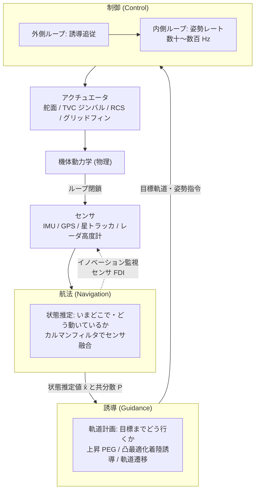

# アビオニクスと GNC (Avionics & GNC: Flight Computers, Fault Tolerance, Guidance)

## 概要 (Overview)

**アビオニクス (avionics, aviation electronics)** は、飛行を成立させる電子機器（飛行制御計算機、センサ、アクチュエータ駆動、データバス、通信）の総称であり、**GNC (Guidance, Navigation and Control, 誘導・航法・制御)** はその上で走る「機体をどこへ・どう動かすか」のソフトウェアである。

この領域を貫くテーマは一つ: **止まることが許されない計算機をどう作るか**。フライバイワイヤ (fly-by-wire) の旅客機では、操縦桿と舵面の間に機械的な繋がりはなく、飛行制御計算機が止まれば操縦そのものが失われる。ロケットは数分の飛行中に計算機が止まれば機体もミッションも失う。ゆえにアビオニクスは、フォールトトレランス (fault tolerance) の工学が最も早く・最も徹底して発達した分野であり、車載の機能安全 ([`../automotive/functional-safety-iso26262.md`](../automotive/functional-safety-iso26262.md)) が範とした**先行者**である。

本ドキュメントは、(1) GNC ループの構造（状態推定・軌道計画・追従制御）、(2) 冗長化とフォールトトレランスの設計空間、(3) 歴史的実例（Apollo AGC、Space Shuttle、Boeing 777、Airbus A320、SpaceX Falcon 9）の設計判断、(4) 航空宇宙データバスと開発保証 (DO-178C) を、ソフトエンジニアの視点で整理する。分析深度は Level 3。

## 方法論 (Methodology)

- GNC を「**航法 (Navigation)** = いまどこで・どう動いているかの推定 → **誘導 (Guidance)** = 目標までどう行くかの計画 → **制御 (Control)** = 計画への追従」という3層ループに分解する。
- フォールトトレランスを「**何重にするか × 同種か非相似か × どう裁定するか**」の設計空間として定式化し、実機のアーキテクチャをこの空間上の点として位置づける。
- 実例は一次資料（査読論文、NASA 史料、設計者自身の解説）に基づき、典拠を参考文献に示す。
- 航空（型式証明と数十年運用の世界）と宇宙（質量・電力・放射線制約の世界）を対比し、同じ原理が異なる制約下で異なる解になることを示す。

## 発見事項 (Findings)

1. **航法の本質は「信じられないセンサから状態を推定し続ける」こと。** IMU は誤差が積分されてドリフトし、GPS は低頻度で妨害されうる。単独で信頼できるセンサは存在せず、各センサを「どれだけ信じるか」を不確かさとして明示的に扱う**カルマンフィルタによる融合**が、航法の核心にある。
2. **フォールトトレランスの単位は「多数決できる最小構成」。** 2重化は不一致の検出しかできない（どちらが正しいか裁定できない）。3重化 (2oo3) で初めて故障をマスクして継続できる。故障ノードが「相手によって違う嘘をつく」Byzantine 故障まで想定するなら、f 故障に 3f+1 台が必要になる。Shuttle の4台同期構成はこの理論の実装である。
3. **同一設計の N 重化は設計バグ (systematic fault) に無力。** 同じソフトのコピーは同じ入力で同じ誤りを犯す。777 は各計算機内に**非相似の3レーン**（別ベンダの CPU・別コンパイラ）、A320 は**別ハード・別チーム開発**の計算機系列、Shuttle は**独立開発のバックアップソフト (BFS)** を持つ。いずれも多様性 (dissimilarity) で系統故障を防ぐ。ISO 26262 の ASIL 分解が要求する「独立性」と同根の思想である。
4. **宇宙では放射線が故障モデルを支配し、その対処が経済設計になる。** 耐放射線 (rad-hard) プロセッサは高価で性能も1世代以上遅い。Falcon 9 は民生 (COTS) x86 を3系統×2コアで多数決させ、「安い部品×アーキテクチャ冗長」で放射線耐性を買った。故障モデルに対するコスト最適化という設計判断である。
5. **データバスの決定性は安全設計の一部。** MIL-STD-1553（コマンド/レスポンス）→ ARINC 429（単方向）→ AFDX（帯域保証付きスイッチド Ethernet）という進化は、車載の CAN → Automotive Ethernet/TSN と同じ「決定性 vs 帯域」の構造を30年先行して辿っている。
6. **フォールトトレランスはハードだけの話ではない。** Apollo 11 着陸中の 1201/1202 アラームは、過負荷時に低優先度タスクを捨てて必須機能だけ継続する AGC の実行制御 (Executive) が着陸を救った事例であり、「落ちても・溢れても正しく続く」**ソフトウェアアーキテクチャ**がもう一つの柱である。

## アーキテクチャ (Architecture)

### GNC ループの全体像



凡例: 実線は信号の流れ、破線は故障検出 (FDI) のための監視経路。航法は推定理論（[`../../foundations/mathematics/probability-statistics/estimation-hypothesis-testing.md`](../../foundations/mathematics/probability-statistics/estimation-hypothesis-testing.md)）、誘導は最適化（[`../../foundations/mathematics/optimization/convex-optimization-duality.md`](../../foundations/mathematics/optimization/convex-optimization-duality.md)）、制御と機体動力学は常微分方程式の安定性（[`../../foundations/mathematics/calculus-analysis/ordinary-differential-equations.md`](../../foundations/mathematics/calculus-analysis/ordinary-differential-equations.md)）を理論的基礎とする。

各層の時間スケールは分業されている: 内側の姿勢制御は数十〜数百 Hz、誘導の再計画は 1〜10 Hz 級、航法はセンサ依存（IMU は数百 Hz〜kHz、GPS は 1〜10 Hz）。**速いループほど内側で閉じる**構造は、電力系統の階層制御（[`../energy/generation-grid-fundamentals.md`](../energy/generation-grid-fundamentals.md)）や車載と共通の設計原則である。

### 冗長設計の設計空間

| 構成 | 裁定方式 | 故障時の挙動 | 実例 |
|---|---|---|---|
| 単系＋ウォッチドッグ | 自己診断 | 既知状態へ再起動（セーフモード） | 深宇宙探査機の平常時 |
| **2重 (dual)** | 相互比較 | 不一致を**検出**できるが裁定不能 → 自らを切り離す (fail-silent) | A320 の COM/MON ペア |
| **3重 (TMR / 2oo3)** | 多数決 | 1故障を**マスクして継続** (fail-operational) | 777 PFC、Falcon 9 の3ストリング |
| **4重＋** | 同期多数決 | Byzantine 故障1つまで継続 | Shuttle PASS ×4 |

冗長構成の信頼度（N 重系・k-out-of-n 系の確率計算）は [`../../foundations/mathematics/probability-statistics/reliability-theory.md`](../../foundations/mathematics/probability-statistics/reliability-theory.md) で扱う。これに直交する軸が**相似 (similar) / 非相似 (dissimilar)**: ランダムなハード故障は同一設計のコピーで受けられるが、設計・実装のバグには別 CPU・別コンパイラ・別チームという多様性が要る。実機はこの2軸を組み合わせる。

### 実例アーキテクチャ — 4つの解

#### Space Shuttle — 4＋1 と Byzantine 障害 (1981)

- 汎用計算機 **GPC (IBM AP-101) を5台**搭載。うち**4台が同一ソフトウェア (PASS) を同期実行**して相互監視・多数決し、上昇・再突入という致命フェーズで 1 故障をマスクする。
- 4台という数は Byzantine 障害の理論（f=1 に 3f+1=4）に対応する。同期した計算機group では「故障機が相手ごとに違う値を送る」故障まで考慮する必要があることを、Shuttle 開発は実務として確立した。
- **5台目は BFS (Backup Flight System)**。別会社が独立開発したソフトウェアを載せ、PASS の共通モード（ソフトバグ）に備える非相似冗長。幸い実飛行で BFS への切替が必要になったことはない。

#### Boeing 777 — Triple-Triple (1995)

- **PFC (Primary Flight Computer) 3台**、各 PFC 内部に**非相似の3レーン** (AMD 29050 / Motorola 68040 / Intel 80486) が同じ計算を実行して照合する、3×3 の二層構成。
- チャネル間（3台の PFC）は同一設計＝ランダム故障を多数決で受け、レーン内の非相似＝CPU・コンパイラ起因の系統故障を受ける。**2種類の故障モードに2つの直交する冗長軸**を当てた教科書的設計。
- 通信 (ARINC 629 ×3系統)・電源・油圧も3系統。冗長は計算機だけでは完結せず、**共通原因（電源・バス・物理配置）まで断つ**必要がある。

#### Airbus A320系 — fail-silent の集合で fail-op を作る (1988)

- 飛行制御計算機は **ELAC ×2 ＋ SEC ×3**（＋FAC ×2）。各計算機は**コマンド/モニタ (COM/MON) の2プロセッサペア**で、両者が不一致なら計算機自身が黙って切り離される (fail-silent)。
- ELAC と SEC は**別ハードウェア・別ソフトウェア（独立チーム開発）** の非相似構成。計算機が1台ずつ死んでも制御則を Normal → Alternate → Direct と**段階的に縮退 (graceful degradation)** させ、最後は機械的なトリム操作まで残す。
- 思想: 「各箱は疑わしければ黙る。箱が多数あるから系全体は飛び続ける」。多数決を箱の内側（ペア比較）に押し込み、箱の外は冗長台数と縮退則で受ける。

#### SpaceX Falcon 9 — COTS ×アーキテクチャ冗長 (2010)

- **3系統 (string) × 各2コアの民生 x86**、OS は Linux、フライトソフトは C++。string 内の2コアが同一計算を照合し、不一致ならその string は指令を出さない (fail-silent)。健全な string 群の指令をエンジン・グリッドフィン等の末端マイコンが受け、**マイコン側でも3系統の指令を多数決**する。
- 放射線対策: 高価な rad-hard CPU を使わず、SEU（放射線によるビット反転）は「string 間不一致 → 当該 string の再同期・復帰」で吸収する。**radiation-tolerant by architecture**。1 string だけでもミッション継続可能とされる。
- 成立条件: 打ち上げ機の飛行は数分〜数時間と短く、SEU の期待回数が小さい。数十年飛ぶ深宇宙探査機なら同じ解は選べない。**ミッション時間×放射線環境×予算が解を決める**。

### 航空と宇宙 — 同じ原理、違う制約

| | 民間航空 (777 / A320) | 宇宙 (Shuttle / Falcon 9 / 探査機) |
|---|---|---|
| 支配的制約 | 型式証明、数十年の運用・整備 | 質量・電力・放射線・コスト |
| 故障モデル | ランダム故障＋設計故障 | ＋ SEU/SEL（放射線起因） |
| 計算機の選択 | 認証された専用品 | rad-hard 専用品 or COTS＋冗長 |
| 故障時の要求 | 空中で継続必須 (fail-operational) | フェーズ依存: 上昇中は継続必須、巡航中の探査機は**セーフモード退避**が許される |

## 技術詳細 (Technical Details)

### 1. 航法 — 慣性航法とカルマンフィルタ

**慣性航法 (inertial navigation)** は IMU（ジャイロ＋加速度計）の出力を積分して姿勢・速度・位置を得る。外部に依存せず妨害不能だが、**誤差も一緒に積分されて際限なくドリフトする**。そこで GPS・星トラッカ・レーダ高度計などの外部基準で周期的に補正する。この融合を最適に行うのが**カルマンフィルタ (Kalman filter)** である。

```text
# 例示 (illustrative)。実装ではなく構造を示す。
# x̂: 状態推定値, P: 推定の不確かさ (共分散), Q/R: モデル/観測の不確かさ

predict (IMU レートで高頻度):
    x̂ ← f(x̂, u_imu)                    # 運動モデルで外挿
    P ← F·P·Fᵀ + Q                      # 不確かさは増えていく

update (GPS 等の観測が届いたとき):
    K ← P·Hᵀ·(H·P·Hᵀ + R)⁻¹             # カルマンゲイン: どちらをどれだけ信じるか
    x̂ ← x̂ + K·(z_obs − h(x̂))           # 予測と観測を重み付き融合
    P ← (I − K·H)·P                     # 不確かさは減る
```

本質は「**センサを信じる度合いを共分散という数値で明示的に持つ**」こと。副産物として、観測と予測の食い違い（イノベーション）が統計的にありえない大きさなら**そのセンサの故障を検出**できる。つまり推定器がセンサ FDI (Fault Detection and Isolation) を兼ねる。理論は Kalman (1960)、最初期の大規模実用が Apollo の航法である。

### 2. フォールトトレランスの理論 — 多数決の前提を疑う

- **2oo3 多数決**は、1台が任意の誤値を出しても残り2台で正しい出力を選べる。ただし成立条件がある: 3台が**同じ入力を同じタイミングで**受け取ること（入力一致, input congruency）と、出力を比較するための**同期**。
- **Byzantine 故障**: 故障ノードが「相手によって違う値を送る」ことを許すと、口頭メッセージのみでは f 故障の合意に **3f+1 台**が必要になる (Lamport, Shostak & Pease 1982)。センサ値の配布や同期そのものが Byzantine になりうる。
- 実務上の急所は多数決そのものではなく、**多数決の前提（入力配布・クロック同期・電源）を成立させる部分**にある。ここに単一障害点が残れば N 重化は見かけ倒しになる。これが 777 が電源・油圧・バスまで3重化した理由であり、ISO 26262 の共通原因故障分析と同じ問いである。

### 3. 誘導 — 上昇の PEG と着陸の凸最適化

- **上昇誘導**: 大気圏内は構造荷重制約から事前設計した重力ターン (gravity turn) に近い開ループ、大気圏外は **PEG (Powered Explicit Guidance)** 系の閉ループ誘導が「残り推進剤と目標軌道条件」から最適な推力方向を毎周期解き直す。Shuttle 以来の標準形。
- **着陸誘導 (powered descent guidance)**: 燃料最適な降下は、推力に**下限**がある（エンジンは深く絞れない）ため非凸の最適制御問題になる。**無損失凸化 (lossless convexification)** はこれを等価な凸問題 (SOCP) に変換できることを証明し (Açıkmeşe & Ploen 2007)、凸問題ゆえに**大域最適解へ有界時間で確実に収束**する内点法ソルバをオンボードで走らせる道を開いた。「必ず・時間内に・解ける」という保証が、やり直しのきかないホバスラング（[`spacex-reusability.md`](spacex-reusability.md)）を計算機に任せる根拠である (Blackmore 2016)。
- 運用形態は**逐次再計画**: 航法の推定が更新されるたびに残り軌道を解き直す、モデル予測制御 (MPC) 的なループ。誘導は「一度決めた軌道への固執」ではなく「最新の推定に対する再最適化」である。

### 4. 制御 — 内外ループ・ゲインスケジューリング・構造連成

- **内側ループ**（姿勢レート、数十〜数百 Hz）が機体を安定化し、**外側ループ**が誘導指令（姿勢角・加速度）に追従する。古典的にはフェーズごとに調整された PID＋フィルタ群。
- **ゲインスケジューリング**: 動圧・マッハ数・質量（燃料消費で刻々変わる）で機体の応答が大きく変わるため、飛行条件に応じて制御ゲインを切替・補間する。ロケットは1回の飛行で動圧ゼロ → max-Q → ゼロと環境が激変する。
- **アクチュエータの使い分け**: 舵面（航空）、TVC ジンバル（推力方向）、RCS スラスタ（動圧ゼロの宇宙空間・エンジン停止時）、グリッドフィン（再突入の高動圧域）。どの飛行条件でどの操舵権限 (control authority) が生きているかが制御設計の前提になる。
- **構造との連成**（振動モードの一般論は [`../../foundations/physics/classical-mechanics/newton-laws-oscillations.md`](../../foundations/physics/classical-mechanics/newton-laws-oscillations.md)）: 細長い機体は曲げ振動モード（ベンディングモード）を持ち、制御がこれを励振すると発散する。ノッチフィルタでモード周波数を避ける。制御ソフトの係数に**構造力学が焼き込まれる**箇所である。

### 5. 放射線とハードウェア

| 影響 | 内容 | 主対策 |
|---|---|---|
| **TID** (Total Ionizing Dose) | 累積線量による恒久劣化 | rad-hard プロセス、遮蔽 |
| **SEU** (Single Event Upset) | ビット反転（一過性） | ECC＋スクラビング、TMR、多数決冗長 |
| **SEL** (Single Event Latch-up) | 寄生サイリスタ点弧（破壊的になりうる） | 電流監視＋電源断リセット、SOI プロセス |

対策の選択肢は連続体をなす: **rad-hard 専用 CPU**（BAE RAD750: PowerPC 750 ベース ~200 MHz、Curiosity / Perseverance / JWST 等に搭載）、FPGA 内部の **TMR**、**ECC メモリ＋定期スクラビング**、**アーキテクチャ冗長**（Falcon 9 方式）、そして最後の受け皿としての**ウォッチドッグ＋既知状態への再起動**。深宇宙で数十年なら rad-hard、LEO で数分なら COTS 冗長であり、ミッションプロファイルが解を決める。

### 6. 航空宇宙データバス

| バス | 速度 | 方式 | 決定性の作り方 | 主な採用 |
|---|---|---|---|---|
| **ARINC 429** | 100 kbps | 単方向・1送信多受信 | 送信者が1つ（衝突が存在しない） | 従来民間機 |
| **MIL-STD-1553B** | 1 Mbps | バスコントローラ主導のコマンド/レスポンス、二重冗長 | 「BC しか話させない」 | 軍用機・多くの宇宙機 |
| **ARINC 629** | 2 Mbps | マルチマスタ | 時分割アクセス | 777 FBW |
| **AFDX (ARINC 664 p7)** | 100 Mbps | スイッチド Ethernet | Virtual Link ごとの帯域保証 (BAG) | A380 / 787 / A350 |
| **TTEthernet** | ~1 Gbps | 時刻同期スケジュール | 「時刻表で話す」 | Orion 宇宙船 |

決定性の実現方法が「一人しか話せない (1553)」→「帯域を予約する (AFDX)」→「時刻表に従う (TTE)」と進化してきた。車載 TSN ([`../automotive/automotive-ethernet-tsn.md`](../automotive/automotive-ethernet-tsn.md)) は AFDX/TTE の思想を IEEE 標準として一般化したものであり、車載ネットワークの系譜（CAN の調停 = [`../automotive/in-vehicle-networks.md`](../automotive/in-vehicle-networks.md)）と直接比較して読める。

### 7. 事例研究: Apollo AGC — ソフトウェアで生き残る

**AGC (Apollo Guidance Computer)** は 2K ワードの RAM と 36K ワードのコアロープ ROM、実行速度 ~85,000 命令/秒という、現代の目には極小の計算機で月着陸の GNC を担った。注目すべきはその実行制御である。

- **優先度付き非同期実行 (Executive)**: タスクは優先度付きで登録され、計算資源が尽きたら低優先度から捨てられる。
- **再起動保護 (restart protection)**: 主要タスクはチェックポイントから再開可能に書かれ、異常検出時は計算機ごと再起動して**既知の正しい状態から数百 ms で復帰**する。
- **Apollo 11 の 1201/1202 アラーム**: 着陸降下中、ランデブーレーダの設定ミスに起因する擬似ジョブが計算負荷を溢れさせた。Executive は低優先度タスクを捨て、再起動保護が必須タスク（降下誘導・制御）だけを回し続け、着陸は成功した (Eyles 2004)。

教訓: フォールトトレランスは冗長ハードの専有物ではない。**過負荷と再起動を「設計済みの状態」にしておくソフトウェアアーキテクチャ**（今日の RTOS の優先度スケジューリング、ウォッチドッグ→既知状態リブートの原型）が、1969年に月面で実証されていた。

## セキュリティ考察 (Security Considerations)

- **耐空セキュリティ標準**: 航空は安全 (DO-178C/ARP4761) と別軸で、意図的攻撃を扱う **DO-326A/ED-202A 系 (Airworthiness Security)** を持つ。ISO 26262 × ISO 21434 の車載の構図（[`../automotive/cybersecurity-iso21434.md`](../automotive/cybersecurity-iso21434.md)）は、この航空の枠組みに約10年遅れて対応したものと読める。
- **GNSS 妨害・偽装 (jamming / spoofing)**: 民間航空で現実の運用問題であり、紛争地域周辺で日常的に観測される。防御の基盤は本文の航法アーキテクチャそのもの、つまり**妨害不能な IMU を軸にした多センサ融合**と、イノベーション監視による「ありえない観測」の棄却。GNC の正しさとセキュリティが同じ機構で守られる好例。
- **ADS-B は無認証ブロードキャスト**: 航空機の位置放送 (ADS-B) は認証を持たず、偽トラフィックの注入が構造的に可能。CAN と同型の「単純さ・相互運用性のための無認証」であり、監視側の多元照合（レーダ・マルチラテレーション）で補う。
- **宇宙機のコマンドリンク**: 地上局からのコマンドが無認証なら衛星の乗っ取りが成立する。CCSDS の **SDLS (Space Data Link Security)** がリンク層の認証・暗号を標準化しており、商用衛星でも採用が進む。
- **ドメイン分離**: 客室系（IFE・機内 Wi-Fi）と飛行制御系の分離は、車載のインフォテインメント/制御系分離と同じ原則。COTS 部品・ソフトの採用拡大（Falcon 9 の Linux はその象徴）は、サプライチェーン検証という新しい宿題を伴う。

## 結論 (Conclusions)

- GNC は「推定（航法）→ 計画（誘導）→ 追従（制御）」のループであり、核心は不完全なセンサからの状態推定にある。カルマンフィルタは融合と故障検出を同じ枠組みで与える。
- フォールトトレランスは設計空間である: 多数決の最小単位 (2oo3)、Byzantine を考えるなら 3f+1、設計故障には非相似。Shuttle・777・A320・Falcon 9 はこの空間の異なる最適点であり、**証明・質量・放射線・コストという制約が解の位置を決める**。
- Falcon 9 は「COTS ×アーキテクチャ冗長」で放射線耐性を経済的に解き、着陸誘導は無損失凸化により「必ず時間内に解ける」問題へ翻訳された。理論（Byzantine、凸最適化）が飛行機体の設計判断に直結する分野である。
- ソフトウェアアーキテクチャ（優先度実行・再起動保護）もフォールトトレランスの柱であり、その原点は Apollo AGC にある。
- 車載の機能安全・セキュリティ・TSN は、本ドキュメントの航空宇宙の系譜を大衆価格帯へ移植したものと位置づけられる。両分野を往復して読むことで、「止まれないシステム」の設計原理が制約非依存の形で見えてくる。

### 次の接続先 (Related Topics)

- [`spacex-reusability.md`](spacex-reusability.md) — 凸最適化着陸誘導の応用先（ホバスラングの理論的中身）。
- [`orbital-mechanics.md`](orbital-mechanics.md) — 誘導が従う力学的基礎（Δv、軌道遷移）。
- [`range-safety-fts.md`](range-safety-fts.md) — 冗長計算機と fail-safe 設計の公衆安全への応用（AFSS）。
- [`../../foundations/mathematics/optimization/convex-optimization-duality.md`](../../foundations/mathematics/optimization/convex-optimization-duality.md) — 無損失凸化・内点法の数学的背景。
- [`../../foundations/mathematics/probability-statistics/reliability-theory.md`](../../foundations/mathematics/probability-statistics/reliability-theory.md) — 冗長系の信頼度計算。
- [`../automotive/functional-safety-iso26262.md`](../automotive/functional-safety-iso26262.md) — 同じ思想の車載版。ASIL 分解の独立性 ↔ 非相似冗長、ロックステップコア ↔ COM/MON ペア。
- [`../automotive/automotive-ethernet-tsn.md`](../automotive/automotive-ethernet-tsn.md) — AFDX/TTEthernet の思想の車載標準化 (TSN)。
- [`../automotive/in-vehicle-networks.md`](../automotive/in-vehicle-networks.md) — バスの決定性設計の系譜比較 (CAN ↔ 1553)。

## 参考文献 (References)

**一次資料 (Primary — 査読論文・史料・設計者解説)**

- Yeh, Y. C. (1996). Triple-triple redundant 777 primary flight computer. *IEEE Aerospace Applications Conference*, 293–307. DOI: 10.1109/AERO.1996.495891 — [IEEE Xplore](https://ieeexplore.ieee.org/document/495891/) — Accessed: 2026-07-02。777 の 3×3 構成・非相似レーン・ARINC 629 の一次資料。
- Lamport, L., Shostak, R., & Pease, M. (1982). The Byzantine Generals Problem. *ACM TOPLAS*, 4(3), 382–401. DOI: 10.1145/357172.357176 — 3f+1 の原典。
- Kalman, R. E. (1960). A New Approach to Linear Filtering and Prediction Problems. *Journal of Basic Engineering*, 82(1), 35–45. DOI: 10.1115/1.3662552 — カルマンフィルタの原典。
- Açıkmeşe, B., & Ploen, S. R. (2007). Convex Programming Approach to Powered Descent Guidance for Mars Landing. *Journal of Guidance, Control, and Dynamics*, 30(5), 1353–1366. DOI: 10.2514/1.27553 — 無損失凸化の原典。
- Blackmore, L. (2016). Autonomous Precision Landing of Space Rockets. *The Bridge* (National Academy of Engineering), 46(4), 15–20. — [PDF](http://www.larsblackmore.com/nae_bridge_2016.pdf) — Accessed: 2026-07-02。Falcon 9 着陸誘導の設計者自身による解説。
- Traverse, P., Lacaze, I., & Souyris, J. (2004). Airbus Fly-By-Wire: A Total Approach to Dependability. *IFIP World Computer Congress*. — A320 系の COM/MON・非相似設計の一次解説。
- Tomayko, J. E. (1988). *Computers in Spaceflight: The NASA Experience* (NASA CR-182505). — [NASA History](https://history.nasa.gov/computers/contents.html) — Accessed: 2026-07-02。Shuttle GPC/BFS・AGC の公式史料。
- Eyles, D. (2004). Tales from the Lunar Module Guidance Computer. *AAS Guidance and Control Conference*. — [doneyles.com](https://www.doneyles.com/LM/Tales.html) — Accessed: 2026-07-02。1201/1202 アラームの当事者（LM 降下ソフト開発者）による一次解説。
- RTCA DO-178C, *Software Considerations in Airborne Systems and Equipment Certification* ／ DO-254（ハードウェア）／ SAE ARP4754A（システム開発保証）／ RTCA DO-326A（耐空セキュリティ）。開発保証の規範（有償規格のため本文は概要に基づく）。
- MIL-STD-1553B ／ ARINC 429 / 629 / 664 Part 7 (AFDX)。バス仕様の規範。

**二次資料 (Secondary)**

- SpaceX ソフトウェアチーム Reddit AMA (2013). *We are SpaceX Software Engineers — We Launch Rockets into Space*. — [reddit.com](https://www.reddit.com/r/IAmA/comments/1853ap/we_are_spacex_software_engineers_we_launch/) — Accessed: 2026-07-02。3系統×2コア x86・Linux・C++ という Falcon 9 計算機構成の開発者自身の発言（一次性の高い二次資料として扱う）。
