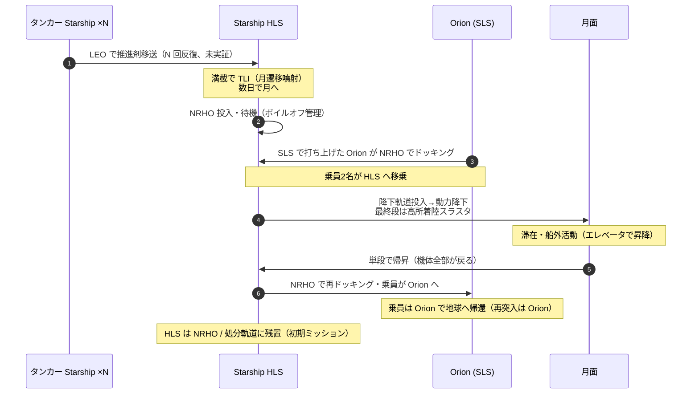

# HLS と月着陸アーキテクチャ (Starship HLS & the Lunar Landing Architecture)

## 概要 (Overview)

NASA の **Artemis 計画**は、半世紀ぶりに人間を月面へ降ろす着陸機として、SpaceX の **Starship HLS (Human Landing System)** を選定した（2021年、固定価格 $2.89B）[^selection]。この選定は単なる調達ではなく、**月着陸のアーキテクチャそのものの転換**を意味する。Apollo が「使い捨ての専用最小機 (LM) を1回の打ち上げで送り込む」設計だったのに対し、Artemis/HLS は「**軌道上給油で満たした汎用大型機**を月へ送る」設計である。これは、質量を極限まで削る工学から、質量を打ち上げ頻度で安く買う工学への転換である。

> **計画状況 (as of 2026-10)**: Artemis II（Orion による有人月フライバイ）は2026年4月10日に太平洋へ着水して成功した[^artemis2]。NASA は2026年2月27日に Artemis III を**月着陸から LEO での実証ミッションへ再編**し、2027年に Orion と商業着陸機（SpaceX Starship HLS と Blue Origin Blue Moon Mk2 の一方または両方）のランデブー・ドッキングを試験する。Starship 側は機首にドッキング機構を付けた V3 試験機で操縦性・通信を評価し、**乗員は Starship には入らない**（Blue Moon には最大2名が入る）。**初の有人月着陸は Artemis IV（2028年前半目標）**に移った[^artemis3][^hls-test]。以下の分析は「HLS が月面へ乗員を降ろすミッション」を対象とし、これは Artemis IV 以降の構成に相当する。

本ドキュメントは、この往還の全体構造（LEO 給油キャンペーン、**NRHO (近直線ハロー軌道)** での Orion とのランデブー、月面への降下と帰昇）を Δv 収支として整理し、HLS 機体固有の設計（TPS もフラップも持たない真空専用機、高所配置の着陸スラスタ、エレベータ）を分析する。あわせて、Apollo LM との対比でアーキテクチャの得失を評価し、計画リスク（給油回数の感度、実証の律速）を独立報告書に基づいて扱う。分析深度は Level 3。

> 前提: Δv 収支の最適化（制約付き最小化）の数学は [`../../foundations/mathematics/optimization/convex-optimization-duality.md`](../../foundations/mathematics/optimization/convex-optimization-duality.md)、ロケット方程式の背後にある運動方程式は [`../../foundations/physics/classical-mechanics/newton-laws-oscillations.md`](../../foundations/physics/classical-mechanics/newton-laws-oscillations.md)。軌道上推進剤移送の流体工学は [`propellant-fluid-systems.md`](propellant-fluid-systems.md)、Δv とホーマン遷移は [`orbital-mechanics.md`](orbital-mechanics.md)、機体側は [`spacex-starship-superheavy.md`](spacex-starship-superheavy.md)。

## 方法論 (Methodology)

- ミッションを**フェーズ分解**（LEO 給油→月遷移→NRHO→降下→月面→帰昇）し、各フェーズの Δv・推進剤・機体状態を追う。
- HLS 固有の設計変更を「地球再突入を捨てた真空専用機」という一点から逆算して説明する。
- Apollo LM を対照群として、最小化アーキテクチャと給油アーキテクチャの得失を比較する。
- 計画状態は NASA 公式・選定文書 (Source Selection Statement)・GAO/OIG の独立報告を典拠とし、目標値と実証済みを区別する（本リポジトリの Source Hierarchy 方針）。

## 発見事項 (Findings)

1. **アーキテクチャの核心は「質量の価格改定」。** Apollo は 1 kg を月面に置くために設計の全てを切り詰めた。HLS は「LEO への輸送が安く高頻度なら、月着陸機は巨大でよい」と割り切る。タンカー N 機分の打ち上げコストと引き換えに、月面ペイロード・居住容積・再使用性を桁で買う[^selection]。
2. **HLS は Starship の「引き算」変種である。** 地球再突入をしないため、**耐熱タイルもフラップも持たない**（[`reentry-thermal-protection.md`](reentry-thermal-protection.md) の系をまるごと削除）。浮いた質量と複雑さが、月面用装備（着陸脚、エレベータ、キャビン）に振り替わる[^hls-nasa]。
3. **着陸の最終段は「上に付けたスラスタ」で降りる。** Raptor の巨大推力を月面直上で使うと、排気が**レゴリスを掘削し噴石を飛ばす** (plume-surface interaction)。HLS は機体上部側面に中規模の着陸スラスタ群を配し、最終降下を高所からの噴射で行う計画である。これは月面という「射点なき着陸」への固有解である[^hls-nasa]。
4. **NRHO は「物理と政治の妥協軌道」。** Orion (SLS) の Δv 能力は低月軌道 (LLO) への往復に足りない。地球からの可視性・熱環境・軌道維持コストに優れる **NRHO** をランデブー点に置くことで、Orion の制約と着陸機側の Δv 負担増を交換した。これは**着陸機が余分に働く**構図であり、給油で質量が安い HLS だから成立する[^nrho]。
5. **乗員は往復とも Orion に乗る。** 有人着陸ミッション（Artemis III の再編後は Artemis IV 以降）では、乗員の地球発着（上昇・再突入）は Orion が担い、HLS は **NRHO↔月面**だけを運ぶ。Starship の有人認定問題（[`crewed-starship.md`](crewed-starship.md)）のうち最難関の「地球からの上昇アボート」「地球再突入」を、初の有人運用から**切り離した**リスク配分になっている。
6. **律速は着陸機の性能ではなく給油である。** 必要タンカー数はボイルオフ・搭載量・滞在期間に敏感で、公的レビューは1桁台後半〜16機程度の幅を報告する[^gao]。機体間移送は as of 2026-10 で未実証かつ実施日未定であり（[`propellant-fluid-systems.md`](propellant-fluid-systems.md)）、GAO/OIG は一貫して給油実証をクリティカルパスに挙げる[^gao][^oig-26]。
7. **Apollo の鏡像としての「余裕」。** LM は乗員2名・月面滞在3日・与圧容積 6.7 m³ の極限設計だった。HLS は桁違いの容積・ペイロードを持ち、その「余裕」は安全余裕（消耗品・冗長）と月面インフラ輸送能力に転化する。これが、月を「訪れる」から「滞在する」への計画目標の物理的な裏付けである[^hls-nasa]。

## アーキテクチャ (Architecture)

### 往還の全体構造 (Mission Profile)

有人着陸ミッション（Artemis IV 以降の想定構成）の往還を、機体間のやり取りとして示す。



凡例: 実線矢印は機体間の移動・移送、Note は機体内の運用。推進剤移送の詳細は [`propellant-fluid-systems.md`](propellant-fluid-systems.md)、Δv の一般論は [`orbital-mechanics.md`](orbital-mechanics.md)。

### Δv 収支の骨格 (Δv Structure)

| 区間 | Δv (概算) | 備考 |
|---|---|---|
| LEO → TLI | ~3.1–3.2 km/s | 給油後の HLS が自力で実行（Apollo は Saturn V 第3段が担当） |
| TLI → NRHO | ~0.4–0.9 km/s | 経路により幅。LLO 投入 (~0.8–0.9) と同程度かやや低い |
| NRHO → 月面（降下） | **~2.6–2.8 km/s** | LLO からの降下 (~2.0) より大きい。NRHO の代償を着陸機が払う |
| 月面 → NRHO（帰昇） | ~2.6–2.8 km/s | 同上。往復で LLO 案より ~1 km/s 級余分 |

- **要点**: NRHO 案は着陸機の往復 Δv を数割増やす。Apollo 型の質量最小設計なら致命的な負担だが、「給油で質量が安い」HLS では許容できる。つまり、**軌道選択とアーキテクチャ選択が互いを正当化し合っている**[^nrho]。

### Apollo LM との対比 (LM vs HLS)

| 観点 | Apollo LM | Starship HLS |
|---|---|---|
| 設計思想 | **最小化**（1 kg を削る） | **給油前提の大型汎用機** |
| 打ち上げ | Saturn V 1機に同梱 | 本体1機＋タンカー N 機のキャンペーン |
| 段構成 | 2段（降下段を月面に残置） | **単段往復**（機体全部が帰昇） |
| 与圧容積 | 6.7 m³（乗員2・3日） | 桁違いに大（乗員2〜・長期滞在目標） |
| 月面ペイロード | ~0.5 t 級（装備・試料） | 数十 t 級目標（インフラ輸送を視野） |
| 乗降 | 梯子（数 m） | **エレベータ**（ハッチ高さ数十 m） |
| アボート | 降下中いつでも帰昇段で中断可 | 単段ゆえエンジン再点火での中断。設計の要検証点 |
| 実績 | 6回着陸・6回帰昇（1969–72） | 未飛行（無人実証着陸が先行要求。SpaceX は2027年3月の無人月ミッションを目標と表明、as of 2026-10）[^gao][^nbc-moon] |

## 技術詳細 (Technical Details)

### 真空専用機という引き算 (The Vacuum-Only Variant)

HLS は Starship から「地球へ帰る能力」を引き算した機体である。

- **削除**: 耐熱タイル（~1万枚超）、前後フラップ、ベリーフロップ用の空力設計、ヘッダタンクの着陸フリップ要件。[`reentry-thermal-protection.md`](reentry-thermal-protection.md) で見た上段再使用の最難関系を**問題ごと消す**。
- **追加**: 着陸脚（不整地・傾斜への対応）、高所着陸スラスタ群、乗員キャビンと ECLSS（[`dragon-spacecraft.md`](dragon-spacecraft.md) の系の長期滞在版）、月面昇降エレベータ、Orion/Gateway とのドッキング系 (IDSS 系)。
- **熱の逆問題**: 再突入熱はなくなるが、**推進剤の長期保温**が代わりに立つ。月往還の数週間〜、メタン/LOX のボイルオフ管理（遮光・断熱・姿勢）が機体成立性を左右する。[`propellant-fluid-systems.md`](propellant-fluid-systems.md) の CFM がそのまま設計要求になる[^gao]。

### 月面着陸の固有問題 — 噴煙とレゴリス (Plume-Surface Interaction)

- **問題**: 月面は無大気で、エンジン排気は減衰せずレゴリスに衝突する。Apollo LM (~45 kN 級) でさえ着陸時に視界喪失・噴石を経験した。Raptor（~2,750 kN）を地表近くで使えば、クレータ掘削・噴石の軌道投入・機体自身への跳ね返りが起きうる。
- **HLS の解**: 最終降下を機体**上部**に配した中推力スラスタ群で行い、主エンジンは高度を残して停止する。噴射点を地表から離す（距離の2乗で圧力が減る）ことと、推力を分散することの合わせ技である[^hls-nasa]。
- **一般化**: 「射点なき天体への着陸」は、地上系 ([`launch-ground-systems.md`](launch-ground-systems.md)) が担っていた排気管理を**機体側が背負い直す**問題であり、月面基地が整備されるまでの過渡期の固有工学である。

### 給油キャンペーンの感度 (The Tanker Campaign)

必要タンカー数 N は次の変数に敏感である。

```
 N ≈ HLS が TLI までに使う推進剤量 ÷ タンカー1機の実効輸送量
     実効輸送量 = タンカー搭載量 − (ボイルオフ + 移送損失 + 残留)
```

- タンカー搭載量（機体世代 V2→V3 で増加予定）、貯蔵期間のボイルオフ率、移送効率のいずれも**未実証パラメータ**を含むため、公的レビューの見積もりは1桁台後半〜16機と幅を持つ[^gao]。
- **含意**: N はコストだけでなく**スケジュールの変数**でもある（N 機の打ち上げ×射点ターンアラウンド[`launch-ground-systems.md`](launch-ground-systems.md)）。給油の実証と高頻度化が、月着陸の日付を事実上決める。

### 選定の論理 — なぜ Starship だったか (The Source Selection)

NASA の選定文書は、HLS 案の評価として (1) 圧倒的なペイロード・容積の余裕、(2) 固定価格・企業側コスト分担、(3) 飛行実証を積む開発手法を挙げつつ、給油キャンペーンの複雑さをリスクとして明記した[^selection]。単独選定（当初）は予算制約の帰結でもあり、後に第2着陸機 (Blue Origin, 2023) が追加された。これにより、**着陸機の二重化**という Apollo にはなかった冗長がアーキテクチャに入ったことになる。さらに NASA は2025年10月、Starship の遅れを理由に Artemis III 着陸機の契約を競争に再び開くと表明し、2026年2月の再編では Artemis III を両着陸機の LEO 実証に充てた[^artemis3][^crs-artemis]。二重化は冗長であると同時に、スケジュール競争の手段にもなった。

## 計画リスク考察 (Programmatic Risk Considerations)

> 本分野の「セキュリティ考察」は、未飛行の計画では**リスクの所在の明示**として読み替える。

- **クリティカルパスは給油である**: GAO/OIG は一貫して、機体間極低温移送・長期貯蔵・高頻度打ち上げの実証を最大のスケジュールリスクに挙げる[^gao]。着陸そのものより「満タンにする」ことが難しいという構図は、[`propellant-fluid-systems.md`](propellant-fluid-systems.md) の結論の計画版である。
- **無人実証着陸が先行ゲート**: 有人着陸の前に無人の月面着陸実証が要求されており（SpaceX の目標は2027年3月、as of 2026-10）[^nbc-moon]、Starship 本体の飛行試験進捗（[`spacex-starship-superheavy.md`](spacex-starship-superheavy.md) の反復）と直列につながる。
- **アボートの設計検証**: 単段機の降下中断は「帰昇燃焼への即時切替」に依存する。Apollo の独立した帰昇段のような物理的分離はなく、この安全論証（エンジン冗長・スラスタ群の縮退能力）が有人認定の中心論点になる。これは [`crewed-starship.md`](crewed-starship.md) で扱う認定問題の月面版である。
- **再編の意味**: Artemis III の LEO 実証化は、Starship の有人運用リスクを「乗員が入らない操縦性・通信評価」まで縮め、有人着陸の前段にもう1段のゲートを挿入したと読める。給油と無人着陸の実証が Artemis IV（2028年前半目標）の日付を事実上決める構図は変わらない[^artemis3][^hls-test]。
- **本ドキュメントの賞味期限**: 計画値・機数・日付は流動的である。ここでは構造（Δv 収支・感度・リスクの所在）を主とし、個別数値は取得日付きの典拠に委ねる。

## 結論 (Conclusions)

Starship HLS は「より良い月着陸船」ではなく、**月着陸の前提の書き換え**である。Apollo が質量を削る工学の金字塔だったのに対し、HLS は「LEO までの質量は打ち上げ頻度で安くなった」という新しい前提から、大型・単段・給油前提の機体を導いた。NRHO という妥協軌道も、TPS を捨てた真空専用機も、上部着陸スラスタも、すべてこの前提転換の系である。

そして、この構想の成否は着陸の華やかな瞬間ではなく、N 機のタンカーを飛ばし、極低温推進剤を漏らさず移し、数週間保つという**地味な流体管理**にかかっている。本リポジトリのロケット分野を貫いてきた結論、「SpaceX のアーキテクチャは最終的に液体をどこにどの温度で置くかに収斂する」([`propellant-fluid-systems.md`](propellant-fluid-systems.md)) は、月着陸においてそのまま計画のクリティカルパスになった。

---

## 参考文献 (References)

> NASA 公式・選定文書と GAO/OIG の独立報告を一次資料とし、数値の幅と取得日を明示する。

**一次資料 (Primary — 公式・独立監査)**

[^selection]: NASA (2021). *Source Selection Statement — Human Landing System Option A* — HLS 選定の公式文書。評価（ペイロード余裕・固定価格）とリスク（給油キャンペーン）の明記。／ NASA プレスリリース *NASA Picks SpaceX to Land Next Americans on Moon* (2021-04-16)。

[^hls-nasa]: [NASA — Human Landing System / SpaceX Starship HLS](https://www.nasa.gov/humans-in-space/human-landing-system/) ／ [SpaceX — Starship HLS](https://www.spacex.com/) — 真空専用構成（TPS・フラップなし）、高所着陸スラスタ、エレベータ、乗員運用範囲 (NRHO↔月面)。Accessed: 2026-07-26.

[^gao]: U.S. GAO — Artemis/HLS 進捗報告書群 ／ NASA OIG — Artemis 監査報告書群 — 給油実証をクリティカルパスとする評価、タンカー機数見積もりの幅（1桁台後半〜16機）、無人実証着陸の先行要求。Accessed: 2026-07-26.

[^artemis3]: [NASA — Artemis III News and Updates](https://www.nasa.gov/artemis-iii-news-and-updates/) — Artemis III を2027年の LEO 実証ミッション（商業着陸機とのランデブー・ドッキング試験）に再編、初の有人月着陸は Artemis IV で2028年前半を目標（「2025年半ば以来不変」）。Accessed: 2026-10-04.

[^hls-test]: [NASA (2026-07-15). How NASA's Artemis III Lander Test Will Pave Way for Moon Landings](https://www.nasa.gov/directorates/esdmd/artemis-campaign-development-division/human-landing-system-program/how-nasas-artemis-iii-lander-test-will-pave-way-for-moon-landings/) — Starship V3（機首ドッキング機構付き）の操縦性・通信評価、Blue Moon Mk2 の ECLSS・アビオニクス評価、「乗員は Starship 試験機に入らない」。Accessed: 2026-10-04.

[^artemis2]: [NASA (2026-04-10). Artemis II Flight Day 10: Re-entry Live Updates](https://www.nasa.gov/blogs/missions/2026/04/10/artemis-ii-flight-day-10-re-entry-live-updates/) — Artemis II の太平洋着水（2026-04-10）。Accessed: 2026-10-04.

[^crs-artemis]: [Congressional Research Service — NASA's Artemis Program (IF11643)](https://www.congress.gov/crs-product/IF11643) — Artemis III 再編と着陸機調達の経緯の議会向け要約。Accessed: 2026-10-04.

[^oig-26]: NASA Office of Inspector General (2026-03-10). [*NASA's Management of the Human Landing System Contracts* (IG-26-004)](https://oig.nasa.gov/wp-content/uploads/2026/03/final-report-ig-26-004-nasas-management-of-the-human-landing-system-contracts.pdf) — p. 13: Starship の次の主要マイルストンである大規模な機体間 (vehicle-to-vehicle) 極低温推進剤移送試験は、2025年3月の予定から12か月遅れて2026年3月予定となった。HLS 計画は極低温推進剤移送の実証を、SpaceX が直面する最も重大な技術課題の一つとみなす。p. 5: Artemis III/IV に先立ち、10機超のタンカーで LEO の貯蔵デポへ推進剤を集積する運用構想。なお「as of 2026-10 で実施日は未公表」は、2026-10-12 時点で NASA・SpaceX の公式発表を確認できないことに基づく。Accessed: 2026-10-12.

**専門報道 (Specialist reporting)**

[^nbc-moon]: [NBC News — SpaceX prioritizes Moon before Mars, Musk says](https://www.nbcnews.com/science/space/spacex-prioritizes-moon-before-mars-musk-says-rcna258168) — 月優先への方針転換、2027年3月の無人月ミッション目標（企業側の目標値）。Accessed: 2026-10-04.

**技術解説 (Technical explainers)**

[^nrho]: [NASA — White Paper: Near-Rectilinear Halo Orbit for Artemis / Gateway](https://www.nasa.gov/) — NRHO 選定の根拠（Orion の Δv 制約、可視性、軌道維持コスト）と降下側の Δv 負担。Accessed: 2026-07-26.

**本リポジトリ内参照**

- [`propellant-fluid-systems.md`](propellant-fluid-systems.md) — 軌道上移送・ボイルオフ・CFM（本ドキュメントの技術的基礎）
- [`orbital-mechanics.md`](orbital-mechanics.md) — Δv 収支・遷移軌道の一般論
- [`spacex-starship-superheavy.md`](spacex-starship-superheavy.md) — 機体・飛行試験の進捗（無人実証の前提）
- [`crewed-starship.md`](crewed-starship.md) — アボートと有人認定（安全論証の側）
- [`dragon-spacecraft.md`](dragon-spacecraft.md) — ECLSS・ドッキング系の実績側
