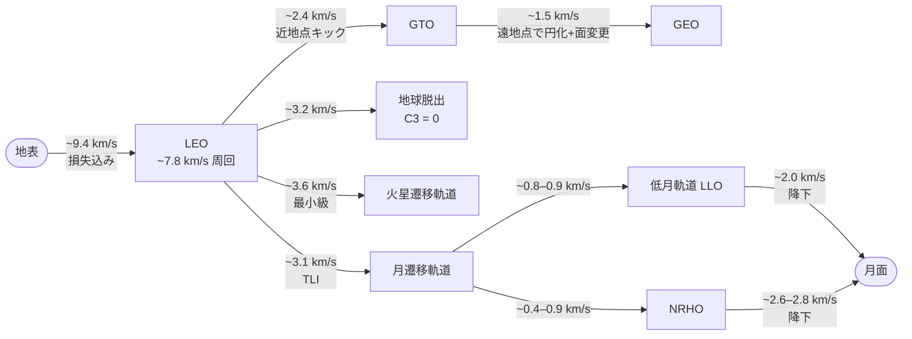

# 軌道力学の基礎 (Orbital Mechanics Fundamentals)

## 概要 (Overview)

ロケットエンジンがどれだけ高性能でも、「どこへ、どれだけの速度で運ぶか」を決めるのは**軌道力学 (orbital mechanics / astrodynamics)** である。軌道に乗るとは「高く上がる」ことではなく、**落ち続けても地面に当たらないだけの水平速度（低軌道で約 7.8 km/s）を得る**ことだ。そしてその速度を得る・変える・保つために必要な量はすべて、ただ一つの通貨である**Δv（速度増分, delta-v）** で測られる。

本ドキュメントは、SpaceX 3部作（[`spacex-rocket-engines.md`](spacex-rocket-engines.md) / [`spacex-reusability.md`](spacex-reusability.md) / [`spacex-starship-superheavy.md`](spacex-starship-superheavy.md)）の**物理的基礎**を与える。前章のエンジンが「Δv を生む装置」、再使用が「Δv を余分に払って機体を戻す行為」だったことを、軌道力学の側から定量的に裏づける。二体問題・ケプラー則・ヴィス・ヴィヴァ式から、Δv 収支・ホーマン遷移・打ち上げ損失までを Level 3 で扱う。

> 軌道力学は枯れた物理であり、本章の原理は標準的な天体力学の教科書（Curtis, Vallado, Bate–Mueller–White）を一次資料とする。リポジトリの出典方針（CLAUDE.md「Source Hierarchy」：原理は教科書/査読/標準を優先）に従う。

## 方法論 (Methodology)

- **二体問題 (two-body problem)** を出発点に、軌道が円錐曲線 (conic sections) になること（ケプラー）を押さえる。
- 軌道の速度とエネルギーを **ヴィス・ヴィヴァ式 (vis-viva equation)** で一本化し、軌道変更のコストを Δv として定量化する。
- 代表的な軌道変更（**ホーマン遷移・面変更**）の Δv を式で示し、「なぜ高軌道・軌道面変更が高価か」を説明する。
- **打ち上げ**を「水平速度の獲得」と捉え、重力損失・抗力損失・地球自転の利得を含めて、地表→LEO に約 9.4 km/s 要る理由を解く。
- **ツィオルコフスキー式**（[`spacex-rocket-engines.md`](spacex-rocket-engines.md)）と接続し、Δv 収支が**多段化**と**再使用のペイロード代償**をどう規定するかを示す。
- 数値は標準大気・地球（μ, R⊕）と教科書の代表値に基づき、桁感を優先する。

## 発見事項 (Findings)

1. **軌道とは「永遠の自由落下」である。** 物体は常に地球へ落ちているが、十分な水平速度があると地表の湾曲と同じだけ「外れ」続け、落ちながら回り続ける（ニュートンの大砲）。**鍵は高度ではなく水平速度**。
2. **Δv が宇宙の万能通貨。** 軌道へ行く・変える・戻るといった、あらゆる操作のコストは Δv で測られ、ツィオルコフスキー式 `Δv = Isp·g0·ln(m0/mf)` が Δv を推進剤量へ翻訳する。エンジンの Isp が Δv を左右するのはこのため。
3. **速度は軌道半径とエネルギーで決まる（ヴィス・ヴィヴァ）。** `v² = μ(2/r − 1/a)`。低い軌道ほど速く、高い軌道ほど遅い。直感に反するが、加速すると軌道が上がり**平均速度はむしろ下がる**。
4. **高い軌道への移動は二段階で安く済む（ホーマン）。** 近地点と遠地点で1回ずつ加速する2インパルス遷移が、同一面内では最も燃料効率が良い。
5. **軌道面の変更は極めて高価。** 面を Δi 変えるには `Δv = 2v·sin(Δi/2)`。LEO 速度7.8 km/s では 1°でも約136 m/s、30°なら約4 km/s になる。そのため、打ち上げ時に正しい傾斜角を取るのが鉄則。
6. **打ち上げの大半は「横向きに加速」する作業。** 高度100 kmまで上がる位置エネルギーは小さく、軌道速度7.8 km/sの運動エネルギーが主。重力・抗力・操舵損失を足して地表→LEO は約 **9.4 km/s** 必要。
7. **地球の自転と発射方位が影響する。** 赤道では自転で約465 m/s を「ただでもらえる」。**東向き・低緯度**の射場が有利（だから Cape Canaveral は東海岸、赤道射場が理想）。
8. **再使用は Δv を余分に払う行為。** ブーストバック・再突入・着陸の各バーン分の Δv が、本来ペイロードに使えた分を減らす。これが [`spacex-reusability.md`](spacex-reusability.md) の RTLS/ASDS トレードオフの正体である。

## アーキテクチャ (Architecture)

### 軌道は円錐曲線 (Orbits are Conic Sections)

二体問題の解は、軌道エネルギーに応じて4種の円錐曲線になる。

```
  離心率 e        軌道            束縛/非束縛
  ─────────────────────────────────────────
  e = 0          円 (circle)      束縛（閉軌道）
  0 < e < 1      楕円 (ellipse)   束縛（閉軌道）
  e = 1          放物線 (parabola) 脱出ぎりぎり
  e > 1          双曲線 (hyperbola) 非束縛（脱出/フライバイ）
```

`e=0` の円から `e→1` で楕円が細長くなり、`e=1`（放物線）で脱出速度、`e>1`（双曲線）で恒星間・惑星間フライバイ。地球周回はすべて円〜楕円（`e<1`）。

### 主な地球周回軌道 (Common Earth Orbits)

| 軌道 | 高度（代表） | 周期 | 用途 |
|---|---|---|---|
| **LEO** (低軌道) | ~200–2,000 km | ~90 min | Starlink、ISS、観測、Starship 主戦場 |
| **SSO** (太陽同期) | ~600–800 km, 傾斜~98° | ~100 min | 地球観測（同じ地方時で通過） |
| **MEO** (中軌道) | ~20,000 km | ~12 h | GPS/GNSS 測位衛星 |
| **GTO** (静止遷移) | 近地点~200 km / 遠地点~35,786 km | 楕円 | GEO への中継楕円軌道 |
| **GEO** (静止) | ~35,786 km, 傾斜~0° | 24 h | 通信・気象（地上から静止して見える） |

### Δv マップ（速度予算）(Delta-v Budget)

「どこへ行くにいくら払うか」の地図。代表値（地球, 損失込み）を示す。



凡例: 矢印の数値は片道の代表 Δv（教科書・NASA 資料の概算値で、経路・時期で幅がある）[^curtis][^nasa-bsf]。月関連の区間は [`hls-lunar-architecture.md`](hls-lunar-architecture.md) の Δv 表と整合させている。

- **地表→LEO の ~9.4 km/s** のうち、軌道速度 7.8 km/s が本体、残り ~1.5–2.0 km/s が**重力損失・抗力損失・操舵損失**（後述）[^wiesel][^curtis]。
- 高軌道・惑星間ほど Δv が積み上がり、**ツィオルコフスキー式の対数**ゆえに必要推進剤が急増する。これが**多段化**の動機である（[`spacex-rocket-engines.md`](spacex-rocket-engines.md)）。

## 技術詳細 (Technical Details)

### 二体問題と万有引力 (Two-Body Problem)

ニュートンの万有引力 `F = G·M·m/r²` のもと、衛星（質量 m ≪ M）の運動は**重力パラメータ `μ = G·M`**（地球で約 3.986×10⁵ km³/s²）だけで決まる[^vallado]。運動方程式 `r̈ = −μr/|r|³` は2階の非線形常微分方程式であり、その解法と保存量（エネルギー・角運動量）による次元削減の考え方は [`../../foundations/mathematics/calculus-analysis/ordinary-differential-equations.md`](../../foundations/mathematics/calculus-analysis/ordinary-differential-equations.md) と [`../../foundations/physics/classical-mechanics/newton-laws-oscillations.md`](../../foundations/physics/classical-mechanics/newton-laws-oscillations.md) で扱う。軌道の**比軌道エネルギー (specific orbital energy)** は次式で与えられる。

```
ε = v²/2 − μ/r = −μ/(2a)
```

`a` は軌道長半径 (semi-major axis)。`ε<0` なら束縛（円・楕円）、`ε=0` で放物線（脱出）、`ε>0` で双曲線。**エネルギーが軌道の大きさ `a` だけで決まる**点が要[^curtis][^bmw]。

### ケプラーの3法則 (Kepler's Laws)

1. **楕円軌道の法則**: 惑星（衛星）は焦点に中心天体を置く楕円を描く。
2. **面積速度一定**: 動径が単位時間に掃く面積は一定（近地点で速く、遠地点で遅い＝角運動量保存）。
3. **調和の法則**: 周期の2乗は長半径の3乗に比例、`T² = 4π²a³/μ`[^bmw]。

### ヴィス・ヴィヴァ式 — 速度の支配方程式 (Vis-viva)

任意の軌道点での速度は次式で与えられる。

```
v² = μ · (2/r − 1/a)
```

| 状況 | 帰結 |
|---|---|
| 円軌道 (`r=a`) | `v = √(μ/r)`。低いほど速い（LEO 7.8、GEO 3.1 km/s） |
| 近地点 (`r` 最小) | 速度最大 |
| 遠地点 (`r` 最大) | 速度最小 |
| 脱出 (`a→∞`) | `v_esc = √(2μ/r)`。地表で約 **11.2 km/s** |

**反直感の核心**: 円軌道で加速すると `a` が増えて軌道が上がり、新しい（高い）円軌道では**前より遅くなる**。「速く回りたいなら低く、ゆっくりでよいなら高く」。

### 軌道要素 (Orbital Elements)

軌道を一意に決める6要素（古典的ケプラー要素）を示す。

| 要素 | 記号 | 意味 |
|---|---|---|
| 軌道長半径 | `a` | 軌道の大きさ（エネルギー） |
| 離心率 | `e` | 軌道の形（円〜楕円） |
| 軌道傾斜角 | `i` | 赤道面に対する傾き |
| 昇交点赤経 | `Ω` | 軌道面の向き（昇交点の経度） |
| 近地点引数 | `ω` | 楕円の向き（面内での近地点方向） |
| 真近点角 | `ν` | 軌道上の現在位置 |

`a, e` が軌道の「サイズと形」、`i, Ω, ω` が「向き」、`ν` が「いつ・どこに居るか」を表す。

### ホーマン遷移 — 同一面内の最安経路 (Hohmann Transfer)

低い円軌道（半径 `r1`）から高い円軌道（`r2`）へ、**近地点 `r1`・遠地点 `r2` の遷移楕円**を介して2回加速する。

```
   円軌道 r1 ──①近地点で加速 Δv1──▶ 遷移楕円 ──②遠地点で加速 Δv2──▶ 円軌道 r2
```

```
Δv1 = √(μ/r1)·(√(2r2/(r1+r2)) − 1)
Δv2 = √(μ/r2)·(1 − √(2r1/(r1+r2)))
Δv_total = Δv1 + Δv2
```

- ①で楕円に乗り（遠地点が `r2` まで届く）、②遠地点で円化する。**同一面内では最小 Δv の2インパルス解**[^curtis]。
- 半径比が約 **11.94 倍を超える**極端な遷移では、**バイ・エリプティック遷移 (bi-elliptic)**（一度 `r2` より外へ出てから戻る3インパルス）が逆に安くなる場合がある（15.58 倍を超えると中間遠地点によらず常に有利）[^vallado][^curtis]。
- GTO→GEO はこのホーマン的な「遠地点キック」で円化する典型。

### 軌道面変更はなぜ高価か (Plane Changes)

軌道傾斜角を `Δi` 変えるには、速度ベクトルの**向き**を変える必要があり、必要な Δv は次式になる。

```
Δv = 2·v·sin(Δi/2)
```

LEO 速度 `v≈7.8 km/s` では、`Δi=30°` で **約 4.0 km/s** となり、LEO 到達コストの半分近い[^curtis]。ゆえに次の指針が導かれる。

- 面変更は**速度の遅い高軌道（遠地点）** で行う方が安い（`v` が小さい）。
- **打ち上げ時に目標傾斜角へ直接入れる**のが基本（射場緯度が傾斜角の下限を決める）。SpaceX が極軌道を西海岸 Vandenberg から、低傾斜を Florida から上げるのはこのため。

### 打ち上げの Δv 収支 — 損失の正体 (Launch Losses)

地表→LEO に **約 9.4 km/s** 要るが、軌道速度は 7.8 km/s。差の ~1.5–2.0 km/s は3つの損失である。

| 損失 | 機構 | 抑え方 |
|---|---|---|
| **重力損失 (gravity loss)** | 上昇中、推力の一部が重力に抗するだけで横方向速度に変わらない | 高 T/W で素早く加速、早めに機体を傾ける**重力ターン (gravity turn)** |
| **抗力損失 (drag loss)** | 大気中の空気抵抗 | 最大動圧 (max-Q) で減速・整形、上層で加速 |
| **操舵損失 (steering loss)** | 推力方向を速度方向からずらす分 | 軌道設計で最小化 |

一方、**地球自転は利得**: 赤道で東向きに撃つと自転速度 約465 m/s（赤道半径 6,378 km ÷ 恒星日 86,164 s × 2π）を初速として得る[^vallado]。**東向き・低緯度**ほど有利で、これが射場立地と発射方位を決める。

### ツィオルコフスキー式との接続 — なぜ多段か (Why Staging)

Δv 収支（例: LEO まで ~9.4 km/s）を、ツィオルコフスキー式 `Δv = Isp·g0·ln(m0/mf)` で推進剤に翻訳すると、対数ゆえに**単段で大 Δv を出すには非現実的な質量比**が要る。そこで次の手段をとる。

- **多段化 (staging)**: 燃え終わったタンク・エンジンを途中で捨て、`mf` を実質的に小さく保つ。各段の Δv を足し合わせて総 Δv を稼ぐ。
- これが Falcon 9（2段）や Super Heavy + Starship（2段）の根本理由。**再使用はこの捨てるはずの段を回収する**営みであり、その代償（着陸用 Δv・脚・熱防護の重量）を払って `mf` を増やすトレードオフになる（[`spacex-reusability.md`](spacex-reusability.md) / [`spacex-starship-superheavy.md`](spacex-starship-superheavy.md)）。

### オーベルト効果 (Oberth Effect)

同じ Δv でも、**速度が速い（重力井戸の深い）ところで燃やす方が、得られる運動エネルギーが大きい**[^curtis]。運動エネルギーは `v²` に比例するため、近地点での加速が効率的。惑星間ミッションが「近地点キック」で脱出するのはこのため。再使用ロケットの着陸燃焼が低高度・低速で行われるのとは対照的に、加速は深い井戸の底で行うのが得。

## 運用・安全考察 (Operational & Safety Considerations)

> 本分野の「セキュリティ考察」を、軌道運用では**軌道環境の安全と運用制約**として読み替える。

| 論点 | 内容 | 対応 |
|---|---|---|
| **軌道デブリ (orbital debris)** | 使用済み機体・破片が高速で周回。衝突は連鎖（ケスラーシンドローム）を招く[^kessler] | 衝突回避マヌーバ、運用終了後の**deorbit/廃棄軌道**投入 |
| **衝突回避** | 接近予報に基づく軌道変更（Δv を消費） | 推進剤予算に回避分を確保、自律回避（Starlink 等） |
| **軌道保持 (station-keeping)** | 大気抵抗（LEO）・摂動（J2、月太陽引力、太陽輻射圧）で軌道が崩れる[^vallado] | 定期的な軌道保持バーン。寿命は搭載推進剤で律速 |
| **打ち上げ窓 (launch window)** | 目標軌道面・ランデブー相手の位相に合うタイミングのみ発射可 | 軌道面の歳差（J2）と相手位相から窓を算出 |
| **再突入の安全** | 廃棄機体の落下・残骸 | 制御再突入で海洋（南太平洋無人海域 等）へ誘導 |

これらはいずれも「**Δv 予算の一部を運用・安全に割く**」という形で設計に跳ね返る。推進剤は有限であり、軌道力学は打ち上げだけでなく運用寿命全体を規定する。

## 結論 (Conclusions)

軌道力学は、SpaceX 3部作を貫く **Δv という通貨**の理論的根拠を与える。軌道に乗るとは水平速度（LEO で 7.8 km/s）を得ることであり、その速度を得る・変える・保つコストはすべて Δv で測られ、ツィオルコフスキー式が推進剤量へ翻訳する。ヴィス・ヴィヴァ式は「低いほど速い」軌道速度を、ホーマン遷移と面変更式は「どの軌道変更がいくらか」を、打ち上げ損失は「地表→LEO になぜ 9.4 km/s 要るか」を説明する。

この基礎から、3部作の設計判断が一つの論理で読み直せる。

- **エンジン**（[`spacex-rocket-engines.md`](spacex-rocket-engines.md)）は **Isp を上げて同じ Δv を少ない推進剤で**出す装置であり、軌道力学が課す Δv 予算への回答である。
- **多段化と再使用**（[`spacex-reusability.md`](spacex-reusability.md)）は、対数の壁を**段を捨てる/回収する**ことで越える工夫であり、再使用は「着陸用 Δv と重量」を払って `mf` を増やすトレードオフ。
- **Starship**（[`spacex-starship-superheavy.md`](spacex-starship-superheavy.md)）は、その Δv 予算と完全再使用の両立を、ステンレス鋼・33基クラスタ・キャッチ着陸で取りに行く統合解。

次の自然な深掘りは、軌道へ運んだ後に**機体をどう自律制御するか（アビオニクス/GNC）**、あるいは**再突入の熱をどう凌ぐか（TPS）** である。いずれも本章の Δv と軌道の上に乗る応用層である。

---

## 参考文献 (References)

> 軌道力学の原理は枯れており、標準的な天体力学の教科書を一次資料とする（CLAUDE.md「Source Hierarchy」: 原理は教科書/査読/標準を優先）。

**一次資料 (Primary — 教科書・査読)**

[^curtis]: Curtis, H. D. (2020). *Orbital Mechanics for Engineering Students* (4th ed.). Butterworth-Heinemann. — 二体問題、ヴィス・ヴィヴァ式、ホーマン/バイ・エリプティック遷移、面変更、オーベルト効果、Δv の標準的導出。

[^vallado]: Vallado, D. A. (2013). *Fundamentals of Astrodynamics and Applications* (4th ed.). Microcosm Press. — 地球定数（μ, 赤道半径, 自転角速度）、摂動（J2 等）、軌道決定、運用（station-keeping, 打ち上げ窓）、遷移軌道の比較。

[^bmw]: Bate, R. R., Mueller, D. D., & White, J. E. (1971). *Fundamentals of Astrodynamics*. Dover. — 古典的名著。二体問題・ケプラー則・遷移軌道。

[^wiesel]: Wiesel, W. E. (2010). *Spaceflight Dynamics* (3rd ed.). Aphelion Press. — 打ち上げ力学と重力・抗力・操舵損失の扱い。

[^kessler]: Kessler, D. J., & Cour-Palais, B. G. (1978). Collision Frequency of Artificial Satellites: The Creation of a Debris Belt. *Journal of Geophysical Research*, 83(A6), 2637–2646. DOI: 10.1029/JA083iA06p02637 — 衝突連鎖（ケスラーシンドローム）の原典。

**補助 (Secondary — 数値・索引)**

[^nasa-bsf]: NASA, [*Basics of Space Flight*](https://science.nasa.gov/learn/basics-of-space-flight/) — 軌道・遷移・脱出の入門解説。Accessed: 2026-10-04.

- Karabeyoglu, A. [*AA284a Advanced Rocket Propulsion, Lecture 7: Launch Trajectories*](https://web.stanford.edu/~cantwell/AA284A_Course_Material/Karabeyoglu%20AA%20284A%20Lectures/AA284a_Lecture7.pdf). Stanford University 講義資料 — 地表→LEO の Δv 内訳の例（高度400 km、極軌道で地球自転の利得なし）: 軌道速度 7.67、位置エネルギー 0.47、重力損失 2.2、抗力損失 0.1、計 10.44 km/s。講義資料は、重力損失が飛行経路に依存し、抗力損失は小さいと明記している。本書の ~9.4 km/s は東向き打ち上げの代表値で、この例との差は地球自転の利得と、経路で変わる重力損失から生じる（一次は上記教科書を優先）。Accessed: 2026-10-12.

**本リポジトリ内参照**

- [`spacex-rocket-engines.md`](spacex-rocket-engines.md) — ツィオルコフスキー式・比推力・多段化の動機。
- [`spacex-reusability.md`](spacex-reusability.md) — 再使用の Δv 代償と RTLS/ASDS トレードオフ。
- [`spacex-starship-superheavy.md`](spacex-starship-superheavy.md) — 完全再使用と Δv 予算の両立。
- [`aircraft-engineering-fundamentals.md`](aircraft-engineering-fundamentals.md) — 航空機との差分（自前の酸化剤・推力支配）。
- [`hls-lunar-architecture.md`](hls-lunar-architecture.md) — NRHO と月往還の Δv 収支（本章の応用）。
- [`../../foundations/mathematics/calculus-analysis/ordinary-differential-equations.md`](../../foundations/mathematics/calculus-analysis/ordinary-differential-equations.md) — 二体問題の運動方程式（常微分方程式）。
- [`../../foundations/physics/classical-mechanics/newton-laws-oscillations.md`](../../foundations/physics/classical-mechanics/newton-laws-oscillations.md) — 万有引力・保存則の基礎。
- [`../../foundations/physics/classical-mechanics/central-force-kepler-orbits.md`](../../foundations/physics/classical-mechanics/central-force-kepler-orbits.md) — ケプラーの法則・ヴィス・ヴィヴァ式・脱出速度の導出、軌道要素と J2 摂動。
