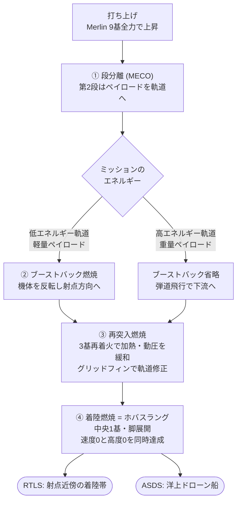

# Falcon 9 — 再使用性の工学 (Falcon 9: The Engineering of Reusability)

## 概要 (Overview)

ロケットの第1段は、打ち上げ機の中で最も高価な部品でありながら、従来は一度きりで海に捨てられてきた。SpaceX の **Falcon 9** は、その第1段を**飛行後に推進降下させ、垂直着陸させて回収・再使用**することで、この前提を覆した[^f9official]。Falcon ファミリーの第1段着陸成功は累計で **665/678（98.1%、as of 2026-10-02）** に達し[^wiki-f9]（2026年6月時点の集計では 630/643＝97.98%、再使用に特化した **Block 5** 機で 605/611＝99.02%[^techtimes-reuse]）、再使用は例外ではなく**標準運用**になった。2025年の165回の打ち上げのうち157回が再使用ブースタで[^techtimes-reuse]、2026年7月13日には再使用ブースタによる600回目の飛行を記録した[^sfn-600]。先頭機 **B1067** は2026年8月25日に単機 **37回目**の飛行・回収を達成し、これは同年100回目の Falcon 9 打ち上げでもあった（as of 2026-10）[^upi-b1067][^space-b1067][^boosters]。

本ドキュメントは、Falcon 9 の再使用を**着陸シーケンスの制御工学**として分解する。エンジンの深いスロットリング・再着火（前章 [`spacex-rocket-engines.md`](spacex-rocket-engines.md)）が、グリッドフィン・着陸脚・誘導制御とどう協調して垂直着陸を成立させるか。そして再使用が**経済**に何をもたらしたかを、査読研究を交えて評価する。分析深度は Level 3。

## 方法論 (Methodology)

- 第1段の帰還を**飛行フェーズ（分離→ブーストバック→再突入→着陸）** に分解し、各フェーズで「何を制御し、何が難所か」を特定する。
- 着陸に必要な**4要素**を対応づける。4要素とは、(1) 深いスロットリングと再着火（推進）、(2) グリッドフィンによる空力制御、(3) 推力ベクタ制御 (TVC) による姿勢、(4) 誘導 (GNC) の精度である。
- **RTLS（射点帰還）と ASDS（ドローン船着艦）** を、Δv コストとペイロード代償のトレードオフとして比較する。
- 再使用の**経済性**を、公表値と査読研究（再使用が成立する打ち上げ頻度の閾値、コスト/kg）で裏づける。
- 数値は SpaceX 公式・報道・査読論文に基づき、典拠を脚注に付す。

## 発見事項 (Findings)

1. **垂直着陸は「推力＞重量」を逆手に取った制御問題。** ロケットは T/W>1 ゆえにホバリングできない。減速しきると同時に速度ゼロ・高度ゼロに到達させる**ホバスラング (hoverslam / suicide burn)** で着地する。時間的余裕のないワンショット制御である。
2. **再着火とスロットリングが着陸を可能にした。** Merlin が深く絞れて複数回再着火できることが、ブーストバック・再突入・着陸の3バーンを成立させる前提（[`spacex-rocket-engines.md`](spacex-rocket-engines.md) 参照）。
3. **空力制御は「グリッドフィン」が担う。** 超音速〜遷音速で機能するチタン製の格子翼が、再突入中の機体を射点／着船点へ誘導する。
4. **着陸地点の選択がペイロードを左右する。** 射点へ戻る RTLS は燃料（＝ペイロード）を多く消費し、洋上のドローン船 ASDS は Δv を節約できる。高エネルギー軌道ほど ASDS になる。
5. **再使用は「設計の問題」だった。** Block 5 は再使用前提（耐熱、整備性、寿命）で再設計され、着陸成功率を 99% 級へ押し上げた[^techtimes-reuse]。
6. **経済効果は頻度に依存する。** 査読研究は「再使用が割に合うのは年6〜9回以上の打ち上げ」と示し[^lionnet]、SpaceX はその閾値を桁違いに超える運用で、第1段の整備費を概算 $13M→$1M 級へ下げたとされる[^ark]。
7. **回収は第1段とフェアリングに及ぶ。** 高価な第1段とペイロードフェアリングを再使用し、第2段は使い捨てとする。**部分再使用**で経済性を取りに行った現実解である。完全再使用は Starship へ持ち越す（次章）。

## アーキテクチャ (Architecture)

### 着陸シーケンス (Landing Sequence)



凡例: 四角は飛行フェーズ、菱形は運用上の分岐。RTLS はブーストバックを経由し、ASDS は通常これを省く（Δv とペイロードのトレードオフは後述）。

| フェーズ | 主担当 | 難所 |
|---|---|---|
| 段分離 | 機構・GNC | クリーンな分離、第2段への擾乱回避 |
| ブーストバック | 推進（再着火）+ GNC | 大きな速度反転、燃料予算 |
| 再突入 | 推進（3基）+ 空力（グリッドフィン） | 空力加熱・最大動圧 (max-Q) の通過 |
| 着陸 | 推進（深絞り1基）+ TVC + 脚 | ホバスラングの時間的余裕の無さ |

### 着陸を成立させる4要素 (Four Enablers)

```
   ┌── (1) 推進: 深いスロットリング + 複数回再着火 (Merlin) ──┐
   │     着陸燃焼で推力を絞り、ブースト/再突入/着陸の3バーン  │
   ├── (2) 空力: グリッドフィン (titanium grid fins) ────────┤
   │     超音速〜遷音速で効く格子翼。ピッチ/ヨー/ロールを誘導 │
   ├── (3) 姿勢: 推力ベクタ制御 (TVC, gimbaling) ───────────┤
   │     エンジンジンバルで姿勢・軌道を微修正               │
   └── (4) 誘導: GNC（航法・誘導・制御）+ 着陸脚 ───────────┘
         センサ融合と凸最適化で着地点へ収束、脚で衝撃吸収
```

- **グリッドフィン (grid fins)**: 機体上部の4枚の格子状の翼。再突入中、超音速域でも空力モーメントを生み、機体を着地点へ誘導する。SpaceX は当初アルミ製を採用したが、再突入の高熱で焼損したため**鋳造チタン製**に変更し、再使用性と制御権限を高めた。
- **推力ベクタ制御 (TVC)**: エンジンをジンバル（首振り）させて推力方向を変え、姿勢と軌道を制御。
- **着陸脚 (landing legs)**: 着陸直前に展開する4本脚。着地衝撃を吸収し機体を支える。

### 着陸地点 — RTLS vs ASDS

| 方式 | 場所 | Δv コスト | ペイロード | 適用 |
|---|---|---|---|---|
| **RTLS** (Return To Launch Site) | 射点近傍の陸上 | **高い**（ブーストバックで速度を反転） | 減る | 低エネルギー軌道、軽量ペイロード |
| **ASDS** (ドローン船着艦) | 下流の洋上プラットフォーム | **低い**（速度反転が小さい） | 多い | 高エネルギー軌道、重量ペイロード |

**物理の本質**: 第1段は分離時に水平速度を持って下流へ飛んでいる。射点へ戻る (RTLS) には、その水平速度を打ち消し逆向きに加速し直す必要があり、**大きな燃料＝ペイロードの犠牲**を伴う。洋上の落下点へ船を置く (ASDS) 方が Δv 予算を節約でき、重い／高軌道のミッションで選ばれる。これは航空機にない「降りる場所を燃料と引き換えに選ぶ」という再使用ロケット固有の設計判断である。

## 技術詳細 (Technical Details)

### ホバスラング (Hoverslam / Suicide Burn) の制御

ロケット第1段は、推進剤をほぼ使い切った着陸時でも**最小推力（1基・深絞り）が機体重量を上回る**（T/W>1）。つまり**ホバリングできない**。点火し続ければ必ず上昇に転じる。したがって着陸は次の手順になる。

1. 落下する機体に対し、「**ちょうど着地高度で速度ゼロになる**」唯一のタイミングで着陸燃焼を開始する。
2. 早すぎれば空中で停止して再上昇（燃料切れで墜落）、遅すぎれば減速しきれず激突。
3. 許容誤差が極めて小さい**ワンショットのリアルタイム最適制御**問題となり、車載・航空の制御より過酷な「やり直しのきかない」性質を持つ。

この問題は**凸最適化に基づく誘導 (convex-optimization guidance)**（燃料最適な降下軌道をオンボードで解く手法）として定式化され、SpaceX の着陸制御の理論的背景になっている[^blackmore-bridge]。降下の運動方程式（ODE）は [`../../foundations/mathematics/calculus-analysis/ordinary-differential-equations.md`](../../foundations/mathematics/calculus-analysis/ordinary-differential-equations.md)、凸性・双対性・内点法の理論は [`../../foundations/mathematics/optimization/convex-optimization-duality.md`](../../foundations/mathematics/optimization/convex-optimization-duality.md) で扱う。

#### なぜ「凸」であることが本質か

燃料最適な動力降下 (powered descent) は最適制御問題だが、**エンジン推力に下限がある**（深く絞っても最小推力より下げられない；点火中の推力集合が「穴あき」になる）ため、そのままでは**非凸**になり、一般には大域最適の保証も、決まった時間内に解ける保証もない。突破口が **無損失凸化 (lossless convexification)**: 制約を緩和した凸問題（二次錐計画, SOCP）の最適解が、元の非凸問題の最適解と一致することを**証明**できる、という結果である[^acikmese]。

凸であることの実務的な意味は3つある。

1. **大域最適が保証される** — 局所解に落ちて「もっと良い着陸軌道があった」ということが起きない。
2. **収束が有界時間で保証される** — 内点法は決められた反復回数で所定精度に達する。「解けないかもしれない最適化」は飛行ソフトに載せられないが、これは載せられる。
3. **再計画できる** — 高速に解けるため、航法の状態推定が更新されるたびに残り軌道を解き直す（モデル予測制御的な運用）。突風や推力誤差は「軌道への固執」ではなく「毎周期の再最適化」で吸収される。

ホバスラングの「やり直しがきかない」性質は、この「必ず・時間内に・最適解が出る」数学的保証によって初めて計算機に委ねられる。誘導・航法・制御の全体像と冗長計算機（Falcon 9 は民生 x86 の3系統多数決）は [`avionics-gnc.md`](avionics-gnc.md) で扱う。

### Block 5 — 再使用のための再設計

Falcon 9 の最終形 **Block 5** は、初めから再使用を前提に設計された。

- **熱防護の強化**: エンジン部・機体基部の耐熱を改善し、再突入・着陸の熱負荷に耐える。
- **整備性**: 点検・再整備の工数を削減し、短いターンアラウンドで再飛行できる構造に。
- **寿命**: 当初「10回再使用（整備で更に延長）」を目標に設計され、実運用ではそれを大きく超えて飛び続けている（B1067 は37回、30回以上飛んだブースタは9機、as of 2026-08）[^upi-b1067]。
- **結果**: Block 5 の着陸成功率は **605/611（99.02%）** と、再使用が信頼できる標準運用になったことを示す[^techtimes-reuse]。

### フェアリングの再使用

ペイロードを覆う**フェアリング (fairing)** も高価（一対で数百万ドル級）なため、分離後にパラシュート降下させ、洋上で回収して再使用する。**第1段＋フェアリング**の部分再使用が Falcon 9 の経済モデルである（第2段は使い捨て）。

## 信頼性・経済性考察 (Reliability & Economics)

> 本分野の「セキュリティ考察」は、再使用ロケットでは**信頼性と経済性**として読み替える。

### 信頼性 (Reliability)

- **着陸成功率**: 累計 665/678（98.1%、as of 2026-10-02）[^wiki-f9]。Block 5 単独では 605/611（99.02%、as of 2026-06）[^techtimes-reuse]。多数回の反復飛行データが、稀な故障モード（エンジン再着火不良、脚展開不良、グリッドフィン油圧）を解消してきた。
- **エンジンアウト耐性**: 9基クラスタは上昇中に最大2基を喪失しても任務継続が可能（[`spacex-rocket-engines.md`](spacex-rocket-engines.md)）。再使用と冗長が両立する設計。
- **疲労・寿命管理**: 再使用回数が当初設計（~10回）を超えて伸びる中で、構造疲労・熱サイクルの管理が新たな工学課題（航空機の損傷許容設計に相当）。

### 経済性 (Economics) — 査読研究を交えて

- **コスト/kg の低下**: 使い捨て時代の概算 $10,000/kg（LEO）から、Falcon 9 で **~$2,500/kg** 級へ。再使用機ではさらに低く、新造機 ~$2,700 に対し再使用機 ~$800〜1,500/kg と試算される[^spacenews][^orbitalx]。
- **整備費の低下**: 第1段の再整備費は概算 **$13M→$1M** 級へ低下したとされる[^ark]。
- **採算の閾値**: 査読研究 (Lionnet & Cuellar, 2021) は「再使用が経済的に成立するには**年6〜9回以上**の打ち上げが必要」と分析した[^lionnet]。SpaceX は2025年に165回打ち上げ[^techtimes-reuse]、2026年も8月下旬に100回目、10月初めまでに約108〜111回（集計サイトにより幅）に達しており[^upi-b1067][^keeptrack]、この閾値を桁違いに超えることで再使用の経済効果を最大化している。ただし2026年後半は Starlink 打ち上げの Starship への移行に伴い、ケープからの Falcon 9 打ち上げ頻度が下がっている（2026年9月は東海岸1回・西海岸6回）[^sfn-sep]。
- **再使用の前提条件**: 査読誌 *Aerospace* (MDPI, 2025) の費用対効果分析は、Falcon 9（ペイロード18.5 t級）を再使用 RLV の参照機として用い、**打ち上げ頻度とペイロード規模**が再使用の損益を決めることを定量的に示している[^mdpi]。

**要点**: 再使用は「技術的に着陸できる」だけでは経済にならない。**高頻度・短ターンアラウンド・低整備費**が揃って初めて、捨てるより安くなる。SpaceX の優位は着陸技術そのものより、それを支える**運用の規模と頻度**にある。

## 結論 (Conclusions)

Falcon 9 の再使用は、**ロケット第1段の帰還を制御工学の問題に翻訳した**成果である。T/W>1 ゆえにホバリングできないロケットを、深いスロットリングと再着火（推進）、チタン製グリッドフィン（空力）、推力ベクタ制御（姿勢）、凸最適化誘導（GNC）の協調で、やり直しのきかないホバスラングへ収束させた。そして RTLS/ASDS という「降りる場所を燃料と引き換えに選ぶ」固有のトレードオフを運用に組み込んだ。

しかし Falcon 9 は**部分再使用**である。第2段とフェアリングの一部は使い捨てで、整備にも人手がかかる。再使用の論理を**両段・全機**へ徹底し、整備すら最小化して「飛行機のように飛ばす」ことを狙うのが、次章の **Starship / Super Heavy** である。そこでは、本章の着陸技術（ホバスラング、グリッドフィン相当の制御）が、**射点のアームで機体を空中キャッチする (Mechazilla)** という、さらに過激な形へ進化する。

---

## 参考文献 (References)

> 一次資料（SpaceX 公式）と査読論文を優先し、報道・業界分析で補う。

**一次資料・査読研究 (Primary & Peer-reviewed)**

[^f9official]: [SpaceX — Falcon 9（公式車両ページ）](https://www.spacex.com/vehicles/falcon-9/) — Falcon 9 は世界初の軌道級再使用ロケットである旨、第1段9基 Merlin、再使用設計。Accessed: 2026-06-30.

[^lionnet]: Lionnet, P. & Cuellar (2021), Eurospace の分析として広く引用 — 再使用が経済的に成立するには年6〜9回以上の打ち上げ頻度が必要、とする試算。Accessed: 2026-06-30.

[^mdpi]: [*Cost Effectiveness of Reusable Launch Vehicles Depending on the Payload Capacity* — Aerospace (MDPI), 12(5):364, 2025](https://www.mdpi.com/2226-4310/12/5/364) — 査読誌。Falcon 9（18.5 t級）を参照機に、ペイロード規模と打ち上げ頻度が再使用の費用対効果を決めることを定量分析。Accessed: 2026-06-30.

[^wiki-f9]: [List of Falcon 9 and Falcon Heavy launches — Wikipedia](https://en.wikipedia.org/wiki/List_of_Falcon_9_and_Falcon_Heavy_launches) — 累計約706回の Falcon ファミリー打ち上げ、第1段着陸 665/678（as of 2026-10-02）。一次の打ち上げ記録への索引として扱う。Accessed: 2026-10-04.

[^keeptrack]: [KeepTrack — Falcon 9 launch statistics](https://keeptrack.space/launches/vehicles/falcon-9) — 2026年の Falcon 9 打ち上げ数（集計サイト、Tertiary）。Accessed: 2026-10-04.

[^boosters]: [List of Falcon 9 first-stage boosters — Wikipedia](https://en.wikipedia.org/wiki/List_of_Falcon_9_first-stage_boosters) — B1067 を含む機体別の飛行履歴（一次の打ち上げ記録への索引）。Accessed: 2026-10-04.

[^acikmese]: Açıkmeşe, B., & Ploen, S. R. (2007). Convex Programming Approach to Powered Descent Guidance for Mars Landing. *Journal of Guidance, Control, and Dynamics*, 30(5), 1353–1366. DOI: 10.2514/1.27553 — 無損失凸化（推力下限付き降下問題の SOCP への等価変換）の原典。

[^blackmore-bridge]: Blackmore, L. (2016). [Autonomous Precision Landing of Space Rockets — *The Bridge* (NAE), 46(4), 15–20](http://www.larsblackmore.com/nae_bridge_2016.pdf) — Falcon 9 着陸誘導の設計者自身による解説。精密着陸の課題と凸最適化誘導の位置づけ。Accessed: 2026-07-02.

**報道・業界分析 (Reporting & Industry analysis)**

[^upi-b1067]: [UPI (2026-08-25). Falcon 9 booster sets reuse record](https://www.upi.com/Top_News/US/2026/08/25/Falcon-9-booster-sets-reuse-record/7011787681645/) — B1067 の37回目の飛行（2026年100回目の Falcon 9）、30回以上飛行したブースタが9機。Accessed: 2026-10-04.

[^space-b1067]: [Space.com — SpaceX launches record 37th flight of a booster, 100th Falcon 9 launch of 2026](https://www.space.com/space-exploration/launches-spacecraft/spacex-starship-record-37th-booster-flight-100-falcon-9-launches) — B1067 の記録の独立報道。Accessed: 2026-10-04.

[^sfn-600]: [Spaceflight Now (2026-07-13). SpaceX to launch a flight-proven Falcon booster for 600th time](https://spaceflightnow.com/2026/07/13/live-coverage-spacex-to-launch-a-flight-proven-falcon-booster-for-600th-time/) — 再使用ブースタの600回目の飛行。Accessed: 2026-10-04.

[^sfn-sep]: [Spaceflight Now (2026-09-25). SpaceX Falcon 9 to launch classified mission for U.S. Space Force from West Coast](https://spaceflightnow.com/2026/09/25/spacex-falcon-9-to-launch-classified-mission-for-u-s-space-force-from-west-coast/) — 2026年9月の東西射場別の打ち上げ数と、ケープでの Falcon 9 頻度低下。Accessed: 2026-10-04.

[^techtimes-reuse]: [Falcon 9 Reusability Passes 650 Flights — Tech Times (2026-06-12)](https://www.techtimes.com/articles/318286/20260612/falcon-9-reusability-passes-650-flights-block-5-now-flies-past-its-accounting-life.htm) — 着陸成功 630/643（97.98%）、Block 5 605/611（99.02%）、2025年は165回中157回が再使用機。Accessed: 2026-06-30.

[^spacenews]: [SpaceX's reusable Falcon 9: What are the real cost savings for customers? — SpaceNews](https://spacenews.com/spacexs-reusable-falcon-9-what-are-the-real-cost-savings-for-customers/) — 顧客から見た再使用のコスト効果。Accessed: 2026-06-30.

[^orbitalx]: [Reusable Rockets Economics — OrbitalXploration](https://orbitalxploration.com/reusable-rockets-economics-how-reusability-cuts-launch-costs) — コスト/kg の低下（$10,000→~$2,500、再使用機の更なる低下）。Accessed: 2026-06-30.

[^ark]: [ARK Invest Newsletter #335 — Falcon 9 第1段整備費の推移](https://www.ark-invest.com/newsletters/issue-335) — 第1段再整備費が概算 $13M→$1M へ低下したとする業界分析。Accessed: 2026-06-30.
