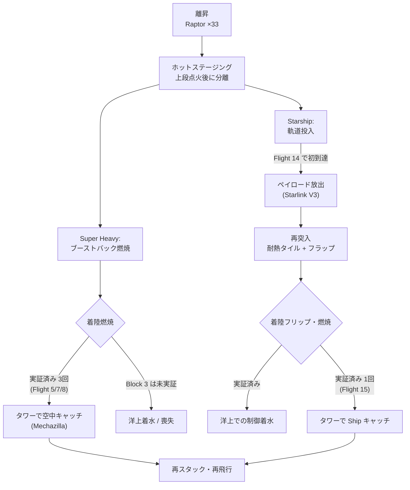

# Starship / Super Heavy — 完全再使用アーキテクチャ (Starship / Super Heavy: Full Reusability)

## 概要 (Overview)

**Starship**（上段）と **Super Heavy**（下段ブースタ）から成る2段式ロケットは、SpaceX が「**両段・完全再使用 (fully reusable)**」を目標に開発する、史上最大・最強の打ち上げ機である。全高はおよそ **121〜124 m**、離陸推力は **約 74〜80 MN（1,800万 lbf 超）** に達し、Saturn V のほぼ2倍で、人類が飛ばした最も強力なロケットである[^scientificamerican][^starship-official]。Super Heavy は **33基の Raptor**、Starship 上段は **6基の Raptor**（海面3＋真空3）を搭載し、推進剤は液体メタン／液体酸素（methalox）。機体は**ステンレス鋼**製で、LEO へ **100 t 超（再使用構成）** のペイロードを目標とする[^starship-official][^satnews]。

本ドキュメントは、Starship を「**Falcon 9 の部分再使用を、両段・全機へ徹底した到達点**」として捉える（前章 [`spacex-reusability.md`](spacex-reusability.md) の延長）。完全再使用がもたらす設計判断（ステンレス鋼、33基クラスタ、**射点アームでのブースタ空中キャッチ (Mechazilla)**、ホットステージング、耐熱タイル）と、それを「飛ばして壊して直す」反復で詰めてきた飛行試験の歴史を、Level 3 で分析する。

## 方法論 (Methodology)

- Starship を要求（完全再使用・低コスト・大ペイロード・火星）から逆算し、各設計判断が**どの要求に応える妥協か**を読み解く。
- Falcon 9 との差分（部分→完全再使用、過熱に耐える材料、キャッチ着陸）を対比軸に据える。
- 飛行試験 (IFT-1 〜 Flight 15, as of 2026-11) を**反復開発 (iterative, hardware-rich development)** のサイクルとして時系列で追い、各回の「狙いと学び」を整理する。
- 数値・経緯は SpaceX 公式（車両ページ・飛行試験ページ）と一次に近い報道・FAA 文書に基づき、典拠を脚注に付す。最新の飛行試験は流動的なため、確定値と暫定値を区別する。

## 発見事項 (Findings)

1. **完全再使用が全設計を駆動する。** 「両段とも無傷で戻し、最小整備で再飛行する」という要求が、材料・形状・着陸方式・エンジン数のすべてを規定する。Falcon 9 が残した「使い捨ての第2段」を無くすのが核心。
2. **ステンレス鋼という逆張り。** 航空宇宙の常識（軽量なアルミ／複合材）に反し、SpaceX は**ステンレス鋼**を選んだ。低温で強度が増し、高温（再突入）にも耐え、安価で溶接でき、量産に向くためである。比強度より「広い温度域での総合性能とコスト」を取った判断。
3. **33基クラスタは「数による推力と冗長」。** Super Heavy は Raptor を33基束ねて巨大推力を得つつ、複数基喪失への耐性を確保する。製造可能な中型エンジンを大量に並べる思想（Falcon 9 の9基の極大化）。
4. **着陸は「脚」から「キャッチ」へ。** ブースタに着陸脚を付けず、**射点タワーのアーム (chopsticks) で空中キャッチ (Mechazilla)** する。脚の重量を排し、整備性と再飛行速度を上げる過激な最適化。ブースタのキャッチは Flight 5・7・8 の計3回成功している（as of 2026-11。最後の成功は2025年3月の Flight 8 で、Block 3 ブースタのキャッチは未実証）。上段 (Ship) は2026年11月14日の Flight 15 で軌道から戻り、タワーで初めてキャッチされた[^sfn-catch][^sh-list][^sflight15]。
5. **ホットステージング。** 上段エンジンを下段がまだ燃焼中に点火して分離する方式を採用し、段間の性能損失を抑える。
6. **再突入は耐熱タイルで凌ぐ。** 上段 Starship は軌道速度からの再突入時の空力加熱を、機体下面の**耐熱タイル (TPS)** で防護する。ここが上段再使用の最大の技術的難所。
7. **開発は「反復」そのもの。** IFT-1（2023年）の爆発から Flight 12（2026年5月）の V3 初飛行、Flight 14（2026年9月28日）の**初の軌道到達と Starlink V3 26基の実運用放出**、Flight 15（2026年11月）の**初の Ship タワーキャッチ**まで、SpaceX は失敗を織り込んだ高頻度試験で設計を詰めてきた（as of 2026-11 で統合飛行は計15回）[^sflight14][^ft-results][^sflight15]。一方で Block 3 ブースタは Flight 12・13 で着水前に喪失し、Flight 14 でも上昇中に Raptor 1基が早期停止するなど、Raptor 3 の信頼性は依然として開発途上にある[^sfn-faa][^mynews-faa][^sflight13]。Flight 15 でもブースタはキャッチを自動で中止し、着水直前に爆発した（原因は調査中）[^flight15-booster]。

## アーキテクチャ (Architecture)

### スタック構成 (Stack Configuration)

```
        ┌─────────────┐  ← Starship（上段 / 宇宙船）
        │  ペイロード   │     Raptor ×6（海面3 + 真空3）
        │  ベイ        │     耐熱タイル(TPS)で再突入を防護
        │             │     ペイロード >100 t → LEO（再使用構成）
        ├─────────────┤  ← ホットステージング段間部
        │             │
        │             │  ← Super Heavy（下段 / ブースタ）
        │  推進剤      │     Raptor ×33（methalox）
        │  タンク      │     グリッドフィン、Mechazilla で空中キャッチ
        │             │
        └──┬┬┬┬┬┬┬┬┬──┘
           33基の Raptor → 離陸推力 ~74–80 MN（Saturn V の約2倍）
   全高 ~121–124 m / 直径 9 m / ステンレス鋼製 / 両段完全再使用
```

| 諸元 | 値 | 典拠 |
|---|---|---|
| 全高（スタック） | ~121–124 m | [^scientificamerican][^satnews] |
| 直径 | 9 m | [^starship-official] |
| 離陸推力 | ~74–80 MN（>18M lbf、Saturn V の約2倍） | [^scientificamerican] |
| Super Heavy エンジン | Raptor ×33 | [^starship-official] |
| Starship エンジン | Raptor ×6（海面3＋真空3） | [^starship-official] |
| 推進剤 | 液体メタン / 液体酸素（methalox） | [^starship-official] |
| 構造材 | ステンレス鋼（30X 系） | [^starship-official] |
| ペイロード（LEO, 再使用） | 100 t 超（V3 目標、使い捨て構成で更に増） | [^satnews] |
| 再使用 | 両段・完全再使用を目標 | [^starship-official] |

### ミッションプロファイルと実証状況 (Mission Profile & Demonstration Status)

完全再使用の飛行は、両段がそれぞれ別の帰還経路をたどる。下図は Starlink 展開ミッションを例に、各フェーズの実証状況（as of 2026-11）を示す。



凡例: 四角は飛行フェーズ、菱形は帰還方式の分岐。矢印のラベルは as of 2026-11 の実証状況で、「未実証」は試みたが成功していないか未実施であることを示す[^sflight14][^sh-list][^sflight15]。

### Falcon 9 からの飛躍 (Leap from Falcon 9)

| 観点 | Falcon 9 | Starship / Super Heavy |
|---|---|---|
| 再使用 | **部分**（第1段＋フェアリング、第2段は使い捨て） | **完全**（両段とも回収・再使用を目標） |
| 構造材 | アルミリチウム合金 | **ステンレス鋼** |
| 第1段エンジン | Merlin ×9（ケロシン, ガスジェネレータ） | Raptor ×33（メタン, FFSC） |
| 着陸（下段） | 着陸脚で陸／ドローン船 | **タワーのアームで空中キャッチ (Mechazilla)** |
| 上段の帰還 | （使い捨て） | **耐熱タイルで再突入し帰還** |
| 段分離 | 通常分離 | **ホットステージング** |

### Mechazilla — 空中キャッチ (Tower Catch)

```
        射点タワー (launch/catch tower)
        ┃   ╱━━ chopsticks（2本のアーム）━━╲
        ┃  ║                              ║
        ┃  ║   ← 降下する Super Heavy を    ║
        ┃  ║      アームで挟んで受け止める   ║
        ┃  ║   （着陸脚を持たない＝軽量化）  ║
        ┃  ╲______________________________╱
        ┗━━━━━━━━━━━━━━━━━━━━━━━━━━━━━━━━━━
```

- Super Heavy は**着陸脚を持たない**。代わりに、降下してくるブースタを**射点タワーの2本のアーム（通称 chopsticks）で空中で挟んで捕捉**する。
- 利点: (1) 着陸脚の重量を排して性能向上、(2) 機体を直接タワーへ戻すことで**整備・再スタックを高速化**（飛行機的な運用に近づく）。
- 難所: ブースタを **数十 cm の精度でタワー位置へ誘導**する制御が要る。Falcon 9 のホバスラング（[`spacex-reusability.md`](spacex-reusability.md)）を、固定構造物への精密ランデブーへ先鋭化したもの。誘導の数学（凸最適化）は [`avionics-gnc.md`](avionics-gnc.md) と [`../../foundations/mathematics/optimization/convex-optimization-duality.md`](../../foundations/mathematics/optimization/convex-optimization-duality.md) で扱う。ブースタのキャッチは計3回成功している（Flight 5・7・8）。Flight 15 では両段のキャッチを初めて同じ飛行で試み、ブースタはキャッチ位置から外れたため自動で中止してメキシコ湾へ向かい、着水直前に爆発した。上段は約21時間の軌道飛行のあと Pad 2 のタワーに捕捉され、軌道から戻った上段の初めての回収となった[^sfn-catch][^sh-list][^sflight15][^flight15-booster]。

## 技術詳細 (Technical Details)

### なぜステンレス鋼か (Why Stainless Steel)

航空宇宙では軽量なアルミ合金・複合材が常識だが、Starship は**ステンレス鋼 (30X 系)** を選んだ。その根拠を示す。

| 要求 | ステンレス鋼の利点 |
|---|---|
| 極低温強度 | 低温で**強度・靭性が増す**（液体メタン/酸素タンクに好適） |
| 再突入の耐熱 | **融点が高く高温に強い**（アルミは ~150°C で軟化、鋼は遥かに上） |
| コスト | アルミ/複合材より**桁違いに安い**——完全再使用＋量産の経済に効く |
| 製造性 | **溶接で大型構造を作れる**。複合材のオートクレーブ不要、屋外で量産可能 |
| 代償 | 比強度はアルミに劣り**重い**——が、上記の総合利得で相殺と判断 |

これは「比強度で材料を選ぶ」航空機の発想（[`aircraft-engineering-fundamentals.md`](aircraft-engineering-fundamentals.md) の材料節）への意図的な逆張りで、**広い温度域での性能 × コスト × 製造性**を総合最適化した結果である。

### ホットステージング (Hot-Staging)

段分離時、**上段 Starship のエンジンを、下段 Super Heavy がまだ推力を出している間に点火**してから分離する方式。通常分離で生じる「分離後にエンジンが立ち上がるまでの推力空白（重力損失）」を避け、性能を稼ぐ。段間部に高温排気を逃がす構造（vented interstage）を設ける必要があり、Flight 2 から導入された。段分離の物理的背景（推力空白の間に重力が速度を奪う重力損失）は [`orbital-mechanics.md`](orbital-mechanics.md) を参照。

### 耐熱防護システム (TPS) — 上段再使用の難所

上段 Starship は、軌道速度（~7.5 km/s 級）からの再突入で激しい**空力加熱**を受ける（詳細は [`reentry-thermal-protection.md`](reentry-thermal-protection.md)、理論は [`../../foundations/physics/fluid-dynamics/shock-waves-hypersonics.md`](../../foundations/physics/fluid-dynamics/shock-waves-hypersonics.md)）。これを機体下面に貼った**セラミック耐熱タイル (heat shield tiles)** で防ぐ。

- 完全再使用の鍵は「タイルが再突入に耐え、かつ最小整備で再飛行できる」ことである。これは Space Shuttle が苦しんだ点であり、SpaceX の最大の技術課題である。
- 直近の試験では、タイルの挙動を確認するため**ヒートシールドを撮像するカメラ**を搭載するなど、データ取得を重視している。Flight 14 では放出した Starlink V3 のうち3基がカメラを搭載し、軌道上から Ship のヒートシールドを撮像する試みを行った[^starship-official][^sflight14]。

### 33基クラスタの制御 (33-Engine Cluster)

Super Heavy は中型エンジン Raptor を**33基**束ねて巨大推力を得る。設計思想は Falcon 9 の9基クラスタの極大化である。

- **数による推力**: 製造可能なサイズのエンジンを大量に並べ、単一巨大エンジンの開発リスクを避ける。
- **冗長**: 複数基の喪失に耐える（ただし基数が増えるほど統合・配管・始動シーケンスの複雑さが増す）。
- **難所**: 33基の同時始動・推力ベクタ制御・燃焼安定の協調（燃焼不安定の側面は [`combustion-instability.md`](combustion-instability.md)）。Raptor 3 を積む Block 3 ブースタは、Flight 12 でブーストバック燃焼の全基点火に失敗し、着陸燃焼では1基しか点火できずに着水前に喪失、FAA の「事故 (mishap)」認定に至った[^sfn-faa][^mynews-faa]。Flight 13 でも着陸燃焼の再点火で複数基が不調となり硬着水（再点火できた基数は報道で「13基中10基」と「8基点火後に3基停止」の2説あり）、Flight 14 では上昇中に1基が早期停止した（着水は制御下で成功）[^sflight13][^sflight14]。これは多発化の統合難度が依然として開発の最前線にあることを示す。

## 信頼性・開発考察 (Reliability & Development)

> 本分野の「セキュリティ考察」を、開発途上の機体については**信頼性・開発プロセス**として読み替える。

### 反復開発の歴史 (Iterative Flight-Test History)

SpaceX の開発は「**ハードウェア潤沢・高頻度試験 (hardware-rich, fly-fail-fix)**」を特徴とする。地上で完璧を期すより、飛ばして実データで学ぶ。

| 試験 | 時期 | 狙いと結果（要約） |
|---|---|---|
| IFT-1 | 2023-04 | 初の統合飛行。上昇中に姿勢を失い飛行終了（複数エンジン不調・段分離前に破壊） |
| IFT-2 | 2023-11 | ホットステージング導入。段分離成功も両段とも喪失 |
| IFT-3〜4 | 2024 | 上段の再突入・着水へ前進、データ取得を拡大 |
| **Flight 5** | 2024-10 | **史上初の Super Heavy 空中キャッチ成功 (Mechazilla)** |
| Flight 7 | 2025-01 | ブースタはキャッチ成功、上段は喪失[^sfn-catch] |
| Flight 8 | 2025-03 | ブースタは3回目のキャッチ成功（as of 2026-11 で最後のブースタキャッチ）、上段は喪失[^sh-list] |
| Flight 9 | 2025-05 | 初のブースタ再飛行。ブースタは着陸燃焼中に喪失、上段は飛行中に姿勢制御を失い、制御不能のまま再突入して喪失[^ft-results] |
| Flight 10〜11 | 2025-08 / 2025-10 | Block 2 最終盤。両段とも制御着水に成功（ブースタはメキシコ湾、上段はインド洋）。Flight 11 が現行構成の Pad 1 からの最終打ち上げ[^ft-results] |
| **Flight 12** | 2026-05-22 (UTC) | **初の Block 3 / V3・Raptor 3 飛行、Pad 2 初使用**。Starlink 模擬22基を放出し上段はインド洋に着水。ブースタはブーストバック・着陸燃焼不調で喪失、FAA 事故認定→打ち上げ一時停止[^mynews-flight12][^sfn-faa] |
| Flight 13 | 2026-07-24 | Starlink V3 20基を準軌道で放出、宇宙空間での Raptor 再点火、上段は無傷で軟着水。ブースタは再点火不調で硬着水[^sflight13] |
| **Flight 14** | 2026-09-28 | **初の軌道到達**（約 262×275 km、傾斜 30.5°〜32°）。**Starlink V3 26基を実運用放出**。ブースタは制御着水（キャッチせず）、上段は早期の軌道離脱後ハワイ北方の太平洋に制御着水。計画 ~10 時間を約3時間に短縮[^sflight14][^ft-results] |
| **Flight 15** | 2026-11-13 (22:47 UTC) | B22/S42、Pad 2。**初の両段キャッチ挑戦**。約 275 km の軌道で Starlink V3 26基を放出し、約14周・21時間あまり飛行したのち、11-14 21:20 UTC に**上段を Pad 2 のタワーでキャッチ**（軌道からの上段回収は初）。ブースタはキャッチを自動中止してメキシコ湾へ向かい、着水直前に爆発[^sflight15][^flight15-booster] |

- **成功と失敗が混在するのが正常**: 各回の「喪失」は設計反復の入力であり、Mechazilla キャッチ成功（Flight 5）、V3 初飛行（Flight 12）、初の軌道到達（Flight 14）、初の Ship キャッチ（Flight 15）といったマイルストンと並走する。Flight 15 は同じ飛行の中で上段の回収に成功し、ブースタの回収に失敗した。
- **依然として開発途上**: as of 2026-11 で、Block 3 ブースタの回収（キャッチ）と、回収した上段の再飛行はいずれも未実証である。Flight 15 で捕捉した Ship 42 について、Musk は再飛行もおそらく可能だとしつつ、展示用に退役させると述べた[^sflight15-retire]。ブースタがキャッチを中止した原因について、SpaceX の説明は途中で変わった。当初は誘導の問題とされ、のちに誘導・航法・制御の問題ではないと訂正され、ブーストバック燃焼が燃料残量低下の警報で早く終わったという説明も出た。根本原因は調査中である[^flight15-booster]。Flight 15 について FAA が事故調査を求めたという報道は確認できなかった（2026-11-23 時点）。完全再使用は未完であり、信頼性は飛行データの蓄積で詰めている段階[^sfn-faa][^sflight14]。
- **射点の多重化**: Starbase Pad 2 が Flight 12 以降の主射点となり（Pad 1 は改修中）、フロリダでは LC-39A の Starship 射点が初打ち上げに向けて仕上げ段階、SLC-37 が建設中である。LC-39A からの初打ち上げは当初 NET 2026-10-30 が目標とされたが実施されておらず、B23/S43 を使う Flight 16 がその初打ち上げになると報じられている。日付は公表されておらず、年内より2027年初頭の可能性が高いとされる（as of 2026-11、報道による）[^nsf-pads][^nsf-flight16]。

### Falcon 9 との信頼性プロセスの対比

| 観点 | Falcon 9（成熟） | Starship（開発途上） |
|---|---|---|
| 着陸成功率 | Block 5 で 99% 級[^reuse-doc] | ブースタキャッチ3回（Block 2）、Ship キャッチ1回（Flight 15）。Block 3 ブースタの回収と回収機の再飛行は未確立 |
| 主たる学習源 | 大量の実運用飛行 | 高頻度の試験飛行（fly-fail-fix） |
| 規制 | 定常運用 | FAA の事故調査・飛行許可がマイルストンを律速[^sfn-faa] |

## 結論 (Conclusions)

Starship / Super Heavy は、Falcon 9 が証明した再使用の論理を**両段・全機・最小整備**へ徹底した到達点である。完全再使用という一つの要求が、**ステンレス鋼**（広温度域×コスト×製造性）、**33基 Raptor クラスタ**（数による推力と冗長）、**Mechazilla 空中キャッチ**（脚を排した整備性）、**ホットステージング**（段間損失の回避）、**耐熱タイル**（上段再突入）という、相互に連関した設計判断を一斉に駆動している。

同時に、Flight 14 で軌道到達と実ペイロード放出を、Flight 15 で軌道から戻った上段のキャッチを果たした一方、Block 3 ブースタは4飛行連続でキャッチに至っておらず（as of 2026-11）、完全再使用（とりわけ**両段の確実な回収と、回収した機体の再飛行**）は依然として未完の工学であり、SpaceX は「飛ばして壊して直す」反復でそれを詰めている。

### 3部作を貫くもの (The Thread)

本ドキュメント群は、航空機の基礎工学（4つの力・重量との戦い）から出発し、SpaceX を3つの断面で見てきた。

1. **エンジン ([`spacex-rocket-engines.md`](spacex-rocket-engines.md))** — Isp と推力重量比への執着。FFSC で効率の上限を、メタンで再使用と火星を狙う。
2. **再使用性 ([`spacex-reusability.md`](spacex-reusability.md))** — 帰還を制御工学に翻訳し、頻度の経済で「捨てるより安く」を成立させる。
3. **Starship（本書）** — その論理を完全再使用へ徹底し、材料・形状・着陸方式まで作り替える。

貫くのは、航空工学と同じ枠組み、すなわち**推進・構造・制御を、重量とコストと引き換えに、システムとして最適化する**ことを、ロケットの過酷な熱・圧力・速度域で、かつ **「反復で素早く詰める」開発文化**とともに先鋭化する姿勢である。航空機が一世紀かけて型式証明という枠組みで信頼性を作り込んだのに対し、SpaceX は高頻度の飛行データでそれを加速しようとしている。その帰結は、これからの飛行試験が語る。

---

## 参考文献 (References)

> SpaceX 公式（車両・飛行試験ページ）と FAA 文書を一次資料とし、専門報道で補う。最新の飛行試験は流動的なため取得日を明記する。

**一次資料 (Primary — 公式・規制)**

[^starship-official]: [SpaceX — Starship（公式車両ページ）](https://www.spacex.com/vehicles/starship) ／ [Starship V3 アップデート](https://www.spacex.com/updates/starship-v3) — 両段完全再使用、Super Heavy ×33 / Starship ×6 Raptor、methalox、ステンレス鋼、直径9 m、ヒートシールド撮像カメラ等。Accessed: 2026-06-30.

[^sfn-faa]: [FAA requires SpaceX-led mishap investigation before resumption of Starship launches — Spaceflight Now (2026-05-27)](https://spaceflightnow.com/2026/05/27/faa-requires-spacex-led-mishap-investigation-before-resumption-of-starship-launches/) — Flight 12 のブースタ不調を FAA が「事故」認定、調査完了まで打ち上げ停止。Accessed: 2026-06-30.

[^sfn-catch]: [SpaceX successfully catches Super Heavy booster, loses Starship upper stage during Flight 7 — Spaceflight Now (2025-01-17)](https://spaceflightnow.com/2025/01/17/spacex-successfully-catches-super-heavy-booster-loses-starship-upper-stage-during-flight-7/) — Mechazilla による Super Heavy 空中キャッチの実証、上段喪失。Accessed: 2026-06-30.

**専門報道 (Specialist reporting)**

[^sflight14]: [SpaceX Starship megarocket reaches orbit on Flight 14 — Space.com (2026-09-28)](https://www.space.com/space-exploration/launches-spacecraft/spacex-starship-megarocket-flight-14-orbital-launch-success) ／ [NASASpaceflight — Starship Flight 14 reaches orbit (2026-09)](https://www.nasaspaceflight.com/2026/09/starship-flight-14-orbit/) — 初の軌道到達（約 262×275 km）、Starlink V3 26基（うち3基はカメラ搭載）、ブースタ制御着水、Raptor 1基・RVac 1基の早期停止、飛行時間約3時間8分。軌道傾斜は 30.5°（Wikipedia 集計）と 32°（NSF）で報道に幅。Accessed: 2026-10-04.

[^sflight15]: [Spaceflight Now (2026-11-13, updated 2026-11-14). Starship returns to Starbase and a successful tower catch](https://spaceflightnow.com/2026/11/13/live-coverage-starship-flight-15-attempts-to-recover-full-vehicle-in-double-launch-pad-catch/) ／ [CNBC (2026-11-14). SpaceX catches upper stage of Starship rocket in historic first](https://www.cnbc.com/2026/11/14/spacex-plans-to-try-first-ever-catch-of-starship-rocket-from-orbit.html) ／ [Space.com (2026-11-15). What's next for SpaceX's Starship after epic Flight 15 chopsticks catch?](https://www.space.com/space-exploration/launches-spacecraft/whats-next-for-spacexs-starship-after-epic-flight-15-chopsticks-catch) — 2026-11-13 22:47 UTC に Pad 2 から B22/S42 で打ち上げ、約 275 km の軌道で Starlink V3 26基（うち3基はヒートシールド撮像用カメラ搭載）を放出、約14周・21時間あまりの飛行後、2026-11-14 21:20 UTC に Pad 2 のタワーで上段を捕捉（軌道からの上段回収は初）。Spaceflight Now は本文で 16:47 CST、写真説明で 16:48 CST と記しており1分の差がある。SpaceX 公式の Flight 15 ページは取得できなかったため報道で確認した。Accessed: 2026-11-23.

[^flight15-booster]: [Space.com (2026-11-13). SpaceX launches Starship on ambitious 22-hour Flight 15 test, but aborts booster 'chopsticks' catch](https://www.space.com/space-exploration/launches-spacecraft/spacex-starship-flight-15-chopsticks-double-catch-super-heavy-ship) ／ [Space.com (2026-11-14). SpaceX still investigating why Starship Flight 15 booster aborted 'chopsticks' landing catch](https://www.space.com/space-exploration/launches-spacecraft/spacex-says-starship-flight-15-booster-aborted-chopsticks-landing-catch-after-launch-due-to-guidance-issue-video) ／ [SpaceNews (2026-11-13). Starship launches on 15th test, calls off booster catch](https://spacenews.com/starship-launches-on-15th-test-calls-off-booster-catch/)（有料記事のため見出しのみ確認） — ブースタは打ち上げ約6.5分後にキャッチを自動中止してメキシコ湾へ転じ、着水直前に爆発。SpaceX の説明の変遷（誘導の問題 → 誘導・航法・制御の問題ではない → ブーストバック燃焼が燃料残量低下の警報で早期終了）と、根本原因が調査中であること。Accessed: 2026-11-23.

[^sflight15-retire]: [Space.com (2026-11-21). SpaceX will retire 1st Starship upper stage ever caught by 'chopsticks', Elon Musk says](https://www.space.com/space-exploration/launches-spacecraft/spacex-will-retire-1st-starship-upper-stage-ever-caught-by-chopsticks-elon-musk-says) — Ship 42 は再飛行もおそらく可能だが展示用に退役させるという Musk の発言。Accessed: 2026-11-23.

[^nsf-flight16]: [NASASpaceflight (2026-10). SpaceX working through Starship Flight 15 and 16 milestones](https://www.nasaspaceflight.com/2026/10/spacex-flight-15-16-milestones/) ／ [NASASpaceflight (2026-11). Starship Flight 15, a dual catch attempt, awaits FAA green light](https://www.nasaspaceflight.com/2026/11/starship-flight-15-awaits-faa/) — Flight 16 は B23/S43 で LC-39A からの初打ち上げとなる見込み、日付は未公表で2027年初頭の可能性が高い。サイトが直接の取得を拒否したため、検索結果の要約で確認した。Accessed: 2026-11-23.

[^sflight13]: [Space.com — Starship makes the softest splashdown ever after launching next-gen Starlink satellites in Flight 13 (2026-07)](https://www.space.com/space-exploration/launches-spacecraft/spacexs-starship-megarocket-makes-the-softest-splashdown-ever-after-launching-next-gen-starlink-satellites-in-flight-13-test-video) ／ [NASASpaceflight — Starship Flight 13 (2026-07)](https://www.nasaspaceflight.com/2026/07/starship-flight-13-flight/) — Starlink V3 20基の準軌道放出、上段の軟着水、ブースタの再点火不調と硬着水。Accessed: 2026-10-04.

[^nsf-pads]: [NASASpaceflight — Launch site and facility progress on the East Coast for Starship (2026-09)](https://www.nasaspaceflight.com/2026/09/launch-site-facility-progress-east-coast-starship/) — LC-39A（屋根補強・デリュージ試験、初打ち上げ NET 2026-10-30 目標）と SLC-37 の建設状況。Accessed: 2026-10-04.

[^scientificamerican]: [Watch SpaceX launch Starship V3 — the tallest and most powerful rocket yet — Scientific American](https://www.scientificamerican.com/article/watch-spacex-launch-starship-v3-the-tallest-and-most-powerful-rocket-yet/) — V3 が史上最大・最強、Saturn V の約2倍の推力。Accessed: 2026-06-30.

[^satnews]: [SpaceX Debuts Starship V3: Redefining Heavy-Lift Launch Capability — SatNews (2026-05-14)](https://satnews.com/2026/05/14/spacex-debuts-starship-v3-redefining-heavy-lift-launch-capability/) — 全高 ~124 m、LEO 100 t 超（再使用）、ステンレス鋼。Accessed: 2026-06-30.

[^mynews-flight12]: [SpaceX launches 12th Starship test flight; booster fails — Spectrum News 13 (2026-05-21)](https://mynews13.com/fl/orlando/space/2026/05/21/spacex-starship-12-test) — Flight 12（初の V3・Raptor 3）、Starlink 模擬22基放出、ブースタ不調。Accessed: 2026-06-30.

[^mynews-faa]: [FAA grounds SpaceX's Starship after booster malfunction — Spectrum News 13 (2026-05-27)](https://mynews13.com/fl/orlando/space/2026/05/27/faa-grounds-spacexs-starship-after-booster-malfunction) — ブースタ不調による FAA の打ち上げ一時停止。Accessed: 2026-06-30.

**集計・索引 (Tertiary — 発見用。一次は上記を優先)**

[^ft-results]: 各回の結果 — Flight 9: [Spaceflight Now — Starship • Flight 9](https://spaceflightnow.com/launch/starship-flight-9/)（B14 が Flight 7 のエンジン29基を再使用した初の再飛行ブースタで、着陸燃焼中に爆発）／ [Spaceflight Now (2025-05-28). SpaceX launches first flight-proven Super Heavy booster, loses control of Starship mid-flight](https://spaceflightnow.com/2025/05/28/spacex-launches-first-flight-proven-super-heavy-booster-loses-control-of-starship-mid-flight/)（上段は約20分後に姿勢制御を失い、制御不能のまま再突入）。Flight 10: [The Register (2025-08-27). SpaceX's Starship keeps it together for Flight Test 10](https://www.theregister.com/2025/08/27/spacex_starship_flight_10/)（ブースタはメキシコ湾へ制御着水、上段はインド洋へ着水）。Flight 11: [Scientific American (2025-10-13). SpaceX's Starship Succeeds in Final Test Flight of 2025](https://www.scientificamerican.com/article/spacexs-starship-succeeds-in-final-test-flight-of-2025/)（ブースタはメキシコ湾、上段はインド洋へ動力着水）／ [San Antonio Express-News (2025-10-14, via Yahoo News). SpaceX launches Starship for 11th test flight from South Texas Starbase](https://www.yahoo.com/news/articles/know-starships-11th-test-flight-180053017.html)（現行構成の Pad 1 からの最終打ち上げとする SpaceX の発表、V2 最後の機体）。Flight 14: [WUNC/NPR (2026-09-28). SpaceX's Starship launches on first orbital mission from Texas](https://www.wunc.org/national/2026-09-28/spacexs-starship-launches-on-first-orbital-mission-from-texas)（14回目の飛行で初の軌道到達、ブースタはキャッチせずメキシコ湾沖で着陸を模擬、上段はハワイ北方の太平洋へ着水、計画約10時間を約3時間に短縮）。Accessed: 2026-10-12.

[^sh-list]: キャッチ実績 — Flight 5（B12）: [Spaceflight Now (2024-11-01). Starship booster catch brings NASA, SpaceX closer to Artemis 3 Moon landing](https://spaceflightnow.com/2024/11/01/starship-booster-catch-brings-nasa-spacex-closer-to-artemis-3-moon-landing/)。Flight 7（B14）: 上記 Spaceflight Now (2025-01-17)。Flight 8（B15）: [Spaceflight Now — Starship • Flight 8](https://spaceflightnow.com/launch/starship-flight-8/)（チョップスティックによるブースタのキャッチ、S34 は第1回燃焼中に分解）。Flight 9〜14 はいずれもキャッチなし（Flight 9 は着陸燃焼中に喪失、Flight 10・11・14 は着水、Flight 12・13 は上記の各報道のとおり喪失・硬着水）。Accessed: 2026-10-12.

**本リポジトリ内参照**

[^reuse-doc]: 本リポジトリ [`spacex-reusability.md`](spacex-reusability.md)（Block 5 着陸成功率 99% 級、再使用の経済性）。
