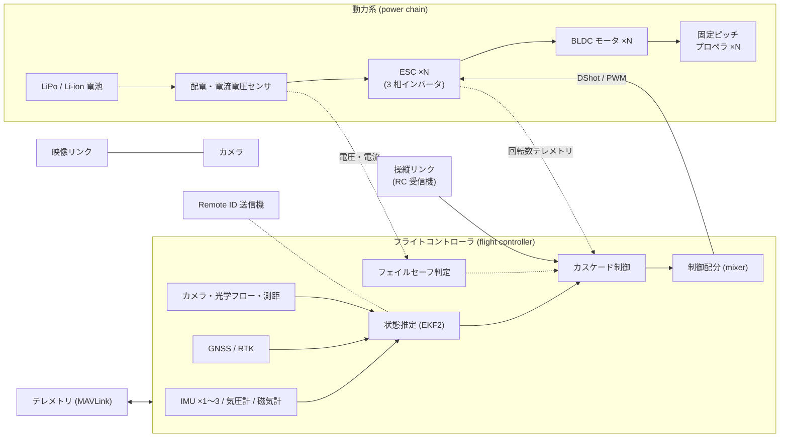
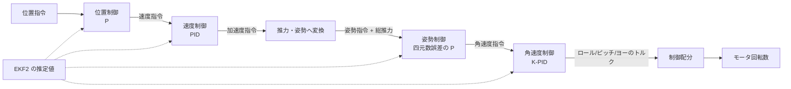

# 小型無人航空機とマルチロータ (Small UAS & Multirotor Systems)

## 概要 (Overview)

小型無人航空機 (small Unmanned Aircraft System, sUAS)、いわゆるドローンの主流はマルチロータ (multirotor) である。機体の可動部はプロペラを直結したブラシレスモータ (brushless DC motor, BLDC) だけで、ヘリコプタのような可変ピッチ機構もスワッシュプレートもない。推力も姿勢もヨーも、4 基以上のモータの回転数を変えることだけで操る。

本文書の中心テーゼは次のとおりである。**マルチロータは機械的にはモータと電池だけの単純な機体であり、飛べるかどうかを決めているのは制御ソフトウェアと電池のエネルギー密度である。** 機械の単純さは、複雑さが消えたことを意味しない。受動的な安定性を持たない機体を数百 Hz のフィードバックで支える役目はソフトウェアに移り、飛行時間の上限は電池の比エネルギー (Wh/kg) と回転翼のホバリング効率で決まる。さらに、無線リンクと衛星測位 (GNSS) に頼ることが、運用上の最大の弱点にもなっている。規制の多くも、この弱点への対策として作られている。

分析深度は Level 3 とし、飛行の原理、機体の構成、飛行制御ソフトウェア (PX4、ArduPilot) と MAVLink、測位と通信、故障モードとフェイルセーフ、日米欧の規制 (2026-10 時点)、運用上の脅威と対策を扱う。軍事用途は公開分析に見える技術の傾向にとどめ、兵器の設計には触れない。

## 方法論 (Methodology)

- **物理から始める。** 推力と回転数の関係、反トルクによるヨー制御、運動量理論によるホバリング電力を、査読論文と回転翼の教科書に基づいて整理する[^mahony][^leishman]。
- **制御はオープンソースの実装で確かめる。** PX4 と ArduPilot の公式文書から、カスケード制御の段の数、状態推定器 (EKF2) の状態量、フェイルセーフの判定と動作を読む[^px4-ctrl][^px4-ekf][^ap-att]。通信は MAVLink の公式仕様に当たる[^mavlink-ser][^mavlink-sign]。
- **電池は一次資料の公称値から計算する。** メーカーのカタログ値 (容量、電圧、質量) から比エネルギーを求め、公称値であることを明記する[^tattu]。
- **規制は 2026-10-24 時点で公的機関の一次資料を確かめる。** 国土交通省、FAA (連邦官報)、EASA の公開文書を使う。審議中の規則 (FAA Part 108) は「最終規則は未公表」と書く。
- **脅威は査読論文と公的機関の告知で確かめる。** GNSS のなりすまし (spoofing) は Humphreys らの実証、MAVLink と DJI の脆弱性は査読論文、GNSS 妨害の広がりは EASA の安全情報を出典とする。

## 発見事項 (Findings)

1. **マルチロータは「固定ピッチの推力発生器を回転数で制御する」機体である。** 各ロータの推力も反トルクも回転数の 2 乗にほぼ比例する[^mahony]。ロール・ピッチは対角のロータの推力差、ヨーは時計回りと反時計回りのロータの反トルク差で作る。可動部がモータだけなので機械は安く単純だが、操舵のすべてを 4 本以上の回転数指令に変換する計算 (ミキサ、制御配分) が必須になる。

2. **機体は受動的に安定しないため、飛行の成否はソフトウェアの内側ループで決まる。** Mahony らの剛体モデルでは、ロータの推力差がそのまま機体の角加速度になる[^mahony]。機体には姿勢を受動的に戻す仕組みがなく、ソフトウェアが常に姿勢を立て直し続ける。PX4 は位置 (P) → 速度 (PID) → 姿勢 (四元数の P) → 角速度 (PID) の 4 段カスケードを使い[^px4-ctrl]、ArduPilot は Pixhawk 上で 400 Hz の更新を回す[^ap-att]。機械的な調整よりも、フィルタとゲインの調整が機体の挙動を決める。

3. **飛行時間の上限は電池の比エネルギーと円盤荷重で決まり、電池を増やすほど収穫は逓減する。** 運動量理論では、ホバリングの理想電力は推力の 1.5 乗に比例し、ロータ円盤の面積の平方根に反比例する[^leishman]。電池を積むほど機体が重くなり必要電力も増えるため、本文書の簡単なモデルでは、電池の質量を電池以外の質量の 2 倍にしたときに飛行時間が最大になり、その先は短くなる。市販の LiPo パックの比エネルギーは公称値から計算して約 180〜200 Wh/kg である[^tattu]。後述の計算例では電池を電池以外の質量と同じ量から 2 倍にしても、飛行時間は 1 割も延びない。

4. **単発故障に耐えられるかどうかは、ロータの数より配置と制御則で決まる。** 4 発機は 1 発を失うとヨーを捨てて機体を回転させながら飛ぶしかないが、その状態で位置を保てることが実験で示されている[^mueller]。一方、標準的な 6 発機 (PNPNPN 配置) は、作動器が冗長であるにもかかわらず、1 発の故障で可制御性を失うことが示されている[^du2015]。冗長性はロータの数ではなく、残ったロータで力とモーメントを作れるかで決まる。

5. **フェイルセーフは「どこへ逃げるか」を GNSS に頼っている。** PX4 と ArduPilot の標準のフェイルセーフ (リンク喪失、電池低下) は帰還 (Return/RTL) を基本とし、測位が無効なら着陸に切り替える[^px4-safety][^ap-rcfs][^ap-battfs]。電池の判定は負荷による電圧降下 (内部抵抗) を補正しないと早すぎたり遅すぎたりする[^px4-batt]。

6. **制御リンクと Remote ID は既定では認証されていない。** MAVLink 2 にはメッセージ署名 (SHA-256 を 48 bit に切り詰めた認証子) がある。ただし署名は認証だけで暗号化はせず、署名なしのパケットを受け入れる設定もできる[^mavlink-sign]。MAVLink を使ってミッションを止める攻撃が実証されている[^kwon]。DJI の DroneID は暗号化されておらず、操縦者の位置が誰にでも読めた[^droneid]。放送型 Remote ID の規格は認証を十分に定めておらず、なりすましや再送が可能だと指摘されている[^tbrd]。

7. **GNSS は妨害もなりすましもされる、最も弱いセンサである。** Humphreys らはホバリング中の UAV を GPS のなりすましで乗っ取れることを実験で示した[^kerns]。EASA は 2022 年 2 月以降、GNSS の妨害となりすましが顕著に増えたとして安全情報 SIB 2022-02 を改訂し続けている (R4 は 2026-07-03)[^easa-sib]。ウクライナの戦場について、RUSI は 2023 年に、ウクライナ軍の UAV の損失が月約 10,000 機に上り、ロシア軍の電子戦が UAV 対策に重点を置いていると報告した[^rusi-meat]。電波を使わない光ファイバー誘導の機体まで現れている[^rusi-supply]。

8. **規制は「重さ」から「運用のリスク」と「識別」へ移った。** 日本は 100 g 以上の登録とリモート ID を 2022-06-20 に義務化し[^mlit-reg]、2022-12-05 に機体認証と技能証明を新設してレベル 4 (有人地帯での補助者なし目視外飛行) を可能にした[^mlit-l4]。米国は Part 107 (2016) と Remote ID 規則 (2021) を運用し[^part107][^rid-rule]、目視外飛行 (BVLOS) の Part 108 は 2026-10 時点で最終規則が公表されていない[^part108-nprm]。EU は運用のリスクに応じて open / specific / certified の 3 区分に分ける[^easa-reg][^easa-open]。

## アーキテクチャ (Architecture)

### 機体のハードウェアと情報の流れ



凡例: 実線は電力または主要な信号の流れ、破線は監視やテレメトリ、双方向矢印は MAVLink の送受信。映像リンクと Remote ID は飛行制御から独立した送信機であることが多い。

機械的な部品は電池、ESC、モータ、プロペラ、フレームだけである。モータとインバータの原理 (ベクトル制御、センサレス駆動、逆起電力の検出) は [`../motors/electric-motor-drives.md`](../motors/electric-motor-drives.md) が扱う。ESC への指令は従来のパルス幅 (PWM) から、デジタルの DShot (DShot150/300/600。数字は kbit/s) に移っている。DShot はチェックサムを持ち、ESC の較正が要らず、遅延が小さい。双方向 DShot (BDShot) では ESC が回転数を返し、フライトコントローラはそれを動的ノッチフィルタに使う[^px4-dshot]。

### 制御のカスケード



凡例: 実線は指令値の流れ、破線は状態推定値のフィードバック。外側ほど遅く、内側ほど速い。

PX4 のマルチコプタ制御は上の 4 段で、位置ループは位置保持中か、速度指令が 0 の軸でだけ使われる。速度 PID の積分には飽和防止 (anti-windup) があり、加速度指令は推力と姿勢へ変換する段階で飽和させる。このとき鉛直の推力を先に `MPC_THR_MAX` で制限し、水平の推力は残りの余裕に収める。高度の維持を水平移動より優先する設計である。姿勢指令は 2 次の臨界減衰の参照モデルで滑らかにしてから追従させる[^px4-ctrl]。ArduPilot も同じ考え方で、角度誤差を平方根型の P 制御で角速度指令に変え、角速度 PID が AP_Motors のミキサに渡す。ミキサは、最大推力と最大ロールを同時には出せないような要求に対して、軸ごとの優先順位を付けて飽和を処理する[^ap-att]。速いループを内側で閉じる構造は、ロボットの関節制御 ([`../robotics/control-systems.md`](../robotics/control-systems.md)) や航空宇宙の GNC ([`avionics-gnc.md`](avionics-gnc.md)) と同じである。

### 機体の形態の比較

| 形態 | 揚力の作り方 | ホバリング | 巡航効率 | 制御の難しさ |
|---|---|---|---|---|
| マルチロータ | ロータの推力だけ | できる | 低い (常に重量をロータで支える) | 機械は単純、ソフトが必須 |
| 固定翼 | 主翼の揚力 | できない | 高い (揚抗比で効く) | 滑走路または射出・回収が要る |
| VTOL (standard) | ホバリング用と前進用の別の推進器 | できる | 高い | 推進器が増えて重いが、制御は易しい |
| VTOL (tiltrotor) | ロータを 90° 傾ける | できる | 高い | 傾斜機構が複雑 |
| VTOL (tailsitter) | 機体ごと倒す | できる | 高い | 機構は単純、風の中で制御が難しい |

VTOL の分類と特徴は PX4 の文書による[^px4-vtol]。固定翼の揚抗比と航続の関係 (ブレゲー式) は [`aircraft-engineering-fundamentals.md`](aircraft-engineering-fundamentals.md) を参照。PX4 は VTOL のマルチコプタモードを主に離着陸に使い、移動と任務は効率のよい固定翼モードで行うと説明している[^px4-vtol]。

## 技術詳細 (Technical Details)

### 1. 推力、反トルク、ヨー

Mahony らのモデルでは、ロータ i の推力 `T_i` と反トルク `Q_i` は回転数 `ω_i` の 2 乗にほぼ比例する[^mahony]。

```text
# 例示 (illustrative)。4 発の X 型、ロータ番号は右前から反時計回り
# k_T: 推力係数, k_Q: 反トルク係数, l: 中心からロータまでの腕の長さ
T_i = k_T · ω_i²          # 推力
Q_i = k_Q · ω_i²          # 反トルク (回転方向と逆向きに機体へ働く)

総推力   F  = Σ T_i
ロール   τx = (l/√2) · (T_2 + T_3 − T_1 − T_4)   # 右翼下げを正とする
ピッチ   τy = (l/√2) · (T_1 + T_2 − T_3 − T_4)   # 機首上げを正とする
ヨー     τz = Σ s_i · Q_i      # s_i = ±1 (時計回り / 反時計回り)
```

4 つの入力 (`ω_1..ω_4`) から 4 つの出力 (`F, τx, τy, τz`) への写像は線形 (2 乗した回転数について) で、正則な行列になる。制御配分はその逆行列を使う。ヨーは推力ではなく反トルクの差で作る。推力の差に腕の長さを掛けるロール・ピッチと比べて、同じ回転数の変化で得られるモーメントが小さいことが多い。要求が機体の能力を超えたときの扱いも必要になる。ArduPilot のミキサはたとえば最大推力と最大ロールを同時に求められた場合に、軸ごとの優先順位を付けて飽和を処理する[^ap-att]。

並進は姿勢を介してしか作れない。水平に加速するには機体を傾けて推力ベクトルを傾ける必要があり、このためマルチロータは劣駆動 (underactuated) 系になる[^mahony]。位置ループが姿勢ループの外側に置かれる理由はここにある。

### 2. ホバリングの電力と飛行時間

運動量理論 (momentum theory) では、推力 `T` を出すホバリング中のロータ円盤 (面積 `A`) の理想誘導電力は次のとおりである[^leishman]。

```text
P_ideal = T^(3/2) / sqrt(2 · ρ · A)        # ρ: 空気密度
P_elec  = P_ideal / (FM · η_drive)          # FM: フィギュア・オブ・メリット, η_drive: モータ+ESC 効率
```

計算例 (仮定): 総質量 1.0 kg、10 インチ (半径 0.127 m) のロータ 4 基、ρ = 1.225 kg/m³ のとき、`P_ideal ≈ 44 W` となる。FM = 0.6、`η_drive` = 0.8 を仮定すると、電気入力は約 91 W (約 91 W/kg) になる。ロータの半径を半分にすると円盤面積が 1/4 になり、理想電力は 2 倍になる。小さなプロペラの機体ほど飛行時間が短いのは、円盤荷重 (disk loading) の違いが大きい。

飛行時間 `t` は電池のエネルギーを電気入力で割ったものである。

```text
# 例示: 電池以外の質量 m0, 電池質量 mb, 比エネルギー e [Wh/kg], 使用可能割合 u
t(mb) = u · e · mb / P_elec(m0 + mb)
      ∝ mb / (m0 + mb)^(3/2)                 # P_elec ∝ (質量)^(3/2) の仮定のもと
dt/dmb = 0  →  mb = 2 · m0                    # 電池が全備質量の 2/3 のとき最大
# 前提: ロータ面積・効率・機体の構造質量は電池質量に依存しない (実際は大きな電池ほど構造も重くなる)
```

上の計算例の機体 (m0 = 0.7 kg、e = 180 Wh/kg、u = 0.8) では、電池 0.3 kg で約 28 分、0.7 kg で約 40 分、最大となる 1.4 kg で約 44 分、2.0 kg では約 43 分に戻る。電池を 0.7 kg から 2 倍の 1.4 kg にしても、飛行時間は約 9% しか延びない。

この e の値は実際の LiPo パックのカタログ値から得た。Tattu (Grepow) の 6S (公称 22.2 V) パックは 16,000 mAh で 1,974 g、22,000 mAh で 2,460 g であり、比エネルギーはそれぞれ約 180 Wh/kg と約 199 Wh/kg になる。同社の高電圧系 (公称 23.7 V) では 22 Ah で 2,018 g、約 258 Wh/kg になる[^tattu]。いずれもメーカーの公称値 (target) で、独立した実測ではない。セル単体ではさらに高い値の製品が発表されている。Amprius はシリコン負極のセルで 500 Wh/kg (1C 放電) を公称し、2026 年第 4 四半期の商用供給を予定しているが、2026-10 時点で独立した検証は見当たらない[^amprius]。系統用電池の比較 ([`../energy/battery-energy-storage.md`](../energy/battery-energy-storage.md)) と比べると、ドローンは同じリチウムイオン系の中でも高い比エネルギーと高い放電率 (C レート) を同時に求める用途である。

### 3. フライトコントローラと状態推定

フライトコントローラの心臓は MEMS の IMU (3 軸ジャイロと 3 軸加速度計) である。MEMS センサの物理と誤差の積み上がりは [`../../hardware/peripherals/sensor-hub-mems.md`](../../hardware/peripherals/sensor-hub-mems.md) が扱う。PX4 の EKF2 は 24 個の状態量 (姿勢の四元数、NED 座標の速度と位置、ジャイロと加速度計のバイアス、地磁気、磁気計のバイアス、風速、地形の高度) を推定する[^px4-ekf]。

- **IMU は観測ではなく予測に使う。** IMU の増分角と増分速度 (最低 100 Hz) で状態を進め、磁気計 (最低 5 Hz)、GNSS、気圧計、測距計、外部ビジョンを観測として融合する[^px4-ekf]。
- **遅延した時間軸で融合する。** センサごとの遅れを吸収するため、EKF は過去の「融合時間軸」で動き、相補フィルタが現在時刻まで状態を外挿する[^px4-ekf]。
- **冗長化は推定器の多重化で行う。** IMU と磁気計の組み合わせごとに EKF のインスタンスを立て (最大 4×4 = 16、STM32F7 級で 4 インスタンスが検証済み)、セレクタが整合性の最もよいものを選ぶ。IMU が 3 基以上なら中央値で故障した IMU を早く切り離せる[^px4-ekf]。

カルマンフィルタの一般論とセンサフュージョンの定石は [`../robotics/perception-state-estimation.md`](../robotics/perception-state-estimation.md) と [`../../foundations/control-theory/state-space-estimation.md`](../../foundations/control-theory/state-space-estimation.md) を参照。

### 4. 測位: GNSS、RTK、視覚オドメトリ

- **GNSS と RTK。** 基準局の搬送波位相を使う RTK (Real-Time Kinematic) では、u-blox ZED-F9P の公称値で水平 0.01 m + 1 ppm (CEP)、収束 10 秒未満、更新は最大 20 Hz である[^ublox]。公称の CEP は 50% の確率円で、鉛直精度は記載がない。測量や精密農業、離着陸地点への正確な帰還に使う。
- **視覚オドメトリ。** GNSS が届かない屋内や橋梁の下では、カメラと IMU を融合する視覚慣性オドメトリ (Visual-Inertial Odometry, VIO) を使う。VINS-Mono はその代表的な査読済み実装で、単眼カメラと IMU から状態を推定する[^vins]。PX4 は外部ビジョンの位置と方位を EKF2 の観測として受け付ける[^px4-ekf]。
- **異なる原理の測位を組み合わせる意味。** GNSS は妨害となりすましに弱く、VIO は暗所や特徴の少ない面に弱い。両者は壊れ方が違うため、組み合わせると系全体の弱点が減る。これは、[`avionics-gnc.md`](avionics-gnc.md) の非相似冗長と同じ考え方である。

### 5. 通信: 制御リンク、テレメトリ、映像

小型機の無線は用途で見ると 3 種類に分かれる。操縦者のスティック入力を運ぶ操縦用、状態とコマンドを双方向で運ぶデータ伝送用 (テレメトリ、MAVLink)、カメラ映像を運ぶ画像伝送用である。総務省の整理も無線システムごとにこの 3 つの利用形態を区別している[^soumu-drone]。

- **MAVLink。** 2009 年初めに Lorenz Meier が公開した軽量メッセージプロトコルで、トピック型の publish-subscribe と point-to-point を組み合わせ、メッセージを XML の方言 (dialect) で定義する[^mavlink-home]。MAVLink 1 はヘッダ 6 B とメッセージ ID 8 bit、MAVLink 2 はヘッダ 10 B と ID 24 bit で、署名を付けると 13 B が加わる (最大 280 B)[^mavlink-ser]。
- **到達距離はリンクバジェットで決まる。** 送信電力、アンテナ利得、自由空間損失、受信感度の関係 ([`../../hardware/wireless/radio-fundamentals-modulation.md`](../../hardware/wireless/radio-fundamentals-modulation.md)) で決まる。ただし、制度上の到達距離は電波より先に規則で決まることが多い。米国の Part 107 は目視内 (VLOS) を原則とする[^part107]。
- **日本の電波制度。** 免許不要の 2.4 GHz 帯小電力データ通信システム (10 mW/MHz) と 920 MHz 帯の特定小電力無線局は、技術基準適合証明を受けた機器なら免許も登録も要らない。長距離・高画質の映像伝送には、2016 年 8 月に制度化された無人移動体画像伝送システム (169 MHz 帯、2.4 GHz 帯、5.7 GHz 帯、最大 1 W) を使う。こちらは免許と第 3 級陸上特殊無線技士以上の資格、運用者間の調整が必要である[^soumu-drone]。

### 6. 故障モードとフェイルセーフ

| 故障 | 物理的な結果 | 標準的な対処 |
|---|---|---|
| モータ・プロペラ 1 基の停止 (4 発機) | 推力とヨーの釣り合いが崩れる | ヨーを捨てて回転しながら姿勢と位置を保つ解がある[^mueller] |
| モータ 1 基の停止 (6 発機、PNPNPN) | 作動器は冗長でも可制御性を失う | 配置を PPNNPN に変えると一部の故障で可制御性が残る[^du-arxiv] |
| 電池の電圧降下 | 負荷電流 × 内部抵抗の分だけ端子電圧が下がる | 内部抵抗の推定による補正、電流積算との融合[^px4-batt] |
| 電池の残量低下 | 推力余裕が減り、最後は降下できない | 段階的な閾値: 警告 → 帰還 → 着陸[^px4-safety][^ap-battfs] |
| 操縦リンクの喪失 | 指令が途絶える | 一定時間後に帰還 (GNSS が無効なら着陸)[^ap-rcfs] |
| 測位の喪失 | 位置保持と帰還ができない | 帰還 → 着陸 → 降下の順に退避[^px4-safety] |
| ジオフェンスの逸脱 | 許可された空域を出る | 保持・帰還・着陸・終了を選択[^px4-safety] |

**電池の電圧降下。** PX4 の文書によると、LiPo のセル電圧は無負荷で約 3.7 V なら控えめな下限、負荷時 3.5 V が実用上の最小、負荷時 3.0 V では電池を傷める恐れがある。内部抵抗の典型値はセルあたり約 5 mΩ で、PX4 は既定で内部抵抗を飛行中に推定して負荷による降下を補正する。電流積算 (クーロンカウント) は初期容量を知らないため単独では使えず、電圧による推定と融合する。電池が減るほど電圧による推定の重みを増やし、過放電を防ぐ[^px4-batt]。ArduPilot は電圧または消費容量の閾値を 10 秒以上下回ったときに発動し、2 段 (low と critical) の動作を設定できる。推奨は 1 段目で帰還、2 段目で着陸である[^ap-battfs]。

**リンク喪失。** ArduPilot は送信機の電源断、範囲外、受信機の故障を区別せず、信号の喪失が `RC_FS_TIMEOUT` (既定 1 秒) 続くと発動する。地上で武装 (armed) 状態なら即座に停止 (disarm) し、飛行中は帰還または着陸に移る[^ap-rcfs]。PX4 は発動前に `COM_FAIL_ACT_T` 秒だけホバリングして操縦者に介入の時間を与え、複数のフェイルセーフが同時に起きたときは重いほうの動作を採る[^px4-safety]。

**帰還の落とし穴。** 帰還は帰還地点 (home) の座標と GNSS に依存する。GNSS がなりすまされていれば、機体は正しく帰還しているつもりで別の場所へ向かう。電池の閾値は帰還に必要なエネルギー (距離と向かい風) を見込んで決める必要がある。PX4 のジオフェンスは逸脱した後に発動するため、厳格な飛行禁止空域には保持と余裕距離を使うよう勧めている[^px4-safety]。

### 7. 規制 (2026-10 時点)

#### 日本 (航空法)

- **登録とリモート ID。** 屋外を飛ぶ 100 g 以上の無人航空機は、登録、登録記号の表示、リモート ID 機能の搭載が義務である。制度は 2022-06-20 に始まった[^mlit-reg]。
- **カテゴリーとレベル 4。** 特定飛行に当たらないものはカテゴリー I (許可不要)、立入管理措置をとる特定飛行はカテゴリー II、立入管理措置をとらない第三者上空の特定飛行はカテゴリー III である[^mlit-permit]。2022-12-05 の改正法施行で機体認証、操縦者技能証明、運航ルールが整備され、カテゴリー III のレベル 4 飛行 (有人地帯での補助者なし目視外飛行) が可能になった[^mlit-l4]。レベル 4 には第一種機体認証、一等無人航空機操縦士、飛行ごとの許可・承認が要る[^mlit-l4]。
- **機体認証。** 第一種 (カテゴリー III 向け) と第二種 (カテゴリー II 向け) があり、型式認証の有効期間はどちらも 3 年、機体認証は第一種が 1 年、第二種が 3 年である。型式認証を受けた型式の機体は、機体認証の検査の全部または一部が省略される[^mlit-cert]。
- **実績と後続の改正。** 初のレベル 4 飛行の許可・承認は 2023-03-17 に日本郵便に出た[^mlit-l4-first]。2023 年 12 月には、技能証明の保有者が機上カメラで歩行者の有無を確かめることを条件に、補助者や看板による立入管理を不要にする「レベル 3.5 飛行」が新設された[^mlit-l35]。2025-10-01 以降の新規申請では 25 kg 以上の機体に第三者賠償責任保険が必要になり、2026-06-30 には工業専用地域を人口集中地区 (DID) の扱いから除く運用が示された[^mlit-permit]。

#### 米国 (FAA)

- **Part 107。** 2016-08-29 に発効した小型無人航空機の規則で、25 kg (55 lb) 未満、地上 400 ft 以下、対地速度 100 mph (87 kt) 以下、目視内、日中 (または灯火付きの薄明) を基本とする[^part107]。2021 年の改正で人の上空と夜間の飛行が条件付きで認められ、発効日は 2021-04-21 に延期された[^oop]。
- **Remote ID (14 CFR Part 89)。** 2021-01-15 公表の最終規則で、機体の識別子、機体の緯度・経度・幾何高度・速度、操縦装置の緯度・経度・高度、時刻、緊急状態の放送を求める。適合の方法は標準 Remote ID の機体、後付けの放送用モジュール、FAA 認定の識別区域 (FRIA) 内での飛行の 3 つである。製造者の適合期限は 2022-09-16、運用者は 2023-09-16 で、インターネット経由のネットワーク Remote ID は最終規則で見送られた[^rid-rule]。FAA は運用者への執行を 2024-03-16 まで猶予した[^rid-enf]。ASTM F3411-22a (Standard Specification for Remote ID and Tracking) は放送型とネットワーク型の Remote ID の書式と性能を定める業界規格である[^astm]。
- **Part 108 (BVLOS)。** FAA と TSA は 2025-08-07 に目視外飛行を常態化する規則案 (90 FR 38212) を公表し、2026 年 1 月には電子的被視認性と通行優先権について意見募集を再開した[^part108-nprm]。2026-10-24 時点で、連邦官報に最終規則は確認できなかった。

#### EU (EASA)

- **規則の枠組み。** 運用規則は Commission Implementing Regulation (EU) 2019/947 (2019-05-24、運用の規則と手続)、機体の技術要件は Delegated Regulation (EU) 2019/945 (2019-03-12) で、以後数回改正されている[^easa-reg]。
- **open カテゴリー。** 最大離陸質量 25 kg 未満で、高さ 120 m 以下、目視内で飛ばす低リスクの区分である[^easa-ear]。サブカテゴリー A1 (人の上空可、群衆の上空は不可)、A2 (人の近く)、A3 (人から離れる) に分かれ、C0〜C4 のクラス表示と結び付く。2024-01-01 以降の表が適用され、open カテゴリーの機体には原則として Remote ID が必要である[^easa-open]。
- **specific と certified。** 中リスクの specific はリスク評価に基づく運航許可を、高リスクの certified は有人機に近い認証を求める[^easa-open]。

3 つの制度は、軽い機体を簡単な手続きで飛ばせる区分を持つ点 (日本のカテゴリー I、米国の Part 107、EU の open カテゴリー)、目視内を原則とする点、放送型の識別を求める点で似てきている。違いは目視外・第三者上空の飛行を、機体と操縦者の認証 (日本) で開くか、リスク評価に基づく運航許可 (EU) で開くかにある。米国は 2026-10 時点でその枠組み (Part 108) が未完成である。

## 運用・安全考察 (Operational & Safety Considerations)

### GNSS の妨害となりすまし

- **妨害 (jamming)。** 衛星からの信号は地上では非常に弱く、近くの送信機で埋もれてしまう[^psiaki]。EASA の SIB 2022-02R4 (2026-07-03) は、地中海、黒海、中東、バルト海、北極圏などで妨害となりすましが増え、その深刻さと巧妙さが増していると述べる。2026-10-14 時点のダッシュボードでは、欧州、中東、アジア、アフリカの多くの飛行情報区 (FIR) が影響を受けている[^easa-sib]。
- **なりすまし (spoofing)。** Kerns らは本物と同じ信号から始めて少しずつずらす手法で、受信機に気づかれずに測位をすり替え、ホバリング中の UAV を外から誘導できることを示した[^kerns]。Psiaki と Humphreys の総説は、民生 GNSS のなりすましと、その検出手法を整理している[^psiaki]。
- **対策。** (1) IMU と VIO による GNSS 非依存の推定を持ち、GNSS の観測を EKF のイノベーション (予測と観測の差) で監視する。(2) 多周波・多衛星系の受信機を使う。(3) 航法メッセージの認証を使う。Galileo の OSNMA は 2025-07-24 に初期サービスが運用開始となり、無償で使える[^osnma]。ZED-F9P にも OSNMA 対応の派生品がある[^ublox]。ただし OSNMA が認証するのは航法メッセージであり、擬似距離 (信号の到達時間) のレベルの保護は、今後の Signal Authentication Service (SAS) が補う予定である[^osnma]。(4) GNSS を失ったときのフェイルセーフを「帰還」ではなく「その場で降下」にする設定を検討する[^px4-safety]。

### 通信の乗っ取り

- **テレメトリと制御。** MAVLink 2 の署名は 32 B の共通鍵による認証で、タイムスタンプで再送を防ぐ。ただし暗号化はせず、署名なしパケットの受け入れ条件はシステムごとに決める[^mavlink-sign]。Kwon らは MAVLink の脆弱性を突いて実行中のミッションを止める攻撃を実証した[^kwon]。運用では署名を有効にし、鍵をパラメータやログに出さず、署名なしパケットを拒否する。
- **ベンダーの独自プロトコル。** Schiller らは DJI の独自プロトコルを解析し、DroneID が暗号化されておらず操縦者の位置を誰でも読めること、16 件の脆弱性のうち 14 件が操縦者のスマートフォン経由で遠隔から発動でき、飛行中の機体を墜落させられることを示した[^droneid]。
- **センサへの物理的な攻撃。** 共振周波数の音で MEMS ジャイロを狂わせる攻撃 (Rocking Drones) は、[`../../hardware/peripherals/sensor-hub-mems.md`](../../hardware/peripherals/sensor-hub-mems.md) が扱う。

### リモート ID の限界

リモート ID は、近くの受信機が機体と操縦者の位置を知るための仕組みである。日米欧はいずれも放送型を義務付けている[^mlit-reg][^rid-rule][^easa-open]。ただ、放送内容に認証がなければ、偽の機体を見せることも本物の識別子を別の場所で再送することもできる。Veara らは、現行規格が認証の仕組みを十分に定めておらず、なりすまし、中継、再送の攻撃を許すと指摘し、TESLA 方式による認証を提案している (査読前のプレプリント)[^tbrd]。ASTM F3411 は任意のデジタル署名を定めている[^tbrd]。リモート ID は「協力的な機体の識別」には役立つが、悪意のある機体の検知には電波探知、レーダー、光学センサの併用が要る。プライバシーの面では、操縦者の位置が放送されることが DroneID と同じ懸念を生む[^droneid]。

### 群れの運用と電子戦の傾向

- **大量使用と電子戦の応酬。** RUSI の 2023-05-19 の報告は、ウクライナ軍の UAV 損失が月約 10,000 機に上り、ロシア軍の電子戦が前線 10 km ごとに少なくとも 1 基の主要システムを置いて UAV 対策に偏っていると述べた[^rusi-meat]。安価な機体を大量に使い、相手が電子戦で大量に落とす構図である。この数値は報告時点の見積もりで、機種の内訳は示されていない。
- **電波に頼らない誘導。** 妨害への対抗として、光ファイバーで操縦する機体が現れた。RUSI の 2025-11 の報告は、ケーブルがフライトコントローラにつながり無線リンクを持たないため電子戦で妨害できないと述べる[^rusi-supply]。CSIS は、中国の分析者がこの変化を 2024 年 5 月には取り上げていたと報告している[^csis-china]。
- **群れ (swarm) 固有のリスク。** 多数の機体が同じ GNSS、同じ時刻同期、同じメッシュ通信に依存すると、1 つの妨害やなりすましが全機に共通の故障を起こす。群れの安全は機体ごとの冗長よりも依存する外部基盤の多様性で決まる。これは本文書の分析であり、特定の事故例に基づくものではない。

### 運用上の安全

- 電池は内部抵抗の補正を有効にし、帰還に必要なエネルギーを見込んだ閾値を設定する[^px4-batt]。
- 制御配分が飽和したときに、どの軸を優先するかを機体の設定で確かめておく[^ap-att]。
- 6 発以上の機体でも、ロータの配置によっては 1 発の故障で制御を失う[^du2015]。冗長性は配置と制御則で検証する。

## 結論 (Conclusions)

マルチロータの機械はモータ、プロペラ、電池、フレームだけで、操舵のすべてを回転数で行う。受動的な安定性がないため、IMU を中心とした状態推定と 4 段のカスケード制御が数百 Hz で機体を支えている。PX4 と ArduPilot はこの層をオープンソースで実装している。飛行時間は電池の比エネルギー (市販の 6S パックで公称約 180〜260 Wh/kg) と円盤荷重で決まり、電池を増やす効果はすぐに逓減する。この二つの意味で、「飛べるかどうかを決めているのは制御ソフトウェアと電池」というテーゼは成り立つ。

ただし、同じ構造が弱点も生む。位置と帰還は GNSS に、操縦とテレメトリは認証の弱い無線リンクに頼っている。GNSS の妨害となりすましは民間航空でも広がっており (EASA SIB 2022-02R4)、戦場では電波に頼らない機体まで現れた。規制は日米欧とも登録と放送型リモート ID で足並みをそろえつつ、目視外・第三者上空の飛行を、機体と操縦者の認証 (日本のレベル 4)、リスク評価 (EU の specific)、策定中の規則 (米国 Part 108) という異なる方法で開こうとしている。次の課題は測位とリンクと識別の認証 (OSNMA、MAVLink 署名、Remote ID の認証) を、標準の既定値にすることである。

### 次の接続先 (Related Topics)

- [`avionics-gnc.md`](avionics-gnc.md) — GNC ループ、カルマンフィルタ、非相似冗長。本文書の推定器の多重化と異種測位の組み合わせの背景。
- [`aircraft-engineering-fundamentals.md`](aircraft-engineering-fundamentals.md) — 固定翼の揚抗比とブレゲー航続距離式。マルチロータとの効率の比較。
- [`../robotics/control-systems.md`](../robotics/control-systems.md) — カスケード制御と PID の一般論。
- [`../robotics/perception-state-estimation.md`](../robotics/perception-state-estimation.md) — ベイズフィルタ、EKF、VIO、SLAM。
- [`../motors/electric-motor-drives.md`](../motors/electric-motor-drives.md) — BLDC、ベクトル制御、ドローン用 ESC のセンサレス駆動。
- [`../energy/battery-energy-storage.md`](../energy/battery-energy-storage.md) — リチウムイオン電池の化学系と劣化。
- [`../../hardware/peripherals/sensor-hub-mems.md`](../../hardware/peripherals/sensor-hub-mems.md) — MEMS IMU の物理と共振攻撃。
- [`../../hardware/wireless/radio-fundamentals-modulation.md`](../../hardware/wireless/radio-fundamentals-modulation.md) — リンクバジェットと変調。
- [`../../foundations/control-theory/feedback-transfer-functions.md`](../../foundations/control-theory/feedback-transfer-functions.md) / [`../../foundations/control-theory/state-space-estimation.md`](../../foundations/control-theory/state-space-estimation.md) — PID 設計とオブザーバの理論。

## 参考文献 (References)

**査読論文・教科書**

[^mahony]: Mahony, R., Kumar, V., & Corke, P. (2012). Multirotor Aerial Vehicles: Modeling, Estimation, and Control of Quadrotor. *IEEE Robotics & Automation Magazine*, 19(3), 20–32. DOI: 10.1109/MRA.2012.2206474

[^leishman]: Leishman, J. G. (2006). *Principles of Helicopter Aerodynamics* (2nd ed.). Cambridge University Press. ISBN 978-0-521-85860-1. — 運動量理論とフィギュア・オブ・メリット。

[^mueller]: Mueller, M. W., & D'Andrea, R. (2014). Stability and control of a quadrocopter despite the complete loss of one, two, or three propellers. *2014 IEEE International Conference on Robotics and Automation (ICRA)*, 45–52. DOI: 10.1109/ICRA.2014.6906588 ／ 発展版: Mueller, M. W., & D'Andrea, R. (2016). Relaxed hover solutions for multicopters: Application to algorithmic redundancy and novel vehicles. *The International Journal of Robotics Research*, 35(8), 873–889. DOI: 10.1177/0278364915596233

[^du2015]: Du, G.-X., Quan, Q., & Cai, K.-Y. (2015). Controllability Analysis and Degraded Control for a Class of Hexacopters Subject to Rotor Failures. *Journal of Intelligent & Robotic Systems*, 78(1), 143–157. DOI: 10.1007/s10846-014-0103-0

[^du-arxiv]: Du, G.-X., Quan, Q., Yang, B., & Cai, K.-Y. (2015). Controllability Analysis for Multirotor Helicopter Rotor Degradation and Failure. *Journal of Guidance, Control, and Dynamics*, 38(5), 978–985. DOI: 10.2514/1.G000731 — PNPNPN と PPNNPN の比較 ([arXiv:1403.5986](https://arxiv.org/abs/1403.5986) — Accessed: 2026-10-24)。

[^vins]: Qin, T., Li, P., & Shen, S. (2018). VINS-Mono: A Robust and Versatile Monocular Visual-Inertial State Estimator. *IEEE Transactions on Robotics*, 34(4), 1004–1020. DOI: 10.1109/TRO.2018.2853729

[^kerns]: Kerns, A. J., Shepard, D. P., Bhatti, J. A., & Humphreys, T. E. (2014). Unmanned Aircraft Capture and Control Via GPS Spoofing. *Journal of Field Robotics*, 31(4), 617–636. DOI: 10.1002/rob.21513

[^psiaki]: Psiaki, M. L., & Humphreys, T. E. (2016). GNSS Spoofing and Detection. *Proceedings of the IEEE*, 104(6), 1258–1270. DOI: 10.1109/JPROC.2016.2526658

[^kwon]: Kwon, Y.-M., Yu, J., Cho, B.-M., Eun, Y., & Park, K.-J. (2018). Empirical Analysis of MAVLink Protocol Vulnerability for Attacking Unmanned Aerial Vehicles. *IEEE Access*, 6, 43203–43212. DOI: 10.1109/ACCESS.2018.2863237

[^droneid]: Schiller, N., Chlosta, M., Schloegel, M., Bars, N., Eisenhofer, T., Scharnowski, T., Domke, F., Schönherr, L., & Holz, T. (2023). Drone Security and the Mysterious Case of DJI's DroneID. *Network and Distributed System Security Symposium (NDSS) 2023*. DOI: 10.14722/ndss.2023.24217

[^tbrd]: Veara, J., Jain, M., Moy, K., & Ranganathan, A. (2025). TBRD: TESLA Authenticated UAS Broadcast Remote ID. *arXiv:2510.11343* (査読前). — [arXiv](https://arxiv.org/abs/2510.11343) — Accessed: 2026-10-24

**飛行制御ソフトウェアと通信の公式文書**

[^px4-ctrl]: [Controller Diagrams — PX4 Guide (main)](https://docs.px4.io/main/en/flight_stack/controller_diagrams.html) — Accessed: 2026-10-24

[^px4-ekf]: [Using the ECL EKF — PX4 Guide (main)](https://docs.px4.io/main/en/advanced_config/tuning_the_ecl_ekf.html) — Accessed: 2026-10-24

[^px4-safety]: [Safety Configuration (Failsafes) — PX4 Guide (main)](https://docs.px4.io/main/en/config/safety.html) — Accessed: 2026-10-24

[^px4-batt]: [Battery Estimation Tuning — PX4 Guide (main)](https://docs.px4.io/main/en/config/battery.html) — Accessed: 2026-10-24

[^px4-dshot]: [DShot ESCs — PX4 Guide (main)](https://docs.px4.io/main/en/peripherals/dshot.html) — Accessed: 2026-10-24

[^px4-vtol]: [VTOL — PX4 Guide (main)](https://docs.px4.io/main/en/frames_vtol/) — Accessed: 2026-10-24

[^ap-att]: [Copter Attitude Control — ArduPilot Dev Docs](https://ardupilot.org/dev/docs/apmcopter-programming-attitude-control-2.html) — Accessed: 2026-10-24

[^ap-rcfs]: [Radio Failsafe — ArduPilot Copter Docs](https://ardupilot.org/copter/docs/radio-failsafe.html) — Accessed: 2026-10-24

[^ap-battfs]: [Battery Failsafe — ArduPilot Copter Docs](https://ardupilot.org/copter/docs/failsafe-battery.html) — Accessed: 2026-10-24

[^mavlink-home]: [MAVLink Developer Guide](https://mavlink.io/en/) — Accessed: 2026-10-24

[^mavlink-ser]: [Packet Serialization — MAVLink Developer Guide](https://mavlink.io/en/guide/serialization.html) — Accessed: 2026-10-24

[^mavlink-sign]: [Message Signing — MAVLink Developer Guide](https://mavlink.io/en/guide/message_signing.html) — Accessed: 2026-10-24

**部品の公称値 (メーカー資料)**

[^tattu]: [Tattu 6S Lipo Drone Battery — Grepow](https://www.grepow.com/uav-battery/tattu-6s-lipo-drone-battery.html) — Accessed: 2026-10-24。容量・電圧・質量の公称値 (比エネルギーは本文書で計算)。

[^amprius]: [Amprius Introduces SiCore500 High Energy Density Cells for Unmanned Aviation — Business Wire (2026-09-02)](https://secure.businesswire.com/news/home/20260902319547/en/Amprius-Introduces-SiCore500-High-Energy-Density-Cells-for-Unmanned-Aviation) — Accessed: 2026-10-24。メーカーの発表 (公称値)。

[^ublox]: [ZED-F9P series Product Summary (UBX-17005151 R17) — u-blox](https://incremental-content.u-blox.com/sites/default/files/ZED-F9P_ProductSummary_UBX-17005151.pdf) — Accessed: 2026-10-24。RTK 精度・収束時間・更新率の公称値、OSNMA 対応の派生品 (ZED-F9P-05B)。

**規制 (公的機関)**

[^mlit-reg]: [無人航空機の登録制度・リモート ID に関する資料 — 国土交通省](https://www.mlit.go.jp/koku/content/001443264.pdf) ／ [無人航空機総合窓口サイト — 国土交通省](https://www.mlit.go.jp/koku/info/index.html) — Accessed: 2026-10-24

[^mlit-permit]: [無人航空機の飛行許可・承認手続 — 国土交通省](https://www.mlit.go.jp/koku/koku_fr10_000042.html) — Accessed: 2026-10-24。カテゴリー I〜III、2025〜2026 年のお知らせ。

[^mlit-l4]: [無人航空機レベル4飛行ポータルサイト — 国土交通省](https://www.mlit.go.jp/koku/level4/) — Accessed: 2026-10-24

[^mlit-cert]: [機体認証 — 無人航空機レベル4飛行ポータルサイト (国土交通省)](https://www.mlit.go.jp/koku/level4/certification/) — Accessed: 2026-10-24

[^mlit-l4-first]: [無人航空機のレベル4飛行初実施のために飛行の許可・承認を行いました — 国土交通省 報道発表 (2023-03-17)](https://www.mlit.go.jp/report/press/kouku10_hh_000231.html) — Accessed: 2026-10-24

[^mlit-l35]: [コラム「レベル3.5飛行」制度の新設 — 国土交通白書 2024](https://www.mlit.go.jp/statistics/file000004/html/n1211c05.html) ／ [本邦初の無人航空機のレベル3.5飛行初実施について飛行の承認を行いました — 国土交通省 報道発表](https://www.mlit.go.jp/report/press/kouku10_hh_000246.html) — Accessed: 2026-10-24

[^soumu-drone]: [ドローン等に用いられる無線設備について (別紙1) — 総務省](https://www.soumu.go.jp/main_content/000528447.pdf) — Accessed: 2026-10-24

[^part107]: Federal Aviation Administration (2016). Operation and Certification of Small Unmanned Aircraft Systems; Final Rule. *Federal Register*, 81(124), 42064–42214. — [govinfo](https://www.govinfo.gov/content/pkg/FR-2016-06-28/html/2016-15079.htm) — Accessed: 2026-10-24

[^oop]: [Operations Over People General Overview — FAA](https://www.faa.gov/uas/commercial_operators/operations_over_people) ／ Federal Aviation Administration (2021). Operation of Small Unmanned Aircraft Systems Over People; Final Rule. *Federal Register*, 86, 4314. — Accessed: 2026-10-24

[^rid-rule]: Federal Aviation Administration (2021). Remote Identification of Unmanned Aircraft; Final Rule. *Federal Register*, 86, 4390–4513. — [govinfo](https://www.govinfo.gov/content/pkg/FR-2021-01-15/html/2020-28948.htm) — Accessed: 2026-10-24

[^rid-enf]: [FAA Extends Remote ID Enforcement Date Six Months — FAA Newsroom (2023-09)](https://www.faa.gov/newsroom/faa-extends-remote-id-enforcement-date-six-months) — Accessed: 2026-10-24 (FAA サイトは取得時にアクセス制限があり、同日付の複数の報道で日付を照合した)

[^astm]: [ASTM F3411-22a, Standard Specification for Remote ID and Tracking — ASTM International](https://store.astm.org/f3411-22a.html) — Accessed: 2026-10-24。規格本文は有償のため、本文書では範囲 (放送型とネットワーク型の書式と性能) の記載にとどめる。

[^part108-nprm]: Federal Aviation Administration & Transportation Security Administration (2025). Normalizing Unmanned Aircraft Systems Beyond Visual Line of Sight Operations; Proposed Rule. *Federal Register*, 90(150), 38212. — [Federal Register](https://www.federalregister.gov/documents/2025/08/07/2025-14992/normalizing-unmanned-aircraft-systems-beyond-visual-line-of-sight-operations) ／ 意見募集の再開 (2026-01): [DOT 2026-01644](https://www.transportation.gov/regulations/federal-register-documents/2026-01644) — Accessed: 2026-10-24

[^easa-reg]: [Unmanned Aircraft Systems (UAS) Regulations — EASA](https://www.easa.europa.eu/en/regulations/unmanned-aircraft-systems-uas) — Accessed: 2026-10-24。Regulation (EU) 2019/947、2019/945 と改正の一覧。

[^easa-ear]: [Easy Access Rules for Unmanned Aircraft Systems (Revision from June 2026) — EASA](https://www.easa.europa.eu/en/document-library/easy-access-rules/easy-access-rules-unmanned-aircraft-systems-regulations-eu) — Accessed: 2026-10-24。Article 4 (open カテゴリーの条件)。

[^easa-open]: [Open category — low-risk civil drones — EASA](https://www.easa.europa.eu/en/domains/drones-air-mobility/operating-drone/open-category-low-risk-civil-drones) — Accessed: 2026-10-24

**GNSS と安全情報**

[^easa-sib]: [Global Navigation Satellite System Outages and Alterations (SIB 2022-02R4) — EASA](https://www.easa.europa.eu/en/domains/air-operations/global-navigation-satellite-system-outages-and-alterations) — Accessed: 2026-10-24

[^osnma]: [From Testing to Operations: Galileo OSNMA Service Now Available to Users — EUSPA](https://www.euspa.europa.eu/newsroom-events/news/testing-operations-galileo-osnma-service-now-available-users) ／ [Galileo OSNMA — European GNSS Service Centre](https://www.gsc-europa.eu/galileo/services/galileo-open-service-navigation-message-authentication-osnma) — Accessed: 2026-10-24

**安全保障の分析 (専門機関、二次資料)**

[^rusi-meat]: Watling, J., & Reynolds, N. (2023-05-19). *Meatgrinder: Russian Tactics in the Second Year of Its Invasion of Ukraine*. RUSI. — [rusi.org](https://www.rusi.org/explore-our-research/publications/special-resources/meatgrinder-russian-tactics-second-year-its-invasion-ukraine) — Accessed: 2026-10-24

[^rusi-supply]: RUSI (2025-11). *Drones: Decoupling Supply Chains from China* (Research Paper). — [static.rusi.org](https://static.rusi.org/rp-drone-supply-chains-china-nov-2025.pdf) — Accessed: 2026-10-24

[^csis-china]: [Learning Without Bleeding: China's Lessons from the Russia-Ukraine Drone War — CSIS](https://www.csis.org/analysis/learning-without-bleeding-chinas-lessons-russia-ukraine-drone-war) — Accessed: 2026-10-24
