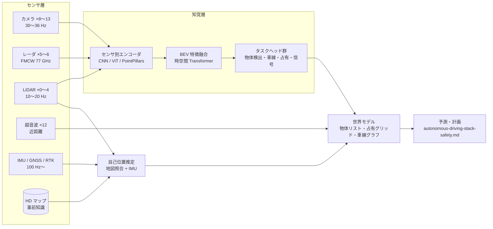

# ADAS のセンシングと知覚 (ADAS Sensing & Perception)

## 概要 (Overview)

先進運転支援システム (ADAS, Advanced Driver Assistance Systems) と自動運転システム (ADS, Automated Driving System) は、車両の周囲を「見る」ところから始まる。どれほど優れた計画・制御を積んでも、入力となる環境認識が誤っていれば出力も誤る。本ドキュメントは自動運転スタックの最上流、つまり**センサの物理**と、複数センサの情報を一つの世界モデルにまとめる**知覚 (perception)・センサ融合 (sensor fusion)** を扱う。

対象は次の3層である。

1. **センサ物理**: カメラ、77 GHz FMCW レーダ（4D イメージングレーダを含む）、LiDAR（ToF 方式と FMCW 方式）、超音波、IMU・GNSS・RTK、そして「事前に用意されたセンサ」としての HD マップ。各センサが何を直接測り、何を推論に頼るかを物理から導く。
2. **知覚アルゴリズム**: 早期融合と後期融合、カメラ画像を鳥瞰図 (BEV, Bird's-Eye View) 空間へ持ち上げる Transformer 系アーキテクチャ（BEVFormer ほか）、3D 占有グリッドを直接推定する占有ネットワーク (occupancy network)。
3. **設計思想の対立**: カメラのみ (camera-only) で進めるテスラ (Tesla) と、カメラ・レーダ・LiDAR を併用する Waymo・Mobileye の論争を、双方の論拠と独立した証拠に沿って公平に扱う。

ここで得た世界モデルを入力に、予測・計画・制御とその安全保証を論じるのが続編 [`autonomous-driving-stack-safety.md`](autonomous-driving-stack-safety.md) である。状態推定（カルマンフィルタ・SLAM）の一般論は [`../robotics/perception-state-estimation.md`](../robotics/perception-state-estimation.md) に委ね、本書は自動車固有の事情（高速・長距離・悪天候・量産コスト）に焦点を当てる。

## 方法論 (Methodology)

- **「何を直接測るか」でセンサを分類する。** 距離・相対速度・角度・反射強度・色/テクスチャのうち、各センサが物理的に直接観測する量と、学習モデルで推論しなければならない量を区別する。これが後段の融合設計と camera-only 論争の論点を決める。
- **物理の式から性能限界を導く。** レーダの距離分解能 `ΔR = c/(2B)`、LiDAR の飛行時間、カメラのピクセル角分解能など、仕様表の数字を第一原理で検算できる形で示す。電波伝搬・変調の基礎は [`../../hardware/wireless/radio-fundamentals-modulation.md`](../../hardware/wireless/radio-fundamentals-modulation.md) を前提とする。
- **知覚アーキテクチャは表現空間の変遷で整理する。** 画像平面 (2D) → 個別物体の 3D バウンディングボックス → BEV 特徴マップ → 3D 占有ボリューム、という「世界をどの座標系で表すか」の移行を軸にする。Transformer の注意機構の一般論は [`../../foundations/machine-learning/transformer-architecture.md`](../../foundations/machine-learning/transformer-architecture.md) を参照する。
- **ベンダーの数字は公称値として扱う。** センサの最大検出距離・チャネル数などは、AGENTS.md の Source Hierarchy に従いメーカー公称値 (vendor spec) と明記し、独立した実測と区別する。camera-only 論争では、各社の主張（マーケティングを含む）と、規制当局の調査・査読研究という独立証拠を分けて示す。

## 発見事項 (Findings)

1. **センサは「直接測る量」が互いに補完的である。** カメラは色・テクスチャ・文字（信号・標識・車線）を高解像度で捉えるが、距離は推論になる。レーダは距離と**ドップラーによる相対速度**を直接測り、雨・霧・逆光に強いが、角度分解能が低い。LiDAR は cm 級の 3D 形状を直接測るが、色を持たず、悪天候で劣化し、高価である。単一センサですべての量を直接測れるものはない。
2. **レーダの性能は帯域幅とアンテナ数で決まる。** 77 GHz 帯（76–81 GHz）の FMCW レーダでは、距離分解能は掃引帯域幅 `B` に反比例し（4 GHz で約 3.75 cm）、角度分解能は仮想アレイの開口に比例する。**4D イメージングレーダ**は MIMO で仮想チャネル数を数百〜数千に増やし、仰角を加えた点群を出力することで、「LiDAR の代替」の一部を担おうとしている。
3. **LiDAR は ToF から FMCW へ二極化しつつある。** パルス ToF 方式は成熟して安価になった一方、FMCW 方式は点ごとの視線速度を直接測れ、太陽光や他車 LiDAR との干渉に強い。波長 905 nm と 1550 nm の選択は、検出器材料のコストと目の安全基準 (IEC 60825-1) の許容出力のトレードオフである。
4. **知覚は「BEV 空間での融合」に収斂した。** 2020 年代前半、各カメラ画像を個別に処理して後から統合する方式から、全カメラの特徴を一つの BEV グリッドへ射影し、時間方向にも融合する方式（LSS, BEVFormer, BEVFusion）へ主流が移った。BEV は計画層がそのまま使える座標系であり、センサ間の融合も同じ格子上で行える。
5. **占有ネットワークは「物体の分類」から「空間の占有」へ問いを変えた。** 学習データにないクラスの障害物（落下物・転倒したトラック）はバウンディングボックス検出器では見落とされうる。3D 空間の各ボクセルが占有されているかを直接推定すれば、未知物体も「そこに何かがある」として扱える。
6. **camera-only 対 multi-sensor は、技術論と事業論が絡み合った論争である。** テスラは「人間は目だけで運転する」「センサ間の不一致はかえって害になる」「コストが量産を決める」と主張する。Waymo・Mobileye は「独立した物理原理による冗長性が稀な失敗を桁で減らす」と主張する。2026 年 10 月時点で、運転者なし (driverless) の商用運行を大規模に実証しているのは multi-sensor 側であり、camera-only 側は監視付き運用からの移行途上にある。ただし、この差がセンサ構成だけによるのか、運用設計・地図・検証の差によるのかは、公開データからは切り分けられない。

## アーキテクチャ (Architecture)

### 知覚パイプラインの全体像



センサ個数はシステムによって大きく異なる。テスラ HW3/HW4 車はカメラ 8 台が基本で[^tesla-aiday21]、北米向けでは 2021 年以降レーダ、2022 年以降超音波を廃している[^tesla-radar][^tesla-vision]。Waymo 第6世代ドライバはカメラ 13・LiDAR 4・レーダ 6 に外部音声受信機を加える[^waymo-6gen]。量産 L2 車では前方カメラ 1＋レーダ 1〜5 が典型である。

### センサの物理と特性比較

| センサ | 直接測る量 | 距離レンジ（典型） | 強み | 弱み | 単価の桁 |
|---|---|---|---|---|---|
| カメラ | 輝度・色・テクスチャ（2D） | 〜250 m（物体認識） | 高解像度、標識・信号・車線、安価 | 距離は推論、夜間・逆光・霧で劣化 | 数十ドル |
| 77 GHz レーダ | 距離・相対速度・方位（4D は仰角も） | 〜300 m | 全天候、速度を直接測定、安価 | 角度分解能が低い、金属以外の反射が弱い、マルチパス虚像 | 数十〜数百ドル |
| LiDAR (ToF) | 3D 点群・反射強度 | 〜200–250 m | cm 級の形状、夜間に強い | 雨・雪・霧で減衰、色なし、高価 | 数百〜数千ドル |
| LiDAR (FMCW) | 3D 点群＋視線速度 | 〜300 m（公称） | 点ごとの速度、干渉耐性 | 新しく高価、走査が遅い | 数百〜数千ドル |
| 超音波 | 近距離の距離 | 〜5 m | 極めて安価、ガラスや低い障害物 | 低速専用、角度情報が乏しい | 数ドル |
| IMU | 加速度・角速度 | — | 高レート、外界非依存 | 積分でドリフト | 数〜数百ドル |
| GNSS/RTK | 絶対位置 | — | 地球座標、RTK で cm 級 | 都市峡谷・トンネルで不可、なりすまし | 数十〜数百ドル |

単価は量産時の桁感であり、契約価格は非公開である。

### 融合方式の分類

融合をどの段階で行うかには3つの型がある。

| 方式 | 融合する対象 | 長所 | 短所 |
|---|---|---|---|
| **早期融合 (early fusion)** | 生データ（画素と点群を同じ座標に投影） | 情報損失が最小 | 時刻・校正ずれに敏感、計算量が大きい |
| **中間融合 (feature-level / BEV fusion)** | センサ別エンコーダの特徴マップを BEV 上で結合 | 学習で最適な重みを獲得、センサ欠落に比較的強い | エンドツーエンド学習が必要、解釈性が低い |
| **後期融合 (late fusion)** | 各センサが独立に出した物体リスト | モジュール独立・検証しやすい、冗長性を主張しやすい | センサ単独で検出できない物体は救えない |

ルールベースの後期融合（追跡フィルタで物体リストを統合）は従来の量産 ADAS の主流であり、BEV 中間融合は 2022 年以降の研究と先進量産の主流である。Mobileye の「真の冗長性 (True Redundancy)」は、カメラ系と レーダ/LiDAR 系がそれぞれ独立に完結した世界モデルを作る**意図的な後期融合**である[^mobileye-redundancy]。統計的に独立な2系統の失敗確率の積で安全を主張するには、系統間で情報を混ぜないことが前提になるためである。

## 技術詳細 (Technical Details)

### 1. カメラ — 解像度と距離推定の限界

車載カメラは CMOS イメージセンサで、HDR（ハイダイナミックレンジ, 120 dB 以上）と LED フリッカ抑制 (LFM) が量産要件になる。トンネル出口や対向車のヘッドライトのように、同一画面に 10⁵ 倍以上の輝度差が生じるためである。

角度分解能は画素数と画角で決まる。水平画角 120°・横 3840 画素なら 1 画素あたり約 0.031°、100 m 先で約 5.5 cm になる。歩行者（幅 0.5 m）は 100 m で約 9 画素、250 m で約 3.6 画素となり、遠方ほど「見えてはいるが分類できない」領域に入る。そのため高速道路向けに狭角の長距離カメラを別に積むのが一般的である。

単眼カメラの距離は**推論**である。手がかりは物体の既知サイズ、地面との接地点、運動視差（自車移動による見え方の変化）、そして学習された事前分布である。ステレオカメラは視差 `d` から `Z = f·b/d`（`f`: 焦点距離, `b`: 基線長）で距離を幾何的に求めるが、距離誤差は `ΔZ ≈ Z²/(f·b)·Δd` と距離の2乗で増える。車幅に収まる基線長では遠距離精度が足りない。マルチカメラの BEV 手法は、重なり合う視野と時系列の運動視差を学習で統合することで、この限界を部分的に補う。

### 2. 77 GHz FMCW レーダ — 距離・速度・角度の3軸

車載レーダは 76–81 GHz 帯を使う。76–77 GHz は等価等方放射電力 (EIRP) の上限が高い長距離レーダ (LRR, ACC 用) 向け、77–81 GHz は最大 4 GHz の掃引帯域が取れる短距離レーダ (SRR) 向けである。欧米では 24 GHz 超広帯域の使用が 2022 年 1 月 1 日以降認められなくなり、77 GHz 帯へ移行した[^ti-radar][^etsi-302264]。方式はほぼすべて **FMCW (Frequency-Modulated Continuous Wave)** である。周波数を時間に対して直線的に掃引する「チャープ (chirp)」を送信し、反射波と送信波を混合 (mixing) すると、往復遅延に比例した**ビート周波数** `f_b` が得られる。

```
送信チャープ:  f(t) = f_c + S·t           (S = B / T_c: 掃引傾き)
往復遅延:      τ = 2R / c
ビート周波数:  f_b = S·τ = 2·S·R / c   →  R = c·f_b / (2S)
距離分解能:    ΔR = c / (2B)              (B = 4 GHz → 3.75 cm, TI は「約 4 cm」と記載)
速度分解能:    Δv = λ / (2·N·T_c)         (N チャープのフレーム時間で決まる)
角度分解能:    Δθ ≈ 2 / N_virt  [rad]     (λ/2 間隔の仮想アレイ N_virt 素子, 正面方向)
```

上式は TI のチャープ設計アプリケーションノートの基本式と同じである[^ti-chirp]。1 フレームの処理は **2 段の FFT** で行う。量産用の単一チップ（例: TI AWR2944、4Tx/4Rx、4 GHz 超の連続帯域、DSP とハードウェアアクセラレータ内蔵、ASIL B 対象）は、RF フロントエンドから FFT・CFAR までを 1 パッケージに収める[^ti-awr2944]。各チャープ内の FFT（距離 FFT）でビート周波数から距離を、チャープ間の位相回転の FFT（ドップラー FFT）で相対速度を得る。これが**距離–ドップラーマップ**であり、その上で CFAR（Constant False Alarm Rate）検出器がノイズフロアに適応した閾値で目標を検出する。最後に受信アンテナ間の位相差から到来角を推定する[^patole-radar]。

**角度分解能がレーダの弱点**である。送信 `N_tx`・受信 `N_rx` の MIMO 構成では仮想アレイは `N_tx × N_rx` 素子になり、3Tx×4Rx の 12 素子なら正面で約 10° 程度にとどまる。100 m 先では 10° は約 17 m の幅に相当し、隣接車線の車と路側の構造物を分離できない。停止物体（路上の停止車両・マンホール蓋・頭上の標識）と自車線上の障害物を区別しにくいことが、従来のレーダ ACC が停止車両への追突を防げなかった物理的理由である。

**4D イメージングレーダ**は、複数チップのカスケード接続や専用 SoC で仮想チャネル数を数百〜2000 超へ増やし、方位・仰角とも 1° 前後の分解能を狙う。代表例として、Arbe Phoenix は送信 48×受信 48 = 2304 仮想チャネルのチップセットで、方位 0.7°・仰角 0.9° の分解能と最大 300 m の検出を謳う（いずれも**公称値**）[^arbe]。Continental（現 AUMOVIO）の ARS540 も「4D プレミアム長距離レーダ」として量産されている[^aumovio-radar]。仰角が得られると、頭上の標識と路上の停止車両を高さで分離できる。ただし点群密度は LiDAR より 1〜2 桁疎であり、「LiDAR の完全な代替」ではなく「悪天候で落ちない低解像度の 3D センサ」と位置づけるのが妥当である。

レーダ固有の誤差要因として、**マルチパス（ガードレールや路面での反射による虚像）**、**相互干渉**（他車レーダのチャープとの衝突。車両密度とともに増える）、**低 RCS 目標**（歩行者や自転車は車両より反射断面積が小さい）がある。

### 3. LiDAR — ToF と FMCW

LiDAR (Light Detection and Ranging) はレーザ光で距離を測る。

- **パルス ToF (Time of Flight)**: 数 ns のパルスを出し、往復時間 `t` から `R = c·t/2` を求める。1 ns の計時誤差は 15 cm に相当するため、ピコ秒級の計時回路と SPAD (single-photon avalanche diode) / APD 検出器を使う。走査は機械式回転（初期の 64 ライン品）、MEMS ミラー、光学フェーズドアレイ、走査なしのフラッシュ方式へと固体化が進んだ。
- **FMCW**: レーダと同じ周波数掃引を光で行い、コヒーレント検波で距離と**ドップラー速度を同時に**得る。点ごとの視線速度により、静止物と移動物を1フレームで分離できる。局部発振光との干渉でしか信号が出ないため、太陽光や他車 LiDAR の光をほぼ拒絶できる。Aeva は FMCW 方式の「4D LiDAR」として点ごとの速度出力を製品化しており、最大 500 m の検出を謳う（**公称値**）[^aeva]。ToF/AMCW/FMCW の回路アーキテクチャの比較は Behroozpour らのレビューが詳しい[^behroozpour]。

**波長の選択**は工学的トレードオフである。905 nm はシリコン検出器が使えて安価だが、網膜に届く波長のため IEC 60825-1[^iec60825] のクラス 1（目に安全）の出力上限が厳しく、検出距離が制約される[^li-lidar]。1550 nm は前眼部（角膜・水晶体）の水分で吸収されて網膜に届かないため、桁違いに高い出力が許され、200 m 超の長距離を狙える。例として MicroVision（旧 Luminar 製品）の IRIS は 1550 nm で最大計測距離 280 m を公称する[^iris]。その代わり InGaAs 検出器とファイバレーザが必要で高価になり、水の吸収が大きく雨の影響を受けやすい。

**悪天候**では、雨滴・雪片・霧粒がパルスを散乱して偽点（クラッタ）と減衰を生む。マルチエコー（最後の反射を採る）や点群フィルタで緩和できるが、濃霧ではレーダに劣る。

### 4. 超音波・IMU・GNSS/RTK

- **超音波センサ**は 40–50 kHz 前後の音波で近距離を測る駐車支援用センサである。Bosch の製品は最小 15 cm から最大 5.5 m の検出を公称する[^bosch-uss]。音速（約 340 m/s）に律速されて更新が遅く、低速専用となる。テスラは 2022 年 10 月に新車から超音波センサを廃止すると発表し、カメラ由来の占有推定（Vision Park Assist）で代替した[^tesla-vision]。
- **IMU** は車両の加速度・角速度を 100 Hz〜1 kHz で供給し、カメラ・LiDAR の短時間の運動補償と、GNSS が途絶した区間の推測航法 (dead reckoning) を担う。誤差の性質（バイアス・ドリフト）と融合の理論は [`../robotics/perception-state-estimation.md`](../robotics/perception-state-estimation.md) の通りである。
- **GNSS** の単独測位は数 m の誤差を持つ。**RTK (Real-Time Kinematic)** は基準局からの補正情報で搬送波位相の整数不確定性 (integer ambiguity) を解き、開けた空の下で cm 級の精度を得る[^yeong-fusion]。PPP-RTK や SBAS などの広域補正も使われる。ただし都市峡谷のマルチパスや高架下では精度が崩れるため、ADS は GNSS を単独の真値としては扱わず、LiDAR やカメラによる地図照合と融合する。

### 5. HD マップ — 事前に測った「センサ」

**HD マップ (High-Definition map)** は cm 級精度の 3D 地図で、車線境界・停止線・信号の位置・制限速度などの意味情報を含む。自車位置を地図に照合 (map matching) すれば、走行中に見えない情報（カーブ先の車線形状・信号の位置）を事前知識として使える。HD マップは**オフラインで高性能センサを使って測った知覚結果のキャッシュ**と見なせる。

| 方式 | 代表 | 長所 | 短所 |
|---|---|---|---|
| 専用測量車による HD マップ | Waymo | 高精度、知覚の負荷と不確かさを下げる | 作成・更新コスト、工事などの変化への追従 |
| 群衆調達 (crowdsourced) の軽量地図 | Mobileye REM（量産 ADAS 車から約 10 KB/km で収集、公称）[^mobileye-rem] | 量産車のカメラから低帯域で自動更新、広域展開 | 精度・意味情報が HD より少ない |
| 地図に依存しない (mapless) | Tesla FSD | 地理的な展開制約がない | 毎回その場で完全に知覚する必要、標準ナビ地図のみ |

Waymo は地図を「実際に見ているものを補う記憶」と位置づけ、走行中の車両が検知した変化（工事など）を自動でアップロードし、フリート全体で共有する運用を公表している[^waymo-maps]。地図の有無は「運行設計領域 (ODD) を地理的にどう広げるか」という事業判断と直結しており、詳細は続編で扱う。

### 6. BEV 知覚 — 画像平面から鳥瞰空間へ

計画・制御は自車中心の平面座標（上空から見た地図）で動く。しかしカメラは透視投影の画像平面で世界を見る。この**座標系のギャップ**をどこで埋めるかが、2020 年代のカメラ知覚の主題である。

1. **Lift-Splat-Shoot (LSS)**[^lss]: 各画素について離散的な深度分布を予測し（Lift）、特徴を 3D の視錐台に持ち上げ、BEV 格子へ積み上げる（Splat）。深度を明示的に推定する方式である。
2. **BEVFormer**[^bevformer]: BEV 格子の各セルに学習可能なクエリを置き、**空間クロスアテンション**で、そのセルの 3D 位置を各カメラ画像へ投影した近傍の特徴だけを参照する（deformable attention）。さらに**時間自己アテンション**で、自車運動を補正した前フレームの BEV 特徴を参照する。深度を明示的に推定せず、「BEV から画像を見に行く」逆向きの方式である。時間融合により、隠れた物体の記憶や速度推定が改善する。
3. **DETR3D**[^detr3d]: BEVFormer に先立ち、3D 空間の物体クエリを各画像へ投影して特徴を引く「3D→2D クエリ」を提案した。
4. **BEVFusion**[^bevfusion]: カメラ BEV 特徴と LiDAR BEV 特徴（PointPillars/VoxelNet 系[^pointpillars]）を同じ BEV 格子上で連結する中間融合である。物体検出に加え、地図要素のセグメンテーションも同一表現から出力する。

```
BEVFormer の 1 層（概念）:
  Q_t        : BEV クエリ (H×W×C), 各セル = 自車周辺の地面上の位置
  B_{t-1}    : 前時刻の BEV 特徴（自車運動で位置合わせ）
  Q' = TemporalSelfAttn(Q_t, B_{t-1})                  # 時間方向の融合
  Q''= SpatialCrossAttn(Q', {F_cam_i}, 参照点=3D 柱の各高さを各カメラへ投影)
  B_t = FFN(Q'')                                      # 次段・タスクヘッドへ
計算量: deformable attention により各クエリは少数の参照点のみ参照
        → 全画素とのアテンション O(HW·N_pix) を O(HW·K) に削減 (K: 参照点数)
```

BEVFormer は nuScenes テストセットで NDS 56.9% を報告し、従来手法を 9.0 ポイント上回った[^bevformer]。BEVFusion は nuScenes の検出で mAP・NDS を 1.3% 改善し、BEV 地図セグメンテーションで mIoU を 13.6% 改善しつつ計算量を 1/1.9 にしたと報告している[^bevfusion]。評価には nuScenes[^nuscenes]（カメラ 6・LiDAR 1・レーダ 5、各 20 秒の 1000 シーン）と Waymo Open Dataset[^waymo-open] が標準的に使われ、NDS・mAP などで比較される。ただしベンチマーク上の向上は、稀な事象 (long tail) での安全性を直接は保証しない。

### 7. 占有ネットワーク (Occupancy Networks)

物体検出は「既知クラスの直方体」を出力する。ところが道路上の危険には、定義済みクラスに収まらないもの（崩れた積荷・倒木・横転車両・不定形の工事資材）がある。**占有ネットワーク**は、自車周辺の 3D 空間をボクセルに分割し、各ボクセルが占有されているか（加えて意味クラスや運動）を直接推定する。テスラは 2022 年の AI Day で、カメラのみから 3D 占有とその流れ (occupancy flow) を推定するネットワークを発表した[^tesla-aiday22]。2021 年の AI Day では、共有バックボーンに複数のタスクヘッドを載せる「HydraNet」と、8 カメラの特徴をベクトル空間へ融合する構成を示している[^tesla-aiday21]。学術側でも Occ3D[^occ3d]（Waymo と nuScenes を基にした占有予測ベンチマーク）などが整備された。

占有表現の利点は、**未知物体を「何かがある」として扱える**点と、計画層が「通れる空間」を直接得られる点である。欠点は、ボクセル数が解像度の3乗で増える計算・メモリ負荷と、教師データ（密な 3D 正解）の作成コストである。後者は LiDAR 点群を時系列で集積して自動生成するのが通例であり、**camera-only の推論系を作るためにも訓練時には LiDAR を使う**という構図が生じる。

### 8. camera-only 対 multi-sensor — 論拠と証拠

| 観点 | camera-only（テスラ） | multi-sensor（Waymo・Mobileye） |
|---|---|---|
| 基本主張 | 道路は人間の視覚のために設計されており、視覚と知能で解ける | 独立した物理原理の冗長性が、稀な失敗を桁で減らす |
| センサ不一致 | レーダとカメラが食い違うと誤判断（ファントムブレーキ）の原因になる[^karpathy-cvpr] | 不一致の検出自体が異常検知・縮退のトリガになる |
| 距離・速度 | 大量データで学習した深度推定で十分に近づく | レーダ・LiDAR は直接測るため、学習分布外でも物理的に保証される |
| 悪条件 | 人間と同様に減速・回避で対処 | レーダは霧・雨・逆光でも距離を失わない |
| コスト・規模 | 数百万台の量産車から学習データを得られる | LiDAR の価格は下がったが、車両単価と台数で不利 |
| 実証状況 | 監視付き L2 (FSD Supervised) が大規模に普及、運転者なし運行は限定的（続編参照） | 運転者なしの商用運行を複数都市で実証（続編参照） |

テスラは 2021 年 5 月以降の北米向け Model 3/Y からレーダを外して「Tesla Vision」へ移行した。移行当初は Autosteer の上限速度を 75 mph に制限するなど、機能の一時的な縮小を自ら告知している[^tesla-radar]。2022 年には超音波センサも廃した[^tesla-vision]。当時の AI 責任者 Karpathy は CVPR 2021 の自動運転ワークショップ (WAD) の基調講演で、視覚のみのスタックへの移行理由として、レーダ由来の誤検出とセンサ融合の難しさを挙げ、大量の自動ラベル付きデータで学習した視覚の深度・速度推定がレーダに匹敵すると主張した[^karpathy-cvpr]。これはテスラ自身の説明であり、比較の条件や評価データは公開されていない。

一方、米国道路交通安全局 (NHTSA) は 2024 年 10 月、太陽のまぶしさ・霧・粉塵など**視界不良の条件下での FSD 関連事故**（歩行者死亡 1 件を含む）を受けて予備調査 (PE24031) を開始した[^nhtsa-pe24031]。NHTSA は 2026 年 3 月にこれを技術分析 (Engineering Analysis, EA26002) へ格上げし、視界劣化を検知する仕組みが運転者へ適切に警告しない場合があるとの見解を示したと報じられている。2026 年 10 月時点で調査は継続中である[^tc-fsd-probes]。調査の進展は欠陥の最終認定ではない。それでも、camera-only 方式の弱点として論じられてきた条件が規制当局の調査対象になったことは、論点が現実の運用で問われていることを示す。

公平に整理すると、次のようになる。

- **multi-sensor 側の優位は「運転者なし運行の実績」として実証されている**。ただしその実績は、地理的に限定された ODD・HD マップ・遠隔支援・長期の検証と組み合わさったものであり、センサ構成の寄与だけを分離した公開研究はない。
- **camera-only 側の優位は「コストと学習データ量」**であり、L2 監視付き運転支援の普及規模としては実証されている。運転者なしの安全性を同等水準で示す独立データは、2026 年 10 月時点で公開されていない。
- 両陣営は収斂もしている。占有ネットワークの教師データ生成で述べたとおり、camera-only の推論系でも訓練段階では密な 3D 正解が要る。Waymo も知覚の大部分を学習モデル化しており、マルチモーダル大規模モデルによる end-to-end 運転の研究（続編の EMMA）も公表している。Mobileye は量産 L2 ではカメラ中心、運転者なしではレーダ・LiDAR を足すという、ODD に応じた段階的構成をとる。

## セキュリティ考察 (Security Considerations)

知覚は**物理世界から直接入力を受け取る**ため、ネットワーク経由の攻撃（[`cybersecurity-iso21434.md`](cybersecurity-iso21434.md)）とは別に、センサの物理チャネルそのものが攻撃面になる。

- **カメラへの敵対的攻撃**: 標識へのステッカー貼付で分類を誤らせる物理的敵対例 (adversarial example)、プロジェクタによる偽の車線・標識の投影が研究で示されている[^eykholt-adv]。防御は、HD マップとの照合（そこに標識があるはずか）、時間的一貫性の検査、複数センサの照合である。
- **LiDAR スプーフィング**: 同期したレーザパルスを注入して偽の障害物を作る攻撃、逆に実在の物体を消す攻撃が実証されている[^cao-lidar]。FMCW 方式はコヒーレント検波のため、ToF 方式より注入に強い。
- **レーダ妨害**: チャープを模倣したスプーフィングやジャミングは原理的に可能である。チャープパラメータのランダム化と干渉検出が対策となる。
- **GNSS スプーフィング**: 偽の衛星信号による自己位置の誘導は実証済みの脅威である。ADS は GNSS を単独の真値とせず、地図照合・IMU との整合性を常時監視する。
- **センサ融合は防御でもある**: 独立した物理原理のセンサを同時に欺くのは、単一センサを欺くより格段に難しい。この点で multi-sensor 構成はセキュリティ上も冗長性を提供する。ただし、BEV 中間融合のように単一のネットワークが全センサを統合する場合、融合ネットワーク自体への敵対的入力が全系に波及しうる。
- **SOTIF との接点**: 攻撃がなくても、逆光・未知物体・雨の反射といった**性能限界**で知覚は誤る。これは故障でも攻撃でもない「意図した機能の不足」であり、ISO 21448 (SOTIF) の対象である。詳細は続編 [`autonomous-driving-stack-safety.md`](autonomous-driving-stack-safety.md) と [`functional-safety-iso26262.md`](functional-safety-iso26262.md) で扱う。
- **データの完全性**: センサデータと知覚出力は車内ネットワーク（[`automotive-ethernet-tsn.md`](automotive-ethernet-tsn.md) のマルチギガビット Ethernet、カメラ用 SerDes）を流れる。時刻同期 (gPTP) の改竄はセンサ間の位置合わせを壊すため、時刻同期と経路の完全性保護が安全要件になる。

## 結論 (Conclusions)

- センサは「何を直接測るか」で相補的である。カメラは意味（色・文字）、レーダは速度と全天候性、LiDAR は形状を直接測る。単一センサで全量を直接測れるものはなく、知覚とは残りを推論で埋める作業である。
- 性能の天井は物理で決まる。レーダの距離分解能は帯域幅、角度分解能は仮想アレイ開口、LiDAR の距離は目の安全基準と波長、カメラの遠方認識は画素角分解能が律速する。4D イメージングレーダと FMCW LiDAR は、それぞれの弱点を物理の側から削る技術進化である。
- 知覚アーキテクチャは BEV 空間での時空間融合へ収斂し、さらに占有ネットワークで「物体分類」から「空間占有」へ問いが移った。これは計画層が使う座標系に知覚を合わせる流れであり、続編で扱う end-to-end 学習への布石でもある。
- camera-only と multi-sensor の論争は、2026 年 10 月時点で「運転者なし運行の実証は multi-sensor 側が先行、量産規模とコストは camera-only 側が優位」という状態にある。センサ構成の寄与を他要因から切り分ける独立データはなく、どちらかを断定的に正解とする根拠はまだない。

### 次の接続先 (Related Topics)

- [`autonomous-driving-stack-safety.md`](autonomous-driving-stack-safety.md) — 本書の世界モデルを入力とする予測・計画・制御、SoC、安全規格、検証と展開状況。
- [`../robotics/perception-state-estimation.md`](../robotics/perception-state-estimation.md) — ベイズフィルタ・センサフュージョン・SLAM の一般論。
- [`../../hardware/wireless/radio-fundamentals-modulation.md`](../../hardware/wireless/radio-fundamentals-modulation.md) — FMCW レーダの前提となる電波伝搬・変調・MIMO。
- [`../../foundations/machine-learning/transformer-architecture.md`](../../foundations/machine-learning/transformer-architecture.md) — BEVFormer の注意機構の基礎。
- [`ee-architecture.md`](ee-architecture.md) / [`automotive-ethernet-tsn.md`](automotive-ethernet-tsn.md) — センサデータを中央コンピュートへ運ぶ E/E 構成と車載 Ethernet。
- [`ev/tesla-software-manufacturing.md`](ev/tesla-software-manufacturing.md) — テスラの集中型 E/E と FSD コンピュータ。

## 参考文献 (References)

**一次資料 (Primary — 査読論文・標準・ベンダー一次資料)**

[^bevformer]: Li, Z., Wang, W., Li, H., Xie, E., Sima, C., Lu, T., Qiao, Y. & Dai, J. (2022). BEVFormer: Learning Bird's-Eye-View Representation from Multi-camera Images via Spatiotemporal Transformers. *ECCV 2022*, LNCS, 1–18. DOI: 10.1007/978-3-031-20077-9_1 — [arXiv:2203.17270](https://arxiv.org/abs/2203.17270) — Accessed: 2026-10-04。nuScenes テスト NDS 56.9%。

[^lss]: Philion, J. & Fidler, S. (2020). Lift, Splat, Shoot: Encoding Images from Arbitrary Camera Rigs by Implicitly Unprojecting to 3D. *ECCV 2020*, LNCS, 194–210. DOI: 10.1007/978-3-030-58568-6_12

[^bevfusion]: Liu, Z., Tang, H., Amini, A., Yang, X., Mao, H., Rus, D. L. & Han, S. (2023). BEVFusion: Multi-Task Multi-Sensor Fusion with Unified Bird's-Eye View Representation. *2023 IEEE International Conference on Robotics and Automation (ICRA)*, 2774–2781. DOI: 10.1109/ICRA48891.2023.10160968 — [arXiv:2205.13542](https://arxiv.org/abs/2205.13542) — Accessed: 2026-10-04。

[^detr3d]: Wang, Y., Guizilini, V. C., Zhang, T., Wang, Y., Zhao, H. & Solomon, J. (2022). DETR3D: 3D Object Detection from Multi-view Images via 3D-to-2D Queries. *Proceedings of the 5th Conference on Robot Learning (CoRL 2021)*, PMLR 164, 180–191. — [PMLR](https://proceedings.mlr.press/v164/wang22b.html) — Accessed: 2026-10-04。

[^pointpillars]: Lang, A. H., Vora, S., Caesar, H., Zhou, L., Yang, J. & Beijbom, O. (2019). PointPillars: Fast Encoders for Object Detection From Point Clouds. *CVPR 2019*, 12689–12697. DOI: 10.1109/CVPR.2019.01298

[^occ3d]: Tian, X., Jiang, T., Yun, L., Mao, Y., Yang, H., Wang, Y., Wang, Y. & Zhao, H. (2023). Occ3D: A Large-Scale 3D Occupancy Prediction Benchmark for Autonomous Driving. *Advances in Neural Information Processing Systems 36 (NeurIPS 2023)*, 64318–64330. DOI: 10.52202/075280-2809 — [arXiv:2304.14365](https://arxiv.org/abs/2304.14365) — Accessed: 2026-10-04。

[^nuscenes]: Caesar, H. et al. (2020). nuScenes: A Multimodal Dataset for Autonomous Driving. *CVPR 2020*, 11618–11628. DOI: 10.1109/CVPR42600.2020.01164

[^waymo-open]: Sun, P. et al. (2020). Scalability in Perception for Autonomous Driving: Waymo Open Dataset. *CVPR 2020*, 2443–2451. DOI: 10.1109/CVPR42600.2020.00252

[^patole-radar]: Patole, S. M., Torlak, M., Wang, D. & Ali, M. (2017). Automotive radars: A review of signal processing techniques. *IEEE Signal Processing Magazine*, 34(2), 22–35. DOI: 10.1109/MSP.2016.2628914 — FMCW・距離/ドップラー FFT・CFAR・到来角推定の標準的レビュー。

[^li-lidar]: Li, Y. & Ibanez-Guzman, J. (2020). Lidar for Autonomous Driving: The Principles, Challenges, and Trends for Automotive Lidar and Perception Systems. *IEEE Signal Processing Magazine*, 37(4), 50–61. DOI: 10.1109/MSP.2020.2973615 — ToF/FMCW、波長選択、悪天候の影響。

[^behroozpour]: Behroozpour, B., Sandborn, P. A. M., Wu, M. C. & Boser, B. E. (2017). Lidar System Architectures and Circuits. *IEEE Communications Magazine*, 55(10), 135–142. DOI: 10.1109/MCOM.2017.1700030

[^yeong-fusion]: Yeong, D. J., Velasco-Hernandez, G., Barry, J. & Walsh, J. (2021). Sensor and Sensor Fusion Technology in Autonomous Vehicles: A Review. *Sensors*, 21(6), 2140. DOI: 10.3390/s21062140 — センサ特性と融合方式の総説。

[^eykholt-adv]: Eykholt, K., Evtimov, I., Fernandes, E. et al. (2018). Robust Physical-World Attacks on Deep Learning Visual Classification. *2018 IEEE/CVF Conference on Computer Vision and Pattern Recognition*, 1625–1634. DOI: 10.1109/CVPR.2018.00175

[^cao-lidar]: Cao, Y., Xiao, C., Cyr, B. et al. (2019). Adversarial Sensor Attack on LiDAR-based Perception in Autonomous Driving. *Proceedings of the 2019 ACM SIGSAC Conference on Computer and Communications Security (CCS)*, 2267–2281. DOI: 10.1145/3319535.3339815

[^iec60825]: IEC 60825-1:2014 (Ed. 3.0), *Safety of laser products — Part 1: Equipment classification and requirements*. — [IEC Webstore](https://webstore.iec.ch/en/publication/3587) — Accessed: 2026-10-04。

[^etsi-302264]: ETSI EN 302 264 V2.1.1 (2017-05), *Short Range Radar equipment operating in the 77 GHz to 81 GHz band*. — [PDF](https://www.etsi.org/deliver/etsi_en/302200_302299/302264/02.01.01_60/en_302264v020101p.pdf) — Accessed: 2026-10-04。

[^ti-radar]: Ramasubramanian, K. (2017). [Moving from legacy 24 GHz to state-of-the-art 77 GHz radar](https://www.ti.com/lit/wp/spry312/spry312.pdf) (SPRY312), Texas Instruments — Accessed: 2026-10-04。76–77 GHz LRR / 77–81 GHz SRR（最大 4 GHz 掃引）、24 GHz UWB の 2022 年 1 月以降の使用不可。

[^ti-chirp]: Dham, V. (2017, rev. 2020). [Programming Chirp Parameters in TI Radar Devices](https://www.ti.com/lit/an/swra553a/swra553a.pdf) (SWRA553A), Texas Instruments — Accessed: 2026-10-04。距離分解能 `c/(2B)` ほかの基本式。

[^ti-awr2944]: [AWR2944 — Automotive, second-generation 76-GHz to 81-GHz high-performance SoC for corner and long-range radar](https://www.ti.com/product/AWR2944) — Texas Instruments — Accessed: 2026-10-04。**ベンダー公称仕様**。

[^arbe]: [Arbe Phoenix — 4D Imaging Radar](https://arberobotics.com/product/) — Arbe Robotics — Accessed: 2026-10-04。2304 仮想チャネル、方位 0.7°/仰角 0.9°、300 m。**ベンダー公称値**。

[^aumovio-radar]: [Radar technology](https://www.aumovio.com/en/solutions/driver-assistance/automated-assisted-driving/radar-technology.html) — AUMOVIO（旧 Continental 自動車部門） — Accessed: 2026-10-04。ARS540 を「4D premium long-range radar」と記載。

[^aeva]: [Aeva — FMCW 4D LiDAR](https://www.aeva.com/) および [Aeries II](https://www.aeva.com/aeries-ii/) — Aeva — Accessed: 2026-10-04。点ごとの速度、最大 500 m。**ベンダー公称値**。

[^iris]: [IRIS](https://microvision.com/sensors/iris) — MicroVision — Accessed: 2026-10-04。1550 nm、最大計測距離 280 m、視野 120°×26°。**ベンダー公称値**。

[^bosch-uss]: [Ultrasonic sensor](https://www.bosch-mobility.com/en/solutions/sensors/ultrasonic-sensor/) — Bosch Mobility — Accessed: 2026-10-04。15 cm〜5.5 m。**ベンダー公称値**。

[^waymo-6gen]: [Meet the 6th-generation Waymo Driver](https://waymo.com/blog/2024/08/meet-the-6th-generation-waymo-driver) — Waymo (2024-08-19) — Accessed: 2026-10-04。カメラ 13・LiDAR 4・レーダ 6・外部音声受信機。

[^waymo-maps]: [The Waymo Driver Handbook: Mapping](https://waymo.com/blog/2020/09/the-waymo-driver-handbook-mapping) — Waymo (2020-09-21) — Accessed: 2026-10-04。

[^mobileye-redundancy]: [True Redundancy](https://www.mobileye.com/technology/true-redundancy/) — Mobileye — Accessed: 2026-10-04。カメラ単独で走行可能なサブシステムとレーダ/LiDAR サブシステムが各々完全な環境モデルを構築。

[^mobileye-rem]: [REM — Road Experience Management](https://www.mobileye.com/technology/rem/) — Mobileye — Accessed: 2026-10-04。

[^tesla-vision]: [Transitioning to Tesla Vision](https://www.tesla.com/support/transitioning-tesla-vision) — Tesla — Accessed: 2026-10-04（本稿執筆時はアクセス制限で本文を再取得できず、超音波廃止の時期は二次報道と照合）。

[^tesla-aiday21]: [Tesla AI Day 2021](https://www.youtube.com/watch?v=j0z4FweCy4M) — Tesla (YouTube) — Accessed: 2026-10-04。HydraNet、マルチカメラのベクトル空間融合。**ベンダー発表**。

[^tesla-aiday22]: [Tesla AI Day 2022](https://www.youtube.com/watch?v=ODSJsviD_SU) — Tesla (YouTube) — Accessed: 2026-10-04。占有ネットワーク。**ベンダー発表**。

[^karpathy-cvpr]: [[CVPR'21 WAD] Keynote — Andrej Karpathy, Tesla](https://www.youtube.com/watch?v=g6bOwQdCJrc) — Workshop on Autonomous Driving at CVPR 2021 (YouTube) — Accessed: 2026-10-04。**当事者の説明**。

[^nhtsa-pe24031]: NHTSA Office of Defects Investigation (2024-10-17). [ODI Resume PE24031: FSD Collisions in Reduced Roadway Visibility Conditions](https://static.nhtsa.gov/odi/inv/2024/INOA-PE24031-23232.pdf) — Accessed: 2026-10-04。SGO 報告 4 件（歩行者死亡 1 件）を契機、対象約 241 万台。

**二次資料 (Secondary — 専門報道)**

[^tc-fsd-probes]: [Tesla settles FSD crash lawsuit as federal investigations continue](https://techcrunch.com/2026/06/26/tesla-settles-fsd-crash-lawsuit-as-federal-investigations-continue/) — TechCrunch (2026-06-26) — Accessed: 2026-10-04。PE24031 の EA26002 への格上げ（2026 年 3 月）、PE25012（交通違反、約 288 万台）。

[^tesla-radar]: [Tesla announces transition to 'Tesla Vision' without radar, warns of limitations at first](https://electrek.co/2021/05/25/tesla-vision-without-radar-warns-limitations-first/) — Electrek (2021-05-25) — Accessed: 2026-10-04。2021 年 5 月以降の北米 Model 3/Y からのレーダ廃止、Autosteer 75 mph 制限。

**注**: センサの検出距離・チャネル数などの製品仕様は、断りのない限りベンダー公称値であり、独立した実測ではない。Arbe・Aeva などの数値は最良条件（高反射率目標など）での値である可能性が高い。
