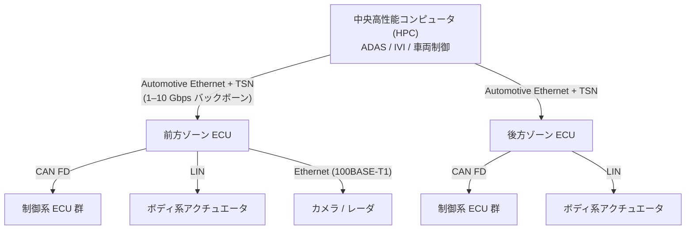

# 車載 Ethernet と TSN — 高帯域・決定論バックボーン (Automotive Ethernet & TSN)

## 概要 (Overview)

`in-vehicle-networks.md` は車載ネットワークの中核である **CAN (Controller Area Network)** を軸に扱った。しかし ADAS・自動運転・**ゾーン型 E/E アーキテクチャ (zonal architecture)** の進展で、車載通信の要求は「数 kbps のスイッチ信号」から「Gbps 級のカメラ/LiDAR 映像」へと桁が変わった。CAN（最大 1 Mbps、CAN FD でも ~8 Mbps）では帯域が根本的に足りない。

本ドキュメントは、CAN の「外側」——**Automotive Ethernet** と **TSN (Time-Sensitive Networking, 時間高感度ネットワーク)** を主役に、FlexRay・LIN・CAN FD/XL を含む非 CAN プロトコル群を整理する。なぜ 1 台に複数のネットワークが共存し続け、なぜゾーン型のバックボーンが Ethernet + TSN に収束していくのかを、ソフトウェアと物理（帯域・タイミング・冗長）の接点として明らかにする。

## 方法論 (Methodology)

- 通信要求を「**帯域・決定論 (determinism, レイテンシ保証)・冗長・コスト・配線**」の 5 軸で捉え、各プロトコルの立ち位置を対応づける。
- **素の Ethernet は決定論的でない**という本質問題を起点に、TSN がそれをどう解くかを機構単位（時刻同期・スケジュール・プリエンプション・冗長）に分解する。
- FlexRay（TDMA）と LIN（従属バス）を「決定論の先駆」「最安ニッチ」として位置づけ、Ethernet + TSN との代替・住み分けを示す。
- 数値・規格番号は各標準の代表値に基づく（IEEE 802.3 / 802.1、ISO 17458 (FlexRay)、ISO 17987 (LIN)、ISO 11898 (CAN)、CiA 610 (CAN XL)）。

## 発見事項 (Findings)

1. **帯域の桁が変わった。** カメラ・LiDAR・レーダの生データは CAN の数百〜数千倍。物理的に Ethernet が不可避となり、車載バックボーンは Ethernet へ移行している。
2. **素の Ethernet は決定論を持たない。** ベストエフォート転送とスイッチのキュー競合により尾レイテンシ (tail latency) が非有界で、ブレーキ・ステアのような安全制御には不十分。**TSN が「時間を保証する Ethernet」に変える。**
3. **物理層がオフィス Ethernet と別物。** 車載は **Single Pair Ethernet (SPE, 1 対線)** ＋電力重畳 (PoDL) で軽く安く敷く。100/1000/10BASE-T1 は 1 対で全二重を実現する専用 PHY。
4. **FlexRay は決定論の先駆だが置換されつつある。** TDMA と二重チャネル冗長で X-by-wire を支えたが、高コスト・10 Mbps 頭打ちのため、TSN 付き Ethernet が同等機能を高帯域で代替する。
5. **LIN は今も現役。** 数十円のボディ系アクチュエータには CAN すら過剰で、単線・マスタ従属の LIN が最安層を担う。**「万能バスは存在しない」は不変**で、階層化（Ethernet 幹＋ CAN/LIN 枝）が現実解。
6. **通信が「信号ベース」から「サービスベース」へ。** CAN の周期ブロードキャストに対し、Ethernet 上では **SOME/IP** によるサービス指向通信が中心となり、SDV（Software-Defined Vehicle）の通信土台になる。

## アーキテクチャ (Architecture)

### 帯域と決定論のマップ

| プロトコル | 速度 (代表) | 決定論 | 配線 | 規格 | 主な用途 |
|---|---|---|---|---|---|
| **LIN** | ~20 kbps | スケジュール表 | 単線 | ISO 17987 | ミラー・窓・シート等の最下層ボディ系 |
| **CAN / CAN FD** | 1 / ~8 Mbps | 優先度調停 (ソフト) | 2 線差動 | ISO 11898 | パワートレイン・シャシ・ボディ制御 |
| **CAN XL** | 10–20 Mbps | 優先度調停 | 2 線差動 | CiA 610 | CAN と Ethernet の橋渡し |
| **FlexRay** | ~10 Mbps (×2ch) | 強 (TDMA) | 2 線 ×2 | ISO 17458 | 旧世代 X-by-wire・高同期用途 |
| **Automotive Ethernet** | 100 M–10 G bps | TSN で付与 | 1 対 (SPE) | IEEE 802.3bw/bp/cg 他 | ADAS・カメラ・車載バックボーン |

要点: **最安＝LIN、汎用制御＝CAN、高帯域＝Ethernet、決定論は FlexRay(旧)から TSN(新)へ**。1 台に複数が同居し、ゾーン ECU / ゲートウェイが橋渡しする。

### ゾーン型バックボーン (Zonal Backbone)

高帯域・決定論の**幹**を Ethernet + TSN が担い、末端 (edge) の低速・低コスト I/O は CAN/LIN が受け持つ。これにより配線重量を削減しつつ、計算を中央に集約する（`in-vehicle-networks.md` のゾーン化・SDV の続き）。

### Single Pair Ethernet の物理 (SPE Physical Layer)

オフィスの Ethernet が 2〜4 対のツイストペアを使うのに対し、車載は **1 対（2 芯）で全二重**を成立させる専用 PHY を用いる。

| 規格 | IEEE | 速度 | 変調/距離の目安 |
|---|---|---|---|
| **100BASE-T1** | 802.3bw | 100 Mbps | PAM3、~15 m |
| **1000BASE-T1** | 802.3bp | 1 Gbps | PAM3、~15 m |
| **10BASE-T1S** | 802.3cg | 10 Mbps | 短距離・**マルチドロップ**（複数ノードを 1 本に）、~25 m |

- **全二重を 1 対で**: 送受信を同一線で重ね、エコーキャンセルで分離する。配線本数・重量・コストを大幅に削減。
- **PoDL (Power over Data Line)**: データ線に電力を重畳し、カメラ等へ給電（別電源線が不要）。
- **10BASE-T1S のマルチドロップ**は、CAN のように 1 本のバスへ複数ノードをぶら下げられ、CAN 置換の候補にもなる。

## 技術詳細 (Technical Details)

### 1. なぜ素の Ethernet では足りないか

標準 Ethernet は**ベストエフォート**で、スイッチの出力キューで複数フローが競合すると、あるフレームが他の長いフレームの後ろで待たされる。平均は速くても**最悪遅延 (worst-case latency) が保証されない**。ブレーキ指令やセンサ同期のように「必ず期限内に届く」ことが安全要件になる用途には、この非決定性が致命的である。TSN はこの一点を解決する。

### 2. TSN の 4 本柱

TSN は Ethernet を置き換えるのではなく、IEEE 802.1 の一連の拡張として**既存 Ethernet に決定論を付加**する。前身は音響/映像同期用の **AVB (Audio Video Bridging)**。

- **時刻同期 — IEEE 802.1AS (gPTP)**: 全機器のクロックをサブマイクロ秒で同期する。以降のスケジュール制御すべての前提。自動車の映像・音声・ECU 間の共通時間基盤。
- **スケジュール — IEEE 802.1Qbv (Time-Aware Shaper, TAS)**: 送信を時間サイクルに区切り、各クラスに**時間ゲート**を開閉して帯域を予約する。時刻同期の上で「この時間窓は制御トラフィック専用」と確保し、遅延を有界化する。
- **フレームプリエンプション — IEEE 802.1Qbu + IEEE 802.3br**: 送信中の非緊急フレームを**中断**して緊急フレームを割り込ませ、再開する。長いベストエフォートフレームによるヘッドオブラインブロッキングを断つ。
- **冗長 — IEEE 802.1CB (FRER, Frame Replication and Elimination for Reliability)**: 重要フレームを**複数経路へ複製**送信し、受信側は最初の 1 個を採用して重複を破棄する。無瞬断の経路冗長を実現。

自動車向けにはこれらをまとめた **IEEE 802.1DG（車載 Ethernet TSN プロファイル）** が定義されている。

### 3. FlexRay — TDMA による決定論

FlexRay は Ethernet 普及前に**決定論と冗長**を実現した高安全バス（ISO 17458）。

- **通信サイクル**は固定長で、**static セグメント（TDMA スロット、時刻で予約）** ＋**dynamic セグメント（mini-slot、イベント駆動）** から成る。static 部が決定論を、dynamic 部が柔軟性を担う。
- **二重チャネル (dual channel)** で冗長化し、片系故障でも通信を継続。X-by-wire（steer/brake-by-wire）等の高安全用途を想定。
- **なぜ置換されるか**: トランシーバ・配線コストが高く、帯域も 10 Mbps で頭打ち。TSN 付き Ethernet が「時刻同期・スケジュール・冗長」を**より高帯域で**提供するため、新規設計では Ethernet + TSN が選ばれつつある。

### 4. LIN — 最安の従属バス

LIN (Local Interconnect Network, ISO 17987) は CAN の下に位置する**低コスト補完バス**。

- **単線・12 V** の 1 本のみ。1 つの**マスタ**が**スケジュールテーブル**に従ってフレームを送信要求し、スレーブが応答するため、**衝突が原理的に起きない**（調停不要＝ハード安価）。
- 速度は ~20 kbps。スレーブは専用発振器を持たず、フレーム先頭の **SYNC フィールド**でマスタのクロックに自己同期する（水晶不要でさらに安価）。
- 用途はドアミラー、パワーウィンドウ、シート、雨滴センサなど、CAN では過剰な最下層。**コスト最優先の設計判断**の好例。

### 5. CAN の延命 — CAN FD / CAN XL

Ethernet 化が進んでも、実績と低コストゆえ CAN 系は残る。

- **CAN FD (Flexible Data-rate, ISO 11898-1:2015)**: 調停後の**データ位相だけ**高速化し、ペイロードを 8→64 バイトに拡張。実効 ~8 Mbps。既存 CAN 設計資産を活かしつつ帯域不足を緩和。
- **CAN XL (CiA 610)**: ペイロード最大 2048 バイト、ビットレート 10–20 Mbps。**ペイロードに Ethernet フレームを収容**でき、CAN と Ethernet の橋渡し（ゲートウェイ簡素化）を狙う。20 Mbps 級には CAN SIC XL トランシーバ (CiA 610-3) を要する。

### 6. 信号ベースから サービスベースへ (SOME/IP)

CAN の通信は「信号を周期的にブロードキャストする」信号ベースだが、Ethernet 上では **SOME/IP (Scalable service-Oriented MiddlewarE over IP)** による**サービス指向**が主流になる。

- **サービスディスカバリ**で提供側と要求側を動的に結び、必要時のみ通信（要求/応答、イベント購読）。
- **Adaptive AUTOSAR** や **DDS (Data Distribution Service)** と組み合わせ、機能を車全体で疎結合に配置できる。ECU をまたぐソフトウェア再配置（SDV）の通信土台であり、`../../hardware/cpu/` の分散・並行性の知見が直接効く領域。

## セキュリティ考察 (Security Considerations)

- **攻撃面が IT 化する**: Ethernet 化により、スイッチング・VLAN・IP スタックの脆弱性、**MAC スプーフィング**、フラッディング、SOME/IP-SD のなりすましなど、従来の IT 型攻撃が車載に持ち込まれる。CAN の「無認証」問題（`in-vehicle-networks.md`）に加え、プロトコルスタックの実装脆弱性が新たなリスクになる。
- **リンク層の防御**: **MACsec (IEEE 802.1AE)** でリンクごとの暗号化・完全性・送信元認証を付与。VLAN とゾーン境界での分離、ゲートウェイでのフィルタ・レート制限、IDS/IPS を併用する。
- **決定論そのものが標的**: TSN は時刻同期 (gPTP) に依存するため、**同期を妨害するとスケジュール (TAS) が崩壊**し、決定論保証が失われうる。時刻同期の認証・監視、境界での保護が必要。一方で FRER/TAS の冗長・分離は安全 (safety) 機構としても機能する二面性を持つ。
- **標準の適用**: **ISO/SAE 21434**（車両サイバーセキュリティ）と **UNECE WP.29 (R155/R156)** は Ethernet 系にも同様に適用され、CAN 同様に **ISO 26262（機能安全）との両立**が必須。攻撃が安全機構を突破しない設計（safety × security）が求められる。

## 結論 (Conclusions)

- 帯域と決定論の要求が桁で上がり、車載バックボーンは **Automotive Ethernet + TSN** に収束しつつある。SPE（1 対線＋ PoDL）で軽く安く敷き、TSN（gPTP・TAS・プリエンプション・FRER）で「時間を保証する Ethernet」に仕立てるのが核心。
- **FlexRay の決定論・冗長は Ethernet + TSN が高帯域で代替**し、**LIN は最安ニッチで存続**、**CAN は FD/XL で延命しつつエッジへ**退く。幹＝ Ethernet、枝＝ CAN/LIN の**階層化**が現実解であり、「万能バスはない」は変わらない。
- 通信は**信号ベースからサービスベース (SOME/IP)** へ移り、ゾーン型・SDV の通信土台となる。CPU アーキテクチャや HW・SW 境界の知見が直接効く領域へ車載ネットワークが接近している。
- セキュリティは IT 型リスクを取り込み、**MACsec・ネットワーク分離・IDS** と、時刻同期の保護、**ISO 21434 / ISO 26262 の両立**が要となる。

### 次の接続先 (Related Topics)

- `in-vehicle-networks.md` — CAN の非破壊調停・無認証問題。本書はその対（CAN の外側）。
- `cybersecurity-iso21434.md` — MACsec・gPTP 同期の保護、IT 化した攻撃面への対策。
- `functional-safety-iso26262.md` — 決定論・冗長 (TSN の TAS/FRER) が支える安全設計。
- `../../hardware/hw-sw-interface/mmio-dma-interrupts.md` — MAC/DMA によるパケット送受信の実装基盤。
- `../../hardware/cpu/` — ゾーン型 HPC が要求する計算・並行性・仮想化。

## 参考文献 (References)

- IEEE Std 802.3bw-2015 (100BASE-T1), 802.3bp-2016 (1000BASE-T1), 802.3cg-2019 (10BASE-T1S). — [Automotive Ethernet Standards Overview](https://automotiveethernet.blog/automotive-ethernet-standards-overview/) — Accessed: 2026-07-01
- IEEE 802.1 Time-Sensitive Networking Task Group（802.1AS, 802.1Qbv, 802.1Qbu, 802.1CB, 802.1DG）— [IEEE 802.1 TSN](https://www.ieee802.org/1/pages/tsn.html) — Accessed: 2026-07-01
- ISO 17458 (FlexRay), ISO 17987 (LIN), ISO 11898-1:2015 (CAN FD). — [Debugging CAN, LIN and FlexRay Automotive Buses (Tektronix)](https://www.tek.com/-/media/55w-61098-5_debugging_can_lin_flexray_automotive_busses_oscilloscope_application_note_0424.pdf) — Accessed: 2026-07-01
- CAN in Automation, *CAN XL (extended data-field length)*, CiA 610. — [CAN CiA: CAN XL](https://www.can-cia.org/can-knowledge/can-xl) — Accessed: 2026-07-01
- *A Survey on Time-Sensitive Networking Standards and Applications for Intelligent Driving*. **Processes**, 11(7), 2211 (2023). — [MDPI](https://www.mdpi.com/2227-9717/11/7/2211) — Accessed: 2026-07-01
