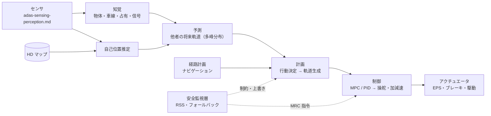
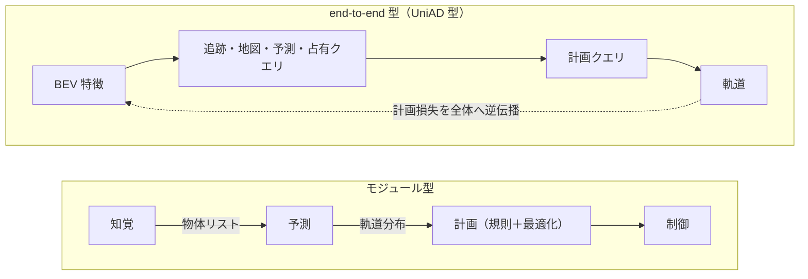
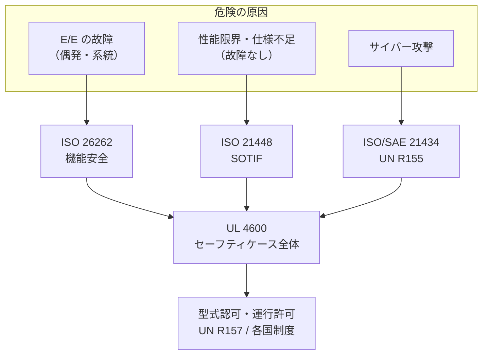

# 自動運転スタック・計算基盤・安全保証 (Autonomous Driving Stack, Compute & Safety)

## 概要 (Overview)

[`adas-sensing-perception.md`](adas-sensing-perception.md) は、センサの物理と知覚によって車両周辺の世界モデルを作るところまでを扱った。本ドキュメントはその下流を扱う。世界モデルから他者の将来を**予測 (prediction)** し、自車の軌道を**計画 (planning)** し、アクチュエータを**制御 (control)** する自動運転スタックの構造、それを実時間で動かす**計算基盤 (SoC)**、そして「十分に安全だ」と主張するための**安全規格・検証手法**である。最後に、2026 年 11 月時点の展開状況を、実証された事実と各社の主張に分けて整理する。

扱う論点は次の5つである。

1. **自動化レベルと ODD**: SAE J3016（2021 年改訂版）の L0〜L5 と、責任の所在を決める動的運転タスク (DDT)・DDT フォールバック・運行設計領域 (ODD) の定義。
2. **スタックの設計思想**: 知覚 → 予測 → 計画 → 制御のモジュール型パイプラインと、センサ入力から軌道までを一つのネットワークで学習する end-to-end 型（UniAD、テスラ FSD v12 以降）。
3. **計算基盤**: NVIDIA DRIVE Orin/Thor、Mobileye EyeQ6、Qualcomm Snapdragon Ride、テスラ FSD コンピュータ（HW3/HW4/AI5）。数値はすべてベンダー公称値として扱う。
4. **安全の枠組み**: ISO 26262（故障）、ISO 21448 SOTIF（性能限界）、UL 4600（セーフティケース）、Mobileye RSS（形式的な安全距離）、UNECE R157 ALKS（L3 の型式認証）。
5. **検証と展開**: シナリオベース試験、シミュレーション、ディスエンゲージメント統計の限界、Waymo の査読付き安全研究、各社の運行状況。

機能安全の一般論は [`functional-safety-iso26262.md`](functional-safety-iso26262.md)、計算基盤を収める車両側の構成は [`ee-architecture.md`](ee-architecture.md)、テスラ固有の集中型 E/E と FSD コンピュータの位置づけは [`ev/tesla-software-manufacturing.md`](ev/tesla-software-manufacturing.md) を前提とする。

## 方法論 (Methodology)

- **責任の所在を軸にレベルを読む。** J3016 のレベルを「機能の高さ」ではなく、「DDT とそのフォールバックを誰が担うか」という役割分担の定義として扱う。L2 と L3 の境界は、技術の差というより法的・安全上の責任の移転点である。
- **スタックは「インターフェースの明示性」で比較する。** モジュール型と end-to-end 型の差を、中間表現（物体リスト・予測軌道）が人間に読めるか、各モジュールを独立に検証できるか、誤差がどこで累積するかという観点で比べる。
- **計算性能は公称値と実効値を分ける。** TOPS（毎秒兆回演算）は精度（INT8/FP4）・疎性 (sparsity) の前提で数倍変わる。AGENTS.md の Source Hierarchy に従い、ベンダーの数値は「公称 (vendor spec)」と明記し、異なる前提の数字を直接比べない。GPU アーキテクチャの一般論は [`../../hardware/accelerators/gpu-simt-architecture.md`](../../hardware/accelerators/gpu-simt-architecture.md) に委ねる。
- **展開状況は「実証」と「主張」を分ける。** 運転者なしの有償運行、規制当局への報告、査読付き研究で裏づけられた事実を「実証 (demonstrated)」とし、経営者の発言や計画を「主張・目標 (claimed / target)」とする。時点依存の事実には「2026 年 11 月時点」のように時点を明記する。

## 発見事項 (Findings)

1. **J3016 のレベルは役割分担の定義であり、性能の格付けではない。** L2 では運転者が常に監視し責任を負い、L3 では ODD 内でシステムが DDT を担い、運転者は「介入要求に応じる待機者」になる。L4 は ODD 内で DDT フォールバックまでシステムが担う。「L2+」や「L2++」は J3016 に存在しないマーケティング用語である。
2. **ODD がすべての安全主張の前提条件である。** 道路種別・速度域・天候・時間帯・地理範囲を限定することで、検証すべき状況の空間を有限にできる。運転者なし運行の現実的な成功例はすべて、ODD を狭く定義してから段階的に広げる戦略をとっている。
3. **スタックはモジュール型から end-to-end 型へ移行しつつあるが、純粋な二択ではない。** UniAD は全モジュールを計画目的で共同学習しつつ中間出力を保持し、テスラは FSD v12 で計画層まで学習モデルに置き換えたと公表した。一方で量産・運転者なしシステムの多くは、学習モデルの外側に規則ベースの安全層（RSS のような形式的制約、フォールバック制御）を残している。性能向上の主因が学習であっても、検証と責任の説明には分解可能な構造が要る。
4. **計算基盤の「TOPS 競争」は精度の前提を揃えないと比較できない。** NVIDIA DRIVE Thor の「1000 INT8 TOPS 超 / 2000 FP4 TFLOPS」と、Mobileye EyeQ6 High の「34 DL TOPS (INT8)」は、設計思想（汎用 GPU と専用アクセラレータ）も電力も異なる。テスラ HW4 は公式 TOPS を公表していない。
5. **安全規格は「故障」「性能限界」「全体の論証」の3層で補い合う。** ISO 26262 は E/E の故障、ISO 21448 (SOTIF) は故障なしでの仕様不足・性能限界、UL 4600 は運転者なしシステムの安全性を主張するセーフティケース全体を扱う。どれも単独では自動運転の安全を保証しない。
6. **走行距離だけで安全を実証するのは統計的に非現実的である。** 人間の死亡事故率と同等であることを 95% の信頼度で示すだけでも数億マイル、20% 優れることを示すには数十億マイル規模の無事故走行が必要になる[^kalra]。シナリオベース試験とシミュレーションが不可欠な理由がここにある。
7. **2026 年 11 月時点で、運転者なしの大規模商用運行を査読付き安全データとともに実証しているのは Waymo が最も先行している。** Baidu Apollo Go も中国で大規模な運転者なし運行を行う。テスラは監視付き FSD の普及規模で突出するが、運転者なしの安全性を示す独立データはまだ限定的である。詳細は「展開状況」節で述べる。

## アーキテクチャ (Architecture)

### SAE J3016 の自動化レベル（2021 年改訂版）

SAE J3016 は 2021 年 4 月改訂版（J3016_202104）が現行であり、ISO/SAE PAS 22736 として ISO と共同発行されている[^j3016]。

| レベル | 名称 | DDT（持続的な横・縦制御と OEDR） | DDT フォールバック | ODD | 代表例 |
|---|---|---|---|---|---|
| L0 | 運転自動化なし | 運転者 | 運転者 | — | 警報のみ（AEB は L0 の「能動安全」扱い） |
| L1 | 運転支援 | 運転者＋システム（横 **または** 縦） | 運転者 | 限定 | ACC 単独 |
| L2 | 部分運転自動化 | 運転者（OEDR）＋システム（横 **かつ** 縦） | 運転者 | 限定 | Tesla FSD (Supervised)、GM Super Cruise |
| L3 | 条件付き運転自動化 | システム | 介入要求に応じる運転者（fallback-ready user） | 限定 | ALKS 準拠システム |
| L4 | 高度運転自動化 | システム | システム | 限定 | Waymo、Apollo Go の運転者なしロボタクシー |
| L5 | 完全運転自動化 | システム | システム | 無制限 | 未実現 |

- **DDT (Dynamic Driving Task)**: 実時間の操作・戦術的機能の総体。横・縦の車両運動制御と、物体・事象の検出と応答 (OEDR, Object and Event Detection and Response) を含む。経路選択のような戦略的機能は含まない。
- **DDT フォールバック**: システム故障や ODD 逸脱の際に、DDT を引き継ぐか、**最小リスク状態 (MRC, Minimal Risk Condition)**（路肩停止など）へ移行する責務。L3 では運転者がこれを担い、L4 以上ではシステムが担う。
- **ODD (Operational Design Domain)**: システムが機能するよう設計された条件（道路種別・速度・天候・時間帯・地理範囲など）。ODD を記述する分類体系は ISO 34503 などで標準化が進んでいる。

L2 で「ハンズオフ」が許されても、監視責任は運転者に残る。L3 の本質は「運転者が監視しなくてよい」点であり、ここで事故時の責任主体が変わる。メーカーが L3 を慎重にしか出さないのはこのためである。

### モジュール型パイプライン



| 段 | 入力 → 出力 | 主な手法 | 周期の目安 |
|---|---|---|---|
| 知覚 | センサ → 物体リスト・占有・車線 | BEV Transformer、占有ネットワーク | 10〜36 Hz |
| 予測 | 物体の履歴＋地図 → 将来 3〜8 秒の軌道分布 | ベクトル化地図＋Transformer、多峰出力 | 10 Hz |
| 計画 | 予測＋経路 → 自車の目標軌道 | 探索・最適化（格子探索、サンプリング、MPC）、学習ベースのスコアリング | 10〜20 Hz |
| 制御 | 目標軌道 → 操舵角・加減速 | MPC、PID、フィードフォワード | 50〜100 Hz |

**長所**は各段の入出力が明示的で、単体試験・故障解析・責任の説明ができることである。**短所**は、各段が下流に渡す情報を人間が設計した表現（例: 物体の直方体と速度）に絞るため、情報が失われ、上流の誤差が下流で累積することである。たとえば知覚が「歩行者の視線や身振り」を捨てると、予測はそれを使えない。

### end-to-end 型の学習スタック

**end-to-end 運転**は、センサ入力から計画出力（軌道や操作量）までを単一の微分可能なネットワークで学習する。初期の行動模倣 (behavior cloning) から、中間タスクを保ったまま計画目的で全体を最適化する方式へ発展した。

- **ChauffeurNet**（Waymo, 2018）[^chauffeurnet]: 知覚済みの BEV 表現から模倣学習で軌道を出す。模倣データにない危険状況を合成して摂動を加え、模倣学習の「分布シフト」問題に対処した。
- **UniAD**（CVPR 2023 最優秀論文）[^uniad]: 追跡・地図・動き予測・占有予測・計画の各モジュールを Transformer のクエリで接続し、**計画を最終目的として全体を共同学習する**「planning-oriented」設計である。中間出力を保持するため、モジュール型の解釈性と end-to-end の最適性を両立しようとする。後続の VAD[^vad] はシーンをベクトル表現にして計算を軽くした。
- **EMMA**（Waymo, 2024）[^emma]: マルチモーダル大規模言語モデル (Gemini) を基盤に、カメラ画像から軌道・物体・道路グラフをテキストトークンとして生成する研究である。Waymo は研究成果として公表しており、運行中の Waymo Driver そのものとは区別して扱うべきである。
- **テスラ FSD v12 以降**: テスラは FSD v12 のリリースノートで「市街地走行スタックを、数百万の動画クリップで学習した単一の end-to-end ニューラルネットワークに置き換え、30 万行超の明示的な C++ コードを置き換えた」と説明した（v12.3, 2024 年 3 月）[^tesla-fsd-v12]。その後 v13（2024 年 11 月）、v14（2025 年 10 月）と更新され、2026 年 11 月時点で北米の HW4 車向けは v14.3 系である。2026 年 11 月下旬には、一部の HW4 車に v15 の配信が始まったとトラッカーが報告している[^tesla-fsd-versions]。ネットワーク構造の詳細は非公開であり、「完全に単一のネットワークか」「規則ベースの安全層が残るか」は外部から検証できない。**ベンダーの説明**として扱う。



| 観点 | モジュール型 | end-to-end 型 |
|---|---|---|
| 情報の受け渡し | 人が設計した明示的表現 | 学習された潜在表現（全情報を保持しうる） |
| 最適化 | 段ごとの局所目的 | 計画性能という最終目的 |
| データ効率 | 規則で稀な状況をカバーできる | 稀な状況のデータが不足すると脆い |
| 検証・説明 | 段ごとに試験・故障解析が可能 | 中間表現の監視が困難、回帰試験はシナリオ網羅に依存 |
| 規格適合 | ISO 26262 の V 字に乗せやすい | 要求から実装へのトレーサビリティが取りにくい（SOTIF・UL 4600 で補う） |

## 技術詳細 (Technical Details)

### 1. 予測と計画の中身

**予測**は、各交通参加者の将来軌道を**多峰分布**として出力する。交差点の車は直進・右折・左折のいずれもありうるため、単一の平均軌道では意味がない。ベクトル化した地図（車線中心線のポリライン）と他者の履歴を Transformer で相互作用させ、K 本の候補軌道とその確率を出すのが現代の標準である。

**計画**は通常2層になる。上位の**行動決定**（車線変更するか、譲るか）と、下位の**軌道最適化**（滑らかさ・快適性・安全距離・交通規則をコスト関数と制約で表し、数秒先までの軌道を求める）である。

```
軌道最適化（概念, MPC 形式）:
  min_{u_0..u_{N-1}}  Σ_k [ w_ref·‖x_k − x_ref,k‖² + w_u·‖u_k‖² + w_j·‖Δu_k‖² ]
  s.t.  x_{k+1} = f(x_k, u_k)                 (車両運動モデル: 自転車モデル等)
        d(x_k, 予測された他者 i の位置) ≥ d_safe,i   (衝突回避)
        |u_k| ≤ u_max, 車線境界・速度制限          (物理・規則制約)
  N: 予測ホライズン（例: 0.1 s × 50 = 5 s）, 毎周期で先頭の u_0 のみ適用（receding horizon）
  計算量: 非凸（衝突回避制約）→ 実用では局所解法（SQP/iLQR）を初期解付きで反復
```

MPC の一般論と実時間制約は [`../robotics/control-systems.md`](../robotics/control-systems.md) の通りであり、自動運転ではこれに「他者の不確かな将来」という確率的制約が加わる。

### 2. Mobileye RSS — 安全距離の形式化

**RSS (Responsibility-Sensitive Safety)** は、Mobileye の Shalev-Shwartz らが 2017 年に提案した、「自車が事故の原因にならない」ための行動規則を数式で定義する枠組みである[^rss]。人間の常識的な運転規範（車間距離を保つ、割り込まない、優先権を譲る）を、最悪ケースの仮定のもとで形式化する。

縦方向の最小安全距離は、後続車（自車, 速度 `v_r`）が応答時間 `ρ` の間に最大加速度 `a_max,accel` で加速し、その後最小制動 `a_min,brake` で止まる一方、先行車（速度 `v_f`）が最大制動 `a_max,brake` で急停止しても衝突しない距離として定義される。

```
d_min = [ v_r·ρ + ½·a_max,accel·ρ² + (v_r + ρ·a_max,accel)² / (2·a_min,brake)
          − v_f² / (2·a_max,brake) ]₊           ([x]₊ = max(x, 0))
```

RSS は「計画層が出した軌道がこの制約を破るなら上書きする」安全監視層として使われる。学習ベースの計画器を形式的な規則で囲む構成であり、IEEE 2846-2022（自動運転の安全関連モデルにおける仮定）の基礎にもなった[^ieee2846]。限界は、パラメータ（`ρ`、制動値）の選び方に安全と円滑性のトレードオフが残ること、そして知覚が正しいことを前提とする点である。知覚誤りは RSS の外側の問題であり、SOTIF で扱う。

### 3. 計算基盤 (SoC) — 公称値の比較

| SoC | ベンダー公称性能 | 製造プロセス | 位置づけ | 備考 |
|---|---|---|---|---|
| NVIDIA DRIVE AGX Orin | 最大 254 TOPS | — | L2+〜L4 の中央コンピュート | 精度の前提は公式ページに明記なし（疎 INT8 とされることが多い） |
| NVIDIA DRIVE AGX Thor | 1000 INT8 TOPS 超（2000 FP4 TFLOPS） | — | Blackwell 世代、ADAS とコックピットの統合、ASIL D 対応を謳う | Transformer・生成 AI 推論を意識した FP4 |
| Mobileye EyeQ6 High | 34 DL TOPS (INT8) | 7 nm | SuperVision 級の監視付きハンズオフ、2024 年末量産計画 | EyeQ5 の 2 個分相当と説明 |
| Mobileye EyeQ6 Lite | 5 DL TOPS (INT8) | 7 nm | 量産 L1/L2 の前方カメラ | 2023 年量産 |
| Mobileye EyeQ Ultra | 176 TOPS | 5 nm | 運転者なし（L4）向け単一チップ | 2025 年量産の**計画**として発表。2026 年 11 月時点で量産開始の発表は確認できない（2026 年第3四半期の決算資料にも記載なし）[^mobileye-q3-2026] |
| Qualcomm Snapdragon Ride (Flex / Elite) | 公式 TOPS は非公表（前世代比の相対値のみ） | — | ADAS とコックピットの統合 SoC | Ride Elite の製品概要は NPU 性能を「前世代比 12 倍」など相対値でのみ示し、「社内の予備試験に基づく目標値」と注記する[^qualcomm-elite]。本稿では絶対値を記載しない |
| Tesla FSD コンピュータ (HW3) | NPU 2 基で 1 チップ約 72 TOPS、2 チップ冗長構成 | Samsung 14 nm | 2019 年量産 | IEEE Micro 論文あり |
| Tesla HW4 (AI4) | 公式 TOPS 非公表 | Samsung 7 nm（報道） | 2023 年 1 月以降の新車 | 「HW3 の 3〜8 倍」は経営者発言 |
| Tesla AI5 | 「HW4 の 10 倍」（経営者発言） | Samsung・TSMC で 2027 年量産予定（発言） | 当初 2026 年 1 月予定から延期 | 2026 年 4 月、まず Optimus とデータセンター向けとの発言。2026 年 10 月の決算説明会では、Samsung のテキサス工場で試作を始めたこと、Optimus への搭載は 2027 年 4 月ごろの見込みであることが語られた（報道）[^tesla-q3-2026] |

出典: NVIDIA[^nvidia-drive]、Mobileye[^mobileye-eyeq][^mobileye-ces2022]、Qualcomm[^qualcomm-elite]、テスラ HW3[^talpes][^bannon-hotchips]、AI5[^ai5][^tesla-q3-2026]。HW4 のプロセスと「HW3 の 3〜8 倍」、HW3 の 1 チップ約 72 TOPS は一次資料で再確認できておらず、報道・発言ベースの値として扱う。

比較上の注意は3点ある。

- **精度と疎性**: 「INT8 TOPS」「疎 INT8 TOPS」「FP4 TFLOPS」は別物で、疎性を仮定すると数値は 2 倍になり、FP4 は INT8 のさらに 2 倍になる。Thor の 2000 と 1000 の併記はこの関係を示している。
- **TOPS ≠ 実効性能**: メモリ帯域、オンチップ SRAM、アクセラレータが対象ネットワーク（畳み込み・アテンション）にどれだけ適合するかで実効性能は決まる。テスラ HW3 の論文は、専用 NPU を自社ネットワークに合わせて設計した点を強調している[^talpes]。
- **冗長性**: テスラ FSD コンピュータは同一ボード上に 2 チップを載せ、独立に計画を計算して照合する構成を発表している[^bannon-hotchips]。運転者なし運行には、計算・電源・通信の冗長化（フェイルオペレーショナル）が必要であり、ピーク TOPS より重要な設計要件となる。冗長の考え方は [`functional-safety-iso26262.md`](functional-safety-iso26262.md) のフェイルオペレーショナル、車両内の配置は [`ee-architecture.md`](ee-architecture.md) のセントラルコンピュートとセーフティアイランドを参照。

センサデータの帯域も計算基盤の制約になる。8MP 級カメラ 1 台の非圧縮映像は数 Gbit/s に達し、カメラは専用 SerDes リンクで、レーダ・LiDAR とゾーン間は [`automotive-ethernet-tsn.md`](automotive-ethernet-tsn.md) のマルチギガビット Ethernet で中央コンピュートへ集約される。センサ間の時刻同期（gPTP）が融合の精度を左右する。

### 4. 安全規格の分担



- **ISO 26262**（2018 年第2版）: E/E システムの故障に起因する危険を扱う。ASIL・安全ライフサイクル・ハードウェアメトリクスは [`functional-safety-iso26262.md`](functional-safety-iso26262.md) を参照。自動運転では、知覚 SoC・電源・操舵/制動アクチュエータの冗長化と、ASIL 分解の独立性主張が焦点になる。
- **ISO 21448:2022 (SOTIF)**: 故障がなくても起こる危険、つまり**意図した機能の不足**（センサの性能限界、想定外のシーン、予見可能な誤使用）を扱う[^sotif]。シナリオを「既知・安全」「既知・危険」「未知・危険」「未知・安全」の4象限に分け、既知の危険シナリオを設計で減らし、**未知の危険シナリオを探索で既知化して減らす**のが活動の中心である。学習モデルの知覚・計画はこの枠組みで扱われる。
- **ISO/SAE 21434**: 攻撃による危険。詳細は [`cybersecurity-iso21434.md`](cybersecurity-iso21434.md)。
- **UL 4600**（2023 年第3版）: 運転者なし自律製品の安全性評価規格である[^ul4600]。手法を規定する代わりに、「なぜ十分に安全か」を主張・論拠・証拠の構造（**セーフティケース**）で示すことを要求し、その網羅性を確認するチェックリスト（知覚の限界、機械学習、運用・保守、フィールドでの監視とフィードバックなど）を与える。ISO 26262 や SOTIF の成果物はセーフティケースの証拠として組み込まれる。
- **ISO/TS 5083:2025**: 自動運転システムの安全（設計・検証・妥当性確認）を扱う ISO の技術仕様（2025 年 4 月発行の第1版、ISO/TC 22/SC 32）であり、ISO 26262・SOTIF を自動運転向けに束ねる位置づけにある[^iso5083]。

### 5. UNECE R157 ALKS と Mercedes DRIVE PILOT

**UN Regulation No. 157 (ALKS, Automated Lane Keeping Systems)** は、国連 WP.29 による初の L3 型式認可規則であり、2021 年 1 月に発効した[^r157]。原規則は作動上限を 60 km/h とし、ドライバ可用性の監視、介入要求 (transition demand) に運転者が応じない場合は開始から早くとも 10 秒後に最小リスク操作 (MRM) を始めること、ALKS と運転者のやり取りを記録する自動運転データ記録装置 (DSSAD) などを要求する[^r157]。その後の改正で上限が 130 km/h に引き上げられ、車線変更も認められた（2023 年 1 月発効と UNECE が発表）[^r157-amend]。

Mercedes-Benz の **DRIVE PILOT** は、R157 に基づく型式認可を取得した最初期の量産 L3 システムであり、ドイツでは 2021 年後半から S クラスで提供された。カリフォルニア州 DMV は 2023 年 6 月 8 日、DRIVE PILOT を一般向けに販売可能な L3 システムとして承認した。条件は指定された高速道路・日中・**40 mph 以下**で、市街地・工事区間・大雨や霧では作動せず、運転者は介入要求に備えて運転席にいる必要がある[^ca-dmv-mb]。ODD 内ではメーカーが運転の責任を負う点が L2 との本質的な違いである。

2026 年 1 月に発表された S クラスの改良型には DRIVE PILOT が設定されないと報じられている。electrive は Handelsblatt の報道として、改良型の S クラスと EQS で提供しないと伝えた[^electrive-mb]。WardsAuto によれば、Mercedes-Benz の広報担当者は米国の規制環境と顧客にとっての価値を見直した結果だと説明した。改良型 S クラスには L2++ の MB.DRIVE ASSIST PRO を載せ、L3 は最大 130 km/h 程度の高速域を狙う次の世代で改めて目指すという[^wards-mb]。提供終了を明示する Mercedes-Benz の公式発表は確認できていない。既販車の DRIVE PILOT（ドイツの 95 km/h 版を含む）が今後も使えるかも確認できていない。L3 は認可を得ても、ODD の狭さと責任負担に対して顧客価値が小さい（渋滞時のみ・低速のみ）という事業上の難しさを抱えており、各社が L3 よりも「監視付きハンズオフ L2」と「運転者なし L4」に二極化する傾向がある。

### 6. 検証と妥当性確認

**走行距離による実証の限界**: Kalra と Paddock は、米国の人間運転の死亡事故率（約 1.09 件/1 億マイル）を基準に、自動運転車が同等以上であることを統計的に示すには、無事故でも約 2.75 億マイル、20% 優れることを示すには約 110 億マイル規模の走行が必要と試算した[^kalra]。ソフトウェアが更新されるたびに証拠がリセットされうることを考えると、走行距離だけで安全を実証するのは非現実的である。

**シナリオベース試験**: ドイツの PEGASUS プロジェクト（2016〜2019 年、自動車メーカーとサプライヤ 17 社参加）は、高速道路パイロットを題材に、シナリオの体系化 → シミュレーション → テストベンチ → 実車試験という段階的な評価手法を確立した[^pegasus]。この考え方は ISO 34502（シナリオベース安全評価）などの標準へ引き継がれている。

```
シナリオベース検証の流れ（概念）:
  1. シナリオ空間の定義: 機能シナリオ（言語記述）→ 論理シナリオ（パラメータ範囲）
                          → 具体シナリオ（パラメータ値）
  2. 重要度サンプリング: 自然走行データ分布から、危険側へ偏らせてサンプリング
                          （稀な事象の評価に必要な試行数を削減）
  3. シミュレーション: 数百万〜数十億の具体シナリオを仮想環境で実行
  4. 実車・テストコース: シミュレーションの妥当性確認と、センサ実物を含む試験
  5. フィールド監視: 運行データから新たな危険シナリオを発見 → 1. へ還流（SOTIF の未知→既知）
```

**シミュレーション**の課題は、センサモデル（カメラ画像・LiDAR 点群・レーダの多重反射）の写実性と、他者の行動モデルの現実性である。近年はニューラルレンダリングや、実走行ログを編集して反実仮想 (counterfactual) シナリオを作る手法が使われる。Waymo は死亡事故の再構成シナリオを使った評価を公表している[^scanlon]。

**ディスエンゲージメント統計の限界**: カリフォルニア州 DMV は試験許可事業者に、安全運転者がシステムを解除した件数と走行距離の年次報告を義務づけている。しかし、解除の定義・報告基準が事業者ごとに異なること、走行環境（市街地か郊外か）が揃わないこと、運転者なし運行では解除という概念自体がないことから、「1000 マイルあたりの解除回数」を安全性の比較指標とするのは不適切だと広く批判されている。

**事故報告**: 米国 NHTSA は 2021 年の一般命令 (Standing General Order 2021-01) で、ADS と L2 ADAS が関与する一定の事故の報告をメーカーに義務づけた[^nhtsa-sgo]。この公開データは、Waymo の安全研究や、テスラ FSD への調査（[`adas-sensing-perception.md`](adas-sensing-perception.md) の PE24031）の根拠になっている。

**Waymo の査読付き安全研究**: Waymo は自社の運転者なし (rider-only) 運行の事故データを、同じ地域・道路種別の人間運転ベンチマークと比べる研究を査読誌に発表している。

| 研究 | 走行距離 | 主な結果（人間ベンチマーク比） |
|---|---|---|
| Kusano et al. (2024), *Traffic Injury Prevention*[^kusano-7m] | 710 万マイル | 負傷を伴う事故率 約 80% 低、警察報告事故率 約 55% 低 |
| Kusano et al. (2025), *Traffic Injury Prevention*[^kusano-57m] | 5670 万マイル（2025 年 1 月まで） | 車両同士の交差点事故で負傷を伴うもの 96% 低（95% CI 87–99%）、エアバッグ展開 91% 低（CI 76–98%）。11 の事故類型のいずれでも統計的に有意な悪化なし |
| Di Lillo et al.（Swiss Re との共同、Waymo 技術報告）[^swissre] | 2530 万マイル | 対人賠償請求 92% 減・対物賠償請求 88% 減（最新 ADAS 装備車との比較では 90%・86% 減） |
| Scanlon et al. (2021), *Accident Analysis & Prevention*[^scanlon] | 再構成シミュレーション | ODD 内の過去の死亡事故を再構成し、Waymo Driver の挙動を評価 |

Waymo の安全ハブは 2026 年 6 月までの累計 2 億 7130 万 rider-only マイルについて、重傷以上の事故 95% 減、エアバッグ展開事故 82% 減、負傷を伴う事故 82% 減と公表している[^waymo-safety-hub]。

これらの研究の解釈には注意が要る。

- **著者は Waymo の社員**である。査読を経ているが、第三者による独立した再現ではない。Swiss Re 研究は保険会社との共同で、保険請求という外部データを使う点で独立性が一段高いが、2026 年 11 月時点でも査読誌への掲載は確認できない。2025 年 8 月の Waymo の後続論文もこの研究を Waymo LLC の技術報告として引用している[^waymo-2025-arxiv]。
- **ベンチマークの構築が結果を左右する。** 人間の事故は過少報告されるため、Waymo は報告漏れを補正したベンチマークを使う。補正方法・地域や道路種別の対応づけの妥当性が論点になる。
- **ODD が限定されている。** 結果は Waymo が運行する都市・道路・条件での比較であり、全道路・全天候での安全性を意味しない。
- それでも、運転者なし運行の安全性を、規制当局の事故報告（NHTSA SGO）と整合する形で、信頼区間つきで査読誌に公表している事業者は 2026 年 11 月時点で限られる。テスラは独自の「Vehicle Safety Report」で自社システム使用時の事故間隔を公表しているが[^tesla-vsr]、道路種別や車齢などの交絡を補正した比較ではなく、査読も経ていない。

## 展開状況 (Deployment Status, 2026 年 11 月時点)

2026 年 11 月 28 日時点の状況を、運転者なし運行・規制当局への報告などで裏づけられた**実証 (demonstrated)** と、計画・発言である**主張 (claimed / target)** に分けて整理する。この分野は月単位で変わるため、数値は出典の日付とともに読む必要がある。

| 事業者 | 実証（2026 年 11 月時点） | 主張・計画 |
|---|---|---|
| **Waymo** | 米国で運転者なしの有償ロボタクシーを運行。2026 年 9 月の報道では 15 市場（フェニックス、SF ベイエリア、LA、オースティン、ダラス、ヒューストン、デンバー、マイアミ、ナッシュビル、サンディエゴ、タンパ、ラスベガス、サンアントニオなど）[^tc-waymo-lv]。サンアントニオ・サンディエゴ・タンパは 2026 年 10 月 14 日に誰でも乗車できるようになった（公式）[^waymo-sat-sd-tpa]。ラスベガスは利用者を段階的に追加中。週 50 万件超の有償乗車（2026 年 11 月の報道での同社説明）[^trr-waymo-freeway]、約 4000 台（2026 年 9 月の報道）[^tc-waymo-fleet]。累計 2.7 億 rider-only マイル超（公式、2026 年 6 月までのデータ）[^waymo-safety-hub]。第6世代（Zeekr ベースの Ojai）を SF・LA・フェニックスで一般提供[^tc-waymo-ojai]。ロンドンで 2026 年 4 月から試験走行[^tc-waymo-london] | ロンドンでの商用開始（英国の APS 許可制度による認可待ち。2026 年 9 月時点で、ロンドンで許可手続きの第1段階を終えた事業者はない）[^tc-waymo-london][^tnw-london]、マドリードで 2027 年に最初の乗客を乗せる計画（2026 年 10 月発表）[^waymo-madrid]などの海外展開 |
| **Baidu Apollo Go** | 中国の武漢・北京・深圳・重慶などで運転者なし運行。2026 年 4 月時点で累計乗車 2200 万件超、2026 年第1四半期 320 万件、週ピーク 35 万件超（公式 IR）[^baidu-q1]。2026 年 8 月時点で 28 都市、自動運転走行 3.5 億 km 超（うち完全な運転者なし 2.4 億 km 超）[^baidu-q2]。2026 年 10 月時点で 30 都市、第3四半期の自動運転走行は約 3400 万 km、10 月 31 日時点の累計は 3.9 億 km 超（公式 IR。第2・第3四半期の発表に乗車件数の記載はない）[^baidu-q3]。ドバイでは運転者なし車両を約 2 倍に増やした[^baidu-q3] | ロンドン（Uber・Lyft と公道試験を継続、Lyft との一般乗車は 2027 年目標）[^tc-baidu-london][^baidu-q3]などの海外展開 |
| **Tesla** | 2025 年 6 月 22 日にオースティンで、助手席に安全監視員を乗せたロボタクシーを開始[^tc-tesla-austin]。2026 年 1 月、オースティンで車内に人がいない有償乗車を少数台から開始（随伴車ありと報道）[^tc-tesla-unsupervised]。NHTSA SGO にロボタクシーの事故 17 件を報告（うち遠隔操作者が関与した 2 件、2026 年 5 月の報道）[^tc-tesla-crashes]。2026 年 9 月 3 日にオースティンで、ハンドル・ペダルのない Cybercab での乗車を開始し、NHTSA が FMVSS 適合の監査 (AQ26002) を開始した[^tesla-q3-update][^tc-cybercab]。第3四半期末の運転者なし運行の累計は約 200 万マイル（前四半期比 8 倍、公式）[^tesla-q3-update]。テキサス州 DMV が運転者なし運行を認めた車両は Model Y 362 台・Cybercab 449 台（報道）[^cnbc-tesla-q3]。監視付き FSD (Supervised) は量産車に広く普及し、有効な契約は 174 万件（公式）[^tesla-q3-update] | 運転者なし運行の多都市展開（決算資料が名指しするのはオースティンのみで、6 都市圏で運行中との報道は二次情報）[^tesla-q3-2026]、2026 年末までの Cybercab の顧客向け販売、AI4 で「人間よりはるかに安全」との経営者発言[^ai5] |
| **Zoox** (Amazon) | 専用車両（ハンドルなし）でラスベガスの一般向け乗車を 2025 年 9 月に無料で開始し、2026 年 8 月から有償化。NHTSA が最大 2500 台・2 年間の FMVSS 一時免除を付与[^tc-zoox]。2026 年 11 月 16 日、ラスベガスで Uber のアプリから配車できるようになった（初の他社プラットフォーム）[^uber-zoox] | SF・オースティン・マイアミへの展開、LA で 2026 年末までに自社運行を始め、2027 年に Uber でも提供[^uber-zoox] |
| **WeRide** | アブダビで Uber と運転者なし運行（2025 年 11 月〜）[^tc-weride]。2026 年 10 月末時点で L4 車両は世界で約 4100 台、うちロボタクシー 2300 台超、中東で約 600 台（公式 IR）[^weride-q3] | アブダビとドバイの中心市街地を年内に全面カバー、中東・欧州への拡大[^weride-q3] |
| **Mobileye** | VW ID. Buzz AD を MOIA・Uber と LA で安全運転者付き試験（約 10 台、2026 年 4 月〜）[^tc-mobileye-la] | 2026 年末に Uber で商用開始、2027 年に運転者なし化、自社ロボタクシー事業（2027 年〜） |
| **Cruise** (GM) | 2023 年 10 月の歩行者事故の後、カリフォルニア州 DMV が 2023 年 10 月 24 日に運転者なし運行の許可を即時停止（安全情報の不実表示を含む4つの違反を理由とする）[^ca-dmv-cruise]。その後 GM はロボタクシー事業から撤退 | — （事業終了） |

読み取れることは次のとおりである。

- **運転者なし運行の規模**: Waymo と Apollo Go はともに週数十万件規模の運転者なし有償乗車を実証している（Apollo Go の乗車件数は 2026 年第1四半期以降公表されていない）。テスラは運転者なし運行の累計約 200 万マイルを公表したが、Waymo の 2.7 億マイルとは 2 桁の差があり、走行距離あたりの事故率を比べられる開示はない。
- **安全データの質**: Waymo は査読付き研究と信頼区間を公表しており、独立データとの整合も確認できる。Apollo Go は乗車件数・走行距離を IR で公表するが、事故率の査読付き比較は確認できなかった。テスラは NHTSA SGO の事故報告で外部から件数が見えるようになったが、走行距離あたりの比較を可能にする開示は乏しい。
- **規制の関与**: Waymo の高速道路運行は 2026 年 5 月に工事区間への進入事例を受けて一時停止し、約 4000 台の自主リコールを経て 7 月から再開した[^tc-waymo-freeway]。しかしその後、US-101 の工事規制区間に 3 台が進入し、I-280 でも 1 台が交通規制中のカリフォルニア州ハイウェイパトロールの脇を通り抜けようとした。これを受けてカリフォルニア州 DMV は 2026 年 11 月 11 日、「公共の安全への差し迫った危険」として州内の高速道路での運転者なし運行と試験を禁じた。Waymo は他の市場でも高速道路運行を自主的に止め、一般道の運行は続けている（報道。DMV のニュースリリースは 2026-11-28 時点で未掲載）[^trr-waymo-freeway][^sfstd-waymo-freeway]。テスラ FSD には視界不良（EA26002）と交通違反（PE25012）の2つの調査が継続している[^tc-fsd-probes]。規模を拡大した事業者ほど、規制当局による継続的な監視の対象になっている。
- **カリフォルニア州 DMV とテスラ**: 行政法判事は 2025 年 12 月に Autopilot/FSD の宣伝を欺瞞的と判断した。DMV は 30 日間の免許停止を執行せず是正期間を与え、テスラは 2026 年 1 月に米国・カナダで Autopilot 自体を廃止したが、テスラは判断の取り消しを求めて提訴している[^tc-tesla-dmv]。L2 の機能名称と運転者の過信の問題は、技術ではなく表示規制の問題としても扱われている。

## セキュリティ考察 (Security Considerations)

- **攻撃面の拡大**: 自動運転車は、センサの物理チャネル（[`adas-sensing-perception.md`](adas-sensing-perception.md)）、車内ネットワーク、OTA 更新、遠隔支援・フリート管理のクラウド接続という4層の攻撃面を持つ。とくにロボタクシーは遠隔支援オペレータとの常時接続を前提とするため、遠隔からの指令経路の認証と権限分離が安全要件になる。ISO/SAE 21434 と UN R155/R156 の枠組みは [`cybersecurity-iso21434.md`](cybersecurity-iso21434.md) を参照。
- **学習モデル固有の脅威**: end-to-end 型では、学習データの汚染 (data poisoning)、物理的な敵対的入力、モデルの窃取が新しい脅威になる。モデル更新は車両の挙動そのものを変えるため、学習パイプラインと配信の完全性（署名・段階的配信・ロールバック）はソフトウェア更新と同等以上に保護する必要がある。
- **安全監視層の独立性**: RSS のような規則ベースの安全層や、フォールバック用の独立した ECU は、主系が侵害されても動作するよう、計算資源・電源・ネットワークを分離する。安全層自体が攻撃で無効化されれば、フェイルオペレーショナル設計の前提が崩れる。
- **フリート規模の単一障害**: 同一ソフトウェアが数千〜数百万台で動くため、一つの欠陥や脆弱性がフリート全体で同時に顕在化しうる。2023 年の Cruise の事故後に規制当局が運転者なし運行の許可を即時停止した事例[^ca-dmv-cruise]のように、運用・規制上のリスクも同時に生じる。段階的配信と遠隔での運行停止機能は、安全とセキュリティの双方で必須である。
- **データとプライバシー**: 外向きカメラの映像、乗客の行動、位置履歴は個人情報を含む。事故調査用の記録（R157 の DSSAD など）は改竄防止が求められる一方、保存と開示の範囲は法域ごとに異なる。

## 結論 (Conclusions)

- SAE J3016 のレベルは「誰が DDT とそのフォールバックを担うか」の定義であり、L2 と L3 の間で責任主体が移る。ODD の限定がすべての安全主張の前提であり、運転者なし運行の成功例はいずれも狭い ODD から段階的に拡大している。
- スタックはモジュール型から end-to-end 型へ移行しつつあるが、UniAD のように中間出力を保つ設計や、RSS のような形式的安全層で学習モデルを囲む設計が並存している。学習が性能を押し上げる一方で、検証と説明の責任が分解可能な構造を要求している。
- 計算基盤の TOPS は精度・疎性の前提で数倍変わる公称値であり、実効性能と冗長性（フェイルオペレーショナル）の方が設計上は重要である。
- 安全は単一の規格では保証できない。ISO 26262（故障）、ISO 21448（性能限界）、ISO/SAE 21434（攻撃）を UL 4600 のセーフティケースで束ね、シナリオベース試験・シミュレーション・フィールド監視で証拠を積み上げる。走行距離だけでの実証は統計的に非現実的である。
- 2026 年 11 月時点の実証の水準は、Waymo（運転者なし有償運行と査読付き安全研究）と Baidu Apollo Go（中国での大規模運転者なし運行）が先行し、テスラは監視付き運転支援の規模で突出しつつ運転者なし運行は初期段階にある。各社の計画・発言と実証済みの運行を区別して評価する必要がある。

### 次の接続先 (Related Topics)

- [`adas-sensing-perception.md`](adas-sensing-perception.md) — 本書の入力となるセンサ物理・BEV 知覚・camera-only 論争。
- [`functional-safety-iso26262.md`](functional-safety-iso26262.md) — ASIL・ASIL 分解・フェイルオペレーショナルの基礎。
- [`cybersecurity-iso21434.md`](cybersecurity-iso21434.md) — 遠隔接続・OTA を含む攻撃面への対策。
- [`ee-architecture.md`](ee-architecture.md) — セントラルコンピュートとセーフティアイランドの配置。
- [`automotive-ethernet-tsn.md`](automotive-ethernet-tsn.md) — センサデータの集約と時刻同期。
- [`ev/tesla-software-manufacturing.md`](ev/tesla-software-manufacturing.md) — テスラの集中型 E/E と FSD コンピュータ。
- [`../robotics/control-systems.md`](../robotics/control-systems.md) — MPC とリアルタイム制御。
- [`../../hardware/accelerators/gpu-simt-architecture.md`](../../hardware/accelerators/gpu-simt-architecture.md) — DRIVE Orin/Thor の基盤となる GPU アーキテクチャ。
- [`../../foundations/machine-learning/transformer-architecture.md`](../../foundations/machine-learning/transformer-architecture.md) — UniAD・EMMA の基盤となる Transformer。

## 参考文献 (References)

**一次資料 (Primary — 標準・規則・査読論文・公式発表)**

[^j3016]: SAE International (2021). *SAE J3016_202104: Taxonomy and Definitions for Terms Related to Driving Automation Systems for On-Road Motor Vehicles*. — [sae.org](https://www.sae.org/standards/content/j3016_202104/) — Accessed: 2026-10-04。ISO/SAE PAS 22736:2021 として共同発行。

[^sotif]: ISO 21448:2022, *Road vehicles — Safety of the intended functionality*. — [ISO 21448:2022](https://www.iso.org/standard/77490.html) — Accessed: 2026-10-04。

[^ul4600]: UL 4600, *Standard for Evaluation of Autonomous Products*, Edition 3 (2023-03-17, ANSI 承認). — [UL Standards](https://www.shopulstandards.com/ProductDetail.aspx?productId=UL4600) — Accessed: 2026-10-04。

[^iso5083]: ISO/TS 5083:2025, *Road vehicles — Safety for automated driving systems — Design, verification and validation*. Edition 1 (2025-04). — [ISO](https://www.iso.org/standard/81920.html) — Accessed: 2026-11-28（ISO サイトは自動取得を拒否したため、発行年・版・委員会は [ANSI Webstore](https://webstore.ansi.org/standards/iso/isots50832025) と [Standards Australia Store](https://store.standards.org.au/product/iso-ts-5083-2025) の書誌情報で照合）。

[^ieee2846]: IEEE Std 2846-2022 (2022-04-22), *IEEE Standard for Assumptions in Safety-Related Models for Automated Driving Systems*. — [IEEE SA](https://standards.ieee.org/ieee/2846/10831/) — Accessed: 2026-10-04。

[^r157]: UN Regulation No 157 — Uniform provisions concerning the approval of vehicles with regards to Automated Lane Keeping Systems [2021/389]. *Official Journal of the European Union*. — [EUR-Lex](https://eur-lex.europa.eu/eli/reg/2021/389/oj) — Accessed: 2026-10-04。60 km/h 上限、介入要求から 10 秒以降の MRM、DSSAD。

[^r157-amend]: UNECE. [Press release on the ALKS amendment (130 km/h, lane change)](https://unece.org/media/transport/Vehicle-Regulations/press/368227) — Accessed: 2026-10-04（本稿執筆時はアクセス制限で本文を再取得できず）。

[^ca-dmv-mb]: California DMV (2023-06-08). [California DMV Approves Mercedes-Benz Automated Driving System for Certain Highways and Conditions](https://www.dmv.ca.gov/portal/news-and-media/california-dmv-approves-mercedes-benz-automated-driving-system-for-certain-highways-and-conditions/) — Accessed: 2026-10-04。

[^electrive-mb]: [Mercedes pauses Level 3 driving assistance for now](https://www.electrive.com/2026/01/12/mercedes-pauses-level-3-driving-assistance-for-now/) — electrive (2026-01-12) — Accessed: 2026-11-28。Handelsblatt の報道として、改良型 S クラスと EQS で DRIVE PILOT を提供しないと伝える。**報道**。

[^wards-mb]: Kable, G. [Mercedes-Benz shifts autonomous driving tech in 2026 S-Class](https://www.wardsauto.com/news/mercedes-benz-shifts-autonomous-driving-tech-in-2026-s-class/811431/) — WardsAuto (2026-02-11) — Accessed: 2026-11-28。広報担当 Tobias Mueller の「The technical foundation has been laid for the next step」、MB.DRIVE ASSIST PRO への切り替え。**報道（広報コメントを含む）**。

[^ca-dmv-cruise]: California DMV (2023-10-24). [DMV Statement on Cruise LLC Suspension](https://www.dmv.ca.gov/portal/news-and-media/dmv-statement-on-cruise-llc-suspension/) — Accessed: 2026-10-04。

[^rss]: Shalev-Shwartz, S., Shammah, S. & Shashua, A. (2017). On a Formal Model of Safe and Scalable Self-driving Cars. — [arXiv:1708.06374](https://arxiv.org/abs/1708.06374) — Accessed: 2026-10-04。

[^uniad]: Hu, Y., Yang, J., Chen, L. et al. (2023). Planning-oriented Autonomous Driving. *CVPR 2023*. — [arXiv:2212.10156](https://arxiv.org/abs/2212.10156) — Accessed: 2026-10-04。最優秀論文賞は [公式リポジトリ](https://github.com/OpenDriveLab/UniAD) の記載による。

[^vad]: Jiang, B., Chen, S., Xu, Q. et al. (2023). VAD: Vectorized Scene Representation for Efficient Autonomous Driving. *ICCV 2023*. — [arXiv:2303.12077](https://arxiv.org/abs/2303.12077) — Accessed: 2026-10-04。

[^chauffeurnet]: Bansal, M., Krizhevsky, A. & Ogale, A. (2018). ChauffeurNet: Learning to Drive by Imitating the Best and Synthesizing the Worst. — [arXiv:1812.03079](https://arxiv.org/abs/1812.03079) — Accessed: 2026-10-04。

[^emma]: Hwang, J.-J., Xu, R., Lin, H. et al. (2024). EMMA: End-to-End Multimodal Model for Autonomous Driving. *Transactions on Machine Learning Research*. — [arXiv:2410.23262](https://arxiv.org/abs/2410.23262) — Accessed: 2026-10-04。

[^talpes]: Talpes, E., Das Sarma, D., Venkataramanan, G., Bannon, P. et al. (2020). Compute Solution for Tesla's Full Self-Driving Computer. *IEEE Micro*, 40(2), 25–35. DOI: 10.1109/MM.2020.2975764

[^bannon-hotchips]: Bannon, P., Venkataramanan, G., Das Sarma, D. & Talpes, E. (2019). Computer and Redundancy Solution for the Full Self-Driving Computer. *2019 IEEE Hot Chips 31 Symposium (HCS)*. DOI: 10.1109/HOTCHIPS.2019.8875645

[^nvidia-drive]: [In-Vehicle Computing for Autonomous Vehicles — DRIVE AGX](https://www.nvidia.com/en-us/solutions/autonomous-vehicles/in-vehicle-computing/) — NVIDIA — Accessed: 2026-10-04。Thor: 1000 INT8 TOPS 超 / 2000 FP4 TFLOPS、Orin: 最大 254 TOPS。**ベンダー公称値**。

[^mobileye-eyeq]: [EyeQ™ chip](https://www.mobileye.com/technology/eyeq-chip/) — Mobileye — Accessed: 2026-10-04。EyeQ6 Lite 5 DL TOPS、EyeQ6 High 34 DL TOPS（INT8, 7 nm）。**ベンダー公称値**。

[^mobileye-ces2022]: [Mobileye CES 2022 tech news](https://www.mobileye.com/news/mobileye-ces-2022-tech-news/) — Mobileye (2022-01-04) — Accessed: 2026-10-04。EyeQ Ultra 176 TOPS・5 nm・2025 年量産計画、EyeQ6 の量産時期。**ベンダー計画値**。

[^qualcomm-elite]: [Snapdragon Cockpit Elite / Snapdragon Ride Elite Product Brief](https://www.qualcomm.com/content/dam/qcomm-martech/dm-assets/documents/Snapdragon-Cockpit-Elite-Snapdragon-Ride-Elite-Product-Brief.pdf) — Qualcomm — Accessed: 2026-11-28。NPU は「12x performance boost over previous cockpit platforms」、注記「All performance targets are compared to previous generation, based on preliminary internal testing」。[CES 2026 の発表](https://www.qualcomm.com/news/releases/2026/01/qualcomm-drives-the-future-of-mobility-with-strong-snapdragon-di)にも TOPS の記載はない。**ベンダー目標値**。

[^mobileye-q3-2026]: Mobileye Global Inc. (2026-10-29). [Third Quarter 2026 Results (Form 8-K, Exhibit 99.1)](https://www.sec.gov/Archives/edgar/data/0001910139/000110465926119830/tm2628197d1_ex99-1.htm) — Accessed: 2026-11-28。「SuperVision deliveries exceeded our expectations」、2026 年 1〜9 月の EyeQ 出荷量が前年比 11% 増。個別チップ名（EyeQ Ultra を含む）には触れない。**当事者発表**。

[^tesla-q3-2026]: [Tesla Q3 2026 Earnings Call Recap: Everything You Need to Know](https://www.notateslaapp.com/news/4867/tesla-q3-2026-earnings-call-recap-everything-you-need-to-know) — Not a Tesla App (2026-10-22) — Accessed: 2026-11-28。AI5 が前月に Samsung のテキサス工場で試作に入ったこと、Optimus への搭載見込み（2027 年 4 月ごろ）。テスラの決算資料本体は未確認。**報道（経営者発言）**。

[^tesla-fsd-v12]: Tesla. FSD (Supervised) v12.3 release notes (software 2023.44.30.25, 2024-03). — [Not a Tesla App による転載](https://www.notateslaapp.com/software-updates/version/2023.44.30.25/release-notes) — Accessed: 2026-10-04。**ベンダーの説明**。

[^tesla-vsr]: [Tesla Vehicle Safety Report](https://www.tesla.com/VehicleSafetyReport) — Tesla — Accessed: 2026-10-04（本稿執筆時はアクセス制限で本文を再取得できず）。**当事者発表**。

[^kalra]: Kalra, N. & Paddock, S. M. (2016). Driving to safety: How many miles of driving would it take to demonstrate autonomous vehicle reliability? *Transportation Research Part A: Policy and Practice*, 94, 182–193. DOI: 10.1016/j.tra.2016.09.010

[^pegasus]: [About PEGASUS](https://www.pegasusprojekt.de/en/about-PEGASUS) — PEGASUS project (BMWi 助成) — Accessed: 2026-10-04。

[^nhtsa-sgo]: NHTSA. [Standing General Order on Crash Reporting](https://www.nhtsa.gov/laws-regulations/standing-general-order-crash-reporting) — Accessed: 2026-10-04（本稿執筆時はアクセス制限で本文を再取得できず）。

[^kusano-7m]: Kusano, K. D., Scanlon, J. M., Chen, Y.-H., McMurry, T. L., Chen, R., Gode, T. & Victor, T. (2024). Comparison of Waymo rider-only crash data to human benchmarks at 7.1 million miles. *Traffic Injury Prevention*, 25(sup1), 2380786. DOI: 10.1080/15389588.2024.2380786

[^kusano-57m]: Kusano, K. D., Scanlon, J. M., Chen, Y.-H., McMurry, T. L., Gode, T. & Victor, T. (2025). Comparison of Waymo Rider-Only crash rates by crash type to human benchmarks at 56.7 million miles. *Traffic Injury Prevention*. DOI: 10.1080/15389588.2025.2499887 — [arXiv:2505.01515](https://arxiv.org/abs/2505.01515) — Accessed: 2026-10-04。

[^scanlon]: Scanlon, J. M., Kusano, K. D., Daniel, T., Alderson, C., Ogle, A. & Victor, T. (2021). Waymo simulated driving behavior in reconstructed fatal crashes within an autonomous vehicle operating domain. *Accident Analysis & Prevention*, 163, 106454. DOI: 10.1016/j.aap.2021.106454

[^swissre]: [New Swiss Re study: Waymo is making roads safer](https://waymo.com/blog/2024/12/new-swiss-re-study-waymo) — Waymo (2024-12-19) — Accessed: 2026-11-28。Di Lillo et al. の技術報告。ブログは「科学誌に投稿済み」と述べるが、2026-11-28 時点で掲載誌・DOI は確認できない。**当事者発表**。

[^waymo-2025-arxiv]: Scanlon, J. M., McMurry, T. L., Chen, Y.-H., Kusano, K. D. & Victor, T. (2025). From Stoplights to On-Ramps: A Comprehensive Set of Crash Rate Benchmarks for Freeway and Surface Street ADS Evaluation. arXiv:2508.19425 — 参考文献で Di Lillo et al. (2025) を「Mountain View (CA): Waymo LLC」の報告として引用。

[^waymo-safety-hub]: [Waymo Safety Impact](https://waymo.com/safety/impact/) — Waymo — Accessed: 2026-11-28。2026 年 6 月までの 2 億 7130 万 rider-only マイル。**当事者発表**。

[^baidu-q1]: Baidu, Inc. (2026-05-18). [Baidu Announces First Quarter 2026 Results](https://www.prnewswire.com/news-releases/baidu-announces-first-quarter-2026-results-302774476.html) — Accessed: 2026-10-04。

[^baidu-q2]: Baidu, Inc. (2026-08-18). [Baidu Announces Second Quarter 2026 Results](https://www.prnewswire.com/news-releases/baidu-announces-second-quarter-2026-results-302853860.html) — Accessed: 2026-10-04。

**二次資料 (Secondary — 専門報道)**

[^tesla-fsd-versions]: [Tesla FSD release history](https://www.notateslaapp.com/fsd-beta/) — Not a Tesla App — Accessed: 2026-11-28。v13.2（2024-11-30）、v14.1（2025-10-07）、北米の v14.3.13（ビルド 2026.38.5.10、2026-10-20）、FSD 15（ビルド 2026.38.6.11、2026-11-21、AI4 の Model Y の一部から配信）。v14.3.13 の広範な配信は [Tesla Oracle (2026-11-18)](https://www.teslaoracle.com/2026/11/18/tesla-update-2026-44-1-goes-wide-release-with-fsd-v14-3-lite-hw3-fsd-v14-3-13-hw4-and-charger-network-view-release-notes/) とも照合。v15 の顧客配信は単一のトラッカーの報告で、テスラの公式発表は確認できていない。**報道・トラッカー**。

[^ai5]: [Musk says Tesla's AI5 chip is done, not coming to vehicles first](https://www.notateslaapp.com/news/3974/musk-says-teslas-ai5-chip-is-done-not-coming-to-vehicles-first) — Not a Tesla App (2026-04-15) — Accessed: 2026-10-04。AI5 はまず Optimus とデータセンター向け、車両は 2027 年以降。**経営者発言**。

[^waymo-sat-sd-tpa]: [Waymo is now open to everyone in San Antonio, San Diego, and Tampa](https://waymo.com/blog/shorts/sat-sd-tpa/) — Waymo (2026-10-14) — Accessed: 2026-11-28。サンアントニオは空港を含む。**当事者発表**。

[^waymo-madrid]: [Waymo in the Madrid region](https://waymo.com/blog/2026/10/waymo-in-madrid-region/) — Waymo (2026-10-20) — Accessed: 2026-11-28。2027 年に最初の乗客。**当事者計画**。

[^tnw-london]: [London's robotaxi permits sit unused](https://thenextweb.com/news/london-robotaxi-phv-route-aps-permit-unused) — The Next Web (2026-09-04) — Accessed: 2026-11-28。APS 許可制度は 2026-05-15 に施行されたが、ロンドンで第1段階を終えた事業者はまだない。**報道**。

[^trr-waymo-freeway]: [California DMV bars Waymo AVs from operating on the state's freeways](https://www.therobotreport.com/california-dmv-bars-waymo-avs-from-operating-on-the-states-freeways/) — The Robot Report (2026-11-17) — Accessed: 2026-11-28。2026-11-11 付の命令、「imminent hazard to public safety」、週 50 万件超の一般道の乗車。**報道**。

[^sfstd-waymo-freeway]: [California DMV bans Waymo from freeways](https://sfstandard.com/2026/11/17/california-dmv-bans-waymo-from-freeways/) — The San Francisco Standard (2026-11-17) — Accessed: 2026-11-28。**報道**。

[^baidu-q3]: Baidu, Inc. (2026-11-16). Baidu Announces Third Quarter 2026 Results. — [Finviz による PR Newswire 配信の転載](https://finviz.com/news/422901/baidu-announces-third-quarter-2026-results) — Accessed: 2026-11-28。30 都市、第3四半期約 3400 万 km、累計 3.9 億 km 超、ドバイの車両約 2 倍、ロンドンで Uber・Lyft と試験。

[^tc-waymo-lv]: [Waymo opens robotaxi service in Las Vegas](https://techcrunch.com/2026/09/14/waymo-opens-robotaxi-service-in-las-vegas/) — TechCrunch (2026-09-14) — Accessed: 2026-10-04。

[^tc-waymo-fleet]: [Waymo is scaling fast: Here's what the fleet data shows](https://techcrunch.com/2026/09/24/waymo-is-scaling-fast-heres-what-the-fleet-data-shows/) — TechCrunch (2026-09-24) — Accessed: 2026-10-04。

[^tc-waymo-ojai]: [Waymo's cheaper next-gen robotaxi is now open to all riders in these three cities](https://techcrunch.com/2026/08/19/waymos-cheaper-next-gen-robotaxi-is-now-open-to-all-riders-in-these-three-cities/) — TechCrunch (2026-08-19) — Accessed: 2026-10-04。

[^tc-waymo-london]: [London gets closer to its first robotaxi service as Waymo begins testing](https://techcrunch.com/2026/04/14/london-gets-closer-to-its-first-robotaxi-service-as-waymo-begins-testing/) — TechCrunch (2026-04-14) — Accessed: 2026-10-04。

[^tc-waymo-freeway]: [Waymo robotaxis are starting to return to freeways](https://techcrunch.com/2026/07/29/waymo-robotaxis-are-starting-to-return-to-freeways/) — TechCrunch (2026-07-29) — Accessed: 2026-10-04。

[^tc-baidu-london]: [Lyft and Baidu enter London's robotaxi battleground as testing begins](https://techcrunch.com/2026/07/28/lyft-and-baidu-enter-londons-robotaxi-battleground-as-testing-begins/) — TechCrunch (2026-07-28) — Accessed: 2026-10-04。

[^tc-tesla-austin]: [Tesla launches robotaxi rides in Austin with big promises and unanswered questions](https://techcrunch.com/2025/06/22/tesla-launches-robotaxi-rides-in-austin-with-big-promises-and-unanswered-questions/) — TechCrunch (2025-06-22) — Accessed: 2026-10-04。

[^tc-tesla-unsupervised]: [Tesla launches robotaxi rides in Austin with no human safety driver](https://techcrunch.com/2026/01/22/tesla-launches-robotaxi-rides-in-austin-with-no-human-safety-driver/) — TechCrunch (2026-01-22) — Accessed: 2026-10-04。

[^tc-tesla-crashes]: [Tesla reveals two robotaxi crashes involving teleoperators](https://techcrunch.com/2026/05/15/tesla-reveals-two-robotaxi-crashes-involving-teleoperators/) — TechCrunch (2026-05-15) — Accessed: 2026-10-04。

[^tc-cybercab]: [Feds launch investigation into Tesla's Cybercab deployment](https://techcrunch.com/2026/09/04/feds-launch-investigation-into-teslas-cybercab-deployment/) — TechCrunch (2026-09-04) — Accessed: 2026-10-04。

[^tc-fsd-probes]: [Tesla settles FSD crash lawsuit as federal investigations continue](https://techcrunch.com/2026/06/26/tesla-settles-fsd-crash-lawsuit-as-federal-investigations-continue/) — TechCrunch (2026-06-26) — Accessed: 2026-10-04。

[^tc-tesla-dmv]: [Tesla's battle with the California Department of Motor Vehicles isn't over after all](https://techcrunch.com/2026/02/23/teslas-battle-with-the-california-department-of-motor-vehicles-isnt-over-after-all/) — TechCrunch (2026-02-23) — Accessed: 2026-10-04。

[^tesla-q3-update]: Tesla, Inc. (2026-10-21). [Q3 2026 Update (Form 8-K, Exhibit 99.1)](https://www.sec.gov/Archives/edgar/data/0001318605/000162828026066738/exhibit9914.htm) — Accessed: 2026-11-28。「We started providing Robotaxi rides using Cybercabs on September 3 in Austin」、運転者なしの累計約 200 万マイル、FSD 契約 174 万件。**当事者発表**。

[^cnbc-tesla-q3]: [Tesla Q3 2026 earnings report](https://www.cnbc.com/2026/10/21/tesla-tsla-q3-2026-earnings-report.html) — CNBC (2026-10-21) — Accessed: 2026-11-28。テキサス州 DMV の認可台数（Cybercab 449 台・Model Y 362 台）。**報道**。

[^uber-zoox]: Uber Technologies (2026-11-16). [Zoox Is Now Available on Uber in Las Vegas](https://investor.uber.com/news-events/news/press-release-details/2026/Zoox-Is-Now-Available-on-Uber-in-Las-Vegas/default.aspx) — Accessed: 2026-11-28。LA の時期は同じ発表内で「年末までに自社運行開始」と「2027 年に Uber で提供」が併記されている。**当事者発表**。

[^weride-q3]: WeRide (2026-11-20). [Third Quarter 2026 Results](https://ir.weride.ai/news-releases/news-release-details/overseas-revenue-1715-yoy-contributing-nearly-half-total-revenue) — Accessed: 2026-11-28。**当事者発表**。

[^tc-zoox]: [Zoox to start charging for robotaxi rides in Las Vegas](https://techcrunch.com/2026/08/05/zoox-to-start-charging-for-robotaxi-rides-in-las-vegas/) — TechCrunch (2026-08-05) — Accessed: 2026-10-04。

[^tc-weride]: [Uber and WeRide's robotaxi service in Abu Dhabi is officially driverless](https://techcrunch.com/2025/11/25/uber-and-werides-robotaxi-service-in-abu-dhabi-is-officially-driverless/) — TechCrunch (2025-11-25) — Accessed: 2026-10-04。

[^tc-mobileye-la]: [Volkswagen begins testing its self-driving microbuses in Los Angeles ahead of launch with Uber](https://techcrunch.com/2026/04/08/volkswagen-moia-uber-los-angeles-testing-self-driving-microbuses-id-buzz/) — TechCrunch (2026-04-08) — Accessed: 2026-10-04。

**注**: SoC の性能値、各社の運行規模・計画はベンダー公称値または報道であり、独立した監査値ではない。展開状況は 2026-11-28 時点の情報で、変化が速い。ISO・SAE・UL 規格本文は有償のため、本稿の記述は公開概要と査読文献に基づく。
