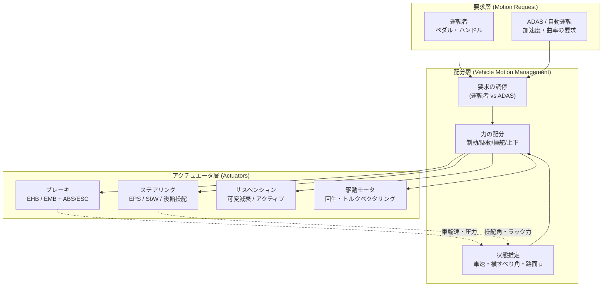
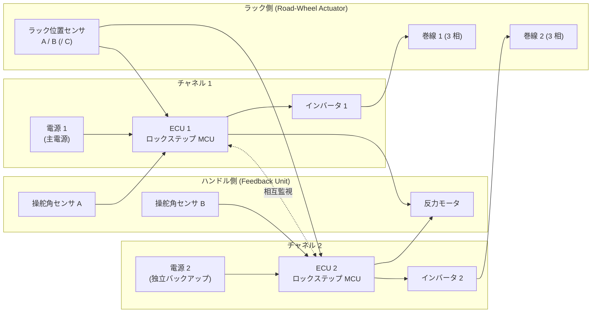
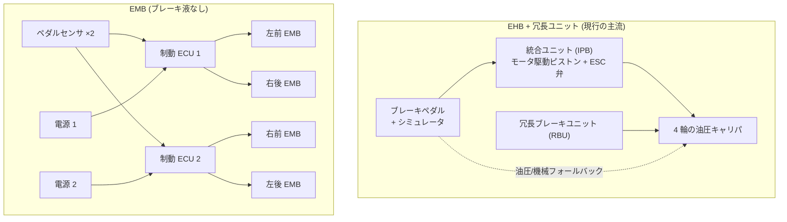

# シャシー制御と X-by-wire (Chassis Control & X-by-Wire)

## 概要 (Overview)

**シャシー制御 (chassis control)** は、タイヤと路面の間に働く力を電子制御で操作し、車両の縦（制動・駆動）・横（操舵）・上下（サスペンション）の運動を決める技術群である。ABS (Anti-lock Braking System) と ESC (Electronic Stability Control, 横滑り防止装置) は、運転者の操作に**ブレーキ圧の補正を重ねる**かたちで始まった。その延長線上にあるのが、運転者の操作と車輪を機械的に切り離し、電気信号だけで結ぶ **X-by-wire**（ブレーキ・バイ・ワイヤ (brake-by-wire)、ステア・バイ・ワイヤ (steer-by-wire, SbW)）である。

X-by-wire の工学的な核心は制御則ではなく**故障時の振る舞い**にある。機械的な結合が残っていれば、電子系が止まっても運転者の力で最低限の操舵・制動ができる。この結合を外すと、電子系の喪失はそのまま操舵・制動の喪失になる。そのため、システムを止めて安全な状態へ移す**フェイルセーフ (fail-safe)** では足りず、故障後も機能を保つ**フェイルオペレーショナル (fail-operational)** な冗長設計が必要になる。本書は ABS/ESC の制御原理から、電動油圧ブレーキ・電動機械ブレーキ・SbW・アクティブサスペンションの構成、冗長アーキテクチャと ASIL 分解、規制（UN R13-H・R140・R79、FMVSS 126、中国 GB 規格）の 2026 年 11 月時点の状況、ADAS/自動運転との接続までを扱う。分析深度は Level 3 とする。

## 方法論 (Methodology)

- シャシー制御を「**タイヤ力の物理 → 制御則 → アクチュエータ → 冗長と故障時挙動 → 規制**」の順に分解する。制御則の数理は [`../../foundations/control-theory/`](../../foundations/control-theory/) の各文書に委ね、本書は車両固有の部分を扱う。
- 規制の状況は UNECE の作業文書・採択記録と EU 官報、米国 eCFR を一次資料とし、2026-11-28 時点で確認できた範囲を書く。採択済みの規則と審議中の提案は区別する。
- 製品の事例（Infiniti Q50、Tesla Cybertruck、Lexus RZ、Bosch、Brembo など）は、メーカーの発表を**公称 (claimed)** として扱い、分解調査やリコール記録など独立した情報源と突き合わせる。突き合わせができないものはその旨を明記する。
- 安全の議論は [`functional-safety-iso26262.md`](functional-safety-iso26262.md) の枠組み（HARA・ASIL・ASIL 分解・従属故障分析）に沿って行う。

## 発見事項 (Findings)

1. **ABS/ESC は「スリップ率」と「ヨーレート」の 2 つの量を制御する。** ABS はタイヤの縦すべりを摩擦係数のピーク付近に保ち、ESC は車輪ごとのブレーキで車体にヨーモーメントを加え、運転者の意図から推定した目標ヨーレートへ車両を戻す。いずれも制動アクチュエータの上で動くソフトウェア機能である。
2. **ESC は主要市場で装着が義務となり、試験法も国際的にそろった。** 米国 FMVSS 126 は 2011-09-01 以降に製造された車両すべてに ESC を求め、sine with dwell 試験でヨーレートの収束（1.0 秒後に 35% 以下、1.75 秒後に 20% 以下）と応答性（横変位 1.83 m 以上）を判定する[^fmvss126]。UN R140 は R13-H から ESC 条項を切り出した規則で、2017-01-22 に発効した[^r140-un]。
3. **ブレーキ・バイ・ワイヤは「油圧を残す」電動油圧ブレーキ (EHB) が主流で、「油圧をなくす」電動機械ブレーキ (EMB) が 2025–2026 年に規制と量産の両面で動き出した。** UN R13-H は WP.29 第 194 回会合（2024 年 11 月）で、蓄積した電気エネルギーだけで制動する方式を認める改正を採択し、EU 官報では 02 series として 2025-06-12 発効と記載されている[^r13h-eu][^r13h-gar]。中国も GB 21670-2025 で EMB を規定した（2026-01-01 施行と報道）[^cn-gb21670]。
4. **ステア・バイ・ワイヤは規制上 2003 年から認められていたが、量産は遅れた。** UN R79 は 01 series 補遺 3 でステアリング操作部と車輪の間に機械的結合を持たない「フルパワーステアリング (full power steering)」を承認可能にした[^vca-sbw]。量産車では、機械式バックアップを残した Infiniti Q50 の DAS（2013 年）が先行し、Tesla Cybertruck と Lexus RZ が機械結合なしの SbW を市販車に載せた。R79 は 2025 年 6 月に SbW を含むフルパワーステアリングの規定を明確化する補遺を採択し（2026-01-11 発効）[^r79-s13]、中国は GB 17675-2025 で機械結合の義務を外した（2026-07-01 施行と報道）[^cn-gb17675]。
5. **機械結合を外すと、安全要求の重心が「誤作動の防止」から「機能喪失の防止」へ移る。** 従来の EPS では、アシストを失っても運転者は重いハンドルで操舵できたため、重大なハザードは主に意図しない操舵 (self-steer) だった。SbW では操舵の喪失も重大なハザードになり、電源・ECU・モータ巻線・センサ・通信を二重化した fail-operational 構成が前提になる。
6. **冗長の価値は共通原因故障を断てるかで決まる。** 2 チャネル構成でも、電源・接地・ソフトウェア・温度環境を共有すれば同時に壊れる。Infiniti Q50 の DAS は低温始動時の不具合で機械式バックアップの結合が遅れるとしてリコールされた[^tc-recall]。冗長化した系でも、故障を検出して切り替える経路自体が単一障害点になりうることを示す事例である。
7. **シャシーは ADAS/自動運転の「最終アクチュエータ」である。** 運転者がいない L4 では、操舵・制動の fail-operational 化が最小リスク操作 (MRM) を実行するための前提になる。計画系の冗長（[`autonomous-driving-stack-safety.md`](autonomous-driving-stack-safety.md)）は、アクチュエータ側の冗長がなければ意味を持たない。

## アーキテクチャ (Architecture)

### シャシー制御の階層 (Control Hierarchy)

現代のシャシー制御は運動の要求を出す層・運動を配分する層・アクチュエータを駆動する層に分かれる。ESC や ABS は配分層とアクチュエータ層の間に入り、要求を上書きする安全機能として働く。



凡例: 実線は指令の流れ、点線はセンサ情報の帰還。配分層は独立 ECU にある場合も、ゾーン/セントラル型 E/E（[`ee-architecture.md`](ee-architecture.md)）の HPC 上のソフトウェアとして実装される場合もある。

### by-wire 化の段階 (Degrees of By-Wire)

| 段階 | ブレーキの例 | ステアリングの例 | 電子系が止まったとき |
|---|---|---|---|
| 機械＋補正 | 負圧ブースタ＋ABS/ESC 油圧ユニット | 油圧/電動パワステ (EPS) | 補助を失うが、運転者の力で操作できる |
| 電動補助 | 電動ブースタ（Bosch iBooster）＋ESC[^bosch-redundancy] | EPS | 同上。補助の二重化で縮退運転も可能 |
| 分離型＋機械/油圧バックアップ | 分離型 EHB（Bosch IPB: ペダルを両ブレーキ回路から切り離し、ペダルフィールシミュレータを接続）[^bosch-ipb] | Infiniti DAS（クラッチで機械結合を復帰）[^nissan-das] | バックアップ経路に切り替わる |
| 完全 by-wire | EMB（ブレーキ液なし） | Cybertruck・Lexus RZ の SbW | 冗長チャネルが機能を継続しなければならない |

下の段に行くほど、パッケージング（ステアリングコラムや油圧配管の削除、左右ハンドルの作り分け）と制御の自由度（可変ギア比、反力の合成、回生協調）が得られる。代わりに、故障時の安全を電子系の冗長だけで担保する必要が出てくる。

### SbW の冗長アーキテクチャ (Redundant Steer-by-Wire)

機械結合を持たない SbW は、ハンドル側の**反力アクチュエータ (feedback actuator)** と、車輪側の**ラックアクチュエータ (road-wheel actuator)** の 2 つに分かれ、その間を通信で結ぶ。典型的な fail-operational 構成では、両端をそれぞれ 2 チャネル化する。



凡例: 実線は電力と指令、点線はチャネル間の相互監視（クロスチェックと状態の同期）。1 つのモータ筐体に 3 相巻線を 2 組持たせる**二重巻線 (dual-wound, 6 相)** 構成では、片方の巻線・インバータ・ECU・電源が失われても、残りの系で出力を落として操舵を続けられる。

公開情報から読み取れる量産例の構成は次のとおりである。

- **Tesla Cybertruck**: 取扱説明書はハンドルと車輪の間に機械的な結合がないと明記する[^tesla-manual]。Munro & Associates の分解調査では、ZF 製のラックに位置センサを持つモータが 2 基あり、両者が食い違ったときに判定する 3 つ目のセンサがあった。ハンドルからの信号は 2 本のケーブルで二重化されていた[^autopian-ct]。電源系の二重化は ZF 担当者の発言として紹介されたのみで、記事中でも未確認とされている。
- **Lexus RZ**: JTEKT は機械的な結合を持たない SbW のバックアップ電源として、自社のリチウムイオンキャパシタ Libuddy を供給したと発表した。主電源を失っても、路肩など安全な場所まで車両を移動させるだけの電力を供給する[^jtekt-rz]。

### ブレーキの冗長アーキテクチャ (Redundant Brake-by-Wire)



凡例: EMB 側は対角 2 系統に分けた構成例。油圧ブレーキの対角 2 回路（X 配管）と同じ考え方で、片系統を失っても残りの対角 2 輪で直進性を保ちながら制動できる。実際の系統分けは製品ごとに異なり、公開されていないものが多い。

Bosch は、電動ブースタ iBooster と ESC が「どちらも単独で車両を制動できる」2 つのアクチュエータになる構成を、自動運転向けの冗長ブレーキとして 2018 年に発表した[^bosch-redundancy]。分離型の IPB では自動運転車向けに冗長ブレーキユニット (RBU) を追加し、IPB が故障しても運転者の介入なしに安全に停止できるとしている[^bosch-ipb]。

## 技術詳細 (Technical Details)

### 1. タイヤ力とスリップ (Tire Forces & Slip)

制動時の**スリップ率 (slip ratio)** は車速 v と車輪周速 ωr の差で定義される。

```text
制動スリップ率  λ = (v − ω·r) / v     （0: 自由転動、1: 車輪ロック）
縦力            F_x ≈ μ(λ) · F_z
摩擦円          √(F_x² + F_y²) ≤ μ_peak · F_z
```

乾燥路では、μ(λ) は小さなスリップ率でピークに達し、その後ロック (λ = 1) に向かって下がる。ロックした車輪は横力 F_y もほとんど出せないため、操舵が効かなくなる[^rajamani][^pacejka]。**摩擦円 (friction circle)** の制約により、縦力と横力は同じタイヤの摩擦を分け合う。強く制動している車輪ほど、曲がる力の余地が小さくなる。

ABS の制御器は車輪速と推定車速からスリップ率を求め、ピーク付近に保つよう油圧を「増圧・保持・減圧」の 3 状態で調整する。ここで難しいのは、車速を直接測れないことである。全輪が同時に滑ると車輪速から車速を推定できなくなるため、加速度センサとの融合や、意図的に圧を抜いて車輪を回復させる手順が必要になる。推定の理論は [`../../foundations/control-theory/state-space-estimation.md`](../../foundations/control-theory/state-space-estimation.md)（オブザーバとカルマンフィルタ）を参照。

### 2. ESC のヨーレート制御 (Yaw-Rate Control)

ESC は運転者の操舵角と車速から**目標ヨーレート**を計算し、実際のヨーレート（ヨーレートセンサ）との偏差を、車輪ごとの制動によるヨーモーメントで打ち消す。目標値の計算には線形 2 輪モデル（自転車モデル, bicycle model）が使われる[^rajamani]。

```text
定常円旋回のヨーレート  r_ss = v · δ / (L · (1 + K_us · v²))
  δ: 前輪舵角, L: ホイールベース, K_us: スタビリティファクタ（アンダーステア特性）
路面の上限               |r_target| ≤ μ · g / v
```

- **オーバーステア**（後輪が先に滑り、ヨーレートが目標を超える）では、旋回外側の前輪を制動して戻すモーメントを作る。
- **アンダーステア**（前輪が滑り、ヨーレートが足りない）では、旋回内側の後輪を制動する。

FMVSS 126 の定義では、ESC は車輪ごとに独立した制動トルクでヨーモーメントを生み、ヨーレートの推定・監視と比較に基づいて介入し、20 km/h 未満・後退時・初期化中を除く全速度域で作動するシステムである[^fmvss126]。性能は **sine with dwell** 試験で判定する。80 km/h から 0.7 Hz の正弦操舵を行い、2 つ目のピークで 500 ms 保持したあと、操舵終了から 1.0 秒後のヨーレートが最初のピークの 35% 以下、1.75 秒後が 20% 以下であること（横安定性）、操舵開始から 1.07 秒後の横変位が 1.83 m 以上であること（車両総重量 3,500 kg 以下の場合、応答性）を求める[^fmvss126]。

ESC の装着義務と試験規則の状況は次のとおり。

| 地域・規則 | 内容 | 状況（2026-11-28 時点） |
|---|---|---|
| 米国 FMVSS 126 | 段階導入を経て、2011-09-01 以降製造の全車（車両総重量 4,536 kg 以下）に義務化 | 施行済み[^fmvss126] |
| EU 規則 661/2009 | M1/N1 の新型式は 2011-11-01、全新車は 2014-11-01 から ESC を義務化 | 施行済み。現在は一般安全規則 (EU) 2019/2144 が引き継ぐ[^eu-661][^eu-gsr] |
| UN R140 | R13-H から ESC 条項を切り出した型式認可規則。装着を義務づけるのではなく、装着した場合の要件を定める | 2017-01-22 発効[^r140-un] |

### 3. ブレーキ・バイ・ワイヤ (Brake-by-Wire)

**EHB (Electro-Hydraulic Brake)** は、油圧キャリパを残したまま、圧力の発生源をモータに替える方式である。電動ブースタ（iBooster）は運転者のペダル力を電動で補助するもので、ペダルと油圧回路の機械的なつながりは残る[^bosch-redundancy]。分離型 (decoupled) の IPB はペダルを両ブレーキ回路から切り離してシミュレータにつなぎ、モータがギアを介して油圧ピストンを動かす[^bosch-ipb]。分離型には 2 つの利点がある。

- **回生協調 (regenerative blending)**: ペダル操作と実際の摩擦制動が切り離されるため、駆動モータの回生制動を優先し、足りない分だけ油圧を足せる。Bosch は IPB で最大 0.3 g の回生を公称する[^bosch-ipb]。回生の電気的な側面は [`../motors/electric-motor-drives.md`](../motors/electric-motor-drives.md) §10 を参照。
- **自動ブレーキの応答**: ADAS の制動要求に、運転者の操作なしで速く圧を立ち上げられる。

**EMB (Electro-Mechanical Brake)** は、各輪のキャリパに組み込んだモータが減速機とボールねじでパッドを押し付ける方式で、ブレーキ液と配管をなくす。利点は油圧系の削除による組立・保守の簡素化と、輪ごとの独立した高速制御である。課題は制動エネルギーのすべてを電源に頼る点にある。電源を失えば制動力がなくなるため、規則も電源の監視と予備の確保を中心に組み立てられている。

- **UN R13-H**: WP.29 第 194 回会合（2024 年 11 月）で採択された改正 (ECE/TRANS/WP.29/2024/147) は、運転者が操作する蓄積電気エネルギーだけで常用制動の性能を満たす方式を認め、使用サイクルの開始時にエネルギー管理系が警告を表示する規定などを加えた[^eu-council-2024][^r13h-gar]。EU 官報の R13-H 掲載版は 02 series の発効日を 2025-06-12 とし、電気伝達式の制動系を持つ車両はこの改正の要件を満たす場合にのみ型式認可を与えるとする経過規定を載せている[^r13h-eu]。重量車の R13 側も同じ方向の改正が並行して進んだ[^eu-council-2024]。
- **中国 GB 21670-2025**: EMB を「電気伝達式制動系 (ETBS)」として初めて規定し、2026-01-01 から施行されたと報じられている[^cn-gb21670]。バックアップ電源の起動時間などの数値は中国語の二次報道でしか確認できていない。
- **量産**: Brembo は 2026 年 5 月、ブレーキ液を使わない制動システム Sensify が、顧客名非公表の大手自動車メーカーで量産に入ったと発表した[^newatlas-sensify]。報道の間で構成の説明に食い違いがあり（前輪に電動油圧アクチュエータを使うとの記述もある）、4 輪とも EMB かどうかは一次資料で確認できていない。中国のサプライヤも 2026 年の量産開始を主張しているが、独立した確認は限られる[^cn-gb21670]。

### 4. EPS からステア・バイ・ワイヤへ (From EPS to Steer-by-Wire)

**EPS (Electric Power Steering)** は、コラムやラックに取り付けたモータが、トルクセンサで測った運転者の操舵トルクに比例した補助力を加える。制御の中身はモータの電流（トルク）制御であり、[`../motors/electric-motor-drives.md`](../motors/electric-motor-drives.md) の FOC カスケードがそのまま使われる。EPS の主要なハザードは 2 つある。

| ハザード | 例 | 機械結合あり (EPS) | 機械結合なし (SbW) |
|---|---|---|---|
| 意図しない操舵 (self-steer) | トルクセンサ故障で勝手に切れる | 最重要。出力の遮断で安全側へ倒せる | 最重要。遮断すると次のハザードになる |
| 操舵機能の喪失 (loss of steering) | モータ・ECU・電源の故障 | 補助を失っても重い手応えで操舵可能 | 操舵不能。fail-operational が必須 |

EPS では「おかしければ補助を止める」というフェイルセーフが成り立つ。SbW では、止めることがそのまま操舵の喪失になる。これが SbW を fail-operational 設計へ押しやる根本的な理由である。

量産例を比べると次のとおりである。

| 車種 | 機械結合 | 公開情報で確認できた構成 | 典拠の性質 |
|---|---|---|---|
| Infiniti Q50 (DAS, 2013) | あり（通常は切り離し、故障時にクラッチで結合） | Nissan は「世界初の量産 SbW」と公称[^nissan-das]。低温始動時の不具合で機械式バックアップの結合が遅れ、操舵を失うおそれがあるとしてリコール[^tc-recall] | メーカー発表＋規制当局のリコール記録 |
| Tesla Cybertruck | なし | 2 モータのラック、3 系統の位置センサ、信号ケーブルの二重化、48 V 系[^tesla-manual][^autopian-ct] | 取扱説明書＋第三者の分解調査 |
| Lexus RZ | なし | 専用バックアップ電源（JTEKT Libuddy）[^jtekt-rz]。中立から左右へ約 200° の操舵角[^lexus-uk]。英国では 2026 年第 1 四半期からの導入を予告（目標） | メーカー・サプライヤ発表 |
| NIO ET9 | なし | 中国初の機械バックアップなし量産 SbW と報道[^cn-gb17675] | 二次報道のみ |

SbW は機械結合がないため、ハンドルに伝わる手応えを**反力モータで合成**する必要がある。ラック力の推定値に、路面からの情報として何を伝え、何を遮るかは設計上の選択であり、DAS が掲げた「路面の細かな乱れを遮りつつ必要な情報を伝える」はその一例である[^nissan-das]。可変ギア比も自由に設定でき、Lexus RZ の中立から左右へ約 200° という操舵角はその例である[^lexus-uk]。

**規制上の位置づけ (UN R79)**: R79 は 2003 年の 01 series 補遺 3 で、操舵力をエネルギー源だけから得る「フルパワーステアリング」を承認可能にした。SbW はこの区分に入り、電子制御系の安全を扱う Annex 6 の文書監査（故障時の戦略、FMEA/FTA などの解析）と、正常時・故障時の試験で評価される[^vca-sbw]。2025 年 6 月の WP.29 第 196 回会合は CLEPA と OICA の提案に基づき、SbW などフルパワーステアリングの規定を明確化する 03 series 補遺 13 (ECE/TRANS/WP.29/2025/61) を全会一致で採択し、2026-01-11 に発効した[^r79-s13][^wp29-1185]。同時に 04 series 補遺 8 (ECE/TRANS/WP.29/2025/62) も採択されている[^wp29-1185]。中国の GB 17675-2025 は機械結合の義務を外し、電源・制御伝達・エネルギー管理の故障時性能、電源の劣化警報、ISO 26262 への準拠を求めると報じられている（2026-07-01 施行）[^cn-gb17675]。

### 5. アクティブサスペンション (Active Suspension)

サスペンションの電子制御は**可変減衰 (semi-active)** と**フルアクティブ (fully active)** に分かれる。可変減衰はダンパの減衰力だけを変え、エネルギーを散逸させる方向にしか力を出せない。フルアクティブはアクチュエータで力を能動的に加え、車体を持ち上げたり押し下げたりできる。

- **Audi A8 の predictive active suspension**: 各輪に 48 V 系から給電する電動モータを置き、ベルトと波動歯車で 1,100 N·m に増幅してトーションチューブに伝える。シャシー制御ユニットは 5 ms ごとに指令を送り、状況により最大 3 kW を 48 V バッテリへ回生する（公称値）[^audi-pas]。
- **プレビュー制御**: Mercedes-Benz の Magic Body Control は、ステレオカメラで前方の路面の凹凸を検出し、車輪が到達する前に足回りを調整する（2013 年の S クラスで導入）[^mbc]。フィードバックだけでは遅れて反応するしかない外乱を、前方の観測でフィードフォワード補償する構成である。

サスペンションの故障は操舵や制動に比べて直接の重大事故につながりにくい。故障時は受動ばねとして振る舞うよう設計し、フェイルセーフで済ませることが多い。ただし、車高を大きく変える機能や、横転防止のロール制御を担う場合は、故障時の姿勢変化そのものがハザードになるため、HARA で個別に評価する必要がある。

### 6. フェイルセーフとフェイルオペレーショナル (Fail-Safe vs Fail-Operational)

| 区分 | 故障後の振る舞い | 必要な構成 | シャシーでの例 |
|---|---|---|---|
| フェイルサイレント (fail-silent) | 誤った出力を出さずに停止 | 自己診断＋出力遮断 | 1 チャネルの EPS ECU |
| フェイルセーフ (fail-safe) | 安全状態へ移行 | 診断＋安全状態の存在 | EPS の補助停止（機械結合が安全状態を与える） |
| フェイルデグレード (fail-degraded) | 性能を落として継続 | 部分的な冗長 | iBooster と ESC の相互バックアップ[^bosch-redundancy] |
| フェイルオペレーショナル (fail-operational) | 一定時間、機能を継続 | 独立した 2 チャネル以上＋切替 | 機械結合なしの SbW、EMB、L4 の制動・操舵 |

fail-operational の要件は「どのくらいの時間、どの性能で」を伴って初めて意味を持つ。運転者が乗っている L2 までは、運転者が引き継ぐか停止するまでの数秒〜数十秒、縮退した性能を保てばよい。運転者がいない L4 では、システム自身が MRM で路肩停止まで車両を運ぶ間、操舵と制動を保つ必要がある。SbW の規則も故障後にどの性能をいつまで保つか（停止または低速に至るまでなど）を軸に議論されてきたが、2025 年 6 月に採択された R79 補遺の最終的な文言は、本書の執筆時点で一次資料を確認できていない[^r79-s13]。

### 7. ASIL 分解と従属故障 (ASIL Decomposition & Dependent Failures)

SbW の安全目標「意図しない操舵を防ぐ」「操舵機能の喪失を防ぐ」は、高速走行中の事象を考えれば S3・E4・C3 となり、ASIL D に分類されるのが一般的である（決定の仕組みは [`functional-safety-iso26262.md`](functional-safety-iso26262.md) §HARA）。

2 チャネル構成では ISO 26262-9 の ASIL 分解で `ASIL D → B(D) + B(D)` のように各チャネルの開発水準を下げる設計が考えられる[^iso26262-9]。ただし、分解が成り立つのは 2 つのチャネルが**十分に独立**している場合に限られる。SbW で独立性を崩しやすい要因は次のとおりである。

| 従属故障の要因 | 具体例 | 対策 |
|---|---|---|
| 電源 | 主電源の喪失、共通の接地点、同じヒューズ | 独立した電源（別バッテリ・キャパシタ）、接地の分離 |
| ハードウェア | 同じモータ筐体の機械的固着、同じロットの部品 | 二重巻線でも軸受・ギアは共通であることを認め、機械部分は別途の故障率目標で管理 |
| ソフトウェア | 両チャネルに同じバグ | 多様化 (diversity)、または分解後も系統故障対策は元の ASIL D 水準で実施 |
| 環境 | 低温・水没・EMC | 環境試験、チャネルの物理的な離隔 |
| 切替の論理 | 故障検出・投票・切替そのものの不具合 | 切替経路の単純化、故障注入試験 |

Infiniti DAS のリコール[^tc-recall]は、最後の行の典型例である。冗長系の価値は主系の信頼性ではなく、故障の検出から縮退までの経路が確実に働くことで決まる。冗長系の信頼度と、共通原因故障がそれを崩す仕組みは [`../../foundations/mathematics/probability-statistics/reliability-theory.md`](../../foundations/mathematics/probability-statistics/reliability-theory.md) を参照。

fail-operational 化ではハードウェアの PMHF 目標（ASIL D で 10⁻⁸/h 未満）を、1 チャネルの故障率と、2 チャネル目が潜在故障を抱えている確率の積で満たすことになる。2 チャネル目の潜在故障を見逃さないよう、始動時の自己診断や定期的な切替試験で**潜在故障の暴露時間**を短くすることが、ハードウェアの冗長と同じくらい重要になる。

### 8. 制御理論から見た by-wire (Control-Theoretic View)

- **むだ時間と帯域**: by-wire ではセンサ → ECU → 通信 → インバータの経路が操舵・制動ループのむだ時間になる。むだ時間は位相余裕を削り、ループ帯域の上限を決める（[`../../foundations/control-theory/frequency-response-stability-margins.md`](../../foundations/control-theory/frequency-response-stability-margins.md) §4）。チャネル切替の過渡や、冗長 ECU 間の同期で生じる遅れも、同じ式で評価できる。
- **カスケード構造**: ラック位置制御の内側にモータ電流ループがあり、その外側にヨーレートや経路追従のループが重なる。内側ほど帯域を高くとるという分業は、[`../../foundations/control-theory/feedback-transfer-functions.md`](../../foundations/control-theory/feedback-transfer-functions.md) と [`../motors/electric-motor-drives.md`](../motors/electric-motor-drives.md) のループ帯域の議論と同じである。
- **非線形性**: スリップ率に対するタイヤ力の飽和は、線形制御の前提を崩す。ABS が状態機械とルールで書かれることが多いのは、この強い非線形と路面 μ の不確かさによる。
- **推定**: 横すべり角や路面 μ は直接測れず、ESC の性能は推定精度に左右される。状態空間モデルとカルマンフィルタ（[`../../foundations/control-theory/state-space-estimation.md`](../../foundations/control-theory/state-space-estimation.md)）が推定器の基盤になる。

### 9. ADAS・自動運転との接続 (Interface to ADAS & Automated Driving)

- **運動要求のインタフェース**: ADAS はブレーキ圧やモータ電流ではなく、目標加速度・目標曲率（またはヨーレート）を配分層に要求する。配分層は運転者の操作との調停（オーバーライドの検出）と、アクチュエータの能力限界の管理を受け持つ。
- **ESC は ADAS の下でも働く**: 自動ブレーキや車線維持の指令であっても、ABS/ESC はアクチュエータ層の最後の安全機能として介入する。上位の計画が摩擦円を超える要求を出しても、下位層が車輪のロックやスピンを防ぐ。
- **冗長の連鎖**: L3 以上では計算・電源・通信・アクチュエータのすべてが冗長でないと fail-operational にならない。計算側の冗長とセーフティアイランドは [`autonomous-driving-stack-safety.md`](autonomous-driving-stack-safety.md) と [`ee-architecture.md`](ee-architecture.md)、通信の時間保証は [`automotive-ethernet-tsn.md`](automotive-ethernet-tsn.md) を参照。
- **MRM の実行主体**: 運転者のいない状態で主系が故障したとき、路肩停止のための最小限の操舵・制動を、どの ECU が、どの電源で実行するかを事前に決めておく必要がある。この経路はセントラルの HPC を経由しない独立した経路として残すのが一般的である。

## 運用・安全考察 (Operational & Safety Considerations)

### 機能安全・運用

- **潜在故障の管理**: 冗長チャネルの片方が気づかないうちに壊れたまま走り続けると、冗長はないのと同じになる。始動時の自己診断と走行中の相互監視で潜在故障を暴露させ、片系故障時は警告を出して運転者に整備を促す運用設計が要る。
- **縮退時の性能表示**: 片系で走行を続ける場合、最大操舵速度や制動力が落ちる。運転者や ADAS に能力の低下を知らせ、速度制限や自動運転機能の停止と組み合わせる必要がある。
- **バックアップ電源の劣化**: キャパシタや補助バッテリは経年で容量が落ちる。中国 GB 17675-2025 が電源劣化の警報を求めると報じられているように[^cn-gb17675]、劣化の監視は規制要件にもなりつつある。
- **整備と OTA**: by-wire 系のパラメータ（ギア比、反力特性、回生協調の配分）はソフトウェアで変えられる。OTA 更新では UN R156 の SUMS の枠組みに沿って、型式認可の範囲を逸脱しないことを確認する必要がある（[`cybersecurity-iso21434.md`](cybersecurity-iso21434.md)）。

### サイバーセキュリティ

- **アクチュエータへの到達経路**: Miller と Valasek は 2015 年、テレマティクス経由で Jeep Cherokee の CAN に到達し、低速時のブレーキ無効化やステアリング操作を実証した[^miller-valasek]。by-wire 化は電子経路しか持たない操舵・制動を増やすため、この種の攻撃の影響を大きくする。
- **防御の層**: 制御ドメインのゲートウェイ分離、SecOC によるメッセージ認証、ECU のセキュアブートと HSM（[`in-vehicle-networks.md`](in-vehicle-networks.md)、[`cybersecurity-iso21434.md`](cybersecurity-iso21434.md)）。ADAS からの運動要求は認証に加えて、配分層での**物理的な妥当性検査**（要求加速度・曲率の上限、変化率の制限）を通すべきである。認証は送信者を確かめるだけで、正規の送信者が侵害されていれば意味をなさないからである。
- **安全機構の悪用**: 冗長系の切替や縮退は、偽の故障信号で意図的に引き起こせる可能性がある。TARA で「縮退モードへの誘導」を脅威シナリオとして扱い、HARA と突き合わせる（ISO 26262 × ISO/SAE 21434）。
- **E2E 保護との役割分担**: AUTOSAR の E2E 保護（[`../../software/embedded/autosar-vehicle-software.md`](../../software/embedded/autosar-vehicle-software.md)）は偶発的な破損や欠落を検出するためのもので、悪意ある改ざんは防げない。安全のための E2E と、保安のための SecOC は併用する。

## 結論 (Conclusions)

- ABS/ESC はスリップ率とヨーレートを制御する、制動アクチュエータ上のソフトウェア機能である。ESC は米国・EU で義務化され、sine with dwell 試験で性能が判定される。
- by-wire 化の本質は、機械結合が与えていた「無料の安全状態」を手放すことにある。その代わりに、電源・ECU・モータ巻線・センサ・通信の冗長と、故障を検出して切り替える経路の確実性で安全を担保する必要がある。
- 規制は 2025–2026 年に大きく動いた。UN R13-H は電気エネルギーだけで制動する方式を認め、UN R79 はフルパワーステアリングの規定を明確化し、中国は EMB と機械結合なしの SbW を国家規格に取り込んだ。量産では EHB が主流で、EMB と SbW は導入の初期段階にある。
- ASIL 分解は独立性が前提であり、SbW では電源・環境・切替論理の共通原因故障が分解の成否を決める。
- シャシーは自動運転の最終アクチュエータであり、計画系の冗長はアクチュエータ側の fail-operational 化と組み合わさって初めて意味を持つ。by-wire 化は同時に、電子経路だけで車を動かせる攻撃面を広げるため、物理的な妥当性検査を含む多層防御が要る。

### 次の接続先 (Related Topics)

- [`functional-safety-iso26262.md`](functional-safety-iso26262.md) — HARA・ASIL 分解・従属故障分析・E-Gas 3 レベル監視の規範。
- [`ee-architecture.md`](ee-architecture.md) — ゾーン/セントラル型での配分層の置き場所、eFuse による電源の分配と冗長。
- [`in-vehicle-networks.md`](in-vehicle-networks.md) — シャシー ECU をつなぐ CAN/CAN FD と無認証問題。
- [`automotive-ethernet-tsn.md`](automotive-ethernet-tsn.md) — by-wire の指令経路に要る時間保証。
- [`autonomous-driving-stack-safety.md`](autonomous-driving-stack-safety.md) — 計算系の冗長、MRM、UN R157。
- [`cybersecurity-iso21434.md`](cybersecurity-iso21434.md) — TARA、SecOC、HSM、UN R155/R156。
- [`../motors/electric-motor-drives.md`](../motors/electric-motor-drives.md) — EPS/SbW/EMB を動かすモータの FOC・ループ帯域・回生・故障モード。
- [`../../foundations/control-theory/feedback-transfer-functions.md`](../../foundations/control-theory/feedback-transfer-functions.md) — フィードバック・PID・カスケード構造。
- [`../../foundations/control-theory/frequency-response-stability-margins.md`](../../foundations/control-theory/frequency-response-stability-margins.md) — むだ時間と遅れ余裕。
- [`../../foundations/control-theory/state-space-estimation.md`](../../foundations/control-theory/state-space-estimation.md) — 車速・横すべり角の推定。
- [`../../foundations/mathematics/probability-statistics/reliability-theory.md`](../../foundations/mathematics/probability-statistics/reliability-theory.md) — 冗長系の信頼度と共通原因故障。

## 参考文献 (References)

**一次資料 (Primary — 規則・規格・規制当局・教科書)**

[^fmvss126]: 49 CFR § 571.126, *Standard No. 126; Electronic stability control systems for light vehicles*. — [Cornell LII](https://www.law.cornell.edu/cfr/text/49/571.126) — Accessed: 2026-11-28。S4 の ESC の定義、S5.2 の性能要件（35%/1.0 s、20%/1.75 s、1.83 m/1.07 s）、S7.9 の sine with dwell、S8 の段階導入と 2011-09-01 の全面適用。

[^r140-un]: United Nations Treaty Collection, *UN Regulation No. 140 — Uniform provisions concerning the approval of passenger cars with regard to Electronic Stability Control (ESC) Systems*. — [UNTC XI-B-16-140](https://treaties.un.org/doc/Publication/MTDSG/Volume%20I/Chapter%20XI/XI-B-16-140.en.xml) — Accessed: 2026-11-28。2016 年 7 月採択、2017-01-22 発効。

[^eu-661]: Regulation (EC) No 661/2009 of the European Parliament and of the Council (General Safety Regulation, 旧). Art. 12(1)・13. — [legislation.gov.uk: Article 12](https://legislation.gov.uk/eur/2009/661/article/12/adopted) — Accessed: 2026-11-28。M1/N1 への ESC 装着義務、新型式 2011-11-01・全新車 2014-11-01。

[^eu-gsr]: Regulation (EU) 2019/2144 (General Safety Regulation). — [EUR-Lex 32019R2144](https://eur-lex.europa.eu/eli/reg/2019/2144/oj) — Accessed: 2026-11-28。661/2009 を置き換えた現行の一般安全規則。

[^r13h-eu]: UN Regulation No 13-H — Uniform provisions concerning the approval of passenger cars with regard to braking, EU 官報掲載版 (2026/502). — [EUR-Lex OJ L 2026/502](https://eur-lex.europa.eu/eli/reg/2026/502/oj/eng) — Accessed: 2026-11-28。02 series の発効日 2025-06-12 と電気伝達式制動系の経過規定（本文は検索結果経由で確認、ページ本体の取得は不可）。

[^eu-council-2024]: Council of the European Union (2024). *ANNEX to the Proposal for a Council Decision on the position to be taken on behalf of the EU in WP.29 ...*, ST 14819/24 ADD 1, 25 October 2024. — [Consilium PDF](https://data.consilium.europa.eu/doc/document/ST-14819-2024-ADD-1/en/pdf) — Accessed: 2026-11-28。ECE/TRANS/WP.29/2024/147（R13-H: 蓄積電気エネルギーのみに依存する制動系の許容、使用サイクル開始時の警告）と WP.29/2024/143（R13 Annex 18 の改正）の要旨。

[^r79-s13]: GlobalAutoRegs, *UN R79: Proposal for a Supplement 13 to the 03 series of amendments* (ECE/TRANS/WP.29/2025/61). — [globalautoregs.com](https://globalautoregs.com/modifications/2451?rule_id=90) — Accessed: 2026-11-28。WP.29 第 196 回会合（2025-06-23〜27）で採択（出席 35 締約国が全会一致）、2026-01-11 発効。目的は ACSF 用語の改善と SbW などフルパワーステアリング規定の明確化。UNECE の採択記録を整理した専門データベース（二次）だが、文書番号・投票記録は UNECE 文書に基づく。

[^wp29-1185]: UNECE (2025). *Annotated provisional agenda for the 196th session of the World Forum*, ECE/TRANS/WP.29/1185, 4 April 2025. — [UN ODS PDF](https://documents.un.org/doc/undoc/gen/g25/053/58/pdf/g2505358.pdf) — Accessed: 2026-11-28。議題 4.7.6（R79 03 series 補遺 13、GRVA/2025/6・2025/7 に基づく）と 4.7.7（04 series 補遺 8）。

[^vca-sbw]: Vehicle Certification Agency (UK). *Assessing the compliance of Steer-by-Wire systems for Individual Vehicle Approval*. — [VCA](http://www.vehicle-certification-agency.gov.uk/?p=20432) — Accessed: 2026-11-28。R79 が 2003 年の 01 series 補遺 3 でフルパワーステアリングとしての SbW を承認可能にしたこと、Annex 6 による評価。

[^iso26262-9]: ISO 26262-9:2018, *Road vehicles — Functional safety — Part 9: ASIL-oriented and safety-oriented analyses*. — [ISO 26262-9:2018](https://www.iso.org/standard/68391.html) — Accessed: 2026-11-28。ASIL 分解と従属故障分析。

[^tc-recall]: Transport Canada, *Recall 2013410 — 2014 INFINITI Q50 (Direct Adaptive Steering)*. — [Transport Canada Recalls](https://recalls-rappels.canada.ca/en/alert-recall/transport-canada-recall-2013410-nissan) — Accessed: 2026-11-28。低温始動時の不具合で機械式バックアップの結合が遅れ、操舵を失うおそれ。DAS モジュールの再書き込みで対処。

[^rajamani]: Rajamani, R. (2012). *Vehicle Dynamics and Control* (2nd ed.). Springer. DOI: 10.1007/978-1-4614-1433-9。スリップ率、2 輪モデル、ヨー安定性制御、ABS。

[^pacejka]: Pacejka, H. B. (2012). *Tire and Vehicle Dynamics* (3rd ed.). Butterworth-Heinemann. DOI: 10.1016/C2010-0-68548-8。タイヤ力のスリップ依存性と複合スリップ（摩擦円）。

[^miller-valasek]: Miller, C., & Valasek, C. (2015). *Remote Exploitation of an Unaltered Passenger Vehicle*. Black Hat USA 2015 white paper. — [IOActive PDF](https://www.ioactive.com/wp-content/uploads/pdfs/IOActive_Remote_Car_Hacking.pdf) — Accessed: 2026-11-28。

**メーカー・サプライヤ発表 (First-party — 公称値)**

[^bosch-redundancy]: Robert Bosch GmbH (2018-01-15). *Bosch technology enables redundancy needed for automated driving*. — [Bosch Media](https://www.bosch-presse.de/pressportal/de/en/bosch-technology-enables-redundancy-needed-for-automated-driving-140487.html) — Accessed: 2026-11-28。iBooster と ESC が単独で制動できる 2 つのアクチュエータとなる冗長構成、fail-operational 機能付き EPS。

[^bosch-ipb]: Robert Bosch GmbH. *Integrated power brake*. — [Bosch Mobility](https://www.bosch-mobility.com/en/solutions/driving-safety/integrated-power-brake) — Accessed: 2026-11-28。ペダルを両ブレーキ回路から切り離しシミュレータに接続、最大 0.3 g の回生（公称）、自動運転向けの冗長ブレーキユニット。

[^nissan-das]: Nissan (2013-11-20). *Direct Adaptive Steering*. — [Nissan Global Newsroom](https://global.nissannews.com/en/releases/direct-adaptive-steering) — Accessed: 2026-11-28。「世界初の量産 SbW」（公称）、INFINITI Q50。機械式バックアップの存在はリコール記録[^tc-recall]で確認。

[^tesla-manual]: Tesla, Inc. *Cybertruck Owner's Manual — Steering Wheel*. — [Tesla](https://www.tesla.com/OWNERSMANUAL/cybertruck/en_us/GUID-46420EE2-F6B0-4E95-88D5-E50CB3061101.html) — Accessed: 2026-11-28。SbW でありハンドルと車輪の間に機械的な結合がない旨（ページ本体は取得できず、検索結果の抜粋で確認）。

[^jtekt-rz]: JTEKT Corporation (2025-10-01). *Libuddy adopted as backup power supply for steer-by-wire system in new LEXUS RZ*. — [JTEKT News](https://www.jtekt.co.jp/e/news/2025/004779.html) — Accessed: 2026-11-28。機械的な結合を持たない SbW、電源喪失時に安全な場所まで移動できる電力の供給。

[^lexus-uk]: Lexus UK (2025-03-11). *Lexus leads on BEV technology innovation, launching steer-by-wire and virtual manual gear shifting*. — [Lexus UK Media](https://media.lexus.co.uk/lexus-leads-on-bev-technology-innovation-launching-steer-by-wire-and-virtual-manual-gear-shifting/) — Accessed: 2026-11-28。中立から左右へ約 200°、英国では 2026 年第 1 四半期から導入予定（目標）。

[^audi-pas]: AUDI AG. *Multifaceted personality: predictive active suspension in the A8 flagship model*. — [Audi MediaCenter](https://audi-mediacenter.com/en/press-releases/multifaceted-personality-predictive-active-suspension-in-the-a8-flagship-model-11905) — Accessed: 2026-11-28。48 V 給電の各輪モータ、1,100 N·m、5 ms 周期、最大 3 kW の回生（公称）。

**二次資料 (Secondary — 報道・分解調査・データベース)**

[^r13h-gar]: GlobalAutoRegs, *UN Regulation No. 13-H — documents 2024* (ECE/TRANS/WP.29/2024/147). — [globalautoregs.com](https://globalautoregs.com/rules/24/documents?year=2024) — Accessed: 2026-11-28。WP.29 第 194 回会合（2024-11-11〜15）で採択、出席 37 締約国。

[^autopian-ct]: The Autopian (2024-04-26). *Here's the fascinating redundancy manufacturing experts found when they tore into the Tesla Cybertruck's steer-by-wire system*. — [The Autopian](https://theautopian.com/heres-the-fascinating-redundancy-manufacturing-experts-found-when-they-tore-into-the-tesla-cybertrucks-steer-by-wire-system) — Accessed: 2026-11-28。Munro & Associates の分解調査の紹介。ZF 製ラック、2 モータと 3 系統の位置センサ、48 V 系、後輪操舵は最大 10°。

[^cn-gb17675]: CarNewsChina (2025-12-03). *China removes mechanical steering requirement, allows full steer-by-wire systems*. — [CarNewsChina](https://carnewschina.com/2025/12/03/china-removes-mechanical-steering-requirement-allows-full-steer-by-wire-systems/) — Accessed: 2026-11-28。GB 17675-2025 の 2026-07-01 施行、機械結合の義務撤廃、故障時性能と電源劣化警報、NIO ET9。規格本文は未確認。

[^cn-gb21670]: CarNewsChina (2026-02-10). *China's brake-by-wire leap: electronic mechanical braking suppliers gear up for 2026 mass production push*. — [CarNewsChina](https://carnewschina.com/2026/02/10/chinas-brake-by-wire-leap-electronic-mechanical-braking-suppliers-gear-up-for-2026-mass-production-push/) — Accessed: 2026-11-28。GB 21670-2025 の 2026-01-01 施行と EMB 量産の動向。規格本文は未確認。

[^newatlas-sensify]: New Atlas (2026-05-06). *Brembo's fluid-free electronic braking system Sensify enters production*. — [New Atlas](https://newatlas.com/automotive/brembo-fluid-free-electronic-braking-system-sensify-production/) — Accessed: 2026-11-28。顧客名非公表の量産開始、構成の説明には曖昧さがある。

[^mbc]: Phys.org (2013-09). *Mercedes-Benz S-Class stability system uses sensors, stereo camera*. — [Phys.org](https://phys.org/news/2013-09-mercedes-benz-s-class-stability-sensors-stereo.html) — Accessed: 2026-11-28。Magic Body Control の Road Surface Scan。
