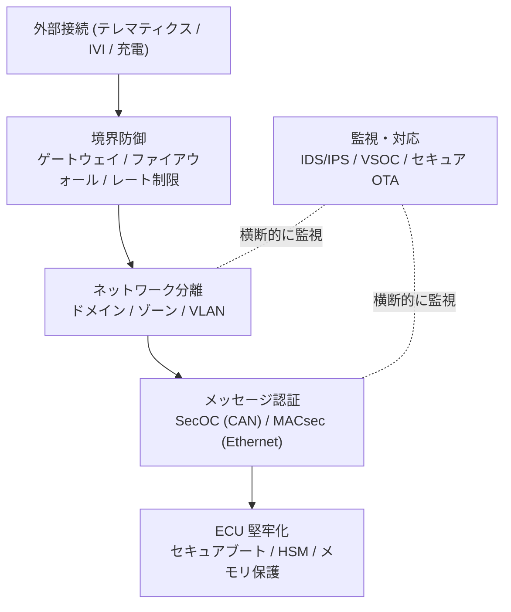

# 自動車サイバーセキュリティ (Automotive Cybersecurity — ISO/SAE 21434, UN R155/R156)

## 概要 (Overview)

車がネットワーク化・**SDV (Software-Defined Vehicle)** 化するにつれ、攻撃面 (attack surface) が急拡大した。`in-vehicle-networks.md` で見た**無認証の CAN** と、`automotive-ethernet-tsn.md` で見た **IT 化した Ethernet** は、いずれも外部から制御系に到達しうる経路を生む。2015 年の Jeep 遠隔操作研究（テレマティクス経由でブレーキ・ステアへ到達）が、車載セキュリティを「あれば良い」から「型式認証の要件」へと押し上げた転換点である。

本ドキュメントは、車載サイバーセキュリティの全体像を、**脅威分析 (TARA)**・**規格 (ISO/SAE 21434)**・**法規 (UN R155/R156)**・**技術対策 (HSM・セキュアブート・SecOC・IDS・セキュア OTA)**・そして**機能安全 (ISO 26262) との統合**という軸で整理する。CLAUDE.md が全ドキュメントに求める「セキュリティ考察」を、車載領域として独立に深掘りする位置づけである。

## 方法論 (Methodology)

- **ライフサイクル全体**（コンセプト→開発→生産→運用→廃棄）でリスクを捉える ISO/SAE 21434 の枠組みに沿う。
- 攻撃面（外部接続・近接・物理・サプライチェーン）→ **脅威分析 (TARA)** → 対策（組織・プロセス・技術）→ 法規適合、という流れで分解する。
- CAN／Ethernet の具体的な弱点を既存文書（`in-vehicle-networks.md`, `automotive-ethernet-tsn.md`）と接続し、対策がどこに効くかを示す。
- 規格・法規の記述は一次情報系（ISO/SAE 21434:2021、UNECE R155/R156、AUTOSAR SecOC 仕様）に基づく。

## 発見事項 (Findings)

1. **セキュリティは後付けできない。** 設計時からのプロセス（ISO 21434）と、それを裏づける法規（R155 型式認証）が必須になった。運用開始後のパッチだけでは間に合わない。
2. **無認証が根本課題。** CAN は送信者を認証しない。対策の中心は**暗号化ではなく認証**——リアルタイム制約下では **SecOC の MAC ＋フレッシュネス**でなりすまし・再送を防ぐのが現実解。
3. **信頼の起点はハードウェア。** **HSM (Hardware Security Module)** とセキュアブートで**ルートオブトラスト (root of trust)** を確立し、鍵を隔離する。ソフトウェアだけでは信頼の連鎖が閉じない。
4. **安全 × 保安は不可分。** 攻撃が安全機構を突破すれば人命に直結する。ISO 26262 の **HARA** と ISO 21434 の **TARA** を相互参照し、攻撃経路が安全目標を脅かさない設計にする。
5. **法規が設計を縛る。** UN R155（CSMS）/ R156（SUMS）が型式認証の要件となり、**OTA を含むソフト更新**も管理プロセス下に置かれる。
6. **サプライチェーンが攻撃面。** 多数のサプライヤ由来の部品・ソフトで構成されるため、**SBOM (Software Bill of Materials)** と供給網のリスク管理が不可欠。

## アーキテクチャ (Architecture)

### 攻撃面のマップ (Attack Surface)

| 分類 | 入口の例 | 主なリスク |
|---|---|---|
| **遠隔 (remote)** | テレマティクス・セルラー・Wi-Fi・Bluetooth | 遠隔侵入、ボット的な大規模影響 |
| **近接 (proximate)** | OBD-II ポート・USB・充電 (ISO 15118)・キーレス | 局所的な注入・リレー攻撃 |
| **物理 (physical)** | JTAG/デバッグ端子・バスへの直接接続・チップ解析 | 鍵抽出・ファーム吸出し・改竄 |
| **サプライチェーン** | サードパーティ部品・ライブラリ・生産工程 | バックドア混入・脆弱コンポーネント |

遠隔の入口から侵入し、ゲートウェイ越しに**制御系バスへ到達する経路**が最も危険（Jeep 研究が示した構図）。

### 多層防御 (Defense in Depth)

単一の防壁に頼らず、**破られても次の層が残る**多層構成にする。無認証 CAN の弱点は L3（SecOC）で、IT 型攻撃は L1/L2/L3（分離・MACsec）で、鍵とファームは L4（HSM・セキュアブート）で守る。

### セキュリティライフサイクル (ISO/SAE 21434)

ISO/SAE 21434 は E/E システムの**全ライフサイクル**（コンセプト・開発・生産・運用/保守・廃棄）にサイバーセキュリティ活動を規定する。機能安全の **ISO 26262 の V 字プロセス**（`functional-safety-iso26262.md`）と並走し、HARA↔TARA・安全目標↔セキュリティ目標を相互参照する構造になっている。

## 技術詳細 (Technical Details)

### 1. TARA — 脅威分析とリスク評価 (Threat Analysis and Risk Assessment)

ISO/SAE 21434 の中核手法。**資産 (asset)** の特定 → **損害シナリオ (damage scenario)** → **脅威 (threat, 攻撃経路)** → **攻撃実現可能性 (attack feasibility)** → **リスク値** → **サイバーセキュリティ目標／対策** の順に評価する。機能安全の HARA（危険源→ASIL）と対応する、セキュリティ版のリスク段階化である。

### 2. ハードウェアルートオブトラスト — HSM / セキュアブート

- **HSM (Hardware Security Module)**: メイン CPU から隔離された専用のセキュリティコア。**鍵の生成・保管を隔離**し、暗号アクセラレータ（AES/ECC/ハッシュ）とセキュアストレージを備える。鍵がソフトから直接読めないことが要点。EU の **EVITA** プロジェクトが HSM を **full / medium / light** の 3 ティアに整理し、要求性能に応じて実装を選ぶ基礎となった。
- **セキュアブート (secure boot)**: 起動時に各段のファームウェア署名を検証し、**改竄されたコードの起動を拒否**する。ブート ROM を信頼の起点とした**信頼の連鎖 (chain of trust)** を積み上げる（`../../hardware/hw-sw-interface/boot-initialization.md` のブートシーケンスに、署名検証を挿入した形）。

### 3. SecOC — メッセージ認証 (Secure Onboard Communication)

AUTOSAR の SecOC は、車載バスの**リアルタイム制約**に合わせた認証機構。

- **暗号化しない**——バス上の周期トラフィックに暗号化はコスト過大。代わりに **truncated MAC（切り詰めた認証コード）** をフレームに付与し、**送信元の真正性 (authenticity) と完全性 (integrity)** を検証する。
- **フレッシュネス値 (freshness value, カウンタ)** で**再送 (replay) 攻撃**を防ぐ（AUTOSAR 4.3 の SecOC Profile 3 でカウンタベースを導入）。
- 暗号処理は **CSM (Crypto Service Manager) → HSM** に委譲。CAN/CAN-FD/Ethernet 共通で使える。帯域とレイテンシの制約から MAC を切り詰める点が設計判断。

### 4. リンク／ネットワーク層 — MACsec と分離

- **Ethernet**: **MACsec (IEEE 802.1AE)** でリンクごとに暗号化・完全性・送信元認証を付与（`automotive-ethernet-tsn.md` 参照）。
- **CAN**: プロトコルに認証がないため、**ネットワーク分離とゲートウェイ**が主防御。制御系バスと外部接続系を分け、ゲートウェイでフィルタ・レート制限・プロトコル変換を行う。

### 5. 侵入検知 (IDS / IPS)

- **CAN**: メッセージの**周期・ID・エントロピーの異常**や、送信 ECU の**電圧指紋 (voltage fingerprinting)** による物理層識別で、なりすましを検出。
- **Ethernet**: ディープパケットインスペクション (DPI)、フロー異常検知。
- 検知結果を車載ログ→**VSOC (Vehicle Security Operations Center)** に集約し、艦隊 (fleet) 規模で監視・対応する。

### 6. セキュア OTA — R156 / SUMS

- 更新パッケージへの**署名検証**、**ロールバック防止**（旧版への差し戻し攻撃対策）、**A/B パーティション**（更新失敗時のフォールバック）。
- UN R156 が要求する **SUMS (Software Update Management System)** の下で、更新の記録・追跡・型式適合性維持を義務づける。

## セキュリティ考察 (Security Considerations)

- **安全 × 保安の統合**: HARA↔TARA を突き合わせ、**安全機構自体が攻撃対象**になりうる点に注意する。冗長・診断・フェイルセーフのトリガが改竄されれば、誤った縮退 (degradation) を誘発しうる。安全関連通信に SecOC を、安全 ECU に HSM・セキュアブートを併用する。
- **鍵管理のスケール**: 数千万台 × 多数の鍵の**ライフサイクル**（工場プロビジョニング・配布・失効・更新）を破綻なく回す運用が最難関の一つ。
- **長期運用と暗号危殆化**: 車両は 15 年以上使われる。採用時に安全だった暗号が運用中に危殆化 (compromise) しうるため、**暗号アジリティ (crypto agility)** と**耐量子計算機暗号 (PQC) への移行**を見越した設計が要る。
- **検知と対応の継続性**: 出荷は終点ではない。脆弱性開示 (coordinated disclosure)、インシデント対応、VSOC による継続監視——**運用フェーズのセキュリティ**が R155 の CSMS で明確に求められる。

## 結論 (Conclusions)

- 車載サイバーセキュリティは、**設計時からのプロセス (ISO/SAE 21434)** ＋ **法規適合 (UN R155/R156)** ＋ **多層の技術対策 (HSM・セキュアブート・SecOC・MACsec・IDS・セキュア OTA)** の総合であり、単発の対策では成立しない。
- 無認証の CAN と IT 化した Ethernet の弱点を、**ハードウェアのルートオブトラスト**を起点に補う。信頼の連鎖はハードから積み上げ、ソフト単独では閉じない。
- **安全と保安は不可分**。HARA と TARA の統合、ISO 26262 × ISO 21434、WP.29 規制の協調が現代車載開発の必須要件である。
- **長期運用・鍵管理・暗号危殆化・サプライチェーン**が残存課題であり、暗号アジリティと継続的な運用監視が鍵を握る。

### 次の接続先 (Related Topics)

- `in-vehicle-networks.md` — CAN の無認証問題と SecOC・ゲートウェイ分離。
- `automotive-ethernet-tsn.md` — Ethernet 化の IT 型攻撃面と MACsec、gPTP 同期の保護。
- `functional-safety-iso26262.md` — HARA↔TARA、安全と保安の統合（ISO 26262 × 21434）。
- `../../hardware/hw-sw-interface/boot-initialization.md` — セキュアブートの起点となるブートシーケンス。
- `../../hardware/cpu/virtual-memory-mmu.md` — ECU 内のドメイン隔離を支えるメモリ保護 (MMU/MPU)。

## 参考文献 (References)

- ISO/SAE 21434:2021, *Road vehicles — Cybersecurity engineering*. — [ISO 21434:2021](https://www.iso.org/standard/70918.html) — Accessed: 2026-07-01
- UNECE Regulation No. 155 (CSMS) / No. 156 (SUMS), WP.29. — [UNECE R155 Guide](https://www.uraeus.io/unece-r155/) — Accessed: 2026-07-01
- AUTOSAR, *Specification of Secure Onboard Communication* (CP R19-11). — [AUTOSAR SWS SecOC](https://www.autosar.org/fileadmin/standards/R19-11/CP/AUTOSAR_SWS_SecureOnboardCommunication.pdf) — Accessed: 2026-07-01
- *How hardware security modules enable AUTOSAR* (HSM / EVITA の位置づけ). — [Embedded.com](https://www.embedded.com/how-hardware-security-modules-enable-autosar/) — Accessed: 2026-07-01
