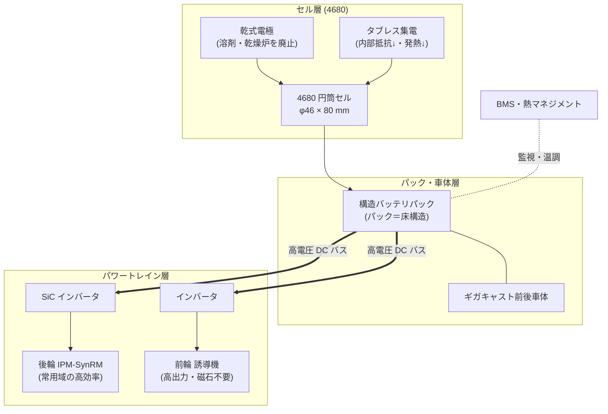

# テスラのバッテリとパワートレイン (Tesla: Battery & Powertrain)

## 概要 (Overview)

テスラ (Tesla) の電気自動車としての強みは、[`ev-fundamentals.md`](ev-fundamentals.md) で見た EV の各要素（**電池・モータ・インバータ・パック・熱**）を、個別最適ではなく**システムとして統合最適化**した点にある。本ドキュメントは、そのうち「エネルギーと動力」の中核、すなわち **(1) 電池セル（4680）と構造一体化パック、(2) パワートレイン（モータと SiC インバータ）** を深掘りする。

テスラは、(a) **4680 円筒セル**（タブレス・乾式電極）でセル製造コストとパック効率を、(b) **構造バッテリパック (structural pack)** で車体とパックの一体化を、(c) **永久磁石機と誘導機の使い分け＋ SiC インバータ**で効率と航続を攻めた。一方で 4680 の量産は、野心的な目標（乾式電極・高エネルギー密度）と量産現実（性能・歩留まり）の間で揺れており、本章はその **target（目標/公称）と demonstrated（実証/実測）の区別**を明示して扱う（CLAUDE.md「Source Hierarchy & Conflicts」）。分析深度は Level 3。

> 典拠は、テスラ公式（Battery Day 等）を一次資料とし、System Plus Consulting / Yole / Munro & Associates（MarkLines 経由）による**独立した分解調査**（teardown）を重視する。出典方針では「独立検証は権威を上回りうる」ため、第三者の実測・分解は強い証拠として扱う。

## 方法論 (Methodology)

- 電池を**セル（4680 の形状・タブレス・乾式電極）→ パック（構造一体化）→ 化学・BMS** の順に分解し、各層でテスラが何を変えたかを [`ev-fundamentals.md`](ev-fundamentals.md) の一般論と対比する。
- パワートレインを**モータ（種類の使い分け）→ インバータ（SiC 採用）→ ドライブユニット統合**で捉え、効率・航続への寄与を示す。
- 公称値（テスラ発表）と実測値（teardown・第三者報道）を区別し、4680 のように両者が食い違う場合は**幅と取得日**を明記する。
- 数値は代表値・分解レポート・公式発表に基づき桁感を優先する。

## 発見事項 (Findings)

1. **4680 は「大型化×タブレス×乾式電極」の三重の賭け。** 直径46 mm×高さ80 mm の大型円筒で部品点数を減らし、**タブレス (tabless)** で内部抵抗と発熱を下げ、**乾式電極 (dry electrode)** で溶剤乾燥工程を省いて製造コスト・エネルギーを削る狙い[^batterydesign][^evlithium]。
2. **構造バッテリパックで「パックが車体になる」。** セルを車台に直接統合し、モジュール／パックの構造部材を省く cell-to-chassis 的設計。剛性に寄与し、質量と部品を削る[^evlithium]。
3. **乾式電極の量産は難所だった。** 負極は早期に乾式化できたが**正極の乾式化が難しく**、長く「ハイブリッド（乾式負極＋湿式正極）」だった。テスラは Q4 2025 決算資料（2026-01-28）で「4680 用の乾式電極を負極・正極ともオースティンで製造している」と公表した[^tsla-q4-2025][^evlithium]。
4. **ただし 4680 の実性能は論争的。** 公称（例: 第3世代で300 Wh/kg 級）に対し、独立報道は量産セルの**性能未達**を指摘する[^electrek]。2026 年に入り、テスラは 4680 パックを一部 Model Y に再採用し（関税・通商リスクへの供給ヘッジと説明）、Q2 2026 にはテキサスの 4680 設備能力を「>40 GWh・生産中」と記載して Cybercab・Semi 向けに増産中とした[^tsla-q4-2025][^tsla-q2-2026][^electrek-my]。ただし、これは設備能力の公称であり、実セルの性能・歩留まりを独立に検証した数値ではない。**target と demonstrated の乖離**は 2026-10 時点でも解消していない。
5. **モータは「効率の永久磁石」と「堅牢な誘導機」を使い分ける。** Model 3/Y は後輪に**内部永久磁石同期リラクタンス機 (IPM-SynRM)**、前輪（デュアル）に**誘導機**を置き、常用効率と高速・高出力を両取りする[^marklines-m3][^marklines-my]。
6. **量産車で初の全 SiC インバータ。** Model 3 の駆動インバータは ST マイクロ製 **SiC MOSFET（650V）を24対**搭載。量産高級車で初の全 SiC パワーモジュールである。スイッチング損失を下げ航続を伸ばす[^systemplus][^yole]。
7. **統合がコストと効率を生む。** ドライブユニット（モータ＋ギア＋インバータ）一体化、パワーエレクトロニクス統合、構造パックなど、**部品・配線・界面を減らす**設計が一貫する。

## アーキテクチャ (Architecture)

### 統合の全体像 (Integration Overview)



凡例: サブグラフは統合の 3 層、太線は高電圧の電力経路、点線は監視・制御。各層で「部品・界面・工程を減らす」設計が施され、層同士も直結される（セル→構造パック→車体）。デュアルモータ構成の例を示す（Model Y では前輪インバータが Si-IGBT の構成も報告されている[^marklines-my]）。

### 4680 セルの設計思想 (4680 Cell Design)

```
   18650 → 21700 → 4680   （直径mm × 高さmm の大型化）
   小            大
   ┌─────────────────────────────────────────────┐
   │ 4680: φ46 × 80 mm                            │
   │  ・大型化 → セル本数↓・部品点数↓・組立簡素      │
   │  ・タブレス → 集電タブを廃し、箔の全縁で集電     │
   │     → 電流経路短縮・内部抵抗↓・発熱↓・急速充電↑ │
   │  ・乾式電極 → 溶剤塗布/乾燥工程を省く            │
   │     → 製造エネルギー・設備・コスト↓             │
   │  ・鋼缶 + 一体ダイカスト                        │
   └─────────────────────────────────────────────┘
```

| 技術 | 狙い | トレードオフ／課題 |
|---|---|---|
| **大型円筒 (46×80)** | 本数削減・組立簡素・パック効率 | 大型ゆえ放熱・セル内均一性が難しい |
| **タブレス (tabless)** | 内部抵抗↓・発熱↓・急速充電↑ | 製造精度（箔縁の集電）要求 |
| **乾式電極 (dry electrode)** | 溶剤工程廃止でコスト/エネルギー↓ | **正極の乾式化が技術的難所**・歩留まり |
| **構造一体化パック** | 部品↓・剛性↑・質量↓ | 修理性低下、セル交換困難 |

### 構造バッテリパック (Structural Pack)

```
  従来: セル → モジュール → パック → 車体に搭載（多層の構造部材）
  テスラ構造パック:
     セル群を上下のカバーで挟み、パックが「床構造」を兼ねる
     ┌──────────── 車体フロア ─────────────┐
     │  上カバー（座席取付面）                  │
     │  ▓▓▓▓ 4680 セル群（接着充填）▓▓▓▓      │ ← パック自体が荷重を負担
     │  下カバー（車体底・衝突保護）             │
     └──────────────────────────────────────┘
     → モジュール/中間構造を省き、剛性に寄与、質量・部品↓
```

- セルを構造接着剤で固め、**パックが車体の剛性部材を兼ねる**（cell-to-chassis 的）。航空機の応力外皮（[`../../aerospace/aircraft-engineering-fundamentals.md`](../../aerospace/aircraft-engineering-fundamentals.md) のセミモノコック）に通じる「外皮が荷重を負う」発想。
- 利点: 部品・質量・組立工程の削減、ねじり剛性向上。
- 代償: **修理・セル交換が困難**（パック全体が一体）。整備性とのトレードオフ。

### パワートレインの構成 (Powertrain Layout — Dual Motor)

```
   前輪 ◀─[ 誘導機 IM ]◀─[ インバータ ]◀┐
        （高速・高出力・堅牢、磁石不要）    │
                                       ├─ 高電圧バス ◀─ 構造パック
   後輪 ◀─[ IPM-SynRM ]◀─[ SiC インバータ ]┘
        （常用域で高効率な永久磁石機）
```

- **後輪 = 永久磁石（IPM-SynRM）**: 常用速度域で高効率。単独走行時の航続を稼ぐ主機[^marklines-m3]。
- **前輪 = 誘導機（IM）**: 磁石不要で堅牢、高速・高出力域で有利。必要時のみ強く使い、不要時は引きずり損を抑える[^marklines-my]。
- **使い分けの妙**: 「効率の永久磁石」と「出力・堅牢の誘導機」を前後で組み合わせ、効率と性能を両立。

## 技術詳細 (Technical Details)

### 1. タブレスと乾式電極 — なぜ効くか

- **タブレス集電 (tabless)**: 従来は電極箔の一部に集電タブを溶接して電流を集めるため、電流経路が長く抵抗・発熱が大きい。タブレスは**箔の全縁を集電面にする**ことで経路を短縮し、内部抵抗を大幅低減。これが**急速充放電と低発熱**に寄与する（独立報道で内部抵抗の大幅低減が示唆される[^evlithium]）。
- **乾式電極 (dry electrode)**: 通常は活物質を溶剤に分散して箔に塗布し、長い乾燥炉で溶剤を飛ばす（エネルギー・設備・床面積を大量消費）。乾式は**溶剤を使わず粉体を直接成膜**するため、乾燥工程と溶剤回収を省ける。**負極は比較的容易、正極（材料が複雑）が難所**で、テスラは長くハイブリッド方式を経て、Q4 2025 決算資料で正負極とも乾式電極の製造を公表した[^tsla-q4-2025]。狙いはセルコストの2〜3割削減級とされるが、**量産歩留まり・実性能は検証途上**。

### 2. 4680 の性能 — target と demonstrated の区別

> CLAUDE.md「Source Hierarchy & Conflicts」に従い、公称（target/spec）と実証（demonstrated/as-built）を分けて記す。

| 項目 | 公称・目標（テスラ/推進派） | 独立報道・実測の見方 |
|---|---|---|
| エネルギー密度 | 第3世代で ~300 Wh/kg 級と喧伝[^evlithium] | 量産セルの**性能未達**を指摘する報道あり[^electrek] |
| 内部抵抗 | 大幅低減（タブレス効果） | 効果自体は teardown でも支持される[^evlithium] |
| 量産・自給 | 正負極とも乾式電極を製造（Q4 2025）、テキサス 4680 設備 >40 GWh・生産中（Q2 2026）[^tsla-q4-2025][^tsla-q2-2026] | Model Y への再採用はコスト優位ではなく通商リスクへの供給ヘッジとの見方[^electrek-my]。設備能力に対する実生産量・歩留まりは非開示 |
| 用途 | Cybertruck 中心 → Model Y 一部・Cybercab・Semi へ拡大（2026）[^tsla-q2-2026] | Cybertruck の販売不振で 4680 の主用途が失われ、振り向け先を探した結果との指摘[^electrek-my] |

**結論として**: 4680 の設計コンセプト（大型・タブレス・乾式・構造パック）は理にかなうが、**量産性能・自給の達成度は 2026-10 時点でも論争的**であり、単一の値で断定しない。エネルギー密度などの数値は「公称」と明示し、実測の異論を併記する。

### 3. モータ — IPM-SynRM と誘導機 (Motors)

- **IPM-SynRM（内部永久磁石同期リラクタンス機）**: 永久磁石トルクと**リラクタンストルク**（回転子の磁気的非対称による）を併用し、広い速度域で高効率。Model 3/Y の後輪主機[^marklines-m3]。
- **誘導機 (induction)**: 回転子（鋳造アルミ導体）に電流を誘導して回す。磁石不要で堅牢、高速・高出力で有利。前輪に配置し、巡航時は引きずりを抑える[^marklines-my]。
- **制御**: ベクトル制御（界磁・トルク分離）と界磁弱めで、低速トルクから高速まで滑らかに。EV の「変速機不要」を支える。誘導機の回転子電流と逆起電力・回生の原理は [`induction-inductance.md`](../../../foundations/physics/electromagnetism/induction-inductance.md) §1–2 を参照。

### 4. SiC インバータ (Silicon Carbide Inverter)

- Model 3 駆動インバータは **ST マイクロ製 SiC MOSFET（650V）を24対**搭載。テスラは**量産高級車で初**の全 SiC パワーモジュール採用とされる[^systemplus][^yole]。
- **効果**: SiC は Si-IGBT に比べスイッチング損失・導通損失が小さく、高温・高周波に強い（ワイドバンドギャップの物理は [`band-theory-semiconductors.md`](../../../foundations/physics/quantum-solid-state/band-theory-semiconductors.md)、還流ダイオード損失は [`pn-junction-diode.md`](../../../foundations/physics/quantum-solid-state/pn-junction-diode.md)）。インバータ損失を下げ、**同じ電池で航続を伸ばす**（[`ev-fundamentals.md`](ev-fundamentals.md)「電力変換器」参照）。
- **コスト配分**: Model Y では**後輪に SiC、前輪に Si-IGBT** と、効率寄与の大きい主機に SiC を投じてコストを最適化する設計も見られる[^marklines-my]。

### 5. 統合 — ドライブユニットとパワエレ (Integration)

- **ドライブユニット**: モータ＋減速ギア＋インバータを一体化し、配線・界面・質量を削減。電池の等価回路やインバータ出力フィルタの回路理論は [`circuit-theory.md`](../../../foundations/physics/electromagnetism/circuit-theory.md) §3–4 を参照。
- **パワーエレクトロニクス統合**: 充電器 (OBC)・DC-DC・配電を集約して小型軽量化。
- 一貫する思想は **「部品・配線・界面を減らす」** であり、これは次章の **E/E アーキ集中化・ギガキャスト**（[`tesla-software-manufacturing.md`](tesla-software-manufacturing.md)）と共通する。

## 安全・信頼性考察 (Safety & Reliability)

> 「セキュリティ考察」を、EV では**電気・熱安全と信頼性**として読み替える（[`ev-fundamentals.md`](ev-fundamentals.md) と同枠）。

| 論点 | 内容 | テスラの対応／含意 |
|---|---|---|
| **熱暴走と大型セル** | 4680 は大型ゆえセル内発熱の均一化・放熱が課題 | タブレスで発熱源（内部抵抗）を下げ、パック冷却で管理 |
| **構造パックの修理性** | セル一体化で**個別交換・修理が困難** | 部品・質量削減と引き換えのトレードオフ（保険・修理費に影響） |
| **BMS** | 大量セルの監視・バランス・SoC/SoH 推定 | セル数最適化（大型化で本数↓）が監視を簡素化 |
| **量産品質のばらつき** | 新工程（乾式電極）の歩留まり・性能一貫性 | 2026-10 時点で検証途上、独立報道が性能課題を指摘[^electrek] |
| **HV 安全** | 数百V の活電部・衝突保護 | 構造パック下カバーが衝突保護、HVIL/遮断（[`ev-fundamentals.md`](ev-fundamentals.md)） |

## 結論 (Conclusions)

テスラの電池・パワートレインは、[`ev-fundamentals.md`](ev-fundamentals.md) の各要素を「**部品・界面・工程を減らす**」という一貫した思想で統合した結果である。4680（大型・タブレス・乾式電極）と構造バッテリパックは**セル製造とパックを同時に簡素化**する試みであり、IPM-SynRM＋誘導機の使い分けと量産初の全 SiC インバータは**効率と航続**を攻める。

ただし 4680 の量産性能・自給は、野心的な公称と未達報道の間で**2026-10 時点でも論争的**であり（テスラは設備能力 >40 GWh と用途拡大を公表する一方、独立したセル性能データは未達を示す）、その評価は target と demonstrated を分けて慎重に行うべきである。本章はそれを明示した。

この「統合による簡素化」という考え方は、車体の作り方（ギガキャスト）とソフトの作り方（集中型 E/E・OTA）にも貫かれる。次章 [`tesla-software-manufacturing.md`](tesla-software-manufacturing.md) で、その2層を見る。

---

## 参考文献 (References)

> テスラ公式（決算資料・Battery Day）を一次とし、**独立分解調査（teardown）** を重視（「独立検証は権威を上回りうる」）。公称と実測が食い違う点は両論併記。

**一次に近い独立調査 (Independent teardown — primary-grade evidence)**

[^systemplus]: [Tesla Model 3 Inverter with SiC Power Module from STMicroelectronics — System Plus Consulting (reverse-costing teardown)](https://www.systemplus.fr/reverse-costing-reports/tesla-model-3-inverter-with-sic-power-module-from-stmicroelectronics/) — Model 3 インバータの SiC MOSFET（650V）24対、量産車初の全 SiC モジュールの分解原価分析。Accessed: 2026-06-30.

[^yole]: [STMicroelectronics SiC Module — Tesla Model 3 Inverter (Yole, teardown sample)](https://medias.yolegroup.com/uploads/2019/02/YOLE_SP18413-STM_SiC_Module_Tesla_Model_3_Inverter_sample.pdf) — Model 3 SiC パワーモジュールの構造分析。Accessed: 2026-06-30.

[^marklines-m3]: [Tesla Model 3 Teardown: Motor, Inverter, and Battery — Munro & Associates / MarkLines](https://www.marklines.com/en/report/rep1830_201903) — 後輪 IPM-SynRM、前輪誘導機、SiC インバータの分解報告。Accessed: 2026-06-30.

[^marklines-my]: [Tesla Model Y Teardown: Electric Powertrain Technology — Munro / MarkLines](https://www.marklines.com/en/report/Munro007_202105) — Model Y の後輪同期機＋前輪誘導機（鋳造アルミ回転子）、後輪 SiC／前輪 Si-IGBT。Accessed: 2026-06-30.

[^batterydesign]: [Tesla 4680 Cell — Battery Design](https://www.batterydesign.net/tesla-4680-cell/) — 4680 の寸法（φ46×80 mm）・タブレス・構造の技術整理（一次の Battery Day 発表への索引）。Accessed: 2026-06-30.

**報道（公称と実測の双方）(Reporting — claims and counter-claims)**

[^evlithium]: [Tesla 4680 Battery: Full Dry Electrode Mass Production & Design Analysis — EVLithium](https://www.evlithium.com/lifepo4-battery-news/tesla-4680-battery-full-dry-electrode-mass-product.html) — タブレス・乾式電極（負極先行→正極が難所→2025Q4 完全乾式量産）、構造パック、内部抵抗低減、公称エネルギー密度。Accessed: 2026-06-30. ※公称寄りの解説として扱う。

[^electrek]: [Tesla's 4680 battery cells are underperforming — Electrek (2026-05-07)](https://electrek.co/2026/05/07/tesla-4680-battery-cell-performance-data-shows-cant-build-own-cells/) — 量産 4680 の性能未達・自給の難しさを示すデータ報道（demonstrated 側）。Accessed: 2026-06-30.

[^electrek-my]: [Tesla puts 4680 battery cells back in Model Y; Here's why — Electrek (F. Lambert, 2026-01-28)](https://electrek.co/2026/01/28/tesla-puts-4680-battery-cells-back-in-model-y/) — 4680 の Model Y 再採用を通商リスクへの供給ヘッジと分析（Cybertruck 不振で余剰化した 4680 の振り向け）。Accessed: 2026-10-04.

**テスラ公式（一次・公称）(Tesla first-party — claims)**

[^tsla-q4-2025]: [Tesla Q4 2025 Update (Form 8-K Exhibit 99.1, 2026-01-28) — SEC EDGAR](https://www.sec.gov/Archives/edgar/data/1318605/000162828026003837/exhibit991.htm) — 「4680 用乾式電極を負極・正極ともオースティンで製造」「一部 Model Y で 4680 パックの生産を開始」、テキサス正極材と LFP ラインは 2026 年稼働予定。Accessed: 2026-10-04. ※一次だが公称。

[^tsla-q2-2026]: [Tesla Q2 2026 Update (Form 8-K Exhibit 99.1, 2026-07) — SEC EDGAR](https://www.sec.gov/Archives/edgar/data/0001318605/000162828026049213/exhibit991.htm) — 4680 を Cybercab・Semi・Model Y 向けに増産、テキサス 4680 設備能力「>40 GWh・Production」。Accessed: 2026-10-04. ※設備能力の公称であり実生産量ではない。

**本リポジトリ内参照**

- [`ev-fundamentals.md`](ev-fundamentals.md) — 電池・モータ・インバータ・回生・充電・熱の一般原理。
- [`tesla-software-manufacturing.md`](tesla-software-manufacturing.md) — 集中型 E/E・OTA とギガキャスト・アンボックス製造。
- [`../../aerospace/aircraft-engineering-fundamentals.md`](../../aerospace/aircraft-engineering-fundamentals.md) — 応力外皮（セミモノコック）：構造パックの発想の親戚。
- [`../../energy/battery-energy-storage.md`](../../energy/battery-energy-storage.md) — 同系統のセル・BMS を系統用蓄電 (BESS) に用いる場合。
- [`../../../foundations/physics/electromagnetism/induction-inductance.md`](../../../foundations/physics/electromagnetism/induction-inductance.md) — トラクションモータの逆起電力・誘導機・回生の原理。
- [`../../../foundations/physics/electromagnetism/circuit-theory.md`](../../../foundations/physics/electromagnetism/circuit-theory.md) — バッテリ等価回路とインバータのフィルタ設計。
- [`../../../foundations/physics/quantum-solid-state/band-theory-semiconductors.md`](../../../foundations/physics/quantum-solid-state/band-theory-semiconductors.md) / [`pn-junction-diode.md`](../../../foundations/physics/quantum-solid-state/pn-junction-diode.md) — SiC の物理と還流ダイオード損失。
