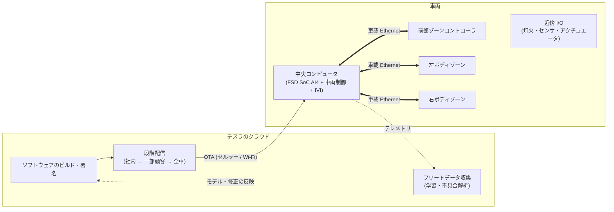

# テスラのソフトウェアと製造 (Tesla: Software & Manufacturing)

## 概要 (Overview)

テスラ (Tesla) の独自性は、電池・パワートレイン（[`tesla-battery-powertrain.md`](tesla-battery-powertrain.md)）だけでなく、**「車の作り方」と「車の動かし方」** そのものを作り替えた点にある。本ドキュメントは、(1) **ソフト/E/E アーキテクチャ** と (2) **製造/生産技術** を深掘りする。前者は集中型コンピュータ＋ゾーン制御、車載 Ethernet、OTA（無線更新）、独自シリコン（FSD コンピュータ）を、後者はギガキャスト (gigacasting)、構造一体化、アンボックス (unboxed) 製造、垂直統合を扱う。

両者を貫くのは、前章のハードと同じ考え方、すなわち 「**部品・配線・界面・工程を減らし、システムとして統合する**」思想である。E/E では ECU と配線を集中コンピュータへ集約し、製造では約70点のプレス部品を1点の鋳造へ集約する。そして OTA は、出荷後の車を**ソフトウェアで進化し続ける製品**に変えた。分析深度は Level 3。

> 既存の [`../in-vehicle-networks.md`](../in-vehicle-networks.md)（分散 ECU・CAN・ドメイン/ゾーン移行）が業界一般の車載アーキテクチャを扱う。本章はその文脈で**テスラが集中化をどこまで進めたか**を見る。典拠はテスラ公式（投資家説明・製造公開）と独立報道・分解を併用し、公称と実測を区別する（CLAUDE.md「Source Hierarchy & Conflicts」）。

## 方法論 (Methodology)

- **E/E アーキテクチャ**を「ECU の数と配置」「ネットワーク」「コンピュート」「更新性 (OTA)」で分解し、[`../in-vehicle-networks.md`](../in-vehicle-networks.md) のドメイン→ゾーン移行の文脈に位置づける。
- **製造**を「車体（ギガキャスト）」「組立（アンボックス）」「統合（構造パック・垂直統合）」で捉え、従来のプレス・溶接ライン (body-in-white) と対比する。
- 各々で**何を集約したか（部品/配線/工程/ECU の削減）** を定量的に示し、トレードオフ（修理性・拡張性・初期投資）を明らかにする。
- 業界内の異論（純粋集中型 vs ドメイン・ゾーン型の優劣）も併記し、単一の正解として描かない。

## 発見事項 (Findings)

1. **テスラは E/E を「集中型コンピュータ＋ゾーン」へ集約した。** 機能ごとに数十〜百の ECU を分散させる従来式に対し、強力な中央コンピュータがアプリを実行し、**ゾーンコントローラ**が物理的に近い入出力をまとめ、**車載 Ethernet** で結ぶ[^digitimes][^vaisakh]。
2. **配線ハーネスの劇的な削減。** ゾーン化で「端末ごとに中央へ長い線」を引かず、近傍をまとめるため**ハーネスが軽く・短く・組立（ロボット化）しやすく**なる。太い銅アース線を廃し車体をアースに使う設計も報じられる[^vaisakh]。
3. **OTA が車を「出荷後も進化する製品」にした。** 機能追加・不具合修正・性能調整を無線配信し、リコール費用を下げ、顧客体験を更新し続ける[^vaisakh]。これは集中型コンピュートがあって初めて成立する。
4. **独自シリコン（FSD コンピュータ）で計算を内製。** 自動運転推論用の独自 SoC を HW3→HW4(AI4) と更新し、中央集中コンピュートの中核に据える[^notatesla]。次世代 AI5 は 2026-04 にテープアウトしたが、量産は 2027 年見込みで、当初公約（2025 年後半の車載）から約 2 年遅れている[^electrek-ai5]。2026-10 時点の量産車と Cybercab は AI4 で走る。
5. **ギガキャストが車体部品を集約した。** 6,000〜9,000トン級の巨大ダイカスト機 (Giga Press) で、**約70点のプレス部品で構成していた後部車台を1点のアルミ鋳造**に置換[^gigapress][^reuters]。
6. **アンボックス製造で組立の前提を覆す。** 前部・後部・電池・床などの**モジュールを並行して作り込み、最後に結合**する「アンボックス (unboxed / GAME)」方式。直列のライン組立を並列化し、コストと床面積を攻める[^ams][^teslarati]。
7. **垂直統合が全体最適を可能にする。** セル・モータ・インバータ・鋳造・ソフト・シリコンまで内製/設計することで、層をまたいだ統合（構造パック×ギガキャスト×集中 E/E）が実現する。
8. **集中型は万能ではない。** 純粋集中型は配線・更新で利く一方、計算の単一障害点・拡張性・サプライヤ協調の観点から、業界はドメイン・ゾーン折衷へ向かう動きもあり、優劣は文脈依存である[^digitimes]。

## アーキテクチャ (Architecture)

### 集中型 E/E と OTA の全体像 (Central Compute, Zones & OTA)



凡例: 太線は車載 Ethernet 幹線、細線はゾーン近傍の局所配線（CAN/LIN・電源）、実線矢印は OTA 配信、点線はデータの還流。機能は中央コンピュータのソフトとして定義され、ゾーンは I/O と電源分配を受け持つ。OTA と還流データの閉ループが「出荷後も進化する製品」を成立させる。ゾーンの数と区画は車種で異なる（図は概念図）。

### E/E アーキテクチャの進化 (E/E Architecture Evolution)

```
  従来（分散）          ドメイン型           ゾーン型＋中央集中（テスラが先導）
  ┌──┐┌──┐┌──┐      ┌─────────┐         ┌──────────────────┐
  │ECU││ECU││ECU│      │ドメイン  │         │  中央コンピュータ    │
  │..50–100個..│      │ECU×数個 │         │ (FSD/車両制御/IVI) │
  └──┘└──┘└──┘      └────┬────┘         └───┬────┬────┬─────┘
   機能ごとに分散         機能群で集約            │Ethernet│
   CAN 配線が膨大        ドメイン間ゲートウェイ    ゾーン  ゾーン  ゾーン
                                              (前) (後) (中央)
                                              近傍の I/O をまとめる
```

| 世代 | 構成 | 配線 | 更新性 |
|---|---|---|---|
| 分散 (distributed) | 機能ごとに 50–100 ECU、CAN 主体 | 膨大・重い | 個別、OTA 困難 |
| ドメイン (domain) | 機能群（駆動/シャシ/ボディ/IVI）に集約 | 中 | 限定的 |
| **ゾーン＋中央 (zonal + central)** | 中央コンピュータ＋物理ゾーン、Ethernet | **短く軽い** | **全車 OTA** |

[`../in-vehicle-networks.md`](../in-vehicle-networks.md) が示すこの「ドメイン→ゾーン」移行を、テスラは早期かつ徹底的に進めた。要点は **「機能の境界」ではなく「物理的な位置」で I/O をまとめる**ことであり、配線最短化とロボット組立に役立つ。

### 車体製造の進化 (Body Manufacturing Evolution)

```
  従来 (body-in-white):
    数百枚の鋼板をプレス → 数百〜数千点を溶接/接合 → 塗装 → 組立
    （治具・溶接ロボット多数、工程長い）

  テスラ ギガキャスト:
    溶融アルミを巨大金型へ高圧鋳造（6,000–9,000 t）
    → 後部車台「1点」（従来 ~70 点のプレス部品を置換）
    → 部品点数・溶接点・治具・床面積・工程↓
```

### アンボックス製造 (Unboxed / GAME)

```
  従来（直列ライン）: 車体 →(順に)→ 塗装 → 内装 → 駆動 → 検査  （1本のライン）

  アンボックス（並列モジュール）:
    ┌ 前部モジュール ┐
    ┤ 後部モジュール ├─▶ 最終結合 ─▶ 検査
    ┤ 電池/床モジュール ┤   （並行生産を合流）
    └ 側部/内装モジュール ┘
    → 各モジュールを最適な向き・工程で並行生産 → 床面積/時間/コスト↓
```

## 技術詳細 (Technical Details)

### 1. 集中型コンピュート＋ゾーン (Central Compute + Zonal)

- **中央コンピュータ (HPCU)**: 車両制御・インフォテインメント・自動運転を強力な中央 SoC 群で実行。機能を ECU に固定配線せず**ソフトで定義**する（software-defined vehicle）[^digitimes]。
- **ゾーンコントローラ**: 車体を物理的な区画（前・後・中央など）に分け、各区画のセンサ/アクチュエータの入出力をまとめて中央へ橋渡し。これにより**端末→中央の長距離配線を排し**、ハーネスを短縮[^vaisakh]。
- **車載 Ethernet**: 高帯域・低遅延のバックボーンで中央⇄ゾーンを接続。CAN/LIN（[`../in-vehicle-networks.md`](../in-vehicle-networks.md)）は端末近傍の局所通信に残る。
- **効果と代償**: 配線・重量・組立工数↓、OTA 容易。一方、中央への集約は**計算の単一障害点・冗長設計・拡張性**の課題を生み、安全系には冗長と縮退運転 (graceful degradation) が要る。

### 2. 配線ハーネスの削減 (Wiring Harness Reduction)

- 分散 ECU 時代の車は、ハーネス総延長が数 km・重量が数十 kg に達する。ゾーン化は**近傍 I/O をまとめる**ことでこれを短縮し、軽量化・コスト減・**ロボットによる自動敷設**を可能にする。
- 報じられる例: **太い銅アース線を廃し、車体（シャシ）をアース経路に使う**。配線をさらに減らす設計である[^vaisakh]。
- これは前章の「ドライブユニット統合」「構造パック」と同じ、**界面と部品を減らす**思想の電装版。

### 3. OTA — ソフトウェア定義の車 (Over-the-Air Updates)

- **何を更新するか**: 不具合修正、機能追加（運転支援・UI・効率調整）、リコール対応、時に出力/航続のパラメータ。
- **なぜ集中型が前提か**: 機能が中央コンピュータのソフトで定義されるため、**1つの配信で車全体の挙動を変えられる**。分散 ECU（多数のサプライヤ製・個別 FW）では困難。
- **効果**: リコールを物理入庫から無線配信へ移し、コストと時間を圧縮。**出荷後も価値が更新される製品**という体験を作る[^vaisakh]。
- **含意（安全・セキュリティ）**: 無線で車両挙動を変えられること自体が**攻撃面**でもある。署名・検証・段階配信・ロールバックといった配信基盤の堅牢性が安全の前提になる（[`../functional-safety-iso26262.md`](../functional-safety-iso26262.md) の機能安全と、[`../cybersecurity-iso21434.md`](../cybersecurity-iso21434.md) のセキュリティ ISO/SAE 21434 が関わる）。

### 4. 独自シリコン (Custom Silicon — FSD Computer)

- テスラは自動運転推論用の**独自 SoC（FSD コンピュータ）** を設計し、HW3 → **HW4(AI4)** と更新してきた[^notatesla]。中央集中コンピュートの中核。
- **次世代 AI5（2026-10 時点）**: マスクは 2026-04-15 にテープアウトを公表した。性能は「AI4 の最大 10 倍」とされるが、これは**公称**である。量産（大量ボード供給）は 2027 年半ばの見込みと報じられ、2024-06 時点の「2025 年後半に車載」という公約から約 2 年遅れた[^electrek-ai5]。テスラは Q2 2026 決算説明でも AI5 の量産を「できれば来年」と述べるにとどまり、当面は AI4 で教師なし (unsupervised) FSD を目指す方針である[^tsla-q2-2026]。マスクはテープアウト当日、AI5 はまず Optimus と学習用クラスタに使い、車両には当面載せないとも述べている。性能の倍率は報道によって「最大 10 倍」「約 5 倍」と幅があり、いずれも公称である[^dtc-ai5]。2026-09 には、Samsung のテキサス州テイラー工場で 2 nm プロセスによる AI5 の試作生産が始まったと報じられた。歩留まりの検証を 2026 年末、量産を 2027 年に予定しているとされるが、テスラの公式な確認はない[^nata-ai5-samsung]。
- **垂直統合の象徴**: 計算の心臓部まで内製設計することで、ソフト・センサ・モデルと協調最適化できる。汎用サプライヤ依存を脱し、世代更新の速度を握る。
- （自動運転の知覚・判断アルゴリズムそのものは本章の範囲外。ここでは「**計算基盤を内製した**」という E/E アーキ上の意味に絞る。）

### 補足: 自動運転サービスの状況 — target と demonstrated (Robotaxi Status, as of 2026-10)

アルゴリズムそのものは範囲外だが、集中コンピュート＋OTA という E/E 基盤が何を可能にしているかの現況として、公称と独立観測を分けて記す（CLAUDE.md「Source Hierarchy & Conflicts」）。

| 項目 | テスラ公称（一次） | 独立報道・観測 |
|---|---|---|
| Robotaxi 展開 | 2026-07 時点で 7 大都市圏で稼働。オースティン・ダラス・ヒューストン・マイアミ・オーランド・タンパは無人（unsupervised）、サンフランシスコ湾岸はセーフティドライバー付き。ラスベガス・フェニックスは準備中[^tsla-q2-2026] | 独立集計（コミュニティの Robotaxi Tracker）では、オースティンで乗客を乗せた車両は年の大半で 20〜40 台だった。2026-09 初めの Cybercab 投入時に一時 100 台を超えたが、2026-09-22 時点の直近 7 日間では 8 台に戻った[^electrek-active]。テキサス州の登録台数（2026-10 初めで Cybercab 169 台）は増え続けているが、登録は稼働を意味しない[^nata-cybercab] |
| Cybercab | Q2 2026 にギガテキサスで生産開始[^tsla-q2-2026]。2026-09 からオースティンで乗車提供[^electrek-cybercab] | ソフトは既存 Model Y Robotaxi と同一で、実質は「車両の入れ替え」との評価[^electrek-cybercab] |
| FSD (Supervised) | アクティブ契約 148 万件、北米新車の 55% 超が FSD 契約付き。AI3 車向けに FSD v14 lite を配信[^tsla-q2-2026] | — |
| 計算基盤 | 無人運行も含め AI4 で実施、AI5 は 2027 年量産見込み[^tsla-q2-2026][^electrek-ai5] | AI5 は当初公約から約 2 年遅延[^electrek-ai5] |

数字の性格が異なる点に注意する。テスラの「7 都市圏」はサービスの提供エリア数であり、独立集計の「20–30 台」は同時稼働する無人車両の数である。両者は矛盾しないが、前者だけで無人運行の規模を推し量ると過大評価になる。

### 5. ギガキャスト (Gigacasting)

- **装置**: Idra 製などの **Giga Press**（型締め力 6,000〜9,000 トン級）。溶融アルミを高圧で巨大金型に流し込み、車台構造を一体鋳造する[^gigapress][^reuters]。
- **効果**: Model Y の後部車台で、**従来（Model 3）約70点のプレス部品を接合していた構造を1点の鋳造**に置換。部品点数・溶接点・治具・ロボット・床面積・工程を大幅削減[^gigapress]。
- **ギガキャスト2.0**: 前後＋床を更に大きな一体鋳造へ。**3Dプリント砂型**で中空サブフレーム（内部リブ）を作り、軽量化と衝突性能を両立する手法が報じられる[^reuters]。
- **トレードオフ**: 大型一体鋳造は**衝突修理が困難・高コスト**（局所損傷でも大物交換になりうる）。歩留まり・合金・金型開発の難度も高い。構造パックの修理性問題（前章）と同根。

### 6. アンボックス製造 (Unboxed / GAME)

- **発想**: 従来の「車体を1本のラインで直列に仕上げる」前提を捨て、**前部・後部・電池/床・側部などのモジュールを並行して作り込み、最後に結合**する[^ams]。
- **狙い**: 各モジュールを最適な向き・最適工程で同時生産 → ライン長・床面積・サイクルタイム・コストを圧縮。塗装や内装を「箱（車体）の内側」で行う制約を外す。
- **現状（2026-10 時点）**: **Cybercab** が完全アンボックス採用の先行例とされる[^teslarati][^ams]。テスラは Q2 2026 決算資料でギガテキサスでの Cybercab 生産開始を公表した[^tsla-q2-2026]。2026-09-03 にオースティンで発表イベントを開き、既存の Robotaxi アプリ経由で一般向けの乗車提供を始めた[^electrek-cybercab]。ただし生産台数・ライン速度は非開示で、アンボックス方式が従来ラインに比べてコスト・床面積の目標をどこまで達成したかは、独立には検証されていない。低価格モデルへの展開も計画段階にとどまる。

### 7. 垂直統合 (Vertical Integration) — なぜ層を跨げるか

テスラが構造パック×ギガキャスト×集中 E/E のような**層をまたぐ統合**をできるのは、各層を内製/自社設計しているからである。

```
  セル(4680) ─ モータ/インバータ ─ 鋳造(ギガキャスト) ─ E/E/ソフト ─ 独自SoC
        └──────────── 全層を自社で設計/最適化 ───────────┘
        → 層の界面で「妥協」せず、車全体を1つの最適化問題として解ける
```

- 利点: 部品・界面・工程を跨いだ全体最適（部分最適の和を超える）。
- 代償: 巨大な初期投資・内製リスク（4680 量産の苦戦＝[`tesla-battery-powertrain.md`](tesla-battery-powertrain.md) がその例）、サプライヤ・エコシステムの薄さ。

## 安全・拡張性考察 (Safety & Scalability)

> 「セキュリティ考察」を、本章では**機能安全・サイバーセキュリティ・拡張性**として読み替える。

| 論点 | 内容 | 対応・含意 |
|---|---|---|
| **計算の単一障害点** | 中央集中ゆえ、中央 SoC 障害の影響が大 | 冗長コンピュート、縮退運転 (graceful degradation)、安全系の独立化 |
| **OTA の攻撃面** | 無線で挙動を変えられる＝攻撃対象 | 署名・検証・段階配信・ロールバック、**ISO/SAE 21434**（車載サイバーセキュリティ） |
| **修理性** | ギガキャスト/構造パックは局所損傷でも大物交換 | 修理費・保険料の上昇、設計と整備のトレードオフ |
| **拡張性/サプライヤ協調** | 純粋集中型は世代更新・多様な仕入れに不利な面 | 業界はドメイン・ゾーン折衷へ。優劣は文脈依存[^digitimes] |
| **機能安全** | 駆動・制動・操舵の電子化 | ISO 26262（[`../functional-safety-iso26262.md`](../functional-safety-iso26262.md)）、冗長アクチュエーション |

## 結論 (Conclusions)

テスラのソフトと製造は、前章のハードと**同じ思想（統合による集約）** を、電装と車体製造へ適用したものである。E/E では数十〜百の ECU と長大なハーネスを**集中コンピュータ＋ゾーン＋Ethernet**へ集約し、OTA で車を出荷後も進化する製品に変えた。製造では約70点のプレス部品を**1点のギガキャスト**へ、直列ライン組立を**並列アンボックス**へ置き換えた。これらを跨いで最適化できるのは**垂直統合**ゆえである。

同時に、この徹底した集中・一体化は**単一障害点・修理性・サイバーセキュリティ・拡張性**という代償を伴い、業界がドメイン・ゾーン折衷へ向かう動きもある。つまり「集中型が常に最適」ではない。テスラの賭けは、**全層を内製して全体最適を取る**ことにあり、その成否（例: 4680 量産の苦戦）は層ごとに濃淡がある。

### EV 編を貫くもの (The Thread)

- **基礎 ([`ev-fundamentals.md`](ev-fundamentals.md))** — EV を電池・変換・電動機・回生・管理の問題として分解。
- **バッテリ/パワートレイン ([`tesla-battery-powertrain.md`](tesla-battery-powertrain.md))** — 4680・構造パック・SiC で「エネルギーと動力」を統合・簡素化。
- **ソフト/製造（本書）** — 集中 E/E・OTA とギガキャスト・アンボックスで「動かし方と作り方」を統合・簡素化。

貫くのは、**部品・界面・工程・配線を減らし、垂直統合で層をまたいで最適化する**という、航空宇宙編（SpaceX の「統合・再使用・反復」）とも響き合う設計哲学である。次の自然な深掘りは、本章で範囲外とした**自動運転（知覚・判断・GNC 的制御）**、あるいは充電網（Supercharger/NACS）といった**システム外延**へ広がる。

---

## 参考文献 (References)

> テスラ公式（投資家説明・製造公開）と独立報道・分解を併用。純粋集中型の優劣など論争点は両論併記（CLAUDE.md「Source Hierarchy & Conflicts」）。

**製造・装置 (Manufacturing — primary/secondary)**

[^gigapress]: [Electrek (2021-02-04). Tesla releases video of Giga Press in action producing giant single-piece rear body](https://electrek.co/2021/02/04/tesla-video-giga-press-in-action-producing-giant-single-piece-rear-body/) — Idra 製 Giga Press（型締め力 5,600–6,200 tf）による Model Y の単体後部車台鋳造、従来70点の部品を1点へ ／ [Charged EVs (2020-05-04). In Model Y, Tesla replaces 70 underbody parts with one casting](https://chargedevs.com/newswire/in-model-y-tesla-replaces-70-underbody-parts-with-one-casting) — Tesla 2020年Q1決算説明会での Musk 発言（Model 3 の後部車台は鋼・アルミのプレス部品70点、大型鋳造機で「70点から1点へ」）。6,000–9,000 t 級という幅は下記 Reuters 記事による。Accessed: 2026-10-12.

[^reuters]: [Gigacasting 2.0: Tesla reinvents carmaking — Reuters (via Investing.com)](https://www.investing.com/news/stock-market-news/gigacasting-20-tesla-reinvents-carmaking-with-quiet-breakthrough-3174334) — 前後・床の大型一体鋳造、3Dプリント砂型による中空サブフレーム。Accessed: 2026-06-30.

[^ams]: [Inside Tesla's radical manufacturing shift: the Unboxed process — Automotive Manufacturing Solutions](https://www.automotivemanufacturingsolutions.com/assembly/inside-teslas-radical-manufacturing-shift-how-the-unboxed-process-could-slash-ev-production-costs-and-impact-the-automotive-industry/527962) — アンボックス（GAME）方式：モジュール並行生産→最終結合。Accessed: 2026-06-30.

[^teslarati]: [Tesla to focus on existing gigacast tech for unboxed process — Teslarati](https://www.teslarati.com/tesla-to-focus-on-existing-gigacast-tech-for-unboxed-process-report/) — アンボックスとギガキャストの関係、Cybercab/低価格モデルでの採用計画。Accessed: 2026-06-30.

**E/E アーキ・ソフト (Architecture & software)**

[^digitimes]: [Tesla's centralized 'vehicle brain' strategy ... rivals embrace domain-zonal architectures — DIGITIMES (2025-05-16)](https://www.digitimes.com/news/a20250516PD202/tesla-automotive-industry-hpc-vehicle-automakers.html) — 中央集中＋ゾーン＋Ethernet、software-defined vehicle、純粋集中型の限界と業界のドメイン・ゾーン折衷。Accessed: 2026-06-30.

[^vaisakh]: [Inside Tesla's Brain before CyberTruck — V. Venugopal](https://www.vaisakhvenugopal.com/p/inside-teslas-brain-before-cybertruck) — ゾーン化によるハーネス削減、車体アース化、OTA を支える集中コンピュート。Accessed: 2026-06-30. ※技術解説（二次）として扱う。

[^notatesla]: [Tesla Quietly Modifies HW4 (AI4) FSD Computer Hardware — Not a Tesla App](https://www.notateslaapp.com/news/3188/tesla-quietly-modifies-hw4-ai4-fsd-computer-hardware) — 独自 FSD コンピュータ（HW3→HW4/AI4）の更新。Accessed: 2026-06-30.

[^electrek-ai5]: [Tesla taped out AI5 chip, Musk says — nearly 2 years behind schedule — Electrek (F. Lambert, 2026-04-15)](https://electrek.co/2026/04/15/tesla-ai5-chip-taped-out-musk-ai6-dojo3/) — AI5 テープアウト（TSMC）、量産は 2027 年半ば見込み、2024-06 の公約からの遅延、Cybercab は AI4 を使用。Accessed: 2026-10-04.

**テスラ公式・自動運転サービス (Tesla first-party & robotaxi status)**

[^tsla-q2-2026]: [Tesla Q2 2026 Update (Form 8-K Exhibit 99.1, 2026-07) — SEC EDGAR](https://www.sec.gov/Archives/edgar/data/0001318605/000162828026049213/exhibit991.htm) — Cybercab のギガテキサス生産開始、Robotaxi の 7 都市圏展開（無人/セーフティドライバーの区分）、FSD 契約 148 万件、AI3 向け FSD v14 lite。Accessed: 2026-10-04. ※一次だが公称。AI5 の「できれば来年」は同四半期の決算説明会での発言（[Not a Tesla App の要約, 2026-07-22](https://www.notateslaapp.com/news/4481/summary-of-teslas-2026-q2-earnings-call-cybercab-fsd-ai4-and-more)）。

[^electrek-cybercab]: [Tesla confirms Cybercab launch coming next week — Electrek (F. Lambert, 2026-08-24)](https://electrek.co/2026/08/24/tesla-cybercab-exclusive-access-robotaxi-sept-3/) — 2026-09-03 オースティンでの Cybercab 発表と Robotaxi アプリ経由の提供、無人車両の同時稼働数（全市場で 20–30 台程度）の独立集計。Accessed: 2026-10-04. ※独立報道（demonstrated 側）だが批判的論調。

**本リポジトリ内参照**

- [`../in-vehicle-networks.md`](../in-vehicle-networks.md) — 車載ネットワーク（CAN/Ethernet）とドメイン→ゾーン移行の一般論。
- [`../functional-safety-iso26262.md`](../functional-safety-iso26262.md) — 機能安全（ISO 26262）。OTA/集中化のセーフティ前提。
- [`tesla-battery-powertrain.md`](tesla-battery-powertrain.md) — 4680・構造パック・SiC（同じ「統合・簡素化」の思想）。
- [`ev-fundamentals.md`](ev-fundamentals.md) — EV パワートレインの一般原理。
- [`../ee-architecture.md`](../ee-architecture.md) — 分散 → ドメイン → ゾーン＋セントラルの業界一般論（本章はその先行例）。
- [`../cybersecurity-iso21434.md`](../cybersecurity-iso21434.md) — セキュア OTA・UN R155/R156・HSM。
- [`../../../software/embedded/autosar-vehicle-software.md`](../../../software/embedded/autosar-vehicle-software.md) — 標準 (AUTOSAR) と内製 Vehicle OS の対比。
- [`../../../hardware/accelerators/tpu-systolic-arrays.md`](../../../hardware/accelerators/tpu-systolic-arrays.md) — FSD SoC の NPU と同系統の行列演算アクセラレータの原理。
- [`../../../foundations/mathematics/probability-statistics/reliability-theory.md`](../../../foundations/mathematics/probability-statistics/reliability-theory.md) — 中央集中が生む単一障害点と冗長設計の定量的基礎。

[^electrek-active]: [Tesla's active robotaxi fleet in Austin crashes back to 8 vehicles after Cybercab pump — Electrek (F. Lambert, 2026-09-22)](https://electrek.co/2026/09/22/tesla-robotaxi-active-fleet-austin-crashes-8-vehicles/) — コミュニティの Robotaxi Tracker による稼働台数とテキサス州の登録データの集計。Accessed: 2026-10-11. ※独立集計 (demonstrated 側) だが批判的論調。

[^nata-cybercab]: [Tesla Extends Robotaxi Hours in Austin, Adds 111 Cybercabs — Not a Tesla App (2026-10-04)](https://notateslaapp.com/news/4768/tesla-extends-robotaxi-hours-in-austin-adds-111-cybercabs) — テキサス州 DMV のデータによる Cybercab の登録台数。Accessed: 2026-10-11

[^dtc-ai5]: [Tesla AI5 design revealed as Musk confirms it won't be used in cars — Drive Tesla Canada (2026-04-15)](https://driveteslacanada.ca/news/tesla-ai5-design-revealed-musk-confirms-wont-be-used-in-cars/) — AI5 の用途 (Optimus と学習用クラスタ) についてのマスクの発言。Accessed: 2026-10-11

[^nata-ai5-samsung]: [Tesla AI5 Chip Enters Trial Production at Samsung's Texas Fab — Not a Tesla App (2026-09-17)](https://www.notateslaapp.com/news/4701/tesla-ai5-chip-enters-trial-production-at-samsungs-texas-fab) — 韓国報道に基づく試作生産の報道。テスラ未確認。Accessed: 2026-10-11
