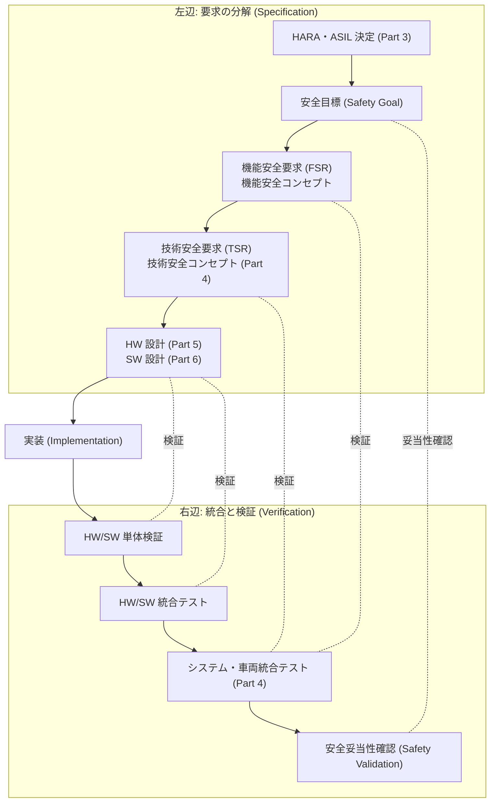

# 機能安全 (Functional Safety, ISO 26262)

## 概要 (Overview)

自動車の電子制御は人命に直結する。ブレーキ、ステアリング、エアバッグ、加速制御を担う E/E システム (Electrical/Electronic system) の**故障 (failure)** が、そのまま事故になりうる。**機能安全 (functional safety)** とは、システムが故障しても許容できないリスクを生じさせない性質であり、自動車分野ではその国際標準 **ISO 26262** が設計・開発・検証の全工程に要求を課す。

本ドキュメントは、ISO 26262 の中核概念（ハザード分析、ASIL、安全ライフサイクル、ハード/ソフトの安全機構）を整理し、[`in-vehicle-networks.md`](in-vehicle-networks.md)（車載ネットワーク）や組込みソフトの設計判断が「なぜ安全要求から逆算されるのか」を明らかにする。安全 (safety) とサイバーセキュリティ (security, ISO 21434) の関係も扱う。

## 方法論 (Methodology)

- 「ハザードの特定 → リスクの定量化 (ASIL) → 安全目標 → 安全要求 → 実装と検証」という安全ライフサイクルの流れで整理する。
- ASIL の決定要因（S・E・C）を分解し、要求の厳しさがどう決まるかを示す。
- 故障への技術的対処（冗長化、フェイルセーフ、診断）を、ハード/ソフト両面で対応づける。
- random failure（偶発故障）と systematic failure（系統故障）の区別を軸に、対策が異なることを示す。

## 発見事項 (Findings)

1. **安全は「故障しないこと」ではなく「故障しても危険にしないこと」。** 部品は必ず壊れる前提で、検出・縮退・安全状態への移行を設計する。
2. **要求の厳しさは ASIL で段階化される。** すべてを最高水準で作るのは非現実的なため、リスクに応じて開発の厳格さを配分する。
3. **2種類の故障に別々の対策が要る。** 偶発故障 (random HW failure) はハードの確率的故障 → 冗長・診断で対処。系統故障 (systematic failure) は設計/実装のバグ → プロセス（レビュー・検証・トレーサビリティ）で防ぐ。
4. **安全はプロセス全体に埋め込まれる。** 後付けでなく、要求→設計→実装→検証→運用の全段で V字プロセスとして確保される。
5. **安全とセキュリティは不可分になった。** ネットワーク化（[`in-vehicle-networks.md`](in-vehicle-networks.md)）でサイバー攻撃が安全を脅かすため、ISO 26262 と ISO 21434 の協調が必須。

## アーキテクチャ (Architecture)

### 安全ライフサイクルと V字プロセス

ISO 26262 は開発を V字モデルで規定する。左で要求を分解し、右で対応する検証を行う[^iso26262-1]。概念フェーズ（アイテム定義・HARA・機能安全コンセプト）は Part 3、システムレベルは Part 4、ハードウェアは Part 5、ソフトウェアは Part 6 が受け持つ[^iso26262-3][^iso26262-5][^iso26262-6]。



凡例: 実線は開発の流れ、点線は左辺の成果物と右辺の検証活動の対応（トレーサビリティ）を示す。括弧内は主に規定する ISO 26262 の Part 番号。

各左辺の成果物に、対応する右辺の検証が紐づく（トレーサビリティ, traceability）。

### ハザード分析とリスク評価 (HARA)

運用状況ごとに危険事象を洗い出し、3軸でリスクを評価して **ASIL** を決める。

| 軸 | 意味 | 段階 |
|---|---|---|
| **S (Severity, 深刻度)** | 被害の重さ | S0–S3（無傷〜致命） |
| **E (Exposure, 暴露確率)** | その状況の起こりやすさ | E0–E4（稀〜高頻度） |
| **C (Controllability, 制御可能性)** | 運転者が回避できるか | C0–C3（容易〜不能） |

S・E・C の組み合わせから **ASIL (Automotive Safety Integrity Level)** が決まる。

```
  QM  <  ASIL A  <  ASIL B  <  ASIL C  <  ASIL D
 (品質管理のみ)                        (最も厳格)
```

- **ASIL D**: 最高水準。例: 電動パワーステアリング、ブレーキ、エアバッグ展開。
- **ASIL A/B**: 比較的影響の小さい機能。
- **QM (Quality Management)**: 安全要求なし、通常の品質管理で足りる。例: インフォテインメントの一部。

要点: **ASIL が高いほど、要求される手法・冗長・検証の厳格さが上がる**。リスクに応じて開発リソースを配分する仕組み。

#### ASIL 決定の仕組み

ISO 26262-3 の決定表は、実質的に **S・E・C の段階の合計**で読める[^iso26262-3]。

- **S3 + E4 + C3（合計 10）のときだけ ASIL D**。
- どれか1軸が1段下がるごとに、ASIL も1段下がる（合計 9 → C、8 → B、7 → A、6 以下 → QM）。
- S0（無傷）・E0（起こりえない）・C0（一般に回避可能）のいずれかなら ASIL 対象外。

| 例 | S | E | C | ASIL |
|---|---|---|---|---|
| 高速走行中の意図しない全制動 | S3（致命的） | E4（高速走行は日常） | C3（運転者は回避不能） | **D** |
| 駐車支援中の誤操舵（低速） | S1 | E3 | C2 | QM〜A 程度 |
| 夜間のみ使うランプの不点灯 | S2 | E2 | C2 | QM〜A 程度 |

この構造ゆえ、**「その危険事象が起こる運転状況をどう定義するか」（E の見積り）が ASIL を大きく左右する**。HARA が安全設計の最上流であり、ここでの判断ミスは下流全体を誤らせる。

### ASIL 分解 (ASIL Decomposition)

高 ASIL の要求を、独立した複数の要素に分割して各々の ASIL を下げる手法。ISO 26262-9 が許す分解スキームは決まっている[^iso26262-9]。

| 元の ASIL | 許される分解（いずれか） |
|---|---|
| **D** | C(D) + A(D) ／ B(D) + B(D) ／ D(D) + QM(D) |
| **C** | B(C) + A(C) ／ C(C) + QM(C) |
| **B** | A(B) + A(B) ／ B(B) + QM(B) |

括弧内は元の ASIL を示す（例: `B(D)` = ASIL D 由来の要求を担う ASIL B 要素）。**独立性 (independence) と冗長 (redundancy)** が前提で、電源・クロック・筐体・開発チームの共有などによる共通原因故障 (common cause failure) があると成立しない。独立性の主張には共通原因分析 (dependent failure analysis) の裏づけが要る[^iso26262-9]。並列冗長の信頼度計算と、共通原因故障がその独立性の仮定を崩す仕組みは [`reliability-theory.md`](../../foundations/mathematics/probability-statistics/reliability-theory.md) §2 を参照。

## 技術詳細 (Technical Details)

### 偶発故障 (Random Failure) への対策 — ハードウェア

確率的に起きる物理故障。指標と機構は次のとおりである。

- **指標**: FIT (Failure In Time, 10⁹時間あたり故障数)、SPFM (単一点故障メトリック)、LFM (潜在故障メトリック)、PMHF (確率的ハードウェアメトリック)。ISO 26262-5 が ASIL ごとの数値目標を定める[^iso26262-5]。FIT・故障率・バスタブ曲線の確率論的な定義は [`reliability-theory.md`](../../foundations/mathematics/probability-statistics/reliability-theory.md) §1・§4 にまとめてある。

  | 指標 | 意味 | ASIL B | ASIL C | ASIL D |
  |---|---|---|---|---|
  | **SPFM** | 単一点故障が安全目標を侵す割合の低さ | ≥ 90% | ≥ 97% | ≥ 99% |
  | **LFM** | 潜在（多重点）故障の検出・防御率 | ≥ 60% | ≥ 80% | ≥ 90% |
  | **PMHF** | 安全目標侵害の時間あたり確率 | < 10⁻⁷/h | < 10⁻⁷/h | < 10⁻⁸/h |

  ASIL D の PMHF < 10⁻⁸/h は **10 FIT** に相当する。部品単体の故障率がこれを上回る以上、**目標は素子の高信頼化だけでは達成できず、診断網羅率（検出して安全状態へ逃がす能力）で稼ぐ**。これが冗長・診断機構がハード設計に必ず入る定量的な理由である。
- **冗長化 (redundancy)**: 二重化・多数決 (TMR, Triple Modular Redundancy)、ロックステップコア (lockstep core, 2コアが同じ計算をし不一致を検出)。
- **診断 (diagnostics)**: ウォッチドッグ (watchdog timer)、ECC メモリ、CRC、BIST (Built-In Self Test)、センサの妥当性チェック。診断網羅率 (diagnostic coverage) が SPFM/LFM を左右する。
- **フェイルセーフ / フェイルオペレーショナル**:
  - フェイルセーフ (fail-safe): 故障時に安全状態へ移行（例: 出力遮断）。
  - フェイルオペレーショナル (fail-operational): 故障しても機能継続（自動運転で必須。冗長系で実現）。

### 系統故障 (Systematic Failure) への対策 — プロセス/ソフトウェア

設計・実装のバグは確率では語れない（同じ入力で必ず再現）。対策はプロセスによる。

- **コーディング規約**: MISRA C/C++（未定義動作・危険構文の排除）。[`../../hardware/cpu/memory-ordering-atomics.md`](../../hardware/cpu/memory-ordering-atomics.md) のデータ競合や [`../../hardware/hw-sw-interface/abi-syscalls.md`](../../hardware/hw-sw-interface/abi-syscalls.md) のメモリ安全が、ここで規約として強制される。
- **検証手法**: 要求トレーサビリティ、レビュー、静的解析、単体/統合テスト、構造網羅率 (MC/DC など ASIL に応じた基準)、フォーマル検証[^iso26262-6]。形式手法の位置づけは [`formal-verification-landscape.md`](../../software/formal-methods/formal-verification-landscape.md) を参照。
- **フリーダム・フロム・インターフェアレンス (FFI, Freedom From Interference)**: 異 ASIL の機能が同一 ECU/SoC に同居するとき、低 ASIL の不具合が高 ASIL を侵さないよう、メモリ保護 ([`virtual-memory-mmu.md`](../../hardware/cpu/virtual-memory-mmu.md) の MMU/MPU)・時間分割 (time partitioning)・通信分離で隔離する。混載 (mixed criticality) の要。AUTOSAR における実装（OS-Application のメモリ保護・タイミング保護、E2E 保護）は [`autosar-vehicle-software.md`](../../software/embedded/autosar-vehicle-software.md) を参照。
- **ツール認定 (tool qualification)**: コンパイラ等のツール自体の信頼性も評価対象。

### 実例: E-Gas 3レベル監視コンセプト (3-Level Monitoring Concept)

電子スロットル制御のために業界ワーキンググループ (EGAS Workgroup) が標準化した監視アーキテクチャで、「診断＋独立監視＋独立遮断経路」を1つの MCU 周りに構成する定石として、スロットル以外（モータ制御、ブレーキ等）にも広く転用されている[^egas]。

```
  Level 1: 機能         — トルク要求の演算・アクチュエータ制御（本来の仕事）
  Level 2: 機能監視     — 同一 MCU 内の独立ソフトが L1 の出力を妥当性検査
                          (plausibility check)。メモリ・実行時間を L1 から隔離 (FFI)
  Level 3: 制御器監視   — 外部の監視 IC が MCU 自体を質問-応答 (challenge-response)
                          ウォッチドッグで監視。MCU が正しく答えられなければ、
                          MCU を経由しない独立経路でアクチュエータを遮断
```

要点は **Level 3 が「監視対象と同じ計算機を信用しない」** こと。L1/L2 は MCU 自身の故障（暴走、クロック異常）と運命を共にするため、最後の砦は外部ハードウェアに置く。単純なウォッチドッグ（[`../../hardware/hw-sw-interface/mmio-dma-interrupts.md`](../../hardware/hw-sw-interface/mmio-dma-interrupts.md)）との違いは、質問-応答により「タイマを蹴るコードだけが生きている」状態を検出できる点にある。

### SEooC — 文脈から切り離した安全要素 (Safety Element out of Context)

MCU・OS・ミドルウェアのような汎用部品は、最終的にどの車両のどの機能に載るか分からないまま開発される。ISO 26262 はこれを **SEooC** として扱い（指針は Part 10）[^iso26262-1]、**「想定する使われ方 (assumptions of use)」を明文化した上で開発し、統合側がその想定と実際の一致を検証する**枠組みを与える。半導体ベンダが「ASIL D ready」と称する MCU（ロックステップコア・ECC・BIST 内蔵）は SEooC の典型で、想定条件（例: 外部ウォッチドッグの併用、安全マニュアルに従った初期化）を満たして初めて ASIL D システムの部品になれる。

### 関連標準

- **ISO 26262**: 機能安全（E/E システムの故障に起因する危険）[^iso26262-1]。
- **ISO 21448 (SOTIF, Safety Of The Intended Functionality)**: 故障ではなく**仕様の不足や性能限界**による危険（例: センサが想定外シーンを誤認）。ADAS/自動運転で重要[^iso21448]。
- **ISO/PAS 8800:2024**: 安全関連機能に用いる AI（機械学習）要素の安全。ISO 26262 と ISO 21448 を AI 向けに調整・拡張し、データ・学習・検証・運用監視までを含む AI 安全ライフサイクルを定める[^iso8800]。
- **ISO/SAE 21434**: サイバーセキュリティ（後述）[^iso21434]。
- **ASPICE**: 開発プロセスの成熟度評価。

## セキュリティ考察 (Security Considerations)

- **セキュリティは安全の前提条件になった**: [`in-vehicle-networks.md`](in-vehicle-networks.md) の通り CAN は無認証で、攻撃者がブレーキ等へ偽指令を注入しうる。サイバー攻撃が安全機構を突破すれば、機能安全の前提が成り立たなくなる。
- **ISO 26262 × ISO 21434 の協調**: 安全分析（HARA）とセキュリティ分析（TARA, Threat Analysis and Risk Assessment）を相互参照し、攻撃が安全目標を脅かす経路を塞ぐ。安全機構自体が攻撃対象になりうる点に注意。
- **セキュアな安全機構**: 診断・冗長・フェイルセーフのトリガが改竄されれば誤った縮退を誘発しうる。安全関連の通信に SecOC（メッセージ認証）、ECU に HSM・セキュアブートを併用する。
- **規制**: UNECE WP.29 (R155/R156) がサイバーセキュリティ管理システム (CSMS) とソフトウェア更新管理システム (SUMS) を型式認証の要件とし、安全とセキュリティの両立を法的に義務化した[^r155][^r156]。EU では一般安全規則 (EU) 2019/2144 により、新型車は 2022-07 から、全新規登録車は 2024-07 から適用されている[^eu-gsr]。

## 結論 (Conclusions)

- 機能安全の本質は「故障を前提に、危険な結果を防ぐ」こと。検出・縮退・安全状態への移行を設計に組み込む。
- ISO 26262 はリスクを ASIL で段階化し、QM〜ASIL D に応じて開発の厳格さ・冗長・検証を配分する。すべてを最高水準にはしない合理的枠組み。
- 偶発故障（確率的ハード故障 → 冗長・診断）と系統故障（設計バグ → プロセス・規約・隔離）は別物で、対策も別。FFI による混載分離は CPU/メモリ保護の知見と直結する。
- ネットワーク化により安全とセキュリティは不可分となり、ISO 26262 と ISO 21434、WP.29 規制の協調が現代車載開発の必須要件である。

### 次の接続先 (Related Topics)

- [`in-vehicle-networks.md`](in-vehicle-networks.md) — CAN の無認証問題と SecOC、安全への影響。
- [`cybersecurity-iso21434.md`](cybersecurity-iso21434.md) — TARA↔HARA、安全と保安の統合（ISO 21434 × 26262）。
- [`../../hardware/hw-sw-interface/mmio-dma-interrupts.md`](../../hardware/hw-sw-interface/mmio-dma-interrupts.md) — ウォッチドッグ・診断・MPU による隔離の実装基盤。
- [`../../hardware/cpu/virtual-memory-mmu.md`](../../hardware/cpu/virtual-memory-mmu.md) — FFI を支えるメモリ保護 (MMU/MPU)。
- [`ee-architecture.md`](ee-architecture.md) — 混在重要度・ハイパーバイザ・セーフティアイランドによる FFI のアーキテクチャ的実装。
- [`../../software/embedded/autosar-vehicle-software.md`](../../software/embedded/autosar-vehicle-software.md) — FFI・E2E 保護・ASIL 対応 BSW のソフトウェア側の実装。
- [`../../software/embedded/realtime-fundamentals.md`](../../software/embedded/realtime-fundamentals.md) — 時間分割・WCET・デッドラインなど、タイミング保護の基礎。
- [`../../foundations/mathematics/probability-statistics/reliability-theory.md`](../../foundations/mathematics/probability-statistics/reliability-theory.md) — FIT・PMHF・冗長系・共通原因故障の確率論的基礎。
- [`chassis-control-x-by-wire.md`](chassis-control-x-by-wire.md) — fail-operational 冗長と ASIL 分解の実例：ステア・バイ・ワイヤとブレーキ・バイ・ワイヤ。

## 参考文献 (References)

**一次資料 (Primary — 標準・規則・業界仕様)**

[^iso26262-1]: ISO 26262:2018 (series, 2nd ed.), *Road vehicles — Functional safety* (Parts 1–12). — [ISO 26262-1:2018 Vocabulary](https://www.iso.org/standard/68383.html) — Accessed: 2026-10-04。V字の安全ライフサイクル全体。SEooC の指針は Part 10 (Guidelines on ISO 26262)。

[^iso26262-3]: ISO 26262-3:2018, *Road vehicles — Functional safety — Part 3: Concept phase*. — [ISO 26262-3:2018](https://www.iso.org/standard/68385.html) — Accessed: 2026-10-04。アイテム定義、HARA（S/E/C と ASIL 決定表）、機能安全コンセプト。

[^iso26262-5]: ISO 26262-5:2018, *Road vehicles — Functional safety — Part 5: Product development at the hardware level*. — [ISO 26262-5:2018](https://www.iso.org/standard/68387.html) — Accessed: 2026-10-04。ハードウェアアーキテクチャメトリクス (SPFM/LFM) と偶発故障による安全目標侵害の評価 (PMHF)。

[^iso26262-6]: ISO 26262-6:2018, *Road vehicles — Functional safety — Part 6: Product development at the software level*. — [ISO 26262-6:2018](https://www.iso.org/standard/68388.html) — Accessed: 2026-10-04。ソフトウェア安全要求、アーキテクチャ設計、単体検証と構造網羅率（MC/DC 等）。

[^iso26262-9]: ISO 26262-9:2018, *Road vehicles — Functional safety — Part 9: Automotive safety integrity level (ASIL)-oriented and safety-oriented analyses*. — [ISO 26262-9:2018](https://www.iso.org/standard/68391.html) — Accessed: 2026-10-04。ASIL 分解、要素の共存基準、従属故障分析 (DFA)。

[^iso21448]: ISO 21448:2022, *Road vehicles — Safety of the intended functionality (SOTIF)*. — [ISO 21448:2022](https://www.iso.org/standard/77490.html) — Accessed: 2026-10-04。

[^iso8800]: ISO/PAS 8800:2024, *Road vehicles — Safety and artificial intelligence*. — [ISO OBP: ISO/PAS 8800:2024](https://www.iso.org/obp/ui/#iso:std:iso:pas:8800:ed-1:v1:en) — Accessed: 2026-10-04。ISO/TC 22/SC 32 が 2024-12 に発行。ISO 26262・ISO 21448 を AI 要素向けに調整・拡張する。

[^iso21434]: ISO/SAE 21434:2021, *Road vehicles — Cybersecurity engineering*. — [ISO/SAE 21434:2021](https://www.iso.org/standard/70918.html) — Accessed: 2026-10-04。

[^egas]: EGAS Workgroup (2015). *Standardized E-Gas Monitoring Concept for Gasoline and Diesel Engine Control Units*, Version 6.0. — 3レベル監視コンセプトの原典（ワーキンググループ配布文書、公開 URL なし）。

[^r155]: UN Regulation No. 155 — *Uniform provisions concerning the approval of vehicles with regards to cyber security and cyber security management system*. EU 官報掲載版: OJ L 82, 9.3.2021 (2021/387). — [EUR-Lex 42021X0387](https://eur-lex.europa.eu/eli/reg/2021/387/oj) ／ [UNECE R155](https://unece.org/transport/documents/2021/03/standards/un-regulation-no-155-cyber-security-and-cyber-security) — Accessed: 2026-10-04。

[^r156]: UN Regulation No. 156 — *Uniform provisions concerning the approval of vehicles with regards to software update and software updates management system*. EU 官報掲載版: OJ L 82, 9.3.2021, pp. 60–74 (2021/388)。法的拘束力のある原文は ECE/TRANS/WP.29/2020/80。 — [EUR-Lex 42021X0388](https://eur-lex.europa.eu/eli/reg/2021/388/oj/eng) — Accessed: 2026-10-04。

[^eu-gsr]: Regulation (EU) 2019/2144 of the European Parliament and of the Council of 27 November 2019 (General Safety Regulation). — [EUR-Lex 32019R2144](https://eur-lex.europa.eu/eli/reg/2019/2144/oj) — Accessed: 2026-10-04。R155/R156 を EU 型式認証の要件に組み込み、新型車 2022-07-06／全新規登録車 2024-07-07 から適用。

**注**: ISO 規格本文は有償のため、本書の記述は規格の公開概要と、業界で広く共有されている枠組み（V字、S/E/C→ASIL、メトリクス目標値）に基づく。数値目標を設計判断に使う際は必ず規格本文を参照のこと。
