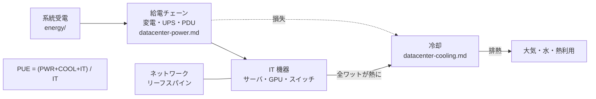

# データセンター基礎 (Datacenter Fundamentals)

## 概要 (Overview)

データセンターは「サーバを収める建物」ではない。Barroso らが**倉庫規模の計算機 (warehouse-scale computer, WSC)** と呼んだとおり、数万台のサーバ・ネットワーク・給電・冷却が単一の設計対象として最適化された、それ自体が一つの計算機である[^wsc]。ソフトウェア側の分析（`../../software/distributed-systems/`・`../../software/observability/`）が「故障は常態」「テールが支配する」と繰り返してきた前提は、この物理層の性質——数万台では毎日何かが壊れる、給電と冷却が性能の上限を画す——から生まれている。

本ドキュメントは領域の入口として、WSC という見方、可用性の語彙（Tier・冗長記法）、効率の会計（PUE/WUE）、内部ネットワークのトポロジ（Clos/リーフスパイン）、そして **AI クラスタがもたらした密度の転換**——ラックあたり数 kW から 100 kW 超へ——を扱う。給電の変換チェーンは [`datacenter-power.md`](datacenter-power.md)、熱の処理は [`datacenter-cooling.md`](datacenter-cooling.md) に続く。時事性の高い数値（AI の電力需要・密度）は **2026-07 時点**と明記して扱う。分析深度は Level 3。

## 方法論 (Methodology)

- データセンターを**ワットの流れ**として読む: 系統から入った電力が計算に変換され、全量が熱として出ていく——この収支の各段に、効率指標・冗長設計・密度制約を対応づける。
- 可用性は「壊れない設計」ではなく「**壊れても止まらない構成の語彙**」（N+1/2N・コンカレントメンテナビリティ）として整理し、`../../software/` 側の冗長設計と同じ言葉で読めるようにする。
- 業界統計（電力需要・PUE 平均）は一次に近い機関（IEA・LBNL・Uptime Institute）の公表値を用い、アクセス日を付す。ベンダの密度数値は目標値と実測を区別する。
- ネットワークは「トポロジと帯域の経済」に絞り、スイッチの内部は `../../hardware/networking/`、AI 特化の設計は `../../hardware/accelerators/interconnects-scaleout-training.md` に委ねる。

## 発見事項 (Findings)

1. **WSC の設計単位は「サーバ」ではなく「建物」である。** 電力容量（MW）が土地・建屋より先に尽きる制約であり、データセンターの規模は面積ではなく**受電容量**で語られる。サーバ・ラック・電源・冷却は建物全体の TCO（総所有コスト）を最小化するよう共設計され、個々の部品の最適（最高性能のサーバ）と全体の最適（ワットあたり仕事量）はしばしば食い違う[^wsc]。
2. **可用性は構成の語彙で買う——そして語彙は電力・冷却・ネットワークで共通である。** N（必要容量）に対する N+1（1 台の故障に耐える）・2N（系統ごと複製）・2(N+1) という冗長記法、稼働中に保守できる**コンカレントメンテナビリティ**、単一障害点の排除——Uptime Institute の Tier I〜IV はこれらの構成要件を等級化したものである[^uptime]。`../../software/distributed-systems/` のレプリケーションと同じ設計原理が、UPS・冷凍機・スイッチに適用されているだけ、と読むのが正しい。
3. **PUE は「計算以外に何倍払っているか」の会計であり、改善は頭打ちに近い。** PUE = 施設全体の消費電力 ÷ IT 機器の消費電力。業界平均は 1.5 台で長く停滞し、ハイパースケーラの最良値は 1.1 前後——冷却の物理（`datacenter-cooling.md`）が漸近線を決める[^uptime-pue]。重要なのは PUE が**効率の一部しか測らない**ことで、IT 機器内部の無駄（電源変換・アイドル電力）や水 (WUE)・炭素 (CUE) は別勘定である——単一指標の最適化が全体を歪める、`../../software/observability/` のメトリクス設計と同じ教訓がここにもある。
4. **内部ネットワークは Clos の再発見で「帯域を積み木で買う」ものになった。** 1953 年に電話交換網のために示された Clos 網[^clos]は、同一の安価なスイッチを多段に組むことで任意規模の無閉塞網を作れることを示した。データセンターはこれをフォールデッド Clos（リーフスパイン/ファットツリー）として再発見し[^fat-tree]、「巨大で高価なコアスイッチ」を「コモディティスイッチの並列」に置き換えた——`../../hardware/networking/` のマーチャントシリコンの経済と、ECMP による多経路分散がその成立条件である。
5. **オーバーサブスクリプションは「トラフィックの局所性への賭け」である。** リーフの下り帯域（サーバ向け）に対し上り帯域（スパイン向け）を 1:1 で用意すれば無閉塞だが高価であり、実務は 3:1 等に「間引く」。この賭けは east-west トラフィック（サーバ間）の増大とともに分が悪くなり続け、AI 学習（全 GPU が同期通信する——`../../hardware/accelerators/interconnects-scaleout-training.md`）では**賭け自体が成立しない**ため 1:1 のレール最適化網が別途建設される。トポロジは「トラフィック行列の予測」の物理的な表明である。
6. **AI は密度の前提を一桁書き換えた（2026-07 時点）。** 汎用サーバのラックが 5〜15 kW で設計されてきたのに対し、GPU ラックは世代ごとに跳ね上がり、ラック規模 NVLink ドメイン（NVL72 型）は**1 ラック 100 kW 超**に達する[^nvl72]。これは「空冷の限界」（`datacenter-cooling.md`）と「配電の限界」（`datacenter-power.md`）を同時に突破するもので、既存施設の改修ではなく AI 専用棟の新設が主流になった構造的理由である。
7. **データセンターの電力需要は系統計画の変数になった（2026-07 時点）。** IEA はデータセンターの世界電力消費を 2024 年で約 415 TWh（世界の約 1.5%）と推計し、2030 年までに倍増近い成長を見込む[^iea]。個々のキャンパスが数百 MW〜GW 級に達し、送電線・変電所の建設リードタイムが AI インフラの律速になる——`../energy/`（系統・市場）とこの領域が合流する現在地であり、電力調達（PPA・自家発電・原子力併設）がインフラ戦略の一部になった。

## アーキテクチャ (Architecture)

### ワットの流れ — 建物としての計算機



### リーフスパイン (フォールデッド Clos) の構造

```
        スパイン層  [S1]   [S2]   [S3]   [S4]     ← 全リーフと接続
                    /|\    /|\    /|\    /|\
        リーフ層  [L1]  [L2]  [L3]  ...  [Ln]     ← ToR (top of rack)
                   |||    |||    |||
        サーバ     ▯▯▯   ▯▯▯    ▯▯▯

  任意のサーバ間は最大 2 ホップ (リーフ→スパイン→リーフ)、
  経路はスパイン数だけ存在 → ECMP でフローを分散
  規模拡張 = スパインを足す / 段を足す (3段 Clos → 5段)
```

| 設計変数 | 意味 | 典型値・傾向 |
|---|---|---|
| オーバーサブスクリプション比 | リーフの下り帯域 ÷ 上り帯域 | 汎用: 2:1〜4:1 / AI ファブリック: 1:1 |
| 基数 (radix) | スイッチのポート数 | 大radix ASIC ほど段数・ホップが減る (`../../hardware/networking/`) |
| 障害の粒度 | スイッチ 1 台の故障で失う帯域 | 1/スパイン数——多数の小さい箱が優雅に劣化する |

## 技術詳細 (Technical Details)

### 1. 可用性の語彙と Tier (Availability Vocabulary & Tiers)

- **冗長記法**: N = 需要を満たす最小構成。N+1 は「どの 1 台が落ちても定格を維持」、2N は「独立な 2 系統」、2(N+1) はその両方。適用対象は UPS モジュール・冷凍機・給電経路・ネットワーク平面と横断的で、**どの層の N+1 が最初に破れるか**が実際の可用性を決める。
- **Tier I〜IV**（Uptime Institute）: I（冗長なし）→ II（部分的冗長）→ III（コンカレントメンテナビリティ: どの部品も**停止せずに**保守可能）→ IV（フォールトトレラント: 任意の単一障害に自動で耐える）[^uptime]。Tier は「年間停止時間の約束」ではなく**構成の等級**である点が実務上重要で、運用の質は別問題として残る。
- 障害統計の現実: 大規模停止の主因は電源系と、それを上回る勢いで**人的・手順的要因**（変更作業のミス）が占める——`../../software/` 側の障害学（設定変更起因の大規模障害）と完全に相似形である。
- 可用性の単位はサイトを超える: ハイパースケーラは**アベイラビリティゾーン**（独立した給電・冷却・ネットワークを持つ建物群）を単位に、ソフトウェア側のレプリケーション（`../../software/distributed-systems/consensus.md`）へ冗長性を引き渡す。物理の冗長とソフトウェアの冗長は代替関係にあり、「Tier IV を 1 棟」より「Tier III 相当を 3 ゾーン」が現代の主流解である。

### 2. 効率の会計 — PUE とその限界 (The Efficiency Ledger)

```
PUE = P_total / P_IT      理想 1.0、業界平均 ~1.5台、最良 ~1.1 (2026-07 時点)
WUE = 水消費量 / IT 電力量 [L/kWh]   蒸発冷却とのトレードオフ
```

- PUE を 1.5 → 1.1 に下げる主手段は冷却の合理化（外気利用・封じ込め・高温運転——ASHRAE の許容温度緩和）と配電損失の削減（変換段数の削減、`datacenter-power.md`）である[^wsc]。
- **PUE の盲点**: (1) IT 機器内の電源損失・ファンは分子の「IT」側に入り、見かけを改善する方向に歪む、(2) 蒸発冷却は PUE を下げ WUE を上げる——**電気と水の交換**であり、立地（乾燥地の水制約）で最適解が反転する、(3) アイドルサーバの電力は PUE に現れない——利用率（`../../software/observability/` の稼働の観測）こそ最大の効率変数という WSC の主張[^wsc]は今も有効である。

### 3. トポロジの経済 (The Economics of Topology)

- **ファットツリーの発見**[^fat-tree]は「k ポートのコモディティスイッチ k³/4 台で、k³/4 台のサーバを 1:1 帯域で結べる」ことを示し、専用コアスイッチの垂直スケールを水平スケールに置換した。Google の Jupiter 世代はこれを SDN 制御・段階的増設・（近年は）光サーキットスイッチによるスパイン置換へと進化させた[^jupiter]。
- **ECMP の限界**: フロー単位のハッシュ分散は少数の巨大フロー（エレファントフロー）で偏る。AI 学習の同期一斉通信はその極端例で、パケット単位分散・適応ルーティングという別解が要る——この分岐が汎用ファブリックと AI ファブリック（`../../hardware/accelerators/interconnects-scaleout-training.md`）を分けた。
- **物理設計との結合**: トポロジは配線長・光モジュールのコスト関数でもある。リーフスパインの配線は構造化ケーブリング（パッチパネル・光ファイバトランク）として建屋設計に埋め込まれ、`../../hardware/signal-integrity/` の銅の限界・`../../hardware/networking/` の光インターコネクト候補が「どこから光にするか」の損益分岐を与える。

### 4. AI 密度の転換 — 2026-07 時点の現在地 (The AI Density Inflection)

- 密度の系譜: 汎用ラック 5〜15 kW → GPU 空冷ラック 20〜40 kW → 液冷 GPU ラック（NVL72 型: **約 120 kW/ラック**、72 GPU + NVSwitch を単一 NVLink ドメインに収める製品構成）[^nvl72]。ラックが「サーバの棚」から「単一の液冷計算機」（`../../hardware/accelerators/interconnects-scaleout-training.md` のスケールアップ領域の物理実体）へ変質した。
- 帰結: (1) 床荷重・配管・母線が新設計になる（改修では追いつかない）、(2) 建屋の単位が「ホール」から「AI 専用棟・専用キャンパス」へ、(3) 電力の時間変動——学習ジョブの同期性が MW 級の負荷変動を作る——が系統側の問題になる（`datacenter-power.md`）。
- 需要の規模（IEA 推計: 2024 年 ~415 TWh → 2030 年に向け倍増方向）[^iea]は不確実性が大きく、効率改善（ハードウェア世代・アルゴリズム）と需要成長の綱引きで推計は頻繁に改定される——本値は参照時点の再確認を要する。

## セキュリティ考察 (Security Considerations)

- **物理アクセスはすべての境界の外側である。** `../../hardware/security/`・`../../hardware/signal-integrity/` で見たとおり、物理アクセスを得た攻撃者に対するソフトウェア防御は大きく減価する。入退の多層化（敷地→建屋→ホール→ケージ→ラック）、監視、作業の二人制は、ソフトウェアの多層防御 (`../../software/security/`) の物理版である。
- **インフラの制御系は OT である。** BMS（ビル管理）・電力監視 (EPMS)・冷却制御は SCADA 系の攻撃面であり、IT ネットワークからの分離・ベンダ遠隔保守経路の管理が要る——`../energy/plant-control-scada-security.md` の議論がそのまま適用される。冷却制御の侵害は数分で熱暴走を招くため、**可用性攻撃の物理的増幅器**になりうる。
- **単一キャンパスへの集中はリスクの集中である。** GW 級キャンパスは、物理攻撃・系統事故・自然災害の単一標的として社会インフラ級の重要度を持つ。地理的分散（アベイラビリティゾーン）とソフトウェア冗長への引き渡しが、セキュリティの観点からも第一の防御になる。
- **サプライチェーンと立地**: 変圧器・発電機・冷凍機は納期年単位の長物であり、調達の完全性・予備品戦略が可用性の一部である。立地選定は法域（データ主権・監視法制）の選定でもあり、技術外の制約が設計に先行する。

## 結論 (Conclusions)

データセンターは「ワットが入り、計算を経て、熱が出る」一本の流れとして設計される倉庫規模の計算機であり、可用性は N+1/2N という構成の語彙で、効率は PUE/WUE という会計で、ネットワークは Clos という積み木で管理される。そして AI は、この体系の前提——ラック密度・オーバーサブスクリプション・電力需要の規模——を一斉に書き換え、データセンターを系統計画・国家インフラの変数へ押し上げた。ソフトウェアの分析で繰り返し現れた原理（故障は常態・冗長は語彙・メトリクスは歪む）が、建物の縮尺でそのまま成立していることが、この領域を hardware/software 両スタックの合流点たらしめている。

### 続編への橋渡し

ワットの流れの上流——系統から 1 V までの変換チェーンと冗長設計——を [`datacenter-power.md`](datacenter-power.md)、下流——全ワットの熱をどう捨てるか——を [`datacenter-cooling.md`](datacenter-cooling.md) で扱う。

---

## 参考文献 (References)

[^wsc]: Barroso, L. A., Hölzle, U. & Ranganathan, P. (2018). *The Datacenter as a Computer: Designing Warehouse-Scale Machines* (3rd ed.). Morgan & Claypool. DOI: 10.2200/S00874ED3V01Y201809CAC046 — WSC の設計原理・TCO・PUE 議論の標準的典拠。

[^uptime]: Uptime Institute. *Tier Classification System (Tier Standard: Topology)*. https://uptimeinstitute.com/tiers — Accessed: 2026-07-13. — Tier I〜IV とコンカレントメンテナビリティの定義。

[^uptime-pue]: Uptime Institute. *Global Data Center Survey*（年次、PUE 業界平均の推移）. https://uptimeinstitute.com/ — Accessed: 2026-07-13. — 平均 PUE の停滞（1.5 台）の出典。

[^clos]: Clos, C. (1953). A Study of Non-Blocking Switching Networks. *Bell System Technical Journal*, 32(2), 406–424. DOI: 10.1002/j.1538-7305.1953.tb01433.x — Clos 網の原典。

[^fat-tree]: Al-Fares, M., Loukissas, A. & Vahdat, A. (2008). A Scalable, Commodity Data Center Network Architecture. *Proc. ACM SIGCOMM 2008*, 63–74. DOI: 10.1145/1402958.1402967 — コモディティスイッチによるファットツリーの原典。

[^jupiter]: Singh, A. et al. (2015). Jupiter Rising: A Decade of Clos Topologies and Centralized Control in Google's Datacenter Network. *Proc. ACM SIGCOMM 2015*, 183–197. DOI: 10.1145/2785956.2787508 — 大規模 Clos 運用の一次報告（後続の OCS 化は Poutievski et al., SIGCOMM 2022）。

[^iea]: IEA (2025). *Energy and AI* / *Electricity — Analysis and Forecast*. https://www.iea.org/ — Accessed: 2026-07-13. — データセンター電力消費の推計（2024 年 ~415 TWh、2030 年へ倍増方向）。推計は改定が多く参照時点の確認を要する。

[^nvl72]: NVIDIA. *GB200 NVL72* 製品資料. https://www.nvidia.com/en-us/data-center/gb200-nvl72/ — Accessed: 2026-07-13. — ラック規模 NVLink ドメインの構成・電力密度（ベンダ公称値）。
