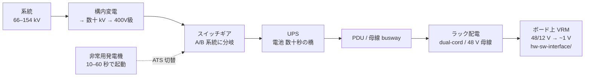

# データセンターの給電 (Datacenter Power)

## 概要 (Overview)

データセンターの給電とは、**系統の数万ボルト交流を、プロセッサの 1 V 直流まで、無停止で・冗長に・効率よく変換し続ける**チェーンの設計である。[`../energy/`](../energy/) が扱った系統側（発電・送配電・市場）と、[`../../hardware/hw-sw-interface/clock-power-reset.md`](../../hardware/hw-sw-interface/clock-power-reset.md) が扱ったチップ側（オンボードの電源レール・POR）の間を埋める層であり、変換の各段（変電、無停電電源 (UPS)、配電 (PDU)、ラック内変換）のそれぞれに、効率（損失）・冗長性・保守性のトレードオフが埋め込まれている。

AI クラスタはこの層に二重の圧力をかけた: **密度**（1 ラック 100 kW 超は従来の配電の一桁上、[`datacenter-fundamentals.md`](datacenter-fundamentals.md) 参照）と、**変動**（数万 GPU が同期して動く学習ジョブは、MW 級の負荷ステップを系統に見せる）である。本ドキュメントは変換チェーンを上流から下流へ辿り、冗長トポロジ、ラック給電の 48 V 化、電力のオーバーサブスクリプション、そして系統との新しい関係までを扱う。時事性の高い数値は 2026-10 時点と明記する。分析深度は Level 3。

## 方法論 (Methodology)

- チェーンを**電圧の階段**（66/154 kV → 数十 kV → 400 V 級 → ラック → 12/48 V → ~1 V）として描き、各段に「なぜこの電圧か（電流と導体の算術）」「どこで冗長を確保するか」「何%を失うか」を対応づける。
- 冗長は [`datacenter-fundamentals.md`](datacenter-fundamentals.md) の語彙（N+1/2N・コンカレントメンテナビリティ）を給電に具体化する形で扱う。
- 電池・電力変換の物理は既存文書（[`../energy/battery-energy-storage.md`](../energy/battery-energy-storage.md)・[`../../foundations/physics/electromagnetism/circuit-theory.md`](../../foundations/physics/electromagnetism/circuit-theory.md)）に委ね、本書はシステム構成の判断に徹する。
- 業界動向（48 V・±400 V DC・原子力併設）は目標値/構想と実装済みを区別する。

## 発見事項 (Findings)

1. **給電チェーンの設計原理は「電流を小さく保て」の一言に尽きる。** 導体の損失は I²R であり、同じ電力なら電圧を上げるほど電流と損失が減る（[`../energy/generation-grid-fundamentals.md`](../energy/generation-grid-fundamentals.md) の送電と同じ算術）。ゆえに変換チェーンは「できるだけ高い電圧で運び、負荷の直前で落とす」よう設計され、密度が上がるほど**高電圧をよりラックの近くまで**引き込む方向に進化してきた（配電の 400 V 級化、ラック内 48 V 化、±400 V DC 構想）。
2. **UPS の役割は「停電対策」ではなく「発電機が起動するまでの 10〜60 秒の橋」である。** 長時間の停電を電池で持たせる設計は非経済的で、実際の構成は「電池（またはフライホイール）で数十秒 → 非常用発電機が引き継ぐ」の二段構えである。UPS 方式の選択、つまり常時二重変換（オンライン: 常に AC→DC→AC、品質最高・損失数%）とライン インタラクティブ/エコモード（常時はバイパス、異常時に切替）のどちらを採るかは、**電力品質と効率の交換**であり、大規模事業者は損失を嫌ってエコモード・分散電池へ寄ってきた。
3. **冗長トポロジの本質は「二本の独立な道」をどこまで下流まで保つかである。** 2N 構成では独立な A/B 系統がラックの二重電源 (dual-cord) まで並走し、サーバの 2 台の PSU がその終端になる。ブロック冗長・分散冗長 (distributed redundant) は 2N の資本コストを削る中間解である。重要なのは**冗長の終端より下流は単一障害点**という自明な帰結で、単一電源の機器（一部のスイッチ・GPU 筐体）をどう扱うかが実務の詰めどころになる（ラック内 ATS・静的切替器）。
4. **ラック内の 48 V 化は「変換段数と I²R」の算術が Open Compute で製品化されたものである。** 従来の「AC → PSU で 12 V → マザーボード」に対し、OCP 系ラックは「ラック一括で 48 V DC 母線 → 各ボードで降圧」へ移行した。12 V → 48 V で同一電力の電流は 1/4、母線損失は 1/16 になり、電池 (BBU) をラックに分散して UPS 段を丸ごと省く構成も可能になる[^ocp]。AI ラックの kW 密度がこの移行を必須化し、さらに **±400 V DC をラックへ直接引き込む構想**（変換段の追加削減）が進む。OCP の Mt. Diablo 仕様（Microsoft・Meta・Google 起草。旧称 Diablo 400）は、AC-DC 変換・保護・任意の蓄電を IT ラック脇の「サイドカー電源ラック」に移し、3 相 400〜480 V の交流を受けて差動 800 V DC（±400 V DC）を IT ラックへ送る構成を定める。2026-10-08 に v1.0.0 が発効して最初の正式版になり、電源ラック 1 台で 800 kW から 1 MW 超（並列化も可）までの拡張を想定している[^ocp-hvdc]。NVIDIA は 13.8 kV AC を施設外周で 800 V DC に変換する構成を 2025-05 に提案し、本格量産を Kyber 世代ラックに合わせるとした（端から端までの効率最大 5% 改善・銅量 45% 削減はいずれもベンダの目標値）[^nvidia-800v]。2026-08 には NVIDIA・Google・Microsoft が OCP で共同の白書（2026-03）と固体変圧器 (SST) の仕様 v0.3（2026-07）を出し、三つの道筋を示した。既存施設向けの MGX 800 V DC 電源ラック（2026 年下半期）、列単位で最大 2 MW を配る「列電源センタ」（2027 年）、新設施設で中圧交流を一段で 800 V DC にする構成である[^nvidia-lvdc]。NVIDIA の数字は資料ごとに揃っておらず、同じ導体で送れる電力の増分は 2025-05 の資料で 85%、2025-10 の資料で 150% 超とされる。比較の前提が異なるとみられ、どちらもベンダの主張である。2026-11 時点で 800 V DC を採用した顧客の運用例は公表されておらず、仕様の確定と製品化の段階にある。目標値と実装の区別が要る領域である。
5. **電力のオーバーサブスクリプションは「名板値の嘘」を回収する。** 全サーバが銘板定格 (nameplate) で同時にピークを引くことは実際にはないため、実測分布に基づき定格合計が受電容量を超える台数を収容し、超過しそうな稀な瞬間だけ**電力キャッピング**（周波数制限・ジョブ抑制）で守る[^power-provisioning]。これは [`../../software/virtualization/`](../../software/virtualization/) のメモリオーバーコミットと同じ統計的多重化である（独立な確率変数の和は相対的なばらつきが小さくなる、という [`probability-random-variables.md`](../../foundations/mathematics/probability-statistics/probability-random-variables.md) の帰結に依拠する）。ただし AI 学習はこの前提を崩す。同期ジョブは全 GPU のピークを**揃えて**引くため多重化の余地が薄く、逆に通信フェーズで一斉に電力が落ちる。つまり、負荷の相関が統計的な見込みを外す。
6. **AI の負荷変動は施設と系統の新しい設計問題である（2026-10 時点）。** 学習ジョブの計算/通信の交代・チェックポイント・障害停止は、数十 MW 規模の負荷ステップを数秒〜数分スケールで生む。施設側はラック/施設レベルの平滑化（電池・キャパシタ・ダミー負荷）やジョブ側の電力整形で吸収を図り、系統側は大口需要家の変動・保護協調を規制の対象にし始めた。北米では、データセンターの負荷が一斉に系統から離脱する事象（2024-07 のバージニアで約 1,500 MW）を受けて NERC が 2026-05 に最高位の Level 3 アラートを出し[^nerc-alert]、FERC は 2026-07-16 に、計算負荷 (computational load) の系統連系に関する強制力のある信頼度基準の策定を NERC に命じた（提出期限 2026-12-31。2026-10 時点で基準は策定中）[^ferc-rd26-7]。[`../energy/electricity-markets-dispatch.md`](../energy/electricity-markets-dispatch.md) の需要側資源の議論に、データセンターが最大のプレーヤとして登場した形である。
7. **給電は最大の停止原因であり続けている。** 業界調査で重大停止の主因は一貫して電源系である。Uptime Institute の 2026 年調査では重大停止の 56% が電源起因で（2025 年 45%、2024 年 54%。同社は 2025 年を例外的な低値とみる）、電源起因の IT サービス停止の内訳は UPS 故障 39%・切替器（系統切替）故障 34%・発電機故障 28% と報告されている[^uptime-outage]。つまり多くは「UPS があるのに落ちた」型（切替の失敗、電池の劣化見逃し、保守時の誤操作）であり、冗長は**検証されて初めて冗長**である（負荷試験・実切替訓練）。[`../../software/security/fuzzing-program-analysis.md`](../../software/security/fuzzing-program-analysis.md) の「検出はインフラ」と同じく、可用性も行為ではなく運用の継続である。

## アーキテクチャ (Architecture)

### 電圧の階段 — 系統から 1 V まで



### 冗長トポロジの比較

| 構成 | 独立系統 | 耐えられる事象 | 資本コスト | 典型用途 |
|---|---|---|---|---|
| N | 1 | なし | 最小 | 冗長不要の負荷 |
| N+1 (並列冗長) | 1 系統 + 予備モジュール | UPS/発電機 1 台の故障 | 中 | Tier II〜III |
| 分散冗長 (3系統で 2N 相当) | 3 系統に負荷分散 | 1 系統の全損 | 中〜高 | 大規模での 2N 代替 |
| 2N | 完全独立 A/B | 片系統の全損 + 保守同時 | 最大 | Tier III〜IV |

- どの構成でも、**切替器 (ATS/STS) と下流の単一経路**が実質の弱点になる。「紙の上の 2N」と「訓練で実証された 2N」の差が停止統計（発見事項 7）を説明する。
- 表の Tier 対応は Uptime Institute の Tier 分類[^uptime-tier]に、設計要件の別体系としては ANSI/TIA-942-C の Rated-1〜4[^tia942]がある。いずれも「構成の等級」であって停止時間の保証ではない。並列冗長・共通原因故障の定量化は [`reliability-theory.md`](../../foundations/mathematics/probability-statistics/reliability-theory.md) の並列系・共通原因モデルがそのまま使える。

## 技術詳細 (Technical Details)

### 1. UPS と エネルギー貯蔵 (UPS & Energy Storage)

- **常時二重変換 (double conversion)**: 入力 AC → 整流 → DC バス（電池接続）→ インバータ → 出力 AC。周波数・波形の乱れを完全に遮断するが、常時 2 回の変換損失（数%）を払う。**エコモード**は正常時バイパスで通し、異常検出時に数 ms でインバータへ切り替える。これは「品質の保険料を、切替リスクと引き換えに返金する」方式であり、大規模事業者の採用が進んだ。
- **貯蔵の選択**: 鉛蓄電池（安価・重い・寿命短）→ リチウムイオン（省スペース・BMS 必須、熱暴走リスクは [`../energy/battery-energy-storage.md`](../energy/battery-energy-storage.md)・消防法規と一体）へ世代交代。フライホイールは 10 秒級の橋に特化した機械式の解。ラック分散 BBU（OCP 型）は「UPS という段」を消してチェーンを短くする[^ocp]。
- **発電機**: ディーゼルが標準（数十秒起動・燃料 24〜72 h 備蓄）。起動失敗が停止統計の常連であり、無負荷試運転ではなく**実負荷試験**が運用の要。排出規制・燃料の脱炭素（HVO・ガス・水素構想）と、そもそも発電機を持たない設計（系統二回線 + ソフトウェア冗長への引き渡し）が現在の論点である。

### 2. 配電と計測 (Distribution & Metering)

- PDU・母線 (busway) はラック列への配電と**計測の粒度**を提供する。回路単位の電流・電力の常時計測は、容量管理（オーバーサブスクリプションの前提データ）・故障予兆・課金の基盤であり、[`../../software/observability/`](../../software/observability/) の「観測の入口」が給電にもある。分岐回路レベルのテレメトリなしに統計的多重化は運用できない。
- 相バランス: 三相給電では負荷を 3 相に均等配分しないと中性線電流・変圧器容量を無駄にする（変圧器の原理は [`induction-inductance.md`](../../foundations/physics/electromagnetism/induction-inductance.md)、三相・フェーザの扱いは [`circuit-theory.md`](../../foundations/physics/electromagnetism/circuit-theory.md)）。ラック内の機器配置が電気設計問題になる、地味だが恒常的な制約である。

### 3. 電力キャッピングの階層 (The Power Capping Hierarchy)

```
施設受電容量
  └ 変圧器・UPS 容量 (静的制約)
      └ ラック割当 (契約値)
          └ サーバ電力上限 —— RAPL 等でチップに強制
              └ プロセッサ DVFS (msスケールの実施機構)
```

- 実施の実体はチップの電力管理（DVFS・電力上限レジスタ、[`../../software/operating-systems/power-management.md`](../../software/operating-systems/power-management.md)・[`../../hardware/cpu/`](../../hardware/cpu/) 参照）であり、施設の静的な契約をミリ秒の閉ループが守る、階層化された制御系である（[`../robotics/control-systems.md`](../robotics/control-systems.md) のカスケード構造の給電版）。
- AI 学習でのキャッピングは性能に直結する（全 GPU が同期しているため 1 台の抑制が全体を遅らせる。[`../../hardware/accelerators/interconnects-scaleout-training.md`](../../hardware/accelerators/interconnects-scaleout-training.md) のストラグラー問題の電力版）。ゆえに AI クラスタでは「キャップで守る」より「変動を平滑化して容量内に収める」（電池バッファ・ジョブの電力整形）方向が探られている。

### 4. 系統との関係の変化 (The New Grid Relationship)

- 大口化: 単一キャンパスの受電が数百 MW 級になると、接続可否は送電・変電設備の増強計画に依存し、**「電力の取れる土地」が最希少資源**になる（[`datacenter-fundamentals.md`](datacenter-fundamentals.md) の立地の議論）。
- 接続待ちの規模: テキサスの ERCOT では、75 MW を超える大口需要の接続申請が 2026-06 時点で約 474 GW に達し、その約 9 割がデータセンターだった。申請の大半は実現しない前提で読む必要がある。ERCOT は申請を束で審査する方式（Batch Zero、2026-06 にテキサス州公益事業委員会が承認）に切り替えた[^ercot-queue]。米国全体では、FERC が 2026-06-18 に PJM・MISO・SPP・CAISO・ISO-NE・NYISO の 6 つの系統運用者それぞれに、大口需要の接続規則が妥当であることを示すか、規則を改めるよう命じた（連邦電力法第 206 条の手続き）。これに先立ち、2025-12-18 には PJM の併設負荷 (co-location) の規則を不当と判断し、送電サービスの選択肢を作るよう命じている[^ferc-large-load]。
- 自家発電: 系統の接続を待てない事業者は構内のガスタービンを「橋渡し」や主電源として置き始めた。xAI の子会社は 2026-03-10 にミシシッピ州で 41 基のガスタービンの建設許可を得て、メンフィスの Colossus 2 に給電するとした。それまで同じ場所で許可のないタービンを動かしていたとして、環境団体が異議を申し立てている（報道による）[^xai-turbines]。この形では発電機が非常用ではなく常用になり、排出規制と地域合意が給電の可用性を左右する。
- 原子力: 既設炉との長期契約が先行している。Microsoft は Three Mile Island 1 号機（Crane Clean Energy Center、約 835 MW）の再稼働に合わせて 20 年の PPA を結んだ（2024-09、発表時の運転再開目標は 2028 年）[^crane-ppa]。NRC は 2026-09 に環境評価を終え、Constellation は 2027 年の再開を見込むが、免除と許可変更の審査は残っている[^crane-nrc]。Amazon と Talen は Susquehanna 発電所から最大 1,920 MW を 2042 年まで受ける契約を、系統経由 (front-of-the-meter) の形に組み替えた（2025-06）。FERC が 2024-11 に併設負荷の拡大を認めなかったことを受けた変更である[^talen-amazon]。SMR の併設は 2026-11 時点で構想と契約の段階にある。
- 調達: 再エネ PPA（会計上のマッチング）から、24/7 カーボンフリー調達、自家発電・蓄電の併設、原子力まで、[`../energy/electricity-markets-dispatch.md`](../energy/electricity-markets-dispatch.md) の市場の仕組みがデータセンター戦略の一部になった。
- 需要側資源として: 大規模電池・柔軟なワークロード（遅延許容のバッチ・学習）を持つデータセンターは、系統サービス（需要応答・周波数調整）の提供者にもなりうる。「系統の負担」から「系統の資源」への転換が構想され、実装はまだ限定的である。

## セキュリティ考察 (Security Considerations)

- **給電制御系は最も増幅率の高い OT 攻撃面である。** UPS・スイッチギア・発電機制御・BMS への侵入は、物理的破壊なしに全館停止を引き起こせる。ネットワーク接続された UPS/PDU の管理インターフェースは既定認証情報・未パッチの常連であり、管理網の分離・ベンダ保守経路の統制（[`../energy/plant-control-scada-security.md`](../energy/plant-control-scada-security.md) と同型）が第一線になる。
- **切替イベントは攻撃の窓である。** 系統→発電機切替・UPS バイパス操作は、正規手順でも停止リスクが最大化する瞬間であり、偽の異常を注入して切替を誘発する攻撃は「正規機構の悪用」として検出が難しい。切替ロジックの完全性と、異常時手順の訓練が防御を兼ねる。
- **電力テレメトリは情報を漏らす。** 施設・回路単位の電力波形はワークロードの推定（学習ジョブの開始・規模・チェックポイント周期）を許す。これは [`../../hardware/security/side-channels-tee-secure-boot.md`](../../hardware/security/side-channels-tee-secure-boot.md) の電力サイドチャネルの施設スケール版であり、テレメトリの取り扱いは機密情報に準じる。
- **燃料・電池のサプライチェーン**: 非常用燃料の品質・補給契約、電池の劣化管理は可用性の一部であり、広域災害時には補給が競合する。冗長設計は「平時の独立性」だけでなく「危機時の調達競合」まで含めて評価する必要がある。

## 結論 (Conclusions)

給電チェーンは「電流を小さく保て」という一つの算術の反復であり、その上に「二本の独立な道をどこまで保つか」という冗長の設計と、「銘板値と実測の差を回収する」統計的多重化が載る。UPS は停電対策ではなく発電機への橋であり、冗長は訓練されて初めて実在し、48 V 化・DC 化はチェーンを短くする算術の帰結である。そして AI は、密度と同期変動という二つの新変数でこの体系を揺さぶり、データセンターを系統の最大の顧客かつ潜在的資源へと変えた。給電の設計は今や、チップの DVFS から電力市場までを貫く一本の制御問題である。

---

## 参考文献 (References)

[^ocp]: [Open Compute Project — Open Rack V3 (ORv3) Base Specification ほか Rack & Power プロジェクト仕様群](https://www.opencompute.org/projects/rack-and-power) — Accessed: 2026-10-04. — 48 V 母線・電源シェルフ・分散 BBU の一次仕様。

[^ocp-hvdc]: [Open Compute Project (2026). *Mt. Diablo Disaggregated Power Rack Specification 1.0.0, Base Specification*](https://www.opencompute.org/wp-content/uploads/2026/10/OCP-Specification-Mt.-Diablo-Disaggregated-Power-Rack-Specification-v1.0.0.pdf) — 2026-10-08 発効。著者 Microsoft・Meta・Google。第 5 節 (範囲: 800 kW〜1 MW 超)、第 7.1.1 節 (3 相 400/415/480 V の交流入力)、版の履歴 (Diablo 400 から改称、800 V DC を「差動 800 V DC」に統一)。Accessed: 2026-11-28. 以前の版は [v0.7.0 (2026-03)](https://www.opencompute.org/documents/ocp-specification-diablo-400-v0-7-0-final-pdf)・[v0.5.2 (2025-05-30)](https://www.opencompute.org/documents/ocp-specification-diablo-400-v0p5p2-2025-05-30-pdf)。

[^nvidia-800v]: [Blake, M. et al. (2025-05-20). NVIDIA 800 V HVDC Architecture Will Power the Next Generation of AI Factories. *NVIDIA Technical Blog*](https://developer.nvidia.com/blog/nvidia-800-v-hvdc-architecture-will-power-the-next-generation-of-ai-factories/) — Accessed: 2026-10-04. — 800 V DC 給電構想と 2027 年の量産目標（ベンダ目標値）。

[^nvidia-lvdc]: [NVIDIA Blog (2026-08-11). 800 VDC power architecture for AI factories](https://blogs.nvidia.com/blog/800-vdc-power-architecture-ai-factory) — 共同白書 (2026-03)、LVDC SST 仕様 v0.3 (2026-07)、MGX 800 V DC 電源ラック (2026 年下半期)、列電源センタ (2027 年、最大 2 MW/列)、80 社超の参加。同日の [OCP のニュース](https://www.opencompute.org/news/powering-the-next-era-of-ai-how-google-microsoft-and-nvidia-are-standardizing-and-accelerating-the-industry-transition-to-lvdc/) も参照。同じ導体での電力 150% 超の主張は [NVIDIA Blog (2025-10-13)](https://blogs.nvidia.com/blog/gigawatt-ai-factories-ocp-vera-rubin)。いずれもベンダの目標値。Accessed: 2026-11-28

[^ercot-queue]: [ERCOT (2026-07-29). Senate panel: Assessing the Grid](https://www.ercot.com/files/docs/2026/07/29/ERCOT-Senate-July-29-Panel-1-Assessing-The-Grid.pdf) と [ERCOT (2026-06-18). New Batch Connection Process for Large Electricity Users](https://www.ercot.com/files/docs/2026/06/18/ERCOT-Trending-Topic-New-Batch-Connection-Process-for-Large-Electricity-Users.pdf) — 大口需要の申請 約 474 GW (約 9 割がデータセンター)、75 MW 超の定義、束での審査。ERCOT の PDF は自動取得を拒むため、数値は検索で得た抜粋と、増加を伝える報道 ([Utility Dive](https://www.utilitydive.com/news/ercots-large-load-queue-jumped-almost-300-last-year/808820/)) で突き合わせた。Accessed: 2026-11-28

[^ferc-large-load]: [FERC (2026-06-18). FERC launches aggressive, targeted action to speed large load integration](https://ferc.gov/news-events/news/ferc-launches-aggressive-targeted-action-speed-large-load-integration) — 6 つの系統運用者への第 206 条の命令 (EL26-67〜EL26-72)。手続きの整理は [McGuireWoods (2026-06)](https://www.mcguirewoods.com/client-resources/alerts/2026/6/ferc-issues-section-206-show-cause-orders-directing-all-six-rtos-isos-to-justify-or-reform-large-load-integration-rules/) (二次資料)。PJM の併設負荷は [FERC Fact Sheet (2025-12-18)](https://ferc.gov/news-events/news/fact-sheet-ferc-directs-nations-largest-grid-operator-create-new-rules-embrace) (EL25-49)。Accessed: 2026-11-28

[^xai-turbines]: [DatacenterDynamics — Musk's xAI gets go-ahead for 41 natural gas turbines in Mississippi to power Colossus data centers](https://www.datacenterdynamics.com/en/news/musks-xai-gets-go-ahead-for-41-natural-gas-turbines-in-mississippi-to-power-colossus-data-centers) と [SELC (2026-03-10)](https://www.selc.org/press-releases/mississippi-regulators-rubber-stamp-air-permit-for-xai-power-plant-ignoring-overwhelming-public-pushback/) — 2026-03-10 の許可、41 基、許可前のタービンをめぐる異議 (SELC は当事者)。州の許可文書そのものは読んでいない。Accessed: 2026-11-28

[^crane-ppa]: [Constellation (2024-09-20). Constellation to Launch Crane Clean Energy Center](https://www.constellationenergy.com/news/2024/Constellation-to-Launch-Crane-Clean-Energy-Center-Restoring-Jobs-and-Carbon-Free-Power-to-The-Grid.html) — Microsoft との 20 年 PPA、約 835 MW、2028 年の運転再開目標 (発表時)。Accessed: 2026-11-28

[^crane-nrc]: [World Nuclear News (2026-09-28). NRC completes environmental review of Crane restart](https://www.world-nuclear-news.org/articles/nrc-completes-environmental-review-of-crane-restart) — 環境評価と FONSI、審査中の免除と 3 件の許可変更、2027 年の再開見込み (事業者の見通し)。Accessed: 2026-11-28

[^talen-amazon]: [Utility Dive — Talen, Amazon restructure Susquehanna nuclear deal (2025-06)](https://www.utilitydive.com/news/talen-amazon-aws-susquehanna-nuclear-data-center-t/750440/) と [World Nuclear News — New supply agreement expands Talen-Amazon partnership](https://world-nuclear-news.org/articles/new-supply-agreement-expands-talen-amazon-partnership) — 最大 1,920 MW、2042 年まで、2029 年 840〜1,200 MW・2032 年 1,680〜1,920 MW、系統経由への移行。Talen の発表文そのものは読んでいない。Accessed: 2026-11-28

[^power-provisioning]: Fan, X., Weber, W.-D. & Barroso, L. A. (2007). Power Provisioning for a Warehouse-sized Computer. *Proc. ACM/IEEE ISCA 2007*, 13–23. DOI: 10.1145/1250662.1250665 — 電力オーバーサブスクリプションと実測分布の原典。

[^uptime-outage]: [Uptime Institute (2026). *Uptime Institute Global Data Center Survey 2026*](https://datacenter.uptimeinstitute.com/rs/711-RIA-145/images/UptimeInstitute.GlobalDataCenterSurvey.2026.pdf) — 重大停止の主因 (n=85、電源 56%)。電源起因の内訳は同社の Resiliency Survey 2026 (n=129) による。Accessed: 2026-10-11

[^nerc-alert]: [Morgan Lewis — NERC Alert Moves Data Centers From Emerging Risks to Planning Obligations (2026-05-12)](https://www.morganlewis.com/blogs/powerandpipes/2026/05/nerc-alert-moves-data-centers-from-emerging-risks-to-planning-obligations) — NERC の Level 3 アラートの解説 (二次資料)。Accessed: 2026-10-11

[^ferc-rd26-7]: [FERC (2026-07-16). Order Directing Reliability Standard(s) Pertaining to Computational Load Integration, Docket No. RD26-7-000](https://www.ferc.gov/sites/default/files/2026-07/RD26-7-000.pdf) — 196 FERC ¶ 61,031。基準の提出期限 2026-12-31、追加の作業計画 2027-03-01。Accessed: 2026-10-11

[^uptime-tier]: [Uptime Institute. *Tier Classification System*](https://uptimeinstitute.com/tiers) — Accessed: 2026-10-04. — Tier I〜IV の構成要件（N+1・コンカレントメンテナビリティ・フォールトトレランス）の定義。

[^tia942]: Telecommunications Industry Association (2024). *ANSI/TIA-942-C: Telecommunications Infrastructure Standard for Data Centers*. TIA（2024-05 発行）. — 電力・機械・建築・通信を含むデータセンター設計の最低要件と評価等級（Rated-1〜4）。高密度・液浸冷却の附属書を追加。

その他の標準的典拠を以下に挙げる。

- Barroso, L. A., Hölzle, U. & Ranganathan, P. (2018). *The Datacenter as a Computer* (3rd ed.). Morgan & Claypool. — 給電チェーン・TCO・キャッピングの体系的整理。
- IEEE Std 3006.7 / IEEE Gold Book 系列. *Recommended Practice for Determining the Reliability of 7x24 Continuous Power Systems*. — 給電信頼性評価の実務標準。
