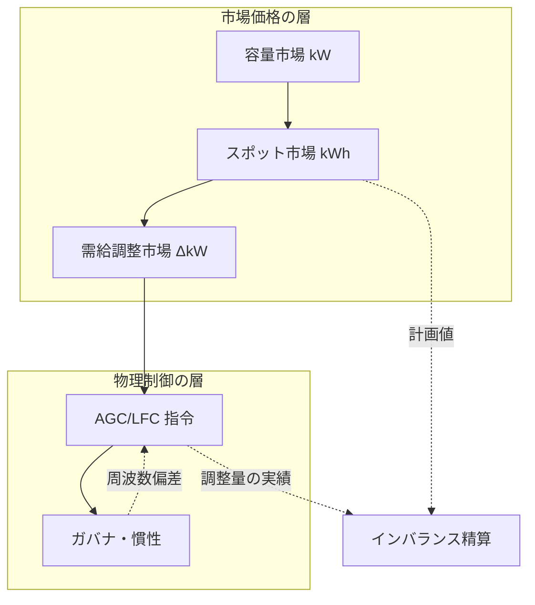

# 電力市場と経済的ディスパッチ (Electricity Markets & Economic Dispatch)

## 概要 (Overview)

[`generation-grid-fundamentals.md`](generation-grid-fundamentals.md) は、電力系統が「生成と消費を瞬時に一致させ続ける巨大な制御ループ」であり、その制御が慣性 → 一次 → 二次 → 三次調整という時間スケールの階層で分業されることを示した。本ドキュメントはその階層に**価格**を重ねる。電力事業 (electricity business) の中核である電力市場 (electricity market) は、物理の制約（貯蔵できない、瞬時同時同量、送電容量が有限）をそのまま市場設計に写し取った構造をしており、**周波数制御の各階層は、そのまま市場で取引される「商品」に対応する**。

かつて垂直統合の電力会社の中で EMS (Energy Management System) が一括で解いていた「どの発電機を、いつ、どれだけ動かすか」という最適化（経済負荷配分 / economic dispatch、起動停止計画 / unit commitment）は、自由化 (liberalization) によって市場メカニズムへ分解された。本ドキュメントは、(1) 電力という商品の特殊性、(2) メリットオーダー (merit order) と限界費用による価格形成、(3) 時間軸に沿った市場の連鎖（容量市場 → 卸電力市場 → 需給調整市場 → インバランス精算）、(4) その裏で依然として動き続ける最適化問題、を日本の制度 (JEPX・OCCTO・需給調整市場) を主な事例、欧米 (LMP、ancillary services) を対比として整理する。

## 方法論 (Methodology)

- 市場を**時間軸で階層化**して捉える: 実需給の数年前（容量）→ 前日（スポット）→ 当日（時間前）→ 前日（調整力。2025 年度までは一部が週間）→ 実需給断面（AGC・ガバナ）→ 事後（インバランス精算）。物理の制御階層が「速いほど下位で自律的」だったのと対称に、市場は「実需給に近いほど物理に従属する」。
- 価格形成を**限界費用 (marginal cost)** の一点から導出する。メリットオーダー、スパイク、ゼロ・マイナス価格、市場分断はすべて同じ原理の帰結として説明できる。
- 制度の細部（商品要件、締切時刻、精算式）は改定が続いているため、本ドキュメントは**構造**の理解を優先し、具体的な数値は執筆時点 (2026-07、需給調整市場の制度は 2026-10 に再確認) のものであることを明記する。地域差（日本／欧州／北米）は本質が同じで用語が違う場合が多く、対応表で吸収する。
- 経済学の厳密な展開（均衡理論、オークション理論）には立ち入らず、「物理制約がどう商品と価格になるか」というシステム設計の視点に絞る。

## 発見事項 (Findings)

1. **電気は在庫できないため、「同じ kWh」が時間帯ごとに別商品になる。** 一般の商品は在庫が時間差を吸収するが、電気は生産と消費が同時でなければならない。したがって市場は 30 分（日本のスポット取引の単位、コマ）や 1 時間・15 分（欧州）単位の**時間帯別の商品**として電力を取引する。1 日 = 48 コマの独立したオークションであり、価格は時間帯ごとに数十倍動きうる。

2. **価格はメリットオーダーで決まり、「最後に動く発電機」の限界費用が全員の価格になる。** 発電機を限界費用（ほぼ燃料費）の安い順に積み上げ、需要と交わる点で約定する**シングルプライスオークション (uniform price auction)** が基本形。太陽光・風力・原子力・水力は限界費用がほぼゼロで常に約定し、火力（ガス・石炭・石油）が価格を決める。再エネが増えるほど価格の低い時間帯が増え（メリットオーダー効果）、同時に再エネが凪いだ時間の価格スパイクも極端になる。

3. **kWh（電力量）だけでは系統は保てず、ΔkW（調整力）と kW（供給力）が別商品として値付けされる。** 周波数制御の階層（一次〜三次調整）は需給調整市場の 5 商品として、数年先の供給力は容量市場として取引される。物理文書で「同期機の物理的副産物」とした慣性・電圧支持も、英国など一部系統では市場調達が始まっており、**物理の副産物が順に商品化されていく**過程が観察できる。

4. **起動停止計画 (unit commitment) は混合整数計画問題であり、市場の約定処理そのものが大規模最適化である。** 発電機には起動費・最低出力・最低運転/停止時間・ランプ制約という「離散と慣性」があり、単純な価格順ソートでは解けない。系統運用者・市場運営者は毎日、数千変数規模の MIP (Mixed-Integer Programming) を制限時間内に解いている。

5. **送電容量が足りないと市場が「分断」され、価格が場所の関数になる。** 連系線の容量を超える取引は物理的に実行できないため、市場は地域ごとに別価格で約定する（日本: エリアプライス・市場分断、米国 PJM など: ノード単位の LMP）。価格差は送電線増強の便益をそのまま表す。[`hvdc-interconnection.md`](hvdc-interconnection.md) で扱う地域間連系線が「事業」の問題になる理由がここにある。

6. **市場で決まるのは計画であり、最後の数分は物理（AGC・ガバナ）が埋める。** 日本の「計画値同時同量」では、発電・小売の各主体 (バランシンググループ) が 30 分コマごとの計画を提出し、計画と実績の差（インバランス）は一般送配電事業者が調整力で埋めて事後精算する。市場と物理の接続点は、EMS/中央給電指令所が調整力電源へ送る AGC 指令・出力指令であり、これは [`plant-control-scada-security.md`](plant-control-scada-security.md) で扱った OT システムの上で動く。

## アーキテクチャ (Architecture)

### 時間軸に沿った市場の連鎖 (Market Sequence)

```
 実需給の4年前        1年前〜数日前         前日            当日           実需給断面        事後
 ┌────────────┐   ┌────────────┐   ┌────────────┐  ┌────────────┐  ┌────────────┐  ┌──────────┐
 │ 容量市場     │   │ 先物・先渡   │   │ スポット市場 │  │ 時間前市場   │  │ 需給調整     │  │ インバランス│
 │ (capacity)  │   │ (futures)   │   │ (day-ahead) │  │ (intraday)  │  │ (balancing) │  │ 精算       │
 │ kW 価値      │   │ 価格ヘッジ   │   │ kWh 30分コマ │  │ 計画の修正   │  │ ΔkW→AGC指令 │  │ (settlement)│
 │ OCCTO       │   │ TOCOM/EEX等 │   │ JEPX        │  │ JEPX        │  │ EPRX/TSO    │  │ 一般送配電  │
 └────────────┘   └────────────┘   └────────────┘  └────────────┘  └────────────┘  └──────────┘
   将来の供給力を確保    リスク管理        ここで大半の      直前の需要予測     周波数を守る      計画と実績の
   (発電所建設の投資回収) (物理受渡なし可)   価格が決まる      ・再エネ予測誤差    最後の砦         差を値付け
                                                        を織り込む
```

- **卸電力市場（スポット）**: 日本では JEPX (Japan Electric Power Exchange) が運営。30 分単位・48 コマのブラインド・シングルプライスオークションで、前日朝に入札を締め切り一括約定する。
- **需給調整市場**: 2021 年に開設され、2024 年度から全 5 商品が取引されている。2026 年度からは全商品が前日取引（前日 11:30〜14:00 入札、15:00 約定）・30 分単位の入札に統一された。買い手は一般送配電事業者（TSO）のみで、「電気そのもの」ではなく**指令に応じて出力を変えられる能力 (ΔkW)** を取引する。
- **容量市場**: OCCTO (電力広域的運営推進機関) が実需給の 4 年前にメインオークションを実施し、将来の供給力 (kW) を確保する。卸価格の低下で火力の固定費回収が難しくなり、供給力が退出しすぎるのを防ぐ制度で、脱炭素電源向けには長期脱炭素電源オークションが併設されている。

### 周波数制御の階層と市場商品の写像 (Physics-to-Product Mapping)

[`generation-grid-fundamentals.md`](generation-grid-fundamentals.md) の制御階層は、次のように商品へ写像される。

| 物理階層 | 応答時間 | 日本（需給調整市場） | 欧州 (ENTSO-E) | 北米 (例: PJM) |
|---|---|---|---|---|
| 慣性応答 | 〜0.1 s | 未商品化 | 未商品化（英国は安定度サービスとして調達開始） | 未商品化 |
| 一次調整（ガバナ） | 〜10 s | 一次調整力 | FCR (Frequency Containment Reserve) | Primary Frequency Response |
| 二次調整（AGC/LFC） | 〜数分 | 二次調整力①② | aFRR (automatic Frequency Restoration Reserve) | Regulation |
| 三次調整（予備力） | 〜15分以降 | 三次調整力①② | mFRR / RR | Spinning / Non-spinning Reserve |
| 経済負荷配分 | 〜30分 | スポット・時間前市場 | Day-ahead / Intraday | Day-ahead / Real-time Energy (LMP) |
| 長期の供給力 | 年 | 容量市場 | 各国の容量メカニズム | Capacity Market (RPM) |



## 技術詳細 (Technical Details)

### メリットオーダーと価格形成 (Merit Order & Price Formation)

```
 価格 [円/kWh]
   ▲
   │                                              石油火力 ←── 需要が
   │                                          ┌────────        ここまで
   │                                   ガス火力│                伸びると
   │                             ┌─────────────┘                価格スパイク
   │                     石炭火力│         ↑
   │             ┌───────────────┘      約定価格 = 需要曲線との交点
   │  再エネ・原子力・水力                 （最後に約定した電源の限界費用）
   ├──────────────┐
   │ 限界費用 ≈ 0  │
   └──────────────┴───────────────────────────────────────▶ 累積供給力 [GW]
```

- **なぜ限界費用で入札するのか**: シングルプライスオークションでは、約定すれば自分の入札価格ではなく市場価格を受け取れるため、正直に限界費用で入札するのが（市場支配力がなければ）最適戦略になる。固定費は kWh 価格のスパイクと容量市場で回収する建て付けである。
- **ゼロ・マイナス価格**: 再エネ余剰時、欧州の市場ではマイナス価格（発電者が金を払って引き取ってもらう）が発生する。日本のスポット価格には 0.01 円/kWh の下限があり（執筆時点）、マイナス価格の代わりに再エネの**出力制御 (curtailment)** が発動する。
- **価格スパイク**: 2021 年 1 月の需給ひっ迫では、JEPX スポット価格が通常の数十倍（一時 200 円/kWh 超）まで高騰し、市場価格連動メニューの小売や市場調達依存の新電力に深刻な影響を与えた。希少性が価格に出ること自体は設計通りだが、上限価格やインバランス料金の制度は本事象を受けて見直された。

### 需給調整市場の商品要件 (Balancing Market Products)

2026 年度時点の 5 商品（EPRX 商品要件 第 6 版, 2026-03-13）。買い手は一般送配電事業者で、約定した電源・蓄電池・DR (Demand Response) は指令システム（[`plant-control-scada-security.md`](plant-control-scada-security.md) の EMS/中央給電指令所）に接続される。

| 商品 | 応動時間 | 継続時間 | 指令・制御 | 対応する物理階層 |
|---|---|---|---|---|
| 一次調整力 | 10 秒以内 | 5 分以上 | オフライン（自端制御） | ガバナ・フリー |
| 二次調整力① | 5 分以内 | 30 分 | オンライン (LFC 信号) | AGC/LFC |
| 二次調整力② | 5 分以内 | 30 分 | オンライン (EDC 信号) | 経済負荷配分の高速分 |
| 三次調整力① | 15 分以内 | 30 分 | オンライン | 予備力 |
| 三次調整力② | 60 分以内（当初 45 分、2025 年度に変更） | 30 分 | オンライン | 再エネ予測誤差対応 |

- 取引は 2021 年度に三次②から始まり、2022 年度に三次①、2024 年度に一次・二次①②が加わって全商品が揃った。開設初期には応札不足・約定価格の高止まりが続き、制度改定（ブロック時間の短縮、応動時間の緩和など）が繰り返されている。2026 年度には一次〜三次①の週間商品が廃止されて全商品が前日取引へ移り、入札単位も 3 時間ブロックから 30 分へ細分化された。これは、**市場設計は一発で決まらず、物理要件と応札可能性の間の反復調整である**ことを示す実例といえる。
- 速い商品ほど設備要件（専用線オンライン、応動の実測検証）が厳しく、参加できる電源が限られる。蓄電池 (BESS) がこの市場で強いのは応動がミリ秒〜秒オーダだからであり、詳細は [`battery-energy-storage.md`](battery-energy-storage.md) で扱う。

### 起動停止計画と経済負荷配分 (Unit Commitment & Economic Dispatch)

市場の約定処理と給電計画の中核は、次の最適化問題である。

```
minimize   Σ_t Σ_g [ C_g(p_{g,t}) + SU_g · v_{g,t} ]        // 燃料費 + 起動費
subject to:
  Σ_g p_{g,t} = D_t + Loss_t                    ∀t          // 需給バランス
  P_min,g · u_{g,t} ≤ p_{g,t} ≤ P_max,g · u_{g,t}           // 出力範囲（並列時のみ）
  |p_{g,t} − p_{g,t−1}| ≤ R_g                               // ランプ制約
  min-up / min-down time constraints (u_{g,t})               // 最低運転・停止時間
  Σ_g r_{g,t} ≥ Reserve_t                                    // 予備力の確保
  |flow_l(p)| ≤ F_max,l                         ∀l          // 送電容量制約（直流法潮流近似）

  u_{g,t} ∈ {0,1}: 並列状態, v_{g,t} ∈ {0,1}: 起動フラグ, p_{g,t}: 出力
```

- **構造**: 整数変数を固定した残りの経済負荷配分 (ED) は凸最適化であり、需給バランス制約のラグランジュ乗数がそのまま限界価格（システムプライス、LMP のエネルギー成分）になる。凸性・KKT 条件・双対性（制約の値段）の理論は [`convex-optimization-duality.md`](../../foundations/mathematics/optimization/convex-optimization-duality.md) を参照。
- **計算複雑性**: 整数変数（並列/解列）を含む MIP であり、一般に NP 困難。実務では対象期間 1 日〜1 週間、発電機数百〜数千台、30 分〜1 時間刻みの問題を、分枝限定法＋線形緩和で「最適性ギャップ数 % 以内・制限時間内」に解く。厳密最適ではなく**時間内に十分良い解**を出すことが要件である点は、リアルタイム制御と同じ工学的妥協といえる。
- **前提**: 上式は送電網を直流法潮流 (DC power flow) で線形近似し、電圧・無効電力を無視している。実運用では約定後に交流潮流・安定度の検証が入る。交流潮流の計算、直流法への近似、PTDF の導出は [`transmission-distribution.md`](transmission-distribution.md) で扱う。
- 自由化前はこの全体を 1 社の EMS が解いていた。自由化後は、スポット市場の約定（価格順の単純化された形）＋各事業者の自社ポートフォリオ最適化＋TSO の調整力運用に**分解**されたが、解いている問題の本質は変わらない。

### 送電制約と価格の地理性 (Congestion & Locational Pricing)

- **日本（ゾーン制・市場分断）**: スポット市場はまず全国一律価格（システムプライス）で仮約定し、地域間連系線の容量を超える場合はエリア間で価格を分けて再約定する（市場分断 / market splitting）。北海道・東北で再エネが余り、東京で足りない時間帯には、連系線が満杯になりエリア価格差が生じる。**恒常的な価格差は連系線増強の便益の直接的な観測値**であり、OCCTO のマスタープランはこれを費用便益分析の入力にしている（[`hvdc-interconnection.md`](hvdc-interconnection.md) 参照）。
- **米国 PJM など（ノーダル制・LMP）**: LMP (Locational Marginal Price) は母線（ノード）ごとの価格で、`LMP = エネルギー価格 + 混雑成分 + 損失成分` に分解される。数千ノードの価格が 5 分ごとに最適化から算出される。つまり、価格計算そのものが大規模な制約付き最適化の双対変数 (shadow price) である。
- ゾーン制は簡潔だがゾーン内の混雑が価格に見えず、ノーダル制は精密だが複雑さと市場支配力監視のコストが大きい。どちらも「物理制約をどの粒度で価格に写すか」の設計選択である。

### 計画値同時同量とインバランス精算 (Balancing Groups & Imbalance Settlement)

```
 前日〜当日     発電BG ──── 発電計画 (30分コマ) ────┐
                                                  ├──→ 広域機関(OCCTO)経由で
               小売BG ──── 需要計画 (30分コマ) ────┘     一般送配電事業者へ
 実需給        実績が計画からズレる（需要予測誤差、電源トラブル、再エネ変動）
                  │
                  ▼
               一般送配電事業者が需給調整市場で確保した ΔkW を発動して埋める
                  │
 事後            ▼
               インバランス料金で精算（調整に要した限界的コストを反映）
```

- インバランス料金は「ズレを TSO に尻拭いさせるコスト」の値付けであり、調整力の発動実績から算出される。需給ひっ迫時には高くなるよう設計され、各主体に計画精度を高める（または蓄電池・DR を持つ）インセンティブを与える。
- ここが**市場（30 分の計画値の世界）と物理（秒単位の周波数の世界）の縫い目**である。縫い目より速い現象はすべて、需給調整市場で調達された調整力と、その下のガバナ・慣性が吸収する。

## セキュリティ考察 (Security Considerations)

- **市場システムは OT に直結した IT である。** スポット約定結果 → 発電計画 → EMS の出力指令 → AGC という経路は、金銭情報が最終的に物理指令へ変換されるパイプラインであり、市場システムや計画提出系（広域機関システム等）の完全性 (integrity) 侵害は、誤った給電計画という形で物理系統に波及しうる。
- **テレメトリの完全性が精算の完全性である。** 調整力の応動実績・計量データの改ざんは、精算の不正（経済的動機の攻撃）と、TSO の需給把握の汚染（可用性への攻撃）の両方につながる。[`plant-control-scada-security.md`](plant-control-scada-security.md) で述べた「無認証プロトコル上のテレメトリ」の問題は、市場の文脈では会計の問題にもなる。
- **価格シグナル自体が攻撃面になりうる。** 市場価格や指令に応答する自動化資産（蓄電池、DR、スマート家電）が増えるほど、偽の価格・偽の指令への大量同時応答が系統規模の外乱を生むシナリオが現実味を持つ。多数の分散資産の同時挙動が系統を壊しうる構造は、南オーストラリアのインバータ設定の事例（物理文書参照）と同型である。
- **サイバーでない攻撃: 市場支配力。** 物理的売り惜しみ (physical withholding) や限界費用を大きく超える入札 (economic withholding) による価格つり上げは、規制・監視（日本では電力・ガス取引監視等委員会）の対象である。技術的防御ではなく制度的監視で守る層だが、システム設計（入札データの保全、監査可能性）はその基盤になる。

> 本ドキュメントは公開制度・公開情報に基づく教育目的の概説であり、特定システム・市場の脆弱性や操作手法は扱わない（リポジトリの倫理方針に準拠）。

## 結論 (Conclusions)

- 電力市場は「貯蔵できない・瞬時同時同量・送電容量有限」という物理制約を、時間帯別商品・メリットオーダー・市場分断としてそのまま制度に写像したものである。**市場設計は物理の従属変数**であり、物理を知らずに電力事業は理解できない。
- 周波数制御の階層（慣性〜三次調整〜給電）は、需給調整市場の 5 商品・スポット市場・容量市場として値付けされる。同期機の物理的副産物（慣性・電圧支持）が順に商品化されていく過程は、再エネ大量導入で「物理がソフトウェア制御に置き換わる」動きの経済面での現れである。
- 市場の中核では今も unit commitment / economic dispatch という大規模最適化が毎日解かれており、自由化はこの最適化を消したのではなく、市場・事業者・TSO へ**分解**した。
- 市場（30 分の計画値）と物理（秒の周波数）はインバランス精算と AGC 指令で縫い合わされ、その縫い目は [`plant-control-scada-security.md`](plant-control-scada-security.md) の OT システムの上にある。市場データの完全性は、会計の問題であると同時に系統セキュリティの問題である。
- 次の展開: 調整力市場の主役になりつつある蓄電池を [`battery-energy-storage.md`](battery-energy-storage.md) で、市場分断を規定する地域間連系線を [`hvdc-interconnection.md`](hvdc-interconnection.md) で扱う。

## 参考文献 (References)

- Kirschen, D. S., & Strbac, G. (2018). *Fundamentals of Power System Economics* (2nd ed.). Wiley. ISBN 978-1-119-21324-6.
- Stoft, S. (2002). *Power System Economics: Designing Markets for Electricity*. IEEE Press / Wiley. ISBN 0-471-15040-1.
- [電力需給調整力取引所 (EPRX) — 需給調整市場の概要・商品要件（第4版, 2024-04-01）](https://www.eprx.or.jp/outline/docs/gaiyoushouhin_ver.4_20240401.pdf) — Accessed: 2026-07-05
- [EPRX — 2025年度向け需給調整市場システム切替における三次調整力②入札時間単位変更に関する留意事項 (2024-05)](https://www.eprx.or.jp/j_information/) — Accessed: 2026-07-05。三次②の応動 45→60 分・継続 30 分への変更。
- [電力需給調整力取引所 (EPRX) — 需給調整市場の商品要件と取引スケジュール（第6版, 2026-03-13）](https://www.eprx.or.jp/outline/docs/shouhin_ver.6_20260313.pdf) — Accessed: 2026-10-04。全商品前日取引化・30 分入札単位・前日 14 時入札締切／15 時約定。
- [資源エネルギー庁 — 需給調整市場について（次世代電力基盤 WG 資料, 2026-05-13）](https://www.meti.go.jp/shingikai/enecho/denryoku_gas/jisedai_kiban/stable_power_supply_wg/pdf/001_08_00.pdf) — Accessed: 2026-07-05
- [JEPX (日本卸電力取引所) — 取引概要](https://www.jepx.jp/) — Accessed: 2026-07-05。スポット市場（30 分・48 コマ、ブラインドオークション）の仕様。
- [電力広域的運営推進機関 (OCCTO) — 容量市場](https://www.occto.or.jp/market-board/market/) — Accessed: 2026-07-05
- [電力・ガス取引監視等委員会 — 2020年度冬期の電力スポット市場価格高騰に係る検証](https://www.emsc.meti.go.jp/) — Accessed: 2026-07-05。2021 年 1 月価格高騰の公式検証。
- [PJM — Energy & Ancillary Services Market Operations (Manual 11)](https://www.pjm.com/library/manuals) — Accessed: 2026-07-05。LMP・Regulation 市場の一次資料。
- ENTSO-E — *Electricity Balancing in Europe* (FCR/aFRR/mFRR の枠組み). [entsoe.eu](https://www.entsoe.eu/) — Accessed: 2026-07-05
