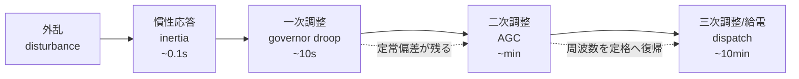

# 発電と電力系統の基礎 (Power Generation & Grid Fundamentals)

## 概要 (Overview)

電力系統 (power system) は、人類が運用する**最大のリアルタイム制御ループ**である。電力は経済的な規模では貯蔵できないため、**生成 (generation) と消費 (load) は常に・瞬時に一致していなければならない**。この需給一致の度合いが、系統全体で共有される一つの物理量、すなわち**系統周波数 (system frequency)**（日本では 50/60 Hz、欧州 50 Hz、北米 60 Hz）に現れる。発電が消費を上回れば周波数は上がり、不足すれば下がる。つまり周波数は、大陸規模に分散した数千の発電機と数億の負荷を結ぶ**共有された状態変数 (shared state variable)** であり、その制御は秒〜分の階層的フィードバックで行われる。

本ドキュメントは、(1) 一次エネルギーが電気エネルギーへ変換される物理チェーン、(2) 大多数の発電を担う**同期発電機 (synchronous generator)** とそれが系統に与える**慣性 (inertia)**、(3) 周波数を一定に保つ階層的制御、(4) 再生可能エネルギー (renewables) のインバータ接続がこの構造をどう変えるか、を整理する。最後に、これら物理層の制御点が最終的に発電所制御システム（SCADA/DCS）というソフトウェアに集約される様子と、そのセキュリティ含意を示す。

チップ内電源を扱う [`../../hardware/hw-sw-interface/clock-power-reset.md`](../../hardware/hw-sw-interface/clock-power-reset.md) が動的電力の基礎式 **P = α·C·V²·f** をワット〜数百ワットの規模で扱うのに対し、本ドキュメントは同じ「電力」をギガワット (10⁹ W) 規模、約12桁上のスケールで扱う。両者に共通するのは「電力・周波数・安定性は独立に最適化できない」という構造である。

## 方法論 (Methodology)

- 電力を **一次エネルギー → 機械エネルギー → 電気エネルギー → 系統 → 負荷** の変換チェーンとして分解し、各段の損失と制御点を対応づける。
- 系統を一つの**回転質量系 (rotating mass system)** とみなす。全同期発電機の回転子は電気的に結合しており、周波数はその合成回転速度に比例する。この視点が慣性・周波数応答・安定度を統一的に説明する。
- 周波数制御を**時間スケールで階層化**して捉える: 慣性応答（数百ミリ秒）→ 一次調整 (primary control, 数秒〜数十秒) → 二次調整 (secondary control / AGC, 数十秒〜数分) → 三次調整 (tertiary, 数分〜) → 経済負荷配分 (dispatch, 数十分〜)。
- 数値は代表的な系統・機器の桁感を示すものであり、地域・規模・運用方針で大きく変わる。絶対値より**桁感 (order of magnitude)** と相対関係を理解の基準とする。
- 物理から制御への接続を一貫して追い、最終的に「どのレジスタ／設定値／指令がソフトウェアの制御点になるか」へ落とし込む。

## 発見事項 (Findings)

1. **電力は貯められないので、系統は常時バランスを取る巨大な制御ループである。** 揚水発電 (pumped hydro) やバッテリーを除けば電気は経済規模で貯蔵できず、発電量は需要を秒単位で追従しなければならない。需給差は系統周波数の偏差として全系統に即座に伝わり、これが制御の観測量になる。

2. **周波数は「系統の回転速度」であり、慣性がその急変を抑える。** 同期発電機の回転子は周波数と同期して回る巨大な弾み車 (flywheel) であり、その運動エネルギー（慣性）が外乱直後の周波数変化率 (RoCoF, Rate of Change of Frequency) を物理的に制限する。慣性は制御指令ではなく**物理法則として瞬時に働く**点が、後段の調整制御と本質的に異なる。

3. **周波数制御は時間スケールで明確に階層化されている。** 慣性応答（瞬時・受動的）、ガバナによる一次調整（数秒、比例制御=ドループ）、AGC による二次調整（数分、積分制御で周波数を定格へ戻す）、経済負荷配分（数十分、最適化）が役割分担する。各層は下位の応答を前提に設計される。

4. **同期発電機が系統の「強さ」を作っている。** 周波数の安定、無効電力 (reactive power) による電圧支持、短絡電流 (short-circuit current) の供給、慣性は、いずれも大型回転機の物理的副産物である。再エネのインバータ接続が増えるほどこれらが自動的には供給されなくなり、系統は「弱く」なる。

5. **再エネの大量導入は慣性を低下させ、制御を物理から能動制御へ移す。** 太陽光・風力はパワーエレクトロニクス (power electronics) 経由で接続され、回転質量を系統に与えない。失われた慣性・周波数応答・電圧支持を、インバータ制御（合成慣性、グリッドフォーミング）で**能動的に模擬する**必要が生じる。これが本質的に物理現象だった量をソフトウェア制御の対象へ移す。

6. **物理層の制御点はすべて発電所制御システム（SCADA/DCS）に集約される。** ガバナ設定、AGC 指令、保護リレーの整定値、起動停止シーケンスは、最終的に制御システム上の設定値・指令として実装される。発電・系統制御は、巨大な物理プラントに対する一種の組込み制御であり、そのセキュリティは社会インフラの可用性に直結する（[`../automotive/functional-safety-iso26262.md`](../automotive/functional-safety-iso26262.md) と同じく、安全性・可用性が支配的な要件となる領域である）。

## アーキテクチャ (Architecture)

### エネルギー変換チェーン (Energy Conversion Chain)

ほとんどの発電方式は「熱や運動を回転に変え、回転を電気に変える」という共通構造を持つ。例外は太陽光発電（光起電力で直接直流を作る）である。

```
  一次エネルギー        中間形態           電気への変換          系統接続
 (Primary energy)    (Intermediate)      (Conversion)        (Grid)

 燃料燃焼/核分裂 ──→  蒸気 ──→ タービン ──┐
 (thermal/nuclear)   (steam)  (turbine)  │
                                         │
 水の位置エネルギー ─────→ 水車 ─────────┤──→ 同期発電機 ──→ 昇圧変圧器 ──→ 送電網
 (hydro head)            (water turbine) │   (sync. gen.)   (step-up Tx)   (grid)
                                         │   回転→交流
 風 ──────────────────→ 風車 ───────────┘   (rotation→AC)
 (wind)                  (rotor)
                                                  ▲
 太陽光 ──→ PVパネル(DC) ──→ インバータ(DC→AC) ───┘ (回転機を介さない / inverter-based)
 (solar)    (photovoltaic)   (inverter)
```

- **火力・原子力 (thermal / nuclear)**: 燃料燃焼または核分裂で水を蒸気にし、蒸気タービンを回す。**ランキンサイクル (Rankine cycle)** に従い、熱効率は概ね 33〜45%（最新の超々臨界圧やコンバインドサイクルで 60% 超）。大きな回転質量を持ち、慣性源として重要。
- **水力 (hydro)**: 落差（位置エネルギー）で水車を回す。効率は 85〜90% 超と高く、出力変更が速いため調整力として価値が高い。揚水式は事実上の大規模蓄電。
- **風力 (wind)**: 風の運動エネルギーで翼を回す。理論上限は **ベッツ限界 (Betz limit) ≈ 59.3%**。現代の大型機は可変速運転＋電力変換器を介して接続されるため、回転していても系統慣性には直接寄与しない。
- **太陽光 (solar PV)**: 光起電力効果で直流を生成し、インバータで交流へ変換。回転部を持たず、慣性ゼロ。

### 同期発電機と系統の結合 (Synchronous Generator & Grid Coupling)

系統に繋がる全ての同期発電機は、電気角で互いに**同期 (in synchronism)** して回る。この結合が「系統周波数」という単一の量を成立させる。

```
  原動機(タービン)        発電機                    系統 (Grid)
  (prime mover)        (synchronous machine)
  ┌──────────┐  T_mech  ┌──────────────┐  P_elec  ┌─────────────────────┐
  │ 蒸気/水/風 │ ──────→ │  回転子(界磁) │ ──────→ │ 他の全発電機と同期    │
  │  ガバナで  │  機械    │  ↻ ω         │  電気    │ ω に比例して f が決まる │
  │  流量制御  │  トルク  │  固定子(電機子)│  出力    │ (例: 2極機 3000rpm=50Hz)│
  └──────────┘          └──────────────┘          └─────────────────────┘
       ▲                       │                          │
   ガバナ指令              界磁電流 If で                外乱 → 全機の ω が
   (governor setpoint)     電圧/無効電力を調整            一斉に応答
                           (AVR: 自動電圧調整器)
```

回転子の運動方程式（**動揺方程式 / swing equation**）が、機械入力と電気出力の不均衡を回転速度（=周波数）の変化へ結びつける。

```
   2H     dΔf
  ──── · ───── = P_mech − P_elec        (per unit 表記)
   f₀     dt

   H : 慣性定数 (inertia constant, 秒) — 定格出力で運動エネルギーを使い切る時間に相当
   f₀: 定格周波数 (50 or 60 Hz)
```

- **機械入力 > 電気出力** → 余剰トルクで加速 → 周波数上昇。
- **機械入力 < 電気出力**（負荷急増・電源脱落）→ 減速 → 周波数低下。
- **慣性定数 H** は典型的に火力 2〜9 s、水力 2〜4 s 程度。H が大きいほど同じ不均衡に対する周波数変化率 (RoCoF) が小さく、制御に余裕が生まれる。

### 周波数制御の階層 (Hierarchical Frequency Control)

周波数を定格へ戻す仕組みは、応答時間で明確に分業されている。

```
 外乱発生 (例: 大型発電機の脱落)
   │
   ├─ 0〜数百ms : 慣性応答 (inertial response)   ← 物理・受動的。RoCoF を制限
   │
   ├─ 数秒〜30s : 一次調整 (primary / governor)  ← 比例制御(ドループ)。周波数を「止める」
   │             各機がドループに従い出力増。周波数は定格より低い点で落ち着く(定常偏差)
   │
   ├─ 30s〜数分 : 二次調整 (secondary / AGC)      ← 積分制御。周波数を定格へ「戻す」
   │             中央給電(AGC)が指令を配分し定常偏差を解消、連系線潮流も規定値へ
   │
   └─ 数分〜    : 三次調整 / 経済負荷配分          ← 最適化。予備力を再配置しコスト最小化
                 (tertiary / economic dispatch)
```



- **ガバナのドループ特性 (droop)**: 一次調整は比例制御であり、周波数低下に比例して出力を増やす。ドループ R（例 4〜5%）は「周波数が定格の R% 下がると出力が 0→100% 変化する」傾き。比例制御ゆえ**定常偏差**が残り、これを消すのが二次調整の役目。
- **AGC (Automatic Generation Control)**: 中央の制御システムが**地域要求量 (ACE, Area Control Error)** ＝周波数偏差と連系線潮流偏差の合成を計算し、配下発電機へ出力指令を送る積分制御。これが周波数を定格へ戻し、エリア間の約定潮流を守る。**ここが物理プラントとソフトウェア制御の主要な接続点**である。

## 技術詳細 (Technical Details)

### 有効電力・無効電力と電圧 (Active / Reactive Power & Voltage)

交流系統では電力は複素量として扱われ、**有効電力 P（W）が周波数**を、**無効電力 Q（var）が電圧**を主に支配するという近似的な分離（decoupling）が成り立つ。

| 量 | 単位 | 主な制御対象 | 主な調整手段 |
|---|---|---|---|
| 有効電力 P | W (MW) | 周波数 f | ガバナ／AGC（原動機入力） |
| 無効電力 Q | var (Mvar) | 電圧 V | AVR（界磁電流）、調相設備、SVC/STATCOM |
| 皮相電力 S | VA | — | S² = P² + Q² |

- **AVR (Automatic Voltage Regulator)**: 同期発電機の界磁電流 (field current) を制御し、端子電圧と無効電力出力を調整する。周波数制御（ガバナ）と電圧制御（AVR）は別系統のフィードバックループ。
- 長距離送電で電圧を上げる（数百 kV）のは、同じ電力 P = V·I を低い電流 I で送り、**抵抗損失 I²R を電流の二乗で削る**ため。これが昇圧変圧器が必須な理由である。

### 系統安定度 (Power System Stability)

外乱後に系統が同期運転を保てるかは、いくつかの安定度カテゴリで論じられる。

- **周波数安定度 (frequency stability)**: 需給不均衡後に周波数を許容範囲へ収束させられるか。慣性・一次調整・負荷遮断 (UFLS, Under-Frequency Load Shedding) が関与。
- **回転子角安定度 (rotor angle / transient stability)**: 短絡などの大外乱後、発電機群が同期を維持できるか。動揺方程式に基づく**等面積基準 (equal-area criterion)** が古典的判定法。
- **電圧安定度 (voltage stability)**: 重負荷時に無効電力不足から電圧が崩壊（voltage collapse）しないか。

外乱が制御能力を超えると**連鎖故障 (cascading failure)** が起き、保護が次々と動作して広域停電 (blackout) に至る。2003 年の北米北東部大停電や 2006 年の欧州系統分断はこの典型である。

### 再エネ大量導入の含意 (Implications of High Renewable Penetration)

```
 従来系統 (synchronous-dominated)        高再エネ系統 (inverter-dominated)
 ┌──────────────────────────┐          ┌──────────────────────────────┐
 │ 大型同期機が多数           │          │ PV/風力がインバータ経由で接続    │
 │ → 慣性大、周波数は緩やかに変化│          │ → 慣性小、RoCoF が急峻          │
 │ → 短絡容量大、電圧頑健       │   ──→    │ → 短絡容量小、系統が「弱い」      │
 │ → 周波数応答は物理で自動供給  │          │ → 応答は制御で能動的に作る必要    │
 └──────────────────────────┘          └──────────────────────────────┘
                                          対策: 合成慣性 (synthetic inertia)、
                                          グリッドフォーミング・インバータ
                                          (grid-forming inverter)、蓄電・調相設備
```

- **グリッドフォロー (grid-following)** インバータは既存の系統電圧・周波数を測って追従するだけで、自分では周波数を「作らない」。系統全体がこれに偏ると、基準を作る同期機が減り不安定化する。
- **グリッドフォーミング (grid-forming)** インバータは自ら電圧源として振る舞い、同期機を模擬して周波数・電圧の基準を提供する。慣性の能動的合成（**synthetic / virtual inertia**）もここに含まれる。
- 重要な転換点は、**慣性という物理現象が、制御アルゴリズムとソフトウェア設定の対象に置き換わる**ことである。これは本リポジトリが繰り返し扱う「物理量がソフトウェアの制御点に集約される」構造の、系統スケールでの例といえる。

### 実事例: インバータ主体系統の停電に学ぶ (Case Studies)

インバータ大量導入下の系統で実際に何が壊れるかは、2つの大停電が具体的に示している。共通する教訓は「**故障モードが機械の物理から、制御ソフトの設定値と協調へ移った**」ことである。

#### 南オーストラリア・ブラックシステム (2016-09-28)

- 暴風で送電線が連続的に故障 → 電圧擾乱が短時間に繰り返し発生。
- 複数の風力発電所で、**フォールトライドスルー (fault ride-through) の保護設定**（「一定回数以上の電圧擾乱で出力を抑制する」というソフトウェアパラメータ）が作動し、合計約 456 MW が数秒で脱落した。
- 供給不足分が州間連系線 (Heywood) に集中して過負荷保護でトリップ → 系統分離。低慣性の州内系統では RoCoF が急峻すぎ、負荷遮断 (UFLS) が間に合わず全系崩壊 (black system) に至った。
- 教訓: 系統を落としたのは風車の機械でも嵐そのものでもなく、**インバータ制御ファームウェアの設定値**だった。運用者 (AEMO) はこの設定の存在を事前に把握していなかった。つまり、分散した制御ソフトのパラメータが系統規模の単一障害点になりうる（AEMO 最終報告書に基づく。設定は事後に変更され、同種擾乱への耐性が確認されている）。

#### イベリア半島大停電 (2025-04-28)

- スペイン・ポルトガル全域が停電し、復旧に 12〜16 時間を要した欧州最大級の事象。発生時、系統はインバータ電源（太陽光中心）の比率が高い状態だった。
- ENTSO-E 専門家パネルの最終報告 (2026-03) は、**振動現象（0.2 Hz の地域間振動・0.63 Hz の局所振動）への対応と、無効電力・電圧制御の不備**を軸とする複合要因を挙げた: 電圧上昇の制御に失敗 → **過電圧で発電機が連鎖的に解列** → 秒オーダで崩壊し欧州大陸系統から分離。
- 注目すべきは報告の結論である: **「慣性が著しく高くても、この事象の進行では同期喪失は避けられなかった」**。直後に広く言われた「慣性不足が原因」という見立てを、最終報告は否定した。根本原因は慣性でも地域間振動でもなく、**電圧・無効電力制御の設計と協調の不足**に置かれている。
- 教訓: インバータ主体系統の課題を「慣性」に単純化してはならない。同期機が物理的副産物として供給していたのは慣性だけでなく**電圧支持（無効電力）** でもあり（前節の「系統の強さ」）、後者の計画的な代替こそが決定的だった。

2つの事例はいずれも、系統の信頼性が「回転質量の物理」から「**多数の分散したパワーエレクトロニクス制御の設定・協調・検証**」へ移りつつあることを示す。これは車載や航空宇宙が辿った「機械の故障からソフトウェア起因の系統故障へ」という重心移動（[`../automotive/functional-safety-iso26262.md`](../automotive/functional-safety-iso26262.md) の systematic failure）の、系統スケール版である。

### 物理からソフトウェアへ：制御点の集約 (Convergence onto Control Software)

発電・系統の制御点は最終的に制御システムの設定値・指令に落ちる。代表的な階層は以下の通り。

| 物理機構 | 制御パラメータ／指令 | 実装される層 |
|---|---|---|
| ガバナ（一次調整） | ドループ率 R、不感帯、出力上下限 | 発電機ガバナ／DCS |
| AGC（二次調整） | 出力指令 (MW setpoint)、参加係数 | 中央給電システム (EMS) |
| AVR | 電圧設定値、無効電力指令 | 励磁制御装置 |
| 保護リレー | 過電流・周波数・距離の整定値 (settings) | IED / 保護リレー |
| 起動停止 | シーケンス、インターロック条件 | DCS / PLC |

これらを統括するのが **SCADA (Supervisory Control and Data Acquisition)**、プラント内制御の **DCS (Distributed Control System)**、変電所自動化の **IEC 61850**、給電指令の **EMS (Energy Management System)** である。これらは典型的な OT (Operational Technology) であり、可用性とリアルタイム性が最優先される。詳細は本サブディレクトリの今後の文書で扱う。

## セキュリティ考察 (Security Considerations)

- **可用性が最優先の脅威モデル。** 一般 IT が機密性 (Confidentiality) を重視するのに対し、電力 OT は **可用性 (Availability) と完全性 (Integrity)** を最優先する。制御指令の改ざんや停止は、物理プラントの異常・広域停電に直結しうる。
- **物理プロセスを標的とする攻撃。** Stuxnet (2010) は PLC を改ざんして遠心分離機を物理的に損傷させた事例として知られ、制御システムへの侵入が物理的破壊に至りうることを示した。2015 年・2016 年のウクライナ電力網への攻撃は、遠隔操作による広域停電が現実の脅威であることを実証した。
- **レガシーと長寿命。** 発電・送配電設備は数十年運用され、制御プロトコル（Modbus、DNP3、初期の IEC 60870-5 等）は認証・暗号を前提に設計されていないものが多い。後付けの境界防御（セグメンテーション、一方向ゲートウェイ）に依存しがち。
- **再エネ・分散電源の攻撃面拡大。** 多数のインバータ、スマートインバータ、需要応答機器がネットワーク接続されることで、攻撃面が地理的・論理的に拡散する。多数機器の同時誤動作は系統規模の外乱を生みうる。
- **安全と保護の二重化。** 保護リレーや安全計装系 (SIS) は最後の砦であり、制御系が侵害されても物理的な限界を守るよう独立に設計されるべきである。これは [`../automotive/functional-safety-iso26262.md`](../automotive/functional-safety-iso26262.md) の機能安全と同じ「制御が壊れても安全側へ倒す」思想と通底する。

> 本ドキュメントは公開情報に基づく防御・教育目的の概説であり、特定システムへの攻撃手法は扱わない（リポジトリの倫理方針に準拠）。

## 結論 (Conclusions)

- 電力系統は「生成と消費を瞬時に一致させ続ける」という制約から、**系統周波数を共有状態とする巨大なリアルタイム制御ループ**として理解できる。周波数は系統の回転速度そのものである。
- 同期発電機の**慣性**が外乱直後の周波数変化を物理的に抑え、その上に**ドループ（一次）→ AGC（二次）→ 給電（三次）** という時間スケール階層の制御が積み重なる。各層は応答時間で明確に分業される。
- 同期機は周波数安定・電圧支持・短絡容量・慣性を物理的副産物として供給しており、これらが系統の「強さ」を成している。
- 再エネのインバータ接続はこの物理的供給を縮小させ、慣性・周波数応答・電圧支持を**能動的なインバータ制御で模擬する**方向へ系統を変えつつある。物理現象がソフトウェアの制御点へ移る転換である。
- これら全ての制御点は最終的に SCADA/DCS/EMS というソフトウェアに集約され、その可用性・完全性が社会インフラの安定に直結する。発電・系統制御は系統スケールの組込み制御であり、安全性とセキュリティが支配的な要件となる。

次の展開として、本サブディレクトリでは (1) 発電所制御システム (SCADA/DCS/IEC 61850) とそのセキュリティ、(2) 電力変換 (power electronics) とインバータ制御、(3) 系統安定度と周波数制御の定量モデル、を扱う予定である。

## 参考文献 (References)

- Kundur, P. (1994). *Power System Stability and Control*. McGraw-Hill. ISBN 0-07-035958-X.
- Glover, J. D., Overbye, T. J., & Sarma, M. S. (2017). *Power System Analysis and Design* (6th ed.). Cengage Learning. ISBN 978-1-305-63213-4.
- Machowski, J., Bialek, J. W., & Bumby, J. R. (2008). *Power System Dynamics: Stability and Control* (2nd ed.). Wiley. ISBN 978-0-470-72558-0.
- Kroposki, B., et al. (2017). Achieving a 100% Renewable Grid: Operating Electric Power Systems with Extremely High Levels of Variable Renewable Energy. *IEEE Power and Energy Magazine*, 15(2), 61–73. DOI: 10.1109/MPE.2016.2637122
- [IEEE/NERC — Frequency Response and Frequency Bias Setting (NERC Standard BAL-003)](https://www.nerc.com/pa/Stand/Pages/BAL-003-Frequency-Response-and-Frequency-Bias-Setting.aspx) — Accessed: 2026-06-29
- [ENTSO-E — Inertia and Rate of Change of Frequency (RoCoF)](https://www.entsoe.eu/) — Accessed: 2026-06-29
- [U.S.–Canada Power System Outage Task Force (2004). Final Report on the August 14, 2003 Blackout](https://www.energy.gov/oe/articles/blackout-2003-final-report-august-14-2003-blackout-united-states-and-canada-causes-and) — Accessed: 2026-06-29
- AEMO (2017). *Black System South Australia 28 September 2016 — Final Integrated Report*. Australian Energy Market Operator. — 風力のライドスルー設定・系統分離・RoCoF の事象分析（aemo.com.au で公開）。
- [ENTSO-E (2026). Expert Panel Final Report on the 28 April 2025 Iberian Blackout](https://www.entsoe.eu/publications/blackout/28-april-2025-iberian-blackout/) — Accessed: 2026-07-02。電圧・無効電力制御を軸とする複合要因の公式調査。慣性は根本原因でないと結論。
