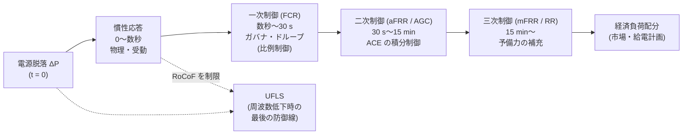
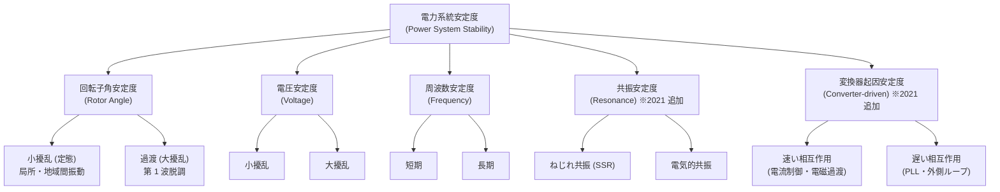
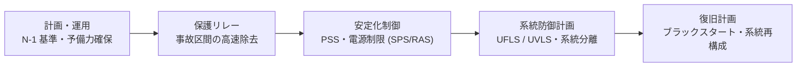

# 系統安定度と周波数制御 (Power System Stability & Frequency Control)

## 概要 (Overview)

交流電力系統は、数百台の同期発電機が同じ周波数で回り続けることを前提とした巨大な結合力学系である。需要と供給は 1 秒たりとも蓄積なしには一致せず、その瞬時の差はまず回転子の運動エネルギーの増減として現れ、周波数を動かす。外乱の後に周波数・電圧・発電機間の位相差が許容範囲へ戻ってくる性質が**安定度 (stability)** であり、戻ってこなかった場合の帰結が大停電 (blackout) である。

[`generation-grid-fundamentals.md`](generation-grid-fundamentals.md) は、動揺方程式・慣性・周波数制御の階層・安定度の 3 分類を入門として示した。本ドキュメントはそれを定量化する。扱うのは、(1) 動揺方程式から RoCoF と周波数最下点 (nadir) を導く式と数値例、(2) 慣性応答・一次（ガバナ・ドループ）・二次 (AGC)・三次の周波数制御の設計原理、(3) 安定度の分類（IEEE/CIGRE 合同タスクフォースの 2004 年版と、変換器起因安定度を加えた IEEE PES タスクフォースの 2021 年改訂）、(4) インバータ電源 (IBR) の増加による慣性の低下と合成慣性、(5) 周波数低下負荷遮断 (UFLS)、(6) 5 つの大停電（2003 年北米北東部、2016 年南オーストラリア、2018 年北海道、2019 年英国、2025 年イベリア半島）を公式調査報告に基づいて比較すること、(7) 連鎖故障の定量モデル、である。インバータ側のハードウェアと制御は [`power-electronics-grid-converters.md`](power-electronics-grid-converters.md)、周波数制御が市場商品として値付けされる構造は [`electricity-markets-dispatch.md`](electricity-markets-dispatch.md) で扱う。

## 方法論 (Methodology)

- **常微分方程式で考える。** 系統の周波数・位相のふるまいを、動揺方程式という 2 階の常微分方程式（[`../../foundations/mathematics/calculus-analysis/ordinary-differential-equations.md`](../../foundations/mathematics/calculus-analysis/ordinary-differential-equations.md)）の解として扱う。線形化すれば固有値（振動モード・減衰）、非線形のままなら等面積法やエネルギー関数で大外乱の安定性を論じられる。
- **時間スケールで分離する。** ミリ秒（電磁過渡・変換器制御）、0.1〜数秒（慣性・回転子角）、数秒〜数十秒（ガバナ）、数分（AGC）、数十分以上（三次・経済負荷配分）の各階層は、時定数が 1 桁ずつ離れているため、ほぼ独立に設計できる。この分離が崩れる場面（低慣性系統での慣性と一次応答の重なり、変換器制御と系統の電磁過渡の結合）が新しい不安定性の源になる。
- **分類は IEEE/CIGRE の定義に従う。** Kundur ら (2004)[^kundur2004] と Hatziargyriou ら (2021)[^hatziargyriou2021] の分類を用語の基準とする。
- **事例は公式調査報告を一次情報とし、報告の発行日と位置づけ（最終・中間）を明記する。** 報道・解説は一次報告の所在を探すためにのみ使う。報告間で数値が異なる場合は、その旨と出典を併記する。
- 数値例は教科書的な単純化モデル（一機無限大母線、集約した単一周波数モデル）による試算であり、実系統の値ではないことを明記する。

## 発見事項 (Findings)

1. **外乱直後の RoCoF は慣性だけで決まり、制御はそれを変えられない。** 動揺方程式を系統全体で集約すると、電源脱落 ΔP の直後の周波数変化率は RoCoF = f_0·ΔP / (2·E_k) となる。E_k は同期運転中の回転エネルギーの総和である。50 Hz・E_k = 150 GW·s の系統で 1 GW が脱落すれば約 0.17 Hz/s、E_k が 60 GW·s まで減れば約 0.42 Hz/s になる。ガバナは数秒かかって応答するので、最初の 0.5〜1 秒の周波数の傾きは慣性の物理だけが決める[^kundur-book]。

2. **周波数の最下点は「慣性」と「一次応答の速さ」の比で決まる。** 一次応答が一定速度 r [GW/s] で立ち上がると近似すると、最下点の深さは Δf_nadir ≈ f_0·ΔP² / (4·E_k·r) となり、脱落量の 2 乗に比例し、慣性と応答速度の積に反比例する（本稿の技術詳細で導出）。慣性が半分になった系統で同じ最下点を守るには、一次応答を 2 倍速くする必要がある。これが、蓄電池の高速周波数応答 (FFR) に価値が生じる定量的な理由である。

3. **安定度の分類は「何が戻らないか」で整理され、2021 年に変換器起因の 2 分類が加わった。** 2004 年の IEEE/CIGRE 分類は回転子角・電圧・周波数の 3 本柱だった[^kundur2004]。2021 年の改訂では、インバータ電源の増加を受けて**共振安定度 (resonance stability)** と**変換器起因安定度 (converter-driven stability)** が加わり、5 分類になった[^hatziargyriou2021]。後者は、変換器の制御ループ（PLL・電流制御）が系統と結合して起きる、数 Hz〜kHz の不安定を指す。

4. **大停電は単一原因ではなく、「初期事象 → 保護・制御の想定外の作動 → 系統分離 → 負荷遮断の失敗」という共通の型を持つ。** 2003 年北米北東部では、警報ソフトウェアの停止で運用者が状況を把握できないまま送電線の過負荷トリップが連鎖し、約 5,000 万人・61,800 MW が停電した[^us-canada-2004]。2019 年英国では、落雷という日常的な事故に対し、洋上風力 737 MW、火力 244 MW、分散型電源（RoCoF・ベクトルシフト保護）約 500 MW が想定外に脱落した。合計は TSO が備えていた 1,000 MW の想定を超え、負荷遮断 892 MW・約 115 万需要家の停電に至った[^ofgem-2020]。

5. **慣性の低下は事実だが、すべての停電を「慣性不足」で説明するのは誤りである。** 2025 年 4 月のイベリア半島大停電について、ENTSO-E 専門家パネルの最終報告 (2026-03-20) は、根本原因を過電圧の連鎖とした。具体的には、電圧制御の不足（力率一定運転の再エネ、同期機の電圧制御の実効性不足、手動操作の分路リアクトル）が生んだ過電圧で発電機が次々に解列したとし、欧州大陸系統で初めての「過電圧型」の大停電と位置づけた[^entsoe-iberia]。周波数崩壊は結果であり、負荷遮断（系統防御計画）は作動したが過電圧が性質上止められなかった。

6. **日本では 2018 年北海道で全域停電（ブラックアウト）が起きた。** 胆振東部地震で苫東厚真 2・4 号機（約 1,160 MW）と水力・風力が脱落した。北本連系の緊急融通と UFR による負荷遮断（約 1,300 MW）で周波数は一度回復したが、苫東厚真 1 号機の出力低下と停止（03:25）で全域停電に至った。検証委員会の最終報告 (2018-12-19) は、需要約 3,087 MW の系統で最大電源 3 台に供給を集中させた「N-3」級の同時喪失を主因とした[^occto-2018]。

7. **連鎖故障の規模分布はべき則的な裾を持ち、確率的モデルで定量化できる。** 北米の停電記録の解析は、停電規模の分布が指数関数ではなくべき則的に減衰することを示した[^carreras2004]。分岐過程モデルでは、平均伝播率 λ（1 件の故障が平均何件の後続故障を誘発するか）が 1 に近づくと、平均規模が θ/(1−λ) で発散的に増える[^dobson2012]。N-1 基準は「初期事象」への備えであり、「伝播率」を直接は抑えない。

## アーキテクチャ (Architecture)

### 周波数制御の階層 (Hierarchy of Frequency Control)



凡例: 実線は時間の経過に沿った制御の引継ぎ、破線は最後の防御線への分岐。欧州の名称 (FCR/aFRR/mFRR/RR) と日本の需給調整市場の商品（一次〜三次②）の対応は [`electricity-markets-dispatch.md`](electricity-markets-dispatch.md) を参照。

| 階層 | 時間 | 制御則 | 目的 | 典型的な担い手 |
|---|---|---|---|---|
| 慣性応答 | 0〜数秒 | なし（物理） | RoCoF の制限 | 同期機の回転子、同期調相機、GFM インバータ |
| 高速周波数応答 (FFR) | 0.1〜2 秒 | 周波数・RoCoF トリガ | 慣性不足の補完 | 蓄電池、需要側資源 |
| 一次制御 | 数秒〜30 秒 | 比例（ドループ） | 周波数低下の停止 | ガバナ、蓄電池 |
| 二次制御 (AGC) | 30 秒〜15 分 | 積分（ACE） | 周波数・連系線潮流の定格復帰 | 火力・水力・蓄電池 |
| 三次制御 | 15 分〜 | 給電指令 | 二次予備力の補充・経済性 | 火力・水力・揚水 |

### 安定度の分類 (Classification of Power System Stability)



出典: Kundur et al. (2004)[^kundur2004]、Hatziargyriou et al. (2021)[^hatziargyriou2021]。2004 年版では電圧安定度と周波数安定度にそれぞれ「短期・長期」の時間区分もあり、図では主要な区分のみ示す。

- **回転子角安定度**: 同期機群が同期を保てるか。小擾乱では振動モードの減衰が、大擾乱（事故）では最初の数秒で脱調しないかが問題になる。
- **電圧安定度**: 擾乱後に全母線の電圧を許容範囲に保てるか。古典的には電圧低下（無効電力不足による電圧崩壊）を指す。2025 年のイベリア半島の事象は、過電圧側でも崩壊が起きうることを示した（技術詳細を参照）。
- **周波数安定度**: 需給の大きな不均衡の後に周波数を許容範囲に戻せるか。系統分離後の単独系統で問題になりやすい。
- **共振安定度**: 直列コンデンサ補償とタービン軸のねじれ振動の共振（亜同期共振, SSR）や、電気的な共振。
- **変換器起因安定度**: 変換器の制御と系統の動特性の相互作用（[`power-electronics-grid-converters.md`](power-electronics-grid-converters.md) の弱い系統問題）。

### 防御の多層構造 (Defense-in-Depth)



各層は前の層が失敗したときの備えであり、大停電は複数の層が同時に機能しなかったときに起きる。5 事例の比較（技術詳細）では、どの層が破られたかを軸に整理する。

## 技術詳細 (Technical Details)

### 動揺方程式と慣性定数 (Swing Equation & Inertia Constant)

同期機 i の回転子の運動方程式を、定格容量 S_i を基準とする単位法で書くと次のようになる[^kundur-book]。

```text
(2·H_i / ω_s) · d²δ_i/dt² = P_m,i − P_e,i − D_i·Δω_i      [pu]

H_i = (1/2)·J_i·ω_m² / S_i   [s]   … 定格回転時の運動エネルギー / 定格容量
δ_i : 回転子角（同期回転座標に対する位相）、ω_s : 同期角速度
P_m, P_e : 機械入力・電気出力、D : 制動係数
```

慣性定数 H は「定格出力で回転エネルギーを使い切るまでの秒数」に相当する。典型値は火力・原子力の蒸気タービン発電機で 2〜9 s、水車発電機で 2〜4 s 程度である[^kundur-book]。系統全体では、同期運転中の機械の回転エネルギーを合計する。

```text
E_k = Σ H_i · S_i   [MW·s]          H_sys = E_k / S_sys

集約モデル（全機が同一周波数 f で回ると近似）:
  df/dt = f_0 / (2·E_k) · (ΔP_m − ΔP_e)

外乱直後（t = 0+）の RoCoF:
  RoCoF = f_0 · ΔP / (2·E_k)
```

**数値例（集約モデル, 50 Hz）**。

| 系統の状態 | E_k [GW·s] | 1 GW 脱落時の RoCoF | 3 GW 脱落時の RoCoF |
|---|---|---|---|
| 同期機主体（例: 30 GW 運転 × H = 5 s） | 150 | 0.17 Hz/s | 0.50 Hz/s |
| IBR 比率が高い時間帯（同 × H = 2 s） | 60 | 0.42 Hz/s | 1.25 Hz/s |

RoCoF が 0.125〜1 Hz/s を超えると、分散型電源の単独運転防止保護（RoCoF リレー）が作動しうる。2019 年英国の事象はまさにこの作動を含んでいた（RoCoF 0.125 Hz/s 超で分散型電源が脱落）[^ofgem-2020]。慣性が下がるほど、同じ脱落量に対して保護が連鎖的に作動しやすくなる。

### 周波数最下点の簡易モデル (Frequency Nadir: a Closed-Form Approximation)

一次応答が脱落直後から一定速度 r [MW/s] で直線的に立ち上がり、負荷の周波数特性（自己制御性）を無視すると、集約モデルは解析的に解ける。

```text
df/dt = −(f_0 / (2·E_k)) · (ΔP − r·t)

最下点は応答が脱落を補った時刻 t* = ΔP / r で到達し、
  Δf_nadir = −(f_0 / (2·E_k)) · (ΔP·t* − r·t*²/2)
           = −f_0 · ΔP² / (4 · E_k · r)

数値例: f_0 = 50 Hz, ΔP = 1 GW, r = 0.1 GW/s（3 GW の一次予備力が 30 s で全量応動）
  E_k = 150 GW·s → t* = 10 s, Δf_nadir ≈ −0.83 Hz
  E_k =  60 GW·s → Δf_nadir ≈ −2.1 Hz（UFLS 作動域）
  E_k =  60 GW·s, r = 0.25 GW/s → Δf_nadir ≈ −0.83 Hz
```

このモデルは負荷の自己制御性やガバナの遅れを無視するため、最下点を過大に見積もる（実系統はもっと浅い）。それでも、**最下点は ΔP の 2 乗に比例し、E_k·r に反比例する**という比例則は保たれ、設計の直感として有用である。慣性を半分にしたとき同じ最下点を保つには応答速度を 2 倍にする必要がある。数値例の 3 行目は、蓄電池などによる応答の高速化が慣性の不足を補える範囲を示している。Milano らは低慣性系統のこの種の基礎課題を体系的に整理している[^milano2018]。

### 一次制御: ガバナとドループ (Primary Control & Droop)

一次制御は、周波数偏差に比例して出力を変える比例制御である。速度調定率（ドループ）R は「定格出力を 0→100 % 動かすのに要する周波数変化の割合」と定義される[^kundur-book]。

```text
R_i = (Δf / f_0) / (ΔP_i / P_rated,i)         典型値 3〜5 %

系統全体の定常偏差:
  Δf_ss = −ΔP_L / β,   β = D_L + Σ (P_rated,i / (R_i · f_0))   [MW/Hz]
  β : 系統周波数特性定数（frequency response characteristic）

例: 50 Hz 系統、ガバナ運転中の容量 20 GW、R = 5 %、負荷特性 D_L = 1 %/Hz（需要 30 GW → 300 MW/Hz）
  ガバナ分 = 20,000 / (0.05·50) = 8,000 MW/Hz
  β ≈ 8,300 MW/Hz → 1 GW 脱落で Δf_ss ≈ −0.12 Hz
```

比例制御なので定常偏差が残る。偏差をゼロに戻すのは二次制御の役割である。欧州大陸同期系統では、基準事故 3,000 MW に対し、FCR が ±200 mHz の偏差で 30 秒以内に全量応動すること、瞬時最大偏差 800 mHz・準定常偏差 200 mHz 以内に収めることが規定されている（系統運用ガイドライン, SOGL）[^sogl]。

### 二次制御: AGC と地域要求量 (Secondary Control: AGC & ACE)

二次制御は、制御エリアごとに**地域要求量 (ACE: Area Control Error)** を計算し、それを積分制御でゼロへ戻す。原理は周波数バイアス付き連系線潮流制御 (tie-line bias control) である[^kundur-book]。北米 NERC の信頼度基準（BAL 系）では次の形で定義される（計量誤差補正項は省略）。

```text
ACE = (NI_A − NI_S) − 10·B·(F_A − F_S)        [MW]
  NI_A, NI_S : 連系線の実潮流・計画潮流（送出を正）
  F_A, F_S   : 実周波数・基準周波数
  B          : 周波数バイアス [MW/0.1 Hz]（負の値）

AGC: ΔP_ref,i = −α_i · (K_P·ACE + K_I·∫ACE dt)   α_i : 配分係数
```

周波数バイアスを系統周波数特性 β に近く設定すると、自エリア内の脱落にだけ自エリアの AGC が応じ、他エリアの脱落には一次制御の支援だけを返す「非干渉化」が実現する。これが多エリア連系の基本設計である。日本の 50 Hz・60 Hz 各同期系統では、エリア間の融通は連系線の運用容量の範囲で行われ、50/60 Hz 間は周波数変換設備（[`hvdc-interconnection.md`](hvdc-interconnection.md)）を通る。

AGC の指令は EMS から通信回線で発電所へ送られる。この経路は [`plant-control-scada-security.md`](plant-control-scada-security.md) の OT アーキテクチャの上にあり、指令の改ざんは周波数への直接の外乱注入と等価である。

### 回転子角安定度: 等面積法と臨界除去時間 (Rotor Angle Stability)

一機無限大母線系統 (SMIB) では、電気出力は P_e = P_max·sin δ（P_max = E·V/X）である。3 相短絡で P_e = 0 となり、事故除去後に事故前の回路へ戻る場合、等面積法から臨界除去角 δ_cr と臨界除去時間 t_cr が解析的に求まる[^kundur-book]。

```text
cos δ_cr = (π − 2δ_0)·sin δ_0 − cos δ_0        （P_m = P_max·sin δ_0）
t_cr     = √( 4·H·(δ_cr − δ_0) / (ω_s · P_m) )

例: δ_0 = 30°, P_m = 1.0 pu（P_max = 2.0 pu）, 50 Hz
  δ_cr ≈ 79.6°
  H = 5 s → t_cr ≈ 0.235 s
  H = 2 s → t_cr ≈ 0.148 s
```

慣性が小さいほど回転子が速く加速し、事故を除去しなければならない時間が短くなる。遮断器と保護リレーの動作時間（超高圧系で 3〜5 サイクル程度）との余裕が、過渡安定度の設計余裕である。

小擾乱安定度は、動揺方程式を平衡点まわりで線形化した振動モードで評価する。

```text
(2H/ω_s)·Δδ̈ + (D/ω_s)·Δδ̇ + K_s·Δδ = 0,   K_s = P_max·cos δ_0（同期化力係数）
固有振動数 ω_n = √(ω_s·K_s / (2H))
例: K_s = 1.0 pu, H = 5 s, 50 Hz → f_n ≈ 0.89 Hz（局所モード）
```

一般に局所モードは 0.7〜2 Hz、遠く離れた発電機群同士が逆位相で振れる地域間モードは 0.1〜0.8 Hz に現れる。制動不足のモードは電力系統安定化装置 (PSS) で減衰させる[^kundur-book]。イベリア半島の事象で観測された 0.63 Hz と 0.2 Hz の振動は、それぞれ局所的な振動と欧州大陸規模の地域間振動に当たる[^entsoe-iberia]。

### 電圧安定度 (Voltage Stability)

送電端電圧 V_s・リアクタンス X の線路で力率 1 の負荷へ送るとき、受電端電圧 V_r と電力 P の関係は「ノーズカーブ (P–V curve)」になる。最大送電電力は P_max = V_s² / (2X) で、この点を越えると解が存在しなくなる（電圧崩壊）。無効電力の供給源（同期機、調相設備、変換器）が電圧の支えであり、負荷時タップ切換器 (OLTC) が負荷電圧を回復させようと動くことで、数十秒〜数分かけて崩壊が進む長期電圧不安定もある[^kundur-book]。

イベリア半島の事象は逆方向、つまり**過電圧**による崩壊だった。軽負荷・高再エネ時に送電線の負荷が下がると、線路の充電容量が生む無効電力が余り、電圧が上がる。これを吸収すべき資源（分路リアクトル、同期機・再エネの無効電力吸収）が不足するか遅れると、電圧上昇 → 発電機の過電圧解列 → さらに無効電力吸収が減る、という正帰還に入る[^entsoe-iberia]。

### インバータ電源と慣性の低下 (IBR and the Loss of Inertia)

太陽光・蓄電池・フルコンバータ風車は、変換器を介して系統と結合するため、回転質量（あれば）が系統周波数と直結しない。IBR の比率（系統非同期電源比率, SNSP など）が上がるほど E_k が減る。Tielens & Van Hertem は、慣性の低下が RoCoF と最下点の両方を悪化させること、そして慣性の必要量は時間帯・系統分離の想定によって大きく変わることを整理している[^tielens2016]。

**合成慣性 (synthetic inertia) と高速周波数応答**:

| 手段 | 原理 | 応答 | 留意点 |
|---|---|---|---|
| 同期調相機 (synchronous condenser) | 発電しない同期機。物理的な慣性と短絡電流を提供 | 瞬時 | 設備費、損失。フライホイール付きで H を増やせる |
| GFM インバータ（VSM） | 電圧源として内部位相を保持し、慣性を内在的に提供 | 瞬時（電気的） | 電流制限、エネルギー源（直流側）の確保 |
| GFL ＋ 合成慣性 | 計測した df/dt に比例して出力 | 数十〜数百 ms 遅れ | 周波数計測の遅れ・ノイズ |
| 風車の慣性模擬 | 回転子の運動エネルギーを一時的に引き出す | 数百 ms | 回転数の回復時に出力が減り、周波数が 2 度目の落ち込みを起こしうる |
| 高速周波数応答 (FFR) | 周波数閾値で全出力を投入（蓄電池・需要） | 0.1〜1 秒 | 慣性ではなく「速い一次応答」。最下点の式の r を上げる |

GFM インバータの制御（ドループと VSM の等価性など）は [`power-electronics-grid-converters.md`](power-electronics-grid-converters.md)、蓄電池による商用の慣性提供（Hornsdale の事例）は [`battery-energy-storage.md`](battery-energy-storage.md) を参照。

### 周波数低下負荷遮断 (Under-Frequency Load Shedding, UFLS)

UFLS は、周波数がある閾値を下回ったとき、あらかじめ割り付けた負荷を段階的に切り離す最後の防御線である。

| 系統 | 開始周波数 | 規定の概要 | 出典 |
|---|---|---|---|
| 欧州大陸（EU 系統緊急・復旧ネットワークコード） | 49.0 Hz | 48.0 Hz までに累計で需要の 45 % 程度を段階的に遮断 | NC ER[^ncer] |
| 英国 (LFDD) | 48.8 Hz | 段階的な需要遮断。2019-08-09 に作動 | Ofgem (2020)[^ofgem-2020] |
| 北海道（2018 年当時） | 48.5 Hz 以下で第 1 段 | 事後に「最下点 47.0 Hz 以上を保つ」よう UFR 設定の見直しを提言 | OCCTO (2018)[^occto-2018] |

UFLS の設計には 2 つの構造的な難しさがある。第一に、遮断の判定は周波数（と遅延）に基づくため、RoCoF が大きいと検出・遮断が間に合わず、最下点が発電機の周波数保護（多くは 47.5 Hz 付近）に達してしまう。2016 年南オーストラリアは、系統分離後の RoCoF が大きすぎて UFLS が効かなかった例として報告されている[^aemo-sa]。第二に、配電線に分散型電源（屋根上太陽光）が多いと、配電線ごと遮断したときに負荷だけでなく発電も切れ、正味の遮断量が想定より小さくなる。英国 2019 年では LFDD で遮断された需要に分散型電源の脱落が混じり、正味効果の評価が困難だったことが報告されている[^ofgem-2020]。

### 大停電の事例比較 (Cascading Failure Case Studies)

#### 北米北東部大停電 (2003-08-14)

- **報告**: U.S.–Canada Power System Outage Task Force 最終報告 (2004-04)[^us-canada-2004]。
- **規模**: 約 5,000 万人、61,800 MW。オハイオ・ミシガン・ニューヨーク等の 8 州とカナダ・オンタリオ州。一部で復旧に 4 日を要した。
- **経過**: オハイオ州の FirstEnergy 管内で、制御室の警報・監視ソフトウェアが停止し、運用者が状況を把握できなかった。その間に 345 kV 送電線が樹木接触で順次トリップし、残った線路へ潮流が移って過負荷が進んだ。16:05 以降に連鎖が加速し、距離リレーの Zone 3 動作などで送電線のトリップが数十秒で広がった。16:10〜16:12 に北東部が複数の島に分離し、崩壊した。
- **破られた層**: 計画・運用（状況認識の喪失、樹木管理の不備）→ 保護（過負荷を事故と誤認する Zone 3 動作）→ 系統防御（島の需給不均衡）。

#### 南オーストラリア・ブラックシステム (2016-09-28)

- **報告**: AEMO 最終統合報告 (2017-03)[^aemo-sa]。
- **経過**: 竜巻を伴う暴風で 275 kV 送電線が相次いで損傷し、短時間に電圧低下が繰り返された。風力発電所の一部が、一定回数の電圧低下で出力を抑制する保護設定（フォールトライドスルー設定）により、合計約 456 MW の出力を失った。不足分が州間連系線 (Heywood) に流れ込んで過負荷保護が作動し、南オーストラリアは系統分離した。分離後の低慣性系統では周波数が極めて急速に低下し、UFLS が有効に働く前に全系が崩壊した。
- **破られた層**: 保護・制御の設定（運用者が事前に把握していなかった IBR のライドスルー設定）→ 系統防御（RoCoF が UFLS の想定を超えた）。

#### 北海道胆振東部地震によるブラックアウト (2018-09-06)

- **報告**: 電力広域的運営推進機関「平成 30 年北海道胆振東部地震に伴う大規模停電に関する検証委員会」最終報告 (2018-12-19)[^occto-2018]。
- **経過**: 03:07 の地震直後、苫東厚真 2・4 号機がタービン振動を検出して停止した（約 1,160 MW）。水力約 430 MW・風力約 170 MW（推定）も脱落した。需要約 3,087 MW の系統で周波数は急低下したが、北本連系の緊急融通（約 500 MW）と UFR による第 1 段の負荷遮断（48.5 Hz 以下、約 1,300 MW。道東の停電を含む）で一度は回復した。その後、苫東厚真 1 号機の出力がボイラ管損傷により低下し、追加の負荷遮断も及ばず、03:25 に 1 号機が停止して全域停電に至った。
- **破られた層**: 計画・運用（大型電源 1 地点への集中による N-3 の同時喪失、北本連系の融通余力の上限到達）→ 系統防御（UFR の遮断量不足）。報告は、北本連系の増強・自励式化や UFR 設定の見直しを提言した。

#### 英国 9 August 停電 (2019-08-09)

- **報告**: Ofgem 調査報告 (2020-01-03)[^ofgem-2020]。National Grid ESO も技術報告を公表している。
- **経過**: 16:52:33、Eaton Socon–Wymondley 400 kV 線への落雷で地絡が発生した（事故自体は日常的で、正常に除去された）。直後に、分散型電源約 150 MW がベクトルシフト保護で脱落した。洋上風力 Hornsea One は制御の不具合で 799 MW から 62 MW へ 737 MW 出力が低下し、Little Barford 火力の蒸気タービン 244 MW も停止した。RoCoF が 0.125 Hz/s を超え、分散型電源 350〜430 MW が RoCoF 保護で脱落した。累計約 1,500 MW の脱落は ESO が備えていた 1,000 MW を超え、周波数は 49.1 Hz まで下がって 49.2 Hz で一度落ち着いた。さらに Little Barford のガスタービン 210 MW の停止などで脱落は少なくとも 1,990 MW に達し、周波数が 48.8 Hz を下回って LFDD が作動した（正味 892 MW、約 115 万需要家）。周波数は 5 分以内に 50 Hz へ回復した。
- **破られた層**: 計画（想定事故 1,000 MW が分散型電源の同時脱落を含んでいなかった）→ 保護・制御（洋上風力の制御、分散型電源の保護設定）。一部の鉄道車両が 49 Hz 未満で停止して立ち往生し、再起動に時間を要したことが社会的影響を拡大した。

#### イベリア半島大停電 (2025-04-28)

- **報告**: ENTSO-E 専門家パネル 事実報告 (2025-10-03)、最終報告 (2026-03-20)[^entsoe-iberia]。
- **前段**: 10:30 頃から電圧の変動が目立ち始めた。正午前後には、0.63 Hz の局所振動と 0.2 Hz の地域間振動が発生した。スペイン・フランス両 TSO の共通手順による振動対策は振動の減衰には成功したが、送電線の負荷を下げる方向に働き、電圧を押し上げた（運用範囲内）。スペインの 400 kV 系統では運用上限 435 kV と発電機の過電圧解列電圧の間の余裕が小さかった。
- **連鎖**: 12:32:57 グラナダで 355 MW（風力・PV・太陽熱）が脱落した。12:33:16 バダホスで 727 MW、12:33:17 にはセゴビア・ウエルバ・バダホス・セビリア・カセレスで 928 MW が脱落した。発電機の解列で無効電力の吸収がさらに減り、電圧が急上昇した。12:33:19 に周波数が低下し、欧州大陸系統との同期を失った。12:33:21 にスペイン—フランス・モロッコ間の交流線がすべて解列した。系統防御計画（自動負荷遮断）は作動したが、過電圧型の崩壊は止められなかった。
- **根本原因（最終報告の簡略化した原因ツリー）**: 単一原因ではなく複合要因とされた。(a) 力率一定運転の再エネが電圧変化に無効電力で反応しない、(b) 同期機による電圧制御が実効的でない（無効電力の要件に動特性の規定がなく、要件からの乖離に経済的な帰結もない）、(c) 分路リアクトルが手動操作で、12:32 時点で容量の約 58 % しか投入されておらず残りが間に合わない、(d) 小規模分散型電源の脱落で TSO から DSO への潮流が増え、線路負荷が下がる、(e) 多くの保護設定が要件から乖離していた。
- **破られた層**: 運用（電圧制御資源の不足・手動操作の遅れ）→ 保護（過電圧解列の設定）→ 系統防御（周波数ベースの負荷遮断は過電圧に無力）。

#### 5 事例の比較 (Synthesis)

| 事例 | 初期事象 | 決定的な想定外 | 崩壊の形 | 主な教訓 |
|---|---|---|---|---|
| 北米 2003 | 樹木接触による送電線トリップ | 警報ソフト停止による状況認識の喪失 | 過負荷の連鎖 → 島分離 | リアルタイム監視とツールの信頼性 |
| 南豪 2016 | 暴風による送電線損傷 | 風力のライドスルー設定 | 連系線トリップ → 高 RoCoF | IBR の設定の把握と規定 |
| 北海道 2018 | 地震 | 最大電源 3 台の同時喪失 | 周波数崩壊 | 電源集中の制限、UFR 量 |
| 英国 2019 | 落雷 | 洋上風力・分散型電源の同時脱落 | LFDD 作動（全系崩壊は回避） | 想定事故への分散型電源の算入 |
| イベリア 2025 | （前段の振動と電圧上昇） | 過電圧解列の連鎖 | 過電圧 → 同期喪失 | 動的な電圧制御の要件化 |

5 事例のうち 3 件（南豪・英国・イベリア）で、IBR と分散型電源の**保護・制御設定**が連鎖の中心にあった。2003 年と 2018 年は同期機中心の系統での事象だが、「状況認識」と「単一地点への集中」という、系統構成に依存しない弱点を示している。

### 連鎖故障の定量モデル (Quantitative Cascade Models)

連鎖故障は決定論的な潮流計算だけでは扱いにくい。故障の伝播には保護の誤動作、運用者の判断、隠れた故障 (hidden failure) など確率的な要素が多いからである。3 系統のモデルがよく使われる。

**(1) 分岐過程モデル (branching process)**[^dobson2012]。各段の故障が、平均 λ 件の次段故障を生むとみなす（ガルトン・ワトソン過程）。

```text
初期故障の平均数 θ、伝播率 λ (< 1) のとき
  総故障数の期待値 E[N] = θ / (1 − λ)

例: θ = 1.5
  λ = 0.3 → E[N] ≈ 2.1
  λ = 0.6 → E[N] ≈ 3.8
  λ = 0.9 → E[N] = 15
λ → 1（臨界）で平均規模が発散し、規模分布がべき則的な裾を持つ
```

Dobson は、電力会社の送電線トリップ記録から λ と θ を推定し、少数の観測から大規模連鎖の確率を外挿する手法を示した[^dobson2012]。λ は系統の負荷水準とともに上がる。運用余裕の縮小が「伝播しやすさ」として定量化できる点が実務上の価値である。

**(2) CASCADE / OPA モデル**。CASCADE は、各要素に初期負荷と耐量を与え、故障した要素の負荷を残りに再配分する抽象モデルである。OPA (ORNL–PSERC–Alaska) は、直流潮流に基づく線路トリップの短期の連鎖と、需要成長・設備増強の長期の動態を組み合わせる。後者の長期動態が、系統を「臨界点付近」に自己組織化させるという仮説（自己組織化臨界, SOC）が提示されている[^dobson2007]。

**(3) 経験的な規模分布**。Carreras らは北米の停電記録を解析し、停電規模の分布がべき則的な裾を持つこと、時系列に長期相関があることを示した。これを自己組織化臨界の証拠と解釈している[^carreras2004]。べき則的な裾は、「最大級の停電の確率は、正規分布や指数分布の直感より桁違いに大きい」ことを意味する。2003 年や 2025 年の規模の事象を「想定外の偶然」として片付けられない根拠になる。

**N-1 基準との関係**。N-1 基準（任意の 1 設備の喪失に耐える）は初期事象 θ を管理するが、伝播率 λ は直接管理しない。北海道（N-3）や英国（想定外の同時脱落）の事例は、「1 設備」の定義と、設備間の共通原因（地震、同一の保護設定）の扱いに限界があることを示した。系統規模でのモンテカルロ連鎖シミュレーションや、IBR の EMT モデルを含む動的解析が、N-1 を補完する手段として使われつつある。

## 運用・安全考察 (Operational & Safety Considerations)

- **想定事故の定義は系統構成とともに更新が要る。** 英国 2019 年は、TSO が備えていた想定事故 1,000 MW に分散型電源の同時脱落が含まれていなかった[^ofgem-2020]。北海道 2018 年は、単一地点の大型電源 3 台の同時喪失を想定していなかった[^occto-2018]。IBR・分散型電源が増えた系統では、「1 台の発電機」ではなく「1 つの共通原因（保護設定、電圧低下、気象）で同時に脱落する電源群」を想定事故として扱う必要がある。
- **保護設定の一元的な把握。** 南豪・英国・イベリアの各事例で、運用者は IBR・分散型電源の保護設定を十分に把握しておらず、設定は系統要件から乖離していた。数万〜数百万台に分散した設定値の登録・検証・適合確認は、系統運用の新しい基盤業務である。
- **慣性・系統強度の運用監視と市場化。** RoCoF 制約を守るには、運転中の E_k をリアルタイムに推計し、不足時には同期機を運転させる（または GFM・同期調相機を確保する）運用が要る。慣性や系統強度は従来は無償の副産物だったが、明示的な調達対象になりつつある。市場設計への写像は [`electricity-markets-dispatch.md`](electricity-markets-dispatch.md) で扱う。
- **制御・通信のサイバーセキュリティ。** AGC 指令、EMS の状態推定、保護リレーの設定変更、IBR の遠隔設定は、いずれも周波数・電圧に直接影響する。2003 年の事例は、悪意がなくてもソフトウェア（警報システム）の停止が大停電の一因になることを示した。同じ経路への攻撃は、より大きな影響を持ちうる。防御の枠組みは [`plant-control-scada-security.md`](plant-control-scada-security.md) を参照。
- **復旧とブラックスタート。** 全域停電後の復旧では、自立起動できる電源（水力、ブラックスタート対応ガスタービン、GFM 化した蓄電池や VSC-HVDC）から系統を段階的に再構成する。イベリア半島では復旧に 12〜16 時間を要した。最終報告は、ブラックスタート能力の試験や通信を含む復旧計画を勧告対象に挙げている[^entsoe-iberia]。
- **社会インフラとの結合。** 英国 2019 年では鉄道車両の周波数保護が、イベリア 2025 年では通信・交通の広範な停止が、電力系統の事象を社会的な影響へ増幅した。データセンター（[`../datacenters/datacenter-power.md`](../datacenters/datacenter-power.md)）や EV 充電（[`../automotive/ev/ev-fundamentals.md`](../automotive/ev/ev-fundamentals.md)）のような大型の変換器負荷も、電圧低下時に一斉に系統から切り離れる（あるいは復電時に一斉に戻る）挙動を持つ。需要側の振る舞いも安定度解析の対象に含める必要が増している。

> 本ドキュメントは公開文献と公式調査報告に基づく教育目的の概説であり、特定設備の脆弱性や攻撃手法は扱わない（リポジトリの倫理方針に準拠）。

## 結論 (Conclusions)

本稿の分析から、系統の周波数・安定度の問題は、動揺方程式という 1 本の常微分方程式から出発して、時間スケールごとの制御と防御の層へ体系的に展開できることが分かる。外乱直後の RoCoF は慣性（回転エネルギー E_k）だけで決まり、周波数最下点は脱落量の 2 乗に比例して慣性と一次応答速度の積に反比例する。この比例則は、IBR の増加で慣性が減った系統で何を補えばよいか（同期機・GFM による慣性か、蓄電池による応答の高速化か）を定量的に示す。

安定度の分類は、2004 年の回転子角・電圧・周波数の 3 本柱から、2021 年に共振安定度と変換器起因安定度を加えた 5 分類へ拡張された。この改訂は、変換器の制御そのものが系統の動特性の一部になったことを公式に認めたものである。大停電の 5 事例はこの変化を裏づける。2003 年北米と 2018 年北海道は状況認識の喪失と電源集中という古典的な弱点を、2016 年南豪と 2019 年英国は IBR・分散型電源の保護設定による同時脱落を、2025 年イベリア半島は過電圧という新しい崩壊の形を示した。とくにイベリア半島の最終報告は、慣性不足という単純な説明を退け、動的な電圧制御の要件化と保護設定の協調を課題の中心に置いた。

連鎖故障の定量モデル（分岐過程、CASCADE/OPA、規模分布の経験則）は、大停電の確率がべき則的な裾を持ち、運用余裕の縮小が伝播率の上昇として現れることを示す。N-1 基準が管理するのは初期事象であり、伝播しやすさは管理しない。系統の信頼性を保つには、共通原因による同時脱落を想定事故に含め、分散した変換器の設定を系統全体の観点で検証し、慣性・系統強度を明示的に確保することが求められる。いずれも、物理現象だった安定度がソフトウェアの設定と協調の問題へ移りつつあることへの対応である。

## 参考文献 (References)

[^kundur-book]: Kundur, P. (1994). *Power System Stability and Control*. McGraw-Hill. ISBN 0-07-035958-X. — 動揺方程式、慣性定数、ガバナ・AGC、等面積法、小擾乱安定度、電圧安定度の標準的教科書。

[^kundur2004]: Kundur, P., Paserba, J., Ajjarapu, V., Andersson, G., Bose, A., Cañizares, C., Hatziargyriou, N., Hill, D., Stankovic, A., Taylor, C., Van Cutsem, T., & Vittal, V. (2004). Definition and Classification of Power System Stability — IEEE/CIGRE Joint Task Force on Stability Terms and Definitions. *IEEE Transactions on Power Systems*, 19(3), 1387–1401. DOI: 10.1109/TPWRS.2004.825981

[^hatziargyriou2021]: Hatziargyriou, N., Milanović, J., Rahmann, C., Ajjarapu, V., et al. (2021). Definition and Classification of Power System Stability – Revisited & Extended. *IEEE Transactions on Power Systems*, 36(4), 3271–3281. DOI: 10.1109/TPWRS.2020.3041774

[^milano2018]: Milano, F., Dörfler, F., Hug, G., Hill, D. J., & Verbič, G. (2018). Foundations and Challenges of Low-Inertia Systems (Invited Paper). *2018 Power Systems Computation Conference (PSCC)*, 1–25. DOI: 10.23919/PSCC.2018.8450880

[^tielens2016]: Tielens, P., & Van Hertem, D. (2016). The relevance of inertia in power systems. *Renewable and Sustainable Energy Reviews*, 55, 999–1009. DOI: 10.1016/j.rser.2015.11.016

[^dobson2012]: Dobson, I. (2012). Estimating the Propagation and Extent of Cascading Line Outages From Utility Data With a Branching Process. *IEEE Transactions on Power Systems*, 27(4), 2146–2155. DOI: 10.1109/TPWRS.2012.2190112

[^dobson2007]: Dobson, I., Carreras, B. A., Lynch, V. E., & Newman, D. E. (2007). Complex systems analysis of series of blackouts: Cascading failure, critical points, and self-organization. *Chaos*, 17(2), 026103. DOI: 10.1063/1.2737822

[^carreras2004]: Carreras, B. A., Newman, D. E., Dobson, I., & Poole, A. B. (2004). Evidence for Self-Organized Criticality in a Time Series of Electric Power System Blackouts. *IEEE Transactions on Circuits and Systems I: Regular Papers*, 51(9), 1733–1740. DOI: 10.1109/TCSI.2004.834513

[^sogl]: European Commission (2017). *Commission Regulation (EU) 2017/1485 of 2 August 2017 establishing a guideline on electricity transmission system operation* (SOGL). Official Journal of the European Union, L 220. — 欧州大陸同期系統の基準事故・FCR 応動要件（Annex）。

[^ncer]: European Commission (2017). *Commission Regulation (EU) 2017/2196 of 24 November 2017 establishing a network code on electricity emergency and restoration* (NC ER). Official Journal of the European Union, L 312. — 自動低周波数負荷遮断の要件（Annex）。

[^us-canada-2004]: U.S.–Canada Power System Outage Task Force (2004-04). *Final Report on the August 14, 2003 Blackout in the United States and Canada: Causes and Recommendations*. [energy.gov](https://www.energy.gov/oe/downloads/blackout-2003-final-report-august-14-2003-blackout-united-states-and-canada-causes-and) — Accessed: 2026-10-04.

[^aemo-sa]: AEMO (2017-03). *Black System South Australia 28 September 2016 — Final Integrated Report*. Australian Energy Market Operator. [aemo.com.au](https://www.aemo.com.au/-/media/Files/Electricity/NEM/Market_Notices_and_Events/Power_System_Incident_Reports/2017/Integrated-Final-Report-SA-Black-System-28-September-2016.pdf) — Accessed: 2026-10-04.

[^occto-2018]: 電力広域的運営推進機関 (2018-12-19). 平成30年北海道胆振東部地震に伴う大規模停電に関する検証委員会 最終報告（英語要約版 *Final Report of the Hokkaido Blackout (Summarized)* を含む）. [occto.or.jp](https://www.occto.or.jp/houkokusho/2018/hokkaidokensho_saishuhoukoku.html) — Accessed: 2026-10-04.

[^ofgem-2020]: Ofgem (2020-01-03). *Investigation into 9 August 2019 power outage*. [ofgem.gov.uk](https://www.ofgem.gov.uk/publications/investigation-9-august-2019-power-outage) — Accessed: 2026-10-04. 脱落量・周波数・LFDD の数値は同報告本文による。

[^entsoe-iberia]: ENTSO-E Expert Panel (2025-10-03 事実報告／2026-03-20 最終報告). *Final Report on the Grid Incident in Spain and Portugal on 28 April 2025* および 2026-03-20 メディアブリーフィング資料. [entsoe.eu](https://www.entsoe.eu/publications/blackout/28-april-2025-iberian-blackout/) — Accessed: 2026-10-04.
