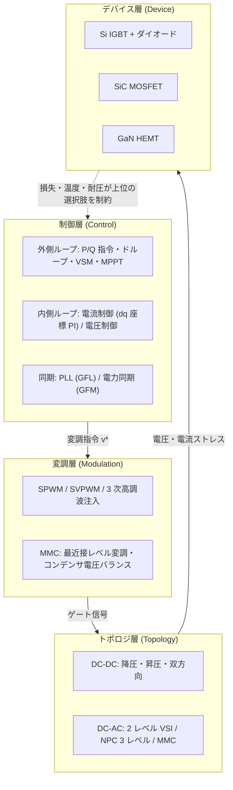
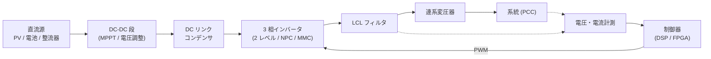
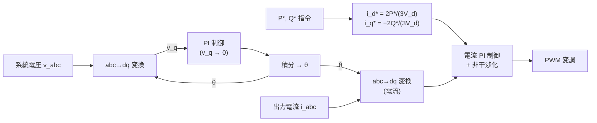

# 電力変換と系統連系インバータ (Power Electronics & Grid-Connected Converters)

## 概要 (Overview)

太陽光、風力、蓄電池、HVDC、データセンター電源、EV。現代の電力システムで新しく増えている設備は、ほぼすべてが**電力変換器 (power converter)** を介して系統とつながる。同期発電機は回転子の物理によって系統に「勝手に」同期するが、変換器は半導体スイッチを毎秒数千〜数万回 ON/OFF し、その順序とタイミングを制御ソフトウェアが決めることで初めて交流を作る。したがって変換器の系統上の振る舞い（電流の波形、事故時に電流を流し続けるか、周波数変化に反応するか）は、デバイス物理・回路トポロジ・変調方式・制御則の 4 層の設計選択で決まる。

本ドキュメントは、[`generation-grid-fundamentals.md`](generation-grid-fundamentals.md) が「インバータが系統を作る」転換として概観した主題を、ハードウェアと制御の水準で掘り下げる。扱うのは、(1) スイッチングデバイス (Si IGBT / SiC MOSFET / GaN HEMT) の物性と損失のトレードオフ、(2) 変換器トポロジ（降圧・昇圧チョッパ、2 レベル電圧形インバータ、NPC 3 レベル、MMC）、(3) PWM 変調（SPWM、SVPWM、3 次高調波注入）、(4) 導通損失・スイッチング損失と熱設計、(5) 高調波とフィルタ（IEEE 519）、(6) グリッドフォロイング (grid-following) とグリッドフォーミング (grid-forming) の制御、(7) 弱い系統 (weak grid) での不安定現象と近年の事象、である。周波数・安定度の系統側の議論は [`grid-stability-frequency-control.md`](grid-stability-frequency-control.md) が受け持つ。

## 方法論 (Methodology)

- **4 層モデルで分解する。** デバイス（何 V・何 A を何 kHz で切れるか）→ トポロジ（何段の電圧レベルで波形を作るか）→ 変調（どの順序でスイッチを切るか）→ 制御（どの量を目標に変調指令を作るか）。上位層の選択肢は下位層の物理で制約される、という依存関係を追う。
- **損失と熱を共通通貨にする。** 変換器設計のほぼすべてのトレードオフ（スイッチング周波数、デバイス選定、レベル数、フィルタ寸法）は、「損失 [W] → 接合温度 [°C] → 寿命・コスト」という連鎖に帰着する。数値例は代表的なデータシート値を丸めた**仮定値**であり、特定製品の値ではないことを明記する。
- **制御は「系統から見た等価回路」で分類する。** グリッドフォロイングは系統から見て電流源、グリッドフォーミングは電圧源に見える。この等価回路の違いが、弱い系統での安定性・慣性提供・事故時挙動の差を生む、という因果で整理する。
- 基礎理論は既存文書を前提とする: 半導体のバンド構造は [`../../foundations/physics/quantum-solid-state/band-theory-semiconductors.md`](../../foundations/physics/quantum-solid-state/band-theory-semiconductors.md)、MOSFET 動作は [`../../foundations/physics/quantum-solid-state/mosfet-cmos.md`](../../foundations/physics/quantum-solid-state/mosfet-cmos.md)、回路方程式は [`../../foundations/physics/electromagnetism/circuit-theory.md`](../../foundations/physics/electromagnetism/circuit-theory.md)、高調波解析は [`../../foundations/mathematics/fourier-signal-processing/fourier-series-transform.md`](../../foundations/mathematics/fourier-signal-processing/fourier-series-transform.md)。
- 事象の記述は公式調査報告（NERC、ENTSO-E 等）に依拠し、報告の発行日を併記する。

## 発見事項 (Findings)

1. **ワイドバンドギャップ (WBG) 半導体の利点は「同じ耐圧を薄いドリフト層で実現できる」ことに集約される。** 4H-SiC と GaN のバンドギャップ（約 3.3 eV / 3.4 eV）は Si（1.12 eV）の約 3 倍で、絶縁破壊電界は約 10 倍に達する。ユニポーラデバイスの理論的なオン抵抗は破壊電界の 3 乗に反比例する（Baliga 性能指数）ため、同耐圧で Si 比 2〜3 桁低いオン抵抗が理論上可能になる[^baliga-fom][^millan]。この差が、Si では IGBT（バイポーラ）でしか実現できなかった 1.2 kV 級以上の領域に、高速なユニポーラ MOSFET を持ち込んだ。

2. **デバイス選定は電圧 × 周波数の平面で棲み分ける。** Si IGBT は数 kV・数 kA の大電力を数 kHz 以下で、SiC MOSFET は 650 V〜3.3 kV 級を数十 kHz で、GaN HEMT は 650 V 以下を数百 kHz〜MHz で受け持つ。EV インバータの 800 V 化と SiC 採用（[`../automotive/ev/ev-fundamentals.md`](../automotive/ev/ev-fundamentals.md)）、データセンター電源の GaN 化（[`../datacenters/datacenter-power.md`](../datacenters/datacenter-power.md)）、HVDC の IGBT-MMC（[`hvdc-interconnection.md`](hvdc-interconnection.md)）は、同じ平面上の異なる点である。

3. **スイッチング周波数は「損失」と「フィルタ寸法」の綱引きで決まる。** スイッチング損失は周波数に比例して増え、出力フィルタのインダクタ・コンデンサは周波数に反比例して小さくなる。SiC はスイッチング 1 回あたりのエネルギーが Si IGBT より大幅に小さいため、この最適点を高周波側に動かし、受動部品の体積と重量を削る。後述の数値例では、同条件で 20 kHz 駆動した場合のスイッチング損失が Si IGBT で約 255 W、SiC MOSFET で約 51 W となる（仮定値による試算）。

4. **マルチレベル化は「デバイス耐圧の不足」と「高調波」を同時に解く。** 2 レベルインバータの出力は ±V_dc/2 の 2 値の矩形波で、dv/dt と高調波が大きい。NPC 3 レベル（1981 年、Nabae・高橋・赤木）は各素子の印加電圧を半分にし[^npc]、MMC（2003 年、Lesnicar・Marquardt）はサブモジュールを数百段積んで階段状の正弦波を作る[^mmc]。MMC ではレベル数が十分多いので各素子のスイッチング周波数を系統周波数の数倍程度まで下げられ、HVDC 用変換器の損失を LCC に近づけた。

5. **SVPWM と 3 次高調波注入は同じ「15.5 % の直流電圧利用率改善」の別表現である。** 正弦波 PWM (SPWM) の線形変調領域では線間電圧の最大振幅は 0.866·V_dc に留まる。3 相中性点に零相成分（3 次高調波または min-max 中心化）を加えると、線間電圧には現れないまま相電圧指令のピークを削れ、最大振幅は V_dc（2/√3 ≈ 1.155 倍）まで上がる[^holmes-lipo]。

6. **グリッドフォロイングとグリッドフォーミングの差は「PLL で系統に追従するか、自ら電圧位相を作るか」である。** 現在の再エネ・蓄電池の大多数は PLL (phase-locked loop) で系統電圧の位相を測り、それに合わせて電流を注入する電流源（グリッドフォロイング）である。この方式は系統電圧が「硬い」ことを前提にしており、短絡比 (SCR) が小さい弱い系統では PLL と電流制御が系統インピーダンスと相互作用して発振しうる[^teodorescu][^rosso]。グリッドフォーミングは電圧の振幅と位相を自ら作る電圧源で、ドループ制御や仮想同期機 (VSM) により同期機に似た慣性・同期化力を提供する[^zhong-weiss]。

7. **系統事故で「インバータが何をするか」は保護・制御パラメータで決まり、それが大規模脱落の原因になってきた。** 米国 Texas の Odessa 事象（2021-05-09）では、複合火力発電所の昇圧変圧器で起きた 1 線地絡（3 サイクルで除去）に対し、事故そのものでは脱落する理由がないにもかかわらず太陽光発電所群が合計 1,112 MW の出力を失った。原因として PLL の同期外れによるトリップ、瞬時過電圧トリップ、出力の一時停止 (momentary cessation) とプラント制御の干渉が挙げられた[^nerc-odessa]。イベリア半島大停電（2025-04-28）では、力率一定運転の再エネが電圧変化に無効電力で反応しなかったことが要因の一つとされた[^entsoe-iberia]。

## アーキテクチャ (Architecture)

### 4 層モデル (Device–Topology–Modulation–Control Stack)



凡例: 実線は指令の流れ、破線は物理的制約のフィードバック。GFL = grid-following、GFM = grid-forming。

### 系統連系インバータの典型構成 (Typical Grid-Tied Inverter)



- **DC リンク**は直流側と交流側の瞬時電力の差を吸収する緩衝であり、その電圧を一定に保つことが外側制御ループの基本的な仕事になる。
- **PCC (point of common coupling)** は系統運用者との責任分界点で、IEEE 519 の高調波制限や系統連系規程 (grid code) の要件はここで評価される。
- 蓄電池の PCS（[`battery-energy-storage.md`](battery-energy-storage.md)）、HVDC 変換所（[`hvdc-interconnection.md`](hvdc-interconnection.md)）、データセンターの UPS（[`../datacenters/datacenter-power.md`](../datacenters/datacenter-power.md)）は、規模は 3〜4 桁違っても同じ構成の変種である。

### デバイスの棲み分け (Device Operating Regions)

| 項目 | Si IGBT | SiC MOSFET | GaN HEMT |
|---|---|---|---|
| キャリア | バイポーラ（伝導度変調） | ユニポーラ | ユニポーラ（2 次元電子ガス, 2DEG） |
| 主な耐圧帯 | 600 V〜6.5 kV | 650 V〜3.3 kV（研究段階で 10 kV 級） | 100〜650 V（横型が主流） |
| 典型的スイッチング周波数 | 〜数 kHz（大容量）／〜20 kHz | 数十〜100 kHz | 数百 kHz〜MHz |
| 導通特性 | 固定のオン電圧 V_CE0 ＋ 抵抗分 | 抵抗性 R_DS(on)（軽負荷で有利） | 抵抗性、逆回復電荷ほぼゼロ |
| 主な弱点 | テール電流によるターンオフ損失 | ゲート酸化膜信頼性、短絡耐量、コスト | 電流コラプス、高耐圧化が困難 |
| 代表用途 | HVDC (MMC)、大型風力、鉄道 | EV トラクション、PV・BESS の PCS、急速充電器 | サーバ電源、充電アダプタ、車載 OBC |

耐圧帯と周波数は商用品の典型値であり、Millán らの総説[^millan]と各社データシートの公開範囲に基づく概略である。境界は年々動いており、とくに SiC の高耐圧化と GaN の 1.2 kV 級化は研究開発が進行中である。

## 技術詳細 (Technical Details)

### ワイドバンドギャップ半導体の物理 (Wide-Bandgap Physics)

| 物性値（300 K, 代表値） | Si | 4H-SiC | GaN |
|---|---|---|---|
| バンドギャップ E_g [eV] | 1.12 | 3.26 | 3.39 |
| 絶縁破壊電界 E_c [MV/cm] | 約 0.3 | 約 2〜3 | 約 3.3 |
| 電子移動度 μ_n [cm²/V·s] | 約 1,400 | 約 900〜1,000 | 約 1,000（バルク）／約 2,000（2DEG） |
| 熱伝導率 [W/cm·K] | 約 1.5 | 約 3.7〜4.9 | 約 1.3 |

出典: Millán et al. (2014)[^millan]、Baliga (2008)[^baliga-book]。文献間で数値に幅があるため代表値として示す。

ユニポーラデバイスのドリフト層では、耐圧 V_B を支える空乏層幅とドーピング濃度が E_c で決まる。理想的な比オン抵抗は次式になる[^baliga-fom]。

```text
R_on,sp = 4·V_B² / (ε_s · μ_n · E_c³)

  ε_s : 誘電率、μ_n : 電子移動度、E_c : 絶縁破壊電界
  分母 ε_s·μ_n·E_c³ が Baliga 性能指数 (BFOM)

  E_c が 10 倍 → R_on,sp は 1/1000（μ の差を除く）
```

Si で 1.2 kV 級の MOSFET を作るとドリフト層が厚くなりオン抵抗が実用にならない。そのため Si では、少数キャリア注入でドリフト層の抵抗を下げる IGBT が使われてきた。代償として、ターンオフ時に蓄積キャリアが抜けるまでの**テール電流**が残り、スイッチング損失が増える。SiC MOSFET はこの代償なしに 1.2 kV 級を実現する。また広いバンドギャップは真性キャリア濃度を桁違いに下げるため、高温動作にも有利である（バンド理論は [`../../foundations/physics/quantum-solid-state/band-theory-semiconductors.md`](../../foundations/physics/quantum-solid-state/band-theory-semiconductors.md)）。

GaN HEMT は AlGaN/GaN ヘテロ界面の分極で生じる 2DEG をチャネルに使う。ドーピングなしで高移動度・高キャリア密度が得られるため、低容量・高速スイッチングに極めて有利である。一方、ノーマリオン特性（p-GaN ゲートやカスコード構成で対処）、トラップによる電流コラプス、横型構造のため高耐圧化しにくい点が制約になる。

### 基本トポロジ: チョッパとインバータ (Basic Topologies)

**降圧・昇圧チョッパ (buck / boost)**。連続導通モードの定常状態で、インダクタの電圧時間積が 1 周期でゼロになる条件（volt-second balance）から変換比が決まる[^mohan]。

```text
降圧 (buck):  V_o = D · V_in            (0 ≤ D ≤ 1)
昇圧 (boost): V_o = V_in / (1 − D)
  D : デューティ比（スイッチ ON 時間 / 周期）

インダクタ電流リプル（降圧）: ΔI_L = (V_in − V_o)·D / (L · f_sw)
  → f_sw を 2 倍にすれば同じリプルを半分の L で実現できる
```

PV の MPPT 段、蓄電池の双方向 DC-DC、EV の昇圧コンバータ、サーバ電源の 48 V→12 V→1 V 降圧はこの基本形の応用である。

**2 レベル 3 相電圧形インバータ (two-level VSI)**。6 個のスイッチ（3 レグ × 上下）で構成し、各相出力は +V_dc/2 か −V_dc/2 のいずれかを取る。上下のスイッチの同時 ON は直流短絡になるため、**デッドタイム**（数百 ns〜数 µs）を挿入する。これが出力電圧誤差と低次高調波の原因になり、補償制御が必要になる。

**NPC 3 レベルインバータ**。各相に 4 個のスイッチとクランプダイオード 2 個を置き、直流中性点に出力をつなぐ状態を加えて +V_dc/2・0・−V_dc/2 の 3 値を出す[^npc]。各スイッチの印加電圧が V_dc/2 になるため、1.7 kV 素子で 2 レベルでは 3.3 kV 素子が要る直流電圧を扱える。dv/dt と高調波も小さい。代償は中性点電位の変動で、変調側で冗長スイッチング状態を選んで電位バランスを保つ。大型 PV インバータや中圧ドライブで広く使われる。

**MMC (Modular Multilevel Converter)**。各アームにハーフブリッジ・サブモジュール（2 スイッチ＋コンデンサ）を N 個直列にし、挿入するモジュール数で電圧を N+1 段階に刻む[^mmc]。

```text
各相: 上アーム N 個 + 下アーム N 個、アームリアクトル付き
サブモジュール電圧: V_c ≈ V_dc / N
出力レベル数: N + 1

例: V_dc = ±320 kV (640 kV), N = 200, V_c ≈ 3.2 kV
    → 1 段あたり 3.2 kV、ほぼ正弦波で交流フィルタが概ね不要
制御課題: 数百個のコンデンサ電圧バランス（ソートアルゴリズム）、
          アーム間の循環電流抑制、直流事故時の電流（ハーフブリッジは
          直流短絡電流を阻止できない → フルブリッジ SM や DC 遮断器）
```

MMC は 2010 年代以降の VSC-HVDC の標準形で、日本では新北本連系設備が国内初の採用例である（[`hvdc-interconnection.md`](hvdc-interconnection.md)）。

### PWM 変調 (Pulse Width Modulation)

**正弦波 PWM (SPWM)**。各相の正弦波指令 v*（振幅変調率 m_a = V̂*/V̂_carrier）を三角波キャリア（周波数 f_sw）と比較し、指令が上回れば上スイッチ ON とする。線形領域（m_a ≤ 1）での出力基本波は次のようになる[^mohan][^holmes-lipo]。

```text
相電圧基本波ピーク:   V̂_ph = m_a · V_dc / 2
線間電圧基本波ピーク: V̂_LL = (√3/2) · m_a · V_dc ≈ 0.866 · m_a · V_dc

例: V_dc = 800 V, m_a = 1
    V̂_LL = 693 V → 線間実効値 ≈ 490 V
```

**3 次高調波注入 (third-harmonic injection)**。各相指令に同じ零相成分 (1/6)·m_a·sin 3ωt を加える。3 相平衡負荷では零相成分は線間電圧で相殺されるが、相指令のピークは √3/2 倍に下がる。その結果、キャリアを超えずに m_a を 2/√3 ≈ 1.155 まで上げられる。

**空間ベクトル PWM (SVPWM)**。3 相の電圧指令を αβ 平面上の 1 本のベクトルとみなし、2 レベルインバータの 8 状態（有効 6 ＋零 2）のうち隣接する 2 有効ベクトルと零ベクトルの時間配分で合成する。零ベクトル時間を両端に等分する通常の SVPWM は、min-max 型の零相成分を注入した SPWM と等価である。線形領域の上限はやはり V̂_LL = V_dc で、SPWM 比 15.5 % 増になる[^holmes-lipo]。

```text
線形変調で得られる線間電圧基本波ピーク（V_dc 比）
  SPWM                     : 0.866
  3 次高調波注入 (1/6)      : 1.000
  SVPWM (= min-max 注入)    : 1.000
  6 ステップ（矩形波, 過変調極限）: 4/π · √3/2 ≈ 1.103（低次高調波あり）
```

**スペクトル構造**。SPWM の出力スペクトルは、基本波のほかにキャリア周波数 f_sw の整数倍の周りの側帯波 (m·f_sw ± n·f_1) に集中する。たとえば f_sw = 5 kHz・f_1 = 50 Hz なら、最大の高調波群は 5 kHz ± 100 Hz 付近に現れる。低次（5 次・7 次）は理想的には現れず、実機ではデッドタイム・直流電圧リプル・系統電圧ひずみが低次高調波を生む。フーリエ級数による展開は [`../../foundations/mathematics/fourier-signal-processing/fourier-series-transform.md`](../../foundations/mathematics/fourier-signal-processing/fourier-series-transform.md) を参照。

### 損失と熱設計 (Losses & Thermal Design)

変換器の損失は、**導通損失**（電流が流れている間の電圧降下）と**スイッチング損失**（ON/OFF 遷移中に電圧と電流が同時に存在する区間）に分かれる。SPWM の 2 レベルインバータで、正弦波電流 i = I_pk·sin(ωt − φ) を仮定した 1 素子あたりの平均損失は、広く使われる近似式で次のように書ける（Holmes & Lipo[^holmes-lipo]、Mohan ら[^mohan]の導出と同形）。

```text
IGBT 導通損失:
  P_cond = V_CE0·I_pk·(1/(2π) + m_a·cosφ/8) + r_CE·I_pk²·(1/8 + m_a·cosφ/(3π))

スイッチング損失（V, I にほぼ比例と近似）:
  P_sw = f_sw · (E_on + E_off) · (1/π) · (I_pk / I_ref) · (V_dc / V_ref)
  E_on, E_off : データシートの基準条件 (V_ref, I_ref) でのエネルギー

接合温度（定常）:
  T_j = T_a + P_total · (R_th,jc + R_th,ch + R_th,ha)
```

**数値例（仮定値による試算）**。V_dc = 600 V、I_pk = 300 A、m_a = 0.9、cosφ = 1 の条件で、1.2 kV 級モジュールを想定する。

| 項目 | Si IGBT（仮定） | SiC MOSFET（仮定） |
|---|---|---|
| 導通パラメータ | V_CE0 = 0.9 V, r_CE = 5 mΩ | R_DS(on) = 5 mΩ（高温時） |
| 導通損失 | 73 W + 99 W ≈ 173 W | ≈ 0.005·300²·(1/8 + 0.9/(3π)) ≈ 99 W |
| E_on + E_off（300 A, 600 V） | 40 mJ | 8 mJ |
| スイッチング損失 @ 4 kHz | 51 W | 10 W |
| スイッチング損失 @ 20 kHz | 255 W | 51 W |
| 合計 @ 20 kHz | 約 428 W | 約 150 W |

この試算からは 3 つの構造が読み取れる。第一に、Si IGBT を 20 kHz で駆動するとスイッチング損失が導通損失を上回る。大容量 IGBT インバータが数 kHz 以下で運転される理由がここにある。第二に、SiC では同じ 20 kHz でも合計損失が約 1/3 になり、フィルタを小さくする余地が生まれる。第三に、MOSFET の導通損失は電流の 2 乗に比例し、低電流で大きく下がる。部分負荷で運転される時間が長い PV や EV では、この点が効率に効く。

熱設計の観点では、許容接合温度（Si IGBT で 150〜175 °C）までの余裕と熱抵抗の積が通電能力を決める。たとえば合計 428 W の素子で R_th,jc + R_th,ch = 0.15 K/W、ヒートシンク温度 80 °C なら、T_j ≈ 80 + 428 × 0.15 ≈ 144 °C で上限に近い。さらに、出力周波数が低い運転（風車の低速域、EV の発進時）では 1 周期内の温度変動が大きくなる。この**パワーサイクル**による温度変動 ΔT_j がボンディングワイヤやはんだ層の疲労寿命を支配する。変換器の寿命設計は「平均損失」ではなく「温度変動の回数と振幅」で行う必要がある。

### 高調波とフィルタ (Harmonics & Filters)

変換器が系統に注入する高調波電流は、系統インピーダンスを通じて電圧ひずみになり、ほかの需要家の機器や保護リレー、コンデンサの過熱に影響する。**IEEE Std 519-2022** は PCC における電圧ひずみと電流ひずみの推奨限度を定める[^ieee519]。

| PCC の母線電圧 | 個別高調波電圧 [%] | 電圧総合ひずみ THD [%] |
|---|---|---|
| ≤ 1 kV | 5.0 | 8.0 |
| 1 kV 超 〜 69 kV | 3.0 | 5.0 |
| 69 kV 超 〜 161 kV | 1.5 | 2.5 |
| 161 kV 超 | 1.0 | 1.5 |

電流側は、PCC の短絡電流と最大需要電流の比 I_sc/I_L に応じて総合需要ひずみ (TDD) の限度が段階的に緩和される（I_sc/I_L < 20 で TDD 5 % など）。系統が強いほど、同じ高調波電流が生む電圧ひずみが小さいからである[^ieee519]。日本では「高調波抑制対策技術指針」(JEAG 9702) が同種の役割を担う。

**LCL フィルタ**。系統連系インバータの標準的な出力フィルタは L–C–L の 3 次フィルタで、L 単体より高周波減衰が −60 dB/dec と急峻になる。代償は共振である[^teodorescu]。

```text
共振周波数: f_res = (1/2π) · √((L_1 + L_2) / (L_1 · L_2 · C_f))
設計の目安: 10·f_1 < f_res < f_sw / 2

例: L_1 = 1.0 mH, L_2 = 0.3 mH, C_f = 20 µF
    f_res = (1/2π)·√(1.3e-3 / (1.0e-3 · 0.3e-3 · 20e-6)) ≈ 2.33 kHz
    → f_1 = 50 Hz, f_sw = 10 kHz なら目安の範囲内

共振の減衰: 受動ダンピング（C_f に直列抵抗、損失増）か
            能動ダンピング（コンデンサ電流フィードバック等、制御帯域を消費）
```

系統インピーダンス L_g は L_2 に直列に加わり、f_res を低い側へ動かす。系統が弱いほど共振点が電流制御帯域に近づき、能動ダンピングの設計が崩れうる。これが次節の弱い系統問題の一側面である。

### グリッドフォロイング制御 (Grid-Following Control)

グリッドフォロイング (GFL) インバータは、系統電圧の位相を PLL で推定し、その位相に同期した回転座標系 (dq 座標) で電流を制御する[^teodorescu]。



- **SRF-PLL (synchronous reference frame PLL)**: 推定位相 θ で変換した電圧の q 軸成分 v_q がゼロになるよう θ を調整する。v_q ≈ V·sin(θ_g − θ) なので、PI 制御が位相誤差をゼロへ追い込む。
- **電流制御**: d 軸電流が有効電力、q 軸電流が無効電力に対応する（電圧を d 軸に合わせた場合）。内側の電流ループ帯域は数百 Hz〜1 kHz 程度、PLL は数 Hz〜数十 Hz 程度に設計されることが多い。
- **系統から見た等価回路**: 指令どおりの電流を注入する**電流源**である。周波数や電圧の基準を作らず、系統に基準がある（ほかの同期機や GFM が電圧を作っている）ことを前提とする。
- **周波数応答**: 外側に周波数ドループや合成慣性 (df/dt に比例する出力) を追加することは可能だが、周波数は PLL の推定値で、推定遅延とノイズが応答を制限する。

### グリッドフォーミング制御 (Grid-Forming Control)

グリッドフォーミング (GFM) インバータは、内部に電圧の振幅 E と位相 δ を持ち、それを出力する**電圧源**として振る舞う。出力電力の変化に応じて内部周波数を調整することで系統と同期する。PLL への依存が（少なくとも定常の同期については）なくなる[^rosso]。

```text
(1) P–f / Q–V ドループ制御（同期機ガバナの模倣）
    ω = ω_0 − m_p · (P − P_0)
    E = E_0 − n_q · (Q − Q_0)
    例: 5 % ドループ → 定格出力変化で 50 Hz 系統の周波数を 2.5 Hz 動かす傾き

(2) 仮想同期機 (VSM) / synchronverter（動揺方程式の模倣）
    J · dω/dt = P_m* − P_e − D · (ω − ω_0)
    dδ/dt = ω − ω_g
    J : 仮想慣性、D : 仮想制動

(3) 等価性: 電力計測に 1 次遅れ (時定数 τ_f) を入れたドループは
    概ね J = τ_f / m_p, D = 1 / m_p（単位法・小信号での対応）の VSM と同じ伝達関数になる
```

(3) の等価性は D'Arco & Suul が示した[^darco-suul]。「ドループか VSM か」は本質的な二択ではなく、慣性と制動のパラメータ選択の違いと理解できる。Zhong & Weiss の synchronverter は、同期機の電気・機械方程式をそのまま制御器内で解く実装の代表例である[^zhong-weiss]。

| 観点 | グリッドフォロイング (GFL) | グリッドフォーミング (GFM) |
|---|---|---|
| 等価回路 | 電流源（PLL で系統に追従） | 電圧源（内部電圧・位相を保持） |
| 同期機構 | PLL | 電力バランス（ドループ / VSM） |
| 強い系統での特性 | 高速・高精度の P/Q 制御、成熟 | 系統の強さにより P 応答が過敏になりうる |
| 弱い系統での特性 | PLL・電流制御の相互作用で不安定化しやすい | 安定化しやすい |
| 慣性・RoCoF 対策 | 合成慣性（df/dt 計測、遅れあり） | 内在的（電圧位相が瞬時に応答） |
| 単独運転・ブラックスタート | 不可（基準電圧が必要） | 可能（設計による） |
| 事故時の電流制限 | 電流指令の制限で容易 | 電圧源のため過電流になりやすく、電流制限との切替が難所 |

GFM の最大の工学的難所は**電流制限**である。同期機は定格の 5〜7 倍程度の事故電流を流せるが、半導体の過電流耐量は定格の 1.1〜1.5 倍程度しかない（設計による）。そのため GFM は事故時に電圧源としての振る舞いを維持できず、仮想インピーダンスや電流制限モードへの切替が必要になる。切替中と復帰時の同期安定性（過渡安定度）が研究・規格化の焦点になっている[^rosso]。

### 弱い系統と変換器起因の不安定性 (Weak Grids & Converter-Driven Instability)

系統の「強さ」は、連系点の短絡容量 S_sc と変換器の定格 P_rated の比、**短絡比 (SCR: Short-Circuit Ratio)** で表すのが通例である。IEEE Std 1204-1997 は、HVDC 連系について SCR > 3 を強い系統、2〜3 を弱い系統、2 未満を非常に弱い系統と分類している[^ieee1204]。

```text
SCR = S_sc / P_rated

SCR が小さい → 系統インピーダンス Z_g が相対的に大きい
  → 自分の注入電流で連系点電圧が大きく動く
  → PLL が「自分が動かした電圧」を測って追従する正帰還ループが生じる
  → PLL・電流制御・LCL 共振・系統インピーダンスが結合した
    数 Hz〜数 kHz の発振（制御相互作用, control interaction）
```

この現象群は、IEEE PES タスクフォースによる安定度分類の改訂（2021 年論文）で、新たに**変換器起因安定度 (converter-driven stability)** として加えられた[^hatziargyriou]。発振周波数帯で「遅い相互作用」（系統の電気機械モードや電圧制御と結合）と「速い相互作用」（電流制御・LCL・系統の電磁過渡と結合）に分けられる。詳細は [`grid-stability-frequency-control.md`](grid-stability-frequency-control.md) の安定度分類を参照。

**近年の事象と教訓（公式報告に基づく）**:

| 事象 | 報告 | 変換器に関わる主要知見 |
|---|---|---|
| 南オーストラリア・ブラックシステム (2016-09-28) | AEMO 最終報告 (2017-03) | 風力のフォールトライドスルー保護設定（一定回数の電圧低下で出力抑制）により約 456 MW が脱落[^aemo-sa] |
| Odessa（米国 Texas, 2021-05-09） | NERC / Texas RE (2021-09) | 1 線地絡に対し太陽光 1,112 MW・風力 36 MW が出力低下。PLL 同期外れトリップ、過電圧トリップ、momentary cessation とプラント制御の干渉[^nerc-odessa] |
| イベリア半島大停電 (2025-04-28) | ENTSO-E 専門家パネル最終報告 (2026-03-20) | 力率一定運転の再エネは P に比例した Q しか出さず、電圧変化に反応しない。多くの保護設定が要件から乖離[^entsoe-iberia] |

3 件に共通するのは、ハードウェアの故障ではなく、**変換器の制御・保護パラメータ**が系統擾乱への応答を決め、その応答が設計時に系統全体の観点で検証されていなかったことである。これを受けて北米では IEEE Std 2800-2022（送電系統に接続する IBR の性能要件）が制定され、電圧・周波数・位相跳躍に対するライドスルー、事故時の無効電流注入などが規定された[^ieee2800]。

### 応用領域ごとの設計の違い (Design Across Applications)

| 応用 | 規模 | 典型トポロジ | デバイス | 主要な系統機能 |
|---|---|---|---|---|
| 住宅用 PV | 数 kW | 昇圧＋単相フルブリッジ | Si MOSFET / SiC / GaN | 電圧上昇抑制、単独運転検出 |
| メガソーラー | 数 MW / 台 | 2 レベル / NPC 3 レベル | Si IGBT / SiC | ライドスルー、無効電力制御、GFL が主流 |
| 系統用 BESS | 数 MW / 台 | NPC / 2 レベル | Si IGBT / SiC | 周波数調整、GFM 化が進む（[`battery-energy-storage.md`](battery-energy-storage.md)） |
| 大型風力（フルコンバータ） | 数〜15 MW 級 | 背中合わせ 2 / 3 レベル | Si IGBT | ライドスルー、合成慣性 |
| VSC-HVDC | 数百 MW〜2 GW | MMC | Si IGBT（高耐圧プレスパック等） | 潮流制御、無効電力、ブラックスタート（[`hvdc-interconnection.md`](hvdc-interconnection.md)） |
| EV トラクション | 100〜300 kW | 2 レベル 3 相 | SiC MOSFET（800 V 系） | 回生、高効率（[`../automotive/ev/ev-fundamentals.md`](../automotive/ev/ev-fundamentals.md)） |
| データセンター電源・UPS | kW〜MW | PFC＋LLC / ダブルコンバージョン | GaN / SiC | 高調波抑制、力率改善（[`../datacenters/datacenter-power.md`](../datacenters/datacenter-power.md)） |

## 運用・安全考察 (Operational & Safety Considerations)

- **保護・制御パラメータは系統規模の単一障害点になりうる。** 前節の 3 事象はいずれも、個々の変換器ではもっともな保護設定が、多数台で同時に作動することで系統規模の外乱になった例である。設定値の管理（どの台数がどの設定か）と系統全体での EMT (電磁過渡) シミュレーションによる検証が、運用上の必須要件になっている。Odessa 報告は、系統運用者に提出されたモデルが実機挙動を再現できなかった点も指摘した[^nerc-odessa]。
- **ファームウェアの更新は系統挙動の変更である。** 変換器の系統挙動はソフトウェアで決まる。遠隔からのファームウェア更新や設定変更は、発電所の「機械的改造」と同等の影響を持ちうる。変更管理、署名検証、遠隔アクセス経路の分離は、[`plant-control-scada-security.md`](plant-control-scada-security.md) の OT セキュリティの枠組みで扱うべき対象である。小規模 PV のインバータがクラウド経由で一斉に設定変更されうる構成は、とくに大きな集約リスクを持つ。
- **デバイス故障モードと保護。** IGBT・SiC MOSFET の短絡耐量は数 µs（SiC は Si より短い傾向）で、ゲートドライバの不飽和検出 (desaturation detection) による高速遮断が必須である。IGBT モジュールの破壊は爆発的なアーク・ケース破損を伴いうるため、大容量変換器では防爆設計やプレスパック（故障時に短絡状態で残る）構造が使われる。MMC はこの「短絡故障モード」を利用し、故障サブモジュールをバイパスして冗長運転を続ける。
- **熱・寿命管理。** パワーサイクル疲労、コンデンサ（電解コンデンサの寿命は温度 10 °C 上昇でおおむね半減）、冷却系の劣化が主な寿命支配要因である。接合温度の推定と残寿命予測を状態監視に組み込むことが、長寿命設備（HVDC は 40 年級）の運用前提になる。
- **電磁両立性 (EMC) と絶縁。** WBG デバイスの高 dv/dt（数十 V/ns 級）は、モータ巻線の絶縁劣化、軸受電流、伝導・放射ノイズを増やす。高速化の利点は、フィルタ・シールド・絶縁設計の追加コストと引き換えである。
- **安全上の注意（感電・蓄積エネルギー）。** DC リンクコンデンサは停止後も高電圧を保持する。放電確認手順（放電抵抗と待機時間）が保守作業の基本になる。

> 本ドキュメントは公開文献と公式調査報告に基づく教育目的の概説であり、特定機器の脆弱性や攻撃手法は扱わない（リポジトリの倫理方針に準拠）。

## 結論 (Conclusions)

本稿の分析から、電力変換器の系統上の振る舞いは、物性からソフトウェアまでの 4 層の連鎖で決まることが分かる。ワイドバンドギャップ半導体は破壊電界の 3 乗で効くオン抵抗の改善によってユニポーラデバイスを高耐圧領域へ持ち込み、スイッチング周波数・損失・フィルタ寸法の最適点を動かした。トポロジでは、NPC や MMC のマルチレベル化が、素子耐圧の不足と高調波という 2 つの制約を同時に緩め、MMC は HVDC の標準形となった。変調では、SVPWM と 3 次高調波注入が零相自由度を使って直流電圧利用率を 15.5 % 引き上げるという、同じ原理の別表現であることを確認した。

系統との関係で決定的なのは制御層である。現在主流のグリッドフォロイング制御は、強い系統が電圧の基準を作っていることを前提にしており、同期機が減って系統が弱くなるほど、その前提が崩れる。グリッドフォーミング制御は電圧源として同期化力と慣性を内在的に提供するが、半導体の過電流耐量の小ささから、事故時の電流制限との両立が残された工学課題である。南オーストラリア、Odessa、イベリア半島の各事象は、故障の重心が回転機の機械的故障から変換器の制御・保護パラメータとその系統規模での協調へ移ったことを示す。IEEE 2800 などの新しい規格や EMT モデルによる検証要件は、この重心移動への制度的な応答と位置づけられる。系統の安定性そのものの定量的な扱いは [`grid-stability-frequency-control.md`](grid-stability-frequency-control.md) で続ける。

## 参考文献 (References)

[^mohan]: Mohan, N., Undeland, T. M., & Robbins, W. P. (2003). *Power Electronics: Converters, Applications, and Design* (3rd ed.). John Wiley & Sons. ISBN 978-0-471-22693-2. — チョッパ・インバータの基本動作、SPWM、損失の標準的教科書。

[^holmes-lipo]: Holmes, D. G., & Lipo, T. A. (2003). *Pulse Width Modulation for Power Converters: Principles and Practice*. Wiley-IEEE Press. ISBN 978-0-471-20814-3. — SPWM・SVPWM・零相注入の等価性、スペクトル解析。

[^teodorescu]: Teodorescu, R., Liserre, M., & Rodríguez, P. (2011). *Grid Converters for Photovoltaic and Wind Power Systems*. John Wiley & Sons / IEEE Press. ISBN 978-0-470-05751-3. — PLL、dq 電流制御、LCL フィルタ設計。

[^baliga-book]: Baliga, B. J. (2008). *Fundamentals of Power Semiconductor Devices*. Springer. ISBN 978-0-387-47313-0. — パワーデバイス物理、ドリフト層設計、IGBT の伝導度変調。

[^baliga-fom]: Baliga, B. J. (1989). Power semiconductor device figure of merit for high-frequency applications. *IEEE Electron Device Letters*, 10(10), 455–457. DOI: 10.1109/55.43098 — 性能指数とオン抵抗の E_c³ 依存。

[^millan]: Millán, J., Godignon, P., Perpiñà, X., Pérez-Tomás, A., & Rebollo, J. (2014). A Survey of Wide Bandgap Power Semiconductor Devices. *IEEE Transactions on Power Electronics*, 29(5), 2155–2163. DOI: 10.1109/TPEL.2013.2268900 — SiC・GaN の物性値とデバイス動向の総説。

[^npc]: Nabae, A., Takahashi, I., & Akagi, H. (1981). A New Neutral-Point-Clamped PWM Inverter. *IEEE Transactions on Industry Applications*, IA-17(5), 518–523. DOI: 10.1109/TIA.1981.4503992 — NPC 3 レベルインバータの原論文。

[^mmc]: Lesnicar, A., & Marquardt, R. (2003). An innovative modular multilevel converter topology suitable for a wide power range. *2003 IEEE Bologna Power Tech Conference Proceedings*, 272–277. DOI: 10.1109/PTC.2003.1304403 — MMC の原論文。

[^zhong-weiss]: Zhong, Q.-C., & Weiss, G. (2011). Synchronverters: Inverters That Mimic Synchronous Generators. *IEEE Transactions on Industrial Electronics*, 58(4), 1259–1267. DOI: 10.1109/TIE.2010.2048839 — 仮想同期機の代表的実装。

[^darco-suul]: D'Arco, S., & Suul, J. A. (2014). Equivalence of Virtual Synchronous Machines and Frequency-Droops for Converter-Based MicroGrids. *IEEE Transactions on Smart Grid*, 5(1), 394–395. DOI: 10.1109/TSG.2013.2288000 — ドループと VSM の等価性。

[^rosso]: Rosso, R., Wang, X., Liserre, M., Lu, X., & Engelken, S. (2021). Grid-Forming Converters: Control Approaches, Grid-Synchronization, and Future Trends—A Review. *IEEE Open Journal of Industry Applications*, 2, 93–109. DOI: 10.1109/OJIA.2021.3074028 — GFM 制御方式と電流制限・同期の総説。

[^hatziargyriou]: Hatziargyriou, N., Milanović, J., Rahmann, C., Ajjarapu, V., et al. (2021). Definition and Classification of Power System Stability – Revisited & Extended. *IEEE Transactions on Power Systems*, 36(4), 3271–3281. DOI: 10.1109/TPWRS.2020.3041774 — 変換器起因安定度・共振安定度の追加。

[^ieee519]: IEEE Std 519-2022. *IEEE Standard for Harmonic Control in Electric Power Systems*. IEEE. DOI: 10.1109/IEEESTD.2022.9848440 — PCC における電圧・電流ひずみの推奨限度。表の数値は 2014 年版から継承された限度値。

[^ieee1204]: IEEE Std 1204-1997. *IEEE Guide for Planning DC Links Terminating at AC Locations Having Low Short-Circuit Capacities*. IEEE. — SCR による系統強度の分類。

[^ieee2800]: IEEE Std 2800-2022. *IEEE Standard for Interconnection and Interoperability of Inverter-Based Resources (IBRs) Interconnecting with Associated Transmission Electric Power Systems*. IEEE. — IBR のライドスルー・事故時応答要件。

[^nerc-odessa]: NERC & Texas RE (2021-09). *Odessa Disturbance: Texas Events May 9, 2021 and June 26, 2021 — Joint NERC and Texas RE Staff Report*. [nerc.com](https://www.nerc.com/pa/rrm/ea/Documents/Odessa_Disturbance_Report.pdf) — Accessed: 2026-10-04. 太陽光 1,112 MW の出力低下と原因分類。

[^aemo-sa]: AEMO (2017-03). *Black System South Australia 28 September 2016 — Final Integrated Report*. Australian Energy Market Operator. [aemo.com.au](https://www.aemo.com.au/-/media/Files/Electricity/NEM/Market_Notices_and_Events/Power_System_Incident_Reports/2017/Integrated-Final-Report-SA-Black-System-28-September-2016.pdf) — Accessed: 2026-10-04.

[^entsoe-iberia]: ENTSO-E Expert Panel (2026-03-20). *Final Report on the Grid Incident in Spain and Portugal on 28 April 2025* および同日のメディアブリーフィング資料. [entsoe.eu](https://www.entsoe.eu/publications/blackout/28-april-2025-iberian-blackout/) — Accessed: 2026-10-04.
