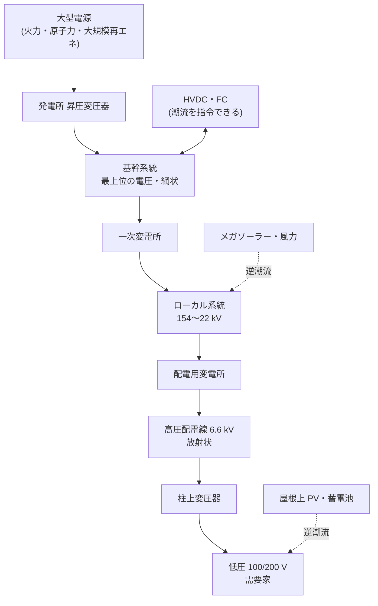
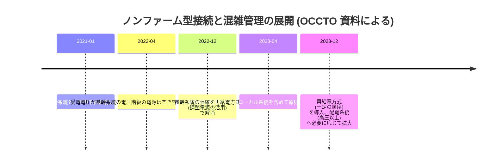

# 送配電網 (Transmission & Distribution Networks)

## 概要 (Overview)

送配電網 (transmission & distribution network) は、発電所から需要家まで電気を運ぶ設備の集まりである。ただし、水道管やパイプラインのように「どの経路でどれだけ流すか」を人が指定できる設備ではない。交流網の電力は、各線路のインピーダンスと各母線の注入量からキルヒホッフの法則 (Kirchhoff's laws) で一意に決まる経路を流れる。ある発電所と需要地の間で取引が成立しても、その電力は網の中のすべての並行経路に分かれて流れ、取引と無関係な線路の容量まで使ってしまう。

本ドキュメントの中心テーゼは次のとおりである。**送配電網は、物理法則で流れ方が決まり、人が経路を指定できない共有資源であり、その制約 (熱容量、電圧、安定度、N-1 基準) が再生可能エネルギー導入の実際の上限を決めている。** 日本で「空き容量ゼロ」と言われた系統の多くは、物理的に満杯なのではなく、全電源のフル稼働と 1 回線故障 (N-1) を同時に想定した計画ルールの上で満杯だった。日本版コネクト&マネージ、ノンファーム型接続、ダイナミックラインレーティング (DLR) は、いずれもこの「想定の保守性」を物理の実態に近づけ、共有資源をより多く配分する手段である。

扱う範囲は、(1) 電圧階級と送電・配電の役割分担、(2) 変電所の構成 (母線方式、遮断器、変圧器、保護リレー)、(3) 潮流計算 (交流潮流とニュートン・ラフソン法、直流近似)、(4) N-1 基準と送電容量の 3 つの制約、DLR、(5) 系統混雑と日本のノンファーム型接続、(6) 託送料金と発送電分離、(7) 配電網の逆潮流と電圧管理、(8) 山火事と送電線 (PG&E、PSPS)、(9) 大規模停電を「網の制約」の視点で読み直すこと、である。周波数と安定度の定量モデルは [`grid-stability-frequency-control.md`](grid-stability-frequency-control.md)、市場価格への写像は [`electricity-markets-dispatch.md`](electricity-markets-dispatch.md)、潮流を制御量にできる直流連系は [`hvdc-interconnection.md`](hvdc-interconnection.md) に譲り、本稿は交流網そのものの制約に集中する。

## 方法論 (Methodology)

- **網を回路として扱う。** 送配電網を、母線 (bus) を節点、線路と変圧器を枝とするグラフとし、各枝をインピーダンスで表す。回路方程式 (フェーザとキルヒホッフの法則は [`circuit-theory.md`](../../foundations/physics/electromagnetism/circuit-theory.md)、分布定数線路は [`transmission-lines-signal-integrity.md`](../../foundations/physics/electromagnetism/transmission-lines-signal-integrity.md)) から潮流を導き、「なぜ経路を選べないか」を式で示す。
- **制約を 3 層に分ける。** 平常時に守る制約 (熱容量、電圧の適正範囲)、想定事故後に守る制約 (N-1 基準)、そして制約の値そのものの決め方 (静的な定格か、気象に応じた定格か) を区別する。
- **一次資料を優先する。** 計画基準は NERC TPL-001-5.1 の本文、日本の接続ルールは電力広域的運営推進機関 (OCCTO) の公表資料、停電事例は公式調査報告、DLR の効果は米国エネルギー省 (DOE) の議会報告に拠る。教科書的な原理は Glover らと査読論文に拠る。
- **時点を明記する。** ノンファーム型接続の適用範囲、FERC の規則、スペインの電圧制御の制度などは変化が速いため、2026-10 時点で確認した内容と確認できなかった内容を分けて書く。
- 数値例は等しいリアクタンスの 3 母線網など教科書的に単純化したモデルによる試算であり、実系統の値ではない。

## 発見事項 (Findings)

1. **交流網では電力の経路を指定できず、1 本の線路の制約が網全体の送電能力を決める。** 直流近似では線路潮流は両端の位相差をリアクタンスで割った値になり、注入量に対して線形に決まる[^stott2009]。等しいリアクタンスの 3 母線網で母線 1 から母線 3 へ送ると、直通の線路に 2/3、迂回路に 1/3 が流れる。各線路の容量が 100 MW なら、直通線が先に上限に達し、送電能力は 150 MW で止まる (技術詳細で導出)。

2. **N-1 基準は、平常時に設備容量の一部を「使わずに空けておく」ことを要求する。** 日本の 2 回線送電線は、1 回線が故障しても送電を続けられるよう、平常時の潮流を 1 回線分の容量以下に抑えて運用されてきた[^occto-n1]。北米の NERC TPL-001-5.1 も、単一の発電機・送電線・変圧器の喪失 (P1) で需要遮断や確定送電サービスの中断を原則として認めない[^tpl001]。

3. **日本の「空き容量ゼロ」は、想定の保守性が生んだ面が大きい。** 従来の空き容量算定は、接続済みの電源がそろって最大出力で動くことに近い想定をしていた。OCCTO は、実際にはそうした状況が稀であることを認め、2018 年 4 月に想定潮流の合理化を全国で始めた[^occto-kaisetsu]。続いて N-1 電制 (先行適用 2018 年、本格適用 2022 年 7 月)、ノンファーム型接続 (基幹系統 2021 年 1 月、ローカル系統 2023 年 4 月) が導入された[^occto-nf][^occto-n1]。

4. **ノンファーム型接続は「容量の予約」をやめ、混雑時の出力制御を接続の条件にする。** 2023 年 4 月 1 日以降に接続検討を受け付けた案件は、接続先の電圧階級や空き容量の有無にかかわらず、原則としてノンファーム型接続となる[^occto-nf]。混雑は再給電方式で解消する。基幹系統では 2022 年 12 月 21 日に調整電源を使う方式、2023 年 12 月 28 日に調整電源以外も含めて一定の順序で制御する方式が始まった[^occto-nf]。

5. **送電線の熱容量は気象で変わり、静的な定格は多くの時間で実力を過小評価する。** DOE の議会報告 (2019) が集めた実証では、DLR により静的定格比で 30〜44 % (NYPA)、平均 22 %・76 % の時間 (AltaLink) の容量増加が報告された[^doe-dlr]。同じ報告は、逆に実際の条件での定格が静的定格を下回る時間もあり得ると指摘している[^doe-dlr]。米国では FERC Order 881 が気温を反映した定格 (AAR) を義務づけ、実施期限は 2025 年 7 月 12 日だった[^ferc881]。

6. **配電網は一方向の流れを前提に設計されており、太陽光の逆潮流は電圧上昇として現れる。** 低圧需要家の電圧は 100 V 系で 101±6 V、200 V 系で 202±20 V の範囲に保つ必要がある[^occto-gc]。逆潮流による電圧上昇への対策として、パワーコンディショナの力率一定制御が系統連系規程に高圧 (2013 年)・低圧 (2015 年) で規定され、低圧 PV の標準力率 95 % が 2017 年に定められた[^occto-gc]。

7. **送電線は山火事の着火源にもなり、その対策 (PSPS) は停電そのものを安全策として使う。** 2018 年のキャンプ・ファイア (85 人死亡、18,804 棟焼失) は PG&E の送電線が原因と CAL FIRE が判断した[^calfire-camp]。カリフォルニア州公益事業委員会 (CPUC) によると、電力設備起因の山火事は報告件数の 10 % 未満だが、州の最も破壊的な山火事のおよそ半数を占める[^cpuc-psps]。

8. **大停電の多くは、網の制約の上で起きている。** 2003 年北米停電の 4 つの主因の 1 つは、送電線下の樹木管理の不備だった。3 本の 345 kV 線は運用上の許容範囲内の条件で地絡した[^ferc-veg]。2025 年イベリア半島停電の最終報告 (2026-03-20) は、送電網の電圧制御の不足を中心とする複合要因を挙げた[^entsoe-iberia]。スペインの規制当局は 2026-07-10、再エネに電圧制御への参加を促す運用手順の改正を承認した[^cnmc-2026]。

## アーキテクチャ (Architecture)

### 電圧階級と役割分担 (Voltage Levels & Roles)

電力は発電所で昇圧され、変電所を通るたびに降圧されて需要家に届く。高い電圧で送るのは、同じ電力を小さな電流で送り、抵抗損失 I²R を減らすためである ([`generation-grid-fundamentals.md`](generation-grid-fundamentals.md))。日本の送配電網は、OCCTO の整理では次の階層に分かれる[^occto-nf]。電圧の組み合わせは一般送配電事業者ごとに異なる。

| 階層 | 代表的な電圧 | 役割 | 構造 |
|---|---|---|---|
| 基幹系統 (bulk transmission) | 各エリアで最も高い電圧の長距離送電線 (例: 北海道は 275 kV と 187 kV)[^occto-kikan] | 大型電源と需要地・地域間を結ぶ | 網状 (meshed) |
| ローカル系統 (sub-transmission) | 154・110 kV、77・66 kV、33・22 kV | 基幹系統から地域の変電所・大口需要家へ | 網状または放射状 |
| 配電系統 高圧 (primary distribution) | 6.6 kV | 配電用変電所から地域の需要家へ | 放射状 (radial)、連系開閉器で切替 |
| 配電系統 低圧 (secondary distribution) | 100/200 V | 柱上変圧器から住宅・小規模需要家へ | 放射状 |

送電と配電では、制約の性質が違う。網状の送電系統では潮流が複数経路に分かれるため、制約は「どの線路が先に上限に達するか」という網全体の問題になる。放射状の配電系統では潮流の経路は一意だが、電圧降下 (または上昇) を末端まで適正範囲に収める問題になる。



凡例: 実線は従来の潮流の向き (上位から下位へ)。点線は分散電源による逆潮流 (下位から上位へ)。両方向の矢印は潮流を変換器の指令で決められる設備 ([`hvdc-interconnection.md`](hvdc-interconnection.md))。

### 変電所の構成 (Substation Architecture)

変電所は、電圧を変える変圧器、事故電流を遮断する遮断器 (circuit breaker)、線路や変圧器を束ねる母線 (busbar)、事故を検出して遮断器に開放を指令する保護リレー (protective relay) からなる[^glover]。網の制約の観点で重要なのは、**母線方式 (bus configuration) が「1 つの故障で何本の線路を同時に失うか」を決める**ことである。

| 母線方式 | 構成 | 1 故障の影響 | 信頼度 (Otani & Vedros 2022 の比較) |
|---|---|---|---|
| 単母線 (single bus) | 全回線が 1 本の母線に接続 | 母線事故で変電所全体を失う | 最も低い群 |
| 主・予備母線 (main and transfer) | 遮断器点検時に予備母線へ切替 | 母線事故の影響は単母線に近い | 最も低い群 |
| 環状母線 (ring bus) | 遮断器を環状に配置 | 1 回線の事故は両側の遮断器で切り離す | 回線数 5 以上で最も高い |
| 1½ 遮断器方式 (breaker-and-a-half) | 2 回線で 3 台の遮断器を共有 | 母線事故でも回線を失わない | 回線数 4 以下で最上位群 |
| 二重母線二重遮断器 (double bus double breaker) | 各回線に遮断器 2 台 | 母線・遮断器の単一故障で回線を失わない | 回線数 4 以下で最も高い |

Idaho 国立研究所の確率論的リスク評価は、二重母線二重遮断器と 1½ 遮断器方式が回線数 4 以下で、環状母線が 5 以上で最も信頼度が高く、単母線と主・予備母線が一貫して低いと報告した[^otani2022]。

母線方式は計画基準にも直接現れる。NERC TPL-001-5.1 は、母線区分の事故 (P2-2)、遮断器内部の事故 (P2-3)、事故を除去しようとした遮断器が開かない遮断失敗 (stuck breaker、P4) を独立した想定事故として列挙し、これらによる複数設備の喪失を評価させる[^tpl001]。超高圧 (EHV) でこれらの事故に需要遮断を認めない以上、単母線のような構成では計画基準を満たせず、遮断器を増やすか母線を分ける必要が出てくる。保護リレーとその通信 (IEC 61850) は [`plant-control-scada-security.md`](plant-control-scada-security.md)、過負荷を事故と誤認する距離リレー Zone 3 の問題は [`grid-stability-frequency-control.md`](grid-stability-frequency-control.md) の 2003 年事例で扱っている。

## 技術詳細 (Technical Details)

### 交流潮流とニュートン・ラフソン法 (AC Power Flow & Newton–Raphson)

潮流計算 (power flow / load flow) は、各母線の注入電力から各母線の電圧 (大きさ |V| と位相角 θ) を求め、そこから各線路の潮流を得る計算である。母線 i の注入電力は、母線アドミタンス行列 Y = G + jB を使って次のように書ける[^glover]。

```
P_i = Σ_j |V_i||V_j| ( G_ij cos θ_ij + B_ij sin θ_ij )
Q_i = Σ_j |V_i||V_j| ( G_ij sin θ_ij − B_ij cos θ_ij )      θ_ij = θ_i − θ_j
```

母線は与える量で 3 種類に分かれる。負荷母線 (PQ 母線) は P と Q を、発電機母線 (PV 母線) は P と |V| を与え、1 つのスラック母線 (slack bus) は |V| と θ を与えて損失を含む収支の残りを引き受ける。未知数は PQ 母線の |V| と θ、PV 母線の θ である。式は非線形なので反復で解く。

```
Pseudocode: Newton–Raphson power flow
Input : Y (sparse, n×n), specified P, Q, |V|, slack angle
Output: |V|, θ for all buses; line flows
Assumptions: Jacobian is nonsingular near the solution
             (the operating point is not at the voltage-collapse nose)

x ← flat start (|V| = 1.0 pu, θ = 0)
repeat
    mismatch ← [P_spec − P(x); Q_spec − Q(x)]      # O(nnz(Y))
    if ‖mismatch‖∞ < ε: break
    J ← ∂[P;Q]/∂[θ;|V|] evaluated at x              # same sparsity as Y
    Δx ← solve(J, mismatch) by sparse LU             # cost depends on fill-in
    x ← x + Δx
until max_iter
Complexity: per iteration dominated by sparse LU; with a fill-reducing
ordering it grows close to linearly in n for typical grid topologies.
Convergence: quadratic near the solution.
```

Tinney と Hart (1967) は、ニュートン法を疎行列の三角分解と組み合わせ、大規模系統で実用になる潮流計算を示した[^tinney1967]。ニュートン法は解の近くで 2 次収束する (収束次数の一般論は [`equations-ode-numerical-methods.md`](../../foundations/mathematics/numerical-analysis/equations-ode-numerical-methods.md)、疎行列の LU 分解は [`matrix-factorizations-numerical.md`](../../foundations/mathematics/linear-algebra/matrix-factorizations-numerical.md))。Stott と Alsac (1974) の高速分離潮流 (fast decoupled load flow) は、送電線で抵抗がリアクタンスより十分小さいことを使って P–θ と Q–|V| の結合を切り離し、定数行列で反復する[^stott1974]。

故障モードとして重要なのは、**重負荷で潮流計算が収束しなくなる現象**である。電圧安定限界 (PV 曲線の「鼻」) に近づくとヤコビアンが特異に近づき、ニュートン法の反復が発散する。計算上の不収束と物理上の電圧崩壊が同じ数学的構造を持つため、連続型潮流計算 (continuation power flow) で限界点までの余裕を測る使い方がされる。電圧安定度そのものは [`grid-stability-frequency-control.md`](grid-stability-frequency-control.md) で扱っている。

### 直流近似と経路を選べない潮流 (DC Approximation & Loop Flow)

送電系統の計画・市場計算では、交流潮流を線形化した直流潮流 (DC power flow) が広く使われる。仮定は 3 つある。電圧の大きさをすべて 1 pu とみなす、位相差を小さいとみなして sin θ ≈ θ・cos θ ≈ 1 とする、抵抗を無視する (損失なし)。すると線路 ij の潮流は次の形になる[^stott2009]。

```
P_ij = (θ_i − θ_j) / x_ij          P = B' θ   (B': 母線サセプタンス行列)
```

潮流が注入量の線形関数になるので、「母線 k に 1 MW 注入し参照母線で引き抜いたとき、線路 l に何 MW 流れるか」を表す**電力伝達分布係数 (PTDF: Power Transfer Distribution Factor)** が定義できる。米国の LMP 計算はこの線形性を前提にした最適化である ([`electricity-markets-dispatch.md`](electricity-markets-dispatch.md)、双対変数としての価格は [`convex-optimization-duality.md`](../../foundations/mathematics/optimization/convex-optimization-duality.md))。

**数値例 (3 母線網)。** 母線 1・2・3 を三角形に結び、3 本の線路のリアクタンスをすべて x、容量をすべて 100 MW とする。母線 1 から母線 3 へ P を送ると、直通経路 (1→3) のリアクタンスは x、迂回経路 (1→2→3) は 2x である。潮流はリアクタンスに反比例して分かれる。

| 取引 | 線路 1→3 | 線路 1→2 | 線路 2→3 |
|---|---|---|---|
| 母線 1 → 母線 3 に P | 2P/3 | P/3 | P/3 |
| 母線 2 → 母線 3 に P | P/3 (2→1→3 経由) | −P/3 (2→1 向き) | 2P/3 |

母線 1 から母線 3 への送電能力は、直通線が 100 MW に達する P = 150 MW で頭打ちになる。迂回経路の 2 本には 50 MW ずつ空きが残るが、使う方法がない。さらに母線 2 に新しい電源をつないで母線 3 へ送ると、その電源の電力の 1/3 は母線 1 を経由して直通線に流れ込む。母線 2 の電源が 60 MW 送れば直通線を 20 MW 使うので、母線 1 からの送電能力は 120 MW に下がる。**電源をどこにつなぐかが別の電源の送電能力を奪う。** これが「網は共有資源である」という意味であり、接続の順番と容量の配分が政策問題になる理由である。

Stott ら (2009) は、直流近似の誤差が無視できない場合があることを示している。重潮流で位相差が大きい線路、R/X 比の大きい低電圧の線路、電圧が 1 pu から大きく外れる状況では誤差が大きくなる[^stott2009]。混雑判定に使うときは、交流潮流で検証するか、誤差を見込んだ余裕を取る必要がある。

### N-1 基準と安全度 (N-1 Criterion & Security)

**N-1 基準**は、系統の任意の 1 設備 (送電線 1 回線、変圧器 1 台、発電機 1 台など) が故障しても、需要を遮断せず、残りの設備が定格を超えず、電圧が許容範囲に収まることを求める計画・運用の基準である。NERC TPL-001-5.1 (目的: 広範な系統条件と想定事故のもとで信頼性高く運用できる基幹系統を計画すること) は、想定事故を次のように分類する[^tpl001]。

| 区分 | 内容 | EHV での需要遮断 |
|---|---|---|
| P0 | 事故なし (平常時) | 不可 |
| P1 | 単一事故 (発電機、送電線、変圧器、調相設備、直流線の 1 極) | 原則不可 (例外は注記 12 の条件付き) |
| P2 | 単一事故 (無故障での区間開放、母線区分事故、遮断器内部事故) | 不可 (母線連絡遮断器の事故は可) |
| P3 | 発電機 1 台の喪失と系統調整の後に、もう 1 つの単一事故 | 原則不可 |
| P4 | 事故と遮断失敗 (stuck breaker) による複数設備の喪失 | 不可 (母線連絡遮断器は可) |
| P5 | 保護システムの非冗長部品の不動作による遅延除去 | 不可 |
| P6 | 2 つの単一事故の重なり (系統調整を挟む) | 可 |
| P7 | 同一鉄塔の 2 回線、直流双極の喪失 | 可 |

P1 で需要遮断を例外的に使う場合 (注記 12) も、米国の登録事業者では計画上の遮断量を 75 MW 以下に制限している[^tpl001]。さらに、極端事象 (extreme events) として、同一ルートの全送電線の喪失、変電所全体の喪失、大規模ガスパイプラインの喪失、**山火事**、ハリケーンなどの悪天候を評価対象に挙げている[^tpl001]。極端事象では P0〜P7 のような性能要件は課されず、より深刻な影響が見込まれる事象を選んで解析し、連鎖停電 (cascading) に至る場合は発生確率を下げるか影響を緩和する対策を検討することが求められる[^tpl001]。

日本では、OCCTO の送配電等業務指針に基づき、2 回線送電線の平常時の潮流を 1 回線分の設備容量以下に抑えて運用してきた。この上限を**運用容量**と呼ぶ[^occto-n1]。

**N-1 電制 (N-1 generation tripping)** は、この空けておいた容量を平常時にも使う仕組みである。1 回線が故障した瞬間に、保護継電器などで特定の電源の出力を抑制 (または遮断) する装置をあらかじめ設置しておけば、平常時は 2 回線分に近い潮流を流せる。OCCTO の例では、100 MW × 2 回線の線路の運用容量が 100 MW から 150 MW に拡大する[^occto-n1]。故障時の安全を「容量の予約」から「事故時の自動制御」に置き換えた形であり、制御装置の信頼性と、電制された電源の費用を誰が負担するかが新しい論点になる。2018 年からの先行適用では新規電源自身が電制対象だったが、2022 年 7 月からの本格適用では既設電源も対象となり、受益者と電制対象が一致しないため費用を精算する[^occto-n1]。

N-1 基準が管理するのは初期事象であり、連鎖の伝播は直接は管理しない。この限界は [`grid-stability-frequency-control.md`](grid-stability-frequency-control.md) の連鎖故障モデルで定量的に扱っている。

### 送電容量の 3 つの制約 (Thermal, Voltage & Stability Limits)

交流送電線が送れる電力の上限は、長さに応じて異なる要因で決まる[^gutman1979][^quaia2018]。

| 制約 | 物理 | 支配的になる場面 | 緩和手段 |
|---|---|---|---|
| 熱容量 (thermal limit) | 電流による発熱で導体温度が上がり、導体が伸びて弛度 (sag) が増え、地上や樹木との離隔が減る | 短い線路 | DLR、高温低弛度電線への張替、増強 |
| 電圧 (voltage limit) | 線路のリアクタンスによる電圧降下、受電端の無効電力不足 | 中距離の線路 | 調相設備 (分路コンデンサ、SVC/STATCOM)、変圧器タップ |
| 安定度 (stability limit) | 送受電端の位相差が大きくなり、外乱後に同期を保てなくなる | 長い線路 | 直列コンデンサ、HVDC、電源制限 (電制) |

線路の送電能力を固有負荷 (SIL: surge impedance loading) の倍数で長さに対して描いた曲線は、St. Clair (1953) の経験則に始まり、Gutman ら (1979) が解析的に導いた[^gutman1979]。Quaia (2018) はこれらの前提 (電圧降下 5 %、力率 1 など) を再検討し、どの制約が支配的かは補償の有無や前提で変わることを示した[^quaia2018]。

熱容量は導体の熱収支で決まる。DOE の議会報告は、電流によるジュール熱と日射による入熱が、対流 (風による冷却) と放射による放熱と釣り合う温度を導体の許容最高温度以下に保つ、という IEEE Std 738 の熱収支を説明している[^doe-dlr]。許容温度は導体の劣化と、弛度による離隔を守るために決まる[^doe-dlr]。

### ダイナミックラインレーティング (Dynamic Line Rating)

静的定格 (SLR: static line rating) は、季節ごとの固定した気象条件 (気温、風速・風向、日射) を仮定して計算した定格である。DOE は、この仮定は最悪条件 (無風、最高気温、全日射) ではないため、実際の条件での定格が静的定格を下回る時間もあると指摘する[^doe-dlr]。静的定格は保守的であると同時に、常に安全側とは限らない。

| 方式 | 定格の決め方 | 更新頻度 | 制度上の位置づけ (米国) |
|---|---|---|---|
| 静的定格 (SLR) | 季節ごとの固定気象を仮定 | 季節 | 従来の標準 |
| 気温反映定格 (AAR: ambient-adjusted rating) | 気温予測を反映し、夜間の日射なしを反映 | 少なくとも 1 時間ごと | FERC Order 881 で義務化 (2025-07-12 期限) |
| 動的定格 (DLR) | 風速・風向・気温・日射、導体温度や弛度の実測 | 数分〜1 時間 | FERC が ANOPR (RM24-6, 2024-06) で検討 |

風は導体を強く冷やすため、DLR の効果は大きい。DOE 報告の事例表では、NYPA の実証で静的定格比 30〜44 %、Oncor で AAR 比 6〜14 % (83 % 超の時間)、静的定格比で平均 30〜70 %、AltaLink で平均 22 % (76 % の時間)、北アイルランドの 110 kV 線で 10〜20 % (一部 26 %) の容量増加が報告された[^doe-dlr]。値の幅が大きいのは、地形、風況、比較基準 (SLR か AAR か) が事例ごとに違うためで、どの線路にも同じ増加率が期待できるわけではない。

風の強い時間に容量が増えることは、風力の出力が大きい時間と重なる。NYPA の実証でも、実時間の容量増加と風力発電の増加に正の相関が見られた[^doe-dlr]。DLR は風力の接続線で特に効く。

FERC Order 881 (2021-12-16 発出) は、10 日以内に終わる短期の送電サービスの評価に AAR を使うことを送電事業者に求めた[^ferc881]。DLR については 2024 年 6 月に事前規則制定提案 (ANOPR, Docket RM24-6) が出された[^ferc881]。2026-10 時点で、DLR を義務づける規則案 (NOPR) や最終規則が出たことは確認できなかった。

DLR の運用上の論点は、**予測と実測のずれ**である。DOE 報告は、強風予測に基づいて静的定格以上で運用する予定だったのに、実時間で風が急に弱まれば線路が過負荷になる事例を挙げている[^doe-dlr]。実証の多くは静的定格に対して上限 (例: 30 %) を設けている[^doe-dlr]。

### 系統混雑と日本版コネクト&マネージ (Congestion & Japan's Connect-and-Manage)

日本の系統アクセスは、長く「先着優先」と「容量の予約」で運用されてきた。電源は接続時に送電容量を確保し (ファーム型接続)、後から来た電源は空き容量がなければ増強工事を待つか費用を負担する。OCCTO の解説によると、従来の空き容量算定は接続済み電源の最大出力に近い想定で潮流を見積もっていた[^occto-kaisetsu]。全電源のフル稼働は実際には稀で、同じエリアの需要が潮流を相殺するため、算定上の空き容量ゼロと実際の潮流には差がある[^occto-kaisetsu]。

この差を物理の実態に近づけるのが**日本版コネクト&マネージ**で、3 つの手法からなる[^occto-kaisetsu][^occto-n1]。

| 手法 | 何を変えたか | 開始 |
|---|---|---|
| 想定潮流の合理化 | 発電所の稼働実態と需要を考慮して最大潮流を算定 | 2018 年 4 月 (全国統一ルール) |
| N-1 電制 | 故障時の自動電制を条件に、緊急用に空けていた容量を平常時に使う | 先行適用 2018 年、本格適用 2022 年 7 月 |
| ノンファーム型接続 | 容量を予約せず、混雑時の出力制御を条件に接続する | 基幹系統 2021 年 1 月、ローカル系統 2023 年 4 月 |

ノンファーム型接続の適用範囲は段階的に広がった[^occto-nf]。



ノンファーム型接続の参加条件には、混雑時の無補償の出力制御 (オンライン制御) と、連系開始までの制御機器の設置が含まれる[^occto-nf]。ローカル系統の混雑については、東京電力パワーグリッドの案内によると、同社エリアで 2024 年 4 月にノンファーム一律制御、2026 年 4 月に再給電方式 (一定の順序) の出力制御順に基づく運用が始まった[^tepco-nf]。他社エリアの開始時期は本稿では確認していない。

ここで 2 種類の出力制御を区別しておく必要がある。1 つは**需給バランス起因の出力制御**で、エリア全体で電気が余るときに行う。優先給電ルールでは、調整力として確保した電源の抑制と揚水運転・蓄電池の充電、調整力でない火力などの抑制、長周期広域周波数調整、バイオマスの抑制を経て、その後に太陽光・風力が抑制される[^occto-yokusei]。市場との関係は [`electricity-markets-dispatch.md`](electricity-markets-dispatch.md) で扱った。もう 1 つは**系統混雑起因の出力制御**で、エリアの需給は足りていても特定の送電線や変圧器が上限に達するときに行い、ノンファーム型接続の電源が対象になる[^occto-nf]。OCCTO は両方の出力抑制について、一般送配電事業者の判断と運用が適切だったかを検証して公表している[^occto-yokusei]。

前者は「電気が余る」問題、後者は「電気を運べない」問題である。後者は場所に依存するので、同じ太陽光発電所でも接続点によって制御量が変わる。ゾーン制の日本の市場では、エリア内の混雑は価格に現れず、再給電方式という系統運用側の手続きで処理される。ノーダル制の米国では、同じ混雑が LMP の混雑成分として価格に現れる ([`electricity-markets-dispatch.md`](electricity-markets-dispatch.md))。

前述の 3 母線の例で言えば、ファーム型接続は「母線 1 の電源に直通線の 100 MW を予約させ、母線 2 の電源の接続を断る」ルール、ノンファーム型接続は「両方を接続し、直通線が満杯になる時間だけ一定の順序で出力を絞る」ルールである。後者は網の利用率を上げるが、電源の事業者は制御量の予測という新しいリスクを負う。

### 託送料金と発送電分離 (Network Tariffs & Unbundling)

送配電網は自然独占であり、規制された料金 (託送料金) で費用を回収する。日本では 2020 年 4 月に法的分離 (legal unbundling) が行われ、送配電事業者 (沖縄電力を除く) は発電事業・小売事業を兼ねることを禁じられ、グループ内で別会社とする必要が生じた[^chambers-jp]。

一般送配電事業者の役割は、託送 (他社の電気を網で運ぶこと)、周波数の維持 (調整力の調達と運用)、系統アクセスの受付と空き容量の算定、混雑管理、停電の復旧である。中立性が求められるのは、網の容量配分 (どの電源をつなぎ、混雑時にどれを絞るか) がそのまま発電事業者の収益を左右するからである。

託送料金は 2023 年度から**レベニューキャップ制度**に移行した。事業者が 5 年間の事業計画と「収入の見通し」を作り、国の承認を受けた上限の中で料金を設定する。九州電力送配電の資料では、第 1 規制期間 (2023〜2027 年度) の収入の見通しは 5 か年平均 4,975 億円で、制御不能費用 (外生的な費用) は事後に調整される[^kyuden-rc]。

2024 年 4 月には**発電側課金**が導入された。それまで小売事業者 (つまり需要家) がすべて負担していた託送料金の一部を、系統の利用者である発電事業者にも負担させる仕組みで、目的は系統の効率的な利用と再エネ拡大に向けた系統増強である[^kyuden-rc]。網の費用の一部を発電事業者に意識させる仕組みであり、ノーダル価格のない日本で、系統利用の費用を発電側の判断に反映させる手段の 1 つといえる。

### 配電網の変化: 逆潮流と電圧管理 (Distribution: Reverse Flow & Voltage)

配電網は、配電用変電所から末端へ向かって電圧が下がっていく一方向の流れを前提に設計されてきた。変電所の送り出し電圧と線路の途中の自動電圧調整器 (SVR) は、末端の需要家でも電圧が下限を割らないように設定されている。

屋根上太陽光が需要を上回ると、余剰が配電線を逆向きに流れ (逆潮流)、接続点の電圧が上がる。低圧需要家の電圧は、100 V 系で 101±6 V、200 V 系で 202±20 V の範囲に保たなければならない[^occto-gc]。逆潮流が大きい配電線では上限 107 V を超えるおそれが出る。電圧上昇の大きさは、線路の抵抗 R とリアクタンス X を使って、近似的に ΔV ≈ (R·P + X·Q)/V で表せる[^glover]。有効電力 P を絞る代わりに無効電力 Q を吸収 (進相運転) すれば、電圧上昇を打ち消せる。

日本の対策は次のように進んできた[^occto-gc]。

- パワーコンディショナ (PCS) の**力率一定制御**: 常に一定の力率で進相運転して電圧上昇を抑える。系統連系規程 (JEAC 9701) に高圧 (2013 年)、低圧 (2015 年) で規定され、低圧 PV の標準力率 95 % が 2017 年に規定された。
- **力率設定値の可変化**: OCCTO のグリッドコード検討会 (2021-09-16) は、PV の連系量が増えると力率 95 % では適正電圧を守れない可能性を示し、一般送配電事業者の求めに応じて力率設定値を変更できる機能 (整定範囲 0.80〜1.00) を要件化する案を検討した。メーカ側からは、認証試験の工数と、ソフトウェア・ハードウェア開発に 1 千万円程度かかるとの意見が出ている。
- PCS の電圧上昇抑制機能: 接続点の電圧が上限に近づくと、PCS が自ら出力を絞る。需要家から見ると「売電が減る」形で現れる。

米国では IEEE Std 1547-2018 が、分散電源に電圧調整のための無効電力能力を要求し、能力を Category A (最低限) と Category B (高い導入率向けの追加能力) に分けた。両カテゴリとも力率一定、無効電力一定、ボルト・バール (volt-var) 制御の各モードを含む[^irec1547]。電圧に応じて無効電力を自律的に変えるボルト・バール制御は、力率一定より少ない無効電力で電圧を抑えられる。こうした機能を持つインバータは**スマートインバータ (smart inverter)** と呼ばれる。インバータ制御の内部は [`power-electronics-grid-converters.md`](power-electronics-grid-converters.md) で扱っている。

逆潮流は保護にも影響する。一方向の事故電流を前提にした配電線の過電流保護は、分散電源が事故電流を供給すると感度が変わる。分散電源が単独で一部の配電線を充電し続ける単独運転 (islanding) は、作業員の感電や再閉路時の非同期投入の危険があるため、単独運転検出機能が求められる。

### 山火事と送電線 (Wildfire & Power Lines)

送電線は山火事の被害を受けるだけでなく着火源にもなる。2018 年 11 月 8 日に始まったカリフォルニア州のキャンプ・ファイアは、153,336 エーカーを焼き、18,804 棟を破壊し、85 人の死者を出した[^calfire-camp]。CAL FIRE は原因を Pulga 付近の PG&E の送電線と判断した[^calfire-camp]。ビュート郡地方検事の公開報告 (2020-06-16) は、捜査の経過と、近くで PG&E の配電線による第 2 の着火があったことを記している[^butte-da]。PG&E は 84 件の過失致死と 1 件の違法な出火で有罪を認めた[^butte-da]。

CPUC は、電力設備起因の山火事は報告件数の 10 % 未満だが、州で最も破壊的な山火事のおよそ半数を占めるとしている[^cpuc-psps]。強風で樹木や部品が電線に接触し、乾燥した植生に着火すると、強風そのものが延焼を速める。着火の確率が高い気象と、着火後の被害が大きい気象が同じである。

この結合を断つ手段が**計画停電 (PSPS: Public Safety Power Shutoff)** である。強風・乾燥時に、電力会社が高リスク地域の線路をあらかじめ停止する。CPUC の規制の経緯は次のとおりである[^cpuc-psps]。

| 時期 | 内容 |
|---|---|
| 2012 年 | CPUC が、電力会社は公共の安全のために電力供給を停止できると判断 |
| 2018 年 | Resolution ESRB-8: 事前通知の強化、各事象後 10 日以内の報告義務 |
| 2018 年 12 月 | 規則制定手続き R.18-12-005 を開始 |
| 2019 年 5 月・2020 年 6 月・2021 年 6 月 | 第 1〜3 段階の決定: 通知、地域支援拠点、医療上の配慮が必要な需要家、復旧、報告 |
| 2023 年 9 月 | PSPS 違反に対する反則金 (citation) 制度 |
| 2024 年 11 月 7 日 | 2021 年の PSPS 事象に関する同意命令: SCE に 2,339,690 ドル、PG&E に 1,753,100 ドル |

PSPS は「停電という故障モードを、より大きな災害を避けるために意図的に選ぶ」運用である。その費用は医療機器に依存する需要家、通信、給水といった停電の二次影響として需要家側に移る。NERC TPL-001-5.1 が山火事を極端事象に挙げていることは、計画の段階で「山火事で線路群を同時に失う」想定が要ることを示している[^tpl001]。逆に、山火事対策で線路を止めることは、N-1 の前提となる設備を自ら外すことでもあり、PSPS 中の系統で次の事故が起きたときの余裕は小さい。

### 大規模停電を網の視点で読む (Blackouts Through the Network Lens)

3 つの大停電の経過と周波数・安定度の分析は [`grid-stability-frequency-control.md`](grid-stability-frequency-control.md) にある。ここでは、それぞれで網の制約が何をしたかに絞る。

**2003 年北米北東部 (2003-08-14)。** 米加合同タスクフォースが挙げた 4 つの主因の 1 つは、FirstEnergy が送電線の通過地 (right-of-way) の樹木を適切に管理しなかったことである[^ferc-veg]。停電の前の 1 時間に 3 本の 345 kV 送電線が伸びた樹木に接触して故障した。最終報告は、樹木が高すぎたため、各線路は**運用上の許容範囲内の条件で**地絡したと述べている[^ferc-veg]。熱容量の定格は離隔を守るための値だが、その前提となる樹木管理が崩れていれば、定格内の電流でも事故になる。1 本の線路が外れると、その潮流は運用者の意図と無関係に並行経路へ移り、残った線路の負荷を押し上げる。連鎖の詳しい経過は [`grid-stability-frequency-control.md`](grid-stability-frequency-control.md) にあるが、その駆動力は前述の「経路を選べない」性質である。FERC は 2004-04-19、送電事業者に樹木管理の実務の報告を命じた[^ferc-veg]。

**2018 年北海道 (2018-09-06)。** 需要約 3,087 MW の系統で、1 地点 (苫東厚真) の大型電源 3 台に供給が集中していた[^occto-2018]。単一の発電所が系統の大きな割合を占めると、その発電所への送電ルートと発電所自体が事実上の単一障害点になる。本州との連系は直流 (北本連系) で、緊急時の融通量に上限があった。網の大きさと連系容量の制約が、N-1 の「1」に含まれない共通原因事故 (地震) の影響を全域停電まで拡大した。

**2025 年イベリア半島 (2025-04-28)。** ENTSO-E 専門家パネルの最終報告 (2026-03-20) は、根本原因を単一ではなく、電圧と無効電力の制御の不足を中心とする複合要因とした[^entsoe-iberia]。挙げられた要因には、力率一定運転の再エネが電圧変化に無効電力で応じないこと、同期機の電圧制御が期待どおりに働かなかったこと、分路リアクトルが手動操作だったこと、保護設定の一部が要件から乖離していたことが含まれる[^entsoe-iberia]。送電網の電圧は、網の中の無効電力の収支で決まる局所的な量である。周波数のように系統全体で 1 つの値を共有せず、場所ごとに制御資源を配置しなければならない。スペインの規制当局 CNMC は 2026-07-10、運用手順 PO 7.4 と PO 14.4 の改正を承認した[^cnmc-2026]。改正は、送電網・配電網に接続する 1 MW 以上の発電・蓄電設備が固定の電圧または無効電力の設定値に従う基本的な電圧制御サービスを新設し、力率一定制御からの移行を促す。報道発表は 2025 年に始まった電圧制御の制度見直しの新段階と位置づけているが、停電には直接言及していない[^cnmc-2026]。

3 つの事例に共通するのは、計画上の想定 (樹木管理を含む定格、1 地点への集中の許容、無効電力を供給する電源の存在) が、実際の網の状態から離れていたことである。

## 運用・安全考察 (Operational & Safety Considerations)

- **容量の配分ルールは安全余裕の配分でもある。** 想定潮流の合理化、N-1 電制、ノンファーム型接続、DLR は、いずれも従来は空けていた余裕を平常時の利用に回す。安全は、容量の予約から、故障時の自動制御 (電制装置)、気象の計測と予測、出力制御の指令系統の確実な動作へ移る。これらの装置・通信・ソフトウェアの故障は、新しい単一障害点になり得る。電制装置の不動作は、NERC TPL-001-5.1 の P5 (保護システムの非冗長部品の不動作) と同じ構造の想定事故として評価する必要がある[^tpl001]。
- **予測に依存する定格には下振れへの備えが要る。** DLR は、予測が外れて風が弱まれば即座に容量が減る。静的定格に対する上限の設定、短時間定格 (緊急時の許容時間) との組み合わせ、予測区間の保守的な採用が必要である[^doe-dlr]。
- **出力制御の指令系統はサイバー攻撃の対象になり得る。** オンライン制御を前提とするノンファーム型接続では、多数の電源に一斉に出力指令が届く。指令の改ざんや偽装は混雑を解消するどころか作り出し得る。防御の枠組みは [`plant-control-scada-security.md`](plant-control-scada-security.md) を参照。
- **配電の電圧管理は需要家設備の設定に依存する。** 数百万台の PCS の力率設定や電圧上昇抑制の整定値は、送配電事業者が直接管理していない。イベリア半島の事例では、発電設備の保護設定が要件から乖離していたことが連鎖に寄与した[^entsoe-iberia]。設定値の登録と適合確認は、配電網でも基盤的な業務になる。
- **計画停電 (PSPS) は安全策であると同時に信頼度の消費である。** 停止で着火を防げても、停止区間の需要家には停電の被害が移り、残りの系統は N-1 の余裕を失う。CPUC が通知、地域支援拠点、医療上の配慮が必要な需要家の扱いを規則化し、違反に制裁を科しているのは、この費用を制度で管理するためである[^cpuc-psps]。
- **樹木管理は定格の一部である。** 2003 年の教訓は、熱容量の定格が離隔の維持を前提としていることだった[^ferc-veg]。DLR で定格を上げれば弛度も増すので、離隔の確認と樹木管理を定格の算定と一体で行う必要がある。

> 本ドキュメントは公開文献と公式調査報告に基づく教育目的の概説であり、特定設備の脆弱性や攻撃手法は扱わない（リポジトリの倫理方針に準拠）。

## 結論 (Conclusions)

交流の送配電網では、電力はキルヒホッフの法則に従ってすべての並行経路に分かれて流れ、人が経路を指定することはできない。そのため、ある電源の接続は網のあちこちの線路の容量を少しずつ使い、別の電源の送電能力を奪う。送配電網は「管」ではなく、物理法則が配分方法を決める共有資源である。

この共有資源の容量は、熱容量、電圧、安定度という 3 つの物理制約と、N-1 基準という安全余裕のルールで決まる。日本で再エネの接続を止めていた「空き容量ゼロ」の多くは、物理の限界ではなく、全電源のフル稼働と 1 回線故障を同時に想定する計画ルールの限界だった。想定潮流の合理化、N-1 電制、ノンファーム型接続という日本版コネクト&マネージは、容量の予約を出力制御と自動電制に置き換え、同じ設備により多くの電源をつなぐ。米国の AAR・DLR は、静的な定格を気象の実態に合わせ、実証では静的定格比で数十 % の容量を引き出した。

ただし、余裕を平常時の利用に回すほど、安全は装置、通信、予測の確実さに依存するようになる。配電網では、一方向の流れを前提とした電圧管理と保護が、逆潮流によって前提ごと変わり、需要家側の数百万台の設定値が電圧品質を左右する。大停電の事例は、樹木管理を含む定格の前提、1 地点への集中、局所的な無効電力の不足という網の制約が、連鎖の起点や増幅器になってきたことを示す。再エネ導入の実際の上限は、発電設備の量ではなく、この共有された網の制約をどれだけ正確に測り、どれだけ公平かつ安全に配分できるかで決まる。

## 次の接続先 (Related Topics)

- [`generation-grid-fundamentals.md`](generation-grid-fundamentals.md): 電力系統の基礎、高電圧送電の理由、有効電力と無効電力
- [`grid-stability-frequency-control.md`](grid-stability-frequency-control.md): 安定度の分類、電圧安定度、大停電 5 事例の詳細、連鎖故障モデル
- [`electricity-markets-dispatch.md`](electricity-markets-dispatch.md): 市場分断、LMP、需給バランス起因の出力制御
- [`hvdc-interconnection.md`](hvdc-interconnection.md): 潮流を制御量にできる直流送電と地域間連系
- [`power-electronics-grid-converters.md`](power-electronics-grid-converters.md): PCS・スマートインバータの制御、弱い系統
- [`plant-control-scada-security.md`](plant-control-scada-security.md): 保護リレー、IEC 61850、制御系のセキュリティ
- [`battery-energy-storage.md`](battery-energy-storage.md): 混雑緩和と再エネの時間シフトに使う系統用蓄電池
- [`../datacenters/datacenter-power.md`](../datacenters/datacenter-power.md): 大口需要としてのデータセンターの受電
- [`../../foundations/physics/electromagnetism/circuit-theory.md`](../../foundations/physics/electromagnetism/circuit-theory.md): フェーザ、キルヒホッフの法則
- [`../../foundations/physics/electromagnetism/transmission-lines-signal-integrity.md`](../../foundations/physics/electromagnetism/transmission-lines-signal-integrity.md): 分布定数線路、特性インピーダンス
- [`../../foundations/mathematics/numerical-analysis/equations-ode-numerical-methods.md`](../../foundations/mathematics/numerical-analysis/equations-ode-numerical-methods.md): ニュートン法と収束次数
- [`../../foundations/mathematics/linear-algebra/matrix-factorizations-numerical.md`](../../foundations/mathematics/linear-algebra/matrix-factorizations-numerical.md): LU 分解と疎行列
- [`../../foundations/mathematics/optimization/convex-optimization-duality.md`](../../foundations/mathematics/optimization/convex-optimization-duality.md): 最適潮流と双対変数としての価格

## 参考文献 (References)

[^occto-kikan]: 電力広域的運営推進機関 (2018). 北海道胆振東部地震に伴う大規模停電に関する検証委員会 第2回 参考資料2 (用語解説「系統・基幹系統」). [PDF](https://www.occto.or.jp/assets/iinkai/hokkaido_kensho/files/hokkaido_kensho_02_sankou_2.pdf) — Accessed: 2026-10-24。「最も高い電圧で長距離の送電線を基幹系統といい、北海道の場合は 275 kV と 187 kV」。

[^glover]: Glover, J. D., Overbye, T. J., & Sarma, M. S. (2017). *Power System Analysis and Design* (6th ed.). Cengage Learning. ISBN 978-1-305-63213-4. — 母線アドミタンス行列、潮流計算、変電所と保護、配電の電圧降下の標準的教科書。

[^tinney1967]: Tinney, W. F., & Hart, C. E. (1967). Power Flow Solution by Newton's Method. *IEEE Transactions on Power Apparatus and Systems*, PAS-86(11), 1449–1460. DOI: 10.1109/TPAS.1967.291823

[^stott1974]: Stott, B., & Alsac, O. (1974). Fast Decoupled Load Flow. *IEEE Transactions on Power Apparatus and Systems*, PAS-93(3), 859–869. DOI: 10.1109/TPAS.1974.293985

[^stott2009]: Stott, B., Jardim, J., & Alsac, O. (2009). DC Power Flow Revisited. *IEEE Transactions on Power Systems*, 24(3), 1290–1300. DOI: 10.1109/TPWRS.2009.2021235

[^gutman1979]: Gutman, R., Marchenko, P. P., & Dunlop, R. D. (1979). Analytical Development of Loadability Characteristics for EHV and UHV Transmission Lines. *IEEE Transactions on Power Apparatus and Systems*, PAS-98(2), 606–617. DOI: 10.1109/TPAS.1979.319410

[^quaia2018]: Quaia, S. (2018). Critical analysis of line loadability constraints. *International Transactions on Electrical Energy Systems*, 28(6), e2552. DOI: 10.1002/etep.2552

[^otani2022]: Otani, C., & Vedros, K. G. (2022). Electrical Substation Configuration Effect on Substation Reliability. *16th International Conference on Probabilistic Safety Assessment and Management (PSAM 16)*, Honolulu. Idaho National Laboratory, INL/CON-22-66879. [発表資料 (iapsam.org)](https://www.iapsam.org/PSAM16/slides/CO102-SLIDES-PSAM16.pdf) — Accessed: 2026-10-24

[^tpl001]: NERC. *TPL-001-5.1 — Transmission System Planning Performance Requirements*. FERC 承認 2020-06-10、米国での発効 2023-07-01 (P5 の是正措置は 2029-07-01 まで段階適用)。[nerc.com](https://www.nerc.com/pa/Stand/Reliability%20Standards/TPL-001-5.1.pdf) — Accessed: 2026-10-24。発効日は [Texas RE の規格日程資料](https://texasre.org/Documents/Standards/NSRF%20Uploads/August%202025/2025%2008%2021_Standards%20Dates.pdf) で確認 — Accessed: 2026-10-24

[^occto-n1]: 電力広域的運営推進機関 (2022-07-05). 流通設備の整備計画の策定（送配電等業務指針第５５条関連）におけるＮ－１電制の考え方について（補足説明資料）. [occto.or.jp](https://www.occto.or.jp/assets/access/oshirase/2018/files/20220705_n-1densei_hosoku.pdf) — Accessed: 2026-10-24

[^occto-kaisetsu]: 電力広域的運営推進機関. 電力ネットワーク利用の改革（かいせつ電力ネットワーク）. [occto.or.jp](https://www.occto.or.jp/grid/public/riyoukaikaku.html) — Accessed: 2026-10-24

[^occto-nf]: 電力広域的運営推進機関 (2020-12-25 作成、2024-07-01 更新). 系統の接続および利用ルールについて ～ノンファーム型接続～. [occto.or.jp](https://www.occto.or.jp/grid/assets/NF_setuzokuriyou_20260710.pdf) — Accessed: 2026-10-24。電圧階級の区分 (上位 2 電圧、154・110 kV、77・66 kV、33・22 kV、6.6 kV、低圧) も同資料の系統図による。

[^occto-yokusei]: 電力広域的運営推進機関. 再生可能エネルギー発電設備の出力抑制に関する検証. [occto.or.jp](https://www.occto.or.jp/gyomusyokai/no2.html) — Accessed: 2026-10-24。優先給電ルールの順番と、需給バランス制約・流通設備の混雑による抑制の検証。

[^tepco-nf]: 東京電力パワーグリッド. ノンファーム型接続について. [tepco.co.jp](https://www.tepco.co.jp/pg/consignment/access/nonfarm.html) — Accessed: 2026-10-24。ローカル系統のノンファーム一律制御 (2024-04-01) と再給電方式 (一定の順序) の出力制御順に基づく運用 (2026-04-01) の開始の記載による。

[^occto-gc]: 電力広域的運営推進機関 (2021-09-16). 第7回グリッドコード検討会 資料7 個別技術要件検討「電圧変動対策(力率設定)」. [occto.or.jp](https://www.occto.or.jp/assets/iinkai/gridcode/2021/files/gridcode_07_07.pdf) — Accessed: 2026-10-24

[^irec1547]: Interstate Renewable Energy Council (2022). *Decision Options Matrix for IEEE 1547-2018 Adoption*. [irecusa.org](https://irecusa.org/wp-content/uploads/2022/10/Decision-Options-Matrix-for-IEEE-1547-2018-Adoption.pdf) — Accessed: 2026-10-24。IEEE Std 1547-2018 本文は有償のため、Category A/B の区分と各制御モードは本資料による。

[^doe-dlr]: U.S. Department of Energy (2019-06). *Dynamic Line Rating* (Report to Congress). [energy.gov](https://www.energy.gov/sites/prod/files/2019/08/f66/Congressional_DLR_Report_June2019_final_508_0.pdf) — Accessed: 2026-10-24。静的定格・AAR・DLR の定義、熱収支、Table 2 の事例 (NYPA, Oncor, AltaLink, Northern Ireland Electricity, Kepco ほか)。

[^ferc881]: FERC (2021-12-16). Order No. 881, *Managing Transmission Line Ratings*。実施期限 2025-07-12 は [ISO-NE の Order 881 対応資料](https://www.iso-ne.com/static-assets/documents/2022/04/a4_order_881_presentation.pdf) と PJM の資料で確認 — Accessed: 2026-10-24。DLR の ANOPR (Docket RM24-6, 2024-06) は [FERC の解説ページ](https://www.ferc.gov/explainer-implementation-dynamic-line-ratings) と [PJM のコメント (2024-10-15)](https://pjm.com/-/media/documents/ferc/filings/2024/20241015-rm24-6-000.ashx) による — Accessed: 2026-10-24

[^chambers-jp]: Fujimoto, Y., Masakane, Y., Tanaka, H., & Kato, Y. (Nagashima Ohno & Tsunematsu) (2026). Japan. In *Chambers Global Practice Guides: Power Generation, Transmission and Distribution 2026*. [chambers.com](https://gpg-pdf.chambers.com/power-generation-transmission-and-distribution-2026/167/) — Accessed: 2026-10-24

[^kyuden-rc]: 九州電力送配電 (2023-09-29). 「託送供給等に係る収入の見通し」の変更承認申請の概要について. [kyuden.co.jp](https://www.kyuden.co.jp/var/rev0/0452/8729/td_Kc9eFNYA.pdf) — Accessed: 2026-10-24。レベニューキャップ制度の第 1 規制期間、発電側課金 (2024-04 導入) の目的と仕組み。

[^calfire-camp]: CAL FIRE. *Camp Fire* (incident page). [fire.ca.gov](https://www.fire.ca.gov/incidents/2018/11/8/camp-fire/) — Accessed: 2026-10-24。原因 (Power Lines)、焼失面積、焼失棟数、死者数。原因判断の公表 (2019-05-15) の内容は [CNBC (2019-05-15)](https://www.cnbc.com/2019/05/15/officials-camp-fire-deadliest-in-california-history-was-caused-by-pge-electrical-transmission-lines.html) で照合 — Accessed: 2026-10-24

[^butte-da]: Butte County District Attorney (2020-06-16). *The Camp Fire Public Report: A Summary of the Camp Fire Investigation*. [buttecounty.net](https://www.buttecounty.net/DocumentCenter/View/1952/June-16-2020---Camp-Fire-Public-Report) — Accessed: 2026-10-24

[^cpuc-psps]: California Public Utilities Commission. *Public Safety Power Shutoffs (PSPS)*. [cpuc.ca.gov](https://www.cpuc.ca.gov/consumer-support/psps) — Accessed: 2026-10-24

[^ferc-veg]: FERC (2004-04-19). *Order Requiring Reporting on Vegetation Management Practices Related to Designated Transmission Facilities*, 107 FERC ¶ 61,053, Docket No. EL04-52-000. [ferc.gov](https://www.ferc.gov/sites/default/files/2020-05/E-7_24.pdf) — Accessed: 2026-10-24。U.S.–Canada Power System Outage Task Force (2004-04) *Final Report on the August 14, 2003 Blackout* の pp. 17–20、57–67 を引用している。

[^occto-2018]: 電力広域的運営推進機関 (2018-12-19). 平成30年北海道胆振東部地震に伴う大規模停電に関する検証委員会 最終報告. [occto.or.jp](https://www.occto.or.jp/houkokusho/2018/hokkaidokensho_saishuhoukoku.html) — Accessed: 2026-10-04 ([`grid-stability-frequency-control.md`](grid-stability-frequency-control.md) での確認による)

[^entsoe-iberia]: ENTSO-E Expert Panel (2026-03-20). *Final Report on the Grid Incident in Spain and Portugal on 28 April 2025*. [entsoe.eu](https://www.entsoe.eu/publications/blackout/28-april-2025-iberian-blackout/) — Accessed: 2026-10-04。最終報告の公表日と要因の要約は [pv magazine (2026-03-23)](https://www.pv-magazine.com/2026/03/23/entso-e-report-finds-systemic-failures-behind-2025-iberian-blackout/) で照合 — Accessed: 2026-10-24

[^cnmc-2026]: Comisión Nacional de los Mercados y la Competencia (2026-07-10). 運用手順 PO 7.4 および PO 14.4 の改正承認に関する報道発表 (DCOOR/DE/006/26). [cnmc.es](https://cnmc.es/prensa/procedimientos-control-tension-20260710) — Accessed: 2026-10-24
