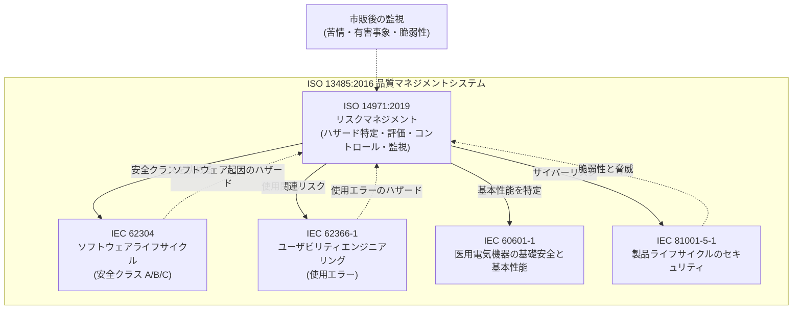

# 医療機器の安全設計と規制下のソフトウェア開発 (Medical Device Safety & Regulated Software Development)

## 概要 (Overview)

医療機器 (medical device) のソフトウェアは、放射線の線量、薬液の流量、心臓への電気刺激を直接決める。ここでの誤りはそのまま患者への危害 (harm) になりうる。本書は日本・米国・EU の規制の枠組みと、ISO 14971・IEC 62304・IEC 60601-1・IEC 62366-1・ISO 13485 の規格群を整理し、Therac-25、輸液ポンプ、植込み型ペースメーカの事例から、それらの要求がどの失敗に対応しているかを読む。

中心テーゼは次のとおりである。**医療機器の安全は「ソフトウェアに誤りがないこと」を示して成り立つのではない。誤りが残っていても危害に至らないことを、リスクマネジメント (risk management) の記録として示すことで成り立っている。規格群は過去の事故で欠けていたものを開発と市販後のプロセスとして固めたものである。** Therac-25 の過剰照射は、同じソフトウェアの欠陥が旧機種 Therac-20 ではヒューズを飛ばすだけで済んでいたことで知られる[^leveson]。差を生んだのはコードの正しさではなく、ソフトウェアから独立したハードウェアの保護回路だった。

車載の機能安全 ([`functional-safety-iso26262.md`](../automotive/functional-safety-iso26262.md)) と同じく「故障を前提に危険を防ぐ」考え方に立つ。違いは、医療機器では市場に出す前に規制当局の審査があり、リスクと便益 (benefit-risk) の比較が判断の軸になる点にある。

## 方法論 (Methodology)

- 規制と規格を分けて読む。法律と行政の要求 (薬機法、FD&C Act、EU MDR) は「何を示せば市場に出せるか」を決め、規格は「それをどういうプロセスで示すか」を与える。両者の対応を表と図で整理する。
- 事故から逆算して要求を読む。Therac-25 は Leveson & Turner (1993) の調査[^leveson]、輸液ポンプは FDA の白書[^fda-pump-wp]とガイダンス[^fda-pump-tplc]、ペースメーカは Halperin ら (2008)[^halperin] と CISA の勧告[^cisa-abbott]を一次資料とする。
- 時期で変わる事実は 2026-10 時点で確かめる。サイバーセキュリティのガイダンス、QMSR、AI 医療機器の件数、IEC 62304 第2版の審議状況を確かめ、取得日を付ける。第2版の状況だけは専門メディアの報道で確かめ、それ以外は FDA・PMDA・厚生労働省の公式ページで確認した。
- 規格本文は有償のため、本書は規格の公式の要約、規制当局の通知とガイダンス、業界団体の公開資料で確かめた範囲だけを書く。

## 発見事項 (Findings)

1. **安全の主張は「誤りがない」ではなく「誤っても危害に至らない」の形を取る。** Therac-25 では、Therac-20 と同じ欠陥がありながら、Therac-20 は独立した保護回路がビームを止めていた[^leveson]。EU MDR の附属書 I はリスクコントロールの優先順位を「設計による除去・低減 → 警報を含む保護手段 → 安全のための情報」と定める[^mdr]。
2. **ソフトウェアの故障確率を数字で見積もる安全解析は信用できない。** AECL の 1983 年の故障の木解析 (fault tree analysis) は「計算機が誤ったエネルギーを選ぶ」確率を 10⁻¹¹ と置いたが、根拠は示されていなかった[^leveson]。IEC 62304 が求めるのは確率の見積もりではなく、起こりうる危害の重さに応じたプロセスの厳しさ (ソフトウェア安全クラス) である[^jira-62304]。
3. **規格は事故の欠落をプロセスとして埋めている。** 輸液ポンプでは 2005〜2009 年に約 56,000 件の有害事象報告と 87 件のリコールがあり、FDA は多くが設計と工学の欠陥に関係すると結論した[^fda-pump-wp]。その後のガイダンスはハザードの網羅を論証する安全保証ケース (safety assurance case) を 510(k) の審査に求めた[^fda-pump-tplc]。
4. **無線でつながる植込み型機器は、安全とセキュリティが同じ問題になる。** Halperin ら (2008) はソフトウェア無線で植込み型除細動器 (ICD) の通信を解析し、患者の安全を損ないうる攻撃を示した[^halperin]。2017 年には Abbott (旧 St. Jude Medical) のペースメーカに、認証の回避と電池の消耗を許す脆弱性が公表され、ファームウェアの更新は医療機関で行う必要があった[^cisa-abbott][^secweek]。
5. **サイバーセキュリティは 2023 年から米国で法律上の市販前要求になった。** FD&C Act の 524B 条はサイバー機器 (cyber device) の申請者に、市販後の脆弱性対応の計画、更新とパッチの提供、SBOM (Software Bill of Materials) の提出を求める[^usc-524b]。日本も 2023-04 に基本要件基準第12条第3項を適用し、JIS T 81001-5-1 等への適合を求めた[^mhlw-0331]。
6. **AI 医療機器は「承認後に変わる機器」をどう扱うかという新しい問題を持ち込んだ。** FDA は 2026-09 時点で 1,600 件超の AI 搭載機器を認可しており[^fda-ai]、変更の範囲と検証方法を前もって承認する PCCP (Predetermined Change Control Plan) の枠組みを法律に置いた[^fr-515c]。日本にも変更計画確認手続制度 (IDATEN) があり、AI を使う機器には追加の資料を求める[^pmda-idaten]。

## アーキテクチャ (Architecture)

### 日米欧の規制の枠組み (Regulatory Frameworks)

3つの法域はいずれも、生体へのリスクの大きさで機器をクラスに分け、クラスが高いほど市場に出す前の審査を重くする。

| 項目 | 日本 (薬機法) | 米国 (FD&C Act) | EU (MDR) |
|---|---|---|---|
| 法令 | 医薬品、医療機器等の品質、有効性及び安全性の確保等に関する法律 | Federal Food, Drug, and Cosmetic Act | Regulation (EU) 2017/745、2021-05-26 から適用[^ema-mdr] |
| クラス | 一般医療機器 (クラス I)、管理医療機器 (II)、高度管理医療機器 (III・IV)[^pmda-class] | Class I・II・III[^fda-classify] | Class I・IIa・IIb・III[^mdr] |
| 低リスク | クラス I は PMDA への届出 (自己認証)[^pmda-class] | 多くの Class I は 510(k) 免除。FDA によれば Class I の約 74% が免除[^fda-classify] | 本書では扱わない |
| 中リスク | 認証基準のあるクラス II・III は第三者認証機関の認証[^pmda-class] | 510(k): 既存の合法な機器 (predicate) との実質的同等性 (substantial equivalence) を示す。判断は通常 90 日以内[^fda-510k] | 本書では扱わない |
| 高リスク | 厚生労働大臣の承認 (PMDA が審査)[^pmda-class] | PMA: Class III の審査で、FDA の市販前申請のうち最も厳しい[^fda-pma] | 本書では扱わない |
| 新規の機器 | 本書では扱わない | De Novo: predicate のない新規の低〜中リスク機器を Class I/II に分類する。以後の 510(k) の predicate になる[^fda-denovo] | 本書では扱わない |
| 品質システム | 本書では扱わない | QMSR (21 CFR 820)。2026-02-02 から ISO 13485:2016 を参照で取り込む[^fda-qmsr] | 本書では扱わない |

「本書では扱わない」とした欄は、作成時に一次資料で確かめられなかった項目である。EU の適合性評価の手続と、MDR の移行期間の延長 (Regulation (EU) 2023/607) の期限も同じ理由で扱わない。

米国の 510(k) は「承認 (approval)」ではなく「クリアランス (clearance)」と呼ばれる[^fda-510k]。新しい機器が既存の機器と同じくらい安全で有効だと示す手続であり、安全そのものを一から証明する手続ではない。この構造は、後述する輸液ポンプで FDA が安全保証ケースを求めた背景になっている。

### 規格群の関係 (Standards Map)

医療機器の規格群は品質マネジメントシステム (QMS) の上に、リスクマネジメントを軸として、ソフトウェア・電気安全・ユーザビリティ・セキュリティの各規格がつながる構造を持つ。IEC 62304 を社内で運用するには、ISO 14971 を取り込んだ ISO 13485 の QMS が事実上の前提になる[^jira-62304]。

凡例: 実線はリスクマネジメントから各規格への入力 (何を、どの厳しさで行うかを決める)、点線は各規格の活動や市販後情報からリスクマネジメントへの戻り (新しいハザードの報告) を示す。枠は ISO 13485 の QMS の中で全体が運用されることを表す。

各規格の識別は次のとおりである (いずれも 2026-10-24 に発行機関または規制当局のページで確認)。

| 規格 | 題名 | 現行版 | 確認先 |
|---|---|---|---|
| ISO 14971:2019 | Medical devices — Application of risk management to medical devices | 第3版。2025 年に見直しで確認済み。指針は ISO/TR 24971:2020 | ISO[^iso14971] |
| IEC 62304:2006+AMD1:2015 | Medical device software — Software life cycle processes | 統合版 Ed. 1.1 (2015-06-26)。日本では JIS T 2304 が対応する | IEC[^iec62304] |
| IEC 60601-1:2005+AMD1:2012+AMD2:2020 | 医用電気機器の基礎安全と基本性能の一般要求 | 統合版 Ed. 3.2 (2020-08-20) | IEC[^iec60601] |
| IEC 62366-1:2015+AMD1:2020 | Medical devices — Part 1: Application of usability engineering to medical devices | 統合版 Ed. 1.1 (2020-06-17) | IEC[^iec62366] |
| ISO 13485:2016 | Medical devices — Quality management systems — Requirements for regulatory purposes | FDA の QMSR が参照で取り込む版 | FDA[^fda-qmsr] |

### リスクコントロールの優先順位 (Risk Control Hierarchy)

EU MDR 附属書 I の第4節は、製造業者がリスクを減らす手段を次の優先順位で選ぶよう定める[^mdr]。

1. 安全な設計と製造によって、リスクをできる限り除去または低減する。
2. 必要に応じて、警報 (alarm) を含む適切な保護手段を取る。
3. 安全のための情報 (警告・注意・禁忌) を提供し、必要に応じて使用者を訓練する。

第2節は「できる限り低減する (as far as possible)」を、便益とリスクの比 (benefit-risk ratio) を損なわない範囲での低減と説明している[^mdr]。リスクをゼロにすることではなく、残ったリスク (残留リスク, residual risk) が便益に見合うことを示すのが要求である。Therac-25 の事故はこの優先順位の1番目 (ハードウェアの保護回路による設計上の除去) を外し、ソフトウェアの確認と操作者への表示に頼った構成で起きた[^leveson]。

## 技術詳細 (Technical Details)

### 1. ISO 14971: リスクマネジメントのプロセス

ISO 14971 はソフトウェアである医療機器 (SaMD) と体外診断用の医療機器を含むすべての医療機器に適用され、製造業者が次を行うプロセスを定める[^iso14971]。

- 医療機器に関連するハザード (hazard) を特定する。
- 関連するリスクを推定し、評価する。
- リスクをコントロールする。
- コントロールの有効性を監視する。

要求は医療機器のライフサイクルの全段階に及び、2019 年版では便益とリスクの分析と、製造と製造後 (post-production) の活動への要求が強められた[^iso14971]。「製造後」が要求に入っていることが、後述するサイバーセキュリティの市販後対応と、AI 機器の変更管理をリスクマネジメントの中で扱える根拠になる。

### 2. IEC 62304: ソフトウェアライフサイクルと安全クラス

IEC 62304 は、ソフトウェアそれ自体が医療機器である場合と、医療機器に組み込まれる、または不可欠な部分となるソフトウェアの、開発と保守に適用される[^iec62304][^jira-62304]。規格はソフトウェアの妥当性確認 (validation) と最終的なリリースは扱わず、それらは機器全体の設計管理に委ねる[^iec62304]。

規格の要求事項は次の箇条からなる[^jira-62304]。

| 箇条 | プロセス |
|---|---|
| 5 | ソフトウェア開発 (計画、要求分析、アーキテクチャ設計、詳細設計、実装と単体検証、結合と結合試験、システム試験、リリース) |
| 6 | ソフトウェア保守 |
| 7 | ソフトウェアリスクマネジメント |
| 8 | ソフトウェア構成管理 |
| 9 | ソフトウェア問題解決 |

規格の根拠を述べる附属書 A は、機能や性能を試験しただけではソフトウェアの使用が安全だと判断するには不十分だという考えに立ち、プロセスに従うことと、患者等へのリスクに応じたプロセスを選ぶことを求める[^jira-62304]。その仕組みがソフトウェア安全クラス (software safety class) である。

| クラス | ソフトウェアが寄与しうる危害 (第1版の説明) | 求められる作業の例 |
|---|---|---|
| A | 負傷または健康障害の可能性はない | 単体の実装 (5.5.1) |
| B | 重傷の可能性はない | A に加え、単体検証プロセスの確立、合否判定基準、単体検証 |
| C | 死亡または重傷の可能性がある | B に加え、追加の合否判定基準 (5.5.4) など、すべての作業 |

表のクラスの説明と作業の対応は、JIRA (日本画像医療システム工業会) が IEC 62304 第1版について公開した解説資料に基づく[^jira-62304]。クラスは ISO 14971 のリスクマネジメントで決まる[^jira-62304]。専門家の解説によれば、クラス A とするためにリスクを許容可能にするコントロールはソフトウェアシステムの外になければならず、分類を行わなければすべてのソフトウェアがクラス C として扱われる[^johner]。2015 年の Amendment 1 以降の分類の細部は規格本文で確かめる必要があり、本書では扱わない。

このクラス分けはソフトウェアの故障確率を見積もらない点で、車載の ASIL ([`functional-safety-iso26262.md`](../automotive/functional-safety-iso26262.md)) と考え方を共有する。ISO 26262 も系統故障 (設計の誤り) を確率ではなくプロセスで扱う。Therac-25 の安全解析が根拠のない 10⁻¹¹ という数字に頼ったこと[^leveson]を思い出せば、「重さでクラスを決め、確率は数えない」という設計は筋が通っている。

**第2版の状況 (2026-10 時点)**: IEC 62304 第2版は審議中で未発行である。専門メディアの報道によれば、IEC が示す発行予定日は 2028-10-26 で、適用範囲を医療機器からヘルスソフトウェア全般へ広げ、A/B/C の3クラスを2段階のプロセスの厳しさ (I/II) に置き換える案が検討されている[^qb-62304ed2]。この報道は単一の二次資料に基づくため、確定した内容ではない。2026-10 時点で適用されるのは Ed. 1.1 である[^iec62304]。

### 3. IEC 60601-1 と IEC 62366-1: 電気安全とユーザビリティ

**IEC 60601-1** は医用電気機器 (medical electrical equipment) に一般に適用される基礎安全 (basic safety) と基本性能 (essential performance) の要求をまとめた通則である[^iec60601]。機器の種類によっては、副通則 (collateral standard) や個別規格 (particular standard) がこの要求を補足または変更し、個別規格がある場合は通則だけを単独で使うべきではないとされる[^iec60601]。日本の行政通知も JIS T 2304 によるライフサイクル全体のリスクマネジメントで「安全性と基本性能」を確保することを求めている[^mhlw-0331]。ソフトウェアは基本性能を担う機能 (例: 輸液の流量制御) のリスクコントロール手段にも、ハザードの原因にもなる。

**IEC 62366-1** は安全に関わる範囲で医療機器のユーザビリティを分析・規定・開発・評価するプロセスを定める[^iec62366]。対象は正しい使用と使用エラー (use error) に関連するリスクで、異常使用 (abnormal use) は対象外である。ISO 14971 との結びつきを強めた規格であり、使用エラーはリスクマネジメントのハザードとして扱われる[^iec62366]。FDA も使用エラーとその結果の危害を最小にするためのヒューマンファクターズとユーザビリティエンジニアリングのガイダンスを出している[^fda-hf]。

Leveson & Turner は Therac-25 の教訓の一つとして「安全な操作者インターフェースと『使いやすい』インターフェースの違い」を挙げた[^leveson]。1985 年の Hamilton の事故では、装置が "H-tilt" のエラーと「線量なし (no dose)」を表示し、操作者は照射を何度もやり直した[^leveson]。使いやすさと安全の確認は衝突しうる。IEC 62366-1 が使用エラーをリスクマネジメントのハザードとして扱うのは、この衝突を設計の段階で評価するためと読める。

### 4. Therac-25 (1985〜1987 年): ソフトウェアに安全を預けた設計

Therac-25 は AECL (Atomic Energy of Canada Limited) が開発した医療用の線形加速器で、米国に5台、カナダに6台が設置された。1985-06 から 1987-01 までに6件の大量過剰照射が起きた[^leveson]。

**設計の変化**: 前の機種 Therac-6 と Therac-20 は、独立した保護回路と機械的インターロックを持ち、ソフトウェアがなくても危険な状態を防げた。Therac-25 は最初から計算機制御を前提に設計され、AECL は既存のハードウェアの安全機構とインターロックをすべては引き継がないと決めた[^leveson]。ソフトウェアは Therac-6 のものを出発点とし、Therac-20 のルーチンも一部流用された[^leveson]。

**Tyler の事故 (1986-03、1986-04)**: データ入力の完了を示すフラグが立った後に、操作者がモードとエネルギーを素早く編集すると、変更が装置の設定に反映されなかった。曲げ磁石の設定には約8秒かかり、その間の編集を検出する処理はフラグを最初の通過で消していたためである。画面の表示と装置の実際の設定が食い違ったまま照射が始まり、ソフトウェアには食い違いを検出する検査がなかった[^leveson]。1986-03 の患者は推定 16,500〜25,000 rad を受けた。Tyler の2人の患者はいずれも後に死亡した[^leveson]。

**Yakima の事故 (1987-01)**: 準備の検査を通るたびに1ずつ増える変数 Class3 は1バイトで、256 回に1回 0 に戻る。0 の瞬間に操作者が "set" ボタンを押すと、上部コリメータの位置の検査が飛ばされた[^leveson]。処方 86 rad に対し、推定 8,000〜10,000 rad が照射された[^leveson]。

**Therac-20 との比較**: シカゴの医学物理士が Therac-20 で同じ編集の手順を試したところ、ヒューズが飛び、ブレーカが落ちた。同じソフトウェアの欠陥が Therac-20 にもあったが、保護回路がビームの照射を許さなかったため、患者への危険はなく「迷惑な不具合」で済んでいた[^leveson]。

AECL の是正計画 (CAP、1986-06-13 の初版とその後の改訂) は、Tyler の欠陥の修正、Class3 を固定の非ゼロ値にする修正に加え、**ソフトウェアから独立してビームを止める回路**の追加と、Malfunction 1〜64 を一時停止ではなく治療の中断にする変更を含んでいた[^leveson]。Leveson & Turner は、個々のソフトウェアの欠陥に注目することは安全なシステムを作る方法ではないと述べている[^leveson]。

Leveson & Turner の教訓と、現在の規格や規制の要求の対応を整理すると次のようになる。対応づけは本書の分析であり、規格が Therac-25 を直接の起源とすると述べるものではない。

| Leveson & Turner の指摘[^leveson] | 現在の要求での対応 |
|---|---|
| ソフトウェアへの過信とハードウェアのインターロックの撤去 | 設計によるリスク除去を最優先とする順位 (MDR 附属書 I 第4節)[^mdr] |
| 1つのソフトウェアの誤りで破局に至る設計をしない。最悪の場合に備える | 危害の重さでクラスを決める IEC 62304 の安全クラス[^jira-62304] |
| 安全解析の数値への過度の依存 | ソフトウェアの確率ではなくプロセスの厳しさで管理する考え方[^jira-62304] |
| 事故の調査で、ソフトウェアの関与を最後に調べた | 市販後の監視と問題解決プロセス (ISO 14971、IEC 62304 箇条9)[^iso14971][^jira-62304] |
| 安全な操作者インターフェースと「使いやすい」インターフェースの混同 | 使用エラーをハザードとして扱う IEC 62366-1[^iec62366] |
| 監査証跡とインシデント分析の手順の欠如 | ISO 13485 の QMS と、米国の QMSR による取り込み[^fda-qmsr] |

### 5. 輸液ポンプと Infusion Pump Improvement Initiative (2010 年〜)

FDA は 2010-04 の白書で、2005〜2009 年に輸液ポンプについて約 56,000 件の有害事象報告を受け、87 件のリコール (Class I が 14 件、Class II が 70 件) があったと報告した[^fda-pump-wp]。FDA は、多くの問題が機器の設計と工学の欠陥に関係しているとし、個別の事例ごとに対応してきた方法では不十分だったと認めた[^fda-pump-wp]。

白書が挙げた問題は次の3種類である[^fda-pump-wp]。

- ソフトウェアの欠陥: 事前に設定した警報が鳴らない、問題がないのに警報が鳴る、1回の打鍵が複数回として登録される「キーバウンス (key bounce)」で過量または過少の投与が起きる。
- ユーザーインターフェースの問題: 測定単位があいまいな画面の指示など。
- 機械・電気の故障: 筐体の破損、電池の早期の故障、火花や発火。

FDA は対策として、設計と工学の追加情報の提出、使用環境に即した設計の妥当性確認、製造所の査察が済むまでクリアランスを保留しうること、製造業者が任意でソフトウェアのコードを FDA の静的解析の担当者に提出できる仕組み、オープンな参照モデルとしての Generic Infusion Pump プロジェクトを打ち出した[^fda-pump-wp]。

2014-12 の最終ガイダンス "Infusion Pumps Total Product Life Cycle" は、輸液ポンプの 510(k) で、実質的同等性を**安全保証ケース**の形で示すよう推奨した[^fda-pump-tplc]。安全保証ケースは主張 (claim)、主張と証拠をつなぐ論証 (argument)、証拠 (evidence) の3要素からなる構造化された論証で、ポンプがその使用環境で意図した使用に伴うハザードに十分に対処していることを示す[^fda-pump-tplc]。ガイダンスはハザード分析そのものの網羅性を別の論証 (confidence case) で示すことや、すべての危険状態に少なくとも1つのコントロールがあることをトレーサビリティで示すことも挙げている[^fda-pump-tplc]。

同じガイダンスはソフトウェアに由来するハザードとその原因の例を表にしている[^fda-pump-tplc]。

| ハザード | 原因の例 |
|---|---|
| ソフトウェアの実行時エラー | バッファのオーバーフロー/アンダーフロー、ヌルポインタ参照、メモリリーク、未初期化変数、誤った動的ライブラリ |
| 輸液指令の破損 | データの保存・読み出しの誤り、通信の問題 |
| 誤ったソフトウェアの版 | 更新の未適用、誤った薬剤ライブラリの読み込み |
| 警報の不作動または誤警報 | センサの故障、警報の優先度の設定誤り、閾値の設定誤り |

ハザードを考える範囲には、系統故障と偶発故障、予見できる誤使用、共通原因故障、意図的・非意図的なセキュリティの侵害も含まれる[^fda-pump-tplc]。安全保証ケースの考え方は「誤りがないこと」を示すのではなく「ハザードがコントロールされていること」を証拠付きで論じるという本書のテーゼを、審査の形式にしたものと読める。2023 年の FDA のソフトウェア申請ガイダンスでは、輸液ポンプは一般に Enhanced の文書レベル (Documentation Level) に当たるとされる[^fda-pump-tplc][^fda-swdoc]。

### 6. 植込み型機器: ペースメーカと遠隔からの攻撃

ペースメーカや植込み型除細動器 (ICD) は体内の電池で動き、医師はプログラマ (programmer) と呼ばれる外部装置から RF 通信で設定を変える[^cisa-abbott]。限られた電池と無線の入口という2つの性質が、セキュリティの対策と安全を衝突させる。後述の CVE-2017-12714 は、電池そのものが攻撃の対象になりうることを示した[^cisa-abbott]。

**Halperin ら (2008)**: 2003 年に米国で発売された ICD を対象に、オシロスコープとソフトウェア無線 (software radio) で通信プロトコルを部分的に解析し、患者の安全とプライバシーを損ないうるソフトウェア無線の攻撃を複数実装した[^halperin]。対策として、外部の電波から電力を得る (RF power harvesting) ことで電池を消費しない3つの防御を提案し、そのうち2つは患者自身を安全の確認に参加させる方式だった[^halperin]。電池が安全の資源であるため、暗号処理の電力すら安全とのトレードオフになることを示した研究である。

**Abbott (旧 St. Jude Medical) の 2017 年の更新**: 2017-08-29 に公表された CISA (当時の ICS-CERT) の勧告 ICSMA-17-241-01 は、2017-08-28 より前に製造された Accent/Anthem、Accent MRI、Assurity/Allure、Assurity MRI のペースメーカに3つの脆弱性があるとした[^cisa-abbott]。

| CVE | 弱点 | 内容 |
|---|---|---|
| CVE-2017-12712 | 不適切な認証 (CWE-287) | 認証鍵とタイムスタンプによる認証が破られ、近くの攻撃者が RF で不正な指令を送れる |
| CVE-2017-12714 | 電力消費の制限の欠如 (CWE-920) | 正しい形式の "RF wake-up" 指令の受信数を制限せず、繰り返し送ると電池が減る |
| CVE-2017-12716 | 機微なデータの暗号化の欠如 (CWE-311) | Accent と Anthem が患者情報を暗号化せずに送信・保存する |

攻撃には RF の届く距離まで近づく必要があり、高い技能が要るとされた[^cisa-abbott]。修正のファームウェアは医療機関で Merlin PCS プログラマを使って適用し、更新には設定の消失、バックアップモードへの移行、機能の喪失というリスクがあった。勧告は、ペーシングに依存する患者では一時ペーシングと本体の交換ができる環境で更新するよう推奨した[^cisa-abbott]。FDA は約 46.5 万台を対象として発表し、更新は約3分かかると報じられた[^cso-abbott][^secweek]。

この事例は、植込み型機器のセキュリティの修正が**それ自体リスクを持つ医療行為**になることを示す。患者と医師は、脆弱性が悪用されるリスクと、更新に失敗するリスクを比べて判断することになる[^secweek]。IT システムのように「パッチをすぐ当てる」ことが最善とは限らない。

### 7. サイバーセキュリティの規制 (2023 年以降)

**米国: FD&C Act 524B 条**: 2022-12-29 に成立した Consolidated Appropriations Act, 2023 の第3305条が 524B 条 (Ensuring cybersecurity of devices) を加え、2023-03-29 に施行された[^fda-cyber]。「サイバー機器」は、(1) 申請者が検証・導入・許可したソフトウェアを含み、(2) インターネットに接続する能力を持ち、(3) サイバーセキュリティの脅威に弱い可能性のある技術的特性を持つ機器と定義される[^usc-524b]。申請者は次を行わなければならない[^usc-524b]。

1. 市販後の脆弱性とエクスプロイトを、協調的な脆弱性開示 (coordinated vulnerability disclosure) を含めて、妥当な時間内に監視・特定・対処する計画を提出する。
2. 機器と関連システムがサイバーセキュアであるという合理的な保証を与えるプロセスを設計・維持し、既知の許容できない脆弱性には妥当な定期の周期で、制御できないリスクを生みうる重大な脆弱性にはできるだけ早く周期外で、更新とパッチを提供する。
3. 商用、オープンソース、既製品 (off-the-shelf) のソフトウェア部品を含む SBOM を提出する。
4. 規則で定めるその他の要求に従う。

FDA のガイダンスは 2016-12 の市販後管理のガイダンスに続き、市販前の申請内容のガイダンスが 2023-09 に出され、2025-06-27 に 524B 条への推奨 (第 VII 節) を加えて改訂された[^fda-cyber]。2026-02 にはさらに "Cybersecurity in Medical Devices: Quality Management System Considerations and Content of Premarket Submissions" として改訂され、2025 年版を置き換えた[^fda-cyber-2026]。題名が "Quality System" から "Quality Management System" に変わったのは、ISO 13485 を取り込んだ QMSR が 2026-02-02 に施行されたことと時期が重なる[^fda-qmsr]。

**日本: 基本要件基準第12条第3項**: 他の機器やネットワークに接続して使うプログラムを用いた医療機器に、サイバーセキュリティを確保する計画、サイバーリスクを減らす設計と製造、動作環境の最低限の要件の設定を求める規定で、2023-04-01 から適用され、2024-03-31 まで経過措置が置かれた[^mhlw-0331]。IMDRF の N47 と N60 (2020-03 の医療機器サイバーセキュリティの原則と実践) を踏まえたもので、JIS T 81001-5-1 (IEC 81001-5-1) への適合で第3項への適合を確認できる[^mhlw-0331]。JIS T 81001-5-1 は JIS T 2304 のライフサイクルの要求に加えて行うセキュリティの活動を定める規格と位置づけられている[^mhlw-0331]。想定する攻撃には脆弱性を突く不正アクセス、DoS/DDoS、マルウェア感染が挙げられ、USB 等の外部記録媒体や持ち込みの PC との接続も対象に含まれる[^mhlw-0331]。

**EU: MDR 附属書 I**: 第17.2節はソフトウェアを含む機器と、それ自体が機器であるソフトウェアを、開発ライフサイクル、情報セキュリティを含むリスクマネジメント、検証と妥当性確認の原則に沿って、最新の技術水準 (state of the art) で開発・製造するよう求める。第17.4節は製造業者にハードウェア、IT ネットワークの特性、IT セキュリティ対策の最低限の要件を示すよう求める[^mdr]。

3つの法域で共通するのは、セキュリティを独立した追加の要求ではなく、**リスクマネジメントの中のハザード源**として扱う点である。FDA の輸液ポンプのガイダンスがすでに「意図的・非意図的なセキュリティの侵害」をハザードの考慮範囲に入れていた[^fda-pump-tplc]ことは、この流れの早い例である。SBOM と脆弱性管理の一般論は [`software-supply-chain-security.md`](../../software/security/software-supply-chain-security.md) と [`vulnerability-management.md`](../../software/security/vulnerability-management.md) が扱う。

### 8. SaMD と AI 医療機器

**SaMD の定義**: IMDRF は SaMD (Software as a Medical Device) を「1つ以上の医療目的で使われることを意図し、ハードウェアの医療機器の一部とならずにその目的を果たすソフトウェア」と定義する。FDA もこの定義を採り、医療機器の中のソフトウェア (SiMD) や製造・保守に使うソフトウェアと区別する[^fda-samd]。日本では 2014-11-25 施行の薬機法で、疾病の診断・治療等を目的とする単体のプログラムが医療機器の規制対象になった。PMDA は医療機器としての目的を持ち、意図したとおりに機能しない場合に患者 (または使用者) の生命と健康に影響を与えるおそれがあるプログラムをプログラム医療機器と説明している[^pmda-samd]。

**EU MDR の Rule 11**: 診断や治療の判断に使う情報を出すソフトウェアは原則 Class IIa で、その判断が死亡や健康状態の不可逆な悪化を招きうる場合は Class III、重大な悪化や外科的介入を招きうる場合は Class IIb になる。生理的過程を監視するソフトウェアは Class IIa で、変動が患者に差し迫った危険を生みうるバイタルパラメータの監視なら Class IIb になる。それ以外のソフトウェアは Class I である[^mdr]。誤った判断がもたらす危害の重さでクラスを決める点で、IEC 62304 の安全クラスと同じ考え方をしている。

**FDA の AI 搭載機器の件数**: FDA は 2026-09 時点で、米国で販売を認可した AI 搭載の医療機器が 1,600 件を超えると公表している[^fda-ai]。2025 年末までの認可分では 1,451 件で、そのうち放射線科 (radiology) が 1,104 件 (76%) を占めたと報じられた[^imagingwire]。FDA は一覧が AI 医療機器を網羅するものではなく、公開の要約にある AI 関連の語を主な手がかりに作られていると断っている[^fda-ai-list]。基盤モデルや大規模言語モデル (LLM) を使う機器を識別して印を付ける方法を検討するとも述べている[^fda-ai-list]。件数は認可の数であり、臨床での使用量や安全性の指標ではない。

**PCCP**: 2022 年の FDORA 第3308条が FD&C Act に 515C 条 (21 U.S.C. 360e-4) を加え、FDA が PCCP を承認またはクリアできるようにした。PCCP に沿った変更であれば、新たな PMA 補足申請や 510(k) は要らない[^fr-515c]。AI 搭載機器向けの最終ガイダンス (FDA のページ上の現行版は 2025-08) は、PCCP に、計画した変更の内容、変更を開発・検証・実装する方法、変更の影響の評価を記載するよう推奨する[^fda-pccp]。FDA の AI 搭載機器の一覧には "with PCCP" と付いた認可の例も載っている[^fda-ai-list]。

**日本の IDATEN**: 2020 年に導入された変更計画確認手続制度 (IDATEN: Improvement Design within Approval for Timely Evaluation and Notice) は、改良が見込まれる機器の変更計画を審査の過程で確認し、計画の範囲内で承認事項の一部変更を迅速に認める[^pmda-idaten]。医薬品医療機器等法施行規則 第114条の45の2 は、人工知能関連技術を使う機器について、変更計画と設計・開発の検証方法に加え、変更計画の作成と実施の手順と、AI の適正かつ円滑な管理に必要な資料を求める[^pmda-idaten]。

PCCP と IDATEN は承認を「完成品の一時点の状態」から「変更してよい範囲と、その検証の方法」へ移す仕組みである。これはリスクマネジメントの製造後の監視を前提とした設計で、承認後に性能が変わる機器でも「危害に至らないことを示し続ける」という同じ論理を保とうとしている。

## 運用・安全考察 (Operational & Safety Considerations)

- サイバーセキュリティ: 524B 条は脆弱性への対応を「計画」と「周期」の形で求め、重大な脆弱性には周期外の対応を求める[^usc-524b]。一方で、植込み型機器の更新はそれ自体に機能喪失のリスクがあり、Abbott の事例では医療機関での実施と、ペーシング依存の患者への備えが必要だった[^cisa-abbott]。更新の速さと、更新そのものの安全の両方をリスクマネジメントで比べる必要がある。IT の脆弱性管理の優先順位づけ ([`vulnerability-management.md`](../../software/security/vulnerability-management.md)) は、そのままでは医療機器に当てはまらない。
- SBOM の運用: SBOM は提出して終わりではなく、市販後に新しい脆弱性が見つかったとき、どの機器のどの版が影響を受けるかを答えるための資料である。524B 条は商用・オープンソース・既製品の部品を含めるよう求める[^usc-524b]。IEC 62304 の構成管理 (箇条8) と保守 (箇条6) の記録が、その前提になる[^jira-62304]。
- 想定外の接続経路: 日本の通知は USB メモリや持ち込みの PC のような外部記録媒体と端末も接続に含める[^mhlw-0331]。病院のネットワークから物理的に切り離しても、保守の作業経路が攻撃経路になりうる。制御系の一般論は [`plant-control-scada-security.md`](../energy/plant-control-scada-security.md) と共通する。
- 独立した保護経路の維持: Therac-25 の是正計画はソフトウェアから独立してビームを止める回路を加えた[^leveson]。ソフトウェアの更新や AI の再学習で機能が変わっても、危害を防ぐ最後の経路がソフトウェアの外に残っていれば、更新の失敗が直接の危害に結びつきにくい。車載の E-Gas 3レベル監視 ([`functional-safety-iso26262.md`](../automotive/functional-safety-iso26262.md)) と同じ設計思想である。
- 警報と使用エラー: 輸液ポンプの問題には、警報が鳴らない不具合と誤警報の両方が含まれていた[^fda-pump-wp]。Therac-25 の Hamilton の事故で操作者がエラー表示のあとも照射をやり直したように[^leveson]、表示や警報の信頼が下がると操作者の判断が変わる。警報の設計はソフトウェアの正しさだけでなく、IEC 62366-1 の使用エラーの分析の対象になる[^iec62366]。
- 規格の版の移行: IEC 62304 第2版で安全クラスの構造が変われば、既存の機器の文書をどう読み替えるかが問題になる[^qb-62304ed2]。2026-10 時点では Ed. 1.1 が適用され、第2版の内容はまだ確定していない。
- AI 機器の変更管理: PCCP と IDATEN は変更の範囲を前もって承認するが、範囲の外の変更は通常の申請が要る[^fr-515c][^pmda-idaten]。学習データの偏りや運用環境の変化による性能の低下は、承認時の検証では捉えきれないため、市販後の監視が要る。
- 公開情報の扱い: 本書の題材はすべて防御の観点から公開された資料 (事故調査、規制当局の勧告、査読論文) に基づく。脆弱性の詳細は CISA の勧告に記載された範囲にとどめた。

## 結論 (Conclusions)

- 医療機器の安全の主張は、ソフトウェアに誤りがないことではなく、誤りが残っても危害に至らないことを、リスクマネジメントの記録と論証で示す形を取る。Therac-20 と Therac-25 の差、輸液ポンプの安全保証ケース、EU MDR のリスクコントロールの優先順位は、いずれもこの形を示している。
- IEC 62304 の安全クラスはソフトウェアの故障確率を見積もらず、起こりうる危害の重さでプロセスの厳しさを決める。Therac-25 の安全解析が根拠のない確率に頼った失敗への、構造的な答えになっている。
- 規格群 (ISO 13485、ISO 14971、IEC 62304、IEC 60601-1、IEC 62366-1、IEC 81001-5-1) は、過去の事故で欠けていたもの (独立した保護、使用エラーの分析、ハザードの網羅、市販後の監視、セキュリティ) をプロセスとして固めたものと読める。
- 2023 年以降、サイバーセキュリティは米国 (524B 条)、日本 (基本要件基準第12条第3項)、EU (MDR 附属書 I) のいずれでも市販前の要求になり、SBOM と市販後の脆弱性対応が審査の対象になった。
- AI 医療機器は承認後に変わる機器を持ち込み、PCCP と IDATEN は承認の対象を「変更してよい範囲と検証の方法」へ広げた。製造後のリスクマネジメントの重要性はさらに増している。

### 次の接続先 (Related Topics)

- [`../automotive/functional-safety-iso26262.md`](../automotive/functional-safety-iso26262.md)：ASIL と系統故障・偶発故障の区別、E-Gas 3レベル監視。IEC 62304 の安全クラスとの対比。
- [`../automotive/cybersecurity-iso21434.md`](../automotive/cybersecurity-iso21434.md)：TARA とセキュア OTA。524B 条と JIS T 81001-5-1 の自動車での対応物。
- [`../energy/plant-control-scada-security.md`](../energy/plant-control-scada-security.md)：物理系を制御するシステムのセキュリティ。
- [`../../software/security/software-supply-chain-security.md`](../../software/security/software-supply-chain-security.md)：SBOM、来歴、署名。524B 条の SBOM 要求の技術的な中身。
- [`../../software/security/vulnerability-management.md`](../../software/security/vulnerability-management.md)：脆弱性の優先順位づけと協調的な開示。
- [`../../software/embedded/rtos-architectures.md`](../../software/embedded/rtos-architectures.md)：医療機器の組込みソフトウェアの実行基盤と、認証済み構成の凍結と更新の衝突。
- [`../../software/formal-methods/formal-verification-landscape.md`](../../software/formal-methods/formal-verification-landscape.md)：Therac-25 型の競合状態を設計段階で検出する手法。
- [`../../foundations/mathematics/probability-statistics/reliability-theory.md`](../../foundations/mathematics/probability-statistics/reliability-theory.md)：故障率と冗長の確率論。ソフトウェアに確率を割り当てる難しさの背景。
- [`../railway/railway-signaling-control.md`](../railway/railway-signaling-control.md)：故障したら止まれば安全という安全側を持つ系の設計。Therac-20 のハードウェア保護回路と同じく、ソフトウェアから独立した防護で安全を守る。

## 参考文献 (References)

**論文・調査 (Papers & Investigations)**

[^leveson]: Leveson, N. G., & Turner, C. S. (1993). An Investigation of the Therac-25 Accidents. *Computer*, 26(7), 18–41. https://doi.org/10.1109/MC.1993.274940 。本文は [MIT 6.033 の再掲 Part I〜IV](https://web.mit.edu/6.033/2004/wwwdocs/papers/Therac_1.html) — Accessed: 2026-10-24。

[^halperin]: Halperin, D., Heydt-Benjamin, T. S., Ransford, B., Clark, S. S., Defend, B., Morgan, W., Fu, K., Kohno, T., & Maisel, W. H. (2008). Pacemakers and Implantable Cardiac Defibrillators: Software Radio Attacks and Zero-Power Defenses. In *2008 IEEE Symposium on Security and Privacy*, 129–142. https://doi.org/10.1109/SP.2008.31

**規格 (Standards)**

[^iso14971]: ISO 14971:2019, *Medical devices — Application of risk management to medical devices* (3rd ed.). — [ISO 14971:2019](https://www.iso.org/standard/72704.html) — Accessed: 2026-10-24。規格の公式の要約と版の情報に基づく。

[^iec62304]: IEC 62304:2006+AMD1:2015 CSV, *Medical device software — Software life cycle processes* (Ed. 1.1, 2015-06-26). — [IEC Webstore](https://webstore.iec.ch/en/publication/6792) — Accessed: 2026-10-24。

[^iec60601]: IEC 60601-1:2005+AMD1:2012+AMD2:2020 CSV (Ed. 3.2, 2020-08-20). — [IEC Webstore](https://webstore.iec.ch/en/publication/67497) — Accessed: 2026-10-24。

[^iec62366]: IEC 62366-1:2015+AMD1:2020 CSV, *Medical devices — Part 1: Application of usability engineering to medical devices* (Ed. 1.1, 2020-06-17). — [IEC Webstore](https://webstore.iec.ch/en/publication/67220) — Accessed: 2026-10-24。

[^jira-62304]: 一般社団法人 日本画像医療システム工業会 (JIRA). IEC62304規格の概要 (2011)。 — [JIRA 資料 PDF](https://member.jira-net.or.jp/jira_portal/member/member_info/file2/20110217_IT-tokku_07.pdf) — Accessed: 2026-10-24。IEC 62304 第1版の適用範囲、プロセスの構成、安全クラスと作業の対応、附属書 A の考え方の解説。業界団体の二次資料。

[^johner]: Johner Institute. [IEC 62304 のソフトウェア安全クラスに関する解説記事](https://blog.johner-institute.com/iec-62304-medical-software/safety-class-iec-62304/) — Accessed: 2026-10-24。医療機器規制の専門機関による解説 (二次資料)。

[^qb-62304ed2]: [IEC 62304 Edition 2 has been delayed until October 2028](https://quickbirdmedical.com/en/news/iec-62304-edition-2-august-2026/) (QuickBird Medical, 2026-09-10) — Accessed: 2026-10-24。第2版の審議状況に関する専門メディアの報道 (二次資料)。

**法令・規制当局 (Regulations & Regulators)**

[^usc-524b]: 21 U.S.C. § 360n-2 (FD&C Act § 524B), *Ensuring cybersecurity of devices*. — [Cornell LII](https://www.law.cornell.edu/uscode/text/21/360n-2) — Accessed: 2026-10-24。

[^fda-cyber]: U.S. FDA. [Cybersecurity](https://www.fda.gov/medical-devices/digital-health-center-excellence/cybersecurity) — Accessed: 2026-10-24。524B 条の成立と施行日、ガイダンスの改訂の経緯。

[^fda-cyber-2026]: U.S. FDA. [Cybersecurity in Medical Devices: Quality Management System Considerations and Content of Premarket Submissions](https://www.fda.gov/regulatory-information/search-fda-guidance-documents/cybersecurity-medical-devices-quality-management-system-considerations-and-content-premarket) (Final, 2026-02) — Accessed: 2026-10-24。

[^fda-qmsr]: U.S. FDA. [Quality Management System Regulation (QMSR)](https://www.fda.gov/medical-devices/postmarket-requirements-devices/quality-management-system-regulation-qmsr) — Accessed: 2026-10-24。2026-02-02 施行、ISO 13485:2016 を参照で取り込む。

[^fda-classify]: U.S. FDA. [Classify Your Medical Device](https://www.fda.gov/medical-devices/overview-device-regulation/classify-your-medical-device) — Accessed: 2026-10-24。

[^fda-510k]: U.S. FDA. [Premarket Notification 510(k)](https://www.fda.gov/medical-devices/premarket-submissions-selecting-and-preparing-correct-submission/premarket-notification-510k) — Accessed: 2026-10-24。

[^fda-pma]: U.S. FDA. [Premarket Approval (PMA)](https://www.fda.gov/medical-devices/premarket-submissions-selecting-and-preparing-correct-submission/premarket-approval-pma) — Accessed: 2026-10-24。

[^fda-denovo]: U.S. FDA. [De Novo Classification Request](https://www.fda.gov/medical-devices/premarket-submissions-selecting-and-preparing-correct-submission/de-novo-classification-request) — Accessed: 2026-10-24。

[^fda-pump-wp]: U.S. FDA, CDRH (2010-04). [White Paper: Infusion Pump Improvement Initiative](https://www.fda.gov/medical-devices/infusion-pumps/white-paper-infusion-pump-improvement-initiative) — Accessed: 2026-10-24。

[^fda-pump-tplc]: U.S. FDA (2014-12-02). *Infusion Pumps Total Product Life Cycle: Guidance for Industry and FDA Staff*. — [FDA ガイダンス](https://www.fda.gov/regulatory-information/search-fda-guidance-documents/infusion-pumps-total-product-life-cycle) ／ [PDF](https://www.fda.gov/media/78369/download) — Accessed: 2026-10-24。第5節 (安全保証ケース)、表2・表7 (システムハザードとソフトウェア由来のハザード)、冒頭の 2023 年の注記 (Documentation Level)。

[^fda-swdoc]: U.S. FDA (2023-06). [Content of Premarket Submissions for Device Software Functions](https://www.fda.gov/regulatory-information/search-fda-guidance-documents/content-premarket-submissions-device-software-functions) — Accessed: 2026-10-24。2005 年のソフトウェア申請ガイダンスを置き換える。

[^fda-hf]: U.S. FDA. [Applying Human Factors and Usability Engineering to Medical Devices](https://www.fda.gov/regulatory-information/search-fda-guidance-documents/applying-human-factors-and-usability-engineering-medical-devices) — Accessed: 2026-10-24。

[^fda-samd]: U.S. FDA. [Software as a Medical Device (SaMD)](https://www.fda.gov/medical-devices/digital-health-center-excellence/software-medical-device-samd) — Accessed: 2026-10-24。IMDRF の定義を引用。

[^fda-ai]: U.S. FDA. [Artificial Intelligence in Software as a Medical Device](https://www.fda.gov/medical-devices/software-medical-device-samd/artificial-intelligence-software-medical-device) (Content current as of 2026-09-22) — Accessed: 2026-10-24。「2026-09 時点で 1,600 件超」。

[^fda-ai-list]: U.S. FDA. [Artificial Intelligence-Enabled Medical Devices (list)](https://www.fda.gov/medical-devices/artificial-intelligence-enabled-medical-devices/list-artificial-intelligence-enabled-medical-devices) — Accessed: 2026-10-24。一覧の範囲の注記と、基盤モデル・LLM の識別に関する記述。

[^fda-pccp]: U.S. FDA. [Marketing Submission Recommendations for a Predetermined Change Control Plan for Artificial Intelligence-Enabled Device Software Functions](https://www.fda.gov/regulatory-information/search-fda-guidance-documents/marketing-submission-recommendations-predetermined-change-control-plan-artificial-intelligence) (Final; ページ上の版 2025-08) — Accessed: 2026-10-24。

[^fr-515c]: U.S. FDA (2024-03-15). Medical Devices; Technical Amendments. *Federal Register*, 89(52), 18792–18793. — [govinfo](https://www.govinfo.gov/content/pkg/FR-2024-03-15/html/2024-05473.htm) — Accessed: 2026-10-24。FDORA 第3308条による 515C 条 (PCCP) の追加と、21 CFR 807.81(b)・814.39(b) の改正。

[^cisa-abbott]: CISA (ICS-CERT). [ICSMA-17-241-01: Abbott Laboratories' Accent/Anthem, Accent MRI, Assurity/Allure, and Assurity MRI Pacemaker Vulnerabilities](https://www.cisa.gov/ics/advisories/ICSMA-17-241-01) (初版 2017-08-29、改訂 2018-04-16) — Accessed: 2026-10-24。

[^mdr]: Regulation (EU) 2017/745 of the European Parliament and of the Council of 5 April 2017 on medical devices. — [EUR-Lex 32017R0745](https://eur-lex.europa.eu/eli/reg/2017/745/oj) — Accessed: 2026-10-24。附属書 I 第2節・第4節・第17.2節・第17.4節、附属書 VIII Rule 11。

[^ema-mdr]: European Medicines Agency. [Medical devices](https://www.ema.europa.eu/en/human-regulatory-overview/medical-devices) — Accessed: 2026-10-24。MDR は 2021-05-26、IVDR は 2022-05-26 から適用。

[^mhlw-0331]: 厚生労働省医薬・生活衛生局医療機器審査管理課長 (2023-03-31). 医療機器の基本要件基準第12条第3項の適用について (薬生機審発0331第8号)。 — [厚生労働省 PDF](https://www.mhlw.go.jp/content/11120000/001167157.pdf) — Accessed: 2026-10-24。

[^pmda-class]: 医薬品医療機器総合機構 (PMDA) 医療機器ユニット. 医療機器分類と薬事審査関係部署について。 — [PMDA PDF](https://www.pmda.go.jp/files/000273968.pdf) — Accessed: 2026-10-24。

[^pmda-samd]: 医薬品医療機器総合機構 (PMDA). [プログラム医療機器](https://www.pmda.go.jp/review-services/drug-reviews/about-reviews/devices/0048.html) — Accessed: 2026-10-24。

[^pmda-idaten]: 医薬品医療機器総合機構 (PMDA). IDATEN制度の概要 (プログラム医療機器に関する講習会資料)。 — [PMDA PDF](https://www.pmda.go.jp/files/000282725.pdf) — Accessed: 2026-10-24。医薬品医療機器等法施行規則 第114条の45の2・第114条の45の3 の引用を含む。

**報道 (News, 二次資料)**

[^secweek]: [St. Jude Medical Recalls 465,000 Pacemakers Over Security Vulnerabilities](https://www.securityweek.com/st-jude-medical-recalls-465000-pacemakers-over-security-vulnerabilities/) (SecurityWeek, 2017-08-31) — Accessed: 2026-10-24。

[^cso-abbott]: [465,000 Abbott pacemakers vulnerable to hacking need a firmware fix](https://www.csoonline.com/article/562807/465000-abbott-pacemakers-vulnerable-to-hacking-need-a-firmware-fix.html) (CSO Online, 2017-09-04) — Accessed: 2026-10-24。FDA の発表した 465,000 台と、更新に約3分かかることを報じる。

[^imagingwire]: [Numbers from the FDA show radiology is maintaining its lead](https://theimagingwire.com/2026/03/11/numbers-from-the-fda-show-radiology-is-maintaining-its-lead/) (The Imaging Wire, 2026-03) — Accessed: 2026-10-24。2025 年末までの 1,451 件と放射線科 1,104 件 (76%)。

**注**: ISO・IEC の規格本文は有償のため、本書は規格の公式の要約、規制当局の通知とガイダンス、業界団体の公開資料で確かめた範囲だけを記述した。安全クラスの判断や基本性能の特定に使う際は、必ず規格本文を参照のこと。
