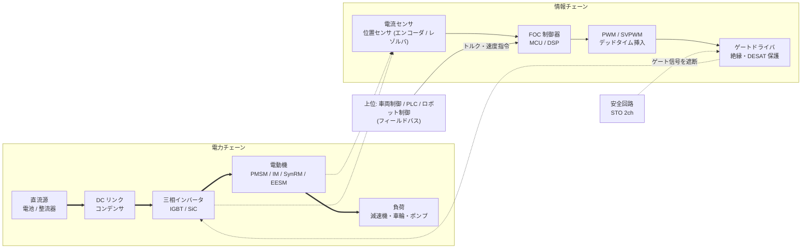
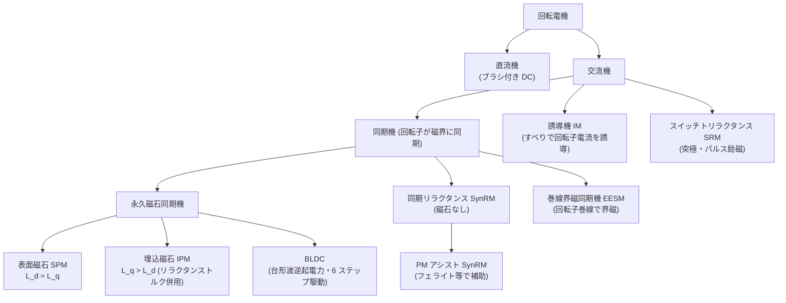
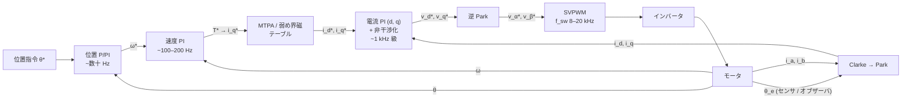
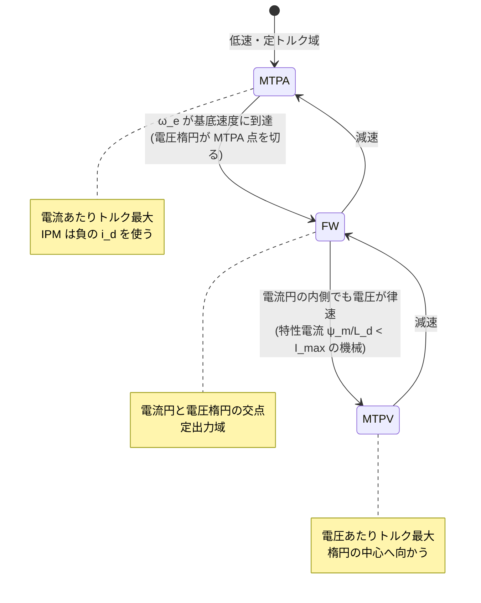

# 電動機とモータドライブ (Electric Motors & Motor Drives)

## 概要 (Overview)

電動機 (electric motor) は、電力を機械的な回転に変える装置であり、世界の電力消費の最大の用途である。IEA の 2011 年の作業文書は、電動機駆動システム (EMDS: electric motor-driven systems) が世界の電力消費の 40 % 超を占めると推計した[^iea-waide]。IEA 4E の Electric Motor Systems Platform (EMSA) は、2023 年のデータでこの割合を 53 %（13,462 TWh）と見積もっている[^emsa-brief]。両者は対象範囲と推計方法が異なるため直接は比較できない。それでも、世界の電力の「4 割から 5 割強」がモータを回していることは確かである。

Daedalus では、モータと駆動の話題がすでに複数の文書に分散している。EV の PMSM/誘導機と SiC インバータは [`ev-fundamentals.md`](../automotive/ev/ev-fundamentals.md) と [`tesla-battery-powertrain.md`](../automotive/ev/tesla-battery-powertrain.md) が扱う。ロボット関節の BLDC/PMSM、トルク定数、QDD は [`robotics-fundamentals.md`](../robotics/robotics-fundamentals.md) が、カスケード制御は [`control-systems.md`](../robotics/control-systems.md) が扱う。Si IGBT/SiC/GaN、2 レベルインバータ、SVPWM、損失・熱設計は [`power-electronics-grid-converters.md`](../energy/power-electronics-grid-converters.md) が扱う。本ドキュメントはこれらを結ぶハブとして、各文書が前提にしている共通の内容を詳しく扱う。具体的には (1) トルク発生の物理と機種の分類、(2) dq 座標でのモデルとベクトル制御 (FOC)、(3) 弱め界磁と MTPA、(4) センサとセンサレス推定、(5) ドライブ側のハードウェアストレス（dv/dt、軸受電流、絶縁）、(6) 損失と熱・減磁、(7) 規格（IEC 60034、IEC 61800）と安全機能 (STO)、(8) 駆動装置の攻撃面、である。

## 方法論 (Methodology)

- **電力チェーンで分解する。** 直流源 → DC リンク → インバータ → 電動機 → 負荷という電力の流れと、電流・位置の計測 → 制御 → ゲート信号という情報の流れを分けて追う。どの設計判断も、どちらかの流れの制約に帰着させる。
- **共通言語として dq モデルを使う。** PMSM・誘導機・同期リラクタンス機 (SynRM) は、回転座標 (dq) で書くとほぼ同じ形の方程式になる。機種ごとの違いは、どのパラメータ（磁石磁束、インダクタンス差、すべり）がトルクを担うかに帰着させる。
- **重複を避ける。** デバイス物理、トポロジ、SVPWM の数理は [`power-electronics-grid-converters.md`](../energy/power-electronics-grid-converters.md)、制御理論の一般論は `foundations/control-theory/` に任せる。本稿では、それらがモータ駆動に特有の形で現れる部分だけを扱う。
- **典拠の階層。** 原理は教科書 (Krishnan、Bose、Hughes & Drury、Mohan、Novotny & Lipo)[^krishnan][^bose][^hughes-drury][^mohan][^novotny-lipo] と査読論文を典拠にする。規制・製品・市場の数値は一次資料（EU 官報・欧州委員会、IEC、IEA、メーカー発表）に依拠し、独立した二次資料と突き合わせる。ベンダー資料 (TI、Microchip) は「ベンダー」と明記する。時事的な記述は 2026-10 時点のものであり、目標値 (target) と実証値 (demonstrated) を区別する。
- 数値例のうち出典を付けないものは、桁感をつかむための**仮定値による試算**である。

## 発見事項 (Findings)

1. **トルクの源は 2 種類しかない。** ひとつは電流と磁束の相互作用（ローレンツ力。電磁トルク）、もうひとつは磁気抵抗が最小になる位置へ鉄心が引き込まれる力（リラクタンストルク）である。PMSM の dq トルク式 `T = (3/2)·p·[ψ_m·i_q + (L_d − L_q)·i_d·i_q]` は第 1 項が前者、第 2 項が後者にあたり、IPM はその両方を使う[^krishnan][^jahns-ipm]。SynRM とスイッチトリラクタンス機 (SRM) は後者だけを使う。磁石を使わない設計の選択肢は、ほぼこの第 2 項をどこまで活かせるかで決まる。

2. **ベクトル制御 (FOC) は交流機を「他励直流機」として扱う座標変換である。** Clarke 変換と Park 変換で三相電流を回転子に同期した dq 座標の直流量に変えると、磁束 (`i_d`) とトルク (`i_q`) を独立した 2 つの PI ループで制御できる。誘導機向けの原理は 1970 年前後に Hasse と Blaschke（Siemens）が定式化した[^blaschke][^novotny-lipo]。現在は、EV のトラクション、ロボット関節、産業用サーボ、ドローンの ESC まで、同じ構造が規模を変えて使われている。

3. **高速域の性能は、モータではなく DC リンク電圧が上限を決める。** 逆起電力は回転数に比例し、インバータが出せる電圧には `V_max ≈ V_dc/√3`（SVPWM の線形域）という上限がある。この上限に達した後に回転数を伸ばすには、負の `i_d` を流して磁石磁束を打ち消す弱め界磁 (field weakening) が必要になる。電流制限円と電圧制限楕円の交点を追う運転点の設計は、Morimoto ら (1990) が定式化した[^morimoto]。800 V 化の効果の一部は、この電圧制限楕円を広げることにある。

4. **センサレス制御は「速度ゼロ付近」で原理的に難しくなる。** 逆起電力オブザーバは誘起電圧 `ω·ψ_m` を推定に使うため、速度がゼロに近づくと信号そのものが消える。低速・停止で位置を推定するには、高周波を注入して回転子の突極性 (`L_d ≠ L_q`) を読む高周波注入法 (HFI) が要る[^jansen-lorenz]。したがって、突極性の大きい IPM はセンサレス化しやすく、突極性の小さい SPM はしにくい。どの機種を選ぶかが、センサの要否まで左右する。

5. **SiC は効率を上げるが、そのぶんモータ側にストレスを移す。** 立ち上がりの速い電圧パルスはケーブルとモータ巻線の間で反射し、端子に過電圧を生む。また、コモンモード電圧の dv/dt が軸受電流を増やす[^chen-lipo]。IEA 4E EMSA の SiC 汎用インバータ試験（2025-10）は、スイッチング周波数を上げると電流高調波が減ってモータ損失が下がる一方、上げすぎるとインバータのスイッチング損失が支配的になり総合効率は下がると報告した。同報告は、既設モータのままインバータだけを SiC に置き換えると、絶縁の劣化が早まりうることも示している[^emsa-sic]。

6. **希土類磁石への依存は、物理的な最適解であると同時に地政学上のリスクでもある。** NdFeB 磁石は体積あたりの磁気エネルギーが最大級であり、高温での保磁力を上げるためにジスプロシウム (Dy) とテルビウム (Tb) が添加される[^iea-ree]。IEA によれば、2024 年に中国は焼結永久磁石の生産の 94 %、磁石向け希土類の精製の 91 % を占めた[^iea-ree]。中国は 2025-04 に Dy・Tb を含む 7 元素とその磁石の輸出を許可制にし、この措置は 2026-10 時点でも有効である[^eprs-ree]。その後の追加措置（2025-10）は停止されている（詳細は技術詳細）。BMW の第 6 世代 eDrive が採用した巻線界磁同期機 (EESM) は、磁石を使わない設計のひとつである。

7. **駆動装置は、安全機能と攻撃面を同じ筐体に持つ機器である。** IEC 61800-5-2 は安全トルク遮断 (STO) などの安全機能を規定する[^iec61800-5-2]。その一方で、駆動装置自体が Web サーバやフィールドバスのスタックを持つネットワーク機器でもある。Stuxnet は周波数変換器の出力周波数を書き換えて遠心分離機を損傷させた[^stuxnet]。PowerFlex 527 では、遠隔から悪用されると再起動が必要な状態に陥るサービス妨害 (DoS) 脆弱性が公表された[^cisa-pf527]。制御側が侵害されても安全機能が働くよう、両者を独立した経路に分けておくことが設計の前提になる。

## アーキテクチャ (Architecture)

### 電力チェーンと情報チェーン (Power & Information Chain)



凡例: 太線は電力の経路で、回生時には逆向きに流れる。細線は信号、点線は計測とゲート駆動を表す。STO はソフトウェアの制御器を経由せず、ゲートドライバへの信号経路をハードウェアで遮断する。EV に特有の構成（BMS が許容電力を制約する経路）は [`ev-fundamentals.md`](../automotive/ev/ev-fundamentals.md) のパワートレイン図を参照。

### 機種の系統 (Machine Taxonomy)



凡例: 箱は機種で、括弧内はトルク源または構造上の特徴を示す。磁束の向き（径方向/軸方向）はこの分類とは独立した軸であり、アキシャルフラックス機の多くは PM 同期機である。

### FOC カスケード (Field-Oriented Control Cascade)



凡例: 帯域は外側のループほど低く、典型的には 1 段につき 1/5〜1/10 に下げる（仮定値による目安）。EV のトラクション用途では、トルク指令で動かすため位置ループと速度ループがなく、電流ループと MTPA/弱め界磁だけで構成されることが多い。ロボット制御側のカスケードとの接続は [`control-systems.md`](../robotics/control-systems.md) のカスケード図を参照。

## 技術詳細 (Technical Details)

### 1. トルク発生の物理 (Torque Production)

導体に働く力 `F = I·L × B` が回転子半径 `r` のところで働くと、トルク `T = r·F` が生じる。ローレンツ力と磁場の基礎は [`current-magnetostatics.md`](../../foundations/physics/electromagnetism/current-magnetostatics.md) §3、回転に伴う逆起電力とインダクタンスは [`induction-inductance.md`](../../foundations/physics/electromagnetism/induction-inductance.md) §2–3 にある。エネルギー保存の観点では、トルクは磁気随伴エネルギー `W'` の角度微分 `T = ∂W'/∂θ` と書ける。これを線形の磁気回路に当てはめると、2 つの項が現れる。

- **電磁トルク（相互インダクタンス項）**: 磁石または界磁巻線の磁束と電機子電流の積に比例する。電流に対して線形なので、トルク定数 `k_t` で `T = k_t·i` と書ける。ロボットの電流によるトルク推定は、この線形性に依拠している（[`robotics-fundamentals.md`](../robotics/robotics-fundamentals.md) §1）。
- **リラクタンストルク（自己インダクタンス項）**: `T = ½·i²·dL/dθ`。回転子の磁気抵抗が角度によって変わるときにだけ生じ、電流の 2 乗に比例する。SRM はこの項だけで回る。

### 2. 機種とトレードオフ (Machine Types)

| 機種 | トルク源 | 長所 | 短所・制約 | 典型用途 |
|---|---|---|---|---|
| ブラシ付き DC | 電磁（整流子で電流を切替） | 駆動回路が単純、低コスト | ブラシ摩耗、火花、保守が必要 | 小型補機、玩具 |
| BLDC（台形波） | 電磁 | ホールセンサと 6 ステップ駆動で安価 | 転流時のトルクリプル | ファン、ドローン、家電 |
| SPM 同期機 | 電磁 | 高トルク密度、制御が線形 | 弱め界磁が苦手、磁石の飛散対策 | サーボ、ロボット関節 |
| IPM 同期機 | 電磁＋リラクタンス | 広い定出力範囲、高効率 | 磁石コスト、制御が非線形 | EV トラクション、エアコン圧縮機 |
| 誘導機 IM | 電磁（すべりで誘導） | 磁石なし、堅牢、無励磁時の引きずりが小さい | 回転子銅損、低速域の効率 | 産業用 VFD、EV の副駆動軸 |
| SynRM / PMa-SynRM | リラクタンス（＋補助磁石） | 磁石なしまたは少量、回転子損失が小さい | 力率が低い、インバータ容量が増える | 産業用ポンプ・ファン |
| EESM（巻線界磁） | 電磁（界磁を可変制御） | 磁石なし、界磁を自由に弱められる | 回転子への給電（スリップリング等）、回転子銅損 | EV トラクション（BMW 等） |
| SRM | リラクタンス | 回転子が鉄だけで最も堅牢・安価 | トルクリプル・騒音、専用インバータが必要 | 高温・高速の特殊用途 |

出典: 原理と一般的な長短は Krishnan[^krishnan]、Hughes & Drury[^hughes-drury]、Bose[^bose] による。

- **IPM の設計思想。** 磁石を回転子の内部に埋め込むと q 軸の磁路が鉄で通りやすくなり、`L_q > L_d` という突極性が生まれる。このとき負の `i_d` はリラクタンストルクを稼ぎ、同時に弱め界磁にもなる[^jahns-ipm]。Tesla Model 3 の後輪機が「IPM-SynRM」と呼ばれるのは、磁石トルクとリラクタンストルクを積極的に併用する設計だからである（[`tesla-battery-powertrain.md`](../automotive/ev/tesla-battery-powertrain.md) §3）。
- **EESM と磁石フリー化（2026-10 時点）。** BMW は第 5 世代に続き、Neue Klasse の第 6 世代 eDrive でも後輪に EESM を採用し、xDrive 版では前輪に誘導機を組み合わせた。報道によれば、BMW は第 5 世代の xDrive と比べてエネルギー損失 40 %減、コスト 20 %減、重量 10 %減と発表している[^bmw-gen6]。この数値は BMW 自身の発表（target 寄り）を二次報道で確認したものであり、駆動系全体についての値で、モータ単体の値ではない。Tesla は 2023-03 の Investor Day で、希土類を一切使わない次世代 PM 駆動ユニットを設計したと発表した[^tesla-ree]。ただし本稿の調査では、2026-10 時点でそれが量産されたことを示す一次資料を確認できなかった。そのため、この発表は**表明された目標**として扱う。
- **アキシャルフラックス機（2026-10 時点）。** 磁束が軸方向を向く円盤形の機械で、大径・短軸の形状でトルク密度を稼ぐ。Mercedes-Benz は 2026-06 に、子会社 YASA の技術に基づくアキシャルフラックスモータの量産を Berlin-Marienfelde 工場で開始し、Mercedes-AMG GT 4-Door Coupé に 3 基搭載した[^mb-axial]。YASA は 2025-10 に、12.7 kg の試作機で 750 kW（短時間ピーク）、59 kW/kg を「非公式の世界記録」として発表した。連続出力は同社の推定で 350–400 kW である[^yasa]。これは試作機の短時間ピーク値（demonstrated、ただし第三者認証なし）であり、量産機の定格ではない。

### 3. dq 座標モデル (dq Modeling)

三相の量を 2 段階で変換する（振幅不変形、平衡三相を仮定）。ここでの式は Krishnan[^krishnan] と TI のアプリケーションレポート（ベンダー資料）[^ti-foc] の表記に従う。

```text
Clarke:  i_α = i_a
         i_β = (i_a + 2·i_b) / √3
Park:    i_d =  i_α·cos θ_e + i_β·sin θ_e
         i_q = −i_α·sin θ_e + i_β·cos θ_e      (θ_e = p·θ_m, p: 極対数)
```

PMSM の電圧方程式とトルク式は次のとおりである。

```text
v_d = R·i_d + L_d·di_d/dt − ω_e·L_q·i_q
v_q = R·i_q + L_q·di_q/dt + ω_e·(L_d·i_d + ψ_m)
T   = (3/2)·p·[ψ_m·i_q + (L_d − L_q)·i_d·i_q]
```

`ω_e·L·i` の項は d 軸と q 軸の間の速度依存の干渉である。電流制御器はこれをフィードフォワードで打ち消し（非干渉化, decoupling）、残りを独立した一次遅れ `1/(R + sL)` として扱う。誘導機では回転子磁束 `ψ_r` を d 軸に合わせ（回転子磁束配向）、トルクは `T = (3/2)·p·(L_m/L_r)·ψ_r·i_q`、すべり周波数は `ω_sl = L_m·i_q / (τ_r·ψ_r)`（`τ_r = L_r/R_r`）になる[^novotny-lipo][^bose]。間接形 FOC はこの `ω_sl` を回転子の位置に積算して座標角を作るため、回転子抵抗の温度変化（銅で約 0.4 %/K）が磁束配向の誤差に直結する。直接トルク制御 (DTC) はこの座標変換を使わず、ヒステリシス比較器で電圧ベクトルを直接選ぶ方式で、Takahashi & Noguchi (1986) が提案した[^dtc]。

### 4. 電流ループ・速度ループの帯域 (Loop Bandwidths)

- **電流 PI の設計。** プラントを `1/(R + sL)` とし、PI を `K_p + K_i/s` として `K_p = ω_c·L`、`K_i = ω_c·R` に選ぶと、PI の零点がプラントの極を打ち消し、開ループは `ω_c/s` になる。閉ループ帯域は `ω_c` である。極零相殺と感度関数については [`feedback-transfer-functions.md`](../../foundations/control-theory/feedback-transfer-functions.md) §4・§6 を参照。
- **むだ時間が帯域の上限を決める。** デジタル実装では、サンプリングから PWM への反映までにおおむね 1.5 サンプル分の遅れが入る。`f_sw = 10 kHz` で 1 回更新なら約 150 µs になる。位相余裕 60° 程度を確保すると、電流ループ帯域の実用上の上限は `f_sw` の 1/10〜1/20 になる（仮定値による目安）。むだ時間と遅れ余裕の一般論は [`frequency-response-stability-margins.md`](../../foundations/control-theory/frequency-response-stability-margins.md) §4 を参照。
- **カスケードの分離。** 速度ループは電流ループよりさらに 5〜10 倍遅くし、内側ループを「理想的なトルク源」とみなせるようにする[^bose]。ロボット関節で電流ループを 10〜40 kHz で回すという [`robotics-fundamentals.md`](../robotics/robotics-fundamentals.md) の記述は、この階層の最内側にあたる。
- **積分器の飽和 (wind-up)。** 電圧が飽和する弱め界磁域では、PI の積分項が飽和して応答が乱れる。このため、積分停止や逆算 (back-calculation) によるアンチワインドアップが必須になる。

### 5. PWM とデッドタイム (PWM & Dead Time)

SVPWM の数理と、SPWM に対する 15.5 % の電圧利用率改善は [`power-electronics-grid-converters.md`](../energy/power-electronics-grid-converters.md)「PWM 変調」で扱っている。モータ駆動に特有なのは次の 2 点である。

- **デッドタイム誤差は低速で問題になる。** 上下アームの短絡を防ぐデッドタイム `t_d` の間は、出力電圧が電流の向きで決まり、平均電圧誤差はおおむね `ΔV ≈ (t_d·f_sw)·V_dc·sign(i)` になる。`t_d = 1 µs`、`f_sw = 10 kHz`、`V_dc = 400 V` なら約 4 V になる（仮定値による試算）。高速時の数百 V の逆起電力と比べれば小さいが、低速・停止付近では指令電圧と同程度になり、電流のゼロクロスでのひずみ、トルクリプル、センサレス推定の誤差を生む。電流の極性に応じたフィードフォワード補償が標準的な対策である[^bose]。
- **過変調と六段階運転。** 弱め界磁域で電圧を最大限に使うため、SVPWM の線形域を超えて矩形波（six-step）まで移行する。基本波電圧は線形域の最大値の `(2/π)/(1/√3) ≈ 1.10` 倍まで増えるが、その代償として低次高調波が増え、電流制御の帯域が落ちる。

### 6. 弱め界磁と MTPA (Field Weakening & MTPA)

運転点は次の 2 つの制約の内側に限られる[^morimoto]。

```text
電流制限円:    i_d² + i_q² ≤ I_max²
電圧制限楕円:  (L_d·i_d + ψ_m)² + (L_q·i_q)² ≤ (V_max / ω_e)²      (R を無視)
```



凡例: 状態は運転領域を、遷移の条件は回転数による切替を表す。

- **MTPA (maximum torque per ampere)。** 一定の電流振幅 `I_s` でトルクを最大にする `i_d` は、IPM の場合 `i_d = [ψ_m − √(ψ_m² + 8·(L_q − L_d)²·I_s²)] / [4·(L_q − L_d)]` になる[^morimoto]。SPM（`L_d = L_q`）では `i_d = 0` に退化する。実機では磁気飽和によって `L_q` が電流で変わるため、ダイナモ試験で作った 2 次元のテーブルを使うのが一般的である。
- **特性電流。** `ψ_m/L_d < I_max` の機械は、理論上は無限の速度まで定出力を保てる。IPM の設計で「磁石を減らし突極性を増やす」方向が好まれるのは、このためである[^jahns-ipm]。
- **安全上の副作用。** 弱め界磁中の高速域で磁石が誘起する逆起電力は `V_dc` を大きく上回る。この状態でインバータが停止すると、還流ダイオードを通じて制御されない回生（UCG: uncontrolled generator）が起き、DC リンクの過電圧と制動トルクの急変を招く[^jahns-ucg]。このため EV では、故障時の安全状態として三相を短絡するアクティブ短絡 (ASC) を選ぶか、全素子 OFF のフリーホイールを選ぶかを、速度に応じて切り替える設計が採られる。ASC は電圧を抑える代わりに、短絡電流による制動トルクと、後述する減磁のリスクを伴う。

### 7. 位置検出: センサとセンサレス (Sensored vs Sensorless)

| 方式 | 原理 | 長所 | 短所 | 主な用途 |
|---|---|---|---|---|
| ホールセンサ | 磁石極の 60° ごとの切替 | 安価 | 分解能が低く、FOC には補間が要る | BLDC の 6 ステップ駆動 |
| 光学/磁気エンコーダ | インクリメンタル/アブソリュート | 高分解能 | 汚れ・振動・温度に弱い | サーボ、ロボット |
| レゾルバ | 回転トランス（sin/cos 出力） | 高温・振動・EMI に強い | R/D 変換器が必要 | EV トラクション |
| 逆起電力オブザーバ | `ω·ψ_m` を推定 | センサ不要 | 低速・停止で破綻 | ファン、ポンプ、ドローン |
| 高周波注入 (HFI) | 突極性 `L_d ≠ L_q` を検出 | 停止時も推定可能 | 騒音、突極性の小さい機械では困難 | IPM の低速域 |

- **オブザーバの構成。** 逆起電力の推定には、拡張逆起電力オブザーバ、スライディングモードオブザーバ (SMO)、PLL による角度追従などが使われる。Microchip の AN1078（ベンダー資料）は、家電向け dsPIC で SMO を使ったセンサレス FOC を実装している[^mchp-an1078]。オブザーバの一般論と、推定器を入れると余裕が失われる問題（分離定理の限界）は [`state-space-estimation.md`](../../foundations/control-theory/state-space-estimation.md) §5・§7 を参照。
- **HFI。** d 軸に数百 Hz〜kHz の電圧を重ねると、q 軸側に現れる電流応答の振幅が角度誤差に比例するので、これを PLL で追う[^jansen-lorenz]。初期の磁極の向き (N/S) は突極性だけでは判別できないため、飽和の非対称性を使ったパルス試験を併用する。
- **ドローン用 ESC。** 低インダクタンス・高速のアウターロータ BLDC を、逆起電力のゼロクロス検出による 6 ステップ駆動か、センサレス FOC で回す。起動時は逆起電力がないので、オープンループで強制転流してから閉ループへ移る。
- **デュアルエンコーダ。** ロボット関節で減速機の向こう側を測る構成は [`robotics-fundamentals.md`](../robotics/robotics-fundamentals.md) を参照。

### 8. インバータ側のハードウェアストレス (Drive-Side Stresses)

デバイスの選定と損失は [`power-electronics-grid-converters.md`](../energy/power-electronics-grid-converters.md) で扱っている。ここではインバータとモータの間に現れる問題を扱う。

- **ゲートドライバ。** ハイサイドを駆動するには、絶縁（容量性・磁気・光）と、負バイアス（SiC では誤点弧を防ぐため）が要る。短絡保護として、不飽和 (DESAT) 検出とソフトターンオフも必要になる。SiC MOSFET の短絡耐量は数 µs と短いため、検出から遮断までの時間設計が厳しい。
- **反射波サージ。** インバータからモータへのケーブルは伝送線路として振る舞う。立ち上がり時間がケーブルの往復伝搬時間より短いと、モータ端子の電圧は最大で `2·V_dc` 近くまで上がる（伝送線路の反射。[`transmission-lines-signal-integrity.md`](../../foundations/physics/electromagnetism/transmission-lines-signal-integrity.md)）。巻線の最初の数ターンに電圧が集中し、部分放電 (PD) による絶縁劣化を招く。IEC 60034-18-41 は、インバータ駆動モータの絶縁系の部分放電に関する評価を定める[^iec60034-18-41]。
- **軸受電流。** PWM のコモンモード電圧が、固定子・回転子・軸受の間の浮遊容量を通じて軸受に電流を流す。この電流は放電加工 (EDM) 状の電食や縦溝摩耗 (fluting) を起こす[^chen-lipo]。対策には、絶縁軸受、セラミック球、シャフト接地ブラシ、コモンモードフィルタ、dv/dt フィルタがある。IEA 4E EMSA の試験は、SiC 化で軸受電流が増えることを観測しつつ、その有害性は軸受の種類と運転条件に強く依存し、一般的な結論は出せないとしている[^emsa-sic]。
- **EMC と配置。** 高 dv/dt は伝導・放射ノイズを増やす。このため、EV ではモータとインバータを一体化したドライブユニットにしてケーブルを無くし、ロボットや協働ロボットでは関節内にドライバを内蔵する構成が増えている。これは前述の反射波対策にもなる。

### 9. 損失・効率マップ・熱 (Losses, Efficiency Maps & Thermal)

| 損失 | 支配要因 | 速度・トルクとの関係 |
|---|---|---|
| 固定子銅損 | `3·I_rms²·R`（高周波では表皮効果・近接効果で増加） | トルクの 2 乗におおむね比例 |
| 鉄損（ヒステリシス＋渦電流） | Steinmetz 型 `k_h·f·B^α + k_e·f²·B²` | 周波数（速度）とともに増加 |
| 磁石渦電流損 | スロット高調波・PWM リプル | 高速・高キャリア周波数で増加 |
| 回転子銅損（IM・EESM） | すべり電流 / 界磁電流 | IM の低速高トルク域で大きい |
| 機械損 | 軸受摩擦・風損 | 速度とともに増加 |
| インバータ損失 | 導通損＋スイッチング損 | 電流と `f_sw` に依存 |

出典: 損失の分類は Hughes & Drury[^hughes-drury] と Krishnan[^krishnan]。

- **効率マップの形。** PMSM のピーク効率は中速・中トルクの領域にあり、高速域では弱め界磁の `i_d` が「トルクを生まない銅損」になるため効率が下がる。誘導機はこの高速域で相対的に有利で、無励磁時には磁石による鉄損と引きずりがない。前後軸で機種を使い分ける設計（Tesla、BMW Gen6）は、2 つの効率マップを重ねて走行パターンの全域で高効率を得るためのものである（[`tesla-battery-powertrain.md`](../automotive/ev/tesla-battery-powertrain.md)）。
- **熱制約と絶縁クラス。** 連続定格を決めるのは巻線温度で、絶縁クラス（F = 155 °C、H = 180 °C）が上限になる。短時間のピーク定格は熱容量で稼ぐ。そのため YASA のピーク値（59 kW/kg）と連続値（推定 350–400 kW）の差に表れているように、ピークと連続の比は冷却設計で大きく変わる[^yasa]。
- **減磁 (demagnetization)。** NdFeB の保磁力は温度上昇とともに下がる。高温時に大きな負の `i_d`（弱め界磁、ASC の短絡電流）が加わると、磁石の動作点が減磁曲線の屈曲点を越え、不可逆な減磁が起きる。Dy/Tb の添加は高温での保磁力を確保するためであり、希土類依存の核心はここにある[^iea-ree]。保護のために、磁石温度を推定（熱モデル、または逆起電力の変化から逆算）し、電流指令を温度に応じて制限する。
- **ポンプ・ファンと VFD の省エネ。** 遠心負荷では、流量 ∝ 回転数、軸動力 ∝ 回転数³（相似則）が成り立つ。そのため、弁やダンパによる絞り制御を可変速駆動 (VFD) に置き換えることが、モータ本体の効率クラスを上げるより大きな省エネになりうる[^hughes-drury]。EU 規則が駆動装置にも効率クラスを課すのは、この「システム効率」の考え方による。

### 10. 回生 (Regeneration)

モータは `i_q` の符号を反転させるだけで発電機になる（四象限運転）。回生電力の行き先が設計の分かれ目になる。

- **EV。** 電池が受け入れられる電力が上限になる（低温時や満充電付近では回生が絞られる）。足りない分は摩擦ブレーキとのブレンディングで補う（[`ev-fundamentals.md`](../automotive/ev/ev-fundamentals.md) §4）。
- **産業用 VFD。** ダイオード整流器は電力を電源へ返せないため、回生エネルギーは DC リンクの電圧を上げる。対策は、制動抵抗（ブレーキチョッパ）で熱にする方法、アクティブフロントエンド (AFE) で系統へ返す方法、複数の軸で DC バスを共有して他の軸の力行に回す方法の 3 つである。AFE は [`power-electronics-grid-converters.md`](../energy/power-electronics-grid-converters.md) のグリッドフォロイング変換器と同じ構成である。なお、EU 規則では回生型ドライブが IE 等級の対象から除外されている[^abb-ecodesign]。
- **ロボット。** 多関節の回生を共通の DC バスで融通する設計は EV と同じ形である（[`robotics-fundamentals.md`](../robotics/robotics-fundamentals.md)）。

### 11. 用途別の比較 (Applications Compared)

| 用途 | 主な機種 | 電圧・出力の桁 | 制御の特徴 | 支配的な制約 |
|---|---|---|---|---|
| EV トラクション | IPM、IM、EESM、アキシャル PM | 400/800 V、100 kW 級以上 | トルク指令、MTPA/弱め界磁、レゾルバ | 効率マップ × 走行パターン、磁石コスト、ISO 26262 |
| ロボット関節 (QDD 含む) | SPM/PMSM（大径・多極） | 24–100 V 程度、数百 W〜数 kW | 電流ループ 10–40 kHz、電流からトルクを推定 | トルク密度、バックドライブ性、発熱 |
| 産業用サーボ | SPM | 200/400 V 級 | 位置・速度・電流の 3 重カスケード、高分解能エンコーダ | 応答性、位置精度、安全機能 |
| 汎用 VFD（ポンプ・ファン） | 誘導機（IE3/IE4）、SynRM | 400 V 級〜中圧 | V/f またはセンサレス FOC | システム効率、高調波、EU 規則 |
| ドローン | アウターロータ BLDC | 十数〜数十 V | センサレス、高速応答 | 質量あたり出力、冷却は飛行風頼み |

電圧と出力の桁は、各文書の記述と教科書の一般的な範囲から示した目安であり、特定製品の値ではない。ロボットの数値は [`robotics-fundamentals.md`](../robotics/robotics-fundamentals.md)、EV の構成は [`tesla-battery-powertrain.md`](../automotive/ev/tesla-battery-powertrain.md) に依拠する。

### 12. 規格と規制 (Standards & Regulation)

- **IEC 60034-30-1（効率クラス）。** 商用電源で駆動する単速度モータ（0.12–1000 kW、2/4/6/8 極）の効率クラスを定める。2014 年の第 1 版は IE1〜IE4 を定めていたが、2025-12 の第 2 版で IE5 が追加された[^iec60034-30-1]。インバータ駆動を前提とするモータの等級は、別の文書（IEC TS 60034-30-2）で扱われる。
- **EU エコデザイン規則 (EU) 2019/1781**（規則 2021/341 で改正）の段階的な要求は次のとおりである[^eu-2019-1781][^ec-motors][^abb-ecodesign]。

| 段階 | 適用日 | 対象 | 要求 |
|---|---|---|---|
| 第 1 段階 | 2021-07-01 | 三相 0.75–1000 kW（2/4/6/8 極） | IE3 |
| 第 1 段階 | 2021-07-01 | 三相 0.12–0.75 kW | IE2 |
| 第 1 段階 | 2021-07-01 | 駆動装置 (VSD) 0.12–1000 kW（三相入出力、100–1000 V） | IE2（回生型・低高調波型などは除外） |
| 第 2 段階 | 2023-07-01 | 三相 75–200 kW（2/4/6 極） | IE4 |
| 第 2 段階 | 2023-07-01 | 単相モータ（0.12 kW 以上）、Ex eb 安全増防爆モータを対象に追加 | 単相は IE2 |

  旧規則 640/2009 には「IE2 モータを可変速駆動と組み合わせれば適合」という経路があったが、新規則ではこれが廃止された[^abb-ecodesign]。駆動装置の IE 等級（IE0〜IE2）は IEC 61800-9-2 に依拠する。
- **IEC 61800 シリーズ（可変速駆動システム, PDS）。** 第 5-1 部は電気・熱・エネルギーに関する安全要求、第 5-2 部は機能安全[^iec61800-5-2]、第 9-2 部はエネルギー効率を定める。第 5-2 部（第 2 版 2016、EN 版 2017）は IEC 61508 の枠組みの中で、STO、SS1、SS2、SOS、SLS、SDI、SBC などの安全サブ機能を定義する。
- **STO の意味。** STO は、モータにトルクを生む電力を供給しない状態を保証する機能で、IEC 60204-1 の停止カテゴリ 0（制御しない停止、惰性で止まる）に相当する[^pilz-61800][^sew-sto]。主接触器ではなく 2 チャネルのゲート信号遮断で実現するため、遮断後に再起動したときの応答が速い。ただし STO は**電気的な絶縁ではない**。DC リンクは高電圧のまま残り、永久磁石機は外力で回されれば端子に電圧を誘起する。また、重力負荷では STO だけでは保持できないので、SBC（安全ブレーキ制御）と機械ブレーキを併用する。
- **車載。** EV インバータの安全目標（意図しない加速・減速の防止など）は ISO 26262 の ASIL として扱う。ASC やフリーホイールといった安全状態の選択はその具体例である（[`functional-safety-iso26262.md`](../automotive/functional-safety-iso26262.md)）。

### 13. 故障モード (Failure Modes)

| 部位 | 故障モード | 主な原因 | 検出・対策 |
|---|---|---|---|
| 軸受 | 電食・フルーティング、疲労、潤滑劣化 | 軸受電流、アライメント不良、過負荷 | 振動解析、絶縁軸受、接地ブラシ |
| 固定子巻線 | ターン間短絡 → 相間短絡・地絡 | 熱劣化、部分放電（反射波サージ）、湿気 | 絶縁抵抗、PD 監視、負相電流の監視 |
| 回転子 | かご形導体の破断（IM）、磁石の減磁・飛散（PM） | 起動ストレス、過温、短絡電流 | 電流スペクトル解析 (MCSA)、逆起電力の監視 |
| インバータ | デバイスの短絡・開放、ゲート劣化、DC リンクコンデンサの劣化 | 熱サイクル、宇宙線（高電圧 SiC/IGBT）、過電圧 | DESAT、温度推定、寿命モデル |
| センサ | エンコーダやレゾルバの信号断・角度誤差 | 振動、EMI、コネクタ | 妥当性チェック、センサレスへの縮退 |
| 制御 | 電流ループの発振、UCG による過電圧 | パラメータ誤差、弱め界磁中のトリップ | 余裕設計、ASC/フリーホイールの切替 |

大型誘導機の信頼性調査では、故障の最大要因は軸受で、次いで固定子巻線、回転子の順になる。IEEE-IAS の調査 (1985) の割合は軸受が約 4 割、巻線が約 1/4、回転子が 1 割未満とされる[^ieee-reliability]。ただし割合は調査対象の母集団（出力帯・業種）で変わる。インバータ駆動では、ここに軸受電流と巻線の部分放電という駆動起因の経路が加わる。

## セキュリティ考察 (Security Considerations)

本節は公開された事例と勧告に基づく防御側の整理であり、攻撃手順は扱わない（リポジトリの倫理方針に準拠）。OT 全般の防御原則は [`plant-control-scada-security.md`](../energy/plant-control-scada-security.md)、ロボットのフィールドバスについては [`control-systems.md`](../robotics/control-systems.md) のセキュリティ考察を参照。

- **周波数変換器は物理的破壊の直接の操作点である。** Symantec の解析によれば、Stuxnet は特定 2 社（Fararo Paya と Vacon）の周波数変換器が 33 台以上あり、出力周波数が 807–1210 Hz で運転されている設備だけを標的にした。そのうえで出力周波数を 1410 Hz に上げ、その後 2 Hz に下げ、さらに 1064 Hz に戻すという操作を周期的に繰り返した[^stuxnet][^isis-stuxnet]。教訓は、駆動装置の**設定値と指令値そのものが攻撃対象になる**ことである。過速度、共振点の通過、加減速の制限値はいずれもパラメータで決まるので、これらの改竄はマルウェアのコードがなくても設備を損傷させうる。
- **駆動装置はネットワーク機器でもある。** CISA が 2024-03 に公表した ICSA-24-086-02 は、Rockwell PowerFlex 527 の 3 件の DoS 脆弱性（CVE-2024-2425/2426/2427、CVSS v4 8.7）を扱っている。悪用されると手動の再起動が必要になり、公表時点で修正版はなく、緩和策はネットワーク分離と Web サーバの無効化だった[^cisa-pf527]。同じく ICSA-24-284-19（PowerFlex 6000T、2024-10）でも、過負荷によって通信不能になる DoS が報告されている[^cisa-pf6000t]。可用性の喪失はモータ駆動ではそのまま生産停止につながり、場合によっては惰性での停止や制御されない停止を意味する。
- **主な攻撃面。** (1) フィールドバスと産業 Ethernet（EtherNet/IP、PROFINET、Modbus TCP、EtherCAT）。多くは認証のない指令とパラメータの書き込みを許す。(2) 組み込み Web サーバとエンジニアリングツール。(3) ファームウェア更新の経路（署名の有無）。(4) 車載では CAN や車載 Ethernet を介したトルク指令（[`cybersecurity-iso21434.md`](../automotive/cybersecurity-iso21434.md)）。防御の枠組みは IEC 62443（ゾーンとコンジットによる分離、署名付きファームウェア、変更監査）である。
- **安全と保安 (safety/security) の相互作用。** STO・SLS などの安全機能は、制御ソフトウェアとネットワークが侵害されても働くよう、ハードウェアの 2 チャネル経路または認証された安全通信（FSoE、PROFIsafe など）に実装する。その一方で、**安全機能自体も攻撃面になる**。安全パラメータ（SLS の速度上限など）の改竄や、STO の誤作動による可用性の攻撃がありうる。安全パラメータはパスワードとチェックサムで保護し、変更を受け入れる前に検証手順を必ず通すようにする。
- **安全状態の選択は物理に依存する。** 「止めれば安全」とは限らない。高速の PM 機ではゲートを遮断すると UCG による過電圧が生じ、ASC は制動トルクと減磁のリスクを伴う[^jahns-ucg]。重力負荷では STO だけでは落下を防げない。攻撃や故障の際に駆動装置がどの状態に移るかは、機械と負荷の物理から決める必要がある。
- **サプライチェーン。** 磁石原料の輸出管理は、セキュリティというより供給の可用性の問題である。中国は 2025-04 に 7 元素（Sm、Gd、Tb、Dy、Lu、Sc、Y）とその磁石材料を輸出許可制にし、この措置は 2026-10 時点で有効である[^eprs-ree][^iea-ree]。2025-10 の追加措置（対象元素の追加と域外適用）は 2025-11 に 1 年間停止され、期限は当初 2026-11-10 だった[^eprs-ree]。2026-09 末の分析は、米中首脳会談を受けて期限が 2027-01-10 に延長されたと報じている[^bisi-ree]。ただし同分析は、重要鉱物について文書化された合意がないことも指摘しており、本稿の調査では中国商務部の一次資料による確認はできなかった。磁石フリーの機種（IM、EESM、SynRM）は、このリスクに対する設計上の保険という意味も持つ。

## 結論 (Conclusions)

電動機の多様な機種は、トルクの源（電磁トルクかリラクタンストルクか）と界磁の作り方（磁石、巻線、誘導）という 2 つの軸で整理できる。dq 座標に変換すれば、ほぼ同じ方程式に帰着する。ベクトル制御はその共通言語であり、EV のトラクション、ロボット関節、産業用サーボ、ドローンは同じカスケード構造の帯域と規模を変えたものである。違いを生むのは制御則よりも、むしろ制約のほうである。高速域は DC リンク電圧と弱め界磁が、低速域はセンサの有無と突極性が、ピーク性能は熱と減磁が、それぞれ上限を決める。

ハードウェアの側では、SiC がインバータの損失を下げる一方で、反射波サージと軸受電流という形でモータの絶縁と軸受にストレスを移している。そのため、インバータとモータを一体化したドライブユニットが、効率と信頼性の両面で合理的な構成になりつつある。材料の側では、NdFeB への依存が性能上の最適解である一方で供給リスクにもなっており、EESM、SynRM、誘導機の併用、アキシャルフラックス機の量産開始（2026-06）が設計空間を広げている。規制面では、IEC 60034-30-1 への IE5 の追加と、EU 2019/1781 がモータ単体から駆動装置を含むシステムへ対象を広げたことが、この流れを後押ししている。

安全とセキュリティの面では、駆動装置は STO という最終的な安全機能と、ネットワーク経由の攻撃面を同じ筐体に持つ。Stuxnet と近年の CISA 勧告が示すとおり、設定値と可用性が攻撃対象になる。安全機能を制御から独立させ、安全状態を機械の物理から決めることが、機能安全とセキュリティの両方に共通する設計原則である。

## 参考文献 (References)

[^krishnan]: Krishnan, R. (2010). *Permanent Magnet Synchronous and Brushless DC Motor Drives*. CRC Press. ISBN 978-0-8247-5384-9. — PMSM/BLDC の dq モデル、MTPA、弱め界磁、センサ、損失。

[^bose]: Bose, B. K. (2002). *Modern Power Electronics and AC Drives*. Prentice Hall. ISBN 978-0-13-016743-9. — ベクトル制御・DTC・センサレス・デッドタイム補償・カスケード設計。

[^hughes-drury]: Hughes, A., & Drury, B. (2019). *Electric Motors and Drives: Fundamentals, Types and Applications* (5th ed.). Newnes. ISBN 978-0-08-102615-1. — 機種の比較、損失、ポンプ・ファン負荷と可変速駆動。

[^novotny-lipo]: Novotny, D. W., & Lipo, T. A. (1996). *Vector Control and Dynamics of AC Drives*. Oxford University Press. ISBN 978-0-19-856439-3. — 誘導機の回転子磁束配向、すべり周波数式。

[^mohan]: Mohan, N. (2012). *Electric Machines and Drives: A First Course*. John Wiley & Sons. ISBN 978-1-118-07481-7. — 電動機と駆動の入門的な体系。

[^blaschke]: Blaschke, F. (1972). The principle of field orientation as applied to the new TRANSVECTOR closed-loop control system for rotating-field machines. *Siemens Review*, 39, 217–220. — 誘導機のベクトル制御（磁界配向）の原典。

[^dtc]: Takahashi, I., & Noguchi, T. (1986). A New Quick-Response and High-Efficiency Control Strategy of an Induction Motor. *IEEE Transactions on Industry Applications*, IA-22(5), 820–827. DOI: 10.1109/TIA.1986.4504799

[^jahns-ipm]: Jahns, T. M., Kliman, G. B., & Neumann, T. W. (1986). Interior Permanent-Magnet Synchronous Motors for Adjustable-Speed Drives. *IEEE Transactions on Industry Applications*, IA-22(4), 738–747. DOI: 10.1109/TIA.1986.4504786

[^morimoto]: Morimoto, S., Takeda, Y., Hirasa, T., & Taniguchi, K. (1990). Expansion of operating limits for permanent magnet motor by current vector control considering inverter capacity. *IEEE Transactions on Industry Applications*, 26(5), 866–871. DOI: 10.1109/28.60058

[^jahns-ucg]: Jahns, T. M., & Caliskan, V. (1999). Uncontrolled generator operation of interior PM synchronous machines following high-speed inverter shutdown. *IEEE Transactions on Industry Applications*, 35(6), 1347–1357. DOI: 10.1109/28.806049

[^jansen-lorenz]: Jansen, P. L., & Lorenz, R. D. (1995). Transducerless position and velocity estimation in induction and salient AC machines. *IEEE Transactions on Industry Applications*, 31(2), 240–247. DOI: 10.1109/28.370269

[^chen-lipo]: Chen, S., Lipo, T. A., & Fitzgerald, D. (1996). Source of induction motor bearing currents caused by PWM inverters. *IEEE Transactions on Energy Conversion*, 11(1), 25–32. DOI: 10.1109/60.486572

[^ieee-reliability]: IEEE Motor Reliability Working Group (1985). Report of Large Motor Reliability Survey of Industrial and Commercial Installations, Part I. *IEEE Transactions on Industry Applications*, IA-21(4), 853–864. DOI: 10.1109/TIA.1985.349532

[^ti-foc]: [Field Orientated Control of 3-Phase AC-Motors (BPRA073) — Texas Instruments Europe, 1998（ベンダー資料）](https://www.tij.co.jp/jp/lit/an/bpra073/bpra073.pdf) — Accessed: 2026-10-12. Clarke/Park 変換と FOC の実装構成。

[^mchp-an1078]: [AN1078: Sensorless Field Oriented Control of a PMSM using a Sliding Mode Observer — Microchip Technology（ベンダー資料）](https://www.microchip.com/en-us/application-notes/an1078) — Accessed: 2026-10-12.

[^iea-waide]: Waide, P., & Brunner, C. U. (2011). *Energy-Efficiency Policy Opportunities for Electric Motor-Driven Systems*. IEA Energy Papers. OECD Publishing. DOI: 10.1787/5kgg52gb9gjd-en — EMDS が世界の電力消費の 40 % 超を占めるとする推計。

[^emsa-brief]: [Electric motor systems: why are they important? (Policy Brief EMSA9, 2025-12) — IEA 4E Electric Motor Systems Platform](https://www.iea-4e.org/wp-content/uploads/2025/12/4E-Policy-Brief-EMSA-9-20251218.pdf) — Accessed: 2026-10-12. 2023 年に世界の電力消費の 53 %（13,462 TWh）、産業部門では 72 %。

[^emsa-sic]: Vezzini, A., & Lanz, T. (2025-10). [*Testing industrial silicon carbide Variable Speed Drives*. IEA 4E Electric Motor Systems Platform](https://www.iea-4e.org/wp-content/uploads/2025/10/EMSA-Impact-of-SiC-VSD-final-Oct_2025.pdf) — Accessed: 2026-10-12. SiC VSD の効率とスイッチング周波数の関係、部分放電、軸受電流。

[^iea-ree]: [Rare earth elements — Executive summary. International Energy Agency (2026)](https://www.iea.org/reports/rare-earth-elements/executive-summary) — Accessed: 2026-10-12. 2024 年の中国シェア（採掘 60 %、精製 91 %、焼結磁石 94 %）と Dy/Tb の役割。

[^eprs-ree]: [China's rare-earth export restrictions — European Parliamentary Research Service (2025-11-24)](https://epthinktank.eu/2025/11/24/chinas-rare-earth-export-restrictions/) — Accessed: 2026-10-12. 2025-04 の 7 元素の許可制、2025-10 の追加措置、2025-11-07 発表の停止（2026-11-10 まで）。

[^bisi-ree]: [China's Rare Earth Processing Dominance and What the Trump-Xi Summit Didn't Change — Bloomsbury Intelligence and Security Institute (2026-09-30)](https://bisi.org.uk/reports/chinas-rare-earth-processing-dominance-and-what-the-trump-xi-summit-didnt-change) — Accessed: 2026-10-12. 停止期限の 2027-01-10 への延長報道（文書化された合意はないとの指摘を含む）。

[^bmw-gen6]: [BMW introduces sixth-generation electric drive technology for Neue Klasse vehicles — Electric & Hybrid Vehicle Technology International (2025-02)](https://www.electrichybridvehicletechnology.com/news/bmw-introduces-sixth-generation-electric-drive-technology-for-neue-klasse-vehicles.html) — Accessed: 2026-10-12. EESM＋ASM 構成と BMW 発表の損失・コスト・重量の削減率（BMW 発表値）。

[^tesla-ree]: [Tesla is going back to EV motors with no rare earth elements — Electrek (2023-03-01)](https://electrek.co/2023/03/01/tesla-is-going-back-to-ev-motors-with-no-rare-earth-elements/) — Accessed: 2026-10-12. 2023 Investor Day での希土類フリー PM 駆動ユニットの表明。

[^mb-axial]: [Mercedes-Benz starts axial flux motor production in Berlin — Automotive World (2026-06-09)](https://www.automotiveworld.com/news/mercedes-benz-starts-axial-flux-motor-production-in-berlin) — Accessed: 2026-10-12. Berlin-Marienfelde での量産開始と AMG GT 4-Door Coupé への 3 基搭載。Mercedes-Benz Group の発表ページ（[group.mercedes-benz.com](https://group.mercedes-benz.com/company/production/news/axial-flux-motor-berlin.html)）とも照合。

[^yasa]: [YASA smashes own unofficial power density world record … 59kW/kg benchmark — YASA Limited (2025-10-22)](https://yasa.com/news/yasa-smashes-own-unofficial-power-density-world-record-pushing-state-of-the-art-electric-motor-to-staggering-new-59kw-kg-benchmark/) — Accessed: 2026-10-12. 12.7 kg、750 kW の短時間ピーク、連続 350–400 kW（同社推定）、非公式記録。

[^iec60034-30-1]: IEC 60034-30-1:2025 (Ed. 2.0). *Rotating electrical machines — Part 30-1: Efficiency classes of line operated AC motors (IE code)*. IEC. [webstore.iec.ch](https://webstore.iec.ch/en/publication/91195) — Accessed: 2026-10-12. 第 2 版での IE5 の追加。

[^iec60034-18-41]: IEC 60034-18-41:2014+AMD1:2019. *Rotating electrical machines — Part 18-41: Partial discharge free electrical insulation systems (Type I) used in rotating electrical machines fed from voltage converters — Qualification and quality control tests*. IEC.

[^iec61800-5-2]: IEC 61800-5-2:2016 (Ed. 2.0). *Adjustable speed electrical power drive systems — Part 5-2: Safety requirements — Functional*. IEC. [webstore.iec.ch](https://webstore.iec.ch/publication/24556) — Accessed: 2026-10-12.

[^pilz-61800]: [International standard EN / IEC 61800-5-2 — Pilz（ベンダー解説）](https://www.pilz.com/en-CH/support/lexicon/articles/200448) — Accessed: 2026-10-12. STO/SS1/SS2 と IEC 60204-1 の停止カテゴリ 0/1/2 の対応。

[^sew-sto]: [STO – Safe Torque Off according to IEC 61800-5-2 — SEW-EURODRIVE（ベンダー資料）](https://download.sew-eurodrive.com/download/html/31960413/en-EN/28733575051.html) — Accessed: 2026-10-12.

[^eu-2019-1781]: European Commission (2019). Commission Regulation (EU) 2019/1781 of 1 October 2019 laying down ecodesign requirements for electric motors and variable speed drives. *Official Journal of the European Union*, L 272, 74–94. [eur-lex.europa.eu](https://eur-lex.europa.eu/eli/reg/2019/1781/oj/eng) — Accessed: 2026-10-12. Regulation (EU) 2021/341 により改正。

[^ec-motors]: [Electric motors — Energy efficient products, European Commission](https://energy-efficient-products.ec.europa.eu/product-list/electric-motors_en) — Accessed: 2026-10-12. 0.75–1000 kW の IE3（2021-07）、75–200 kW の IE4（2023-07）、VSD の IE2。

[^abb-ecodesign]: [EU Ecodesign Regulation for motors and drives — ABB（ベンダー資料）](https://new.abb.com/motors-generators/ecodesign-motors-drives) および [Fact Sheet Ecodesign Step 1/Step 2 — ABB](https://library.e.abb.com/public/3f04c0fbc9f749ef93f861648cc7171e/Fact_Sheet_Ecodesign_3AXD50000469048_RevC_EN_lowres.pdf) — Accessed: 2026-10-12. 単相・Ex eb の追加、VSD の適用範囲と除外、「IE2+VSD」経路の廃止。

[^stuxnet]: Falliere, N., Murchu, L. O., & Chien, E. (2011). *W32.Stuxnet Dossier* (Version 1.4). Symantec Security Response. — 周波数変換器の標的条件（807–1210 Hz、33 台以上）と周波数操作のシーケンス。

[^isis-stuxnet]: [Stuxnet Worm Targets Automated Systems for Frequency Converters — Institute for Science and International Security (2010-11)](https://isis-online.org/isis-reports/stuxnet-worm-targets-automated-systems-for-frequency-converters-is-irans-ce) — Accessed: 2026-10-12. Symantec の分析内容の独立した解説。

[^cisa-pf527]: [ICSA-24-086-02: Rockwell Automation PowerFlex 527 — CISA (2024-03-26)](https://www.cisa.gov/news-events/ics-advisories/icsa-24-086-02) — Accessed: 2026-10-12.

[^cisa-pf6000t]: [ICSA-24-284-19: Rockwell Automation PowerFlex 6000T — CISA (2024-10)](https://www.cisa.gov/news-events/ics-advisories/icsa-24-284-19) — Accessed: 2026-10-12.

### 関連文書 (Related Documents in Daedalus)

- [`../automotive/ev/ev-fundamentals.md`](../automotive/ev/ev-fundamentals.md) — EV パワートレインにおけるモータ・インバータ・回生の位置づけ。
- [`../automotive/ev/tesla-battery-powertrain.md`](../automotive/ev/tesla-battery-powertrain.md) — IPM-SynRM と誘導機の使い分け、量産初の全 SiC インバータ。
- [`../robotics/robotics-fundamentals.md`](../robotics/robotics-fundamentals.md) — ロボット関節のモータ、減速比、QDD、エンコーダ配置。
- [`../robotics/control-systems.md`](../robotics/control-systems.md) — 関節制御のカスケードと、フィールドバスのセキュリティ。
- [`../energy/power-electronics-grid-converters.md`](../energy/power-electronics-grid-converters.md) — デバイス、トポロジ、SVPWM、損失・熱設計。
- [`../energy/plant-control-scada-security.md`](../energy/plant-control-scada-security.md) — OT セキュリティと Stuxnet。
- [`../automotive/functional-safety-iso26262.md`](../automotive/functional-safety-iso26262.md) / [`../automotive/cybersecurity-iso21434.md`](../automotive/cybersecurity-iso21434.md) — 車載駆動系の安全とサイバーセキュリティ。
- [`../../foundations/physics/electromagnetism/current-magnetostatics.md`](../../foundations/physics/electromagnetism/current-magnetostatics.md) / [`../../foundations/physics/electromagnetism/induction-inductance.md`](../../foundations/physics/electromagnetism/induction-inductance.md) / [`../../foundations/physics/electromagnetism/circuit-theory.md`](../../foundations/physics/electromagnetism/circuit-theory.md) / [`../../foundations/physics/electromagnetism/transmission-lines-signal-integrity.md`](../../foundations/physics/electromagnetism/transmission-lines-signal-integrity.md) — ローレンツ力、逆起電力とインダクタンス、回路方程式、反射波。
- [`../../foundations/control-theory/feedback-transfer-functions.md`](../../foundations/control-theory/feedback-transfer-functions.md) / [`../../foundations/control-theory/frequency-response-stability-margins.md`](../../foundations/control-theory/frequency-response-stability-margins.md) / [`../../foundations/control-theory/state-space-estimation.md`](../../foundations/control-theory/state-space-estimation.md) — PI 設計、むだ時間と余裕、オブザーバ。
