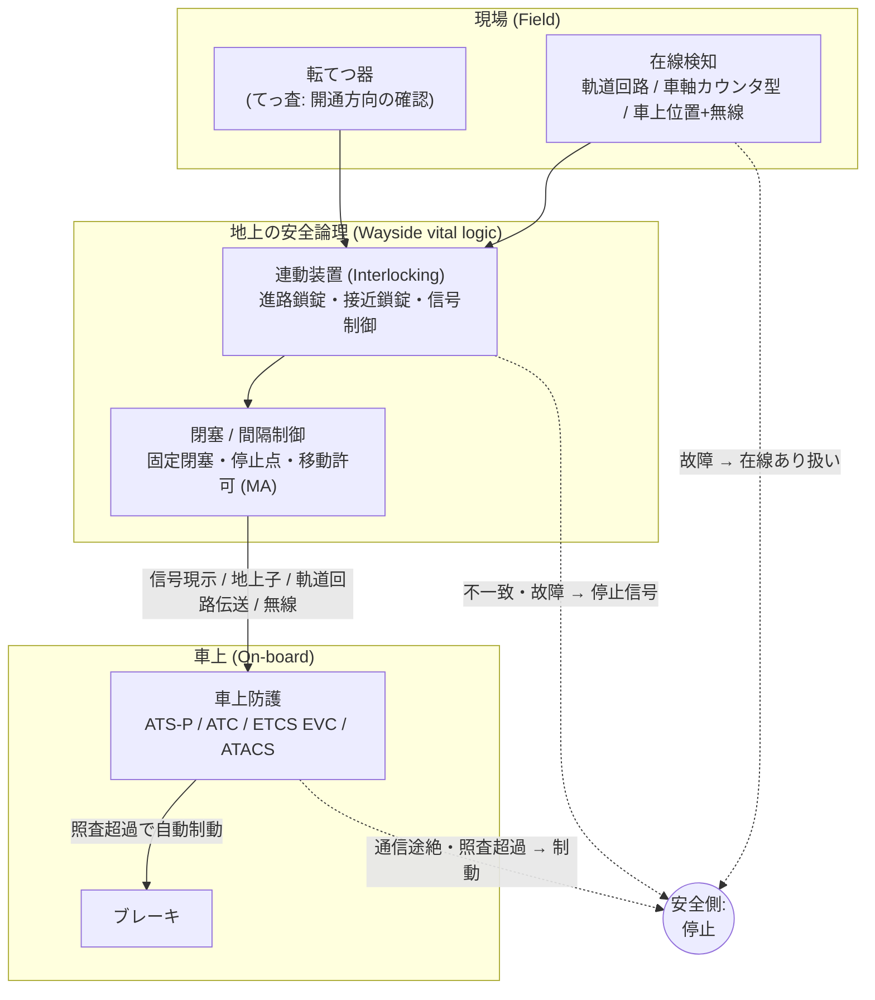
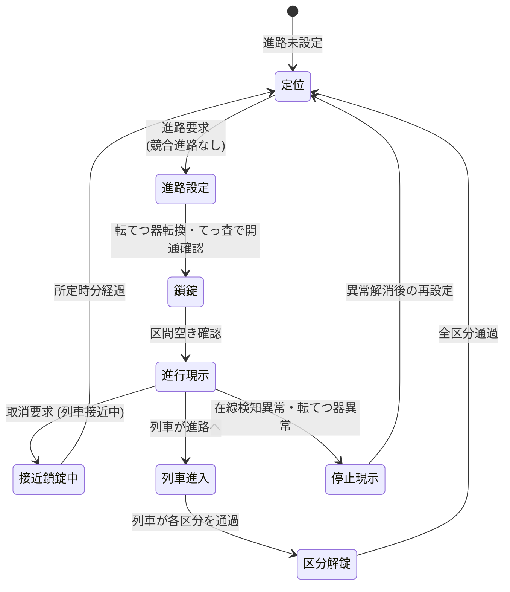

# 鉄道信号と列車制御 (Railway Signaling & Train Control)

## 概要 (Overview)

鉄道はレールに案内される重い車両を、短い見通し距離の先へ、運転士の目では止まりきれない速度で走らせる。120 km/h から 0.8 m/s² で減速すると停止までに約 690 m かかる (v²/2a による試算)。見えてから止まるのでは間に合わない。そこで鉄道は線路を区間に分けて 1 区間に 1 列車しか入れない**閉塞 (block)**、分岐器と信号の矛盾を禁じる**連動装置 (interlocking)**、運転士が信号を見落としても列車を止める **ATS (Automatic Train Stop)・ATC (Automatic Train Control)** を積み重ね、人の注意力に頼らない間隔制御を作ってきた。

本ドキュメントの中心テーゼは次のとおりである。**鉄道信号は「故障したら止まれば安全」という安全側 (safe side) が物理的に存在する系であり、その一点が閉電路式の軌道回路、非通電で落下するリレー、不一致なら止める多重系というアーキテクチャ全体を決めている。** 自動車の機能安全 ([`../automotive/functional-safety-iso26262.md`](../automotive/functional-safety-iso26262.md)) では、高速道路上の停止がそのまま安全とは限らず、最小リスク状態 (MRC) への移行やフェイルオペレーショナルな冗長が要る ([`../automotive/autonomous-driving-stack-safety.md`](../automotive/autonomous-driving-stack-safety.md))。同じ「安全」でも、安全状態がどこにあるかで設計の型が分かれる。

ただし、安全側に倒れる設計は可用性を払って安全を買う。止まった列車を動かすために、人による代用の手順や手動の進路設定が使われる。本稿で扱う事故 (信楽、福知山線、サンティアゴ・デ・コンポステーラ、テンピ) は、いずれも機械の防護が及ばない場所で起きた。その場所とは防護の未整備区間、方式の切替点、そして故障時の縮退運転である。

## 方法論 (Methodology)

- **日本の技術基準を骨格にする。** 「鉄道に関する技術上の基準を定める省令」(平成13年国土交通省令第151号) と国土交通省の解釈基準 (2026-03-31 最終改正版) は、閉塞・連動・ATS/ATC・列車検知の要件を条文で定めている。メーカー資料より抽象度が高く、方式に依存しない要件として読める[^ordinance][^kaishaku]。
- **各方式は一次資料で確かめる。** ATS-P は国鉄の開発報告と国土交通省の説明資料、デジタル ATC は納入メーカーの技術論文、ATACS は JR 東日本が総務省に提出した資料、ETCS は ERA (欧州鉄道機関) の機能要求仕様、CBTC は IEEE 1474.1-2025 による。
- **事故は公的調査の結論を基準にする。** 福知山線は運輸安全委員会の報告書概要を直接読んだ。サンティアゴ (スペイン CIAF) とテンピ (ギリシャ HARSIA) は報告書本文を取得できなかったため、報告書の内容を伝える報道で補い、その旨を明記する。
- **規格は発行機関または各国標準化機関の目録で番号・題名・版を確かめる。** 規格本文は有償で読めないので、規格の中身に踏み込む記述は公開論文 (IRSE の会議論文など) で裏づけられる範囲にとどめる。
- 数値例のうち、出典を付けていないものは物理式による試算であり、その旨を書く。

## 発見事項 (Findings)

1. **鉄道の安全状態は「停止」であり、在線検知の段階から故障を停止側へ写像するよう作られている。** 解釈基準は軌道回路を閉電路式 (常時電流を流し、車軸による短絡で検知する方式) と定める[^kaishaku]。断線・電源喪失・リレー故障のどれが起きても「在線あり」と同じ出力になり、信号は停止を示す。閉塞装置についても「閉そく装置に故障を生じたとき」に停止信号を現示せよと明記している[^kaishaku]。

2. **フェールセーフは部品の物理特性から多重系の論理へ移ったが、原理は同じである。** 信号用リレーは「どの故障でもリレーが落下し、信号を制限側 (安全側) に置く」ように作られ、接点には溶着しない材料が使われる[^gs-patent]。計算機連動では単一の計算機でこの完全性を得られないため、同じ入力を受ける 3 系の出力を比較し、不一致の系を切り離す構成が特許として公開されている[^westinghouse-patent]。省令第63条はこれを方式に依らない要件として「機能に障害が発生した場合においても列車等の安全な運転に支障を及ぼすおそれのない機能」と書く[^ordinance]。

3. **ATS から ATC、無線式への進化は「どこまでを機械が連続監視するか」の拡張である。** ATS-S 型の点制御は地上子の位置でしか速度を見ない。ATS-P は地上子の情報から車上で速度照査パターンを作り、停止位置まで連続して照査する[^mlit-ats][^kurotori]。アナログ ATC は区間ごとに一律の速度を指示する多段ブレーキ、デジタル ATC は停止点情報から一段ブレーキの曲線を車上で作る[^hitachi-datc]。ATACS と ETCS Level 2 は、列車位置を軌道回路でなく車上で求め、無線で地上に送る[^jre-atacs][^era-frs]。

4. **福知山線事故は「防護の空白」で起きた。** 事故列車は制限 70 km/h の半径 304 m の曲線に約 116 km/h で進入して脱線し、107 名が死亡、562 名が負傷した[^jtsb-fukuchiyama]。当時 JR 西日本は ATS-P の曲線速度超過防止機能を 94 か所に整備していたが、福知山線では使用開始前だった[^jtsb-fukuchiyama]。事故後の 2006 年の省令改正で、曲線・分岐器・線路終端などへの速度制限機能付き ATS と、運転士異常時列車停止装置・運転状況記録装置の設置が義務になった[^mlit-2006][^ordinance]。

5. **信楽とテンピは、信号故障後の縮退運転という人間系で起きた。** 信楽高原鐵道事故 (1991 年、死者 42 名) では、JR 西日本が無断で設置した方向優先てこの作用で信楽駅の出発信号が赤で固定された。列車は代用閉塞の手順を経ずに発車し、対向列車は進行を示す信号に従って同じ単線区間に入った[^egi-abe]。テンピ事故 (2023 年、死者 57 名) では、駅長が手動で進路を設定する際に誤り、重なる技術障害が作業負荷を増やしていたと調査機関は報告した[^harsia]。

6. **サンティアゴ・デ・コンポステーラ事故は、方式の切替点が安全の継ぎ目になることを示した。** CIAF によれば、列車は制限 80 km/h の曲線に 179 km/h で進入した。ERTMS の装備区間は曲線の手前で終わっており、列車は ASFA で運転されていた[^publico-ciaf]。2024 年の判決は運転士に加え、ADIF の元安全運行責任者も有罪とし、新線についてリスク評価が行われていなかった点を認めた[^railvolution]。

7. **安全側への倒れは、サイバー攻撃に対しては可用性への攻撃面になる。** 2023 年 8 月、ポーランドでは無認証の「Radio-Stop」信号が無断で送信され、列車の非常停止が相次いだ[^tvn24][^schneier]。衝突は起きていない。止める指令は安全側なので、その指令を偽造されても安全は損なわれず、可用性だけが失われる。鉄道のサイバーセキュリティ規格は CLC/TS 50701:2023 から IEC 63452 へ移行しつつある[^ts50701][^iec63452]。

## アーキテクチャ (Architecture)

### 信号保安の層構造

凡例: 実線は通常時の情報の流れ、点線は故障・異常時にどの層も同じ安全側 (停止) へ落ちることを示す。二重丸は安全状態である。

各層は独立に安全側へ落ちる。在線検知が壊れれば「在線あり」、連動の条件が揃わなければ停止信号、車上で通信が途絶えたり速度照査を超えたりすれば制動となる。どの層の故障も最終的に「列車を止める」という同じ出力に収束する。この収束先が 1 つしかないことが、鉄道信号の設計を単純にしている。

### 方式の系譜

| 世代 | 在線検知 | 地上→車上の情報 | 車上の監視 | 代表例 |
|---|---|---|---|---|
| 地上信号 + 点制御 ATS | 軌道回路 | 地上子 (点) | 地上子位置でのみ照査 | ATS-S 型[^mlit-ats] |
| パターン式 ATS | 軌道回路 | 地上子 (点、距離・制限速度を含む) | 停止位置までのパターンで連続照査 | ATS-P[^kurotori][^mlit-ats] |
| アナログ ATC | 軌道回路 | 軌道回路の信号周波数 (連続) | 区間ごとの一律速度 (多段ブレーキ) | 東海道新幹線以来の ATC[^hitachi-datc] |
| デジタル ATC | 軌道回路 | 軌道回路経由のデジタル停止点情報 | 車上 DB による一段ブレーキ | DS-ATC (2002)、D-ATC (2003)[^hitachi-datc] |
| 無線式・移動許可 | 車上位置 + 無線 (地上検知は方式により併用) | 無線による停止限界・移動許可 | 車上でブレーキパターン生成 | ATACS[^jre-atacs]、ETCS Level 2[^era-frs][^unife-levels]、CBTC[^ieee1474] |

## 技術詳細 (Technical Details)

### 1. 閉塞と在線検知 (Block & Train Detection)

省令は閉塞を「一定の区間に同時に二以上の列車を運転させないために、その区間を一列車の運転に占有させること」と定義する[^ordinance]。固定閉塞 (fixed block) では区間の境界が線路上に固定され、後続列車は先行列車がいる区間の手前で止まる。間隔の最小単位は区間長で決まる。

自動閉塞式では、解釈基準が次の場合に停止信号を現示せよと定める[^kaishaku]。

- 閉塞区間または重複区間に列車等があるとき
- 区間内の転てつ器が正当な方向に開通していないとき
- 他の線路の列車が分岐・交差箇所を支障しているとき
- 閉塞装置に故障を生じたとき

最後の項目が故障を安全側へ写像するという要求である。単線区間では、進路が相対する出発信号機同士を連鎖させ、向かい合う 2 本の列車に同時に進行を出せないようにする[^kaishaku]。

軌道回路 (track circuit) は、左右のレールに電流を流し、車軸がレール間を短絡することで在線を検知する。解釈基準は「閉電路式」を原則とする[^kaishaku]。閉電路式では、電流が流れてリレーが吸引している状態が「在線なし」を意味する。断線、電源断、リレーの不動作はどれも「電流が来ない」状態になり、在線ありと区別できない。どの故障も安全側に出るのは、この非対称性による。軌道回路はレール自体を回路の導体に使う。そのため、レールが破断すれば電流が途絶えて在線ありと同じ出力になり、副次的にレール破断も検知できる。この性質は回路構成から導かれるものである。

軌道回路を使わない検知も認められている。解釈基準は 2 種類を挙げる[^kaishaku]。

- 進入・進出を検知する装置: 区間の始端と終端で列車を数え、進入から進出まで在線状態を保つ。車軸カウンタ (axle counter) 型がこれにあたる。
- 車上位置を無線で伝送する装置: 車輪の回転から算出した位置を無線で地上に送る。複数列車の位置を取り違えないこと、位置誤差を補正する機能を持つことが要件になっている。

後者が ATACS の方式であり、軌道回路をやめるとレール破断の副次検知を失う。代替手段をどう確保するかが論点になる。

### 2. 連動装置と進路の排他 (Interlocking & Route Exclusion)

省令第56条は進路に支障を及ぼすおそれのある信号相互間、および信号と進路内の転てつ器の間を連鎖させる装置を求める[^ordinance]。解釈基準は自動閉塞などの区間の連動装置に次の 4 機能を要求する[^kaishaku]。

| 機能 | 何を禁じるか |
|---|---|
| てっ査鎖錠 (detector locking) | 列車が転てつ器上にある間、その転てつ器を転換させない |
| 進路鎖錠 / 進路区分鎖錠 (route locking) | 進行信号で列車が進路に入った後、通過し終えるまで進路内の転てつ器を動かさない |
| 接近鎖錠 / 保留鎖錠 (approach locking) | 進行信号を出した後に取り消しても、列車が止まりきれない間は進路を解かない |
| 信号制御 (signal control) | 進路が開通し鎖錠され、区間が空いているときだけ進行信号を出す |

これらは進路という共有資源に対する相互排他 (mutual exclusion) と見ることができる。ただし計算機の排他と違い、「ロックを解く」には物理的な条件 (列車の通過、止まりきれる時間の経過) が要る。

凡例: 状態名は進路 1 本のライフサイクルを表す。「停止現示」への遷移は、どの状態からでも異常時に起こりうる遷移を代表として 1 本だけ描いた。

連動装置を遠隔で扱う CTC (列車集中制御装置) は、本線上の列車位置と進路の開通状況を集中表示しなければならない。進路を自動設定する装置には、その故障を制御所へ警報する装置も要る[^kaishaku]。テンピ事故では、現場の自動信号が機能していなかったと鉄道労組の代表が述べている[^aljazeera]。

### 3. フェールセーフの設計原理 (Fail-Safe Principles)

**リレー時代のフェールセーフ。** 信号用のヴァイタルリレー (vital relay) は「どの故障でもリレーを落下させ、信号や制御を制限側、すなわち安全状態に置く」ように設計され、接点には溶着・融着しない材料が使われる[^gs-patent]。非通電で接点が開くことが保証されている[^westinghouse-patent]ので、進行信号や転てつ器の転換許可のような許可側の出力を、リレーが吸引しているときだけ出るように組める。電気が来ている状態でしか許可が出ないので、回路のどこが切れても安全側に倒れる。

**電子化と多重系。** 半導体スイッチは短絡故障を起こしうるので、リレーと同じ非対称性を素子に期待できない[^gs-patent]。そこで論理の多重化で代替する。

- **2 out of 2 (2oo2)**: 2 系が同じ結果を出したときだけ出力し、不一致なら停止する。安全性は確保できるが、どちらか一方の故障で止まる。
- **2 out of 3 (2oo3)**: 3 系の多数決で出力し、不一致の 1 系を切り離して運転を続ける。Westinghouse の計算機連動の特許 (1985) は、3 系に同じ入力を与えて非同期に走らせ、出力の差を参照表と照合して故障系を特定し、その系を停止する。出力は 2 サイクル連続で同じ値が出たときだけ採用する[^westinghouse-patent]。

鉄道で 2oo2 が成り立つのは、不一致のとき「止める」という安全な出力が常に存在するからである。2oo3 は安全のためというより、1 系の故障で列車を止めないための可用性の投資と読める。自動車の自動運転では、止めること自体が安全とは限らない。そのため冗長は安全の要件になる (フェイルオペレーショナル)。同じ多数決でも、何のために払う費用かが逆になる。冗長系の確率計算と共通原因故障の限界は [`../../foundations/mathematics/probability-statistics/reliability-theory.md`](../../foundations/mathematics/probability-statistics/reliability-theory.md) §2 を参照。

**「安全側」の限界。** 停止が安全なのは、ガイドウェイ上の車両には操舵の自由度がなく、主要な危険 (衝突、速度超過による脱線) が止まることで防げるからである。しかし停止は無条件に安全ではない。トンネル内や長大橋梁上での停止、多数の列車の同時停止による立ち往生は別の危険を生む。2019 年の英国の大停電では、鉄道車両の周波数保護が働いて列車が立ち往生した ([`../energy/grid-stability-frequency-control.md`](../energy/grid-stability-frequency-control.md))。鉄道の「安全側」は短い時間で見れば成り立つが、長く止まり続ければ別のリスクに変わる。

### 4. ATS と ATC (Automatic Train Stop & Control)

省令第57条は閉塞によって運転する区間に、信号の現示に応じて列車を自動的に減速・停止させる装置を求める。同条の解釈基準は線路条件に応じた自動減速・停止の機能も求める[^ordinance][^kaishaku]。2006 年の改正以降、解釈基準は速度制限機能が必要な場所を列挙している[^kaishaku]。

- 運転可能速度で進入すると外側へ転覆するおそれのある曲線
- 分岐器の分岐側
- 速度を制限している構造物
- 線路終端
- 停車列車と通過列車で警報開始時期を変えている踏切
- 下り勾配で加速して上の条件に至る区間

**ATS-S 型と ATS-P。** 国土交通省の説明資料は 2 方式を図で比べている[^mlit-ats]。ATS-S 型の速度照査では、2 つの地上子を通過する時間から速度を測り、超過していれば停止情報を送って非常ブレーキをかける。照査は地上子の位置でしか行われない。ATS-P は地上子から制限速度・曲線までの距離・制限区間長を受け取り、車上で速度照査パターンを作って連続的に照査する。パターンを超えれば自動でブレーキがかかり、制限速度まで下がれば緩む。国鉄は 1974 年からこの方式を開発し、運転士の確認扱いを不要にして、速度照査と停止距離の計算で列車を所定位置に止めることを狙った[^kurotori]。

**アナログ ATC とデジタル ATC。** 従来のアナログ ATC はレールに流す信号の周波数ごとに速度を割り当て、区間ごとに一律の速度へ段階的に落とす「多段ブレーキ」を採っていた[^hitachi-datc]。デジタル ATC では、地上装置が軌道回路で在線を検知して先行列車の位置から停止点情報を作り、それをデジタル情報として車上に送る。車上装置は路線データと車両性能を持ち、最適な「一段ブレーキ」を自律的に計算する。日立製作所の納入実績は次のとおりである[^hitachi-datc]。

- 2002 年 12 月: 東北新幹線 盛岡–八戸 (DS-ATC)
- 2003 年 12 月: 京浜東北線 南浦和–鶴見 (D-ATC)
- 2005 年 5 月: 都営新宿線

一段ブレーキでは段の間の余裕が要らないため、同じ速度からの停止必要距離が短くなり、運転間隔を詰められる[^hitachi-datc]。

解釈基準は ATC を 3 方式に分けて要件を書き分けている[^kaishaku]。

- 多段: 地上が速度を連続指示する。
- 一段ブレーキ制御方式: 地上が停止点まで止まれる速度を連続指示する。
- 車上で速度を生成する方式: 地上は「進入できる最終の位置」だけを連続して示し、車上が位置に応じた速度を作る。

3 番目の方式には「列車が自らの線路上の位置を認識するものであること」と「他の列車に対して示される制御情報を自らの制御情報とするものでないこと」という要件がある[^kaishaku]。後者は無線で宛先を取り違えることへの防護であり、通信の完全性を安全要件として書いた例である。

### 5. 無線式列車制御と移動閉塞 (Radio-Based Control & Moving Block)

**ATACS (JR 東日本)。** JR 東日本の資料は次の 4 段階で原理を説明する[^jre-atacs]。

1. 車上装置が地上子と速度センサで自列車の位置を算出する。
2. 車上装置が無線 (移動局 → 基地局) で列車位置を地上装置に送る。
3. 地上装置が各列車の位置から「停止限界」を作り、後続列車に無線で送る。
4. 車上装置がブレーキパターンを作って車内に表示し、運転士が運転する。

使用開始は仙石線が 2011 年、埼京線が 2017 年で、京浜東北線と山手線への導入が決まっている (2026-05 時点)[^jre-atacs]。同資料の技術的条件では使用周波数帯を移動局 330 MHz 帯・基地局 350 MHz 帯、空中線電力を移動局 1 W 以下・基地局 1 W または 3 W としている。変調は仙石線・埼京線の π/4 シフト QPSK から、京浜東北線以降は伝送容量を 2 倍にする方式に変える[^jre-atacs]。Rail Engineer の 2016 年の記事は、400 MHz 帯・9.6 kbit/s・基地局間隔約 3 km と書き、3 秒間更新がなければ列車はブレーキをかけて止まると説明している[^railengineer-atacs]。周波数帯の記述は資料によって食い違う。本稿では、JR 東日本が 2026 年に総務省へ出した一次資料の値 (330/350 MHz 帯) を採る。

ATACS は踏切も無線で制御する。移動許可はまず踏切の手前までしか出ず、遮断完了が確認されると無線で許可が延長される[^railengineer-atacs]。踏切の制御も「確認が取れるまで先へ進ませない」という安全側の論理で組まれている。

**ETCS / ERTMS。** ERTMS (European Rail Traffic Management System) は、列車制御の ETCS (European Train Control System) と無線通信 (GSM-R、後継の FRMCS) からなる欧州の相互運用規格である。ERA の機能要求仕様 (FRS v5.00, 2007) は Level を次のように定義した[^era-frs]。

- Level 1: バリス (balise) などの断続的な伝送媒体で地上から車上へ情報を送る。
- Level 2: 無線による連続的な双方向伝送。列車検知は地上が担う。
- Level 3: Level 2 と同じだが、列車の完全性 (train integrity) を車上が確認する。このため地上の列車検知は任意になる。

2023 年の CCS TSI (Regulation (EU) 2023/1695) で Level 3 は Level 2 に統合された。固定仮想閉塞や移動閉塞は「Level 2 の機能」として扱われ、2024 年の業界団体の解説では現行の Level は L0・LNTC・L1・L2 の 4 つである[^unife-levels]。ERA の CCS TSI のページは 2023/1695 の後に 2026-03-19 付の改正規則 (EU) 2026/693 を掲げ、ETCS Baseline 4 を ATO Baseline 1、FRMCS Baseline 0 と組み合わせている[^era-ccs]。

**CBTC。** 都市鉄道の無線式列車制御は CBTC (Communications-Based Train Control) と呼ばれ、IEEE 1474.1-2025 が性能・機能要件 (運転間隔、システム安全、可用性の基準) を定める[^ieee1474]。

**移動閉塞の意味。** 移動閉塞 (moving block) では、後続列車が進める限界は「先行列車の後端 (と安全余裕)」になり、区間の境界ではなくなる。固定閉塞では、後続列車は先行列車が区間を抜けるまで区間の入口で待つ。移動閉塞では、後続列車が自分の制動距離ぶん離れて追従できる。代わりに、先行列車の後端位置を確実に知る必要がある。列車分離 (連結器の破断) を地上の在線検知なしで見抜くには、車上で列車の完全性を確認しなければならない。ETCS の Level 3 がこの点を独立の Level として扱ってきたのは、そのためである[^era-frs]。

### 6. 安全規格と SIL (Standards & Safety Integrity Levels)

| 規格 | 対象 | 版の状況 (2026-10 時点) |
|---|---|---|
| EN 50126-1 / IEC 62278-1 | RAMS の一般プロセス (ライフサイクル) | EN 50126-1:2017 (A1:2024 で改正)[^en50126]。IEC 62278-1:2025 と IEC 62278-2:2025 が IEC 62278:2002 を置き換えた[^iec62278] |
| EN 50128 → EN 50716 / IEC 62279 | 鉄道制御・防護系のソフトウェア | EN 50716:2023 が EN 50128:2011 と EN 50657:2017 を置き換える。旧規格の撤回期限 (dow) は 2026-10-30[^en50716]。IEC 62279:2015[^iec62279] |
| EN 50129 / IEC 62425 | 信号用の安全関連電子システム | EN 50129:2026 (第3版、2026-05) が EN 50129:2018 とその訂正 (AC:2019-04) を置き換えた。CENELEC の承認は 2026-04-20、各国の旧版の廃止期限 (dow) は 2029-05-31[^en50129] |
| CLC/TS 50701 → IEC 63452 | 鉄道のサイバーセキュリティ | 後述 |

IEC 62278・62279・62425 は、鉄道の通信・信号・処理系について IEC 61508 系列に相当する部門規格と位置づけられている[^iec62278]。

**SIL と許容ハザード率。** 鉄道の SIL (Safety Integrity Level) は 1〜4 の 4 段階で、EN 50126 と EN 50129 は許容ハザード率 (THR) と SIL の対応表を持つ。SIL 4 は 1 時間あたり 10⁻⁹〜10⁻⁸ の帯に対応する[^short]。対応表そのものは規格本文にあり、本稿はこの帯を Short の記述でのみ確認している。IRSE の会議論文で Short (2019) は、この対応が規格策定時には「専門家の意見」だったと指摘する。SIL はもともと定量化できない系統故障を扱う概念なので、SIL 4 の設計がその故障率を達成するかは実証されていなかった。Short は公開データから SIL 4 機器の実績を推定し、約 10⁻⁸/h と SIL 4 帯の境界付近になったと報告している。ただし、データ不足のため結論は暫定とされている[^short]。ISO 26262 の ASIL D の PMHF 目標 (10⁻⁸/h 未満) と桁は同じである ([`../automotive/functional-safety-iso26262.md`](../automotive/functional-safety-iso26262.md))。違いは、鉄道が「安全側の出力が常にある」前提で、偶発故障の検出を停止に結びつけやすい点にある。

**形式手法。** 鉄道は形式手法の産業応用が早かった分野である。パリ地下鉄 14 号線の無人運転システム Météor の安全関連ソフトウェアは B メソッドで開発され、その経験は FM'99 で報告された[^behm]。形式手法一般の位置づけは [`../../software/formal-methods/formal-verification-landscape.md`](../../software/formal-methods/formal-verification-landscape.md) を参照。連動の論理は有限の状態と明確な安全性質 (競合進路に同時に進行を出さない) を持つので、モデル検査や証明に向いている。

### 7. 事故から学んだ設計 (Accidents & Design Lessons)

| 事故 | 何が起きたか | 欠けていた防護 | 設計・制度への反映 |
|---|---|---|---|
| 信楽高原鐵道 (1991-05-14) | 単線で正面衝突、死者 42 名・負傷 614 名[^egi-abe] | 信号故障時の代用閉塞の手順不履行。乗り入れ側が無断で設置した方向優先てこと、既存の連鎖 (反位片鎖錠) との相互作用を誰も把握していなかった | 遺族らの活動が 2001 年の航空・鉄道事故調査委員会発足の契機になった経緯を、先行研究が整理している[^egi-abe] |
| JR 福知山線 (2005-04-25) | 制限 70 km/h の曲線に約 116 km/h で進入し脱線、死者 107 名[^jtsb-fukuchiyama] | ATS-P の曲線速度超過防止が使用開始前。手前区間の最高速度 120 km/h は、簡略式による転覆限界速度 104 km/h を大きく超えていた[^jtsb-fukuchiyama] | 2006 年の省令改正で速度制限機能付き ATS 等を義務化[^mlit-2006] |
| サンティアゴ・デ・コンポステーラ (2013-07-24) | 制限 80 km/h の曲線に 179 km/h (CIAF) で進入し脱線[^publico-ciaf] | ERTMS 区間の終点が曲線の手前にあり、曲線は点制御の ASFA だけで、速度照査の地上子がなかった[^publico-ciaf][^railvolution] | CIAF は速度照査用バリスの設置などを勧告。2024 年判決はリスク評価の欠如も認定[^railvolution] |
| テンピ (2023-02-28) | 旅客列車と貨物列車が同一線路で正面衝突、死者 57 名[^harsia] | 手動の進路設定の誤り。進行許可を口頭で出し、確認を取っていなかった。技術障害が常態化していた[^harsia][^aljazeera] | 2026-07 時点でもギリシャ網で ETCS は運用されていない (議会証言)[^tovima-etcs] |

福知山線の報告書概要には、もう 1 つ示唆的な経過がある。事故の前、運転士は宝塚駅で ATS による非常ブレーキを受けた。社内規則では輸送指令員に連絡して指示を受ける必要があったが、連絡せずに ATS の復帰扱いをして運転を再開していた[^jtsb-fukuchiyama]。防護装置が働いても、その解除が人の手に委ねられていれば、防護は人の判断に依存する。

死傷者数には資料間の差がある。サンティアゴは CIAF 報告を伝える 2014 年の報道で死者 80 名・負傷 147 名[^publico-ciaf]、2024 年の判決報道で死者 79 名・負傷 143 名である[^railvolution]。曲線への進入速度も、CIAF 報告の報道は 179 km/h、判決報道は 191 km/h と書く。本稿は CIAF の値を採り、差を明記する。

### 8. 自動車の機能安全との対比 (Contrast with Automotive Functional Safety)

| 観点 | 鉄道信号 | 自動車 (ISO 26262 / 自動運転) |
|---|---|---|
| 安全状態 | 停止。ガイドウェイ上で操舵の自由度がない | 文脈依存。高速道路上の停止は危険になりうるので MRC へ移行する |
| 故障時の基本形 | フェールセーフ (落下リレー、閉電路、2oo2 で不一致なら停止) | フェイルセーフに加え、自動運転ではフェイルオペレーショナル |
| 冗長の目的 | 2oo3 は主に可用性のため | 冗長そのものが安全要件 |
| 環境の把握 | 在線検知と連動が「進路上に何があるか」を地上で確定する | 開放環境を知覚で推定する (SOTIF の領域) |
| リスクの段階 | SIL 1–4 (THR) | ASIL A–D (PMHF・メトリクス) |
| 人の役割 | 防護装置が運転士の誤りを上書きする | L2 では運転者が監視責任を持つ |

鉄道の「世界」は閉じている。どこに列車がいて、分岐器がどちらを向いているかは設備が確定させ、確定できなければ停止に倒す。自動車は確定できない世界の中で動き続けることを求められる。この違いは規格の書き方よりも前に、物理の段階で決まっている。踏切と線路上の障害物は鉄道の世界に開いた穴であり、鉄道でも知覚の問題が残る数少ない場所である。

## 運用・安全考察 (Operational & Safety Considerations)

- **縮退運転こそ設計対象である。** 信号が止まると、代用閉塞・手動の進路設定・防護装置の解除といった人の手順が現れる。信楽、福知山線 (ATS の復帰扱い)、テンピは、どれもこの手順の中で起きた[^egi-abe][^jtsb-fukuchiyama][^harsia]。故障時の手順を減らすこと、手順の確認を機械が強制すること (区間開通の確認なしには出発させない、など) が、安全側に倒れる系の残る課題である。
- **防護の境界を管理する。** 未整備区間、方式の切替点 (ERTMS から ASFA へ)、改修中の区間は、防護が途切れる継ぎ目になる。サンティアゴでは切替点が危険な曲線の手前にあった[^publico-ciaf]。新線と改修についてリスク評価を行い、継ぎ目の位置そのものを評価対象にすることが、2024 年の判決から読み取れる教訓である[^railvolution]。
- **設備の改修は連動の外から安全を壊しうる。** 信楽では、乗り入れ側が追加したてこが既存の連鎖と相互作用し、保守担当者も原因を特定できなかった[^egi-abe]。連動の論理を変えるときは、全体を再検証しなければならない。連動の形式検証が鉄道で進んだ理由の 1 つがここにある[^behm]。
- **軌道回路をやめるとき、失う機能を数える。** 無線式に移ると地上設備は減るが、閉電路の軌道回路が副次的に担っていたレール破断検知は失われる。代替の検知手段を別に用意する必要がある。
- **サイバーセキュリティ: 規格の動向。** CLC/TS 50701:2023 は EN 50126 の RAMS ライフサイクルの中でサイバーセキュリティを扱う技術仕様で、IEC 62443 系列をもとにしている。機能安全の要求自体は扱わない[^ts50701]。IEC の PT 63452 はこれを入力として国際規格 IEC 63452 を作っている。2025-12 時点の発表では、CDV が承認され、FDIS は 2026-03 頃、国際規格は 2026-08 頃の見通しだった。発行後は EN IEC 63452 が TS 50701 を置き換える予定である[^iec63452]。2026-10 時点で、本稿は IEC 63452 の発行を確認できていない。
- **サイバーセキュリティ: 安全側の指令は偽造しても安全を破らない。** ポーランドの Radio-Stop 事件では、暗号化も認証もない 150.100 MHz の 3 音の停止指令が無断で送信され、列車が非常停止した[^schneier][^tvn24]。停止指令の偽造は可用性への攻撃にとどまる。危険なのは逆向きの偽造で、進行の許可・停止限界の延長・在線なしの報告などがそれにあたる。解釈基準が、車上で速度を生成する ATC に「他の列車に対して示される制御情報を自らの制御情報としない」ことを、無線による列車検知に「複数の列車の位置を取り違えない」ことを求めるのは、危険側の情報の完全性を守る要件である[^kaishaku]。
- **無線の妨害 (jamming)。** 無線式では、妨害は通信途絶になり、移動許可を更新できない列車は止まる。ATACS では 3 秒間更新がなければ制動する[^railengineer-atacs]。妨害も安全側に倒れるが、広い範囲の列車を一斉に止める可用性攻撃になる。周波数の割当、基地局の配置、ダイバーシチといった物理層の対策は [`../../hardware/wireless/radio-fundamentals-modulation.md`](../../hardware/wireless/radio-fundamentals-modulation.md) を参照。
- **規格移行の期限。** EN 50716 による EN 50128 の置換は、2026-10-30 に旧規格の撤回期限を迎える[^en50716]。ソフトウェアの安全ケースを旧規格で組んできた製品は、移行の扱いを確認する必要がある。

## 結論 (Conclusions)

- 鉄道信号の設計は「止まれば安全」という単一の安全状態から逆算されている。閉電路式の軌道回路、非通電で落下するリレー、不一致なら止める 2oo2 は、どれも「故障の出力を停止に写す」という同じ原理の実装である。
- ATS から ATC、無線式への進化は監視の連続性を広げ、人の確認に頼る部分を減らす方向に進んだ。ATS-P の連続照査、デジタル ATC の一段ブレーキ、ATACS と ETCS の車上位置と移動許可がその段階である。
- 事故は、機械の防護が及ばない場所で起きた。福知山線の未整備区間、サンティアゴの方式切替点、信楽とテンピの信号故障後の手動運転がそれにあたる。安全側に倒れる系の弱点は、倒れた後の人間系にある。
- 自動車との違いは安全状態の位置にある。自動車では止めることが常に安全とは限らないので、冗長は安全の要件になる。鉄道では冗長の多くが可用性のための投資になる。
- サイバー攻撃に対しても安全側の非対称性は働き、停止指令の偽造は可用性攻撃にとどまる。守るべきは進行・延長・在線なしという危険側の情報の完全性である。

### 次の接続先 (Related Topics)

- [`../automotive/functional-safety-iso26262.md`](../automotive/functional-safety-iso26262.md) — ASIL・PMHF・フェイルオペレーショナル。本稿の対比の相手。
- [`../automotive/autonomous-driving-stack-safety.md`](../automotive/autonomous-driving-stack-safety.md) — MRC と DDT フォールバック。停止が安全とは限らない系の設計。
- [`../automotive/cybersecurity-iso21434.md`](../automotive/cybersecurity-iso21434.md) — 安全と保安の統合。TS 50701/IEC 63452 の自動車側の対応物。
- [`../energy/grid-stability-frequency-control.md`](../energy/grid-stability-frequency-control.md) — 2019 年英国停電で列車が立ち往生した事例。安全側の停止が社会的影響に変わる経路。
- [`../energy/plant-control-scada-security.md`](../energy/plant-control-scada-security.md) — IEC 62443 を基盤とする制御系セキュリティ。鉄道の TS 50701 と同じ系譜。
- [`../../software/embedded/realtime-fundamentals.md`](../../software/embedded/realtime-fundamentals.md) — 周期処理と応答時間。連動・ATC の制御周期と通信途絶タイマの基礎。
- [`../../software/formal-methods/formal-verification-landscape.md`](../../software/formal-methods/formal-verification-landscape.md) — B メソッドとモデル検査。連動論理の検証。
- [`../../hardware/wireless/radio-fundamentals-modulation.md`](../../hardware/wireless/radio-fundamentals-modulation.md) — 変調・伝搬・妨害耐性。ATACS・GSM-R・FRMCS の物理層。
- [`../../foundations/mathematics/probability-statistics/reliability-theory.md`](../../foundations/mathematics/probability-statistics/reliability-theory.md) — 冗長系の信頼度と共通原因故障。2oo2/2oo3 の確率的基礎。
- [`../medical/medical-device-safety.md`](../medical/medical-device-safety.md) — 同じく「故障を前提に危害を防ぐ」系。規制当局の審査とリスクマネジメントの記録で安全を示す点が異なる。

## 参考文献 (References)

**一次資料: 法令・技術基準 (日本)**

[^ordinance]: 鉄道に関する技術上の基準を定める省令 (平成13年国土交通省令第151号)。第2条 (閉そくの定義)、第54条 (閉そくを確保する装置等)、第56条 (信号相互間等を連鎖させる装置)、第57条 (列車を自動的に減速又は停止をさせる装置)、第63条 (障害発生時の安全確保)、第79条第3項 (運転士異常時の停止装置)、第86条の2 (運転状況記録装置)、平成18年国土交通省令第13号附則第2条。 — [e-Gov 法令 API: 413M60000800151](https://laws.e-gov.go.jp/api/1/lawdata/413M60000800151) — Accessed: 2026-10-24

[^kaishaku]: 国土交通省鉄道局. 鉄道に関する技術上の基準を定める省令等の解釈基準 (2026-03-31 最終改正)。Ⅶ-1 第54条関係 (閉そく装置、自動列車制御装置の 3 方式)、Ⅶ-3 第56条関係 (連動装置の鎖錠機能、遠隔制御装置)、Ⅶ-4 第57条関係 (速度制限機能が必要な箇所)、Ⅶ-6 第59条関係 (閉電路式軌道回路、軌道回路によらない列車検知)、Ⅶ-10 第63条関係。 — [解釈基準 PDF](https://www.mlit.go.jp/common/001968198.pdf) ／ [掲載ページ](https://www.mlit.go.jp/tetudo/tetudo_fr7_000036.html) — Accessed: 2026-10-24

[^mlit-2006]: 国土交通省 (2006-03-24). 鉄道に関する技術上の基準を定める省令の一部改正について (2006-07-01 施行。曲線・分岐器・線路終端等の速度制限装置、運転士異常時列車停止装置、運転状況記録装置)。 — [報道発表](https://www.mlit.go.jp/kisha/kisha06/08/080324_.html) — Accessed: 2026-10-24

[^mlit-ats]: 国土交通省 (2005-05-09). ATS による曲線速度超過対策の例 (ATS-P と ATS-S 型の比較図)。 — [PDF](https://www.mlit.go.jp/kisha/kisha05/08/080509/01.pdf) — Accessed: 2026-10-24

**一次資料: 事故調査**

[^jtsb-fukuchiyama]: 運輸安全委員会事務局. 福知山線列車脱線事故に係る鉄道事故調査報告書の概要 (付録-2-1)。報告書本体は航空・鉄道事故調査委員会 (2007-06-28) RA2007-3-1。 — [概要 PDF](https://jtsb.mlit.go.jp/fukuchiyama/kensyou/fu04-finalreport-annex-2-1.pdf) ／ [報告書本文 PDF](https://jtsb.mlit.go.jp/railway/fukuchiyama/RA07-3-1-1.pdf) — Accessed: 2026-10-24

[^harsia]: HARSIA (ギリシャ航空・鉄道事故調査・運輸安全機関) の最終報告 RL01-2025 (2025-02-27 発表、180 ページ) の内容を伝える報道。報告書本文は取得できなかった。 — [Report on the causes of the Tempi railway collision presented at ESIEA building in Athens — iefimerida.gr](https://www.iefimerida.gr/english/report-causes-tempi-railway-collision) — Accessed: 2026-10-24

**一次資料: 技術文献・仕様**

[^kurotori]: Kurotori, S. (1980). Development Research of ATS-P Type System. *Railway Technical Research Institute, Quarterly Reports*, 21(4), 165–173. — [TRID 書誌](https://trid.trb.org/View/167741) — Accessed: 2026-10-24

[^hitachi-datc]: 佐々木英二 ほか (2005). 最新の列車制御システムと今後の動向. *日立評論*, 87(9), 715–718。 — [PDF](https://www.hitachihyoron.com/jp/pdf/2005/09/2005_09_04.pdf) — Accessed: 2026-10-24

[^jre-atacs]: 東日本旅客鉄道株式会社 (2026-05-14). ATACS の概要 (総務省提出資料。原理、適用状況、技術的条件、新変調方式)。 — [PDF](https://www.soumu.go.jp/main_content/001072130.pdf) — Accessed: 2026-10-24

[^era-frs]: ERA. *ERTMS/ETCS Functional Requirements Specification (FRS)*, Version 5.00, 21 June 2007, ERA/ERTMS/003204, §3.2.1.3a (application levels)。 — [PDF](https://www.era.europa.eu/system/files/2023-01/sos1_index001_-_era_ertms_003204_v500.pdf) — Accessed: 2026-10-24

[^era-ccs]: ERA. Technical Specifications for Interoperability — Control-Command and Signalling (CCS TSI)。Regulation (EU) 2023/1695 (2023-08-10)、改正 (EU) 2026/693 (2026-03-19)、Baseline 4 の構成。 — [ERA CCS TSI](https://www.era.europa.eu/activities/technical-specifications-interoperability-control-command-and-signalling-tsi_en) — Accessed: 2026-10-24

[^ieee1474]: IEEE 1474.1-2025, *IEEE Standard for Communications-Based Train Control (CBTC) Performance and Functional Requirements* (2025-06-13 発行、1474.1-2004 を置換)。 — [IEEE SA](https://standards.ieee.org/ieee/1474.1/6959/) — Accessed: 2026-10-24

[^westinghouse-patent]: Brown, C. R., Corrie, J. D., & Wilson, W. G. J. *Computer-based interlocking system*. US Patent 4,517,673 (Westinghouse Brake and Signal Co., 1985-05-14)。 — [Google Patents](https://patents.google.com/patent/US4517673A/en) — Accessed: 2026-10-24

[^gs-patent]: Hoelscher, J. R. *Vital interface system for railway signalling*. US Patent 4,611,291 (General Signal Corp., 1986-09-09)。背景技術の節にヴァイタルリレーの設計原理の記述がある。 — [Google Patents](https://patents.google.com/patent/US4611291A/en) — Accessed: 2026-10-24

[^behm]: Behm, P., Benoit, P., Faivre, A., & Meynadier, J.-M. (1999). Météor: A Successful Application of B in a Large Project. In *FM'99 — Formal Methods*, LNCS 1708, pp. 369–387. Springer. DOI: 10.1007/3-540-48119-2_22

**一次資料: 規格 (番号・題名・版は各国標準化機関・IEC の目録で確認)**

[^en50126]: EN 50126-1:2017, *Railway Applications — The Specification and Demonstration of Reliability, Availability, Maintainability and Safety (RAMS) — Part 1: Generic RAMS process* (+A1:2024)。 — [EVS](https://www.evs.ee/en/evs-en-50126-1-2017) — Accessed: 2026-10-24

[^en50129]: EN 50129, *Railway applications — Communication, signalling and processing systems — Safety related electronic systems for signalling*。2018 年版 (第2版) は 2026 年版 (第3版) に置換。 — [SFS-EN 50129:2018](https://store.sfs.fi/en/sfs-en-50129-2018) ／ [SFS-EN 50129:2026](https://store.sfs.fi/en/sfs-en-50129-2026) — Accessed: 2026-10-24。CENELEC 側の表記・承認日・置換の範囲は、EN の表紙と European foreword を収めた [STN EN 50129:2026 のプレビュー (スロバキア規格協会)](https://normy.normoff.gov.sk/norma/142846/nahlad/) で確認した (「EN 50129, May 2026」「approved by CENELEC on 2026-04-20」、作成は CLC/SC 9XA、dop 2027-05-31、dow 2029-05-31)。Accessed: 2026-11-28

[^en50716]: EN 50716:2023, *Railway Applications — Requirements for software development*。CENELEC 承認 2023-10-30、EN 50128:2011 (AC:2014, A1:2020, A2:2020) と EN 50657:2017 (A1:2023) を置換、dow 2026-10-30。 — [OVE EN 50716:2024-10-01 プレビュー](https://shop.ove.at/de/preview/ove-en-50716-2024-10-01) — Accessed: 2026-10-24

[^iec62278]: IEC 62278-1:2025, *Railway applications — Specification and demonstration of reliability, availability, maintainability and safety (RAMS) — Part 1: Generic RAMS process*, Ed. 1.0 (2025-07-24)。IEC 62278-2 とともに IEC 62278:2002 を置換。 — [IEC Webstore](https://webstore.iec.ch/en/publication/68933) — Accessed: 2026-10-24

[^iec62279]: IEC 62279:2015, *Railway applications — Communication, signalling and processing systems — Software for railway control and protection systems*。 — [EVS](https://www.evs.ee/en/iec-62279-2015) — Accessed: 2026-10-24

[^ts50701]: CLC/TS 50701:2023, *Railway applications — Cybersecurity* (2023-09-01 有効、2021 年版を置換)。 — [EVS](https://www.evs.ee/en/clc-ts-50701-2023) — Accessed: 2026-10-24

[^iec63452]: Benoliel, S. (2025-12-02). IEC PT 63452 — Vertical Railway Cybersecurity standard. ERA/ENISA conference, Tallinn. — [ENISA PDF](https://www.enisa.europa.eu/sites/default/files/2025-12/session%205-1%20-%20iec%20-%20pt%2063452.pdf) — Accessed: 2026-10-24

**二次資料: 専門誌・会議論文・解説**

[^short]: Short, R. (2019). Does SIL Live up to Expectations? *IRSE ASPECT 2019*. — [PDF](https://aspect2019.irse.nl/proceedings/conference-day-1/safety/SAFETY2%20%20Does%20SIL%20live%20up%20to%20expectations%20paper.pdf) — Accessed: 2026-10-24

[^railengineer-atacs]: Stacy, M. (2016-09-30). ATACS — The Japanese Level 3? *Rail Engineer*. — [Rail Engineer](https://www.railengineer.co.uk/atacs-the-japanese-level-3/) — Accessed: 2026-10-24

[^unife-levels]: UNIFE / ERTMS.net (2024). *ERTMS/ETCS Levels — Different levels to match customer's needs*, factsheet #2 (2024 edition)。Level 3 の Level 2 への統合 (CCS TSI 2023) を説明。 — [PDF](https://www.ertms.net/wp-content/uploads/2024/03/ERTMSETCS-Levels-Updated-2024-Edition.pdf) — Accessed: 2026-10-24

[^egi-abe]: 江木・安部 (2020). 信楽高原鉄道事故の教訓と鉄道の安全. *社会安全学研究*, 第10巻 (関西大学社会安全研究センター)。 — [PDF](https://www.kansai-u.ac.jp/Fc_ss/center/study/pdf/bulletin010_7.pdf) — Accessed: 2026-10-24

**二次資料: 報道 (事故・事件の状況、日付付き)**

[^publico-ciaf]: EFE / Público (2014-06-04). Fomento concluye que el maquinista es el único culpable del accidente de Angrois (CIAF 最終報告の内容を伝える報道。CIAF 報告書本文は取得できなかった)。 — [Público](https://www.publico.es/actualidad/fomento-concluye-maquinista-unico-culpable-accidente-angrois.amp.html) — Accessed: 2026-10-24

[^railvolution]: Railvolution (2024-07-26). Verdict reached on Angrois derailment. — [Railvolution](https://www.railvolution.net/news/verdict-reached-on-angrois-derailment) — Accessed: 2026-10-24

[^aljazeera]: Al Jazeera (2023-03-02). What went wrong in Greece? All to know about deadly train crash. — [Al Jazeera](https://www.aljazeera.com/news/2023/3/2/greece-train-crash-2) — Accessed: 2026-10-24

[^tovima-etcs]: To Vima (2026-07-24). Greek rail chief admits ETCS safety system still not running. — [To Vima](https://www.tovima.com/politics/greek-rail-chief-admits-etcs-safety-system-still-not-running/) — Accessed: 2026-10-24

[^tvn24]: TVN24 (2023-08-28). Poland investigates hacking attack on state railway network. — [TVN24](https://tvn24.pl/tvn24-news-in-english/poland-investigates-hacking-attack-on-state-railway-network-one-of-the-detained-is-a-police-officer-media-say-7311671) — Accessed: 2026-10-24

[^schneier]: Schneier, B. (2023-08-28). Remotely Stopping Polish Trains (Wired の記事からの引用を含む)。 — [Schneier on Security](https://www.schneier.com/blog/archives/2023/08/remotely-stopping-polish-trains.html) — Accessed: 2026-10-24
