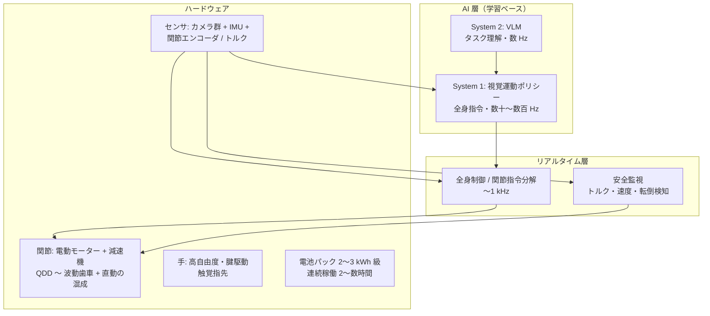

# ヒューマノイドロボット事例分析 (Humanoid Robots Analysis)

## 概要 (Overview)

汎用ヒューマノイド (general-purpose humanoid robot) は、2023〜2026 年に「研究デモ」から「量産を宣言する産業」へと局面が変わった。本ドキュメントは、その代表4社——**Tesla (Optimus)**、**Figure (Figure 02/03 + Helix)**、**Unitree (H1/G1)**、**Boston Dynamics (電動 Atlas)**——のアーキテクチャを、本領域でここまで整備した道具立て（アクチュエータ選定・運動学・制御階層・状態推定・移動と操作）を物差しとして比較する。目的は個社の優劣ではなく、**同じ物理的制約に対して各社がどの設計変数を選んだか**を読み解くことである。

**時事性への注意**: 本分野は極めて速く動いており、本ドキュメントの製品状況・数値は **2026-07-12 時点**の情報である。また各社の発表は本質的にマーケティングを含むため、CLAUDE.md の情報源ヒエラルキーに従い、**目標値 (target) と実証値 (demonstrated) を区別**して記す。原理・設計判断の分析は陳腐化しにくいが、製品固有の数値は参照時点の再確認を要する。

## 方法論 (Methodology)

- 比較軸を本領域の既存文書から導出する: アクチュエータ戦略 (`robotics-fundamentals.md` の減速比トレードオフ)、手の設計（自由度と質量配置）、計算機とセンサ構成、制御スタック（古典階層か学習ベースか — `control-systems.md`・`locomotion-manipulation.md`）、生産体制。
- 情報源は各社の一次発表（公式ブログ・製品ページ）を基点に、独立系報道で三角測量する。Tesla は仕様書を公開しない（イベントと X 上の発信が主）ため、数値は報道ベースであることを明示する。
- 「デモで示された」と「量産され顧客の現場で自律稼働している」を峻別する。テレオペレーション（遠隔操縦）とデータ収集運転は自律稼働に数えない。

## 発見事項 (Findings)

1. **アクチュエーションは電動に完全収斂した。** 油圧の代名詞だった Boston Dynamics が 2024 年に油圧 Atlas を引退させ全電動の新 Atlas に置き換えたことで[^bd-atlas]、主要各社すべてが「電動モーター + 減速機」に揃った。`robotics-fundamentals.md` で述べたトルク密度・保守性・電池駆動との整合が油圧の瞬発力に勝った、という判定が業界レベルで下ったことになる。
2. **各社の個性は減速比の選択に最も表れる。** Unitree は四足で確立した低減速比・準直動 (QDD) 系譜でバックドライバビリティと価格を取り、産業用途を狙う各社は関節ごとに波動歯車・遊星・直動（ボールねじ/ローラーねじ）を使い分けるハイブリッドを取る。Tesla は EV のモーター・パワエレ供給網の垂直統合を武器にする。「唯一の正解アクチュエータ」は存在せず、**タスク想定（動的移動か、把持作業か）が減速比を決める**という本領域の枠組みどおりの分岐である。
3. **差別化の主戦場は手 (hands) に移った。** 歩行が学習ベース制御でコモディティ化しつつある一方、器用な操作 (dexterous manipulation) は未解決である。Tesla Optimus 第3世代の手は 22 自由度・腱駆動で、アクチュエータ群を前腕に移した構成と報じられる[^optimus-hands]——質量・慣性を根元に寄せる設計は、`kinematics-dynamics.md` の反射慣性・`locomotion-manipulation.md` の把持の議論の直接の応用である。指先の触覚（力）センサの搭載も各社共通の方向で、`robotics-fundamentals.md` の「接触を測るセンサ」がここで主役になる。
4. **制御スタックは「二系統 (two-system) の学習アーキテクチャ」に収斂しつつある。** Figure の Helix は、低速で思考する視覚言語モデル (System 2) と高速で全身を駆動する視覚運動ポリシー (System 1、200 Hz 級) の分業を明示したVLA (vision-language-action) であり[^helix]、Boston Dynamics は Google DeepMind の基盤モデル (Gemini Robotics) を Atlas に統合する提携を発表した[^bd-deepmind]。これは `control-systems.md` のカスケード原理（長ホライズン・粗いモデルの上位層 + 短ホライズン・高速の下位層）が、学習ベースになっても保存されることを示している——**学習が置き換えたのは計画と分解であり、実行と安全の層ではない**。
5. **生産能力が公然の競争軸になった。** Figure は自社工場 BotQ で年産 12,000 体ラインを稼働させ、2026 年前半に「1 日 1 体 → 1 時間 1 体」への増速と累計 350 体超の生産を発表した[^botq][^figure-ramp]。Hyundai は年産 30,000 体規模の投資と自社工場への 25,000 体導入計画を掲げ[^hyundai]、Tesla は 2026 年夏の生産開始・2027 年の数万体級を目標と発言している[^optimus-prod]。ただしこれらの多くは**目標値**であり、2026-07 時点で「顧客現場での大規模自律稼働」を実証した例はまだない。
6. **Unitree は「ハードウェアのコモディティ化」という別の戦争をしている。** G1（約 130 cm・35 kg・23〜43 自由度）は 13,500〜16,000 米ドル級で販売され、研究機関・開発者に SDK 付きで普及している[^unitree-g1]。強化学習 + sim-to-real による歩行制御の研究プラットフォームとして事実上の標準になりつつあり、「ヒューマノイドの本体価格は急速に下がる」ことを市場に示した。フルサイズの H1 は 3.3 m/s の走行実証を持つ[^unitree-g1]。
7. **安全の制度が技術に追いついていない。** 産業用ロボットの安全規格 (ISO 10218 / ISO/TS 15066 — `robotics-fundamentals.md`) は「固定された腕」を前提に作られており、**動的にバランスする移動型ヒューマノイドが人と同一空間で働くための安全規格は確立途上**である（転倒ハザードは `locomotion-manipulation.md` で述べたとおり原理的に排除できない）。各社の工場内先行導入は、規格の空白を「自社施設・管理された環境」で埋めている段階と読める。

## アーキテクチャ (Architecture)

### 4社の設計選択の比較（2026-07-12 時点）

| 軸 | Tesla Optimus | Figure 02/03 | Unitree G1/H1 | Boston Dynamics Atlas (電動) |
|---|---|---|---|---|
| 出自・強み | EV の垂直統合（モーター・電池・FSD 計算機） | AI ファースト（Helix VLA）+ 自社工場 BotQ | 四足で量産済みの QDD アクチュエータ | 30 年の動的制御研究（油圧時代の遺産） |
| アクチュエータ | 自社開発、回転+直動の使い分け（報道ベース） | 自社開発、第3世代で内製比率を強調 | 低減速比 QDD 系譜、自社量産 | 全電動化、Hyundai Mobis 供給と報道[^bd-fleet] |
| 手 | 22 DoF・腱駆動・前腕内アクチュエータ（報道）[^optimus-hands] | 第3世代で触覚指先・手載せカメラ | 3指オプション等（構成により変動） | 多指ハンド（詳細非公開） |
| 制御スタック | FSD 系譜の end-to-end 学習 + テレオペデータ収集 | Helix: System 1 (高速視覚運動) / System 2 (VLM) の二系統[^helix] | RL + sim-to-real（歩行）、SDK 公開 | Gemini Robotics 統合を発表[^bd-deepmind] |
| 市場戦略 | 自社工場で先行運用 → 外販（目標） | 商業顧客 + 家庭を宣言、BotQ 年産 12,000 体ライン[^botq] | 研究・開発者市場に低価格販売（実績） | Hyundai 工場群 + DeepMind への供給[^bd-fleet] |
| 価格帯 | 未発表（2〜3万ドル台を示唆する発言のみ） | 未公表（03 は約 2 万ドルとの報道） | G1: 1.35〜1.6 万ドル、H1: 約 9 万ドル[^unitree-g1] | 非売品（グループ内 + 提携先） |

### ヒューマノイドの標準的なシステム構成

各社の公開情報を重ねると、`robotics-fundamentals.md` の階層構成がほぼそのまま現れる。

- 視覚はカメラ主体（Tesla は FSD 同様カメラのみ、Unitree は LiDAR 併載）で、`perception-state-estimation.md` の VIO・接触支援推定がリアルタイム層の状態を供給する。
- 電池と熱の制約（`robotics-fundamentals.md` の「稼働時間は関節の熱容量で律速」）が、実用タスクの選定——持続的な高負荷を避け、ハンドリング系から入る——に直結している。

## 技術詳細 (Technical Details)

### 1. アクチュエータ戦略の分岐

- **Unitree（QDD 系譜）**: 四足 (Go/B シリーズ) で量産してきた低減速比・高トルクモーターの延長で、脚は電流ベースのトルク推定とバックドライブを活かした動的制御に向く。価格競争力の源泉も同じ部品の量産効果にある。走行 3.3 m/s（H1、実証値）は低減速比構成の面目躍如である[^unitree-g1]。
- **産業向け各社（混成）**: 脚の膝・股関節には高トルクが要るため直動（ボールねじ/遊星ローラーねじ）を使い、腕・手首は波動歯車系で精度を取る、関節ごとの適材適所が Tesla・Figure の公開映像・報道から読み取れる。`robotics-fundamentals.md` の表（減速機ごとの特性）が、1 体の中で関節別に適用されている構図である。
- **Boston Dynamics（油圧 → 電動）**: 旧 Atlas はバック転など瞬発力で油圧の頂点を示したが、油圧は効率・保守・オイル漏れ・電池駆動との相性で量産に不向きだった。電動 Atlas への置換は「デモの性能」から「工場の稼働率」への評価軸の転換を象徴する[^bd-atlas]。

### 2. 手と操作 — 自由度をどこに置くか

Tesla の第3世代ハンドが示す設計（報道ベース）は教科書的な問題解決である[^optimus-hands]。

- **腱駆動 (tendon-driven)**: アクチュエータ約 25 基/腕を前腕に置き、ケーブルで指を駆動。指の質量・慣性を最小化しつつ自由度 22 を確保する。`kinematics-dynamics.md` の反射慣性の議論——動かす先端は軽いほどよい——の帰結。
- **触覚指先**: 把持力のフィードバック（卵・ガラス瓶の取り扱いデモ）は、`locomotion-manipulation.md` で述べた「解析的な把持品質はモデル誤差で壊れる → 接触を測って閉ループにする」への実装解である。
- トレードオフ: 腱駆動は摩擦・伸び・耐久が古典的な弱点で、産業的な保守性（交換周期）がどうなるかは未実証。ここが「デモの手」と「量産の手」の分水嶺になる。

### 3. 制御スタック — 二系統 VLA の構造

Figure Helix が公表した構成は、学習ベースヒューマノイドの参照アーキテクチャとして読める[^helix]。

- **System 2**: 事前学習済み視覚言語モデル（数 Hz）。シーン理解・言語指示の解釈という「遅い思考」を担う。
- **System 1**: 高速視覚運動ポリシー（200 Hz 級）。System 2 の潜在指令を受けて全身の連続制御を出す。2026-01 発表の Helix 02 では歩行・バランス・操作を単一システムとして扱う全身自律へ拡張された[^helix-02]。
- この分業は `control-systems.md` のカスケード原理（ホライズンとモデル粒度の交換）の学習版であり、かつ同文書の発見事項 7「安全機能は制御則の外に置く」が学習時代にそのまま持ち越されることを意味する——VLA の下には依然として関節サーボと安全監視のリアルタイム層がある。
- Boston Dynamics × Google DeepMind の提携（Gemini Robotics の Atlas 統合、自動車組立タスクのデモンストレーションで訓練）[^bd-deepmind] も同型で、**「基盤モデル企業 × ロボット企業」の水平分業**という業界構造の変化を示す。Tesla のみ FSD と同様の完全内製・end-to-end 路線である。

### 4. 生産とサプライチェーン — 実証値と目標値の峻別

| 主体 | 実証された事実（2026-07 時点） | 目標・計画（未実証） |
|---|---|---|
| Figure | BotQ 稼働、累計 350 体超、1 時間 1 体の生産レートを発表[^figure-ramp] | 年産 12,000 → 4 年で 100,000 体[^botq]、家庭向け展開 |
| Tesla | 自社工場内での試験運用・データ収集（報道）[^optimus-prod] | 2026 年夏の量産開始、2027 年に数万体（発言ベース） |
| Hyundai/BD | CES 2026 で量産型電動 Atlas 発表、供給先確定と発表[^bd-fleet] | 年産 30,000 体工場、自社工場へ 25,000 体[^hyundai] |
| Unitree | G1/H1 の一般販売・納品（数千体規模と推定される） | — （既に販売実績が主戦場） |

- 現時点で**確実に「実証」と言えるのは Unitree の外販と Figure の生産レート、各社の自社・提携先環境での運用**であり、「第三者の現場で経済的に成立する自律作業」は全社について未実証である。この区別は 1 年以内に大きく動く可能性が高く、参照時点での再確認を要する。
- 労働側の摩擦も顕在化している（Hyundai の工場導入に対する労組の交渉要求の報道[^hyundai-union]）。技術外の制約が導入速度を律する段階に入った。

## セキュリティ考察 (Security Considerations)

- **安全規格の空白**: 移動型ヒューマノイドには ISO 10218（固定腕前提）も ISO 13482（生活支援ロボット、低出力前提）もそのままは適用できない。転倒 (`locomotion-manipulation.md`) と高出力関節の共存に対する認証枠組みは策定途上であり、当面は「管理された環境 + 事業者責任」での運用になる。規格が確立するまで、導入現場のリスクアセスメントが唯一の防壁である。
- **フリート接続の攻撃面**: 数千体が同一のクラウド（モデル配信・テレメトリ・テレオペ）に接続する構成は、単一障害点と大規模同時侵害のリスクを持つ。モデル更新の署名・検証、テレオペ経路の認証、そして `control-systems.md` の原則——**ネットワーク側から安全機能を無効化できない構造**——がフリート規模で問われる。
- **学習スタックの検証問題**: end-to-end 学習制御には安定余裕のような証明可能な保証がない。「学習ポリシーの外側の証明可能な安全層」（速度・トルク・作業空間の監視）の設計と、その安全層自体の完全性規格への適合が、量産ヒューマノイドの認証の核心になると考えられる。
- **データとプライバシー**: 家庭・工場で常時カメラを持つ機械であり、収集データ（映像・音声・施設レイアウト）の扱いは `perception-state-estimation.md` の地図プライバシーの議論の拡大版である。家庭向け (Figure 03 等) ではこれが採用の成否を分ける要件になる。

## 結論 (Conclusions)

4 社の比較から見えるのは、ヒューマノイドが**個別技術の競争から統合とスケールの競争へ**移ったことである。アクチュエーションは電動へ、制御は二系統の学習アーキテクチャへと収斂し、差別化の主戦場は (1) 手と接触操作、(2) 生産能力と垂直統合、(3) 安全と信頼の制度設計、に移動した。本領域の 5 文書で整備した原理——減速比のトレードオフ、反射慣性、カスケード制御、接触の幾何——は、この収斂の「なぜ」をそのまま説明する: 各社は同じ物理に対して、出自の資産（EV 供給網・AI・量産アクチュエータ・制御研究）が最も活きる点に設計変数を置いているのである。

2026-07 時点の最大の未解決問題は技術単体ではなく、**「第三者の現場で、テレオペなしに、経済的に成立する作業」の実証**と、それを社会的に許容する**安全規格の確立**である。本ドキュメントの製品情報は速く陳腐化するため、参照時は各社一次発表の再確認を推奨する。

---

## 参考文献 (References)

一次資料（各社公式）を以下に挙げる。

[^bd-atlas]: [Boston Dynamics Unveils New Atlas Robot](https://bostondynamics.com/blog/boston-dynamics-unveils-new-atlas-robot-to-revolutionize-industry/) — Accessed: 2026-07-12. 油圧 Atlas 引退と全電動 Atlas の発表（2024-04）。

[^botq]: [BotQ: A High-Volume Manufacturing Facility for Humanoid Robots](https://www.figure.ai/news/botq) — Accessed: 2026-07-12. 年産 12,000 体ライン、内製 MES。

[^helix]: [Figure — Helix](https://www.figure.ai/news/helix) — Accessed: 2026-07-12. System 1 / System 2 の二系統 VLA アーキテクチャ。

[^helix-02]: [Introducing Helix 02: Full-Body Autonomy](https://www.figure.ai/news/helix-02) — Accessed: 2026-07-12. 歩行・バランス・操作の統合（2026-01）。

[^figure-ramp]: [Ramping Figure 03 Production](https://www.figure.ai/news/ramping-figure-03-production) — Accessed: 2026-07-12. 累計 350 体超・1 時間 1 体への増速。

[^unitree-g1]: [Unitree G1 製品ページ](https://www.unitree.com/g1/) — Accessed: 2026-07-12. G1 の寸法・自由度・価格。H1 の走行速度は同社発表による。

[^hyundai]: [Hyundai Motor Group Announces AI Robotics Strategy at CES 2026](https://www.hyundainews.com/releases/4664) — Accessed: 2026-07-12. 量産投資・工場導入計画。

二次資料（報道・独立系）を以下に挙げる。

[^optimus-hands]: [Tesla Optimus Gen 3 Hands: 22-DoF, 50 Actuators Explained](https://www.basenor.com/blogs/news/tesla-optimus-gen-3-hands-22-dof-50-actuators-explained) — Accessed: 2026-07-12. Tesla は公式仕様書を出さないため報道ベース。数値は暫定と扱うこと。

[^optimus-prod]: [Tesla Is Turning Its Model S Line Into an Optimus Robot Factory](https://www.techtimes.com/articles/318071/20260609/tesla-turning-its-model-s-line-optimus-robot-factorygen-3-targets-2026-production-start.htm) — Accessed: 2026-07-12. 2026 年生産開始目標（発言ベース、未実証）。

[^bd-deepmind]: [Boston Dynamics Atlas Goes to Work: CES 2026, Google DeepMind Partnership](https://travteks.com/blog/boston-dynamics-atlas-production/) — Accessed: 2026-07-12. Gemini Robotics 統合の発表。

[^bd-fleet]: [Boston Dynamics Ships Full Atlas Production Run to Hyundai and DeepMind](https://ai2.work/blog/boston-dynamics-ships-full-atlas-production-run-to-hyundai-and-deepmind) — Accessed: 2026-07-12. 2026 年出荷分の供給先、Hyundai Mobis 製アクチュエータ。

[^hyundai-union]: [Hyundai Commits 25,000 Atlas Robots to Own Factories: Union Blocks Deployment Without Labor Deal](https://www.techtimes.com/articles/317005/20260522/hyundai-commits-25000-atlas-robots-own-factories-union-blocks-deployment-without-labor-deal.htm) — Accessed: 2026-07-12. 導入をめぐる労使交渉。
