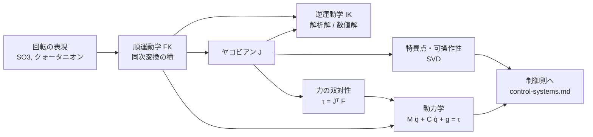

# キネマティクスと動力学 (Kinematics & Dynamics)

## 概要 (Overview)

ロボットの機構を制御するには、まず機構を**数学の対象**として書き下す必要がある。キネマティクス (kinematics) は「関節の角度と手先の位置・姿勢の関係」を力を考えずに扱う幾何の言語であり、動力学 (dynamics) は「トルクと運動の関係」を扱う力学の言語である。この2つが、`robotics-fundamentals.md` で見たハードウェア（モーター・減速機・エンコーダ）と、`control-systems.md` で扱う制御則をつなぐ**数学的インターフェース**になる。

本ドキュメントは、直列リンクマニピュレータを主題材に、回転の表現 → 順運動学 → 逆運動学 → ヤコビアン → 運動方程式の順で、各概念を「制御で何に使うか」まで含めて整理する。数学的前提は [`../../foundations/mathematics/linear-algebra/`](../../foundations/mathematics/linear-algebra/) と [`../../foundations/mathematics/calculus-analysis/multivariable-calculus.md`](../../foundations/mathematics/calculus-analysis/multivariable-calculus.md) に置いており、本ドキュメントはその最も直接的な応用例である。

CLAUDE.md の方針に従い分析深度は Level 3（完全）を既定とし、各主張には標準的教科書（Craig, Lynch & Park, Siciliano ほか）を典拠として付す。

## 方法論 (Methodology)

- 各概念を「**定義 → 制御での用途 → 落とし穴（特異点・多解性）**」の三点セットで押さえる。式の導出は教科書に譲り、構造の理解を優先する。
- 回転の表現は「パラメータ数と特異点のトレードオフ」という一つの軸で比較する。
- 運動方程式は成分の導出ではなく、**構造的性質**（対称性・受動性・項の物理的意味）を中心に据える。制御理論（受動性に基づく制御、計算トルク法）が利用するのはこの構造だからである。
- 計算量は O 記法で示し、リアルタイム制御（1 kHz で運動方程式を評価する）との接続を明示する。

## 発見事項 (Findings)

1. **姿勢の表現には万能解がなく、用途で使い分ける。** 回転行列（9 個、特異点なし、合成が積）、オイラー角（3 個、ジンバルロックあり、人間可読）、クォータニオン（4 個、特異点なし、補間が容易）はそれぞれ一長一短で、実装では「内部表現はクォータニオンまたは回転行列、入出力はオイラー角」が定石である[^lynch-park]。
2. **順運動学は「同次変換行列の積」に尽きる。** 各リンクの相対位置・姿勢を 4×4 の同次変換行列 (homogeneous transformation) で書けば、手先の位置・姿勢は行列積の連鎖で機械的に求まる。「行列積 = 写像の合成」（[`../../foundations/mathematics/linear-algebra/vectors-matrices-linear-maps.md`](../../foundations/mathematics/linear-algebra/vectors-matrices-linear-maps.md)）の最も具体的な現れである。
3. **逆運動学は本質的に多解・非線形で、「解けないこと」が仕様に現れる。** 6軸機械の手先姿勢に対する関節解は一般に複数（肘の上下・手首の反転などで最大 16 解）あり、可動域外・特異点近傍では解が存在しない。産業用ロボットの「姿勢指定 (configuration flags)」はこの多解性の直接の帰結である[^craig]。
4. **ヤコビアンがキネマティクスと力学を接続する中心的対象である。** 関節速度と手先速度を `v = J(q)·q̇` で結ぶだけでなく、双対関係 `τ = Jᵀ·F` によって手先力と関節トルクも結ぶ。速度・力・特異点・可操作性・数値逆運動学のすべてがヤコビアン一つの上に載っている。
5. **特異点は「数値の問題」ではなく「機構の物理的性質」である。** ヤコビアンのランク落ちする配位では、ある方向に手先を動かすのに無限大の関節速度が要る。特異点近傍では小さな手先速度指令が巨大な関節速度に変換されるため、**特異点回避は安全要件**である。可操作性楕円体は `J` の特異値分解（[`../../foundations/mathematics/linear-algebra/svd-low-rank.md`](../../foundations/mathematics/linear-algebra/svd-low-rank.md)）そのものである[^yoshikawa]。
6. **運動方程式 `M(q)q̈ + C(q,q̇)q̇ + g(q) = τ` は、成分は複雑でも構造は普遍である。** 慣性行列 `M` は対称正定値、`Ṁ − 2C` は歪対称（受動性）、重力項 `g` は位置のみに依存する。この構造的性質こそが制御則の安定性証明の土台になる[^siciliano]。
7. **動力学計算は再帰アルゴリズムで O(n) になり、1 kHz 制御に収まる。** ラグランジュ法の閉形式展開は自由度に対して急速に複雑化するが、ニュートン・オイラー法の再帰的定式化は自由度 `n` に線形な計算量で逆動力学を解く[^luh-walker-paul]。現代の動力学ライブラリ（Pinocchio 等）がリアルタイム MPC を可能にしている計算的基盤である。

## アーキテクチャ (Architecture)

### 概念の依存関係



### 座標系の連鎖 (Kinematic Chain)

直列 6 軸マニピュレータの標準的な構成。各関節にフレームを貼り、隣接フレーム間の相対変換を積み上げる。

```
ベース {0} ─ J1 ─ {1} ─ J2 ─ {2} ─ J3 ─ {3} ─ J4 ─ {4} ─ J5 ─ {5} ─ J6 ─ {6} 手先
                                                                        (end-effector)
   T_06 = T_01(θ1) · T_12(θ2) · T_23(θ3) · T_34(θ4) · T_45(θ5) · T_56(θ6)
```

- 手先フレーム {6} のベース座標系での位置・姿勢は、関節変数 `θ` に依存する変換行列の積 `T_06(θ)` で与えられる。
- 隣接フレームの貼り方の規約が **DH 記法 (Denavit–Hartenberg convention)**（リンク長 `a`、ねじれ角 `α`、オフセット `d`、関節角 `θ` の4パラメータ）であり[^craig]、より現代的な代替として指数積表現 (product of exponentials, PoE) がある[^lynch-park]。

## 技術詳細 (Technical Details)

### 1. 回転の表現 (Representations of Rotation)

| 表現 | パラメータ数 | 特異点 | 合成 | 補間 | 主用途 |
|---|---|---|---|---|---|
| 回転行列 `R ∈ SO(3)` | 9（制約6） | なし | 行列積 | 不向き | 内部計算・変換の連鎖 |
| オイラー角 / RPY | 3 | **ジンバルロック** | 不便 | 不向き | 人間との入出力・仕様書 |
| 軸角 / 回転ベクトル | 3〜4 | 角度 0/π 付近 | 不便 | 可 | 誤差表現・最適化 |
| 単位クォータニオン | 4（制約1） | なし（二重被覆） | 積 | **SLERP** | 姿勢制御・推定・補間 |

- **ジンバルロック**: オイラー角は第2回転が ±90° のとき第1・第3軸が重なり、自由度を1つ失う。3 パラメータ表現に特異点が不可避なのは SO(3) の位相的性質であり、実装の工夫では消せない。
- **クォータニオンの二重被覆**: `q` と `−q` が同一の回転を表す。姿勢フィードバックの符号処理を誤ると「遠回りに回転する」バグになる（姿勢制御の古典的な落とし穴）。
- 回転行列の直交性 `RᵀR = I` は数値誤差で崩れるため、長い積の連鎖では再直交化（SVD または Gram–Schmidt）が必要。

### 2. 順運動学 (Forward Kinematics)

同次変換行列は回転と並進を一つの 4×4 行列に束ねる。

```
T = | R  p |      R: 3×3 回転行列, p: 3×1 並進ベクトル
    | 0  1 |      合成は行列積、逆変換は T⁻¹ = | Rᵀ  −Rᵀp |
                                             | 0     1  |
```

- FK は `T_0n(q) = Π T_{i-1,i}(q_i)` の一発計算で、**常に一意・常に解ける**。IK との非対称性がロボット制御の設計を形作る。
- 実装では DH パラメータ表（機構の仕様そのもの）から変換行列を生成する。キャリブレーション（実機の DH パラメータ同定）が絶対精度を決め、繰返し精度（エンコーダ分解能で決まる）とは別物である点が実務上重要。

### 3. 逆運動学 (Inverse Kinematics)

手先の目標 `T_desired` から関節角 `q` を求める逆問題。

- **解析解 (closed-form)**: 手首3軸が1点で交わる機構（球面手首）では、位置3自由度と姿勢3自由度が分離でき、閉形式で解ける（Pieper の条件）[^craig]。産業用 6 軸機のほとんどがこの条件を満たすよう設計されている——**機構設計が計算可能性から逆算されている**例である。
- **数値解 (numerical)**: ヤコビアンを使った反復法。ニュートン・ラフソン法 `Δq = J⁺·Δx`（`J⁺` は擬似逆行列）を収束まで回す。冗長自由度（7軸以上）や特異点近傍では、減衰付き最小二乗 (damped least squares / Levenberg–Marquardt) で数値的な暴れを抑える[^buss-ik]。
- **冗長性 (redundancy)**: 自由度が課題次元を超える機械（7軸アーム、ヒューマノイド全身）では解が無限個あり、ゼロ空間 (null space) を使って「主タスクを満たしつつ、関節限界回避・障害物回避を副次目的として解く」ことができる。ゼロ空間射影 `(I − J⁺J)` は線形代数の核 (kernel) の直接の応用である。

### 4. ヤコビアンと特異点 (Jacobian & Singularities)

ヤコビアン `J(q)` は関節速度から手先速度（並進+角速度の6次元）への線形写像である。

```
v = J(q) · q̇         （速度の順写像）
τ = Jᵀ(q) · F        （力の双対関係: 手先力 F を支える関節トルク τ）
```

- **双対性の由来は仮想仕事の原理**であり、力センサレスの力推定（関節トルクから手先力を逆算）や、重力補償の計算を支える。
- **特異点 (singularity)**: `J` がランク落ちする配位。代表例は肘の完全伸展（ワークスペース境界特異点）、手首の第4・6軸整列（手首特異点）。特異点では次の問題が生じる。
  - ある方向の手先速度が実現不可能になる
  - 擬似逆行列の解 `q̇ = J⁺v` が発散する（条件数の悪化 — [`../../foundations/mathematics/linear-algebra/matrix-factorizations-numerical.md`](../../foundations/mathematics/linear-algebra/matrix-factorizations-numerical.md) の条件数の議論が直接効く）
- **可操作性 (manipulability)**: `J = UΣVᵀ` と特異値分解すると、特異値 `σ_1 ≥ … ≥ σ_6` は「各方向にどれだけ動きやすいか」を表し、可操作性楕円体の半径になる。吉川の可操作性尺度 `w = √det(JJᵀ) = σ_1·σ_2·…·σ_6` は特異点で 0 になる連続的な指標で、経路計画の目的関数に使われる[^yoshikawa]。

### 5. 動力学 (Dynamics)

直列リンク機構の運動方程式は次の形に必ず書ける。

```
M(q)·q̈ + C(q, q̇)·q̇ + g(q) = τ + Jᵀ(q)·F_ext

M(q):   慣性行列（対称・正定値、配位依存）
C(q,q̇): コリオリ・遠心項
g(q):   重力項
F_ext:  外力（接触力）
```

**構造的性質**（制御の安定性証明が依拠する不変量）を次表に示す[^siciliano]。

| 性質 | 内容 | 制御での利用 |
|---|---|---|
| `M(q) = Mᵀ(q) ≻ 0` | 慣性行列は対称正定値 | 運動エネルギー `½q̇ᵀMq̇` が Lyapunov 関数候補になる |
| `Ṁ − 2C` の歪対称性 | エネルギー保存の現れ | **受動性 (passivity)** に基づく制御の安定性証明 |
| パラメータ線形性 | 動力学は物理パラメータに線形 | 最小二乗によるパラメータ同定 (identification) |

- **ラグランジュ法**: エネルギー（`L = T − V`）から系統的に導出。構造の理解・少自由度の手計算向き。オイラー・ラグランジュ方程式は [`../../foundations/mathematics/calculus-analysis/ordinary-differential-equations.md`](../../foundations/mathematics/calculus-analysis/ordinary-differential-equations.md) の2階 ODE の連立系である。
- **ニュートン・オイラー法（再帰形）**: 速度・加速度をベースから手先へ順伝播し、力・トルクを手先からベースへ逆伝播する2パスで逆動力学（`q, q̇, q̈ → τ`）を **O(n)** で解く[^luh-walker-paul]。順動力学（`τ → q̈`）は Featherstone の articulated-body algorithm が同じく O(n) を達成する[^featherstone]。
- **反射慣性との接続**: `robotics-fundamentals.md` で見た `N²·J_m` は、この `M(q)` の対角項にモーター慣性が加算される形で現れる。高減速比機では `N²·J_m` がリンク由来の項を支配するため「各関節が独立した線形系」に近づき、単軸 PID で制御できてしまう——逆に QDD 機ではリンク間の連成が支配的になり、モデルベース制御が必要になる。この分岐が `control-systems.md` の主題である。

## セキュリティ考察 (Security Considerations)

> 本領域では、モデルの誤りがそのまま物理的危害に転化する。セーフティ中心に整理する。

- **特異点近傍の速度爆発は安全問題である。** 手先直線動作 (Cartesian jog) 中に手首特異点を通ると、関節速度が瞬間的に跳ね上がる。産業用制御器は特異点近傍で減速・停止するインターロックを持ち、ISO 10218 の速度監視（安全適合の関節/手先速度制限）はキネマティクス計算の正しさに依存している。
- **キネマティクスモデルは安全境界の定義でもある。** ワークスペース制限・仮想フェンス（セーフティゾーン）は FK の計算結果に対して評価されるため、DH パラメータやツール定義 (TCP) の設定ミス・改竄は安全機能の実効性を直接損なう。ツール座標の検証手順（4点法など）を運用に組み込むのはこのため。
- **動力学モデルの誤差は接触検知の感度を決める。** センサレス衝突検知（推定トルクと実測電流の残差監視）は `M, C, g` の精度が閾値を決める。ペイロード設定の誤りは「衝突の見逃し」または「誤検知の頻発（→現場が感度を下げる）」につながり、いずれも安全性を劣化させる。

## 結論 (Conclusions)

キネマティクスと動力学は、ロボットという機械を**線形代数と微分方程式の言葉に翻訳する層**である。同次変換の積（FK）、ヤコビアンの双対性（速度と力）、特異値分解（可操作性）、対称正定値行列と受動性（動力学の構造）——いずれも [`../../foundations/mathematics/`](../../foundations/mathematics/) で整備した理論がそのまま実体化しており、foundations シリーズの「工学への接続」の最も密度の高い応用先といえる。

### 続編への橋渡し

運動方程式 `M(q)q̈ + C(q,q̇)q̇ + g(q) = τ` が手に入ったので、次は「望む運動を実現する `τ` をどう決めるか」——制御則の設計に進む。[`control-systems.md`](control-systems.md) では、この方程式を無視できる場合（高減速比 + 単軸 PID）から、明示的に使う場合（計算トルク法・MPC）、目標を運動ではなく力学的関係に置き換える場合（インピーダンス制御）へと段階的に進む。

---

## 参考文献 (References)

[^craig]: Craig, J. J. (2018). *Introduction to Robotics: Mechanics and Control* (4th ed.). Pearson. — DH 記法・解析的逆運動学・Pieper の条件の標準的典拠。

[^lynch-park]: Lynch, K. M. & Park, F. C. (2017). *Modern Robotics: Mechanics, Planning, and Control*. Cambridge University Press. — 指数積表現・回転の表現・ヤコビアンの現代的定式化。

[^siciliano]: Siciliano, B., Sciavicco, L., Villani, L. & Oriolo, G. (2009). *Robotics: Modelling, Planning and Control*. Springer. — 運動方程式の構造的性質（歪対称性・受動性・パラメータ線形性）。

[^yoshikawa]: Yoshikawa, T. (1985). Manipulability of Robotic Mechanisms. *The International Journal of Robotics Research*, 4(2), 3–9. DOI: 10.1177/027836498500400201 — 可操作性尺度の原典。

[^luh-walker-paul]: Luh, J. Y. S., Walker, M. W. & Paul, R. P. C. (1980). On-Line Computational Scheme for Mechanical Manipulators. *Journal of Dynamic Systems, Measurement, and Control*, 102(2), 69–76. DOI: 10.1115/1.3149599 — 再帰的ニュートン・オイラー法の原典。

[^featherstone]: Featherstone, R. (2008). *Rigid Body Dynamics Algorithms*. Springer. — O(n) 順動力学 (articulated-body algorithm) の標準的典拠。

[^buss-ik]: Buss, S. R. (2004). *Introduction to Inverse Kinematics with Jacobian Transpose, Pseudoinverse and Damped Least Squares Methods*. IEEE Journal of Robotics and Automation (technical report). — 数値逆運動学の各手法の比較。
