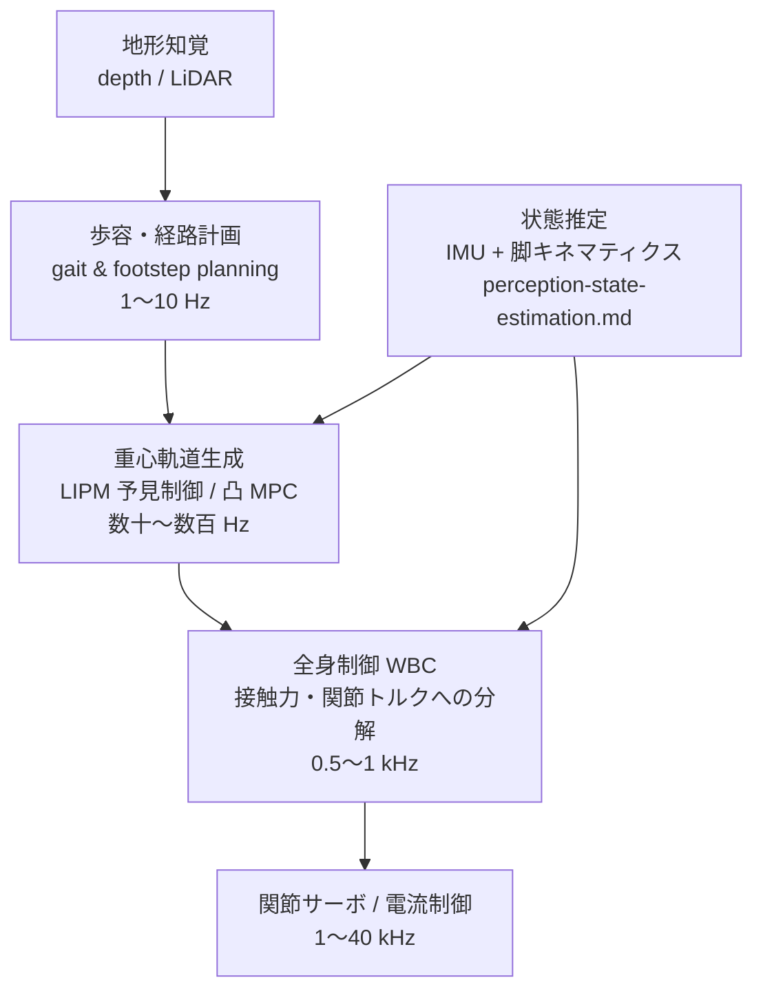

# 移動と操作 (Locomotion & Manipulation)

## 概要 (Overview)

これまでに整備した道具、つまり機構の数学 (`kinematics-dynamics.md`)、制御則 (`control-systems.md`)、状態推定 (`perception-state-estimation.md`) を、ロボットの2つの根源的なタスクに適用する。**移動 (locomotion)** は自分の身体を世界の中で動かすこと、**操作 (manipulation)** は世界の側を動かすことである。両者は対称に見えて、共通の核を持つ: どちらも**接触 (contact) をどう作り・保ち・使うか**の問題であり、接触が断続的に切り替わる（足が離れる、指が触れる）ことが、連続系の制御理論だけでは閉じない難しさの源泉になっている。

本ドキュメントは、車輪移動（非ホロノミック拘束）、脚式移動（ZMP から動歩行へ）、運動計画（サンプリング型と最適化型）、把持と接触作業（フォースクロージャ、ハイブリッド制御）を、「接触の扱い」という一本の軸で貫いて整理する。

CLAUDE.md の方針に従い分析深度は Level 3（完全）を既定とし、各主張には標準的教科書（LaValle, Siciliano ハンドブックほか）と一次文献（Kajita の予見制御、Raibert の脚式制御など）を典拠として付す。

## 方法論 (Methodology)

- 移動と操作を別分野としてではなく、**「接触拘束の下での運動生成」という同一問題の2つの現れ**として扱い、概念の対応（支持多角形 ↔ 把持のクロージャ、歩容切替 ↔ 持ち替え）を明示する。
- 脚式移動は歴史的順序（静歩行 → ZMP → 動歩行 → 学習ベース）で追う。各世代が**前世代のどの仮定を捨てたか**を軸にする。
- 運動計画はアルゴリズムのカタログではなく、**完全性・最適性・計算量のトレードオフ**として2系統（サンプリング型/最適化型）を対比する。
- 数値（歩行周期・摩擦係数など）は代表値・桁感を優先する。

## 発見事項 (Findings)

1. **車輪移動の本質的制約は「横に動けない」ことである。** 車輪の転がり拘束は速度空間を制限する**非ホロノミック拘束 (nonholonomic constraint)** であり、位置空間では到達できても任意の経路では到達できない（縦列駐車が切り返しを要する理由）。経路計画がただの最短経路問題にならないのはこのためである[^lavalle]。
2. **脚式の静的安定は「重心投影が支持多角形の中にあること」に尽きるが、それでは歩けない。** 静歩行は遅く、支持多角形を広げ続ける必要がある。動的な歩行は重心投影が支持領域を出ることを許し、代わりに**動的な量（ZMP・角運動量）** で転倒しないことを保証する。安定の定義を静力学から動力学へ移すことが脚式の第一の転換点である[^vukobratovic]。
3. **ZMP + 線形倒立振子モデル (LIPM) が二足歩行を「解ける問題」にした。** 全身動力学をそのまま解く代わりに、重心を1点・高さ一定と近似すると、重心運動と ZMP の関係が線形 2 階 ODE になり、将来の着地計画から重心軌道を先読みで生成できる（Kajita の予見制御）[^kajita]。ASIMO 世代の二足歩行はこの枠組みの産物である。
4. **動歩行への転換は「倒れ込みを許して次の一歩で受ける」ことである。** Raibert のホッピングロボット以来、動的脚式は「バランスを保つ」のではなく「転倒を着地で回収し続ける」制御であり、捕捉点 (capture point / DCM) が「どこに足を着けば止まれるか」を与える[^raibert][^pratt-cp]。現代の四足・ヒューマノイドは、この考え方を摩擦錐制約付きの MPC + 全身制御（`control-systems.md`）として実装し、さらに不整地では強化学習ポリシーが支配的になりつつある。
5. **運動計画は「完全性を取るか、滑らかさを取るか」の2系統に分かれる。** サンプリング型 (RRT/PRM) は高次元でも確率的完全性を持つが経路はギザギザで後処理が要る。最適化型 (trajectory optimization) は滑らかで制約を明示できるが局所解に落ちる。実務は「サンプリングで大域構造を掴み、最適化で磨く」の直列が定石である[^lavalle]。
6. **把持の成立条件は幾何学で書ける。** 成立条件には、形状で拘束するフォームクロージャ (form closure) と、摩擦力込みで拘束するフォースクロージャ (force closure) がある。把持の解析は接触点の位置・法線・摩擦錐から「任意の外乱レンチに抗せるか」を判定する凸幾何の問題である[^murray]。一方で実世界の把持成功率を上げているのは解析ではなく学習（深層学習による把持点予測）であり、解析と学習の分担が現在進行形で再編されている。
7. **接触作業の定石は「方向ごとに位置と力を使い分ける」ことである。** ペグ挿入では、挿入方向は力制御（押し付け）、横方向は柔らかい位置制御（倣い）と、タスク座標系の方向別に制御モードを割り当てる（ハイブリッド位置/力制御・インピーダンス制御の方向別剛性設定）。`control-systems.md` のインピーダンス制御はここで実戦投入される。

## アーキテクチャ (Architecture)

### 脚式移動の制御スタック



- `control-systems.md` のカスケード原理が脚式でも再現される: 上位ほど長い時間ホライズンを粗いモデル (LIPM) で、下位ほど短いホライズンを精密なモデル（全身動力学）で扱う。**モデルの粒度と時間ホライズンを交換する**のが階層設計の本質である。
- 学習ベースの構成では、中間の2層（重心軌道 + WBC）が単一の学習ポリシー（数十〜数百 Hz で推論）に置き換わる。ただし関節サーボと安全層は残る。学習が置換するのは「計画と分解」であって「実行と安全」ではない。

### 移動と操作の対応関係

| 概念 | 移動 (locomotion) | 操作 (manipulation) |
|---|---|---|
| 接触の集合 | 接地足 | 指・治具の接触点 |
| 成立条件 | 支持多角形 / 摩擦錐内の床反力 | フォーム/フォースクロージャ |
| 接触の切替 | 歩容（遊脚・支持脚の交代） | 持ち替え (regrasping)・指の付け替え |
| 失敗モード | 転倒・滑り | 落下・滑り |
| 計画問題 | 足配置計画 | 把持点選択 |

## 技術詳細 (Technical Details)

### 1. 車輪移動と非ホロノミック拘束 (Wheeled Locomotion)

差動二輪 (differential drive) の運動学は次式で表される。

```
v = r·(ω_R + ω_L)/2        （前進速度）
ω = r·(ω_R − ω_L)/W        （旋回角速度; r: 車輪半径, W: トレッド）
拘束: ẏ·cosθ − ẋ·sinθ = 0  （横滑りしない = 非ホロノミック拘束）
```

- 拘束は**速度空間**の制限であり、積分して位置空間の制限にはならない（だからこそ切り返しで任意姿勢に到達できる）。この「可積分でない拘束」が非ホロノミックの定義である[^lavalle]。
- 経路追従は pure pursuit・タイムスケーリングなどの古典で足りることが多く、車輪移動の実務的難所はむしろ自己位置推定（`perception-state-estimation.md`）と動的障害物側にある。全方向移動（メカナム・オムニホイール）は拘束を機構で消す解だが、段差・汚れへの頑健性を代償にする。

### 2. 脚式移動 — ZMP と線形倒立振子 (Legged Locomotion: ZMP & LIPM)

**ZMP (zero-moment point)** は、床反力の合力が水平軸まわりのモーメントを持たない床上の点である。ZMP が支持多角形の内部にある限り、足裏は床から剥がれない（=転倒モーメントが生じない）[^vukobratovic]。

**線形倒立振子モデル (LIPM)**: 全質量を高さ `z_c` 一定の質点に集約すると、重心の水平運動 `x` と ZMP `p` の関係は次式になる。

```
ẍ = (g / z_c) · (x − p)      （g: 重力加速度 — 線形 2 階 ODE）
```

- 「ZMP をここに置きたい（足配置計画）→ 重心はどう動くべきか」が線形系の追従問題になり、将来の ZMP 参照軌道を使う**予見制御 (preview control)** で重心軌道を生成できる[^kajita]。時定数 `√(z_c/g)`（身長 1 m で約 0.3 秒）が「二足歩行の応答が本質的にこの速さを要求する」ことを教える。これは [`../../foundations/mathematics/calculus-analysis/ordinary-differential-equations.md`](../../foundations/mathematics/calculus-analysis/ordinary-differential-equations.md) の不安定な指数解がそのまま物理になっている例である。
- **捕捉点 (capture point / divergent component of motion, DCM)**: LIPM の発散成分 `ξ = x + ẋ·√(z_c/g)` は「今すぐ足をそこに置けば静止できる点」を与え、押された時の踏み出し (push recovery) と動歩行の統一的な言語になった[^pratt-cp]。
- ZMP 枠組みの限界: 足裏が平らに接地する平地を仮定し、腕の振り・角運動量を使えない。不整地・走行・跳躍では、床反力を摩擦錐制約下の決定変数とする MPC（`control-systems.md` 参照）と全身制御、さらに学習ベース制御へ移行する。

### 3. 運動計画 (Motion Planning)

配位空間 (configuration space)、つまり関節角の張る高次元空間で、始点から終点まで障害物に触れない連続経路を探す問題。

- **サンプリング型**: 配位空間をランダムに標本化し、衝突しない標本をつないでグラフ/木を作る。
  - **PRM (probabilistic roadmap)**: 多クエリ向け。空間全体のロードマップを事前構築。
  - **RRT (rapidly-exploring random tree)**: 単一クエリ向け。木を未探索領域へ偏りなく伸ばす。非ホロノミック拘束下でも使える。
  - 確率的完全性（解があればいつかは見つける）を持つが、経路の質は保証しない。RRT* が漸近最適性を加えた[^lavalle]。
- **最適化型 (trajectory optimization)**: 経路を離散化した変数列とし、滑らかさ + 障害物距離をコストに、動力学・関節限界を制約に入れて非線形最適化で解く（CHOMP・TrajOpt 系）。初期値依存（局所解）だが、動力学制約・接触力を明示的に扱える。脚式 MPC は「毎周期解き直す軌道最適化」にほかならない。
- **狭い通路問題**: サンプリング型は通過確率の低い狭所（部品の嵌合など）が苦手で、まさにその狭所こそ操作タスクの核心という不整合がある。接触を「避ける」計画から「使う」計画（コンプライアンスに任せる、`control-systems.md` のインピーダンス制御）への切替が実務解になる。

### 4. 把持 (Grasping)

接触点集合が物体を拘束できるかは、各接触の摩擦錐 (friction cone) が張るレンチ（力+モーメント）の集合で判定する。

```
フォームクロージャ: 摩擦に頼らず幾何拘束のみで全方向を拘束（例: 治具・チャック）
フォースクロージャ: 摩擦錐内の接触力の組合せで任意の外乱レンチに対抗可能
   摩擦錐: ‖f_tangent‖ ≤ μ·f_normal   （μ: 摩擦係数, 剛体接触の Coulomb モデル）
```

- 点接触+摩擦のモデルでは、2 指の**対蹠把持 (antipodal grasp)**（法線が対向し摩擦錐内）がフォースクロージャの最小構成であり、平行グリッパの把持計画の理論的根拠になっている[^murray]。
- 解析的な把持品質指標（最小特異値・レンチ空間の内接球半径。ここでも SVD が現れる）は、物体形状・摩擦係数・接触位置の正確な知識を仮定する。実環境ではこの仮定が壊れるため、**深層学習による把持点予測**（depth 画像 → 把持候補の品質スコア）が実用の主流になった。学習が置き換えたのは「モデル化できない不確かさの吸収」であり、クロージャの幾何学は依然として教師信号・評価の言語である。
- ソフトグリッパ・吸着は「接触モデルを単純化する機構的解」であり、機構でモデル誤差を吸収するという `robotics-fundamentals.md` の SEA と同じ思想系列にある。

### 5. 接触作業 — ハイブリッド制御 (Contact Tasks: Hybrid Control)

- タスク座標系を接触の幾何で分解する: 拘束方向（環境が位置を決める→力を制御）と自由方向（力がゼロ→位置を制御）。ペグ挿入なら、挿入軸は押し付け力、横2軸+傾き2軸は低剛性の倣い、回転1軸は位置制御、という割り当てになる。
- 実装は `control-systems.md` のインピーダンス制御の方向別剛性で行うのが現代的で、探り (search) → 倣い (compliant insertion) → 完了検知（力プロファイル）の状態機械として組む。
- 組立の自動化が難しいのは、公差がロボットの絶対精度より厳しい（数十 µm vs 数百 µm）ためであり、**精度を制御で買わずコンプライアンスで買う**のがこの分野の一貫した設計哲学である（受動コンプライアンス RCC はその機構版）。

## セキュリティ考察 (Security Considerations)

> 移動・操作は「ロボットが最も大きなエネルギーを環境と交換する」層であり、失敗が直接に危害となる。

- **転倒は脚式の支配的ハザードである。** 数十 kg のヒューマノイドの転倒は周囲の人・設備への直接危害であり、電源喪失・推定発散・押し外乱を想定した**安全転倒 (safe fall)**（衝撃部位の選択・受け身動作）と、転倒検知からの STO（`control-systems.md`）が最後の防護層になる。「転倒しない」保証は動歩行では原理的に得られないため、「転倒しても危害を限定する」設計が要る。
- **計画は安全制約の実施点である。** 速度・分離監視 (ISO/TS 15066) の実効性は、経路計画が人の予測位置に対して制動距離を確保できるかに懸かる。動的障害物（人）の将来位置の不確かさを計画の安全余裕に反映させること、および知覚の故障（`perception-state-estimation.md` のセンサ攻撃・推定発散）時に**保守側（停止）へ縮退する**ことが設計原則。
- **操作対象の完全性**: 把持・組立パラメータ（把持力・挿入力の上限）の改竄は、対象物の破壊や過大な接触力に直結する。`control-systems.md` で述べたパラメータ完全性保護の適用対象はタスク定義にまで及ぶ。
- **学習ポリシーの分布外挙動**: 学習ベースの歩行・把持は訓練分布外の状況（未知地形・未知物体）で予測不能に振る舞いうる。移動・操作こそ「学習の外側に証明可能な安全層を置く」原則（`control-systems.md` 発見事項 7）の主戦場である。

## 結論 (Conclusions)

移動と操作は、**接触をどう作り・保ち・切り替えるか**という同一の問題構造を持つ。車輪の非ホロノミック拘束、ZMP と支持多角形、摩擦錐とフォースクロージャは、いずれも「接触が許す力・速度の集合」を幾何学として書き、その中で運動を計画・制御する営みである。そして歴史は一貫して「接触を避け・単純化する」（平地の ZMP、把持の解析モデル）から「接触を使いこなす」（動歩行、コンプライアント組立、学習把持）へ進んできた。

これで第1期・第2期の5本により、機構 → 数学 → 制御 → 推定 → タスクという領域の主脈が通った。残るロードマップは事例分析（ヒューマノイド）とソフトウェアスタック (ROS 2) であり、前者は本ドキュメントまでの道具立てを実機の設計判断に当てはめる応用編になる。

---

## 参考文献 (References)

[^lavalle]: LaValle, S. M. (2006). *Planning Algorithms*. Cambridge University Press. — 非ホロノミック拘束・配位空間・RRT/PRM の標準的典拠（著者公開版: http://lavalle.pl/planning/）。

[^vukobratovic]: Vukobratović, M. & Borovac, B. (2004). Zero-Moment Point — Thirty Five Years of Its Life. *International Journal of Humanoid Robotics*, 1(1), 157–173. DOI: 10.1142/S0219843604000083 — ZMP 概念の提唱者自身による総説。

[^kajita]: Kajita, S. et al. (2003). Biped Walking Pattern Generation by Using Preview Control of Zero-Moment Point. *Proc. IEEE ICRA*, 1620–1626. DOI: 10.1109/ROBOT.2003.1241826 — LIPM + 予見制御による歩行パターン生成の原典。

[^raibert]: Raibert, M. H. (1986). *Legged Robots That Balance*. MIT Press. — 動的脚式制御（ホッピング・3分割制御）の原典。

[^pratt-cp]: Pratt, J., Carff, J., Drakunov, S. & Goswami, A. (2006). Capture Point: A Step toward Humanoid Push Recovery. *Proc. IEEE-RAS Humanoids*, 200–207. DOI: 10.1109/ICHR.2006.321385 — 捕捉点の原典（DCM と等価な概念）。

[^murray]: Murray, R. M., Li, Z. & Sastry, S. S. (1994). *A Mathematical Introduction to Robotic Manipulation*. CRC Press. — 摩擦錐・フォーム/フォースクロージャ・把持の数学の標準的典拠。

その他の標準的典拠を以下に挙げる。

- Siciliano, B. & Khatib, O. (Eds.) (2016). *Springer Handbook of Robotics* (2nd ed.). Springer. — 歩行・把持・計画の各章のリファレンス。
- Mason, M. T. (2001). *Mechanics of Robotic Manipulation*. MIT Press. — 接触力学・押し操作 (pushing) の理論。
- Wieber, P.-B., Tedrake, R. & Kuindersma, S. (2016). Modeling and Control of Legged Robots. In *Springer Handbook of Robotics* (2nd ed.), Ch. 48. — LIPM/DCM から MPC・全身制御までの現代的整理。
