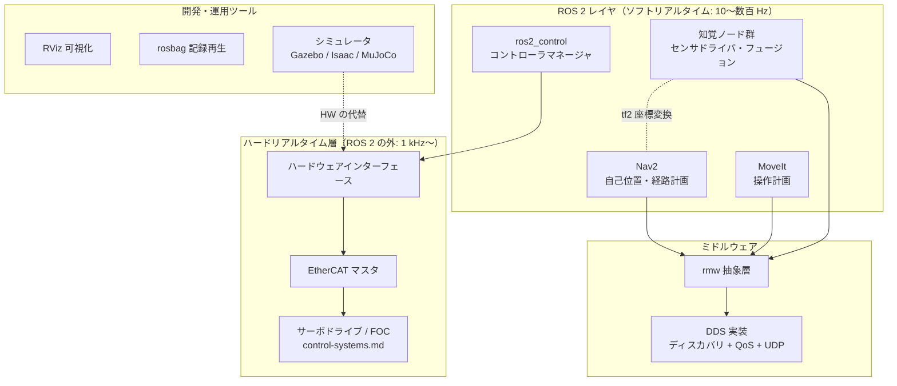

# ロボットソフトウェアスタック (Robot Software Stack)

## 概要 (Overview)

ここまでの文書は制御・推定・計画を「アルゴリズム」として扱ってきた。しかし実機では、それらは**数十のプロセスが複数の計算機に分散し、周期もクリティカリティも異なるまま通信し合うソフトウェアシステム**として動く。この統合を担うのがロボットミドルウェア (robot middleware) であり、現在の事実上の標準が **ROS 2 (Robot Operating System 2)** である。

本ドキュメントは、ROS 2 を「OS」ではなく**分散通信ミドルウェア + ツール群 + エコシステム**として分解し、その中核である DDS (Data Distribution Service)、リアルタイム性の境界（どこまでが ROS 2 で、どこからが RTOS・専用制御器の仕事か）、標準アプリケーション層（ros2_control / Nav2 / MoveIt）、そして開発を支えるシミュレーションと sim-to-real までを扱う。`engineering/robotics/` に置くのは、この層が [`robotics-fundamentals.md`](robotics-fundamentals.md) の計算機階層（「周期要件が計算機の種類を決める」）のソフトウェア側の実装だからである。`../../software/` の各領域（networking, virtualization, ml-systems）への相互参照で両スタックを接続する。

CLAUDE.md の方針に従い分析深度は Level 3（完全）を既定とし、各主張には一次仕様（OMG DDS）と査読論文（Macenski et al. の ROS 2 設計論文）を典拠として付す。

## 方法論 (Methodology)

- ROS 2 を**下から**読む: トランスポート (DDS) → 通信抽象（トピック/サービス/アクション、QoS）→ 実行モデル（ノード・エグゼキュータ）→ アプリケーションフレームワーク → 開発ツール。各層で「何を保証し、何を保証しないか」を明示する。
- ROS 1 → ROS 2 の設計変更を「ROS 1 の何が製品化を阻んだか」の裏返しとして整理する[^macenski]。
- リアルタイム性は [`control-systems.md`](control-systems.md) の要求（1 kHz・低ジッタ）を基準に、「ROS 2 で満たせる範囲」と「フィールドバス直結の専用ループに残す範囲」の線引きとして扱う。
- シミュレーションは「開発の便利ツール」ではなく**学習ベース制御の生産設備**として位置づけ、sim-to-real ギャップを工学的問題として扱う。

## 発見事項 (Findings)

1. **ROS は OS ではなく「分散システムのミドルウェア + 規約 + エコシステム」である。**[^quigley-ros] 提供するのは、プロセス（ノード）間の出版購読通信、共通メッセージ型、座標変換ツリー (tf2)、記録再生 (rosbag)、可視化 (RViz)、ビルド規約であり、価値の過半は**再利用可能なパッケージ群という外部性**にある。ロボット企業が内製ミドルウェアから ROS 2 へ移る主因も個別機能ではなくエコシステム接続である。
2. **ROS 1 の限界は単一障害点と「製品要件の欠落」だった。** ROS 1 は単一の roscore（名前解決の中心）に依存し、TCP ベースの独自トランスポートは QoS・リアルタイム・セキュリティを持たなかった。研究では許容できても、製品（複数ロボット、不安定な無線、安全要件）では致命的であり、ROS 2 はトランスポートを標準規格 DDS に置き換える全面再設計を選んだ[^macenski]。
3. **DDS の中核は「ブローカーレスの出版購読 + QoS 契約」である。** OMG 標準の DDS は、中央サーバなしの参加者相互発見（UDP マルチキャストによるディスカバリ）と、信頼性・履歴・締切・生存性などの **QoS ポリシーの組合せを出版側と購読側の契約**として扱う通信モデルを提供する[^omg-dds]。「センサは最新値のみ・落としてよい (best effort + keep last)」「指令は確実に (reliable)」といった、ロボットの通信要件の語彙がそのまま規格になっている。
4. **ROS 2 はリアルタイム対応「可能」であって既定で「保証」ではない。** エグゼキュータのコールバックスケジューリング、動的メモリ確保、DDS のディスカバリトラフィックはいずれもジッタ源であり、既定構成の ROS 2 は 1 kHz のサーボループには向かない。実務の線引きは明確で、**関節サーボはフィールドバス直結の専用ループ（[`control-systems.md`](control-systems.md) の EtherCAT + サーボドライブ）に残し、ROS 2 は 10〜数百 Hz の計画・監視・統合層を担う**。境界に立つのが ros2_control のリアルタイム制御ループである。
5. **リアルタイム Linux の主流化が境界を動かしつつある。** PREEMPT_RT パッチが Linux 6.12（2024-11 リリース）でメインライン化され[^linux612]、注意深く書かれたユーザ空間プロセス（メモリロック・専用コア・ロックフリー通信）が数百 µs 級の決定性を得られるようになった。「RTOS でなければ不可能」だった領域の一部が汎用 Linux に降りてきており、[`../../software/operating-systems/process-thread-scheduling.md`](../../software/operating-systems/process-thread-scheduling.md) のスケジューラ議論と直結する（RTOS 自体の各論は [`../../software/embedded/rtos-architectures.md`](../../software/embedded/rtos-architectures.md)、リアルタイム性の基礎概念は [`../../software/embedded/realtime-fundamentals.md`](../../software/embedded/realtime-fundamentals.md)）。
6. **アプリケーション層は本領域の各文書と1対1に対応する。** ros2_control（ハードウェア抽象と制御器: [`control-systems.md`](control-systems.md)）、Nav2（自己位置推定・経路計画: [`perception-state-estimation.md`](perception-state-estimation.md)・[`locomotion-manipulation.md`](locomotion-manipulation.md)）、MoveIt（マニピュレーション計画: 同）。つまり ROS 2 エコシステムとは、**本領域で扱った理論の参照実装のカタログ**である。
7. **シミュレーションは学習ベースロボティクスの「生産設備」になった。** 物理エンジン上での大規模並列強化学習（GPU 上で数千環境を同時実行）と、ドメインランダマイゼーションによる sim-to-real 転移[^tobin-dr]が、脚式歩行制御の標準製法になっている[^rudin]。シミュレータの物理忠実度（接触・アクチュエータモデル）とスループットのトレードオフが、そのまま学習可能なスキルの範囲を決める。

## アーキテクチャ (Architecture)

### スタック全体像と実時間の境界

- **tf2（座標変換ツリー）** が全ノードの空間的な共通言語である: 各センサ・リンク・地図の座標系の関係を時刻付きで管理し、[`kinematics-dynamics.md`](kinematics-dynamics.md) の同次変換をシステム全体に配る配管にあたる。
- シミュレータはハードウェアインターフェースの差し替え先として同じトポロジに入る。「実機とシミュレーションで上位層を変えない」ことがアーキテクチャ上の要点である。

### 通信プリミティブと QoS

| プリミティブ | 意味 | 典型用途 |
|---|---|---|
| トピック (topic) | 多対多の出版購読 | センサ流・状態配信 |
| サービス (service) | 要求応答 (RPC) | 設定変更・単発の問い合わせ |
| アクション (action) | 進捗・中断可能な長時間ゴール | 「あそこへ移動せよ」「把持せよ」 |

| 主要 QoS | 選択肢 | 設計判断の例 |
|---|---|---|
| Reliability | reliable / best effort | LiDAR 点群は best effort（遅延 > 完全性）、指令は reliable |
| History/Depth | keep last N / keep all | センサは keep last 1（最新値のみ） |
| Durability | volatile / transient local | 地図など「後から購読しても届くべき」ものは transient local |
| Deadline / Liveliness | 周期・生存の監視 | 「100 ms 途絶えたら縮退」の契約を通信層で検出 |

## 技術詳細 (Technical Details)

### 1. DDS とディスカバリ (DDS & Discovery)

- DDS は OMG 標準（DDS v1.4、ワイヤプロトコル RTPS）であり、複数ベンダ実装（Fast DDS, Cyclone DDS ほか）が相互運用する。ROS 2 は `rmw` (ROS middleware) 抽象層を挟み、実装を差し替え可能にしている[^omg-dds][^macenski]。
- **ブローカーレス**: 参加者は UDP マルチキャストで相互発見し、以後はピアツーピアで通信する。roscore（ROS 1 の単一障害点）は存在しない。代償として、ノード数が増えるとディスカバリトラフィックが増大し、大規模システム・無線環境では発見サーバ方式（discovery server）や設定チューニングが要る。
- トランスポートは UDP が基本（`../../software/networking/` の議論がそのまま適用される）。同一ホスト内は共有メモリ、さらにゼロコピー（loaned message / iceoryx 系）で大容量の点群・画像を配る最適化があり、「プロセス分離の堅牢性」と「コピーコスト」のトレードオフを QoS と配置で調整する。
- マイコン（関節ドライバ・センサハブ級）には **micro-ROS**（XRCE-DDS）があり、[`robotics-fundamentals.md`](robotics-fundamentals.md) の計算機階層の最下層まで同じ概念モデルで届く。

### 2. 実行モデルとリアルタイム性 (Execution Model & Real-Time)

- ROS 2 のノードはコールバック（購読・タイマ・サービス）の集合であり、**エグゼキュータ**がそれらをスレッドに割り当てる。既定のエグゼキュータはスループット指向で、コールバック起動順序の決定性・優先度制御は弱い。ここが制御用途での主要なジッタ源になる。
- 実時間化の定石は、[`control-systems.md`](control-systems.md) の「ジッタは位相遅れ」の観点から: 制御パスを専用スレッド + SCHED_FIFO + CPU アフィニティで隔離し、`mlockall` でページフォルトを排除し、制御ループ内の動的確保・ロック取得を禁じる（[`../../software/concurrency/lock-free-data-structures.md`](../../software/concurrency/lock-free-data-structures.md) の言葉でいう wait-free な受け渡し）。PREEMPT_RT のメインライン化（Linux 6.12）でこの構成の到達点が実用域に入った。
- **ros2_control** はこの境界の標準実装である（ROS 1 の ros_control を継承[^ros-control]）: コントローラマネージャが固定周期（典型 100 Hz〜1 kHz）の制御ループを回し、ハードウェアインターフェース（EtherCAT・CAN・ベンダ SDK）とコントローラ（関節軌道追従・アドミタンス等）をプラグインとして差し替える。**「ROS 2 のトピック層」と「決定的な制御ループ」を同一プロセス内で分離する**構造により、通信のジッタが制御周期に波及しないようにしている。

### 3. アプリケーションフレームワーク (Application Frameworks)

- **Nav2**（移動）[^nav2]: 挙動木 (behavior tree) でタスクフローを、コストマップ + プランナ（大域: A*/Smac、局所: DWB/MPPI）で [`locomotion-manipulation.md`](locomotion-manipulation.md) の計画理論を実装する。自己位置推定は AMCL（[`perception-state-estimation.md`](perception-state-estimation.md) のパーティクルフィルタ）が既定。
- **MoveIt**（操作）: [`kinematics-dynamics.md`](kinematics-dynamics.md) の IK ソルバ群と [`locomotion-manipulation.md`](locomotion-manipulation.md) のサンプリング型計画 (OMPL) を束ね、衝突チェック・軌道時間化まで面倒を見る。
- これらは「参照実装」であり、性能限界（例: Nav2 の想定は主に車輪型、脚式の全身制御は対象外）を知った上で、どこから専用実装に切り替えるかを判断するのが実務である。

### 4. シミュレーションと sim-to-real (Simulation & Sim-to-Real)

| シミュレータ | 物理エンジン | 強み | 主用途 |
|---|---|---|---|
| Gazebo (新世代) | 複数選択可 | ROS 2 統合・センサモデル | システム統合試験 |
| NVIDIA Isaac Sim/Lab | PhysX (GPU) | 数千環境の並列 RL・フォトリアル | 学習ベース制御の量産 |
| MuJoCo | 独自 (接触に強い) | 接触の安定性・研究の標準 | 制御・RL 研究 |

- **sim-to-real ギャップ**の主因は接触（摩擦・剛性）とアクチュエータ（トルク遅れ・摩擦・熱）のモデル誤差である。対策の主流は精密同定よりも**ドメインランダマイゼーション**（物理パラメータ・遅延・ノイズを訓練中に散らし、実機を「分布内の一標本」にする）であり、脚式の RL 歩行はこの製法で実用化した[^rudin]。
- 学習パイプライン全体（GPU 並列シミュレーション → ポリシー蒸留 → 実機推論）は [`../../software/ai/ml-inference-systems.md`](../../software/ai/ml-inference-systems.md) の推論基盤と [`../../hardware/accelerators/gpu-simt-architecture.md`](../../hardware/accelerators/gpu-simt-architecture.md) の上に載る。ヒューマノイド各社の競争力がシミュレーション設備に依存する（[`humanoid-robots.md`](humanoid-robots.md)）のはこの構造による。
- rosbag による実機データの記録・再生は、回帰試験（同じ入力列に対する出力の差分検証）と学習データ収集を兼ね、`../../software/observability/` の「再現可能な観測」のロボット版にあたる。

### 5. デプロイと運用 (Deployment & Operations)

- コンテナ化（[`../../software/virtualization/hardware-virtualization-containers.md`](../../software/virtualization/hardware-virtualization-containers.md)）が配備の標準になりつつあるが、リアルタイムスレッドのスケジューリング特権・デバイスアクセス・DDS のマルチキャストとコンテナネットワークの相性という固有の摩擦がある（host network + 権限の限定付与が定石）。
- フリート運用（OTA 更新・テレメトリ・遠隔介入）は [`humanoid-robots.md`](humanoid-robots.md) で述べた攻撃面そのものであり、更新の署名検証・段階的ロールアウト・「安全層は更新経路から独立」の原則が要る。

## セキュリティ考察 (Security Considerations)

- **既定の ROS 2 / DDS は開放系である。** ディスカバリに応答する参加者は誰でもトピックを購読・出版できるため、同一ネットワークに入られた時点で、センサの盗聴もトルク指令の注入も可能になる。実際、インターネットに露出した ROS システムの探索は研究として繰り返し実証されてきた。
- **SROS2 / DDS-Security** が対策の標準である: 参加者の認証（PKI）、アクセス制御（トピック単位の許可リスト）、暗号化を DDS 層で提供する[^sros2]。代償は鍵管理の運用と若干の遅延・スループット低下で、「工場内の閉域だから不要」という判断は [`control-systems.md`](control-systems.md) の OT セキュリティの議論（境界防御任せの脆さ）と同じ弱点を持つ。
- **安全とセキュリティの分離をここでも保つ**: ROS 2 層は安全機能の実装場所ではない。非常停止・速度制限は [`control-systems.md`](control-systems.md) の安全対応ドライブ + 安全 PLC の独立経路に置き、ROS 2 の侵害が安全層に波及しない構造を維持する。ROS 2 側でできるのは、Deadline/Liveliness QoS による通信途絶の検出と保守側への縮退までである。
- **サプライチェーン**: ROS 2 エコシステムは数千の OSS パッケージの集合であり、依存パッケージ経由の侵害は現実的な経路である。ロックファイルによる依存固定・SBOM・内部ミラーの運用は、`../../software/security/` のサプライチェーン議論（ロードマップ）のロボット適用になる。

## 結論 (Conclusions)

ロボットソフトウェアスタックの設計は、一貫して「**決定性の島を、柔軟な分散システムの海の中にどう確保するか**」の問題である。ROS 2 + DDS は海の側（発見・QoS 契約・エコシステム）を標準化し、ros2_control とフィールドバスが島の側（1 kHz の決定的な制御ループ）を守る。本領域の物理・制御の文書群 ([`robotics-fundamentals.md`](robotics-fundamentals.md) から [`locomotion-manipulation.md`](locomotion-manipulation.md) まで) が「島の中身」だとすれば、本ドキュメントはその島と海の**境界の設計**を扱ったことになる。

これで `engineering/robotics/` の当初ロードマップ 7 本が完結した。機構 → 数学 → 制御 → 推定 → タスク → 事例 → ソフトウェア基盤という主脈が通り、engineering 側は `automotive/`・`aerospace/`・`energy/` の制御各論と、software 側は `networking/`・`concurrency/`・`virtualization/`・`ai/` と相互参照で接続された。本ドキュメントが繰り返し参照した RTOS / PREEMPT_RT の各論は [`../../software/embedded/`](../../software/embedded/) が扱う。

---

## 参考文献 (References)

[^macenski]: Macenski, S., Foote, T., Gerkey, B., Lalancette, C. & Woodall, W. (2022). Robot Operating System 2: Design, architecture, and uses in the wild. *Science Robotics*, 7(66), eabm6074. DOI: 10.1126/scirobotics.abm6074 — ROS 2 の設計原理・DDS 採用理由・QoS の一次的解説。

[^omg-dds]: Object Management Group. *Data Distribution Service (DDS), Version 1.4* (formal/2015-04-10) および *DDS Interoperability Wire Protocol (DDSI-RTPS)*. https://www.omg.org/spec/DDS/ — Accessed: 2026-07-12. — 出版購読モデルと QoS ポリシーの規格一次資料。

[^sros2]: Object Management Group. *DDS Security, Version 1.1* (formal/2018-04-01). https://www.omg.org/spec/DDS-SECURITY/ — Accessed: 2026-07-12. — 認証・アクセス制御・暗号化プラグインの規格（SROS2 の基盤）。

[^rudin]: Rudin, N., Hoeller, D., Reist, P. & Hutter, M. (2022). Learning to Walk in Minutes Using Massively Parallel Deep Reinforcement Learning. *Proc. CoRL 2021*, PMLR 164, 91–100. — GPU 並列シミュレーションによる脚式 RL の代表的実証。

[^tobin-dr]: Tobin, J. et al. (2017). Domain Randomization for Transferring Deep Neural Networks from Simulation to the Real World. *Proc. IEEE/RSJ IROS*, 23–30. DOI: 10.1109/IROS.2017.8202133 — ドメインランダマイゼーションの原典。

[^quigley-ros]: Quigley, M. et al. (2009). ROS: an open-source Robot Operating System. *ICRA Workshop on Open Source Software*. — ROS 1 の設計（ノード・トピック・roscore）を述べた原典。

[^nav2]: Macenski, S., Martín, F., White, R. & Ginés Clavero, J. (2020). The Marathon 2: A Navigation System. *Proc. IEEE/RSJ IROS*, 2718–2725. DOI: 10.1109/IROS45743.2020.9341207 — Nav2 の設計（挙動木・プラグイン構成）と長距離走行実証。

[^ros-control]: Chitta, S. et al. (2017). ros_control: A generic and simple control framework for ROS. *Journal of Open Source Software*, 2(20), 456. DOI: 10.21105/joss.00456 — コントローラマネージャとハードウェアインターフェースの設計。

[^linux612]: [Linux 6.12 — KernelNewbies](https://kernelnewbies.org/Linux_6.12) — Accessed: 2026-10-04. 2024-11-17 リリース、PREEMPT_RT のメインライン統合。

その他の標準的典拠を以下に挙げる。

- [ROS 2 Documentation](https://docs.ros.org/en/rolling/) — Accessed: 2026-07-12. — 概念・QoS・エグゼキュータの公式文書。
- [ros2_control documentation](https://control.ros.org/) — Accessed: 2026-07-12. — コントローラマネージャとハードウェアインターフェースの公式文書。
