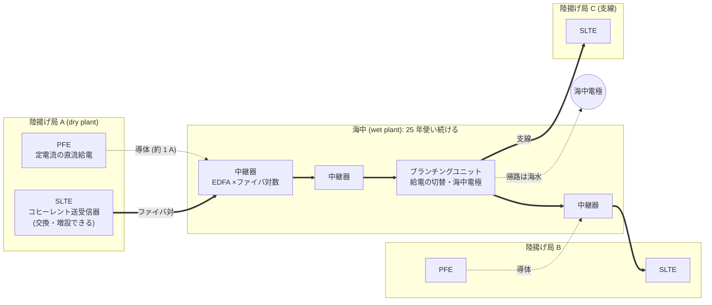
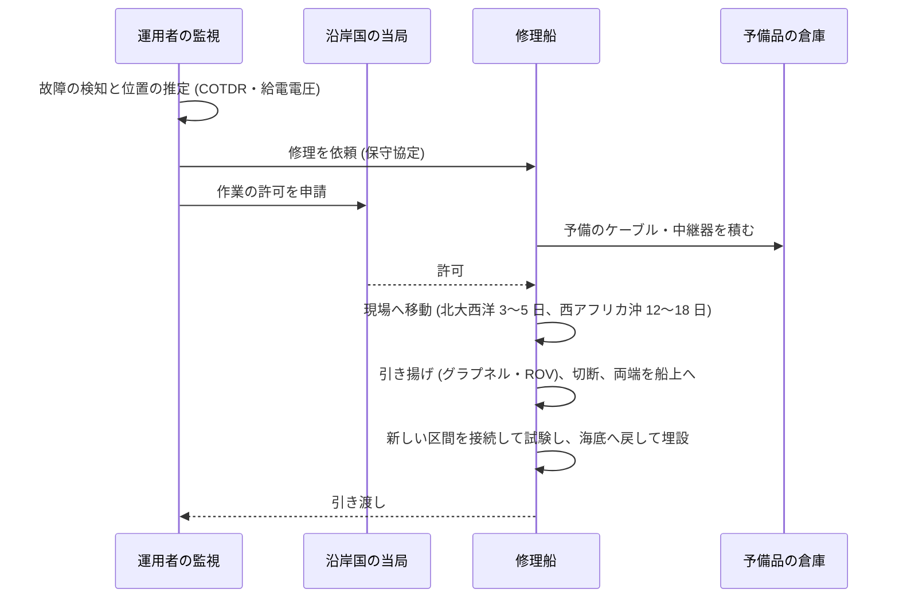

# 海底ケーブル (Submarine Cables): 冗長性は修理船と地理で決まる

## 概要 (Overview)

大陸間のデータ通信の 99% 超は海底に敷かれた光ファイバのケーブルを通る[^iab]。深海に置かれるケーブルの太さは 17 mm 程度で、浅海で鋼線の外装を巻いても 50 mm ほどにしかならない[^icpc-iho]。2026 年時点で、稼働中と計画中を合わせて 600 本を超えるケーブルがあり、運用中の総延長は 150 万 km 超 (TeleGeography) から 170〜180 万 km (ICPC) とされる[^tg-faq][^icpc-media]。

本書の中心テーゼは、**インターネットの国際通信は少数の細いケーブルに集中しており、その冗長性はケーブル単体の設計ではなく、修理能力と経路の地理的な分散で決まっている**、ということである。ケーブル単体の信頼性は高い。ITU-T G.977 は 25 年の設計寿命のあいだに部品の故障で船の出動が要る回数を「3 回未満」とするのが通常の要求だと書いている[^g977]。ところが実際には、世界で年 150〜200 件の故障が起き、その 7〜8 割は漁業と錨という外からの力による[^icpc-media]。外から切られることは防ぎきれない。だから可用性は切れてから直るまでの時間 (修理船と許認可) と、同時に切れないように経路を散らしているか (地理) の二つで決まる。

本書は (1) ケーブル・中継器・給電・陸揚げ局の構造、(2) 給電の電力が容量の上限を決め、ファイバ対を増やす SDM (space-division multiplexing) へ転換した経緯、(3) 故障の統計と修理の手順・日数、(4) 所有構造の変化 (通信事業者のコンソーシアムからハイパースケーラへ)、(5) 2022〜2026 年の切断事例、(6) 地政学と規制、(7) 衛星との補完、を扱う。コヒーレント伝送と DWDM の仕組みはデータセンター間の文脈で [`../../hardware/networking/optical-interconnect.md`](../../hardware/networking/optical-interconnect.md) が扱っているので、本書では海底に特有の制約に絞る。統計と事例は 2026-10 時点で確かめた。分析深度は Level 3。

## 方法論 (Methodology)

- 構造と給電は ITU-T の勧告 G.977 (01/2015) の本文を一次資料とする[^g977]。G.977.1 (10/2020) は題名と版だけを確かめた[^g9771]。
- 容量と SDM の設計判断は、運用者 (Meta) が発表した OFC の論文と Google の公式ブログ、ベンダの発表を使う。運用者の論文が挙げる査読論文 (JLT) は書誌だけを示す。
- 故障・修理の統計は ICPC の公式ページと、ITU と ICPC が設けた国際諮問機関 (IAB: International Advisory Body on Submarine Cable Resilience) の 2026 年報告を使う[^icpc-media][^iab]。ケーブルの本数や総延長は機関によって数え方が違うので、範囲で示す。
- 事故は通信事業者・政府機関・検察の発表と、複数の報道を突き合わせる。原因の確定していないもの (故意か事故か) は、確定していないと書く。
- 可用性の算術と、電圧降下の見積もりは**本書の計算**であり、仮定を併記する。

## 発見事項 (Findings)

1. **国際通信の大半は海底ケーブルが運び、衛星の割合は 1% にも届かない。** IAB の報告は、海底ケーブルが大陸間データ通信の 99% 超を運ぶとする[^iab]。TeleGeography は FCC のデータをもとに、米国の国際回線容量に占める衛星の割合を 0.37% としている[^tg-faq]。衛星は「代わり」ではなく、全ての光の経路が切れたときの最後の予備として位置づけられている[^iab]。

2. **故障の大半は浅い海での人間の活動が原因で、深海での自然災害は少ないが、起きれば被害が大きい。** ICPC によれば、通信ケーブルの故障は世界で年 150〜200 件で安定しており、その 70〜80% は漁業と錨による。故障が多いのは水深 300 m より浅い海である[^icpc-media]。IAB は漁業を約 40%、錨を約 25% とし、人間の海上活動の割合を 40〜70% という幅でも示している[^iab]。数え方 (原因不明の扱い、地域) で割合が動くので、本書は「過半〜8 割」と幅で扱う。一方、水深 5,000 m を超える修理は全体の 5% 未満だが、一回の回収に何時間もかかる[^iab]。

3. **修理の速さは船の数と許認可で決まり、10 年で遅くなった。** ICPC の統計では、修理への対応時間の平均は 2012 年の 20 日未満から 2024 年の 50 日超へと倍以上に延びた。IAB は修理の件数も修理船の数もほぼ一定だったことから、主な原因を許認可の遅れとしている[^iab]。修理ができる船は世界に約 70 隻あるが、修理専用か長期傭船で待機しているのは 20〜25 隻にすぎない[^iab]。同じ故障でも、北大西洋なら 3〜5 日で船が着くが、西アフリカ沖では 12〜18 日かかる[^iab]。

4. **ケーブルの容量は給電できる電力で頭打ちになり、そこから SDM への転換が起きた。** 海中の中継器は陸揚げ局の給電装置 (PFE: power feeding equipment) から導体を通して定電流で給電される[^g977]。Meta の技術者は線路電流は約 1 A、最大電圧は 15 kV が当時の上限だとし、1 ファイバ対あたりの容量はシャノン限界に近づいていると書いた[^fevrier]。限られた電力でケーブル全体の容量を最大にするには、1 対あたりの性能を下げてでも、ファイバ対の数を増やすほうが有利になる。Google の Dunant は 12 対 (従来は 6〜8 対) で 250 Tb/s とし[^google-dunant]、NEC は 2021 年に 24 対の中継器とケーブルの認定を発表した[^nec-24fp]。

5. **ケーブルを使う側の主役は通信事業者からハイパースケーラへ移った。** TeleGeography によれば、2024 年の国際帯域の需要のほぼ 4 分の 3 をコンテンツ・クラウド事業者が占める[^tg-bw2025]。IAB は太平洋横断の帯域需要の 80% 超をハイパースケーラが占めるとしている[^iab]。Google は 2018 年に Curie を発表し、「通信事業者でない大企業として初めて私有の大陸間ケーブルを敷く」と書いた[^google-curie]。Meta は 2025 年、5 大陸を結ぶ 5 万 km 超の Project Waterworth を発表した[^meta-waterworth]。

6. **ケーブルは地理的な隘路に集まり、そこで同時に複数本が切れる。** IAB は紅海南端のバブ・エル・マンデブ海峡を「世界で最も集中した場所」とし、幅 14 マイル未満の海域を少なくとも 17 本が通ると書く[^iab]。2024 年 2 月の紅海では、沈没した貨物船の錨が 3〜4 本のケーブルをまとめて損傷したとみられている[^dcd-redsea]。2024 年 12 月のフィンランド湾では、1 隻のタンカーが錨を約 90 km 引きずり、電力ケーブル Estlink 2 と通信ケーブル 4 本を損傷したとして乗組員が起訴された[^err-eagle]。**本数の冗長性は、経路が分かれていなければ一回の事故で消える**。

7. **新しい投資は既存の経路に集まりやすく、地理的な分散は市場だけでは進まない。** IAB は新しい海底ケーブル投資の 80% 超が既存の経路に集中していると指摘する。迂回路は利用率が低く、政府の共同出資や補助がないと採算が合わない[^iab]。単一のケーブルに頼る国の被害は大きい。2022 年のトンガでは、国で唯一の国際ケーブルが切れ、損害は 2021 年の GDP の 38.7% に相当する約 1.82 億ドルと見積もられた[^iab]。

8. **陸揚げは安全保障の審査対象になり、米国は 2025 年に規則として明文化した。** 米国では、司法長官を議長とする Team Telecom (正式名称は Committee for the Assessment of Foreign Participation in the U.S. Telecommunications Services Sector、大統領令 13913 で設置) が陸揚げ許可を審査する[^eo13913]。FCC は 2025 年の規則で、外国の敵対国 (foreign adversary) に支配されている申請者や、敵対国に陸揚げする申請を原則として拒否する推定 (presumption of denial) を設けた[^fcc-2025]。

## アーキテクチャ (Architecture)

### システムの構成: 乾いた設備と濡れた設備

海底ケーブルのシステムは陸揚げ局の中の「乾いた設備 (dry plant)」と、海中の「濡れた設備 (wet plant)」に分かれる。G.977 は陸揚げ地点のあいだの海中部分に、ケーブル・中継器 (OSR: optical submarine repeater)・ブランチングユニット (BU: branching unit)・等化器 (OSE)・接続箱が入ると定義する[^g977]。



凡例: 二重線は光信号、点線は給電の経路。中継器の間隔は数十 km で、数千 km の線路には百台を超える中継器が並ぶ。

- **SLTE (submarine line terminal equipment)**: 陸揚げ局の送受信器。コヒーレント方式の DSP を持ち、世代交代のたびに交換される。海中の設備は変えずに SLTE を替えて容量を上げる運用は、G.977 が「容量の増強性」として想定している。光増幅器は帯域が広くビットレートに依存しないので、長いケーブル・中継器・給電装置を 25 年使い回せる[^g977]。
- **横方向の互換 (transverse compatibility)**: G.977.1 は中継器付き海底ケーブルの DWDM について横方向の互換を定める勧告である[^g9771]。海中の設備を作ったベンダとは別のベンダの SLTE を載せる「オープンケーブル」の運用は、この考え方に沿っている。
- **中継器の中身**: 中継器の筐体の中には給電モジュールと、両方向を増幅する光ファイバ増幅器 (OFA) の対がファイバ対の数だけ入る[^g977]。海底の光増幅器はエルビウム添加ファイバ増幅器 (EDFA: erbium-doped fiber amplifier) であり、その物理は [`../../foundations/physics/quantum-solid-state/optoelectronics.md`](../../foundations/physics/quantum-solid-state/optoelectronics.md) に譲る。
- 中継器の間隔の例として、英国とカナダを結ぶ現用回線は 46 km 間隔で 128 台の中継器を持ち、高出力の増幅器を 56 km 間隔で置く設計もある[^opn]。

### ケーブルの構造: 深海と浅海で何が違うか

G.977 は機械的な構造でケーブルを分類し、軽量 (lightweight)、軽量保護、軽外装、一重外装、二重外装、岩盤用外装を挙げる[^g977]。違いは何から守るかにある。

| 区間 | 主な脅威 | 構造 | 太さ・重さ (ICPC) |
|---|---|---|---|
| 深海 (数千 m) | ほぼない。設置時の張力と水圧 | 外装なし。中心のファイバを鋼線の張力材と銅の導体で囲み、絶縁体で覆う | 約 17 mm・約 0.7 kg/m |
| 大陸棚・沿岸 (数百 m より浅い) | 底引き網、錨、波浪 | 鋼線の外装を一重・二重に巻き、多くは海底に埋設する | 約 50 mm まで・約 4.8 kg/m まで |
| 陸揚げ付近 | 錨、工事、岩 | 二重外装・岩盤用。水平方向の掘削 (HDD) で海岸を潜らせる場合もある | 資料なし |

太さと重さは ICPC の議長が 2023 年に IHO で示した値である[^icpc-iho]。深海で外装を省くのは、外からの脅威がほぼなく、外装の重さが敷設を難しくするからである。Meta は Waterworth を最深 7,000 m まで敷き、浅い沿岸など故障の多い区域では埋設を強化すると述べている[^meta-waterworth]。故障が水深 300 m より浅い海に集中する[^icpc-media]のは、この設計がうまく機能していることの裏返しでもある。深海では外装を省いても、ほとんど切れない。

### 給電: 陸から数千ボルトの直流を流す

中継器と BU は陸揚げ局からケーブルの導体を通して**定電流**で給電される。帰路は海水である[^g977]。

- 中継器は直列につながっている。電流を一定にすれば、どの中継器にも同じ電力が届く。PFE は出力電圧を自動で調整して電流を保つ。G.977 は線路に自然に誘起される電圧が最大 0.3 V/km (東西方向) に達し、ゆっくり (10 V/s 未満) 変化すると想定している[^g977]。数千 km では、この誘起電圧が数百 V から千 V を超える規模になる (本書の計算)。
- Meta の技術者は線路電流を約 1 A、PFE の最大電圧を 15 kV とした (2019 年時点)[^fevrier]。HMN Technologies は 18 kV の給電装置を発表している (ベンダ発表)[^hmn-18kv]。
- 陸上部分の導体と大地のあいだに高い電位差が生じるので、作業員の保護が必要になる[^g977]。G.977 はケーブル終端装置のインターロック、PFE の非常停止、扱う前に導体を大地へ放電する接地装置を求めている[^g977]。

### 陸揚げ局とブランチングユニット

- **BU**: 3 本のケーブル端を持ち、海中電極を備える。支線へ光を分ける方式にはファイバ対ごと分ける方式 (FFD-BU)、波長で分ける方式 (WDM-BU)、固定の OADM (FOADM-BU)、再構成できる ROADM (ROADM-BU) がある[^g977]。
- **給電の切替**: BU は 3 本のうち 2 本の導体をつないで給電の経路とし、残る 1 本を海中電極に落とせる。ある区間が故障しても、給電経路を組み替えて他の区間の通信を回復する機能が求められる[^g977]。これは修理のあいだも他の陸揚げ局の通信を保つための仕組みである。
- **陸揚げ局**: SLTE と PFE を置き、陸上の網へ接続する。IAB は陸揚げ局を複数持ち、それぞれを別の陸上網につなぐことを冗長化の基本として挙げている[^iab]。

## 技術詳細 (Technical Details)

### 1. 電力の予算が容量を決める: SDM への転換

コヒーレント伝送の普及で、1 ファイバ対あたりの容量は TAT-12/13 の世代の 5 Gb/s から 20 Tb/s 超まで伸びた[^fevrier]。Meta の技術者は海底ケーブルの容量を縛るものを三つ挙げた[^fevrier]。

1. **1 ファイバ対あたりのシャノン限界**: 現在のシステムは実用と経済の両面で限界に近い。
2. **電力の限界**: 海中の設備は陸の PFE だけで動く。線路電流は約 1 A、最大電圧は 15 kV。
3. **ケーブル断面の限界**: ファイバの本数を 32〜50 本より増やすには、ケーブルを設計し直す必要がある。

二番目の制約を数字で見る。導体の直流抵抗は 0.7〜1.6 Ω/km で設計される[^fevrier]。1 A を流すと、導体だけで 1 km あたり 0.7〜1.6 V が落ちる。10,000 km の太平洋横断ケーブルなら、導体の電圧降下だけで 7〜16 kV になる (本書の計算)。これは 15 kV の上限とほぼ同じ大きさで、中継器に使える電圧はその残りになる。Meta が銅に代えてアルミの導体を研究していたのは、電圧降下を下げてファイバ対を増やすためである[^fevrier]。

```text
 使える電力の上限  ≈  PFE の電圧 × 電流  −  導体の損失 (I² × R × 距離)
 ファイバ対ごとの容量 C₁ = B × log₂(1 + SNR)            (B: 増幅帯域)
 ケーブル全体の容量   = N × C₁                           (N: ファイバ対の数)

 SNR は増幅器の出力 (=電力) に対して対数でしか効かない。
 → 電力を N 対に分けて 1 対の SNR を下げても、N に比例して容量が増える。
```

この算術から、電力が一定なら「少ない対を高い SNR で使う」より「多くの対を低い SNR で使う」ほうが全体の容量が大きくなる。Dar らはこの技術経済を分析し、空間の並列数が約 100 の付近でビットあたりのコストが最小になると結論した[^dar]。Sinkin らも、SDM が電力効率を上げる手段であることを示している[^sinkin]。実装では、複数のファイバ対で励起レーザを共有する「ポンプ共有 (pump sharing)」が鍵になった。Google は Dunant について、従来の 1 対に 1 組の励起レーザを持つ設計に対し、レーザと光部品を複数の対で共有すると説明している[^google-dunant]。Meta の技術者はポンプ共有が対の独立性を崩す代わりに、システムの可用性を上げると書いている[^fevrier]。

### 2. 容量の推移

| 時期・システム | ファイバ対 | 容量 | 出典 |
|---|---|---|---|
| TAT-12/13 (1990 年代) | 2 (うち 1 対は予備) | 5 Gb/s / 対 | [^fevrier][^hayes-tat] |
| MAREA (2017) | 8 | 当初設計 160 Tb/s、現在の公称 224 Tb/s | [^ms-marea][^tg-faq] |
| Dunant (2020 予定、Google) | 12 | 250 Tb/s | [^google-dunant] |
| NEC の 24 対の認定 (2021) | 24 | 「半ペタビット毎秒」級 (ベンダ公称) | [^nec-24fp] |
| Project Waterworth (2025 発表、Meta) | 24 | 非公表 (「業界最高水準」とのみ記載) | [^meta-waterworth] |

数値は各社の公称値 (target) であり、運用中に実測された容量 (demonstrated) とは限らない。TeleGeography によれば、国際的に使われている帯域は 2024 年に 6.4 Pb/s を超え、年成長率は 2020 年の 45% から 2024 年の 29% に下がった[^tg-bw2025]。国際インターネット帯域は 2026 年中頃に 2,259 Tb/s に達した[^tg-bw2026]。

### 3. 故障の統計と原因

| 指標 | 値 | 出典 |
|---|---|---|
| 年間の故障件数 | 150〜200 件で安定 | ICPC[^icpc-media]、IAB[^iab] |
| 2025 年の修理件数 | 178 件 (年平均 190 件)、うち通信に影響したもの 52% | ICPC 2026 年総会[^icpc-plenary] |
| 人間の活動による割合 | 70〜80% (主に漁業と錨) | ICPC[^icpc-media] |
| 内訳 | 漁業 約 40%、錨 約 25% | IAB[^iab] |
| 意図的な破壊 | 毎年の損傷の 1% 未満 | ICPC[^icpc-media] |
| 故障が多い水深 | 300 m より浅い海 | ICPC[^icpc-media] |

- **漁業**: 底引き網が最も影響が大きい。東シナ海の張網漁は 3 m まで沈む大きな錨を使い、世界の年間故障の約 15% を占める[^iab]。
- **錨**: 以前は漁業と錨の区別が難しかった。船舶の位置追跡 (AIS) が普及して、漁業によるとされていた故障の多くが錨によるものだとわかった[^iab]。2008 年のシチリア沖では 1 隻が錨を 300 km 引きずって 6 本を損傷し、2023 年には荒天下のコンテナ船が 4 本を切った[^iab]。
- **自然災害**: 地震そのものの変位でケーブルが切れることはまれで、地震が引き起こす海底地すべりや混濁流が切る。1929 年のグランドバンクス地震は大西洋横断の電信ケーブル 13 本のうち 11 本を切り、2006 年の屏東地震は数時間で 13 件の故障を起こした[^iab]。
- **AIS の欠落**: ICPC の 2026 年総会では英国周辺のトロール漁の約 50% が AIS を切った「ダーク」な操業であると報告された[^icpc-plenary]。位置を追えない船の故障は原因の特定が難しい。

### 4. 修理の手順と日数



- **故障位置の特定**: G.977 はコヒーレント OTDR (COTDR) でファイバの区間を監視する方式を挙げている[^g977]。導体が海水に触れるシャント故障 (shunt fault) では、給電電圧の変化が手がかりになる。
- ICPC の 2026 年総会では 2025 年の平均として、通知から出港まで 23.4 日、移動に 7.7 日と報告された。最長の遅れは 947 日だった[^icpc-plenary]。IAB の「対応時間 50 日超」(2024 年) とは測り方が違い、両者は矛盾しない[^iab]。
- **許認可**: 英国の修理着手までの平均は約 8 日で、世界平均の 50 日と大きく違う。英国・南アフリカ・オランダは修理船を事前に許可する制度を持つ[^iab]。2024 年 3 月には、紅海でケーブルを損傷した汎アフリカの事業者が、修理の許可に最大 8 週間かかると報告し、修理は同年 7 月に終わった[^iab]。
- **深海の修理**: 2011 年の東日本大震災では、日本の南東沖の深海でケーブルが埋もれ、修理船が引き揚げるまでに 10 日以上かかった。42 km のケーブルと中継器 1 台は海底に放棄された[^iab]。
- **予備品**: 中継器とケーブルは元のシステムの仕様に正確に合わせる必要がある。世界の生産の 95% 超を ASN・NEC・SubCom・HMN Tech などの少数のベンダが占め、特注品の調達には数か月から 1 年以上かかることがある[^iab]。
- 1 件の修理費は 64.5 万〜130 万ドルで、費用の 30〜70% は修理そのものではなく船の動員の燃料費である[^iab]。
- 長引いた例として、2023 年 2 月、東南アジアのある国では 5 本のケーブルが同時に損傷して容量の 75% を失い、修理船が他の工事でふさがっていたため、全ての修理が終わるまで 9 か月かかった[^iab]。

### 5. 可用性の算術: なぜ「経路の分散」が要るのか

本書の計算として、次の仮定で 1 本のケーブルの不稼働率を見積もる。

```text
 仮定:
   故障件数 = 年 150〜200 件、ケーブル系 約 500 本 [ICPC]
   → 1 本あたり 年 0.3〜0.4 件
   通信に影響する割合 = 約 52% [ICPC 2026 総会]
   修理の平均時間 = 30〜50 日 (着手まで + 作業)

 1 本の不稼働:  0.35 件/年 × 0.52 × 40 日 ≈ 7 日/年  → 不稼働率 約 2%

 独立な 2 本:    0.02 × 0.02 = 0.0004  (年 3〜4 時間)
 同じ海峡の 2 本: 1 回の錨や地すべりで同時に切れる → 0.0004 より大幅に悪い
```

ケーブルは平均すると不稼働率が % 単位の部品であり、1 本で「5 ナイン」は出せない。2 本の掛け算が成り立つのは故障が独立なときだけである。紅海・バルト海・西アフリカの事例はいずれも、1 回の出来事で複数本が切れて独立性が崩れた例である (§ 7)。冗長性の実体は本数ではなく、**故障の相関を下げる地理的な分散**と、**不稼働の時間を縮める修理の速さ**にある。上位の網から見ると、この 2% が BGP の経路切替 ([`../../software/networking/ip-routing-bgp.md`](../../software/networking/ip-routing-bgp.md)) と、マルチリージョン設計 ([`../../software/cloud/multi-region-global-architecture.md`](../../software/cloud/multi-region-global-architecture.md)) の前提になる。冗長な部品の算術は [`../../foundations/mathematics/probability-statistics/reliability-theory.md`](../../foundations/mathematics/probability-statistics/reliability-theory.md) が扱う。

### 6. 所有と事業: コンソーシアムからハイパースケーラへ

- **コンソーシアム型**: 従来の大陸間ケーブルは、複数の通信事業者が共同で出資・所有した。IAB はこの方式では構想から運用開始まで 4〜6 年かかり、出資者が既存の陸揚げ拠点を選びがちで、経路が既存の経路に依存しやすいと指摘する[^iab]。
- **ハイパースケーラの参入**: Google は 2008 年にコンソーシアムの一員として初めて海底ケーブルに出資し、2018 年に私有の Curie (米国—チリ) を発表した[^google-curie]。Meta は過去 10 年に 20 本超の海底ケーブルを、パートナーと共同で開発した[^meta-waterworth]。
- 2024 年の国際帯域の需要のほぼ 4 分の 3 はコンテンツ・クラウド事業者が占める[^tg-bw2025]。
- ハイパースケーラは自社のデータセンター間を結ぶためにケーブルを持つ。経路は自社のリージョン配置で決まる。Google が太平洋で日本・グアム・ハワイなどを結ぶ Pacific Connect に 10 億ドルを投じ、太平洋の島々を経由する経路を選んだことは、既存の直行経路を避ける分散の例として IAB が挙げている[^iab]。

### 7. 切断事例

| 年月 | 場所 | 損傷 | 原因 | 復旧 |
|---|---|---|---|---|
| 2022-01 | トンガ | 唯一の国際ケーブル (トンガ—フィジー、827 km) と国内ケーブル | フンガ火山の噴火による高速の密度流[^seabrook] | 国際ケーブルは 2022-02-22 に復旧 (92 km を交換)。国内ケーブルは 6〜9 か月の見込みとされた[^globalnews-tonga] |
| 2024-02 | 紅海 | Seacom・AAE-1・EIG (TGN を含め 4 本とする報道もある)[^comsoc-hgc] | 攻撃を受けて沈んだ貨物船 Rubymar の錨とみられる (公式には未確定)[^dcd-redsea] | 汎アフリカの事業者は修理許可に最大 8 週間かかるとし、修理は 2024-07 に完了した[^iab] |
| 2024-03 | 西アフリカ | WACS・MainOne・SAT-3・ACE など 12 か国に影響する複数本[^iab][^cloudflare-wa] | コートジボワール沖の海底の落石と報じられた。事業者や調査機関の公式な原因の発表は見当たらない (2026-11-28 時点)[^cloudflare-wa] | 陸上の国境越え回線で迂回[^iab]。SAT-3 は 2024-04-06、ACE は 04-17 に修理を終えたと伝えられた[^cloudflare-wa] |
| 2024-11 | バルト海 | BCS East-West Interlink (リトアニア—スウェーデン)、C-Lion1 (フィンランド—ドイツ) | 調査中。中国の貨物船 Yi Peng 3 が周辺にいたが、決定的な証拠はないと報道[^yle-clion] | C-Lion1 は 11-25 に修理に着手した[^yle-clion]。ICPC は 2 本とも 2 週間以内に修理されたとする[^icpc-media] |
| 2024-12 | フィンランド湾 | Estlink 2 (電力) と通信ケーブル 4 本 | タンカー Eagle S が錨を約 90 km 引きずったとして乗組員 3 人を起訴[^err-eagle] | Estlink 2 は約半年停止[^record-eagle] |
| 2025-01 | バルト海 | ラトビア (ベンツピルス)—ゴットランドの光ケーブル | 貨物船 Vezhen の錨。スウェーデン検察は荒天と装備・操船の不備による事故と判断[^lsm-vezhen] | 未確認 (所有者 LVRTC の公表資料に修理の時期が見当たらない。2026-11-28 時点) |
| 2025-12-31 | バルト海 | Elisa のフィンランド—エストニア間の通信ケーブルなど 2 本 | 貨物船 Fitburg が損傷した錨を少なくとも 130 km 引きずったとして、船長と甲板長を起訴 (2026-06)[^record-eagle]。ヘルシンキ地裁は 2026-11-05 に 2 人を加重破壊工作で有罪とした (控訴可能で未確定)[^yle-fitburg] | 冗長経路で通信は維持された。修理の完了は未確認[^yle-fitburg] |

- **トンガ**: Seabrook らは、噴火で生じた火山砕屑性の密度流が海底ケーブルを壊し、西へ少なくとも 85 km 流れたことを示した[^seabrook]。修理船 Reliance は 20 日かけて 92 km を交換し、予備のケーブルが足りずニューカレドニアから融通を受けた[^globalnews-tonga]。IAB は「ほぼ完全なデジタルの孤立が 61 日」としており[^iab]、報道の国際回線の復旧日 (噴火から 38 日後) とは食い違う。国内ケーブルを含めた孤立の数え方の違いと考えられるが、本書では確認できなかった。
- **紅海**: Seacom は 2024-02-24、モンバサ—ザファラーナ区間の故障を報告し、欧州向けの通信を Equiano・PEACE・WACS へ迂回した[^subtel-seacom]。米国の当局者と ICPC は Rubymar の錨が引きずられて損傷したとみている[^dcd-redsea]。HGC は、損傷したケーブルが地域の通信の約 25% を運んでいたと推定した (事業者の推定)[^comsoc-hgc]。
- **西アフリカ**: IAB によれば 12 か国が影響を受け、1 か国だけで 4 日間に約 5.9 億ドルを失ったと推定される。通信は陸上の国境越え回線で回復された[^iab]。
- **バルト海の司法**: Eagle S の事件では、ヘルシンキ地裁が 2025-10 に管轄権がないとして訴えを退けたが、ヘルシンキ高裁は 2026 年に管轄権を認めて差し戻した。最高裁への上告期限は 2026-10-26 である (2026-10 時点で未確定)[^record-eagle]。高裁は、最初の錨の落下は事故でありえたとしつつ、その後の乗組員の行動は事故ではないと判断した[^record-eagle]。

### 8. 衛星との補完

- 米国の国際回線容量に占める衛星の割合は 0.37% である (TeleGeography による FCC データの集計)[^tg-faq]。数百 Tb/s のケーブル 1 本の代わりを衛星が担うことはできない。
- IAB は Starlink のような低軌道の衛星群を海底ケーブルの「最後の予備」と位置づける。帯域と遅延は劣るが、金融取引や政府の通信など重要な通信が完全に途絶えることは防げる[^iab]。小島嶼国のように経路の少ない国には、全ての光の経路が切れた場合に備えて、衛星への切替をあらかじめ組み込むよう勧めている[^iab]。
- 光ファイバ中の光は真空中より遅い。長距離では、真空中を飛ぶ衛星間レーザの経路がファイバより速くなりうる ([`../aerospace/satellites/starlink-satellite-bus.md`](../aerospace/satellites/starlink-satellite-bus.md))。

## 運用・安全考察 (Operational & Safety Considerations)

- **切断は防げない前提で設計する。** 年 150〜200 件の故障の大半は過失であり、意図的な破壊は 1% 未満とされる[^icpc-media]。対策の順序は(1) 埋設と外装で浅い海の過失を減らす、(2) 海図への記載と保護区域で漁業と錨を遠ざける、(3) 経路と陸揚げ局を散らして同時故障を避ける、(4) 修理を速くする、となる。ICPC はケーブルの位置を示す海図を漁業者に配り、大きさを問わず全ての船に船舶監視システム (VMS) を義務づけるよう政府に勧めている。米国の NOAA は敷設・修理中の船の周囲 1 海里で漁業を禁じている[^iab]。
- **妨害と、事故との区別の難しさ。** バルト海の事例は、錨を引きずるという「事故と同じ手口」が、故意かどうかの立証を難しくすることを示した。Eagle S の裁判は管轄権そのものが争点になり、Vezhen は事故と判断された[^record-eagle][^lsm-vezhen]。NATO は 2025-01 に、フリゲート・哨戒機・無人艇でバルト海の重要インフラを守る Baltic Sentry を始めた[^nato-sentry]。監視は抑止にはなるが、ケーブル全線を常時守ることはできない。IAB が紹介する分散音響センシング (DAS: distributed acoustic sensing) は、ケーブルそのものを振動センサとして使い、両端に装置を置けば海中に能動部品なしで 600 km を監視できる[^iab]。
- **修理能力そのものが戦略資産である。** 修理船の約 4 割ずつがアジア太平洋と北大西洋に置かれ、南大西洋・アフリカ・太平洋島嶼の合計は約 13% にすぎない。南インド洋と南東太平洋には常駐の修理船がない[^iab]。修理船の多くは 1980〜90 年代建造で、30〜40 年が経っている[^iab]。紛争海域では修理船が近づけず、許可の手続きも長引く (紅海の例)。
- **地政学: 誰が作り、どこに陸揚げするか。** 米国の Team Telecom は PLCN の香港への接続について、中国が米国の情報通信網と直結した情報拠点を得ることにつながるとして、その部分の拒否を勧告した[^fcc-2025]。FCC の 2025 年の規則は敵対国に支配された申請者や Covered List に載った機器を使う申請を原則として拒否する。さらに、敵対国の関係者が米国に陸揚げするケーブルの SLTE を設置・所有・管理できるような容量の IRU・リース契約を新たに結ぶことを禁じた[^fcc-2025]。製造の面では、2022 年の SEA-ME-WE 6 で米国の SubCom が約 6 億ドルで受注し、米政府はこれを PGII の成果として挙げた[^wh-pgii]。報道によれば、中国の HMN Tech が受注を失った背景には米政府の働きかけがあった[^lr-smw6]。ケーブル網は米国側と中国側の二つの供給網に分かれつつある。
- **給電設備の安全。** PFE と陸上の導体は kV 級の直流を扱う。G.977 はインターロック、非常停止、作業前の放電を求めている[^g977]。海中の電極が外れた場合に給電電流を局の接地へ逃がす保護も、局の接地電位の上昇から人と装置を守るためにある[^g977]。
- **盗聴と暗号化。** 海底ケーブルの光の区間は、陸揚げ局の SLTE から先の陸上網と同じく、物理的に触れられれば盗聴の余地がある。運用者の対策は伝送路の暗号化であり、考え方は [`../../hardware/networking/optical-interconnect.md`](../../hardware/networking/optical-interconnect.md) のデータセンター間接続と同じである。

> 本ドキュメントは公開情報に基づく防御・教育目的の分析であり、特定の設備の弱点や攻撃の手順は扱わない (リポジトリの倫理方針に準拠)。

## 結論 (Conclusions)

- 海底ケーブルは大陸間通信の 99% 超を運ぶ。ケーブル単体は 25 年で船の出動が 3 回未満となるよう設計される高信頼の部品だが、外から切られることは防げない。世界で年 150〜200 件の故障が起き、その大半は浅い海での漁業と錨による。
- 容量の伸びは、1 対あたりの性能 (コヒーレント伝送) から、ファイバ対の数 (SDM) へと軸が移った。その理由は、陸から送れる電力 (約 1 A、15 kV 級) が上限を決めているからである。電力を多くの対に分けるほど全体の容量が増えるので、12 対・24 対の設計が現れた。
- 冗長性は本数ではなく、故障の相関の低さと修理の速さで決まる。1 本の不稼働率は % 単位であり、同じ海峡を通る 2 本は 1 回の錨で同時に切れる。修理の平均対応時間は 2012 年の 20 日未満から 2024 年の 50 日超に延び、修理専用の船は 20〜25 隻しかない。
- 所有はハイパースケーラへ移り、新しい投資は既存の経路に集まる。地理的な分散を市場だけで生むのは難しく、IAB は政府の共同出資を勧めている。地政学は陸揚げの審査と製造ベンダの選別を通じて、ケーブル網を二つの陣営に分けつつある。
- 2026-10 時点で、Eagle S の裁判は上告期限を控えて確定しておらず、バルト海の一連の損傷が故意かどうかの司法判断は出ていない。

### 次の接続先 (Related Topics)

- [`../../hardware/networking/optical-interconnect.md`](../../hardware/networking/optical-interconnect.md) — データセンター内とデータセンター間の光。コヒーレント伝送と DWDM の仕組みはこちらで扱う。
- [`../../foundations/physics/quantum-solid-state/optoelectronics.md`](../../foundations/physics/quantum-solid-state/optoelectronics.md) — レーザと光増幅の物理。
- [`../../software/networking/ip-routing-bgp.md`](../../software/networking/ip-routing-bgp.md) — ケーブルが切れたときに経路を切り替える BGP。
- [`../../software/networking/cdn-edge-delivery.md`](../../software/networking/cdn-edge-delivery.md) — 国際回線を通さずに配信するキャッシュ。ケーブルの断を利用者から隠す層。
- [`../../software/cloud/multi-region-global-architecture.md`](../../software/cloud/multi-region-global-architecture.md) — リージョン間の遅延と複製。その下にある物理の経路が本書である。
- [`../energy/hvdc-interconnection.md`](../energy/hvdc-interconnection.md) — 海底の電力ケーブル。Estlink 2 の損傷は、通信と電力が同じ海域で同じ錨の危険を負うことを示した。
- [`../aerospace/satellites/starlink-satellite-bus.md`](../aerospace/satellites/starlink-satellite-bus.md) — 海底ケーブルの最後の予備になる低軌道の衛星。
- [`../../foundations/mathematics/probability-statistics/reliability-theory.md`](../../foundations/mathematics/probability-statistics/reliability-theory.md) — 冗長な系の可用性と、共通原因故障の算術。

## 参考文献 (References)

**一次資料 (Primary — 規格・公的機関・運用者)**

[^g977]: ITU-T Recommendation G.977 (01/2015). *Characteristics of optically amplified optical fibre submarine cable systems*. [itu.int](https://www.itu.int/rec/T-REC-G.977-201501-I/en) — Accessed: 2026-10-24。§ 6.3 (設計寿命 25 年、船の出動 3 回未満)、§ 6.4 (容量の増強性)、§ 8 (中継器の筐体・定電流給電・サージ保護)、§ 9 (BU の種類・海中電極・給電の切替)、附属書 A (ケーブルの機械的分類、PFE の定電流制御と 0.3 V/km の誘起電圧、人の保護、COTDR)。

[^g9771]: ITU-T Recommendation G.977.1 (10/2020). *Transverse compatible dense wavelength division multiplexing applications for repeatered optical fibre submarine cable systems*. [itu.int](https://www.itu.int/rec/T-REC-G.977.1) — Accessed: 2026-10-24。題名と版のみ確認。

[^iab]: ITU & ICPC. (2026). *International Advisory Body on Submarine Cable Resilience — Report of the Working Groups 2026*. ISBN 978-92-61-40561-8. [PDF](https://www.itu.int/digital-resilience/submarine-cables/wp-content/uploads/sites/2/2026/07/IAB-Publication-2026.pdf) — Accessed: 2026-10-24。大陸間通信の 99% 超 (p. iii)、修理対応時間 2012 年 20 日未満→2024 年 50 日超 (p. 12, 20)、深海の修理 5% 未満 (p. 14)、東日本大震災の例 (p. 15)、英国の約 8 日 (p. 24)、修理船 約 70 隻・専用 20〜25 隻・建造年 (p. 32)、地域分布と移動日数 (p. 33–34)、製造の集中 (p. 34)、故障 150〜200 件・漁業と錨・張網漁 15%・錨の事例・地震 (p. 51–52)、VMS の勧告 (p. 55)、NOAA の 1 海里 (p. 69)、漁業 40%・錨 25% (p. 63)、衛星の予備 (p. 90, 137)、DAS (p. 97)、バブ・エル・マンデブ・トンガの損害 (p. 107)、西アフリカ (p. 108)、投資の 80% 超が既存経路 (p. 109)、修理費と 2023 年の 9 か月の例 (p. 110)、ハイパースケーラと Pacific Connect (p. 116)。頁は印刷頁。

[^icpc-media]: International Cable Protection Committee. [Media Enquiries / FAQ and Factsheet](https://iscpc.org/news/media-enquiries/) — Accessed: 2026-10-24。約 500 システム・約 180 万 km (FAQ) / 2025 年に約 170 万 km (Factsheet)、年 150〜200 件、70〜80% が人間の活動、意図的な破壊は 1% 未満、水深 300 m より浅い海で多い、2024-11 のバルト海の 2 本は 2 週間以内に修理。

[^icpc-plenary]: International Cable Protection Committee. [2026 Plenary Highlights (Athens, 2026-04-13〜16)](https://www.iscpc.org/events/2026-plenary-meeting/) — Accessed: 2026-10-24。2025 年の修理 178 件 (年平均 190 件)、通信に影響 52%、通知から出港まで 23.4 日、移動 7.7 日、最長 947 日、英国周辺のトロール漁の約 50% が AIS なし。

[^icpc-iho]: Evans, G. (ICPC Chairman). (2023). *ICPC activities affecting HSSC*. IHO HSSC-15, Helsinki. [PDF](https://iho.int/uploads/user/Services%20and%20Standards/HSSC/HSSC15/HSSC15_2023_07.10A_Rev1_EN_ICPC%20activities%20affecting%20HSSC.pdf) — Accessed: 2026-10-24。重さ 0.7〜4.8 kg/m、太さ 17〜50 mm、故障の約 80% は浅い海の漁業と錨。

[^fevrier]: Fevrier, H., Grubb, S., Harrington, N., Palmer-Felgate, A., Rivera-Hartling, E., & Stuch, T. (2019). Facebook Perspective on Submarine Wet Plant Evolution. *Optical Fiber Communication Conference (OFC) 2019*. [PDF](https://code-dev.fb.com/wp-content/uploads/2019/03/OFC-2019-Herve-Fevrier.pdf) — Accessed: 2026-10-24。5 Gb/s→20 Tb/s 超 / 対、三つの制約 (シャノン限界・約 1 A と最大 15 kV・32〜50 本)、導体抵抗 0.7〜1.6 Ω/km、アルミ導体、ポンプ共有、0.14 dB/km のファイバ。

[^dar]: Dar, R., Winzer, P. J., Chraplyvy, A. R., et al. (2018). Cost-Optimized Submarine Cables Using Massive Spatial Parallelism. *Journal of Lightwave Technology*, 36(18), 3855–3865. 書誌は [^fevrier] の参考文献と Nokia Bell Labs の公開ページで確認。電力が一定の条件で、空間の並列数が約 100 のときビットあたりコストが最小。

[^sinkin]: Sinkin, O. V., et al. (2018). SDM for Power-Efficient Undersea Transmission. *Journal of Lightwave Technology*, 36(2), 361–371. 書誌は [^fevrier] の参考文献で確認。

[^seabrook]: Seabrook, S., Mackay, K., Watson, S. J., Clare, M. A., et al. (2023). Volcaniclastic density currents explain widespread and diverse seafloor impacts of the 2022 Hunga Volcano eruption. *Nature Communications*, 14. https://doi.org/10.1038/s41467-023-43607-2 — 密度流が海底ケーブルを破壊し、西へ少なくとも 85 km 流れた。

[^google-dunant]: Google Cloud. [A quick hop across the pond: Supercharging the Dunant subsea cable with SDM technology (2019-04-06)](https://cloud.google.com/blog/products/infrastructure/a-quick-hop-across-the-pond-supercharging-the-dunant-subsea-cable-with-sdm-technology/) — Accessed: 2026-10-24。12 対 (従来 6〜8 対)、250 Tb/s、陸からの給電、ポンプ共有。

[^google-curie]: Google. [Expanding our global infrastructure with new regions and subsea cables (2018-01-16)](https://blog.google/products/google-cloud/expanding-our-global-infrastructure-new-regions-and-subsea-cables/) — Accessed: 2026-10-24。Curie は「通信事業者でない大企業として初めての私有の大陸間ケーブル」、2008 年にコンソーシアムで初出資。

[^meta-waterworth]: Meta Engineering. [Project Waterworth (2025-02-14)](https://engineering.fb.com/2025/02/14/connectivity/project-waterworth-ai-subsea-infrastructure/) — Accessed: 2026-10-24。5 万 km 超、5 大陸、24 対、最深 7,000 m、浅い海での埋設強化、過去 10 年で 20 本超。

[^eo13913]: Executive Order 13913 of April 4, 2020. *Establishing the Committee for the Assessment of Foreign Participation in the United States Telecommunications Services Sector*. 85 FR 19643. [govinfo.gov](https://www.govinfo.gov/content/pkg/FR-2020-04-08/pdf/2020-07530.pdf) — Accessed: 2026-10-24。§ 3: 国防長官・国土安全保障長官ほかで構成し、司法長官が議長。

[^fcc-2025]: Federal Communications Commission. (2025). Review of Submarine Cable Landing License Rules and Procedures To Assess Evolving National Security, Law Enforcement, Foreign Policy, and Trade Policy Risks (Report and Order, FCC 25–49). *Federal Register*, 90(205), 48648 (2025-10-27). [govinfo.gov](https://www.govinfo.gov/content/pkg/FR-2025-10-27/pdf/2025-19658.pdf) — Accessed: 2026-10-24。2025-11-26 施行 (一部条項は無期限延期)。敵対国に支配された申請者と Covered List の推定拒否、敵対国への陸揚げの推定拒否、SLTE に関する IRU・リースの禁止、PLCN と ARCOS-1 の経緯 (¶43)。

[^nato-sentry]: NATO. [NATO launches 'Baltic Sentry' to increase critical infrastructure security (2025-01-14)](https://www.nato.int/cps/en/natohq/news_232122.htm) — Accessed: 2026-10-24。

[^wh-pgii]: The White House. [Fact Sheet: President Biden and G7 Leaders Formally Launch the Partnership for Global Infrastructure and Investment (2022-06-26)](https://bidenwhitehouse.archives.gov/briefing-room/statements-releases/2022/06/26/fact-sheet-president-biden-and-g7-leaders-formally-launch-the-partnership-for-global-infrastructure-and-investment/) — Accessed: 2026-10-24。SubCom の SEA-ME-WE 6 (シンガポール—フランス) 受注、6 億ドル。

**業界データ (Industry data)**

[^tg-faq]: TeleGeography. [Submarine Cable Frequently Asked Questions](https://www2.telegeography.com/submarine-cable-faqs-frequently-asked-questions) — Accessed: 2026-10-24。2026 年時点で稼働中と計画中を合わせ 600 本超、2026 年初めに運用中 150 万 km 超、衛星は米国の国際回線容量の 0.37% (FCC データ)、MAREA 224 Tb/s、設計寿命 25 年以上。

[^tg-bw2025]: Mauldin, A. (TeleGeography). [International Bandwidth Demand Surpasses 6.4 Pbps (2025-05-12)](https://resources.telegeography.com/used-international-bandwidth-reaches-new-heights) — Accessed: 2026-10-24。2024 年の使用帯域 6.4 Pb/s 超、成長率 29%、コンテンツ・クラウド事業者が需要のほぼ 4 分の 3。

[^tg-bw2026]: TeleGeography. [Total International Bandwidth (2026-09-21)](https://resources.telegeography.com/international-internet-bandwidth) — Accessed: 2026-10-24。国際インターネット帯域 2,259 Tb/s (2026 年中頃)。

[^nec-24fp]: Ocean News & Technology. [NEC Qualifies 24 Fiber Pair Subsea Telecom Cable System (2021-03-19)](https://oceannews.com/?p=61363) — Accessed: 2026-10-24。NEC と OCC の発表の転載。16 対から 50% 増、半ペタビット毎秒級 (ベンダ公称)。

[^hmn-18kv]: Ocean News & Technology. [First Key to Unlocking 32 Fiber Pair Systems: 18kV Power Feeding Solution](https://oceannews.com/3yxr) — Accessed: 2026-10-24。HMN Technologies の発表 (ベンダ公称)。

[^opn]: Curtis, S. (2023-03-01). [Subsea Fiber: Into the Deep](https://www.optica-opn.org/Home/Articles/Volume_34/March_2023/Features/Subsea_Fiber_Into_the_Deep). *Optics & Photonics News*, 34(3) — Accessed: 2026-10-24。中継器間隔 46 km・56 km の例、電力の制約と SDM。

**報道 (Reporting — 事故と司法)**

[^globalnews-tonga]: Reuters via Global News. [Tonga reconnects to world as submarine cable restored after tsunami (2022-02-22)](https://globalnews.ca/news/8636512/tonga-volcano-tsunami-cable-restored) — Accessed: 2026-10-24。827 km、92 km 交換、Reliance、20 日、国内は 6〜9 か月。

[^subtel-seacom]: SubTel Forum. [SEACOM Confirms Cable Outage in Red Sea (2024-02)](https://subtelforum.com/seacom-confirms-cable-outage-in-red-sea/) — Accessed: 2026-10-24。2024-02-24、モンバサ—ザファラーナ区間、Equiano・PEACE・WACS へ迂回。

[^dcd-redsea]: Data Center Knowledge. [Houthi-Sunk Ship Seen as Likely Cause of Severed Red Sea Cables (2024-03)](https://www.datacenterknowledge.com/outages/houthi-sunk-ship-seen-as-likely-cause-of-severed-red-sea-cables) — Accessed: 2026-10-24。米当局者と ICPC の見解。

[^comsoc-hgc]: IEEE ComSoc Technology Blog. [HGC Global Communications, DE-CIX & Intelsat perspectives on damaged Red Sea internet cables (2024-03-07)](https://techblog.comsoc.org/2024/03/07/hgc-global-communications-and-de-cix-perspective-on-damaged-red-sea-internet-cables/) — Accessed: 2026-10-24。HGC の推定 (約 25%) と損傷したケーブルの列挙。

[^err-eagle]: ERR News. [Finland charges 3 Eagle S ship officers over broken undersea cables (2025-08-11)](https://news.err.ee/1609767975/finland-charges-3-eagle-s-ship-officers-over-broken-undersea-cables) — Accessed: 2026-10-24。約 90 km、Estlink 2 と通信ケーブル 4 本。

[^record-eagle]: The Record. [Finland appeals court revives case against Eagle S officers over cable breaks (2026-08-27)](https://therecord.media/finland-appeals-court-revives-case-against-eagle-s) — Accessed: 2026-10-24。高裁の差し戻し、上告期限 2026-10-26、Fitburg の起訴 (130 km 以上)、Estlink 2 の停止期間と修理費。

[^hayes-tat]: Hayes, J. F. (2006). Paths Beneath the Seas: Transatlantic Telephone Cable Systems. *IEEE Canadian Review*, 52, 20–21. [PDF](https://canrev.ieee.ca/en/cr52/CR52_TAT.pdf) — Accessed: 2026-11-28。TAT-12/13 は 2 対 (運用 1・予備 1)、各対 5 Gb/s。一次資料の Trischitta, P. et al. (1996). The TAT-12/13 Cable Network. *IEEE Communications Magazine*, 34(2), 24–28. DOI: 10.1109/35.481240 は要旨 (1 対あたり 5 Gb/s、計 10 Gb/s) のみ確認。

[^ms-marea]: Rey, F. (Microsoft). [Microsoft and Facebook to build subsea cable across Atlantic (2016-05-26)](https://learn.microsoft.com/en-us/archive/blogs/testtesttestbug/microsoft-and-facebook-to-build-subsea-cable-across-atlantic) — Accessed: 2026-11-28。8 対、当初の設計容量 160 Tb/s、約 6,600 km、運用は Telxius。

[^cloudflare-wa]: Cloudflare. [Undersea cable failures cause Internet disruptions across Africa (2024-03-14)](https://blog.cloudflare.com/undersea-cable-failures-cause-internet-disruptions-across-africa-march-14-2024/) と [Q1 2024 Internet disruption summary](https://blog.cloudflare.com/q1-2024-internet-disruption-summary/) — Accessed: 2026-11-28。Microsoft Azure の状態ページを引いた 4 本の名前、ITWeb を引いた「落石」の報道、修理を担う事業者の投稿を引いた復旧日。いずれも二次的な集約である。

[^yle-fitburg]: Yle News. [Helsinki court jails two Fitburg crew members over subsea cable damage (2026-11-05)](https://yle.fi/a/74-20255306) — Accessed: 2026-11-28。損傷した通信ケーブル 2 本、船長に禁錮 3 年 6 か月・甲板長に 2 年 10 か月、修理費の支払い、判決は未確定。通信の維持と修理の未着手 (事故直後) は [Helsinki Times](https://www.helsinkitimes.com/finland/finland-news/domestic/28368-fitburg-brought-to-port-after-elisa-cable-damage-in-baltic-sea.html) による。

[^lsm-vezhen]: LSM (Latvian Public Broadcasting). [Sweden says Latvian undersea cable damage was not sabotage (2025-02-03)](https://eng.lsm.lv/article/society/defense/03.02.2025-sweden-says-latvian-undersea-cable-damage-was-not-sabotage.a586287/) — Accessed: 2026-10-24。2025-01-26 のベンツピルス—ゴットランド区間、Vezhen、検察の判断。

[^yle-clion]: Yle News. [Team starts fixing Finland's broken telecom cable (2024-11-25)](https://yle.fi/a/74-20127099) — Accessed: 2026-10-24。C-Lion1 (1,173 km)、Yi Peng 3、決定的な証拠はない。

[^lr-smw6]: Light Reading. [US hardball drove Chinese vendor from huge cable project: reports (2023-03)](https://www.lightreading.com/cable-technology/us-hardball-drove-chinese-vendor-from-huge-cable-project-reports) — Accessed: 2026-10-24。Reuters の調査報道の要約。
