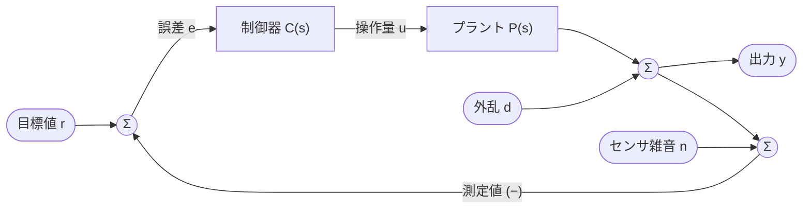

# フィードバックと伝達関数 (Feedback & Transfer Functions)

## 概要 (Overview)

制御理論シリーズの第1回。制御 (control) とは、測った結果を入力へ戻して系の振る舞いを望む形に保つことであり、その中心にある構造が**フィードバック (feedback)** である。フィードバックは、中身のよく分からない対象 (プラント) を、目標値に追従し、外乱の影響を受けにくい系へ変える。一方で、遅れを含むループに強い修正をかけると、系は発振する。Daedalus の分析文書には、ロボットの関節サーボ、電力系統の周波数制御、PLL・CDR、オートスケーラなど、この構造が何度も現れる。

本回はその共通言語を作る。(1) 負帰還がなぜプラントの変動に鈍感な系を作るのかを Black の増幅器で示し、(2) **ラプラス変換 (Laplace transform)** で微分方程式を代数に変え、(3) **伝達関数 (transfer function)** の極と零点から応答の形を読み、(4) 閉ループの性質を**感度関数 (sensitivity function)** で整理し、(5) 定常偏差と**内部モデル原理 (internal model principle)** から積分器の必要性を導き、(6) PID 制御の数理と実装上の落とし穴を扱う。最後に、ループゲインを上げると系が不安定になる例を示し、周波数応答と安定余裕を扱う第2回へつなぐ。

## 前提知識 (Prerequisites)

- [`../mathematics/calculus-analysis/ordinary-differential-equations.md`](../mathematics/calculus-analysis/ordinary-differential-equations.md) — 1階・2階線形 ODE、減衰比 ζ、連立系の安定性と固有値 (本回 §3・§5 の前提)
- [`../mathematics/fourier-signal-processing/fourier-series-transform.md`](../mathematics/fourier-signal-processing/fourier-series-transform.md) — フーリエ変換、畳み込みと LTI システム (§2 で s = jω として合流する)
- [`../mathematics/linear-algebra/eigenvalues-diagonalization.md`](../mathematics/linear-algebra/eigenvalues-diagonalization.md) — 固有値 (極 = 固有値の対応、§3)

## 本論 (Main Content)

### 1. フィードバックという構造 (the structure of feedback)

制御系は、目標値 r と測定値 y の差 (誤差 e) から操作量 u を決める制御器 C と、u を受けて y を出すプラント P からなる。外乱 d はプラントの出力に、センサ雑音 n は測定に加わる。



凡例: 丸の Σ は加算点。測定値は符号を反転して加算する (負帰還)。

**開ループ制御 (open-loop control)** は測定値を見ずに u を決める。プラントのモデルが正確で外乱がなければこれで足りるが、モデル誤差と外乱はそのまま出力に現れる。**閉ループ制御 (closed-loop control)** は誤差を見て u を修正し続けるので、原因が何であれ「結果のずれ」を直せる。

この利点を最初に工学として示したのが、Black (1934) の**負帰還増幅器 (negative feedback amplifier)** である。利得 A の増幅器の出力の一部 β を入力から差し引くと、全体の利得は次のようになる。

```text
閉ループ利得 = A / (1 + Aβ)  ≈  1/β     (Aβ ≫ 1 のとき)

数値例: A = 10⁵, β = 0.01 → Aβ = 1000, 閉ループ利得 = 10⁵/1001 ≈ 99.90
        A が 10% 低下 (9×10⁴) → 9×10⁴/901 ≈ 99.89  (変化は約 0.011%)
```

真空管の利得 A は温度や経年で大きく揺れるが、閉ループ利得はほぼ β、つまり抵抗比だけで決まる。A の変動は 1/(1 + Aβ) 倍、ここでは約 1/1000 に圧縮される。この 1/(1 + Aβ) が §4 の感度関数そのものであり、フィードバックの価値は、**大きなループゲインを使って、不確かな部品への依存を大幅に減らせる**ことにある。オペアンプ回路の利得が外付け抵抗の比だけで決まるのも同じ原理である。代償は安定性である。ループに遅れがあると、修正が遅れて届き、誤差を減らすはずの修正が逆に誤差を増やす。Black 自身も発振に悩まされ、その条件を解いたのが Nyquist (1932) の安定判別である (第2回で扱う)。

### 2. ラプラス変換 — 微分方程式を代数に変える (the Laplace transform)

ラプラス変換は時間関数 f(t) (t ≥ 0) を複素変数 s の関数へ写す。

```text
F(s) = ∫₀^∞ f(t) e^{−st} dt,   s = σ + jω

主要な性質と変換対:
  微分:     f′(t)  →  sF(s) − f(0)        (初期値 0 なら「微分 = s を掛ける」)
  積分:     ∫₀^t f  →  F(s)/s              (「積分 = s で割る」)
  遅延:     f(t − T) →  e^{−sT} F(s)       (むだ時間)
  畳み込み: (g * u)(t) →  G(s)U(s)
  単位ステップ 1 → 1/s,   e^{−at} → 1/(s + a),   sin ωt → ω/(s² + ω²)
```

微分が s の掛け算になるので、定数係数の線形 ODE は s の多項式の代数方程式に変わる。たとえば τy′ + y = u は (τs + 1)Y(s) = U(s) となる (初期値 0)。畳み込みが積になる性質はフーリエ変換と同じであり、実際 s = jω と置けばフーリエ変換に一致する。ラプラス変換が加える減衰因子 e^{−σt} のおかげで、ステップや指数的に増大する信号のように、フーリエ変換が収束しない信号も扱える。不安定な系の応答を記述する必要がある制御では、この拡張が欠かせない (Ogata 2010)。

### 3. 伝達関数と極・零点 (transfer functions, poles and zeros)

初期値 0 の線形時不変 (LTI) 系で、出力と入力のラプラス変換の比を**伝達関数**と呼ぶ。

```text
G(s) = Y(s)/U(s) = N(s)/D(s)
  極 (pole):   D(s) = 0 の根  — 応答に現れる e^{pt} の指数 p
  零点 (zero): N(s) = 0 の根  — 特定の入力を通さない周波数

例: 1次遅れ  G(s) = K/(τs + 1)               極 −1/τ
    2次系    G(s) = ω_n² / (s² + 2ζω_n s + ω_n²)  極 −ζω_n ± jω_n√(1 − ζ²)
```

伝達関数の極は、状態方程式で書いたときの係数行列の固有値と一致する。ODE 編 §4 の「安定性は固有値で決まる」は、ここでは「**すべての極が s 平面の左半面にあれば安定**」と言い換えられる。極の位置は応答の形を直接決める。実部 −σ は減衰の速さ (時定数 1/σ)、虚部 ±ω は振動の角周波数を表す。原点から遠い極ほど速く減衰するため、虚軸に最も近い**支配極 (dominant poles)** が応答の大部分を決める。高次系の設計を2次系の ζ と ω_n で語れるのはこのためである。

零点は応答の形を変える。特に右半面にある零点を持つ**非最小位相系 (non-minimum phase system)** では、ステップ入力に対して出力がいったん逆向きに動く (逆応答)。航空機の昇降舵による高度制御 (舵を上げた直後は尾翼の下向き揚力で機体が一瞬沈む) やボイラのドラム水位 (給水を増やすと気泡がつぶれて水位がいったん下がる) が典型例である (Franklin et al. 2019)。逆応答する系に強い修正をかけると、初期の逆向きの動きに反応して誤った方向へ操作してしまう。そのため右半面零点があると、達成できる応答速度に上限が生じる。むだ時間 e^{−sT} も同じ種類の制約で、どの制御則でも消せない。

### 4. 閉ループの代数と感度関数 (closed-loop algebra and sensitivity)

ループ伝達関数 L(s) = P(s)C(s) を使うと、§1 の図の各入力から出力・誤差への伝達は次の2つの関数で書ける。

```text
感度関数 (sensitivity):              S(s) = 1 / (1 + L(s))
相補感度関数 (complementary sens.):  T(s) = L(s) / (1 + L(s))
恒等式:                              S(s) + T(s) = 1

目標値 r → 出力 y:   T     (追従。T ≈ 1 が望ましい)
外乱 d → 出力 y:     S     (外乱抑制。S ≈ 0 が望ましい)
雑音 n → 出力 y:     −T    (雑音の混入。T ≈ 0 が望ましい)
プラント変動の影響:  (dT/T) / (dP/P) = S   (Black の 1/(1 + Aβ))
特性方程式:          1 + L(s) = 0 の根が閉ループの極
```

|L| が大きい周波数では S ≈ 0、T ≈ 1 となり、追従・外乱抑制・プラント変動への鈍感さがそろって得られる。ただし T ≈ 1 は雑音もそのまま通すことを意味する。S + T = 1 なので、同じ周波数で S と T を両方小さくすることはできない。実際の設計は周波数で役割を分ける。目標値や外乱が主に存在する低周波では |L| を大きくし、センサ雑音とモデル誤差が支配的な高周波では |L| を小さくする。この切り替わりの周波数がループの**帯域 (bandwidth)** であり、どこまで帯域を上げられるかを決めるのが §3 のむだ時間・右半面零点と、第2回で扱う安定余裕である (Åström & Murray 2021)。

### 5. 過渡応答と定常偏差 (transient response and steady-state error)

閉ループの支配極が2次系で近似できるとき、ステップ応答の仕様は ζ と ω_n で書ける。

```text
最大オーバーシュート: M_p = exp(−πζ / √(1 − ζ²))
   ζ = 0.5 → 約 16%,   ζ = 0.7 → 約 4.6%
整定時間 (±2%):       t_s ≈ 4 / (ζω_n)
立ち上がり時間 (10–90%): t_r ≈ 1.8 / ω_n   (ζ ≈ 0.5 付近の近似)
```

仕様は互いにトレードオフの関係にある。オーバーシュートを抑えるには ζ を上げ、速く立ち上げるには ω_n を上げる。ω_n を上げることは帯域を上げることと同じなので、§4 の雑音とモデル誤差の制約に行き当たる。

収束後に残る誤差 (定常偏差) は**最終値定理 (final value theorem)** で求められる。

```text
lim_{t→∞} e(t) = lim_{s→0} s E(s)     (閉ループが安定な場合のみ有効)

単位ステップ目標値に対して E(s) = S(s)/s  →  e(∞) = 1 / (1 + L(0))
例: P(0) = 1 のプラントを比例ゲイン K_p = 4 で制御 → e(∞) = 1/5 = 20%
    C(s) に積分 1/s を含めると L(0) = ∞  →  e(∞) = 0
```

比例制御だけではゲインを有限に保つ限り偏差が残る。偏差をゼロにするには、ループ内に積分器を置く必要がある。これを一般化したのが**内部モデル原理**であり、「ある種類の信号に定常偏差なく追従し、また除去するには、その信号の生成モデルをループ内に持たなければならない」と述べる (Francis & Wonham 1976)。ステップ (1/s) には積分器、ランプ (1/s²) には2重積分器、周期 ω の正弦波には共振項 1/(s² + ω²) が必要になる。電力系統の周波数制御はこの原理をそのまま階層化している。比例制御である一次制御 (ガバナのドループ) は周波数低下を止めるが、偏差は残す。二次制御 (AGC) が地域要求量 ACE を積分して周波数を定格へ戻す。

### 6. PID 制御の数理と実装 (PID control: mathematics and implementation)

産業で使われる制御器の大部分は PID 制御器である (Åström & Murray 2021, Ch. 11)。3つの項はそれぞれ誤差の現在・過去・未来に反応する。

```text
u(t) = K_p e(t) + K_i ∫₀^t e(τ)dτ + K_d de/dt
C(s) = K_p + K_i/s + K_d s

P: 現在の誤差に比例。ゲインを上げると速くなるが、定常偏差が残り、上げすぎると振動する
I: 誤差の蓄積に反応。定常偏差を消す (§5)。位相を遅らせるため振動を招きやすい
D: 誤差の変化率に反応。予測的に制動をかけ、オーバーシュートを抑える。高周波雑音を増幅する
```

教科書の式をそのまま実装すると、実機ではうまく動かないことが多い。実用の PID には少なくとも次の4つの工夫が要る (Åström & Murray 2021, Ch. 11)。

- **微分項のフィルタ**: 純粋な微分 K_d s は高周波で利得が無限に増え、センサ雑音を増幅する。1次ローパス K_d s / (1 + sT_f) で帯域を制限する。さらに目標値のステップが微分されてスパイク (derivative kick) にならないよう、微分を誤差ではなく測定値だけに掛ける形が標準である。
- **アンチワインドアップ (anti-windup)**: アクチュエータには上限がある (弁の全開、モータの最大電流、クラウドの最大台数)。飽和中も積分器が誤差を溜め続けると、飽和が解けた後に溜めた分を吐き出し終えるまで大きなオーバーシュートが続く。飽和中は積分を止めるか、飽和量を積分器へフィードバックして戻す。
- **離散化とサンプリング**: 計算機上の制御器は周期 h で測定し、次の周期まで出力を保持する (零次ホールド)。この保持は平均して約 h/2 の遅れとして働く (Åström & Wittenmark 1997)。制御周期を閉ループ帯域より十分速くとる経験則はここから来る。
- **バンプレス切替 (bumpless transfer)**: 手動から自動へ、あるいはゲインを切り替える瞬間に出力が跳ばないよう、切替時に積分器の状態を現在の出力に合わせて初期化する。

ゲインの初期値を実験で決める古典的な方法が Ziegler–Nichols 法 (1942) である。比例制御だけでゲインを上げ、持続振動が始まる**限界ゲイン K_u** と振動周期 T_u を測り、PID ゲインを K_p = 0.6K_u、積分時間 T_i = T_u/2、微分時間 T_d = T_u/8 とする。この規則は外乱応答を速く減衰させることを狙っており、閉ループの減衰は弱く、オーバーシュートが大きくなりやすい。現在では出発点として扱い、モデルや安定余裕に基づいて詰め直すのが通例である (Åström & Murray 2021, Ch. 11)。

### 7. ループゲインと安定性 — 第2回への橋渡し (loop gain and stability)

ループゲインを上げれば §4 の利点は増すが、上げすぎると系は不安定になる。3つの1次遅れが直列につながったプラントを比例制御する例で確かめる。

```text
L(s) = K / (s + 1)³
特性方程式: (s + 1)³ + K = s³ + 3s² + 3s + (1 + K) = 0

ラウス–フルヴィッツの安定判別 (3次: a₃s³ + a₂s² + a₁s + a₀, 全係数正):
  安定 ⇔ a₂a₁ > a₃a₀  ⇔  3·3 > 1 + K  ⇔  K < 8

K = 8 で極が虚軸上 s = ±j√3 に達し、角周波数 √3 rad/s で持続振動する
→ この K = 8 と周期 2π/√3 ≈ 3.63 s が Ziegler–Nichols 法の K_u と T_u に当たる
```

ループゲイン K を上げるだけで閉ループの極が右へ動き、K = 8 で虚軸を越える。原因は3つの遅れが積み重なってできる位相遅れである。ある周波数で位相が 180° 遅れると、負帰還が正帰還に反転し、その周波数でのループゲインが 1 以上なら振動が成長する。この見方では、安定性は「極が左半面にあるか」という代数の問題から、「位相が 180° 遅れる周波数でループゲインが 1 を下回っているか」という周波数の問題になる。むだ時間 e^{−sT} は利得を変えずに位相だけを ωT 遅らせるため、多項式の判別法では扱えないが、周波数の見方なら自然に扱える。この周波数の見方 (ボード線図、ナイキスト安定判別、ゲイン余裕と位相余裕) が第2回の主題である。

## 工学への接続 (Engineering Connections)

- **電子回路の負帰還**: オペアンプの非反転増幅器の利得 1 + R₂/R₁ は §1 の 1/β そのものである。開ループ利得の大きなばらつきを、抵抗比という安定した量で置き換えている。
- **カスケード制御と時間スケールの分業**: モータの電流ループ → 速度ループ → 位置ループのように、内側ほど速いループを入れ子にすると、外側からは内側が「ほぼ 1 の伝達関数」に見える (§4 の T ≈ 1)。ロボット・航空機・系統用インバータに共通する構造である。
- **位相同期ループ (PLL)**: 位相比較器・ループフィルタ・VCO の閉ループで、VCO が位相を積分する (1/s) ため、ループフィルタの積分と合わせると、周波数のステップに対しても位相誤差を残さずに追従する。§5 の内部モデル原理の典型例である。CDR のループ帯域の選択は、§4 の「追従 (T) と雑音除去 (S) の周波数分担」の具体例になる。
- **ソフトウェアのフィードバック**: オートスケーラ・輻輳制御・レート制限は、メトリクス収集とプロビジョニングという大きなむだ時間を持つ制御ループである。遅れに対して強い修正をかけると発振 (ばたつき) し、上限に当たると積分のワインドアップに似た溜め込みが起きる。制御の語彙はそのまま当てはまる (Hellerstein et al. 2004)。

## Daedalus内の応用 (Applications within Daedalus)

| 文書 | 接続点 |
|------|--------|
| [`engineering/robotics/control-systems.md`](../../engineering/robotics/control-systems.md) | 単軸 PID と重力補償 (§6)、カスケード制御 (§4)、ジッタが位相遅れとして働くこと (§6 離散化) |
| [`engineering/aerospace/avionics-gnc.md`](../../engineering/aerospace/avionics-gnc.md) | 姿勢レートの内側ループと誘導の外側ループ、フェーズごとの PID 調整 (§4, §6) |
| [`engineering/energy/grid-stability-frequency-control.md`](../../engineering/energy/grid-stability-frequency-control.md) | ドループ = 比例制御で偏差が残り、AGC = ACE の積分で定格へ戻す (§5 内部モデル原理) |
| [`engineering/energy/power-electronics-grid-converters.md`](../../engineering/energy/power-electronics-grid-converters.md) | 電流ループと PLL の帯域の分業、PI 制御器 (§4, §6) |
| [`software/cloud/autoscaling-capacity-control.md`](../../software/cloud/autoscaling-capacity-control.md) | むだ時間付きループ、デッドビート型制御則と発振、飽和と溜め込み (§3, §6) |
| [`hardware/signal-integrity/serdes-link-architecture.md`](../../hardware/signal-integrity/serdes-link-architecture.md) | CDR のループ帯域とジッタの追従・除去の交換 (§4) |
| [`hardware/hw-sw-interface/clock-power-reset.md`](../../hardware/hw-sw-interface/clock-power-reset.md) | PLL のロックと周波数切替の過渡応答 (§5) |
| [`engineering/aerospace/combustion-instability.md`](../../engineering/aerospace/combustion-instability.md) | 音響と熱発生の結合が正帰還になる条件 (§7 の位相反転) |

## 参考文献 (References)

- Åström, K. J., & Murray, R. M. (2021). *Feedback Systems: An Introduction for Scientists and Engineers* (2nd ed.). Princeton University Press. — フィードバックの原理、感度関数、PID と実装上の工夫の主参照
- Ogata, K. (2010). *Modern Control Engineering* (5th ed.). Prentice Hall. — ラプラス変換と伝達関数、過渡応答仕様の標準的教科書
- Franklin, G. F., Powell, J. D., & Emami-Naeini, A. (2019). *Feedback Control of Dynamic Systems* (8th ed.). Pearson. — 極・零点と応答の対応、非最小位相系の事例
- Åström, K. J., & Wittenmark, B. (1997). *Computer-Controlled Systems: Theory and Design* (3rd ed.). Prentice Hall. — サンプリングと零次ホールドによる遅れ
- Black, H. S. (1934). Stabilized Feedback Amplifiers. *Bell System Technical Journal*, 13(1), 1–18. DOI: 10.1002/j.1538-7305.1934.tb00652.x — 負帰還増幅器の原典
- Nyquist, H. (1932). Regeneration Theory. *Bell System Technical Journal*, 11(1), 126–147. — 帰還系の安定判別の原典 (第2回の主題)
- Ziegler, J. G., & Nichols, N. B. (1942). Optimum Settings for Automatic Controllers. *Transactions of the ASME*, 64, 759–768. — 限界感度法による PID 調整則の原典
- Francis, B. A., & Wonham, W. M. (1976). The Internal Model Principle of Control Theory. *Automatica*, 12(5), 457–465. DOI: 10.1016/0005-1098(76)90006-6 — 内部モデル原理の原典
- Hellerstein, J. L., Diao, Y., Parekh, S., & Tilbury, D. M. (2004). *Feedback Control of Computing Systems*. Wiley-IEEE Press. — 計算機システムへの制御理論の適用
