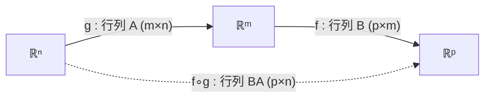

# ベクトル・行列・線形写像 (Vectors, Matrices, and Linear Maps)

## 概要 (Overview)

線形代数 (linear algebra) は「足し算とスカラー倍が定義された世界」= **ベクトル空間 (vector space)** と、その構造を保つ変換 = **線形写像 (linear map)** を扱う数学である。本ドキュメントは線形代数シリーズの第1回として、ベクトル空間・内積・線形写像という骨格概念を基礎から積み上げ、最後に**行列積 (matrix multiplication)** の計算構造まで降りる。

行列を「数の表」として暗記するのではなく、**行列とは線形写像の(基底を固定したときの)表現であり、行列積とは写像の合成である**という視点を軸に据える。この視点に立つと、行列積の結合法則がなぜ成り立つのか、なぜ交換法則は成り立たないのか、そしてなぜ現代の計算機ハードウェア(SIMD, GPU, 行列演算器)が行列積を第一級の演算として扱うのかが、一本の線で繋がる。

## 前提知識 (Prerequisites)

- 高校数学程度の実数・集合・関数の扱い(集合の記法 `x ∈ A`、関数 `f: A → B`)
- 総和記号 Σ の読み書き

シリーズ内の前提文書はない(本ドキュメントが起点)。

## 本論 (Main Content)

### 1. ベクトルとベクトル空間 (vectors and vector spaces)

**n次元実ベクトル (vector)** は実数を n 個並べた組 `x = (x₁, …, xₙ) ∈ ℝⁿ` である。幾何的には「矢印(向きと大きさ)」、データ的には「n個の属性値のレコード」という2つの読み方があり、どちらも同じ代数構造の上に立つ。

ℝⁿ には2つの演算が入る。

- **加法 (addition)**: `x + y = (x₁+y₁, …, xₙ+yₙ)` — 成分ごとの和
- **スカラー倍 (scalar multiplication)**: `αx = (αx₁, …, αxₙ)`, `α ∈ ℝ`

一般に、集合 V にこの2演算が定義され、次を満たすとき V を**ベクトル空間 (vector space)** と呼ぶ(公理系は Axler (2024) §1.B に従う)。

1. 加法の交換律・結合律: `x + y = y + x`, `(x + y) + z = x + (y + z)`
2. 零ベクトル `0` の存在: `x + 0 = x`
3. 加法逆元の存在: 各 `x` に対し `x + (−x) = 0` となる `−x` がある
4. スカラー倍の結合律: `α(βx) = (αβ)x`
5. 単位元: `1x = x`
6. 分配律: `α(x + y) = αx + αy`, `(α + β)x = αx + βx`

公理化の利点は、ℝⁿ 以外の対象——多項式全体、関数全体、信号、画像——も同じ定理群で扱えることにある。後続のフーリエ解析で「関数をベクトルとして扱う」のはこの公理化の直接の恩恵である。

#### 線形結合・張る空間・線形独立

ベクトル `v₁, …, vₖ` と係数 `α₁, …, αₖ` から作る `α₁v₁ + ⋯ + αₖvₖ` を**線形結合 (linear combination)** と呼ぶ。`v₁, …, vₖ` の線形結合全体の集合を**張る空間 (span)** という。

`α₁v₁ + ⋯ + αₖvₖ = 0` を満たす係数が `α₁ = ⋯ = αₖ = 0` しかないとき、`v₁, …, vₖ` は**線形独立 (linearly independent)** であるという。直観的には「どのベクトルも他の組み合わせでは作れない=冗長性がない」状態である。

#### 基底と次元

線形独立かつ空間全体を張るベクトルの組を**基底 (basis)** と呼ぶ。基底を1つ固定すると、空間内の任意のベクトルは基底の線形結合として**一意に**書ける——この一意性が「座標」という概念の正体である。

有限次元ベクトル空間では、**どの基底も要素数が等しい** (Axler 2024, §2.C)。この不変量を**次元 (dimension)** と呼ぶ。「ℝ³ は3次元」という日常的な言明は、この定理によって初めて well-defined になる。

### 2. 内積・ノルム・直交 (inner product, norm, and orthogonality)

ℝⁿ の標準**内積 (inner product / dot product)** は

```text
⟨x, y⟩ = x₁y₁ + x₂y₂ + ⋯ + xₙyₙ
```

で定義され、**ノルム (norm)** `‖x‖ = √⟨x, x⟩` がベクトルの「長さ」を与える。内積は長さと角度の情報を代数化したもので、**コーシー・シュワルツの不等式 (Cauchy–Schwarz inequality)** `|⟨x, y⟩| ≤ ‖x‖‖y‖` (Axler 2024, §6.A) により

```text
cos θ = ⟨x, y⟩ / (‖x‖‖y‖)    (−1 ≤ cos θ ≤ 1 が保証される)
```

として2ベクトルのなす角 θ が定義できる。この量は機械学習で**コサイン類似度 (cosine similarity)** としてそのまま使われる。

`⟨x, y⟩ = 0` のとき x と y は**直交 (orthogonal)** するという。互いに直交する単位ベクトルからなる基底=**正規直交基底 (orthonormal basis)** では、座標が内積 `xᵢ = ⟨x, eᵢ⟩` で直接取り出せるため、理論・数値計算の双方で圧倒的に扱いやすい。フーリエ級数は「関数空間の正規直交基底への展開」であり、この節の概念が無限次元へ伸びたものである。

### 3. 線形写像と行列 (linear maps and matrices)

写像 `f: ℝⁿ → ℝᵐ` が任意の `x, y, α, β` について

```text
f(αx + βy) = αf(x) + βf(y)
```

を満たすとき**線形写像 (linear map)** という。「線形結合を保つ」、すなわち加法とスカラー倍という空間の構造を壊さない写像である。回転・拡大縮小・射影・微分(多項式空間上)はすべて線形写像であり、平行移動は(原点を動かすため)線形写像では**ない**。

#### 行列は線形写像の表現である

線形写像は基底ベクトルの行き先だけで完全に決まる。任意の `x = x₁e₁ + ⋯ + xₙeₙ` に対して線形性より `f(x) = x₁f(e₁) + ⋯ + xₙf(eₙ)` となるからである。そこで **`f(e₁), …, f(eₙ)` を列として並べた表**を作ると、それが `m×n` **行列 (matrix)** `A` であり、`f(x)` の計算は**行列ベクトル積 (matrix-vector product)** `Ax` に一致する。

```text
(Ax)ᵢ = Σⱼ Aᵢⱼ xⱼ        A の j 列目 = f(eⱼ)
```

つまり「行列の列を読む」ことは「基底ベクトルの行き先を読む」ことである。回転行列やスケーリング行列が具体的にああいう形をしているのは、単位ベクトルの行き先をそのまま書き並べた結果に過ぎない。

#### 行列積は写像の合成である

線形写像 `g: ℝⁿ → ℝᵐ`(行列 A)と `f: ℝᵐ → ℝᵖ`(行列 B)の合成 `f∘g: ℝⁿ → ℝᵖ` もまた線形写像であり、その行列が**行列積 (matrix product)** `BA` である。

```text
(BA)ᵢⱼ = Σₖ Bᵢₖ Aₖⱼ
```



この同一視から行列積の主要な性質が「計算せずに」導ける。

- **結合律 `C(BA) = (CB)A`** — 写像の合成はもともと結合的だから
- **非可換 `BA ≠ AB`(一般に)** — 「回してから伸ばす」と「伸ばしてから回す」は別の変換だから
- **サイズの整合条件** — 合成は「g の行き先と f の定義域が一致」しないと定義できないから

#### 核・像・階数

線形写像 `f` に対し、`f(x) = 0` となる入力全体を**核 (kernel)**、出力全体を**像 (image)** と呼ぶ。像の次元が**階数 (rank)** である。両者は**次元定理 (rank–nullity theorem)**

```text
dim(定義域) = rank f + dim(ker f)
```

で結ばれる (Axler 2024, §3.B — 同書はこれを "fundamental theorem of linear maps" と呼ぶ)。核が `{0}` であることと f が単射であることは同値で、正方行列では「フルランク ⇔ 可逆 (invertible)」となる。連立一次方程式 `Ax = b` の解の存在(b が像に入るか)と一意性(核が自明か)は、この定理の言い換えである。

### 4. 行列積の計算構造 (computational structure of matrix multiplication)

ここまでは数学の話だが、行列積は「現代の計算機が最も多くの電力を注ぎ込む演算」でもある。`n×n` 行列同士の素朴な行列積は次の3重ループになる。

```text
# Naive matrix multiplication: C = A × B (all n×n)
# Complexity: n³ multiplications + n²(n−1) additions ≈ 2n³ flops
# Assumption: dense matrices, no blocking
for i in 1..n:
    for j in 1..n:
        acc = 0
        for k in 1..n:
            acc += A[i][k] * B[k][j]
        C[i][j] = acc
```

計算量的に重要なのは flops の絶対数ではなく**演算とデータ量の比**である。入出力データは O(n²) しかないのに演算は O(n³) あるため、1バイトあたりの演算数=**演算強度 (arithmetic intensity)** が n とともに増える。つまり n が十分大きければ、行列積はメモリ帯域ではなく演算器で律速される**計算律速 (compute-bound)** なカーネルにできる (Williams, Waterman & Patterson 2009 のルーフラインモデル (roofline model) における典型例)。「ハードウェアの演算ピークを実際に引き出せる稀有な演算」であることが、GEMM (general matrix multiply) があらゆる演算器設計のベンチマークかつ設計目標になっている理由である。

ただしこの性質は自動では手に入らない。素朴な3重ループは同じデータを何度もDRAMから読み直すため、**ブロック化 (blocking / tiling)** ——行列をキャッシュに収まる小行列に分割し、載せた小行列を使い切ってから次へ進む——によってデータ再利用をキャッシュ階層に合わせて組織する必要がある (Golub & Van Loan 2013, §1.5)。BLAS 実装や GPU カーネルの性能差は、ほぼこの再利用の組織化の巧拙である。

理論面では、Strassen (1969) が 2×2 ブロックの積を8回ではなく**7回**の乗算で構成できることを示し、再帰適用により O(n^log₂7) ≈ O(n^2.807) を達成した——「n³ は自明な下限ではない」ことの最初の証明である。行列積指数 ω の改良は現在も続いており、2024年時点で ω < 2.3716 まで下がっている (Williams et al. 2024)。ただしこれらの漸近的高速アルゴリズムは定数項が巨大で、実用実装は「ブロック化した古典 O(n³)(+場合により数段の Strassen)」が支配的である。

## 工学への接続 (Engineering Connections)

- **データ並列性**: ベクトル加算・スカラー倍・内積は「同じ演算を全要素に一様適用する」演算であり、SIMD が加速する処理の教科書例そのもの。
- **演算器の設計目標**: 行列積の O(n³)/O(n²) という演算強度が、キャッシュ階層・行列演算ユニット・アクセラレータの設計を駆動する。ルーフラインモデル上で「右端に置ける」演算だからこそ、専用ハードウェアへの投資が正当化される。
- **変換の合成**: 「行列積=写像の合成」は、グラフィクスパイプラインが複数の座標変換を1つの行列に畳み込んで頂点ごとの計算を減らす操作の数学的根拠である。
- **機械学習**: ニューラルネットワークの全結合層は「線形写像+バイアス(アフィン写像)+非線形活性化」であり、学習・推論の計算時間の大半は本ドキュメントの `(BA)ᵢⱼ = Σₖ Bᵢₖ Aₖⱼ` の評価に費やされる。

## Daedalus内の応用 (Applications within Daedalus)

| 文書 | 接続点 |
|------|--------|
| [`hardware/cpu-architecture/simd-vector.md`](../../../hardware/cpu-architecture/simd-vector.md) | ベクトル演算のデータ並列実行。同文書の AMX/行列拡張の節は本ドキュメントの行列積の計算構造を前提とする |
| [`hardware/gpu-accelerators/gpu-simt-architecture.md`](../../../hardware/gpu-accelerators/gpu-simt-architecture.md) | Tensor Core は小行列積 (matrix multiply-accumulate) を1命令化したもの。演算強度の議論(§4)がその存在理由 |
| [`software/ml-systems/`](../../../software/ml-systems/) | 学習・推論ワークロードの計算の実体が GEMM であること、ブロック化・データ再利用がカーネル最適化の中心であること |
| [`hardware/peripherals-connectivity/display-pipeline.md`](../../../hardware/peripherals-connectivity/display-pipeline.md) | 表示パイプラインの座標変換・色空間変換は行列で表現され、変換の合成=行列積で畳み込まれる |

## 参考文献 (References)

- Axler, S. (2024). *Linear Algebra Done Right* (4th ed.). Springer. DOI: 10.1007/978-3-031-41026-0 — オープンアクセス。ベクトル空間・線形写像の公理的展開の主参照
- Strang, G. (2016). *Introduction to Linear Algebra* (5th ed.). Wellesley-Cambridge Press. — 幾何的直観と応用視点の副読本
- 齋藤正彦 (1966). 『線型代数入門』東京大学出版会. — 日本語の標準的教科書
- Golub, G. H., & Van Loan, C. F. (2013). *Matrix Computations* (4th ed.). Johns Hopkins University Press. — 行列計算のブロック化・数値線形代数の主参照
- Strassen, V. (1969). Gaussian elimination is not optimal. *Numerische Mathematik*, 13(4), 354–356. DOI: 10.1007/BF02165411
- Williams, V. V., Xu, Y., Xu, Z., & Zhou, R. (2024). New bounds for matrix multiplication: from alpha to omega. *Proceedings of the 2024 ACM-SIAM Symposium on Discrete Algorithms (SODA)*, 3792–3835. DOI: 10.1137/1.9781611977912.134
- Williams, S., Waterman, A., & Patterson, D. (2009). Roofline: An insightful visual performance model for multicore architectures. *Communications of the ACM*, 52(4), 65–76. DOI: 10.1145/1498765.1498785
