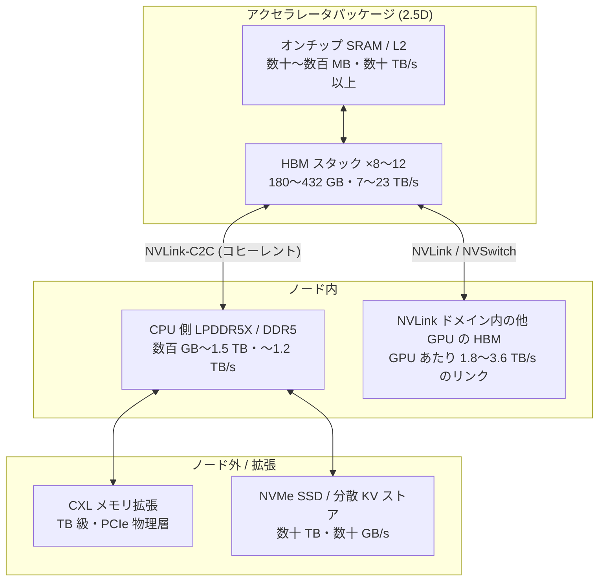
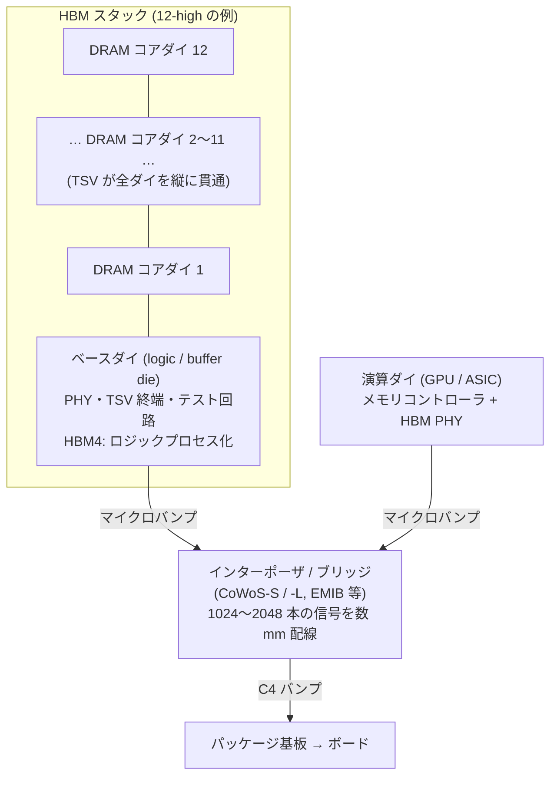
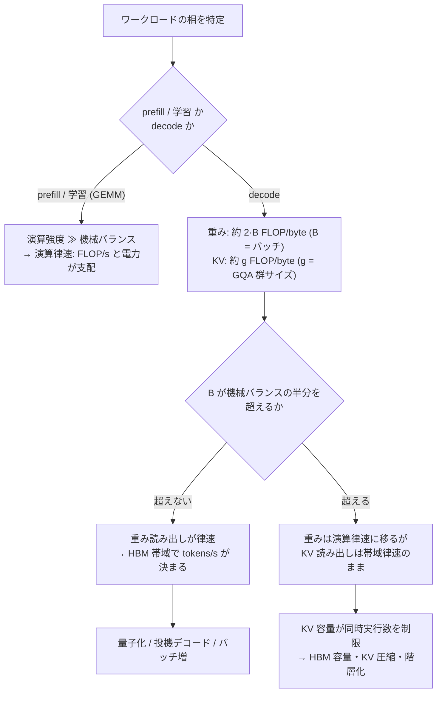

# HBM と AI メモリシステム (HBM & the AI Memory System)

## 概要 (Overview)

AI アクセラレータの性能表は演算性能 (FLOP/s) を先頭に掲げるが、LLM (Large Language Model) の推論で実際に上限を決めているのは、多くの場合メモリの帯域と容量である。自己回帰生成の decode 相は、1 トークンを出すたびに全重みと KV cache を読み直す。そのため 1 秒あたりのトークン数は「メモリ帯域 ÷ 1 トークンあたりの読み出しバイト数」で上から押さえられる。学習でもモデル状態と活性値の容量が並列化の構成を決める（[`../../software/ai/ml-training-systems.md`](../../software/ai/ml-training-systems.md)）。

この需要に応える現在の主な解が HBM (High Bandwidth Memory) である。HBM は DRAM ダイを TSV (Through-Silicon Via) で縦に積み、1024 本（HBM4 では 2048 本）のデータ線を持つ超広幅インタフェースを、シリコンインターポーザ (silicon interposer) 上で演算ダイの数 mm 隣に置く。帯域をピン速度ではなく配線本数で稼ぐこの設計は、エネルギー効率では有利だが、先端パッケージング・積層歩留まり・熱という製造側の制約を抱える。そして 2026-10 時点で、AI 半導体の供給量と価格を左右する主要な部材の一つになっている。

本書は HBM を中心に、AI 向けメモリシステムを (1) 需要側の算術（roofline と KV cache）、(2) HBM の物理構造と世代、(3) 2.5D 実装・エネルギー・熱、(4) 歩留まり・コスト・供給、(5) 代替技術とメモリ階層、(6) 信頼性とセキュリティ、の順に分析する。GPU 内部のメモリ階層と roofline の導出は [`gpu-simt-architecture.md`](gpu-simt-architecture.md)、DRAM セルとタイミングは [`../cpu/dram-memory-controllers.md`](../cpu/dram-memory-controllers.md)、CoWoS を含む先端パッケージングの製造面は [`../semiconductor-manufacturing/semiconductor-fabrication.md`](../semiconductor-manufacturing/semiconductor-fabrication.md) に委ね、本書はそれらを前提に HBM 固有の層を掘り下げる。分析深度は Level 3。

## 方法論 (Methodology)

- 需要側は第一原理の算術で示す。decode のトークン速度上限、KV cache 容量、attention の演算強度を、公開されたモデル構成（Llama 3 の層数・ヘッド数[^llama3]）と公称帯域から概算する。式の導出元は [`../../foundations/machine-learning/transformer-architecture.md`](../../foundations/machine-learning/transformer-architecture.md) §7 である。
- 世代ごとの数値は「JEDEC 規格値」と「ベンダ発表の製品値」を分けて表に置く。HBM3E 以降はベンダが規格上限を超えるピン速度を出荷しており、両者の混同が誤った比較の主因になるためである。
- 製品の容量・帯域はすべて「2026-10 時点のベンダ公称値」と明記する。同じベンダの資料間で数値が食い違う場合（MI455X）は範囲で示す。Rubin は量産品の出荷時に帯域の仕様が改められたので、出荷仕様を示し、事前公表値を併記する。
- 市場シェア・供給・価格は時事性が高いため、調査会社と各社発表を日付つきで引き、2 社以上の報道で裏づけを取る。単一ソースにとどまる数値は本文で使わない。
- エネルギー (pJ/bit) は査読論文の内訳（O'Connor et al., MICRO 2017[^fgdram]）を軸にする。ベンダの「前世代比 X% 改善」は相対値として扱い、絶対値の根拠にはしない。

## 発見事項 (Findings)

1. **LLM decode は帯域で上限が決まり、その上限は簡単な割り算で出る。** バッチ 1 では重み 1 バイトあたり約 2 FLOP しか行わず、機械のバランス点（ピーク演算 ÷ 帯域）は 300〜600 FLOP/byte 級である（Ironwood の公称値で BF16 約 313、FP8 約 625[^ironwood]）。バッチングで重み読み出しは償却できるが、KV cache の読み出しは系列ごとに独立していて償却できない。attention の decode は GQA のグループ数程度（Llama 3 70B で約 8 FLOP/byte）の演算強度に固定される。
2. **HBM は「速いピン」ではなく「多いピン」で帯域を作る。** HBM4 はピンあたり 8 Gb/s（規格値）と、GDDR7 や SerDes に比べて遅い。それでも 2048 本並べてスタックあたり 2 TB/s に達する[^hbm4-jedec]。数 mm のインターポーザ配線なら低速・シングルエンドで済み、イコライザや CDR を持つ SerDes（[`../signal-integrity/serdes-link-architecture.md`](../signal-integrity/serdes-link-architecture.md)）の電力と遅延を払わずに済む。この選択の代償が、インターポーザ必須という実装制約である。
3. **ベンダの出荷品は JEDEC 規格を大きく超えている。** HBM4 の規格値は 8 Gb/s だが、2026 年に量産出荷された製品は 10〜11.7 Gb/s 級をうたう（SK hynix 10 Gb/s 超、Samsung 11.7 Gb/s、Micron 11 Gb/s 超。いずれもベンダ発表）[^skh-hbm4][^ss-hbm4][^mu-hbm4]。規格は相互運用の下限を定め、実際の帯域競争はその上で起きている。
4. **HBM の電力の過半は I/O ではなくダイ内部のデータ移動に使われる。** HBM2 の約 3.9 pJ/bit のうち、行バッファから I/O までのダイ内移動が 2.24 pJ/bit、活性化が 1.21 pJ/bit を占め、I/O は約 0.3 pJ/bit にすぎない[^fgdram]。GDDR5 の 14.0 pJ/bit との差の大部分は、短い配線で I/O を安くしたことによる。この先の改善は DRAM ダイ内部の構造に手を入れる必要がある。
5. **HBM はパッケージングの問題であり、レティクル限界が搭載スタック数を縛る。** 1 スタックあたり 1000〜2000 本超の信号を引くにはシリコン配線が必要である。CoWoS-S のシリコンインターポーザは約 3.3 レティクル（約 2,700 mm²）が上限で、それを超える構成は局所シリコンブリッジ型 (CoWoS-L) に移った[^tsmc-cowos]。2026 年時点で TSMC は 5.5 レティクル品を 98% 超の歩留まりで量産しており、2028 年に 14 レティクル・20 スタックへの拡張を掲げる（ベンダのロードマップ）[^tf-cowos-2026]。
6. **HBM のビット単価が高い主因は、同じビット数を作るのに要するウェハ量である。** Micron は HBM3E が同一ノードの DDR5 に比べて同じビット数あたり約 3 倍のウェハを消費し、HBM4/HBM4E では 4 倍近くに悪化すると述べている[^mu-trade][^tf-custom]。ダイ面積の増加（TSV 領域・広い I/O）と積層歩留まりの掛け算がこの比率を生む。HBM の増産は汎用 DRAM の供給を直接削る。
7. **供給は 3 社に集中し、2026 年は需給が逼迫している。** 2026 年第 2 四半期の HBM 売上シェアは SK hynix 50%、Samsung 33%、Micron 18% と報じられた（Counterpoint）[^cp-share]。HBM の生産配分が汎用 DRAM に回る生産能力を減らし、2026 年は汎用 DRAM の契約価格まで急騰した[^tf-dram-2q26]。HBM4 では Samsung の追い上げでシェアが動いている。
8. **HBM4 でベースダイがロジックプロセスに移り、HBM は半カスタム部品になりつつある。** HBM3E までのベースダイは DRAM プロセスで作る中継層だったが、HBM4 ではファウンドリのロジックプロセス（Samsung は 4 nm、SK hynix と Micron は TSMC と協業）で作るロジックベースダイが登場した[^tf-hbm4-premium][^ss-hbm4][^tf-custom]。Micron は HBM4E から顧客ごとのカスタム品を始めるとしており、顧客と特定サプライヤの結びつきが強まる方向にある[^tf-custom]。
9. **代替技術は帯域・容量・コストの三角形の別の頂点を取る。** GDDR7（安価・中帯域・容量小）、LPDDR5X/SOCAMM（大容量・低電力・低帯域）、オンチップ SRAM（超高帯域・容量極小）、CXL メモリ（大容量・高レイテンシ）は、いずれも HBM の置き換えではなく、prefill/decode の分離や KV cache の階層化といったワークロード分割と組み合わせて使われる。

## アーキテクチャ (Architecture)

### AI アクセラレータのメモリ階層 (2026-10 時点の典型)

凡例: 上段ほど高帯域・小容量・高単価である。矢印はデータ移動の経路を示し、KV cache のオフロードは HBM から下方向へ、prefix 再利用時の読み戻しは上方向へ流れる。数値は本書で引いたベンダ公称値の範囲を丸めた桁感であり、製品ごとの値は技術詳細 §10 の表を参照する。

- 階層の上下で帯域は 1 桁ずつ落ちる。HBM（数 TB/s）から CPU メモリ（1 TB/s 前後）、PCIe/CXL（数十〜百数十 GB/s、[`../hw-sw-interface/bus-interconnect.md`](../hw-sw-interface/bus-interconnect.md)）へ降りるたびに、置いたデータの「読み出しにかかる時間」が桁で増える。
- そのため階層化の設計は「どのデータを、どの頻度で読むか」の分類になる。毎トークン読む重みと実行中リクエストの KV cache は HBM に置き、休止中の会話の KV cache や共有 prefix は下位層に退避する（[`../../software/ai/ml-inference-systems.md`](../../software/ai/ml-inference-systems.md)）。

### HBM スタックの断面構造

凡例: 縦の実線は TSV と積層接合（マイクロバンプ、将来はハイブリッドボンディング）による垂直接続、矢印はダイからパッケージ基板への接続階層を表す。電源・グラウンドの TSV は信号 TSV よりはるかに多く、図では省略した。

- ベースダイは HBM の唯一の「外向き」ダイであり、演算ダイ側の PHY と向かい合う。DRAM コアダイは TSV を通じてベースダイに接続され、各チャネルはコアダイ上のバンク群に割り当てられる。
- インタフェースは独立チャネルに分割される。HBM3 は 16 チャネル × 2 疑似チャネル (pseudo-channel)、HBM4 は 32 チャネル × 2 疑似チャネルである[^hbm3-jedec][^hbm4-jedec]。チャネル数の倍増は、広い I/O を細かい独立アクセス単位に割ることで、バンク並列性を引き出しやすくする（[`../cpu/dram-memory-controllers.md`](../cpu/dram-memory-controllers.md) のバンク・チャネル階層と同じ理屈）。

## 技術詳細 (Technical Details)

### 1. 需要の算術 — decode・KV cache・演算強度

凡例: 菱形は判定、四角は帰結を表す。FLOP/byte の値は FP8 重み・BF16 KV を仮定した近似であり、実装（カーネル融合、FlashAttention の分割）で係数は変わる。

- **トークン速度の上限。** 70B パラメータを FP8（1 byte/パラメータ）で持つと重みは約 70 GB である。8 TB/s の HBM ではこれを読み切るだけで約 8.75 ms かかるため、バッチ 1 の decode は KV を無視しても約 114 トークン/秒を超えられない。これは計算資源ではなく帯域が決める上限であり、量子化（読むバイトを減らす）と投機デコード（1 回の読み出しで複数トークンを検証する）がこの分母を減らす（[`../../software/ai/ml-inference-systems.md`](../../software/ai/ml-inference-systems.md)）。
- **KV cache の容量。** Llama 3 70B（80 層、KV ヘッド 8、ヘッド次元 128[^llama3]）では、BF16 の KV は 1 トークンあたり 2 × 80 × 8 × 128 × 2 B = 320 KiB になる。128K トークンの文脈 1 本で約 40 GiB であり、288 GB の HBM に FP8 重み 70 GB を置いた残りには、この長さの系列が 5 本程度しか入らない。容量が同時実行数、ひいてはバッチによる重み償却の上限を決める。
- **attention の演算強度。** decode 時に 1 つの K/V 要素（BF16、2 byte）は同じグループの g 個のクエリヘッドから参照され、QKᵀ と PV でそれぞれ約 2g FLOP が生じる。演算強度は約 g FLOP/byte（Llama 3 70B では 64/8 = 8）で、バッチを増やしても変わらない。長文脈ほど decode の時間が KV 読み出しに寄るのはこのためで、GQA/MQA・KV 量子化・MLA のような KV 圧縮は、HBM 帯域の消費を直接削る設計である。
- **学習側。** 学習は GEMM 主体で演算律速に近いが、Adam 混合精度でパラメータあたり約 16 byte のモデル状態を持つため容量が先に尽きる（[`../../software/ai/ml-training-systems.md`](../../software/ai/ml-training-systems.md)）。HBM 容量が大きいほど分割数と通信が減るため、学習でも容量は性能を左右する。

### 2. HBM の物理構造

- **TSV 積層。** 各 DRAM コアダイは数十 µm 厚まで薄化され、TSV で信号・電源を貫通させて積層される。SK hynix は 12-high の HBM3E 36 GB で、8-high 品と同じ全高に収めるため各ダイを従来より約 40% 薄くしたと述べている[^skh-hbm3e]。
- **全高の制約。** スタックの全高は演算ダイと高さをそろえる必要があり、JEDEC はパッケージ厚を規定している。HBM3E 世代までの 720 µm から、HBM4 では 12-high/16-high とも 775 µm に緩和されたと報じられた（規格本文は会員配布のため、TrendForce と Digitimes の報道で確認）[^tf-hbm4-height][^dt-height]。この緩和により、16-high HBM4 は既存の接合技術で作れる見通しになった。
- **接合技術。** SK hynix は積層後に液状封止材を一括で流し込む MR-MUF、Samsung はダイ間にフィルム状の封止材を挟んで熱圧着する TC-NCF を主に使う。TrendForce は、20-high の HBM5 でバンプを持たないハイブリッドボンディング (hybrid bonding) を採用することをメーカー各社が確認したと報じた[^tf-hb]。ハイブリッドボンディングはダイ間の隙間をなくし、積層数・I/O 密度・放熱の点で有利だが、パーティクル管理が厳しく設備投資が重い。
- **チャネルと疑似チャネル。** 疑似チャネルは 1 つのチャネルのコマンドバスを共有しつつ、データバスを半分ずつ独立に使う仕組みである。GPU の細粒度ランダムアクセスで、アクセス粒度を小さく保ちつつ帯域を落とさないことが狙いである。
- **ベースダイ。** HBM3E までのベースダイは DRAM プロセスで作られ、主に信号の中継とテスト機能を担った。HBM4 の I/O 倍増でベースダイの面積と回路量が増え、ロジックプロセスへの移行が進んだ（§8）[^tf-hbm4-premium]。

### 3. 世代の比較 — JEDEC 規格値とベンダ製品値

| 世代 | JEDEC 規格 (公開時期) | I/O 幅 | ピン速度 (規格) | スタック帯域 (規格) | 積層・容量 (規格) | ベンダ製品の到達点 (ベンダ発表) |
|---|---|---|---|---|---|---|
| HBM | JESD235 (2013) | 1024 | 1 Gb/s | 128 GB/s | 4-high | — |
| HBM2 | JESD235A (2016) | 1024 | 2 Gb/s | 256 GB/s | 8-high・8 GB | 2018 年改訂で 2.4 Gb/s・12-high・24 GB[^toms-hbm] |
| HBM2E | JESD235C (2020) | 1024 | 3.2 Gb/s | 410 GB/s | 12-high・24 GB | Samsung 4.2 Gb/s 品など[^anand-hbm2e] |
| HBM3 | JESD238 (2022-01) | 1024 | 6.4 Gb/s | 819 GB/s | 4/8/12-high（16-high は将来拡張） | H100（80 GB HBM3）[^llama3] |
| HBM3E | 独立した規格番号は本書の調査範囲で確認できず | 1024 | ベンダ定義 | ベンダ定義 | — | 9.6 Gb/s・約 1.2 TB/s・12-high 36 GB（SK hynix、2024-09 量産）[^skh-hbm3e] |
| HBM4 | JESD270-4 (2025-04) | 2048 | 8 Gb/s | 2 TB/s | 4〜16-high・24/32 Gb ダイ・最大 64 GB | 10〜11.7 Gb/s、2.8 TB/s 超・12-high 36 GB 量産、16-high 48 GB サンプル（2026）[^skh-hbm4][^ss-hbm4][^mu-hbm4] |
| HBM4E | 2026-10 時点で公開規格を確認できず | 2048 | — | — | — | Samsung は 2026 年後半にサンプル、Micron は 2027 年立ち上げを計画[^ss-hbm4][^tf-custom] |

注: HBM・HBM2 の規格値は Tom's Hardware の解説[^toms-hbm]、HBM2E は AnandTech の JESD235C 報道[^anand-hbm2e]、HBM3 は JEDEC 発表の再掲と Synopsys の解説[^hbm3-jedec]、HBM4 は JEDEC 発表の再掲[^hbm4-jedec] による。HBM3E の 1.2 TB/s は 9.6 Gb/s × 1024 bit ÷ 8 からの計算値である。

- 世代ごとの帯域向上は、HBM3 まではピン速度の倍増、HBM4 は I/O 幅の倍増で得ている。HBM4 の規格ピン速度 8 Gb/s は HBM3E 製品の 9.6 Gb/s より低い。HBM4 規格は信号品質の余裕を幅の倍増に回した設計と読める。
- HBM4 はコントローラ側で HBM3 との後方互換を規定し[^hbm4-jedec]、ロウハンマー対策として DRFM (Directed Refresh Management) を導入した（§11）。

### 4. 2.5D 実装とパッケージング

- **なぜインターポーザが必要か。** 1 スタックで 1024〜2048 本のデータ線に加えてコマンド・電源を引くには、有機基板の配線密度では足りず、サブミクロン配線を持つシリコン層が要る。CoWoS-S はダイ群全体をシリコンインターポーザに載せる方式で、TSMC は最大約 3.3 レティクル（約 2,700 mm²）としている[^tsmc-cowos]。
- **CoWoS-R / CoWoS-L。** CoWoS-R はインターポーザを RDL（再配線層、ポリマーと銅）に置き換え、CoWoS-L は RDL の中に局所シリコンブリッジ (LSI) を埋め込み、ダイ間の高密度接続が要る箇所だけにシリコンを使う[^tsmc-cowos]。ブリッジ方式は Intel の EMIB と同じ発想で、巨大な一枚シリコンの歩留まりとレティクル制約を回避する（製造側の議論は [`../semiconductor-manufacturing/semiconductor-fabrication.md`](../semiconductor-manufacturing/semiconductor-fabrication.md)）。
- **スタック数とレティクル。** 演算ダイが 2 レティクル級（B200/B300 のデュアルダイ）になり、HBM が 8〜12 スタックに増えると、必要なインターポーザ面積は CoWoS-S の上限を超える。TSMC は 2026 年に 5.5 レティクル CoWoS の量産歩留まりを 98% 超と説明し、2028 年に 14 レティクル・20 スタック、2029 年に 24 スタックをロードマップに置く（目標値）[^tf-cowos-2026][^se-tsmc-2026]。
- **ボトルネックの移動。** CoWoS 能力が GPU 供給の律速になった経緯は [`../semiconductor-manufacturing/semiconductor-fabrication.md`](../semiconductor-manufacturing/semiconductor-fabrication.md) が扱う。TSMC は CoWoS 能力の 2022〜2027 年の年平均成長率を 80% 超と見込む[^tf-cowos-2026]。

### 5. エネルギー — pJ/bit の比較

| メモリ | 1 bit あたりのアクセスエネルギー | 出典と条件 |
|---|---|---|
| DDR3 系 DIMM | 64 bit 読み出しで 1.3〜2.6 nJ（約 20〜40 pJ/bit） | Horowitz (ISSCC 2014)[^horowitz]、45 nm 世代の概算 |
| GDDR5 | 14.0 pJ/bit | O'Connor et al. (MICRO 2017)[^fgdram] |
| HBM2 | 約 3.9 pJ/bit（ダイ内移動 2.24 + 活性化 1.21 + I/O 約 0.3、ECC 込み） | 同上 |
| FGDRAM（提案） | HBM2 比で約 1/2 | 同上（研究提案、製品ではない） |

- 同じ論文は、従来の GPU ボードが約 300 W で DRAM に配分できるのは約 20% だと述べ、HBM2 のままでは 4 TB/s で DRAM 電力が 120 W を超えると見積もった[^fgdram]。2026 年の GPU は 8〜22 TB/s に達しており、pJ/bit の改善なしにはこの帯域は電力予算に収まらない。
- エネルギー内訳の教訓は、I/O を短くしても DRAM ダイ内の長い配線と、1 KB 行のうち一部しか使わない活性化が残るという点である。HBM4 で SK hynix が「前世代比 40% 超の電力効率改善」、Micron が「20% 超」をうたうのは、ベースダイのロジック化と低電圧化の効果を含むベンダ公称値である[^skh-hbm4][^mu-hbm4]。
- ラックの電力では、HBM は GPU パッケージ電力（MI355X の液冷版で最大 1,400 W[^mi355x]）の一部として冷却・給電設計に入る（[`../../engineering/datacenters/datacenter-power.md`](../../engineering/datacenters/datacenter-power.md)、[`../../engineering/datacenters/datacenter-cooling.md`](../../engineering/datacenters/datacenter-cooling.md)）。

### 6. 熱の制約

- HBM スタックは数百 W を消費する演算ダイの数 mm 隣に置かれ、しかも積層の上側ダイほど放熱経路が長い。DRAM は高温でリーク電流が増え、一般に 85°C を超えるとリフレッシュ頻度を倍にする必要がある（[`../cpu/dram-memory-controllers.md`](../cpu/dram-memory-controllers.md)）。リフレッシュの増加は帯域と電力の両方を削る。
- 積層数を増やすほどダイは薄く、接合層は多くなり、熱抵抗が積み上がる。SK hynix は MR-MUF の改良で前世代比 10% の放熱性能向上をうたう（ベンダ発表）[^skh-hbm3e]。TrendForce は HBM5 20-high でのハイブリッドボンディング採用理由として、全高・I/O 密度と並んで熱管理を挙げた[^tf-hb]。
- 結果として、HBM の温度は GPU の電力制限 (power capping) やクロック制御にも影響する。液冷による放熱能力は、演算ダイと同じパッケージ内にある HBM の温度管理にも関わる（[`../../engineering/datacenters/datacenter-cooling.md`](../../engineering/datacenters/datacenter-cooling.md)）。

### 7. 歩留まり・コスト・供給 (2026-10 時点)

- **積層歩留まり。** 12〜16 枚のダイを積むと、ダイ 1 枚の不良や接合 1 箇所の失敗でスタック全体が失われる。そのため各ダイをウェハ段階で検査した KGD (Known Good Die)、積層後のスタック検査を通った KGS (Known Good Stack) を使い、さらに CoWoS 実装後に GPU とともに失われるリスクを負う。高価な演算ダイと組み合わせた後の不良は損失が大きいため、スタック検査の網羅性がコストに直結する。
- **ウェハ消費比 (trade ratio)。** Micron は HBM3E が同一ノードの DDR5 の約 3 倍のウェハを消費し、HBM4/HBM4E で 4 倍近くになると述べた[^mu-trade][^tf-custom]。ビット単価が DDR5 より大幅に高くなる構造的な理由はここにある。TrendForce は 2025 年に、HBM4 の価格プレミアムが HBM3E（約 20%）を上回る 30% 超になると予測した[^tf-hbm4-premium]。
- **供給集中。** 2026 年第 2 四半期の HBM 売上シェアは SK hynix 50%（前期 58%）、Samsung 33%（同 21%）、Micron 18%（同 21%）と報じられた[^cp-share]。Rubin 向け HBM4 は 3 社すべてが供給しているが、Micron の幹部は、今後は顧客がプロジェクトごとに 1〜2 社に絞る方向に進む可能性を示唆した[^tf-custom]。
- **逼迫と汎用 DRAM への波及。** TrendForce の推計では、上位 3 社の DRAM ウェハ投入量に占める HBM の比率は 2025 年末に約 18%、2026 年末に約 22%、2027 年末に約 30% へ上がる一方、ビット供給に占める比率は約 8%・9%・13% にとどまる[^tf-hbm-2026]。ウェハ消費比の大きさがこの差に表れている。HBM への生産配分が汎用 DRAM の生産能力を圧迫し、TrendForce は 2026 年第 2 四半期の汎用 DRAM 契約価格を前期比 58〜63% 上昇と予測した[^tf-dram-2q26]。一方で HBM は年単位の価格契約のため市況に遅れ、2026 年第 1 四半期にはウェハあたり売上で DDR5 64 GB RDIMM に抜かれたと推計されている[^tf-hbm-2026]。2027 年向け HBM4 の価格交渉では大幅な値上げが見込まれている（TrendForce の予測）。
- **部材の集中。** 演算ダイは TSMC、HBM は 3 社、CoWoS は TSMC と、AI アクセラレータの部材は少数の工場に集中している。地政学・災害・品質問題のいずれでも、1 社の停止が業界全体の出荷を左右する。

### 8. カスタム HBM とロジックベースダイ

- HBM4 で I/O が 2048 本に倍増し、ベースダイの PHY・TSV 終端の面積が増えた。性能向上のためにロジックプロセスへの移行が進み[^tf-hbm4-premium]、SK hynix は TSMC にベースダイを委託し、Samsung は自社の 4 nm ロジックプロセスを使う[^skh-hbm4][^ss-hbm4]。
- ベースダイがロジックプロセスになると、そこに顧客固有の回路を載せる余地が生まれる。たとえばメモリコントローラの一部、近傍演算 (near-memory compute)、独自の信頼性機能である。Micron は HBM4E 世代から標準品に加えて顧客ごとのカスタム品を出し、両者のロジックダイを TSMC が製造すると述べた[^tf-custom]。
- これは HBM が JEDEC 標準の汎用部品から、GPU/ASIC ベンダと共同設計する半カスタム部品へ移ることを意味する。性能面では最適化の余地が広がる一方、サプライヤ間の互換性と二社購買が難しくなる。

### 9. 代替技術とメモリの階層化

| 方式 | 代表例 (ベンダ公称) | 強み | 弱み | 主な使いどころ |
|---|---|---|---|---|
| HBM4 | Rubin: 288 GB・19.2 TB/s (出荷仕様) | 帯域・帯域あたり電力 | 単価・供給・2.5D 必須 | 学習と decode |
| GDDR7 | JESD239 でデバイスあたり最大 192 GB/s[^gddr7]、Rubin CPX: 128 GB[^cpx] | 安価・標準基板実装 | 容量と帯域が中程度 | 長文脈 prefill、推論専用カード |
| LPDDR5X (SOCAMM) | Vera CPU: 最大 1.5 TB・1.2 TB/s[^vera] | 大容量・低電力・保守交換可 | 帯域が HBM の 1/10 以下 | CPU 側の容量層、KV 退避 |
| オンチップ SRAM | Cerebras WSE-3: 44 GB・21 PB/s[^cerebras]、Groq 3 LP30: 約 500 MB・150 TB/s[^groq3] | 桁違いの帯域・低遅延 | 容量が極小、多数チップに分割が必要 | 低遅延 decode |
| CXL メモリ | CXL.mem 拡張 | TB 級容量・既存 DRAM の再利用 | PCIe 級の帯域・遅延 | 容量層・メモリプール |

- **GDDR7。** PAM3 信号で高いピン速度を出し、通常の基板に実装できる[^gddr7]。NVIDIA は長文脈処理向けに GDDR7 128 GB の Rubin CPX を発表した[^cpx]。演算律速の prefill には HBM ほどの帯域が要らないという、§1 の算術に沿った部材選択である。
- **LPDDR5X と NVLink-C2C。** Grace/Vera のような CPU を NVLink-C2C で GPU とコヒーレントに結ぶと、GPU は CPU 側の LPDDR5X を自分のメモリの延長として読める。Vera Rubin NVL72 は 1 ラックで HBM4 20.7 TB に対し LPDDR5X を最大 54 TB 持つ[^nvl72]。CPU 側メモリは容量層として、KV cache やオプティマイザ状態の退避先になる。
- **SRAM 中心の設計。** Cerebras と Groq は外部 DRAM をほぼ使わず、重みを多数チップの SRAM に分散配置して帯域の壁を回避する。NVIDIA は Groq との技術ライセンス契約を経て、2026 年に decode 専用の Groq 3 LPX ラックを Rubin と組み合わせる構成を発表した（ベンダ発表・2026 年後半出荷予定）[^groq3]。prefill を HBM の GPU、decode を SRAM の LPU に割り当てる分業は、メモリ技術の違いを相ごとに使い分ける例である。
- **CXL。** PCIe 物理層上のメモリ拡張であり、帯域と遅延は HBM の 2 桁下に位置する（[`../hw-sw-interface/bus-interconnect.md`](../hw-sw-interface/bus-interconnect.md)）。OS からは CPU を持たない NUMA ノードとして見え、HMAT で帯域・遅延が記述される（[`../cpu/numa-multi-socket.md`](../cpu/numa-multi-socket.md)）。AI では主に CPU 側の容量層や KV ストアの格納先として使われる。
- **KV cache の階層化。** 推論ランタイムは KV cache を HBM、CPU メモリ、SSD、リモートの KV ストアに階層配置し、共有 prefix を再利用する。どこまで退避できるかは「読み戻しにかかる時間が再計算 (prefill) より短いか」で決まり、下位層の帯域が損益分岐を決める（[`../../software/ai/ml-inference-systems.md`](../../software/ai/ml-inference-systems.md)）。

### 10. 製品例 (2026-10 時点のベンダ公称値)

| 製品 | メモリ | 容量 | 帯域 | 備考 |
|---|---|---|---|---|
| NVIDIA B200 (Blackwell) | HBM3E | 192 GB（HGX B200 は 8 基で 1.4 TB 表記） | 8 TB/s | [^bw-ultra][^hgx] |
| NVIDIA B300 (Blackwell Ultra) | HBM3E 12-high | 288 GB | 8 TB/s | 16 × 512 bit = 8,192 bit。スタック数は同一資料内で 8 と 12 の記述が混在[^bw-ultra] |
| NVIDIA Rubin | HBM4 | 288 GB | 19.2 TB/s (出荷仕様) | 事前公表の 22 TB/s から 2026-10 に引き下げられたと報じられた[^sth-rubin]。NVL72 仕様表は 19.2 TB/s、技術ブログと HGX 表は 22 TB/s のまま[^rubin-blog][^nvl72][^hgx] |
| AMD MI355X | HBM3E | 288 GB | 8 TB/s | [^mi355x] |
| AMD MI455X | HBM4（36 GB × 12 スタック） | 432 GB | 19.6〜23.3 TB/s | Helios 資料は 19.6、製品ページと datasheet は 23.3[^mi455x] |
| Google TPU7x (Ironwood) | HBM | 192 GiB | 7.38 TB/s | BF16 2,307 TFLOP/s、FP8 4,614 TFLOP/s[^ironwood] |

- 帯域はおおむね「スタック数 × スタック帯域」で決まる。Rubin の 288 GB を 12-high 36 GB スタックで構成すると 8 スタックになり、22 TB/s を 8 スタックで割るとスタックあたり約 2.75 TB/s、ピン速度に直すと約 10.7 Gb/s になり、JEDEC 規格（8 Gb/s）を超えるベンダ品（§3）を前提にした値と分かる。出荷仕様の 19.2 TB/s はスタックあたり 2.4 TB/s、ピン速度約 9.375 Gb/s に当たる (本稿の試算)。ServeTheHome は、最初の量産品が届いた 2026-10 に NVIDIA が帯域を 22 TB/s から 19.2 TB/s に引き下げたと報じた[^sth-rubin]。NVIDIA は引き下げの理由を説明していない。
- 2026-10 時点の製品は「同じ帯域で容量を増やす世代 (B300)」と「帯域を 2〜3 倍にする世代 (Rubin, MI455X)」が交互に現れている。前者は KV 容量を、後者は decode 速度を改善する。

### 11. 信頼性

- **ECC。** HBM3 以降は DRAM ダイ内の on-die ECC と ECS (Error Check and Scrub) を備える[^hbm3-jedec]。これはダイ内部の弱いセルを隠すための機構であり、インタフェースや TSV の故障は守らない。GPU 側のメモリコントローラが持つ ECC（システムレベル ECC）が別に必要で、DDR5 の on-die ECC と側帯 ECC の関係（[`../cpu/dram-memory-controllers.md`](../cpu/dram-memory-controllers.md)）と同じ構図である。
- **規模での故障率。** Llama 3 405B の 16K GPU・54 日の事前学習では、予期しない中断 419 回のうち 72 回（17.2%）が GPU の HBM3 に起因し、不良 GPU（148 回）に次ぐ 2 番目の要因だった[^llama3]。万台規模の同期学習では、HBM の故障は 1 GPU の問題ではなくジョブ全体の停止になる（[`interconnects-scaleout-training.md`](interconnects-scaleout-training.md)）。
- **ロウハンマー (Rowhammer)。** HBM2 の実測研究は、HBM でもビット反転が起きること、チャネル間で脆弱性が大きく異なること（ビット誤り率で最大 79% の差）、未公開の対策がリフレッシュに連動して動いていることを示した[^hbm-rh][^hbm-rd]。HBM4 は DRFM を規格に入れ、コントローラが攻撃行の周辺を狙ってリフレッシュできるようにした[^hbm4-jedec]。

## セキュリティ考察 (Security Considerations)

- **GPU メモリのロウハンマー。** GPUHammer は GDDR6 を積む NVIDIA A6000 で GPU から最大 8 ビットの反転を起こし、FP16 重みの指数部を反転させて画像分類モデルの精度を大幅に落とせることを示した[^gpuhammer]。対象は GDDR6 であり HBM 搭載品での実証ではないが、HBM2 の実測（§11）はビット反転の物理自体が HBM にもあることを示している。NVIDIA の推奨策はシステムレベル ECC の有効化で、報道によれば約 6.25% の容量と最大 10% 程度の性能を失う。HBM 上の重みは推論の精度を左右するため、マルチテナント環境では ECC の常時有効化と DRFM 対応コントローラを前提にすべきである。一般論は [`../security/side-channels-tee-secure-boot.md`](../security/side-channels-tee-secure-boot.md) を参照。
- **コンフィデンシャルコンピューティングと HBM。** H100 の CC モードは、パッケージ上の HBM を「日常的な物理攻撃ツールに対して安全」とみなし、暗号化しない[^h100cc]。暗号化されるのは CPU との転送（共有メモリ上の暗号化バウンスバッファと AES-GCM）であり、保護はハードウェアファイアウォールで CPU や他 GPU から HBM へのアクセスを遮ることで実現される。脅威モデルはパッケージ境界を信頼境界とするもので、インターポーザのプロービングのような高度な物理攻撃は想定の外に置かれている。CPU 側 TEE が DRAM を暗号化する設計との違いは、HBM 帯域に暗号化の負担を課さないための選択と読める。
- **テナント間のデータ残留。** HBM はクラウドで時分割・空間分割され、前のテナントの重み・KV cache・活性値が残りうる。H100 の CC モードはテナント終了時に GPU のファームウェアがメモリを消去する[^h100cc]が、非 CC モードや MIG の再構成時に消去がどこまで保証されるかはドライバ・ハイパーバイザの実装に依存する。KV cache はユーザの入力そのものを含むため、残留はプロンプトの漏洩に直結する。DMA 経路の隔離は [`../hw-sw-interface/mmio-dma-interrupts.md`](../hw-sw-interface/mmio-dma-interrupts.md) の IOMMU の議論に従う。
- **KV cache の階層化が攻撃面を広げる。** KV を CPU メモリ・SSD・リモートストアへ退避すると、パッケージ内にとどまっていたデータが PCIe・ネットワーク・永続ストレージを通る。CC モードの保護範囲外に出る経路では、暗号化・完全性検証・消去の設計を別に用意する必要がある。
- **サプライチェーン。** HBM は 3 社、ロジックベースダイと CoWoS は主に TSMC という集中構造であり、カスタム HBM ではベースダイに顧客固有の回路が載る。メモリ経路にロジックが入る以上、ベースダイのファームウェア・テスト回路 (DFT) のアクセス制御と真正性検証が新たな監査対象になる。

## 結論 (Conclusions)

- LLM の推論、とりわけ decode は、HBM の帯域と容量の割り算で上限が決まる。重みの読み出しはバッチで償却できるが、KV cache の読み出しは償却できず、長文脈ほど帯域と容量の両方が厳しくなる。
- HBM はピン速度ではなく配線本数で帯域を作り、その代償としてシリコンインターポーザ・積層歩留まり・熱という製造側の制約を引き受けた。HBM4 は I/O 幅を 2048 本に倍増し、ベースダイをロジックプロセスに移した。ベンダ製品は JEDEC 規格を大きく上回るピン速度で出荷されている。
- エネルギーの内訳では I/O より DRAM ダイ内部の移動と活性化が大きく、次の改善はダイ構造の変更に移る。コストの主因は DDR5 の 3〜4 倍に達するウェハ消費比であり、HBM の増産は汎用 DRAM の供給を圧迫する。
- 2026-10 時点で HBM は 3 社が供給し、需給は逼迫している。HBM4E 以降のカスタムベースダイは HBM を半カスタム部品に変え、顧客と特定サプライヤの結びつきを強める。
- GDDR7・LPDDR5X・オンチップ SRAM・CXL は HBM を置き換えるのではなく、prefill/decode の分離や KV cache の階層化と組み合わせて、帯域・容量・コストの別の点を受け持つ。AI のメモリシステム設計は、ワークロードの相とデータの読み出し頻度に合わせて、これらの階層を割り当てる問題になっている。

---

## 参考文献 (References)

[^hbm4-jedec]: JEDEC (2025-04-16). JEDEC and Industry Leaders Collaborate to Release JESD270-4 HBM4 Standard（プレスリリース）。本文は [StorageNewsletter の再掲](https://www.storagenewsletter.com/2025/04/17/jedec-and-industry-leaders-collaborate-to-release-jesd270-4-hbm4-standard/) で確認し、[New Electronics](https://www.newelectronics.co.uk/content/news/jedec-announces-release-of-the-jesd270-4-hbm4-standard) と照合 — Accessed: 2026-10-12. 2048 bit・8 Gb/s・2 TB/s、32 チャネル × 2 疑似チャネル、4〜16-high、24/32 Gb ダイ、最大 64 GB、DRFM、HBM3 コントローラ互換。

[^hbm3-jedec]: JEDEC (2022-01). JESD238 HBM3 公開の発表。規格値は [PCGH の報道](https://www.pcgameshardware.de/Grafikkarten-Grafikkarte-97980/News/HBM3-Standard-veroeffentlicht-Mehr-Geschwindigkeit-Effizienz-und-Speicherplatz-1388170/) と [Synopsys: What Designers Need to Know About HBM3](https://www.synopsys.com/designware-ip/technical-bulletin/hbm3-ip-dwtb.html) で照合 — Accessed: 2026-10-12. 6.4 Gb/s・819 GB/s、16 チャネル × 2 疑似チャネル、4/8/12-high（16-high は将来拡張）、on-die ECC・ECS・RFM/ARFM、16-high・64 GB の規定（Synopsys）。

[^toms-hbm]: [Tom's Hardware. What Are HBM, HBM2 and HBM2E? A Basic Definition](https://www.tomshardware.com/reviews/glossary-hbm-hbm2-high-bandwidth-memory-definition,5889.html) — Accessed: 2026-10-12. HBM・HBM2 の規格値と 2018 年改訂（2.4 Gb/s・12-high・24 GB）。

[^anand-hbm2e]: [AnandTech (2020-02-03). JEDEC Updates HBM2 Memory Standard To 3.2 Gbps; Samsung's Flashbolt Memory Nears Production](https://www.anandtech.com/show/15469) — Accessed: 2026-10-12. JESD235C の 3.2 Gb/s・410 GB/s。

[^skh-hbm3e]: SK hynix (2024-09-26). 12 層 HBM3E 量産開始の発表。[KED Global](https://www.kedglobal.com/newsView/ked202409260013) と [New Electronics](https://newelectronics.co.uk/content/news/sk-hynix-begins-volume-production-of-12-layer-hbm3e) で照合 — Accessed: 2026-10-12. 9.6 Gb/s、36 GB、ダイ約 40% 薄化、MR-MUF で放熱 10% 向上（ベンダ発表）。

[^skh-hbm4]: SK hynix (2025-09-12). HBM4 開発完了・量産体制構築の発表。[ServeTheHome](https://www.servethehome.com/sk-hynix-produces-hbm4-faster-than-jedec-specs-entering-mass-production/) と [TrendForce](https://www.trendforce.com/news/2025/09/12/news-sk-hynix-finalizes-worlds-first-hbm4-mass-production-ready-eyes-nvidia-approval/) で照合 — Accessed: 2026-10-12. 2048 I/O、10 Gb/s 超、電力効率 40% 超改善、ベースダイで TSMC と協業（ベンダ発表）。

[^ss-hbm4]: [Samsung Semiconductor Newsroom (2026-02-12). Samsung Ships Industry-First Commercial HBM4 With Ultimate Performance for AI Computing](https://news.samsungsemiconductor.com/global/samsung-ships-industry-first-commercial-hbm4-with-ultimate-performance-for-ai-computing/) — Accessed: 2026-10-12. 11.7 Gb/s（最大 13 Gb/s）、1c DRAM、4 nm ロジックベースダイ、HBM4E サンプルは 2026 年後半（ベンダ発表）。[Verdict](https://www.verdict.co.uk/samsung-begins-mass-production-and-customer-shipments-of-hbm4/) で照合。

[^mu-hbm4]: Micron (2026-03-16). HBM4 36GB 12H の量産出荷と HBM4 48GB 16H サンプル出荷の発表。[StorageNewsletter](https://www.storagenewsletter.com/2026/03/17/nvidia-gtc-2026-micron-in-high-volume-production-of-hbm4-designed-for-nvidia-vera-rubin-pcie-gen6-ssd-and-socamm2/) と [Evertiq](https://evertiq.com/news/2026-04-06-micron-begins-volume-shipment-of-hbm4-36gb-12h) で照合 — Accessed: 2026-10-12. 11 Gb/s 超、2.8 TB/s 超、電力効率 20% 超改善（ベンダ発表）。

[^fgdram]: O'Connor, M., Chatterjee, N., Lee, D., Wilson, J., Agrawal, A., Keckler, S. W., & Dally, W. J. (2017). Fine-Grained DRAM: Energy-Efficient DRAM for Extreme Bandwidth Systems. *Proc. IEEE/ACM MICRO-50*, 41–54. DOI: 10.1145/3123939.3124545 — HBM2 約 3.97 pJ/bit とその内訳、GDDR5 14.0 pJ/bit、DRAM 電力予算。

[^horowitz]: Horowitz, M. (2014). Computing's Energy Problem (and what we can do about it). *Proc. IEEE ISSCC 2014*, 10–14. DOI: 10.1109/ISSCC.2014.6757323 — DRAM 読み書きのエネルギーの概算値。

[^tsmc-cowos]: [TSMC 3DFabric. CoWoS](https://3dfabric.tsmc.com/english/dedicatedFoundry/technology/cowos.htm) — Accessed: 2026-10-12. CoWoS-S の最大約 3.3 レティクル（約 2,700 mm²）、CoWoS-R の RDL インターポーザ、CoWoS-L の LSI ブリッジ（ベンダ資料）。

[^tf-cowos-2026]: [TrendForce (2026-05-14). TSMC Sees AI Wafer Demand Rising 11x from 2022–2026, Targets CoWoS with 24 HBM Stacks in 2029](https://www.trendforce.com/news/2026/05/14/news-tsmc-sees-ai-wafer-demand-rising-11x-from-2022-2026-targets-cowos-with-24-hbm-stacks-in-2029/) — Accessed: 2026-10-12. 5.5 レティクル品の歩留まり 98%、2028 年 14 レティクル・20 スタック、CoWoS 能力の CAGR 80% 超。

[^se-tsmc-2026]: [Semiconductor Engineering. TSMC Tech Symposium 2026 By The Numbers](https://semiengineering.com/tsmc-tech-symposium-2026-by-the-numbers/) — Accessed: 2026-10-12. 5.5 レティクル CoWoS の 98% 超の歩留まり、SoW-X の 64 HBM スタック。

[^tf-hbm4-height]: [TrendForce (2025-04-28). Following JEDEC's HBM4 Standard, What's Next for SK hynix, Samsung, and Micron?](https://www.trendforce.com/news/2025/04/28/news-following-jedecs-hbm4-standard-whats-next-for-sk-hynix-samsung-and-micron/) — Accessed: 2026-10-12. HBM4 の 12/16-high で 775 µm の公称厚。

[^dt-height]: [DIGITIMES (2026-03-06). HBM の厚さ規格に関する報道](https://www.digitimes.com/news/a20260306VL208.html) — Accessed: 2026-10-12. HBM3E まで 720 µm、HBM4 で 775 µm、20 層向けに 825〜900 µm 超を議論中。

[^tf-hb]: [TrendForce (2024-10-30). HBM5 20hi Stack to Adopt Hybrid Bonding Technology, Potentially Transforming Business Models](https://www.trendforce.com/presscenter/news/20241030-12343.html) — Accessed: 2026-10-12. MR-MUF と TC-NCF、HBM5 20-high でのハイブリッドボンディング採用。

[^tf-hbm4-premium]: [TrendForce (2025-05-22). HBM4 の価格プレミアムに関するプレスリリース](https://trendforce.com/presscenter/news/20250522-12589.html) — Accessed: 2026-10-12. HBM3E 約 20%、HBM4 30% 超のプレミアム予測、I/O 倍増、ロジックベースダイへの移行。

[^mu-trade]: [Blocks and Files (2025-03-21). Micron warns of inventory drag outside datacenters](https://www.blocksandfiles.com/ai-ml/2025/03/21/micron-warns-of-inventory-drag-outside-datacenters/1607342) — Accessed: 2026-10-12. Micron CEO の決算説明「HBM3E は同一ノードの DDR5 の約 3 倍のウェハを消費」。

[^tf-hbm-2026]: [TrendForce (2026-06-02). HBM 契約価格の 2027 年見通しに関するプレスリリース](https://www.trendforce.com/presscenter/news/20260602-13074.html) — Accessed: 2026-10-12. HBM のウェハ投入比率 18/22/30%、ビット比率 8/9/13%、2026 年第 1 四半期に DDR5 64 GB RDIMM がウェハあたり売上で HBM を逆転、2027 年向け HBM4 交渉。

[^tf-dram-2q26]: [TrendForce (2026-03-31). 2026 年第 2 四半期の DRAM 契約価格予測](https://www.trendforce.com/presscenter/news/20260331-12995.html) — Accessed: 2026-10-12. 汎用 DRAM 契約価格の前期比 58〜63% 上昇予測、HBM・サーバ向けへの生産再配分。

[^tf-custom]: [TrendForce (2026-08-12). Micron Flags HBM4E as Start of Custom HBM Era; HBM Market Could Tilt Toward Dual or Single Suppliers](https://www.trendforce.com/news/2026/08/12/news-micron-flags-hbm4e-as-start-of-custom-hbm-era-hbm-market-could-tilt-toward-dual-or-single-suppliers/) — Accessed: 2026-10-12. ウェハ消費比 3:1 から 4:1 近くへ、HBM4E のカスタム化と TSMC 製ロジックダイ、2027 年立ち上げ、3 社による Rubin 向け供給。

[^cp-share]: Counterpoint Research (2026-09-03). Global DRAM and HBM Market Share: Quarterly。数値は [EDAILY (2026-09-03)](https://en.edaily.co.kr/news/eda202609035608/) と [SamMobile](https://www.sammobile.com/?p=16676368) の報道で照合 — Accessed: 2026-10-12. 2026 年第 2 四半期の HBM 売上シェア。

[^llama3]: Llama Team, AI @ Meta (2024). The Llama 3 Herd of Models. *arXiv:2407.21783*. — Table 3（70B: 80 層、KV ヘッド 8、モデル次元 8192、注意ヘッド 64）、Table 5（54 日間の中断 419 回の要因分類、GPU HBM3 Memory 72 回・17.2%）。

[^ironwood]: [Google Cloud. TPU7x (Ironwood)](https://docs.cloud.google.com/tpu/docs/tpu7x) — Accessed: 2026-10-12. チップあたり HBM 192 GiB・7,380 GB/s、BF16 2,307 TFLOP/s、FP8 4,614 TFLOP/s（ベンダ公称）。

[^bw-ultra]: [NVIDIA Technical Blog (2025-08-22, 2025-09-24 更新). Inside NVIDIA Blackwell Ultra: The Chip Powering the AI Factory Era](https://developer.nvidia.com/blog/inside-nvidia-blackwell-ultra-the-chip-powering-the-ai-factory-era/) — Accessed: 2026-10-12. Blackwell 192 GB・Blackwell Ultra 288 GB の HBM3E、8 TB/s、16 × 512 bit コントローラ（ベンダ公称）。

[^hgx]: [NVIDIA. HGX Platform](https://www.nvidia.com/en-us/data-center/hgx/) — Accessed: 2026-10-12. HGX B200 1.4 TB、HGX B300 2.1 TB、Rubin GPU 288 GB HBM4・22 TB/s（ベンダ公称）。

[^rubin-blog]: [NVIDIA Technical Blog (2026-07-21). Inside NVIDIA Rubin GPU Architecture: Powering the Era of Agentic AI](https://developer.nvidia.com/blog/inside-nvidia-rubin-gpu-architecture-powering-the-era-of-agentic-ai/) — Accessed: 2026-10-12. 288 GB HBM4（12-high）、最大 22 TB/s、Blackwell 比 2.8 倍（ベンダ公称）。

[^sth-rubin]: [Smith, R. (2026-10-31). NVIDIA Updates Rubin GPU Specs as First Production Hardware Arrives. ServeTheHome](https://www.servethehome.com/?p=106378) — Accessed: 2026-11-28. HBM4 288 GB は据え置き、帯域 22 → 19.2 TB/s（ピン速度 約 10.75 → 9.375 Gb/s）。NVIDIA の地域別製品ページでも 22 TB/s と 19.2 TB/s の表記が混在する（報道）。

[^nvl72]: [NVIDIA. Vera Rubin NVL72](https://www.nvidia.com/en-us/data-center/vera-rubin-nvl72/) — Accessed: 2026-10-12. GPU あたり 288 GB HBM4・19.2 TB/s、ラックで HBM4 20.7 TB・1,400 TB/s、LPDDR5X 最大 54 TB（ベンダ公称）。

[^mi355x]: AMD Instinct MI350 シリーズの発表（2025-06）。[TechRadar](https://www.techradar.com/pro/amd-releases-details-of-288gb-mi355x-accelerator-80-percent-faster-than-mi325x-8tb-s-memory-bandwidth) と [Gigazine](https://wbgsv0a.gigazine.net/gsc_news/en/20250613-amd-instinct-mi350-ai-gpu) の報道で照合 — Accessed: 2026-10-12. 288 GB HBM3E・8 TB/s、液冷版の最大 1,400 W（ベンダ公称）。

[^mi455x]: [AMD. Instinct MI455X GPUs](https://www.amd.com/en/products/accelerators/instinct/mi400/mi455x.html) と [AMD Helios Rack-Scale Solution brochure](https://www.amd.com/content/dam/amd/en/documents/solutions/ai/amd-helios-bro.pdf) — Accessed: 2026-10-12. 432 GB HBM4、製品ページ 23.3 TB/s、Helios 資料 19.6 TB/s（ベンダ公称、資料間で不一致）。

[^gddr7]: JEDEC (2024-03-05). JEDEC Publishes GDDR7 Graphics Memory Standard (JESD239)。[Design & Reuse の再掲](https://us.design-reuse.com/news/55819/jedec-gddr7-graphics-memory-standard.html) で確認 — Accessed: 2026-10-12. PAM3、デバイスあたり最大 192 GB/s、on-die ECC。

[^cpx]: [NVIDIA Newsroom (2025-09-09). NVIDIA Unveils Rubin CPX: A New Class of GPU Designed for Massive-Context Inference](https://nvidianews.nvidia.com/news/nvidia-unveils-rubin-cpx-a-new-class-of-gpu-designed-for-massive-context-inference) — Accessed: 2026-10-12. GDDR7 128 GB（ベンダ発表）。

[^vera]: [NVIDIA Technical Blog. NVIDIA Vera CPU Delivers High Performance, Bandwidth, and Efficiency for AI Factories](https://developer.nvidia.com/blog/nvidia-vera-cpu-delivers-high-performance-bandwidth-and-efficiency-for-ai-factories/) — Accessed: 2026-10-12. SOCAMM LPDDR5X 最大 1.5 TB・1.2 TB/s、NVLink-C2C 1.8 TB/s（ベンダ公称）。

[^cerebras]: [Cerebras. CS-3](https://www.cerebras.ai/cs3) と [Cerebras (2024-03). Third-generation Wafer Scale Engine press release](https://www.cerebras.ai/press-release/cerebras-announces-third-generation-wafer-scale-engine) — Accessed: 2026-10-12. WSE-3 のオンチップ SRAM 44 GB・21 PB/s（ベンダ公称）。

[^groq3]: [StorageReview. NVIDIA Groq 3 LPX: Everything We Know](https://www.storagereview.com/news/nvidia-groq-3-lpx-everything-we-know) と [The Register (2026-03-19)](https://www.theregister.com/2026/03/19/nvidia_lpx_deep_dive/) — Accessed: 2026-10-12. LP30 あたり SRAM 約 500 MB・150 TB/s、256 LPU/ラック、2026 年後半出荷予定（ベンダ発表の報道）。

[^hbm-rh]: Olgun, A. et al. (2023). An Experimental Analysis of RowHammer in HBM2 DRAM Chips. *arXiv:2305.17918*. — HBM2 チャネル間で最大 79% のビット誤り率差、未公開の対策の存在。

[^hbm-rd]: Olgun, A. et al. (2023). Read Disturbance in High Bandwidth Memory: A Detailed Experimental Study on HBM2 DRAM Chips. *arXiv:2310.14665*. — 6 チップでの RowHammer と RowPress の実測。

[^gpuhammer]: Lin, C. S., Qu, J., & Saileshwar, G. (2025). GPUHammer: Rowhammer Attacks on GPU Memories are Practical. *Proc. USENIX Security 2025*. *arXiv:2507.08166*. 対策のコストは [The Register (2025-07-14)](https://www.theregister.com/2025/07/14/nvidia_a6000_gpu_gpuhammer/) — Accessed: 2026-10-12.

[^h100cc]: [NVIDIA Technical Blog (2023-08-03). Confidential Computing on NVIDIA H100 GPUs for Secure and Trustworthy AI](https://developer.nvidia.com/blog/confidential-computing-on-h100-gpus-for-secure-and-trustworthy-ai/) — Accessed: 2026-10-12. HBM 非暗号化の判断、ハードウェアファイアウォール、暗号化バウンスバッファ、起動時とテナント終了時のメモリ消去。
