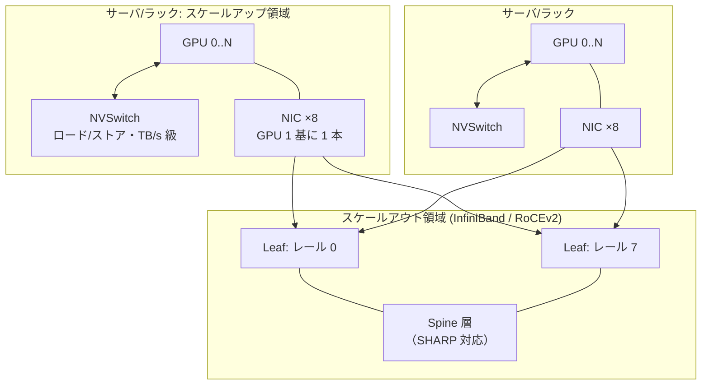

# インターコネクトとスケールアウト学習 (Interconnects & Scale-Out Training)

## 概要 (Overview)

大規模モデルの学習は、単一チップの性能ではなく**数千〜数万アクセラレータを 1 つの同期計算機として振る舞わせる能力**で決まる。学習の 1 ステップごとに全チップが勾配を交換して同期する以上、通信は「たまに起きるイベント」ではなく**毎ステップの構造的な負荷**であり、インターコネクトの帯域・レイテンシ・故障率が学習スループットの分母に直接入る。

本ドキュメントは、AI クラスタのインターコネクトを 2 つの階層に分けて分析する。筐体内の**スケールアップ領域**（NVLink/NVSwitch: 1 台の巨大 GPU に見せる）と、筐体間の**スケールアウト領域**（InfiniBand / RoCEv2: ロスレスな RDMA ファブリック）である。さらに、その上を流れるトラフィックの実体である**集合通信 (collective communication)**、とりわけ all-reduce のアルゴリズムとハードウェア支援 (SHARP)、そして万台規模で常態化する故障までを扱う。[`../networking/nic-switch-architecture.md`](../networking/nic-switch-architecture.md)（RDMA・ロスレスイーサネットの機構）の AI 特化編であり、[`../../software/ai/ml-training-systems.md`](../../software/ai/ml-training-systems.md)（この配管の上に載る並列化戦略）と対で読む。分析深度は Level 3。

## 方法論 (Methodology)

- 一般のデータセンターネットワークとの違いを一点に集約する: **トラフィックパターンが事前に既知**（集合通信の形はプログラムが決める）であること。この一点から、専用トポロジ・スケジューリング・in-network computing の共設計がすべて導かれる、という筋で整理する。
- 帯域・所要時間は第一原理の算術（データ量 ÷ リンク帯域、アルゴリズムの転送係数）で概算し、実測の代表値（MFU・故障率）は一次資料（Llama 3 論文等）から引く。
- 並列化戦略（データ/テンソル/パイプライン並列）の詳細は software 側 ([`../../software/ai/ml-training-systems.md`](../../software/ai/ml-training-systems.md)) に置き、本書は「各戦略がどんな通信を、どの階層に要求するか」という**需要と供給の対応**に徹する。

## 発見事項 (Findings)

1. **学習トラフィックは「既知・周期的・全員参加」であり、汎用ネットワークの前提をすべて裏切る。** 汎用 DC ネットワークは「予測不能な多対多の短いフロー」を前提に設計される（[`../networking/`](../networking/)）。学習は逆で、毎ステップ同じ相手と同じサイズの転送を行う少数の巨大フローが支配する。この予測可能性が、レール最適化トポロジ・静的ルーティング・スイッチ内リダクションといった「一般には成立しない最適化」を成立させる。
2. **all-reduce のリング実装は帯域最適であり、その係数 2(N−1)/N がすべての見積りの基礎になる。** N 台でサイズ M の勾配を all-reduce する場合、リングでは各ノードが約 `2M·(N−1)/N ≈ 2M` を送受信する[^ring]。この量は**台数に（ほぼ）依存しない**。これがデータ並列が数千台にスケールする理由である。一方でステップ数は 2(N−1) 回と台数に線形なため、大 N ではレイテンシ項が無視できなくなり、木・階層型（ノード内リング + ノード間木）への切替が必要になる。NCCL が実行時にトポロジを検出してアルゴリズムを選ぶのはこのためである[^nccl]。
3. **スケールアップ領域は「別種のネットワーク」ではなく「メモリの延長」である。** NVLink/NVSwitch ドメイン内の GPU は互いのメモリをロード/ストアでアクセスでき、帯域は PCIe の 1 桁上（世代あたり GPU 1 基で数百 GB/s〜TB/s 級）、レイテンシはマイクロ秒未満。**毎層ごとに** activations を交換するテンソル並列がこの領域にしか置けない（[`ml-training-systems.md`](../../software/ai/ml-training-systems.md)）ことが、ラック規模の NVLink ドメイン（NVL72 型: 72 GPU を単一ドメイン化）という製品形態を規定した。[`../hw-sw-interface/bus-interconnect.md`](../hw-sw-interface/bus-interconnect.md) のロード/ストア世界と、パケット世界の境界線がここにある。
4. **スケールアウト領域の本質は「損失ゼロの RDMA ファブリック」である。** GPUDirect RDMA により NIC が GPU メモリを直接読み書きし（ホスト経由のコピー排除であり、[`../hw-sw-interface/mmio-dma-interrupts.md`](../hw-sw-interface/mmio-dma-interrupts.md) の DMA の到達点）、InfiniBand または RoCEv2 が輻輳による損失を PFC/DCQCN・クレジットフロー制御で抑え込む。パケット損失は再送どころか**全チップの同期停止**として増幅されるため、「ロスレス」は快適さではなく学習の前提条件である。その代償（PFC ストーム・ヘッドオブライン閉塞）は [`../networking/nic-switch-architecture.md`](../networking/nic-switch-architecture.md) が詳述する。
5. **in-network computing (SHARP) は「通信を計算に変える」。スイッチが reduction を実行する。** all-reduce の縮約演算をスイッチ ASIC 内で行えば、データは木を 1 往復するだけになり、エンドポイントの送受信量はほぼ M に半減、incast も消える[^sharp]。「ネットワークは運ぶだけ」という階層の掟を破る設計が正当化されるのは、トラフィックが既知（発見事項 1）だからである。これは汎用ネットワークでは成立しない共設計の代表例である。
6. **万台規模では故障が常態であり、ネットワークは可用性ドメインになる。** Llama 3 の事前学習（16,384 GPU・54 日）では **419 回の予期しない中断**（約 3 時間に 1 回）が起き、その約 78% がハードウェア起因と報告されている[^llama3]。同期計算は 1 ノードの故障が全体を止めるため、実効スループットは「ピーク性能 × 稼働率 × 復旧速度」の積になり、チェックポイント・迅速な故障切り分け・OCS/アダプティブルーティングによる迂回（TPUv4 の光スイッチ: [`tpu-systolic-arrays.md`](tpu-systolic-arrays.md)）が性能機能として設計される。
7. **標準化の主戦場が「AI 向けイーサネット」に移った。** InfiniBand の事実上の単一ベンダ供給への対抗として、パケットスプレー・順序外配送許容・現代的輻輳制御を束ねる Ultra Ethernet 等の標準化が進み（UEC 仕様 1.0 が 2025-06 に公開され、2026-10 時点の最新は 1.0.3。準拠をうたう NIC がサンプル出荷され始めた初期実装の段階）、ハイパースケーラは RoCE ベースの自社ファブリック運用実績を積んでいる。「専用ファブリック vs 進化したイーサネット」は [`../networking/`](../networking/) の TOE の教訓（専用化 vs 汎用の進化）の再演である。

## アーキテクチャ (Architecture)

### AI クラスタの標準構成 — 2 階層 + レール最適化

- **レール最適化 (rail-optimized)**: 各サーバの i 番目の NIC を同じリーフ群（レール）に揃えて配線する。集合通信の相手は「別サーバの同じランクの GPU」なので、大半のトラフィックがリーフ 1 段で折り返し、スパイン層の負荷と競合が減る。トラフィックが既知だから引ける配線である。
- 帯域の設計点: スケールアップ領域はスケールアウトの**1 桁上**を保つ。この非対称が並列化戦略の配置（次表）を決める。

### 並列化戦略とインターコネクト階層の対応

| 並列化 | 通信の内容 | 頻度・量 | 要求特性 | 置くべき階層 |
|---|---|---|---|---|
| テンソル並列 (TP) | 各層の activations | **毎層・大** | 超高帯域・低レイテンシ | スケールアップ (NVLink) 内 |
| パイプライン並列 (PP) | ステージ境界の activations | 層境界・中 | 点対点・中帯域 | ノード間（近接） |
| データ並列 (DP) | 勾配の all-reduce | ステップ末・大（M≈モデルサイズ） | 帯域（レイテンシは隠蔽可） | スケールアウト全域 |
| エキスパート並列 (EP) | トークンの all-to-all | 毎 MoE 層・中 | 多対多・帯域 | 両階層にまたがる（最難） |

## 技術詳細 (Technical Details)

### 1. 集合通信のアルゴリズム (Collective Algorithms)

- **リング all-reduce**: reduce-scatter（N−1 ステップで各ノードが 1/N ずつの縮約済み断片を持つ）+ all-gather（N−1 ステップで断片を全員に配る）。総送信量 `2M(N−1)/N`、帯域最適[^ring]。パイプライン化により大メッセージではリンク帯域を使い切れる。
- **木・階層型**: レイテンシ項 `α·steps` が支配する小メッセージ・大 N では、二分木 (2 log N ステップ) や「ノード内リング → ノード間木 → ノード内ブロードキャスト」の階層合成が勝つ。NCCL はリンク構成（NVLink/PCIe/NIC）を起動時にプローブしてチャネル数とアルゴリズムを選択する[^nccl]。
- **通信と計算の重畳**: 逆伝播は出力側の層から勾配を確定させるため、確定した層から all-reduce をバケット単位で発行すれば、通信は計算の影に隠せる。「重畳できる通信は無料、できない通信だけが課金される」。これが DP がスケールし TP が閉じ込められる理由の実装側の表現である（[`../../software/ai/ml-training-systems.md`](../../software/ai/ml-training-systems.md)）。

### 2. GPUDirect RDMA とロスレスファブリック (GPUDirect & Lossless Fabrics)

- **GPUDirect RDMA**: NIC の DMA エンジンが PCIe 経由（または NVLink 接続の NIC）で GPU の HBM を直接読み書きする。CPU とホストメモリはデータパスから消え、コピー回数はゼロになる。[`../networking/nic-switch-architecture.md`](../networking/nic-switch-architecture.md) のディスクリプタリング協定が、宛先アドレスだけ GPU メモリに差し替わった形と読める。IOMMU/ATS の設定（[`../hw-sw-interface/`](../hw-sw-interface/)）が前提になる。
- **InfiniBand**: クレジットベースのリンクレベルフロー制御で構造的にロスレス。サブネットマネージャによる集中経路制御、アダプティブルーティングで大フローの衝突を回避する。
- **RoCEv2**: UDP/IP 上の RDMA。ロスレス性は PFC（優先度別の一時停止）+ ECN ベースの輻輳制御 (DCQCN) の運用で作り込む必要があり、その運用難度と引き換えにイーサネットのエコシステムを得る。両者の詳細な機構と代償は [`../networking/nic-switch-architecture.md`](../networking/nic-switch-architecture.md) に譲る。
- 進行中の方向（Ultra Ethernet 等）: 単一パスに順序を頼らず**パケットを複数経路に散らし (packet spraying)、受信側で順序外を許容**する。これは「ロスレスを作り込む」から「損失・順序に頑健にする」への転換であり、[`../../software/networking/tcp-transport-congestion.md`](../../software/networking/tcp-transport-congestion.md) の輻輳制御の知見がファブリック設計に還流している。

### 3. SHARP — スイッチ内リダクション (In-Network Reduction)

- スイッチ ASIC 内の縮約エンジンが、木の各段で子ポートからの勾配を加算して親へ 1 本だけ転送する。エンドポイントは「送って、受け取る」だけになり、送受信量は約 M（リングの半分）、ステップ数は木の深さ、スパインへの incast は構造的に消える[^sharp]。
- 制約に本質が表れる: 縮約は可換・結合的な演算に限られ（浮動小数点加算の結合則は厳密には成り立たないため、再現性との緊張がある。[`ml-training-systems.md`](../../software/ai/ml-training-systems.md) 参照）、スイッチのバッファ・演算器がジョブ間で共有資源になるため、マルチテナントでは予約・分離の運用が要る。
- 「ネットワーク内計算」の一般化（集約・キャッシュ・フィルタをファブリックに置く）は [`../networking/`](../networking/) の P4/プログラマブルスイッチの延長線上にあり、学習はその最初の量産顧客である。

### 4. 故障・テール・可用性 (Failures & Tails at Scale)

- 同期 SPMD 計算では**最も遅い 1 台が全体の速度**である（ストラグラー問題）。原因は故障だけでなく、温度による周波数低下・ECC 再試行・リンクの再トレーニングなど「遅くなる故障」が厄介で、検出には全ランクのステップ時間分布の常時監視（[`../../software/observability/`](../../software/observability/) の方法論）が要る。
- Llama 3 の実測[^llama3]が示す規模感は、419 中断/54 日、78% がハードウェアで、GPU の故障 148 回と HBM3 の故障 72 回を合わせると全中断の約 53% を占める（内訳は [`../reliability/fleet-hardware-reliability.md`](../reliability/fleet-hardware-reliability.md)）。これは、この規模の学習が「計算ジョブ」ではなく**可用性エンジニアリング**であることを意味する。対策の柱は高頻度・低オーバーヘッドのチェックポイント（[`ml-training-systems.md`](../../software/ai/ml-training-systems.md)）、故障の自動切り分けと予備ノードへの再スケジュール、そしてトポロジ側の迂回能力（OCS・アダプティブルーティング）である。
- ネットワーク自体の故障（リンクフラップ・光モジュール劣化）は台数に比例して増える。部品の故障率が一定なら系全体の MTBF は部品数に反比例して縮むという直列系の算術は [`../../foundations/mathematics/probability-statistics/reliability-theory.md`](../../foundations/mathematics/probability-statistics/reliability-theory.md) が扱う。光インターコネクトの信頼性・共封止光学は [`../networking/`](../networking/) のロードマップ（光インターコネクト）で扱う。

## セキュリティ考察 (Security Considerations)

- **RDMA の信頼モデルは「ファブリック内は善意」である。** RDMA の保護は rkey 等のケーパビリティ的トークンに依存するが、転送は暗号化も相互認証も持たないのが基本であり、ファブリックに入られた攻撃者はメモリの読み書きに近い能力を得る。防御は境界で行う。テナント分離（パーティション/PKEY、VXLAN 等のオーバーレイ）と管理プレーン（サブネットマネージャ）の保護が第一線になる。[`../../engineering/robotics/control-systems.md`](../../engineering/robotics/control-systems.md) や [`../../engineering/energy/`](../../engineering/energy/) の OT ネットワークと同じ「境界防御依存」の構図である。
- **学習クラスタは単一で最高価値の標的である。** 数万 GPU・数ヶ月の成果物（チェックポイント・最終重み）がファブリック上を平文で流れ、共有ファイルシステムに蓄積される。重みの持ち出し・チェックポイント改竄（バックドアの注入は学習時が最も検出困難）への対策として、ストレージ・転送の暗号化、チェックポイントの完全性検証と来歴（[`../../software/security/software-supply-chain-security.md`](../../software/security/software-supply-chain-security.md) のモデル来歴）が要る。
- **可用性攻撃は増幅される。** 同期計算の性質上、1 リンクへの妨害が全体を止める。そのため、輻輳の誘発・PFC ストームの惹起は少ないコストで数万 GPU 時間を浪費させられる。SHARP のような共有資源はサービス妨害の梃子にもなるため、ジョブ間の資源分離が安全性と性能の両方の要件になる。
- **マルチテナント学習基盤**では、GPUDirect・共有ファブリック・SHARP がテナント間の新しい共有面であり、[`tpu-systolic-arrays.md`](tpu-systolic-arrays.md) で述べたアクセラレータ TEE・[`../security/`](../security/) のサイドチャネルの議論がクラスタ規模に拡大して適用される。

## 結論 (Conclusions)

AI クラスタのインターコネクトは、「トラフィックが既知である」という一点を梃子に、汎用ネットワークでは許されない共設計を積み上げた体系である。共設計とは、メモリの延長としてのスケールアップ領域、ロスレス RDMA のスケールアウト領域、レール配線、スイッチ内リダクションである。集合通信の算術（リングの 2M、木のレイテンシ、SHARP の半減）が資源計画の言語になり、万台規模では故障と可用性が性能そのものになる。チップ（[`gpu-simt-architecture.md`](gpu-simt-architecture.md)・[`tpu-systolic-arrays.md`](tpu-systolic-arrays.md)）→ 配管（本書）と来た分析は、その配管の上で「どうモデルを切って並べるか」というソフトウェアの問題（[`../../software/ai/ml-training-systems.md`](../../software/ai/ml-training-systems.md)）に引き継がれる。

---

## 参考文献 (References)

[^ring]: Patarasuk, P. & Yuan, X. (2009). Bandwidth Optimal All-reduce Algorithms for Clusters of Workstations. *Journal of Parallel and Distributed Computing*, 69(2), 117–124. DOI: 10.1016/j.jpdc.2008.09.002 — リング all-reduce の帯域最適性の典拠。

[^nccl]: NVIDIA. *NCCL (NVIDIA Collective Communications Library) Documentation*. https://docs.nvidia.com/deeplearning/nccl/ — Accessed: 2026-07-13. — トポロジ検出・アルゴリズム選択・チャネルの一次資料。

[^sharp]: Graham, R. L. et al. (2016). Scalable Hierarchical Aggregation Protocol (SHArP): A Hardware Architecture for Efficient Data Reduction. *Proc. COM-HPC @ SC16*, 1–10. DOI: 10.1109/COMHPC.2016.006 — スイッチ内縮約の原典。

[^llama3]: Grattafiori, A. et al. (Llama Team, AI @ Meta) (2024). The Llama 3 Herd of Models. arXiv:2407.21783 — 16,384 GPU・54 日間の中断統計（419 回・約 78% がハードウェア起因）を含む一次報告。

その他の標準的典拠を以下に挙げる。

- Jouppi, N. P. et al. (2023). TPU v4: An Optically Reconfigurable Supercomputer for Machine Learning. *Proc. ISCA 2023*. DOI: 10.1145/3579371.3589350 — OCS による再構成可能トポロジ。
- NVIDIA. *NVLink & NVSwitch — Technical Overview*. https://www.nvidia.com/en-us/data-center/nvlink/ — Accessed: 2026-07-13. — スケールアップ領域の帯域・ドメイン構成（ベンダ資料、目標値を含む）。
- InfiniBand Trade Association. *InfiniBand Architecture Specification*. https://www.infinibandta.org/ — Accessed: 2026-07-13. — クレジットフロー制御・サブネット管理の規格。
- Ultra Ethernet Consortium. *UEC Specification*. https://ultraethernet.org/specification — Accessed: 2026-10-11. — AI 向けイーサネットの仕様（1.0: 2025-06-11、最新 1.0.3: 2026-07-16）。
