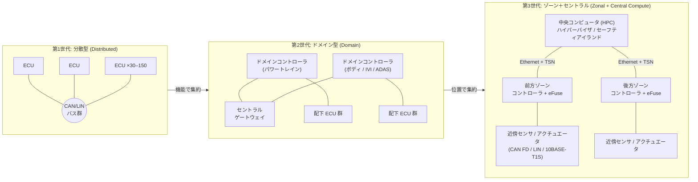

# E/E アーキテクチャ総論 — 分散からゾーン・セントラルへ (Automotive E/E Architecture)

## 概要 (Overview)

**E/E アーキテクチャ (Electrical/Electronic architecture)** とは、車両の電子制御ユニット (ECU)・ネットワーク・電源分配・ソフトウェア配置の全体構成を指す。`in-vehicle-networks.md` が CAN を軸にプロトコルを、`automotive-ethernet-tsn.md` が Ethernet/TSN バックボーンを扱ったのに対し、本書はその**上位の構成論**——なぜ ECU が 100 個規模まで増殖したのか、なぜ業界全体が **分散 (distributed) → ドメイン (domain) → ゾーン (zonal) ＋セントラルコンピュート (central compute)** へ移行しつつあるのか——を扱う。

移行の物理的な強制力 (forcing function) は**配線ハーネス (wiring harness)** である。数 km・数十 kg に達したハーネスが重量・コスト・組立性の限界を突き、アーキテクチャの再設計を強いた。その帰結が **SDV (Software-Defined Vehicle, ソフトウェア定義車両)**——ソフトウェアを ECU 調達から切り離し、出荷後も OTA で進化させる思想——である。`ev/tesla-software-manufacturing.md` が記述するテスラの集中型 E/E は、この業界共通の変遷の先行例として本書で一般化する。分析深度は Level 3。

## 方法論 (Methodology)

- E/E アーキテクチャを「**ECU の数と配置・ネットワークトポロジ・電源分配・ソフトウェア配置**」の 4 層で分解し、世代（分散/ドメイン/ゾーン＋セントラル）ごとに対比する。
- 変遷の駆動力を、(1) 機能追加の調達モデル（feature-per-box）、(2) 配線ハーネスの物理限界、(3) ソフトウェア価値の増大（SDV）の 3 つに整理し、それぞれ定量的根拠を付す。
- ECU 数・ハーネス重量/長は広く引用されるが出典により幅がある。CLAUDE.md「Source Hierarchy & Conflicts」に従い**単一値でなく範囲**で示し、ベンダー公称値（Bosch/Aptiv の削減率、テスラの目標値）は **公称・目標 (target)** と明示して実証値と区別する。
- 業界事例（テスラ、VW ID 系、Tier-1 各社）は個別記述を避け、**一般化した設計パターン**として抽出する。テスラ固有の詳細は `ev/tesla-software-manufacturing.md` に委ねる。

## 発見事項 (Findings)

1. **ECU の増殖は技術ではなく調達モデルの帰結。** 「1 機能 = 1 ボックス」で機能ごとに Tier-1 サプライヤへ発注する方式が数十年続き、典型車で 30–100 個、高級車では 100–150 個超の ECU が積み上がった。各 ECU がサプライヤ固有のファームウェアを持つため、全体としてのソフト更新・統合が構造的に困難になった。
2. **配線ハーネスが物理的限界に達し、アーキテクチャ再設計を強制した。** 現代の乗用車のハーネスは概ね総延長 1.5–5 km・重量 30–60 kg 級（EV や高装備車ではさらに重い報告もある）で、車両で最も重い部品群の一つ、かつ**組立の大部分が今も人手**という異質な存在である。機能追加のたびに端末から遠くの ECU へ配線を引く分散型では、この成長が止まらない。
3. **ゾーン化の本質は「機能の境界」から「物理的位置の境界」への転換。** ドメイン型が機能群（パワートレイン/ボディ/ADAS…）で束ねるのに対し、ゾーン型は**車体の前後左右**でゾーンコントローラに I/O を集約し、Ethernet バックボーンで中央計算機と結ぶ。配線は「近傍まで」で済み、ハーネスは短く・軽く・自動組立しやすくなる（Bosch はゾーン化でハーネス重量 15–20% 減と公称、Aptiv も同様の削減を公称）。
4. **ゾーン化は通信だけでなく電源分配の再設計でもある。** 集中ヒューズボックス＋リレーを、各ゾーンの**半導体スイッチ (eFuse / smart switch)** に置き換えることで、電源線も「近傍配電」になり、ソフトから診断・再投入・負荷制御が可能になる。通信と電力の両方を位置で束ねて初めてハーネス削減が成立する。
5. **セントラルコンピュートの真の課題は性能ではなく混在重要度 (mixed-criticality) の隔離。** ASIL-D の車両制御と QM のインフォテインメントを同一筐体・同一 SoC に同居させるには、ハイパーバイザや**セーフティアイランド (safety island)** による**干渉からの自由 (Freedom From Interference, FFI, ISO 26262)** の立証が必要で、これが SDV 実現の技術的ボトルネックである。

## アーキテクチャ (Architecture)

### 世代の変遷 (Architectural Evolution)

### 世代比較 (Generation Comparison)

| | 分散型 (Distributed) | ドメイン型 (Domain) | ゾーン＋セントラル (Zonal + Central) |
|---|---|---|---|
| **集約の軸** | なし（1 機能 = 1 ECU） | 機能群（パワートレイン/シャシ/ボディ/IVI/ADAS） | 物理的位置（前/後/左/右）＋中央計算 |
| **ECU 数の傾向** | 30–150（増加の一途） | 数十（ドメインコントローラ＋配下 ECU） | 数個の HPC ＋数個のゾーン ECU ＋末端スマートアクチュエータ |
| **ネットワーク** | CAN/LIN の平坦なバス群 | ドメイン内バス＋セントラルゲートウェイ | Ethernet/TSN 幹線＋ゾーン内 CAN FD/LIN/10BASE-T1S |
| **電源分配** | 集中ヒューズボックス＋リレー | 同左（通信のみ再編） | ゾーン内 eFuse（半導体配電・診断可能） |
| **ソフト配置** | 各 ECU に固定（サプライヤ別） | ドメイン単位で集約 | 中央にサービスとして集約（SOME/IP）、OTA 前提 |
| **ハーネス** | 端末→遠方 ECU の長距離配線が膨大 | 中（ドメイン内で短縮） | 近傍配線のみ。重量 15–20% 減（ベンダー公称） |
| **代表例** | 2010 年代までの大半の量産車 | Audi zFAS、多くの現行 ADAS 実装 | テスラ（中央＋前/右/左ボディコントローラ）、VW ID 系 (ICAS)、各社次世代プラットフォーム |

移行は一斉ではなく**混成が常態**である。同一車両内で ADAS はドメイン型、ボディはゾーン型という折衷が現実には多い。

## 技術詳細 (Technical Details)

### 1. ECU 増殖の力学 — feature-per-box 調達モデル

機能（パワーウィンドウ、シートヒータ、レーンキープ…）を追加するたび、OEM は Tier-1 に「箱」ごと発注してきた。この方式は個別機能の開発を並列化でき、責任境界も明確だが、副作用として以下が生じる。

- ECU 数が積算的に増える。典型的な現代車で **30–100 個、高機能な高級車で 100–150 個超**（出典により幅がある。範囲で扱う）。
- 各 ECU のソフトはサプライヤの知的財産で、OEM が全体を統合・更新できない。**ソフトの構造が調達の構造を写像**する（Conway の法則の車載版）。
- ECU 間連携が増えるほどバスとゲートウェイの負荷・配線が増え、ハーネス成長に直結する。

### 2. 配線ハーネス — 物理的強制力 (The Physical Forcing Function)

- **規模（概数）**: 現代の乗用車で電線 1,500–3,000 本、総延長 **約 1.5–5 km**、重量 **約 30–60 kg**（高装備車・BEV では 60–80 kg 級の報告もある）。出典により測り方（電源系を含むか等）が異なるため、いずれも**概算値**として扱う。
- **重量とコスト**: ハーネスは車両で最も重いサブシステムの一つで、BEV では航続距離に直接効く。銅材・コネクタのコストも大きい。
- **組立性が決定的**: ハーネスは柔軟で車両ごとに構成が異なるため、**製造・敷設のロボット化が難しく、今も大部分が手作業**である。組立工数と品質ばらつきの主要因であり、テスラが Model S 約 3 km → Model 3 約 1.5 km と短縮し、さらに「100 m 級」を特許で目標に掲げた（**目標値であり実証値ではない**）動機もここにある。
- 分散型では機能追加のたびに配線が伸びるため、**ハーネスの成長はアーキテクチャを変えない限り止まらない**。これがゾーン化の第一の根拠である。

### 3. ドメイン集約 (Domain Consolidation)

第一段階の集約は機能軸で行われた。パワートレイン/シャシ/ボディ/インフォテインメント/ADAS の各ドメインに**ドメインコントローラ (domain controller)** を置き、配下 ECU を統合、ドメイン間をセントラルゲートウェイで接続する。ADAS のようにセンサ融合で大きな計算を要するドメインから先行した（例: Audi zFAS）。ただしドメイン型は**配線問題を解かない**——ドメインの境界は機能であって位置ではないため、車体後部のセンサが前部のドメインコントローラに長い配線でつながる構図が残る。

### 4. ゾーンアーキテクチャ (Zonal Architecture)

- **ゾーンコントローラ**は車体の物理区画ごとに置かれ、近傍のセンサ/アクチュエータの I/O（CAN FD・LIN・10BASE-T1S 等）を集約し、Ethernet/TSN 幹線で中央と結ぶ（幹と枝の階層は `automotive-ethernet-tsn.md` 参照）。機能はもはや特定の箱に宿らず、**ゾーンは I/O とゲートウェイ、計算は中央**という分業になる。
- **電源分配の再設計**が対になる。従来の集中ヒューズボックス＋リレーを、ゾーンコントローラ内蔵の **eFuse（半導体ヒューズ）/ スマートスイッチ**に置換する。溶断式と違い再設定可能で、電流監視・診断・ソフト制御ができ、故障時の遮断も速い。電源線も「ゾーンまで太い幹線、そこから短い枝」となり、信号と電力の両方でハーネスが縮む。
- **効果の規模（ベンダー公称）**: Bosch はゾーン指向化でハーネス重量 15–20% 減、Aptiv は Smart Vehicle Architecture で約 20% 減＋フラットケーブル化で最大 40% 減の余地と公称する。**第三者による実測の公開は乏しく、公称値として扱う**。

### 5. セントラルコンピュート / HPC (Central Compute)

計算は少数の **HPC (High-Performance Computer)** に集約される。核心は性能でなく**混在重要度の同居**である。

- **ハイパーバイザ**で ASIL 系（車両制御）と QM 系（IVI、Linux/Android）を仮想マシンとして分離し、CPU・メモリ・I/O の**干渉からの自由 (FFI)** を担保する（ISO 26262、`functional-safety-iso26262.md`）。
- SoC 内には**セーフティアイランド**——ロックステップコアと独立電源/クロック監視を持つ領域——を置き、高性能コア群の故障を検出・縮退させる。
- それでも安全上の最終防衛線として、ブレーキ等の**縮退動作 (graceful degradation)** をゾーン側や独立 ECU に残す設計が一般的で、「完全中央集中」は現実には採られにくい。

### 6. SDV — ソフトウェア定義車両 (Software-Defined Vehicle)

ゾーン＋セントラルの目的はハーネス削減だけではない。**ソフトウェアを ECU 調達から切り離す**ことが本丸である。

- 機能が中央のサービス（SOME/IP・Adaptive AUTOSAR・コンテナ）として実装されれば、**機能追加＝ソフト配信**になり、ハード（箱）の発注サイクルから解放される。
- **OTA (Over-The-Air)** が全機能に及ぶ。リコール対応・機能追加・性能調整を無線で行い、車両は出荷後も価値が更新される製品になる（テスラが先行、業界が追随）。
- 組織的含意: OEM は「箱の統合者」から「ソフトプラットフォーム保有者」への転換を迫られる。VW が ICAS/VW.os で自社ソフトスタックに投資したのはこの文脈である。

### 7. 業界事例の一般化 (Industry Examples, Generalized)

- **テスラ**: 中央コンピュータ＋少数のボディコントローラ（前/右/左）＋ Ethernet という徹底した集中・ゾーン構成の先行例。ハーネス短縮と OTA を最初期から設計目標に置いた。詳細は `ev/tesla-software-manufacturing.md`（本書はその一般化）。
- **VW ID 系 (E3 アーキテクチャ)**: **ICAS (In-Car Application Server)** と呼ぶ HPC 群に機能を集約。ICAS1（Continental 製、Adaptive AUTOSAR ベース）がゲートウェイ＋ボディ機能＋ OTA 統括を担う。ハードとソフトの分離を明示的に掲げた量産例（ベンダー・OEM 発表ベース）。
- **一般的傾向**: Tier-1（Bosch・Aptiv・Continental 等）は「ドメイン→クロスドメイン→ゾーン＋ビークルコンピュータ」の段階的ロードマップを提示しており、移行は一足飛びではなく**折衷構成を経由して漸進**する。各社の削減率・時期の数字はマーケティングを含む公称であり、本書では傾向のみを事実として扱う。

## セキュリティ考察 (Security Considerations)

集約は攻撃面 (attack surface) の質を変える。個別の対策技術は `cybersecurity-iso21434.md` に譲り、ここではアーキテクチャ固有の論点に絞る。

- **「多数の貧しい標的」から「少数の豊かな標的」へ**: 分散型では 1 ECU の侵害の影響が局所的だったが、HPC は車両機能の大半を実行するため、**侵害 1 点の価値が桁違いに大きい**。HPC 上の VM 分離・最小権限・セキュアブートが、従来の「ECU 1 個の堅牢化」よりはるかに重い意味を持つ。
- **ゾーンコントローラ＝天然のセキュリティ境界**: すべての末端 I/O がゾーンを経由するため、ゾーンコントローラはフィルタリング・レート制限・IDS の設置点として機能する。ドメイン型のセントラルゲートウェイが担った境界防御が、位置ベースで多重化される形になる。
- **OTA の規模の問題**: SDV では OTA が常態化し、**署名・検証・段階配信・ロールバック**の配信基盤そのものが安全の前提になる（UN R156 のソフトウェア更新管理システム要件）。更新チャネルの侵害は全車両フリートに波及するため、単一車両のハッキングとはリスクの次元が異なる。
- **混在重要度の隔離は safety と security の交点**: ハイパーバイザによる FFI（ISO 26262）は、同時に「IVI の侵害が車両制御に波及しない」というセキュリティ境界でもある。逆に言えば、**ハイパーバイザ/セーフティアイランドの脆弱性は安全と保安を同時に破る**単一障害点であり、ISO 26262 と ISO/SAE 21434 の協調分析（TARA と HARA の突合）が必須になる。

## 結論 (Conclusions)

- E/E アーキテクチャの変遷は、**feature-per-box 調達が生んだ ECU 増殖**と**配線ハーネスの物理限界**（総延長 1.5–5 km・30–60 kg 級）への応答である。技術トレンドではなく、重量・コスト・組立性という物理と経済の強制力が駆動している。
- 集約は 2 軸で進んだ。**機能軸（ドメイン）** は計算を束ねたが配線を解かず、**位置軸（ゾーン）** が通信と電源分配（eFuse）を近傍化してハーネスを縮めた。現実の車両は両者の折衷を経由して漸進する。
- セントラルコンピュートの成立条件は、性能よりも**混在重要度の隔離**（ハイパーバイザ・セーフティアイランド・FFI）である。完全中央集中は単一障害点ゆえに採られず、縮退経路を分散側に残すのが定石である。
- 最終目的は **SDV**——ソフトを箱の調達から切り離し、OTA で出荷後も進化させること。テスラが先行し VW ID 系（ICAS）らが追う構図だが、削減率や時期の数字はベンダー公称が多く、実証値との区別を保って評価すべきである。

### 次の接続先 (Related Topics)

- `in-vehicle-networks.md` — 本書の下層: CAN の調停・無認証問題、ECU の内部構成。
- `automotive-ethernet-tsn.md` — ゾーン幹線の実体: Ethernet/TSN・SPE・SOME/IP。
- `ev/tesla-software-manufacturing.md` — 本書が一般化したテスラ固有の集中型 E/E・OTA・製造統合。
- `functional-safety-iso26262.md` — 混在重要度・FFI・ASIL 分解の規範。
- `cybersecurity-iso21434.md` — 集約後の攻撃面への対策: セキュア OTA・HSM・SecOC・UN R155/R156。
- `../cpu-architecture/` — HPC が要求する仮想化・並行性・メモリ階層の基礎。

## 参考文献 (References)

**一次資料 (Primary — 標準・査読論文・ベンダー一次発表)**

- Zhu, H. et al. (2023). Review of Electrical and Electronic Architectures for Autonomous Vehicles: Topologies, Networking and Simulators. *Automotive Innovation*, 6, 419–436. DOI: 10.1007/s42154-023-00266-9 — [Springer](https://link.springer.com/article/10.1007/s42154-023-00266-9) — Accessed: 2026-07-06。E/E トポロジ変遷（Bosch 6 段階ロードマップ含む）の査読レビュー。
- Aptiv (2020). *Smart Vehicle Architecture™* (white paper). — [PDF](https://www.aptiv.com/docs/default-source/white-papers/2020_aptiv_whitepaper_sva.pdf) — Accessed: 2026-07-06。ゾーン化によるハーネス約 20% 減等。**ベンダー公称値**。
- Robert Bosch GmbH. *E/E architecture — the E/E architecture of the future*. — [bosch-mobility.com](https://www.bosch-mobility.com/en/mobility-topics/ee-architecture/) — Accessed: 2026-07-06。ビークルコンピュータ＋ゾーン ECU 構成、ハーネス 15–20% 減。**ベンダー公称値**。
- Continental AG (2019-11-12). *Continental Vehicle Server Connects VW ID. Electric Vehicles* (press release). — [continental.com](https://www.continental.com/en/press/press-releases/2019-11-12-icas-vw/) — Accessed: 2026-07-06。VW ID.3 の ICAS1（Adaptive AUTOSAR、ゲートウェイ＋ボディ＋OTA 統括）の一次発表。
- Texas Instruments. *How eFuses are helping drive the zone architecture* (SSZTD31). — [ti.com](https://www.ti.com/lit/SSZTD31) — Accessed: 2026-07-06。ヒューズ/リレーの半導体置換とゾーン配電。
- onsemi. *Smart Power Distribution in Zonal Architecture* (AND90348, application note). — [PDF](https://www.onsemi.com/download/application-notes/pdf/and90348-d.pdf) — Accessed: 2026-07-06。ゾーン配電の設計詳細。

**二次資料 (Secondary — 専門誌・技術解説)**

- Charette, R. N. (2021). [How Software Is Eating the Car](https://spectrum.ieee.org/software-eating-car) — *IEEE Spectrum* — Accessed: 2026-07-06。ECU 数（典型 ~100、高級車 150 超）とソフト規模の集計。
- [Wiring harness development in today's automotive world](https://blogs.sw.siemens.com/ee-systems/2020/07/28/wiring-harness-development-in-todays-automotive-world/) — Siemens Digital Industries Software — Accessed: 2026-07-06。ハーネス総延長 4 km 超・約 60 kg 級の概数。
- [Shedding Pounds In Automotive Electronics](https://semiengineering.com/shedding-pounds-in-automotive-electronics/) — Semiconductor Engineering — Accessed: 2026-07-06。ハーネスが最重量級サブシステムの一つであること、軽量化アプローチ。
- Vicor (2023). *Reducing range anxiety by reducing harness weight* (WCX 2023 presentation). — [PDF](https://www.vicorpower.com/documents/event-presentation/evt-WCX-2023-wire-harness-presentation-VICOR.pdf) — Accessed: 2026-07-06。BEV ハーネス重量（70–80 kg 級の報告）。
- [Tesla's new wiring architecture could greatly reduce vehicle build time](https://chargedevs.com/newswire/teslas-new-wiring-architecture-could-greatly-reduce-vehicle-build-time/) — Charged EVs — Accessed: 2026-07-06。Model S 約 3 km → Model 3 約 1.5 km、特許上の 100 m **目標**（実証値ではない）。
