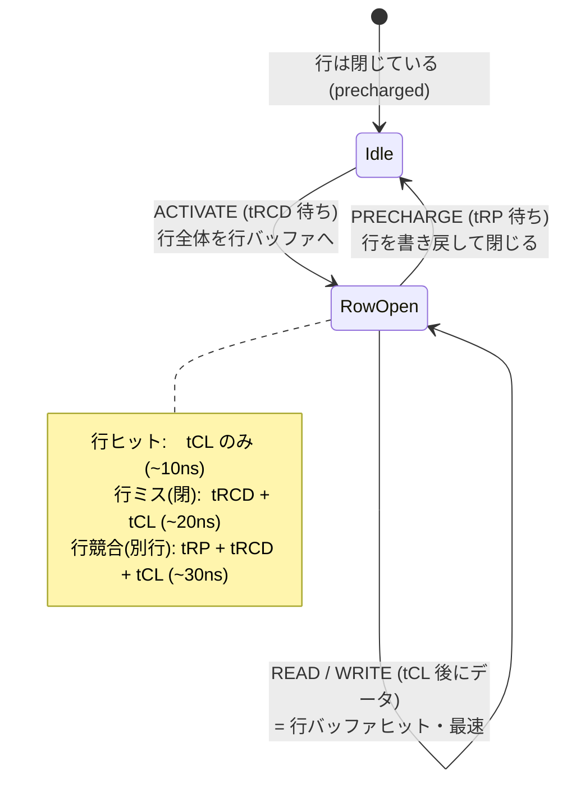

# DRAM とメモリコントローラ (DRAM & Memory Controllers)

## 概要 (Overview)

[`cache-memory-hierarchy.md`](cache-memory-hierarchy.md) はキャッシュ階層を「DRAM が遅いから」という前提の上に描いた。本ドキュメントはその前提の内側——**DRAM はなぜ遅く、なぜその遅さが 30 年ほとんど改善していないのか**——を扱う。

中心テーゼは、**DRAM とは「キャパシタというアナログ物理を、タイミングパラメータという契約書でディジタルに見せかける装置」** だということ。1 個のトランジスタと 1 個のキャパシタ (1T1C) に電荷として蓄えたビットは、読むと壊れ (破壊読み出し)、放っておくと漏れ (リフレッシュ)、隣を叩くと化ける (Rowhammer)。tCL・tRCD・tRP という呪文のようなパラメータ群は、この物理が要求する待ち時間の目録であり、メモリコントローラ (memory controller) はこの契約の範囲内で並列性を絞り出すスケジューラである。

DDR 世代が進むたびに「メモリが速くなった」と言われるが、速くなったのは**帯域** (インタフェースの転送率と並列性) であって、**レイテンシ** (行を開けて読む物理時間) は約 10〜15ns のままほぼ動いていない。この「帯域は買えるがレイテンシは買えない」という非対称が、キャッシュ階層・アウトオブオーダ実行・プリフェッチ・HBM といった計算機構造の大半を説明する。

本書は (1) セルの物理と読み出しの仕組み、(2) バンク・ランク・チャネルという並列性の階層、(3) タイミング契約の読み方、(4) メモリコントローラのスケジューリング、(5) 信頼性 (ECC) と Rowhammer、を整理する。分析深度は Level 3。

## 方法論 (Methodology)

- すべての機構を「キャパシタの物理から何が強制されるか」から導出する。タイミングパラメータは暗記対象ではなく、物理の帰結として説明する。
- レイテンシ停滞の主張は、DDR 世代間の実時間換算 (クロック数 × 周期) で検証する。規格値は JEDEC 標準を一次資料とする。
- コントローラのスケジューリングは原典 (Rixner et al., ISCA 2000) の定式化に基づき、行バッファ局所性 (row-buffer locality) とバンク並列性 (bank-level parallelism) の 2 軸で整理する。
- Rowhammer は発見論文 (Kim et al., ISCA 2014) と緩和策の破り (TRRespass, S&P 2020) を対にして、攻撃と防御の応酬として記述する。攻撃の悪用手順ではなく機構と防御に焦点を置く ([`../hardware-security/`](../hardware-security/) の分担)。

## 発見事項 (Findings)

1. **DRAM の読み出しは破壊的であり、「読む」とは「行ごと退避させる」ことである。** ACTIVATE はビット線の微小な電位差をセンスアンプが増幅する操作で、行 (row) 全体 (数 KB) が**行バッファ**に展開され、セルの電荷は一度失われる (書き戻しはセンスアンプが行う)。以後の READ/WRITE は行バッファ相手の高速な操作であり、**DRAM アクセスの速い/遅いは「行が開いているか」でほぼ決まる**。
2. **レイテンシは 30 年停滞、帯域は 3 桁成長した。** SDRAM PC100 (1998, CL2@100MHz = 20ns) から DDR4-3200 (CL22 ≒ 13.8ns)、DDR5-6400 (CL32 = 10ns) まで、CAS レイテンシの実時間は 2 倍も縮んでいない——セルとセンスアンプの物理 (RC 遅延) が微細化で速くならないため。一方、帯域はバス転送率×チャネル数で数百倍になった。**「速いメモリ」を買うことはできるが、それは「太いメモリ」である**。
3. **DRAM の性能はレイテンシの短縮ではなく、レイテンシの重ね合わせで出す。** チャネル (独立バス) × ランク (バス共有・交代) × バンクグループ × バンク (各自が行バッファを持つ) の階層が「同時に開いている行」を数十個作り、コントローラとアウトオブオーダ実行 ([`pipeline-superscalar-ooo.md`](pipeline-superscalar-ooo.md)) が要求を重ねる。MLP (memory-level parallelism) はソフトウェア側から見た同じ資源の名前である。
4. **メモリコントローラは公平性と性能を天秤にかけるスケジューラである。** 標準的な FR-FCFS (First-Ready, First-Come-First-Served) は「行バッファにヒットする要求を最優先」する——スループットは最大化するが、局所性の高いスレッドが行を占有し、他スレッドを飢えさせうる。マルチコア時代のコントローラ設計は、キャッシュと同じ「共有資源の QoS 問題」をここでも解いている。
5. **リフレッシュは成長する税金である。** 電荷は約 64ms で危険水準まで漏れるため、全行を周期的に再充電する。チップ容量が増えるほど 1 回のリフレッシュ (tRFC) は長くなり、その間バンクは応答しない——数 % の帯域税と、時折の数百 ns のレイテンシスパイクとして観測される。温度が上がると倍率が上がる (85°C 超で 2 倍) ことも運用上の含意を持つ。
6. **Rowhammer は「抽象化から漏れ出した物理」の教科書的事例である。** 同じ行を高頻度で ACTIVATE すると、隣接行のセルが電磁的干渉でビット反転する (Kim et al., 2014: 当時の DDR3 の過半のモジュールで再現)。メモリ保護 ([`virtual-memory-mmu.md`](virtual-memory-mmu.md)) がアドレス変換の層で完璧でも、**物理層でビットが化ければ権限昇格は成立する**。ベンダ緩和策 (TRR) は 2020 年に多面パターン (TRRespass) で破られ、DDR5 では RFM や PRAC といった規格レベルの対策が続く——応酬は現在進行形である。

## アーキテクチャ (Architecture)

### 組織の階層 — 並列性はどこに埋まっているか

```
 CPU パッケージ
 └── メモリコントローラ (オンダイ、チャネルごと)
      ├── チャネル 0 ── 完全独立のバス (DDR5 では DIMM がさらに 2 サブチャネル×32bit)
      │    └── DIMM
      │         ├── ランク 0 ─ バスを共有する DRAM チップの組 (例: x8 チップ × 8 個 = 64bit)
      │         │    └── 各チップ: バンクグループ × バンク (DDR5: 最大 32 バンク)
      │         │         └── バンク = 行 × 列 の 2 次元配列 + 行バッファ (これが並列性の最小単位)
      │         └── ランク 1 (裏面など。バス交代にペナルティ)
      └── チャネル 1 ...
   1 回の CPU キャッシュライン読み (64B) = 1 ランクの全チップが同じ列を分担し、バースト長 BL16 (DDR5) で転送
```

### 1 回のアクセスの状態遷移



- ソフトウェアから見た含意: **シーケンシャルアクセスが速い理由の半分はキャッシュラインだが、残り半分はこの行バッファである** (連続アドレスは同じ行に載る)。ランダムアクセスは行競合の連打であり、レイテンシが 3 倍近く違う。
- 物理アドレス → (チャネル, ランク, バンク, 行, 列) の写像 (**インタリービング**) はコントローラが決める。連続キャッシュラインをチャネル・バンクに撒くことで、ストリームアクセスが自然に並列化するよう設計されている。

## 技術詳細 (Technical Details)

### 1. タイミング契約の読み方 — 「DDR5-6400 CL32」を分解する

- **6400 MT/s**: バスの転送率 (クロック 3200MHz の両縁、DDR = double data rate)。帯域 = 6400 MT/s × 8B ≒ 51.2 GB/s/チャネル。
- **CL (tCL) 32**: READ 発行からデータ先頭まで 32 バスクロック = 32 / 3.2GHz = **10ns**。同様に tRCD (ACTIVATE→READ 可)、tRP (PRECHARGE 完了)、tRAS (行を開けておく最短時間) がそれぞれ約 10ns 級で並ぶ。
- 検算 (レイテンシ停滞): DDR-400 CL3 = 15ns / DDR3-1600 CL11 ≒ 13.8ns / DDR4-3200 CL22 ≒ 13.8ns / DDR5-6400 CL32 = 10ns。**クロック数は 10 倍、実時間はほぼ一定**——「CL の数字が大きくなった＝遅くなった」ではない。
- CPU から見た実効レイテンシ (約 80〜120ns) はこの倍以上ある: キャッシュ階層のミス判定・コントローラのキュー・アドレス変換 ([`virtual-memory-mmu.md`](virtual-memory-mmu.md)) が上乗せされるため。DRAM 単体の物理は末端の 3〜4 割にすぎない。

### 2. メモリコントローラのスケジューリング

- **FR-FCFS** (Rixner et al., 2000): 発行可能な要求のうち (1) 行バッファヒットを最優先、(2) 同格なら古い順。行を開け直すコスト (tRP+tRCD) を払う回数を最小化する貪欲戦略である。
- **行バッファポリシ**: open-page (次も同じ行に賭けて開けておく——局所性の高いワークロード向け) vs closed-page (すぐ閉じて次の行競合を先払い——ランダム・多スレッド向け)。現代のコントローラは履歴で動的に切り替える。
- **書き込みの扱い**: 書き込みは応答を待つ者がいないため、バッファに溜めて**まとめて掃く** (write draining)。読み書きの方向転換 (バスターンアラウンド) にペナルティがあるため、交互ではなくバースト単位で切り替える——[`../../software/operating-systems/block-io-stack.md`](../../software/operating-systems/block-io-stack.md) の writeback と同じ「読みは急ぎ、書きは溜める」構造が最下層にも現れる。
- **マルチコアの公平性**: FR-FCFS は行ヒット率の高いスレッドを構造的に優遇する。行ヒットを量産するストリーム型スレッドが、ランダムアクセスのスレッドを飢えさせる干渉はメモリ性能攻撃 (performance attack) としても定式化されており、スレッド認識型スケジューリングや帯域パーティショニングが対策として研究・実装されてきた。
- コントローラが CPU ダイに載った (AMD Opteron 2003, Intel Nehalem 2008) ことでノースブリッジ経由のホップが消えたが、引き換えに**メモリはソケットに属する**ことになった——NUMA ([`cache-coherence.md`](cache-coherence.md)) はこの配置の直接の帰結である。

### 3. リフレッシュ — 漏れる電荷との会計

- 標準契約: 64ms 以内に全行をリフレッシュ。コントローラは tREFI (約 7.8µs、DDR5 では 3.9µs) ごとに REFRESH コマンドを発行し、チップは内部カウンタで行群を再充電する (tRFC: 8Gb 級で 300ns 前後)。
- 税率 = tRFC / tREFI で数 % だが、問題は平均より**テール**: リフレッシュ中のバンクへの要求は数百 ns 待たされる。レイテンシ敏感な系での「説明のつかないスパイク」の古典的犯人である。fine-granularity refresh や same-bank refresh (DDR5) は、この塊を細かく砕く方向の改良である。
- 温度依存 (高温ほど漏れが速い) のため 85°C 超では倍レートになる——サーバの冷却設計はメモリ帯域の実効値にも効いている。

### 4. 信頼性の階層 — ビットは黙って化ける

- **ソフトエラー**: 宇宙線由来の中性子などでセルやロジックが一時的に反転する。大規模フィールド研究 (Schroeder et al., 2009) は、エラー率が従来の実験室推定より桁で高く、かつ一様でない (故障は特定 DIMM に集中する) ことを示した——**ECC なしのサーバ運用はデータ破損を観測できないだけ**である。
- **側帯 ECC**: ランクにチップを足して (64bit+8bit) SEC-DED (1bit 訂正・2bit 検出) を持つ。チップ 1 個の全損に耐える **chipkill/ADDDC** はその強化版。DDR5 の **on-die ECC** はチップ内部の訂正であり、バスや他チップの故障は守らない——「DDR5 だから ECC 付き」は誤解で、サーバ用途には依然として側帯 ECC が要る。
- OS 側の窓口: Linux の EDAC サブシステムが訂正可能エラー (CE) を数え、閾値超えの DIMM を交換するのが運用の定石。訂正不能 (UE) はプロセス kill やマシンチェックに至る。

### 5. Rowhammer — 物理層への攻撃と規格の応酬

- 機構: ACTIVATE の繰り返しがワード線の電圧振動として隣接行に結合し、電荷を漏らす。微細化するほどセル間距離が縮み**悪化する**——スケーリングが信頼性を削る構造的問題である (Kim et al., 2014)。
- 攻撃としての意味: ページテーブルエントリ ([`virtual-memory-mmu.md`](virtual-memory-mmu.md)) の 1bit を反転させて自プロセスのページテーブルを書き込み可能にする権限昇格 (Project Zero, 2015) が実証済み。**ソフトウェアの正しさの全部が、下の物理の正しさを前提にしている**ことを露呈させた。
- 応酬の年表: TRR (ベンダ独自の被害行リフレッシュ) → **TRRespass** (2020: 多面 hammering で TRR の追跡容量を溢れさせ DDR4 で再現) → DDR5 の RFM (Refresh Management: ACTIVATE 回数に応じた強制リフレッシュ) → **PRAC** (2024, JEDEC: 行ごとの ACTIVATE カウンタをチップに内蔵し、閾値で警報を返す)。緩和は「推測による防御」から「数えて防ぐ」へ移行しつつある。詳細な攻撃面の整理は [`../hardware-security/side-channels-tee-secure-boot.md`](../hardware-security/side-channels-tee-secure-boot.md) を参照。

### 6. 観測の入口 (Observability)

| 疑問 | 道具 |
|---|---|
| 実効レイテンシ・帯域はいくらか | Intel MLC (Memory Latency Checker)、`STREAM` ベンチマーク |
| メモリ律速か CPU 律速か | `perf stat` (LLC-load-misses)、`perf c2c` (共有の競合)、トップダウン分析 (Memory Bound %) |
| どの DIMM 構成か | `dmidecode -t memory` (チャネル・ランク・速度) |
| ECC エラーは出ているか | EDAC (`/sys/devices/system/edac/mc/`)、`rasdaemon` |
| NUMA 越境はあるか | `numastat`、`perf mem` (アクセス先ノードの実測) |

## セキュリティ考察 (Security Considerations)

- **Rowhammer 系** (上記詳説): 権限分離の最終根拠である「メモリは書いた通りの値を保つ」をハードの物理で破る。ECC は難易度を上げるが完全な防御ではない (ECC 回避型の研究がある)。JavaScript からの遠隔発動も実証されており、「ローカル攻撃者限定」という想定は成り立たない。
- **RAMBleed** (2019): Rowhammer の副作用を**読み取り**に転用し、隣接行の秘密 (OpenSSH の鍵で実証) をビット反転の成否から推定する——完全性攻撃が機密性攻撃に転化した例。
- **コールドブート攻撃**: DRAM の電荷は電源断後も低温なら数秒〜数分残る。物理アクセスのある攻撃者はモジュールを凍結・移設して鍵を回収できる——「電源を切れば消える」は近似にすぎない。対策はメモリ暗号化と鍵の CPU 内保持。
- **メモリ暗号化 (TME / AMD SME・SEV)**: コントローラで透過的に暗号化し、コールドブート・バス盗聴・(SEV では) ハイパーバイザからの読み取りに対抗する。完全性保証の有無・リプレイ耐性が製品世代で異なる点は TEE の文脈 ([`../hardware-security/side-channels-tee-secure-boot.md`](../hardware-security/side-channels-tee-secure-boot.md)) で扱う。
- **性能干渉という攻撃面**: 行バッファ競合・帯域飽和は共有環境でのサービス劣化攻撃・共在検知のサイドチャネルになりうる (キャッシュ攻撃 ([`cache-memory-hierarchy.md`](cache-memory-hierarchy.md)) の DRAM 版)。

## 結論 (Conclusions)

- DRAM は「漏れて・壊れて・干渉するアナログ装置」をタイミング契約で包んだものであり、tCL/tRCD/tRP・リフレッシュ・Rowhammer はすべてキャパシタ物理の直接の帰結である。契約書 (JEDEC 規格) は物理の目録として読める。
- レイテンシは物理に縛られて停滞し、帯域は並列性で成長し続ける——この非対称が、キャッシュ階層・OoO・プリフェッチ・HBM・そして「メモリ壁」という言葉の実体である。性能設計とは実質、**行バッファ局所性と MLP をどう確保するか**の問題になる。
- メモリコントローラは最下層のスケジューラであり、行ヒット優先 (FR-FCFS)・書き込みの一括掃き出し・公平性の調停という判断は、OS の I/O スケジューラと驚くほど同型である。共有資源の調停という問題は、スタックのどの層でも同じ顔をして現れる。
- Rowhammer と RAMBleed は「ソフトウェアの安全性は物理の安全性の上にしか立たない」ことの証明であり、PRAC に至る規格の応酬は、抽象化の底が抜けたときに修復がどれほど長くかかるかの実例である。

### 次の接続先 (Related Topics)

- [`cache-memory-hierarchy.md`](cache-memory-hierarchy.md) — 本書の真上。この遅さを隠すための階層全体。
- [`virtual-memory-mmu.md`](virtual-memory-mmu.md) — 物理アドレスがここに落ちるまでの変換層。Rowhammer の標的 (PTE) でもある。
- [`../hardware-security/side-channels-tee-secure-boot.md`](../hardware-security/side-channels-tee-secure-boot.md) — Rowhammer・メモリ暗号化・TEE の攻撃面の体系。
- [`../hw-sw-interface/bus-interconnect.md`](../hw-sw-interface/bus-interconnect.md) — CXL によるメモリ拡張。チャネル直結という前提の再交渉。
- [`../hw-sw-interface/storage-nvm-interface.md`](../hw-sw-interface/storage-nvm-interface.md) — 揮発と永続の境界。NVDIMM・持続性メモリの文脈。
- [`../gpu-accelerators/gpu-simt-architecture.md`](../gpu-accelerators/gpu-simt-architecture.md) — 同じ物理への別解 (HBM: 広く・近く・積む)。

## 参考文献 (References)

**一次資料 (Primary — 規格・論文)**

- JEDEC JESD79-5 (DDR5 SDRAM Standard) — [jedec.org](https://www.jedec.org/standards-documents/docs/jesd79-5c) — Accessed: 2026-07-05。タイミング・RFM・on-die ECC の規格原典。
- Rixner, S., Dally, W. J., Kapasi, U. J., Mattson, P., & Owens, J. D. (2000). Memory Access Scheduling. *ISCA '00*. DOI: 10.1145/339647.339668 — FR-FCFS の原典。
- Kim, Y., et al. (2014). Flipping Bits in Memory Without Accessing Them: An Experimental Study of DRAM Disturbance Errors. *ISCA '14*. DOI: 10.1145/2678373.2665726 — Rowhammer の発見論文。
- Frigo, P., et al. (2020). TRRespass: Exploiting the Many Sides of Target Row Refresh. *IEEE S&P '20*. DOI: 10.1109/SP40000.2020.00090 — TRR 緩和の突破。
- Schroeder, B., Pinheiro, E., & Weber, W.-D. (2009). DRAM Errors in the Wild: A Large-Scale Field Study. *SIGMETRICS '09*. DOI: 10.1145/1555349.1555372 — フィールドでのエラー率の実測。

**二次資料 (Secondary — 教科書・解説)**

- Jacob, B., Ng, S. W., & Wang, D. T. (2007). *Memory Systems: Cache, DRAM, Disk*. Morgan Kaufmann. — DRAM システムの網羅的教科書。
- Hennessy, J. L., & Patterson, D. A. *Computer Architecture: A Quantitative Approach* (6th ed.) — メモリ階層・メモリ壁の定量的整理。
- Mutlu, O., & Kim, J. S. (2019). RowHammer: A Retrospective. *IEEE Transactions on CAD*, 39(8). DOI: 10.1109/TCAD.2019.2915318 — 発見から緩和策までの応酬の総括。
