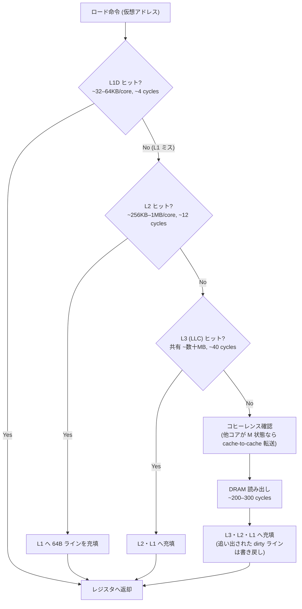

# キャッシュとメモリ階層 (Cache & Memory Hierarchy)

## 概要 (Overview)

現代のCPUにおいて、演算性能とメモリアクセス速度の差（**メモリウォール / memory wall**）は数百倍に達する[^wulf95]。この差を埋めるのがキャッシュ (cache) を中心としたメモリ階層 (memory hierarchy) であり、ソフトウェアの実効性能を決定づける最大の要因の一つである。

本ドキュメントは、メモリ階層の構造・動作原理を整理し、それがソフトウェア設計（データ構造・アルゴリズム・並行処理）にどう影響するかを明らかにする。

## 方法論 (Methodology)

- DRAM 側の内部構造は [`dram-memory-controllers.md`](dram-memory-controllers.md)、ストレージ側は [`../hw-sw-interface/storage-nvm-interface.md`](../hw-sw-interface/storage-nvm-interface.md) に委ね、本書はキャッシュを中心に扱う。
- 階層の各段（レジスタ → L1/L2/L3 キャッシュ → 主記憶 → ストレージ）を、容量・遅延・帯域・管理単位の4軸で比較する。
- キャッシュの内部構造（ライン、連想度、置換、書き込み方式）を分解し、各設計判断がヒット率に与える影響を示す。
- 観測可能な指標（遅延サイクル数、ミス率）に基づき、ソフトウェア最適化の指針を導く。
- 数値は一般的な x86-64 サーバ／デスクトップ世代の代表値であり、世代・実装で変動する。絶対値ではなく**桁感 (order of magnitude)** を理解の基準とする。

## 発見事項 (Findings)

1. **遅延は階層ごとに桁で増える。** L1 ヒットは約 4 サイクルだが、主記憶アクセスは 200〜300 サイクル超に達する[^hp][^intel-opt]。1回のキャッシュミスは数十〜数百命令分の機会損失に相当する。
2. **転送の最小単位はキャッシュライン (cache line) であり、通常 64 バイト。** 1バイト読んでも64バイトが運ばれる。したがって性能は「何バイト触るか」ではなく「どのラインに触るか」で決まる。
3. **データ局所性 (locality) が支配的。** 時間局所性 (temporal) と空間局所性 (spatial) を満たすアクセスパターンは、同じ計算量でも桁違いに速い[^csapp]。
4. **並行処理では false sharing が隠れたボトルネックになる。** 別スレッドが同一ラインの別変数を書くだけで、コヒーレンシ (coherency) のために性能が崩壊する[^torrellas94]。
5. **キャッシュは性能機構であると同時にサイドチャネル (side channel) でもある。** アクセスの有無がタイミングに漏れ、Spectre / Meltdown 系攻撃の前提となる[^kocher19][^lipp20]。

## アーキテクチャ (Architecture)

### メモリ階層の全体像

```
        ┌──────────────┐  容量小・高速・高価
        │  Registers   │  ~数百B,  <1 cycle
        ├──────────────┤
        │  L1 I/D Cache│  ~32–64KB/core, ~4 cycles
        ├──────────────┤
        │   L2 Cache   │  ~256KB–1MB/core, ~12 cycles
        ├──────────────┤
        │ L3 Cache(LLC)│  ~数十MB/共有, ~40 cycles
        ├──────────────┤
        │  Main Memory │  ~数十GB(DRAM), ~200–300 cycles
        ├──────────────┤
        │   Storage    │  ~TB(SSD/NVMe), ~10^4–10^6 cycles
        └──────────────┘  容量大・低速・安価
```

代表的な遅延の桁感（参考値）を示す。L1〜L3 の値は Intel の最適化マニュアルが世代別に掲げる負荷-使用遅延 (load-to-use latency) の桁に、DRAM の値は Drepper の測定に基づく[^intel-opt][^drepper]。

| 階層 | 遅延 (cycles) | 遅延 (実時間, 3GHz換算) |
|---|---|---|
| L1 cache | ~4 | ~1.3 ns |
| L2 cache | ~12 | ~4 ns |
| L3 cache | ~40 | ~13 ns |
| 主記憶 (DRAM) | ~200–300 | ~70–100 ns |
| NVMe SSD | ~10^5 | ~数十 µs |

### ロードの探索経路 (Load Lookup Path)

1回のロード命令が階層を下っていく経路を示す。各段でミスすると次段へ要求が進み、データは逆向きに上位段へ充填 (fill) される。遅延は上表の代表値である。



- 階層は包含 (inclusive)・非包含 (non-inclusive)・排他 (exclusive) の方針で、上位段のラインを下位段にも保持するかが異なり、実効容量とコヒーレンスの実装が変わる[^hp][^jacob]。
- 仮想アドレスから物理アドレスへの変換 (TLB) は L1 参照と並行して行われる（VIPT: virtually indexed, physically tagged）。TLB ミスの経路は [`virtual-memory-mmu.md`](virtual-memory-mmu.md) を参照。

### キャッシュの内部構造

- **ライン (line)**: 転送・管理の最小単位。一般に 64 バイト[^smith82]。アドレスは `[tag | index | offset]` に分解される。
  - `offset` (下位6ビット, 64B時): ライン内の位置
  - `index`: どのセット (set) に入るか
  - `tag`: 同一セット内でラインを識別
- **連想度 (associativity)**: 1つのセットに何本のラインを置けるか。
  - ダイレクトマップ (direct-mapped): 1-way。衝突しやすいが高速・単純。
  - フルアソシアティブ (fully associative): どこにでも置ける。衝突最小だが高コスト。
  - セットアソシアティブ (N-way set associative): 実装の主流（例: L1 8-way, L3 16-way）。連想度と容量・ライン長がミス率に与える影響は、強制・容量・競合の「3C」分類で整理される[^hp]。
- **置換方式 (replacement policy)**: セットが満杯のとき何を捨てるか。LRU 近似 (pseudo-LRU) が一般的[^jacob]。
- **書き込み方式 (write policy)**:
  - ライトバック (write-back): キャッシュにのみ書き、追い出し時に主記憶へ。dirty ビットで管理。帯域効率が高く主流。
  - ライトスルー (write-through): 即座に主記憶へも書く。単純だが帯域を消費。
  - 書き込み割当 (write-allocate / no-write-allocate): 書き込みミス時にラインを読み込むか否か。これらの組合せと帯域への影響は Smith のサーベイ以来の標準的整理である[^smith82][^jacob]。

### キャッシュコヒーレンシ (Cache Coherency)

マルチコアでは各コアが同じラインのコピーを持ちうる。一貫性を保つプロトコルが **MESI** とその拡張 (MOESI, MESIF)[^sorin]。各ラインは状態を持つ。

- **M (Modified)**: 自コアが変更済み、他コアは無効。主記憶と不一致。
- **E (Exclusive)**: 自コアのみ保持、未変更。主記憶と一致。
- **S (Shared)**: 複数コアが保持しうる、未変更。
- **I (Invalid)**: 無効。

あるコアが書き込むと、他コアの該当ラインは Invalidate される。この無効化トラフィックが、後述の false sharing の正体である。状態遷移とスヌープ/ディレクトリの機構は [`cache-coherence.md`](cache-coherence.md) で詳述する。

## 技術詳細 (Technical Details)

### 1. データ配置: AoS vs SoA

**Array of Structures (AoS)** と **Structure of Arrays (SoA)** はキャッシュ効率を大きく変える。

```c
// 説明用の例示コード (illustrative)。リポジトリ内の実コードではない。
// AoS: 1要素に全フィールドが隣接
struct ParticleAoS { float x, y, z; float vx, vy, vz; int id; };
struct ParticleAoS particles[N];

// SoA: フィールドごとに連続配列
struct ParticlesSoA { float x[N], y[N], z[N]; float vx[N], vy[N], vz[N]; int id[N]; };
```

`x` 座標のみを全要素走査する場合を考える。
- AoS では1要素ごとに `y,z,vx,...` も同じラインに載り、不要データでラインが埋まる → 空間局所性が悪化。
- SoA では `x[]` が連続し、1ライン(64B)に16個の `float` が載る → ミスが 1/16 近くに削減。

**指針**: 「一緒にアクセスするデータを物理的に隣接させる」[^drepper]。走査軸に合わせて AoS / SoA を選ぶ。

### 2. アクセスパターンと局所性

```c
// 例示コード (illustrative)
// 良い例: 行優先 (row-major) 配列を行方向に走査 → 空間局所性◎
for (int i = 0; i < N; i++)
    for (int j = 0; j < N; j++)
        sum += a[i][j];

// 悪い例: 列方向に走査 → 各アクセスが別ライン → ミス多発
for (int j = 0; j < N; j++)
    for (int i = 0; i < N; i++)
        sum += a[i][j];
```

C/C++ は行優先 (row-major) のため前者が正しい[^csapp]。後者は N が大きいとミス率が跳ね上がり、計算量 O(N²) は同じでも実行時間は数倍〜十数倍になりうる。**計算量複雑度 (time complexity) が同じでも定数項はメモリ階層が決める。**

### 3. False Sharing（偽共有）

```c
// 例示コード (illustrative)
// 悪い例: 2つのカウンタが同一キャッシュライン(64B)に同居
struct Counters { long a; long b; };  // a,b は隣接 → 同一ライン
// スレッド1が a++ 、スレッド2が b++ するだけで、
// 互いのラインを Invalidate し合い、コヒーレンシ・トラフィックが爆発する。

// 改善: ラインをまたぐようパディング (padding) で分離
struct CountersPadded {
    alignas(64) long a;   // 各カウンタを別ラインへ
    alignas(64) long b;
};
```

論理的には独立した変数でも、物理的に同一ラインだと「共有」とみなされ無効化が連鎖する。これが **false sharing**。対策はキャッシュライン境界へのアラインメント／パディング[^torrellas94]。ロックフリー構造でのパディングの実例は [`../../software/concurrency/lock-free-data-structures.md`](../../software/concurrency/lock-free-data-structures.md) を参照。

### 4. プリフェッチ (Prefetching)

ハードウェアプリフェッチャはストライド (stride) 一定の規則的アクセスを検知し、先読みする。この発想はミス時に後続ラインを先読みする stream buffer に遡る[^jouppi90]。リンクリスト走査のような**ポインタ追跡 (pointer chasing)** は予測できず、毎回ミスしやすい。連続配列がリンク構造より速い主因の一つ。必要に応じソフトウェアプリフェッチ命令 (`prefetcht0` 等) を用いるが、誤用はキャッシュ汚染を招く[^intel-opt]。

### 5. 測定方法 (Measurement)

- **`perf stat`** (Linux): `cache-misses`, `LLC-load-misses`, `L1-dcache-load-misses` 等のハードウェアカウンタを取得。
- **Cachegrind** (Valgrind): キャッシュミスをシミュレートし、行単位で内訳を提示。
- 指標は絶対数より**ミス率 (misses / accesses)** とミスの**局在 (どのループか)** を見る。推測ではなく計測で律速箇所を特定する[^drepper]。

## セキュリティ考察 (Security Considerations)

キャッシュは「アクセスしたか否か」がタイミング差として観測できるため、強力なサイドチャネルになる。

- **Flush+Reload**: 攻撃者が共有ラインを `clflush` で追い出し、被害者の実行後に再アクセス時間を測る。速ければ被害者が触った（=ヒット）と判定し、秘密依存のアクセスを推定する[^yarom14]。
- **Prime+Probe**: 攻撃者がセットを自分のデータで埋め (prime)、被害者実行後に各ラインの遅延を測る (probe)。追い出されていれば被害者がそのセットを使ったと分かる[^osvik06]。
- **Spectre / Meltdown**: 投機実行 (speculative execution) が秘密値をキャッシュ状態に残し、上記の手法で読み出す。アーキテクチャ上は「なかったこと」になる投機結果が、マイクロアーキテクチャ状態（キャッシュ）に痕跡を残す点が本質[^kocher19][^lipp20]。投機の機構は [`branch-prediction-speculation.md`](branch-prediction-speculation.md)、攻撃と TEE の全体像は [`../security/side-channels-tee-secure-boot.md`](../security/side-channels-tee-secure-boot.md) を参照。
- **緩和策 (mitigations)**: 定数時間実装 (constant-time)、秘密依存のメモリアクセス・分岐の排除、`lfence` による投機抑止、ページテーブル分離 (KPTI)、ハードウェア側の投機制御。いずれも性能と引き換えになる。

教訓: キャッシュ最適化（データ依存のアクセス）と機密性（アクセスを秘密に依存させない）は時に対立する。暗号処理など秘密を扱うコードでは、性能より定数時間性を優先する。

## 結論 (Conclusions)

- メモリ階層は「容量と速度のトレードオフ」を多段で解決する仕組みであり、実効性能の支配要因である。
- ソフトウェア側の鉄則は **局所性を高め、ラインを意識し、false sharing を避ける** の3点に集約される。
- 計算量複雑度が同じでも、データ配置とアクセス順序で実行時間は桁で変わる。最適化は計測 (`perf`, Cachegrind) で律速箇所を特定してから行う。
- キャッシュは性能機構であると同時に情報漏洩経路でもある。秘密を扱うコードでは、性能最適化がそのままサイドチャネルになりうることを前提に設計する。

### 次の接続先 (Related Topics)

- [`memory-ordering-atomics.md`](memory-ordering-atomics.md) — コヒーレンシの上に成り立つメモリ順序と並行制御。
- [`cache-coherence.md`](cache-coherence.md) — MESI 系プロトコルの状態遷移・スヌープ/ディレクトリの機構。
- [`virtual-memory-mmu.md`](virtual-memory-mmu.md) — データのキャッシュミスと重なる TLB ミス。
- [`dram-memory-controllers.md`](dram-memory-controllers.md) — 階層の最下段（主記憶）の内部構造。
- [`../hw-sw-interface/mmio-dma-interrupts.md`](../hw-sw-interface/mmio-dma-interrupts.md) — DMA とキャッシュ整合 (cache coherence) の境界問題。
- [`../../software/concurrency/memory-models-synchronization.md`](../../software/concurrency/memory-models-synchronization.md) — ソフトウェア側から見た共有メモリの同期。

## 参考文献 (References)

**一次資料 (Primary — 教科書・論文・仕様)**

[^hp]: Hennessy, J. L., & Patterson, D. A. (2019). *Computer Architecture: A Quantitative Approach* (6th ed.). Morgan Kaufmann. — メモリ階層・キャッシュ構成・3C 分類 (Ch. 2, Appendix B) の標準教科書。

[^smith82]: Smith, A. J. (1982). Cache Memories. *ACM Computing Surveys*, 14(3), 473–530. DOI: 10.1145/356887.356892 — ライン長・連想度・置換・書き込み方式の古典的サーベイ。

[^jacob]: Jacob, B., Ng, S. W., & Wang, D. T. (2008). *Memory Systems: Cache, DRAM, Disk*. Morgan Kaufmann. — キャッシュ管理方式（置換・書き込みポリシー）から DRAM までを通した教科書。

[^csapp]: Bryant, R. E., & O'Hallaron, D. R. (2016). *Computer Systems: A Programmer's Perspective* (3rd ed.). Pearson. — Ch. 6 (The Memory Hierarchy)。局所性・行優先走査・メモリマウンテンのプログラマ視点の整理。

[^wulf95]: Wulf, W. A., & McKee, S. A. (1995). Hitting the Memory Wall: Implications of the Obvious. *ACM SIGARCH Computer Architecture News*, 23(1), 20–24. DOI: 10.1145/216585.216588 — 「メモリウォール」の命名元。

[^torrellas94]: Torrellas, J., Lam, M. S., & Hennessy, J. L. (1994). False Sharing and Spatial Locality in Multiprocessor Caches. *IEEE Transactions on Computers*, 43(6), 651–663. DOI: 10.1109/12.286299 — false sharing の定量評価とデータ配置による削減。

[^jouppi90]: Jouppi, N. P. (1990). Improving Direct-Mapped Cache Performance by the Addition of a Small Fully-Associative Cache and Prefetch Buffers. *Proc. ISCA '90*, 364–373. DOI: 10.1145/325164.325162 — victim cache と stream buffer（ハードウェアプリフェッチ）の原典。

[^yarom14]: Yarom, Y., & Falkner, K. (2014). FLUSH+RELOAD: A High Resolution, Low Noise, L3 Cache Side-Channel Attack. *USENIX Security Symposium*. — [PDF](https://eprint.iacr.org/2013/448.pdf) — Accessed: 2026-07-02。キャッシュサイドチャネルの代表的一次論文。

[^osvik06]: Osvik, D. A., Shamir, A., & Tromer, E. (2006). Cache Attacks and Countermeasures: The Case of AES. *Topics in Cryptology – CT-RSA 2006*, LNCS 3860, 1–20. DOI: 10.1007/11605805_1 — Prime+Probe の原典。

[^kocher19]: Kocher, P. et al. (2019). Spectre Attacks: Exploiting Speculative Execution. *2019 IEEE Symposium on Security and Privacy*, 1–19. DOI: 10.1109/SP.2019.00002 — 投機実行がキャッシュ状態に痕跡を残す攻撃の一次資料。

[^lipp20]: Lipp, M. et al. (2020). Meltdown: Reading Kernel Memory from User Space. *Communications of the ACM*, 63(6), 46–56. DOI: 10.1145/3357033 — Meltdown（USENIX Security 2018 初出）の一次資料。

[^sorin]: Sorin, D. J., Hill, M. D., & Wood, D. A. (2020). *A Primer on Memory Consistency and Cache Coherence* (2nd ed.). Morgan & Claypool. DOI: 10.2200/S00962ED2V01Y201910CAC049 — MESI 系プロトコルの標準的整理。

[^intel-opt]: Intel. *Intel 64 and IA-32 Architectures Optimization Reference Manual*. — [intel.com](https://www.intel.com/content/www/us/en/developer/articles/technical/intel-sdm.html) — Accessed: 2026-10-04。世代別キャッシュ遅延・データ配置・プリフェッチ命令の実装別チューニング指針。

**二次資料 (Secondary)**

[^drepper]: Drepper, U. (2007). *What Every Programmer Should Know About Memory*. — [PDF](https://people.freebsd.org/~lstewart/articles/cpumemory.pdf) — Accessed: 2026-07-02。階層・局所性・測定のソフトウェア視点の定番解説。
