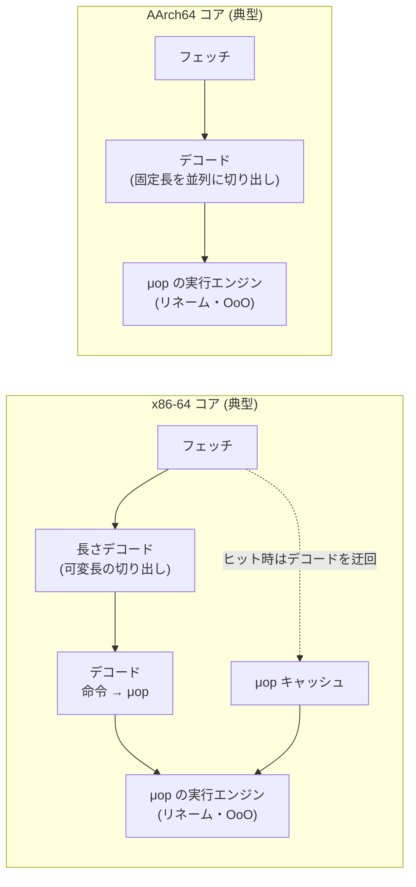

# x86-64 と AArch64 の比較 (x86-64 vs. AArch64)

## 概要 (Overview)

サーバとパソコンの CPU は長く x86-64 が占めてきたが、2020 年代に入り、AArch64 (64 ビットの Arm アーキテクチャ) が Apple の M シリーズ、AWS Graviton などのクラウド向け CPU、Windows on Arm として同じ市場に入ってきた。ソフトウェアの開発者にとって、2つの ISA の違いは、移植、性能、メモリ順序のバグ、セキュリティ機能の差として具体的に現れる。

[`isa-riscv-intro.md`](isa-riscv-intro.md) は RISC-V を題材に ISA の構成要素を説明した。本ドキュメントはその枠組みを使い、現役の2大 ISA を比較する。扱うのは、(1) 命令の符号化とデコード、(2) レジスタと演算の形式、(3) メモリモデルとアトミック命令、(4) 特権モデルと仮想化、(5) セキュリティ拡張、(6) 拡張の歴史と最近の動向、(7) バイナリ変換である。メモリ順序の詳細は [`memory-ordering-atomics.md`](memory-ordering-atomics.md)、SIMD の比較は [`simd-vector.md`](simd-vector.md)、ページテーブルの比較は [`virtual-memory-mmu.md`](virtual-memory-mmu.md) に委ね、本ドキュメントは ISA 全体の設計の違いとその帰結に焦点を当てる。分析深度は Level 3。

## 方法論 (Methodology)

- ISA の違いを「デコード」「レジスタと演算」「メモリ」「特権」「セキュリティ」「拡張の歴史」の軸で整理し、各軸の違いがソフトウェアと実装のどこに現れるかを対応づける。
- 一次資料は、Intel と Arm のアーキテクチャ・リファレンス・マニュアル、x86-64 と AArch64 の ABI 文書、ISA と電力効率についての査読論文 (Blem et al. 2013) である。最近の拡張の採用状況は、学会発表 (Hot Chips) の報道を「2026-10-11 時点」として扱い、発表段階か出荷済みかを区別する。
- アセンブリの例は、C の関数を最適化付きでコンパイルしたときの典型的な出力を手で書いたものであり、特定のコンパイラのバージョンの出力を引用したものではない。

## 発見事項 (Findings)

1. **「RISC は CISC より電力効率が良い」という通説は、現代の高性能コアにはほぼ当てはまらない。** x86 も内部では命令をマイクロ命令 (μop) に分解して実行し、デコードの費用は μop キャッシュなどで大部分が隠れる。Blem ら (2013) は、ARM と x86 の実機を比較し、性能と電力の差は ISA ではなくマイクロアーキテクチャの設計目標 (高性能か低電力か) でほぼ説明できると結論した[^blem]。
2. **ISA の違いが最もはっきり効くのは、命令のデコードである。** x86-64 の命令は 1〜15 バイトの可変長で[^intel-sdm]、次の命令の開始位置は前の命令の長さを解析しないと分からない。AArch64 の命令は 32 ビット固定長なので、複数の命令を並列に切り出してデコードしやすい。x86 の実装はこれを、デコード済みの μop を貯めるキャッシュで補っている。
3. **ソフトウェアの移植で最も問題になるのは、メモリ順序の違いである。** x86-64 は TSO (Total Store Order) という比較的強いモデルを持ち、AArch64 はより多くの並べ替えを許す弱いモデルを持つ。x86 で偶然正しく動いていた同期の誤りが、Arm では表に出る。x86 のバイナリを Arm 上で動かす変換器にとっても、TSO の再現が最大の費用になる。Apple の M シリーズは、変換器 (Rosetta 2) のために、TSO で動作するモードをハードウェアに持っている[^khayet][^lkml-tso]。
4. **AArch64 は、x86 が後付けで加えてきたものを、64 ビット化の時点で設計し直した。** 31 本の汎用レジスタ、3 オペランド形式、フラグを更新しない演算、整理された特権レベル (EL0〜EL3) がその例である。x86 は後方互換を保ったまま同じ方向へ進んでおり、Intel の APX は汎用レジスタを 32 本に増やし、3 オペランド形式とフラグを更新しない形式を加える[^cnc-dmr]。
5. **制御フローの保護は、両者で異なる仕組みで実装されている。** x86 の CET は、戻りアドレスを別のスタック (シャドウスタック) に保存して照合し、間接分岐の飛び先を `endbr` 命令で示す。AArch64 は、ポインタの未使用ビットに暗号学的な署名を埋め込む PAC (Pointer Authentication) と、飛び先を示す BTI を使う。さらに AArch64 には、メモリの割り当てごとにタグを付けて範囲外アクセスを検出する MTE がある[^arm-arm]。

## アーキテクチャ (Architecture)

### 設計の比較

| 観点 | x86-64 | AArch64 |
|---|---|---|
| 起源 | 1978 年の 8086 からの拡張。AMD が 64 ビット化 (2003 年) | Armv8-A (2011 年発表) で 64 ビット ISA を新設計 |
| 命令長 | 1〜15 バイトの可変長 | 32 ビット固定長 |
| 汎用レジスタ | 16 本 (APX で 32 本) | 31 本 (x0〜x30)。番号 31 は文脈によりゼロレジスタかスタックポインタ |
| 演算の形式 | 2 オペランド (結果が入力を上書き)。演算命令がメモリを直接読み書きできる | 3 オペランド。メモリはロード命令とストア命令でだけ扱う (ロード・ストア型) |
| 条件フラグ | ほとんどの演算命令がフラグを更新する | `adds` など S 付きの命令だけが更新する。条件付き選択 (`csel`) を持つ |
| メモリモデル | TSO (ストアの後のロードの追い越しのみ許す) | 弱い順序 (他の多くの並べ替えも許す)。acquire/release の専用命令を持つ |
| アトミック | `lock` 接頭辞付きの命令、`cmpxchg` | LL/SC (`ldxr`/`stxr`)。v8.1 の LSE で単一命令のアトミック (`cas`, `ldadd`) |
| 特権 | リング 0〜3 (実際は 0 と 3) + 仮想化の root/non-root + SMM | 例外レベル EL0〜EL3 (アプリ・OS・ハイパーバイザ・セキュアモニタ) |
| ページサイズ | 4 KiB (大ページ 2 MiB / 1 GiB) | 4 KiB / 16 KiB / 64 KiB の粒度を選べる |
| SIMD | SSE → AVX → AVX-512 → AVX10 (固定幅) | NEON (128 ビット固定) と SVE/SVE2 (ベクタ長非依存) |
| 制御フロー保護 | CET (シャドウスタック、IBT) | PAC、BTI、メモリタグ (MTE) |
| 実装する企業 | 事実上 Intel と AMD | Arm の設計を使う企業 (Cortex/Neoverse) と、アーキテクチャのライセンスで独自に設計する企業 (Apple など) |

### ISA と実装の関係



凡例: 実線は命令の流れ、破線は μop キャッシュがヒットしたときの経路。

ISA の違いは主に前段 (フェッチとデコード) に現れ、後段の実行エンジンは両者でほぼ同じ構造をしている。どちらの高性能コアも、命令をリネームしてアウトオブオーダに実行する ([`pipeline-superscalar-ooo.md`](pipeline-superscalar-ooo.md))。発見事項 1 で ISA が電力効率をほとんど決めないとしたのは、この後段が電力の大部分を使うためである。

## 技術詳細 (Technical Details)

### 1. 符号化とデコード (encoding and decoding)

x86-64 の命令は、任意の接頭辞 (prefix)、REX 接頭辞、1〜3 バイトのオペコード、ModRM と SIB (オペランドとアドレス指定の形式)、変位、即値を組み合わせてできる。長さは最大 15 バイトである[^intel-sdm]。可変長の利点はコード密度で、よく使う命令は短く符号化できる。

C の関数 `int f(int *p, int x) { return *p + x; }` を最適化付きでコンパイルした典型的な出力で比べる。

```text
x86-64 (System V ABI: p は rdi、x は esi、戻り値は eax)
  8b 07          mov  eax, [rdi]      ; メモリから読む (2 バイト)
  01 f0          add  eax, esi        ; 加算 (2 バイト)
  c3             ret                  ; (1 バイト)        合計 5 バイト

AArch64 (AAPCS64: p は x0、x は w1、戻り値は w0)
  ldr  w8, [x0]                       ; メモリから読む (4 バイト)
  add  w0, w8, w1                     ; 3 オペランドの加算 (4 バイト)
  ret                                 ; (4 バイト)         合計 12 バイト
```

この例では x86-64 のほうが小さい。一方、x86 の `add eax, [rdi]` のように演算とメモリ読み取りを1命令にまとめた形も選べるが、内部ではロードと加算の μop に分解される。AArch64 は3オペランド形式なので、入力を残したまま結果を別のレジスタに書け、x86 の2オペランド形式で必要になるレジスタのコピー (`mov`) を減らせる。

デコードの費用は、可変長であることそのものから来る。命令の境界は、接頭辞とオペコードと ModRM を順に解析するまで決まらない。1サイクルに多くの命令をデコードするには、すべてのバイト位置を命令の開始候補として並列に解析し、後で正しい境界を選ぶ必要があり、回路と電力がかかる。x86 の高性能コアは、デコード済みの μop をキャッシュし、ループなどの繰り返し実行される部分ではデコーダを迂回する。AArch64 は 4 バイト境界で命令を切り出せるので、デコード幅を広げやすい。

### 2. レジスタと演算の形式 (registers and operand forms)

汎用レジスタの本数は、関数呼び出しのたびにスタックへ退避する量 (スピル) と、レジスタ割り当ての自由度を決める。x86-64 の 16 本に対し、AArch64 は 31 本を持ち、関数の引数も 8 本までレジスタで渡す (x86-64 の System V ABI は整数引数 6 本、Windows x64 は 4 本)[^aapcs64][^sysv]。呼び出し規約の詳細は [`../hw-sw-interface/abi-syscalls.md`](../hw-sw-interface/abi-syscalls.md) が扱う。

条件フラグの扱いも異なる。x86 ではほとんどの演算命令がフラグを書き換えるので、フラグを使う比較と分岐の間に演算を挟めない。また、フラグの一部だけを書き換える命令は、実装にとってフラグの依存関係の追跡を難しくする。AArch64 では、フラグを更新するのは `adds` や `cmp` などの明示的な命令だけで、条件付き選択 `csel` によって分岐なしで値を選べる。

Intel の **APX (Advanced Performance Extensions)** は、x86 をこの方向へ拡張する。汎用レジスタを 32 本に増やし、結果を別のレジスタに書く3オペランド形式と、フラグを更新しない形式を加える。既存のバイナリはそのまま動き、再コンパイルしたコードだけが新しいレジスタを使う。2026-10-11 時点で、Intel は APX をサーバ向けの Diamond Rapids (Xeon 7) で対応すると Hot Chips 2026 で発表している[^cnc-dmr][^toms-dmr]。クライアント向け CPU での対応時期は、資料によって記述が食い違っている。

### 3. メモリモデルとアトミック命令 (memory model and atomics)

両者のメモリモデルの違いは、マルチスレッドのコードの移植に直接効く ([`memory-ordering-atomics.md`](memory-ordering-atomics.md))。

```text
x86-64 (TSO):  通常のロードとストアが、それぞれ acquire と release の意味を持つ
               許される並べ替えは「先行するストアを後続のロードが追い越す」だけ
AArch64 (弱):  通常のロードとストアは順序を保証しない
               順序は ldar (acquire ロード)、stlr (release ストア)、dmb (バリア) で指定する
```

C や C++ のアトミック型を正しく使っていれば、コンパイラが各 ISA に合った命令を出すので、移植で問題は起きない。問題が起きるのは、アトミックでない変数をフラグとして使うなど、言語のメモリモデル上は誤りだが x86 の TSO のおかげで動いていたコードである。

アトミックな読み書き更新は、x86 では `lock` 接頭辞付きの命令 (`lock xadd`, `lock cmpxchg`) で行う。初期の AArch64 は、ロードとストアの組 (LL/SC: `ldxr`/`stxr`) を使い、間に他のコアの書き込みが入ったらやり直すループで実装した。多数のコアが同じ変数を奪い合うと、このループのやり直しが増えて性能が落ちる。Armv8.1 の **LSE (Large System Extensions)** は、`cas` や `ldadd` などの単一命令のアトミックを加え、メモリ側で処理できるようにした。コア数の多いサーバ向け CPU では、LSE を使うようにコンパイルするかどうかで競合時の性能が大きく変わる。

### 4. 特権モデルと仮想化 (privilege and virtualization)

```text
x86-64:
  リング 3        アプリケーション
  リング 0        OS カーネル (リング 1, 2 は実際にはほとんど使われない)
  VMX root/non-root  仮想化のために後から加えられた直交する軸 (VT-x)
  SMM             ファームウェア用の隠れたモード

AArch64:
  EL0  アプリケーション
  EL1  OS カーネル
  EL2  ハイパーバイザ
  EL3  セキュアモニタ (セキュアワールドとの切り替え)
```

x86 の仮想化は、既存のリングの構造を変えずに root と non-root という別の軸を加えたもので、ハイパーバイザ用の特権レベルを ISA の最初から持っていたわけではない ([`../../software/virtualization/hardware-virtualization-containers.md`](../../software/virtualization/hardware-virtualization-containers.md))。AArch64 は、ハイパーバイザを EL2 として最初から特権の階層に組み込んだ。その後、Linux の KVM のように OS カーネル自身がハイパーバイザになる構成に合わせて、EL1 用に書かれたカーネルをそのまま EL2 で動かせる VHE (Virtualization Host Extensions) が加えられた。

EL3 とセキュアワールドの組み合わせ (TrustZone) は、OS から隔離された実行環境を提供する。Armv9 では、これに加えて、クラウドの事業者からも隔離された計算領域 (Realm) を作る CCA (Confidential Compute Architecture) が定義された。x86 側では、Intel の TDX と AMD の SEV-SNP が同じ目的を持つ ([`../security/side-channels-tee-secure-boot.md`](../security/side-channels-tee-secure-boot.md))。

例外と割り込みの入り口も異なる。x86 は割り込み記述子表 (IDT) をベクタ番号で引き、AArch64 は例外レベルごとのベクタテーブルを、例外の種類と発生元のレベルで引く ([`interrupts-exceptions-traps.md`](interrupts-exceptions-traps.md))。

### 5. セキュリティ拡張 (security extensions)

メモリ破壊の脆弱性を突く攻撃は、戻りアドレスや関数ポインタを書き換えて制御を奪う。両者はこれをハードウェアで防ぐ仕組みを、異なる考え方で追加した ([`../../software/security/memory-safety-exploit-mitigations.md`](../../software/security/memory-safety-exploit-mitigations.md))。

| 目的 | x86-64 | AArch64 |
|---|---|---|
| 戻りアドレスの保護 | CET シャドウスタック: `call` が戻りアドレスを別の保護されたスタックにも積み、`ret` で照合する | PAC: 戻りアドレスに鍵と文脈から計算した署名を埋め込み、使う前に検証する (Armv8.3) |
| 間接分岐の飛び先の制限 | CET IBT: 飛び先は `endbr64` 命令で始まらなければならない | BTI: 飛び先は `bti` 命令で始まらなければならない (Armv8.5) |
| メモリの範囲外・解放後の使用の検出 | (相当する ISA 機能はない) | MTE: 16 バイト単位のメモリとポインタに 4 ビットのタグを付け、不一致を検出する (Armv8.5) |

PAC は、64 ビットのポインタのうち仮想アドレスに使われない上位ビットに署名を入れるので、追加のメモリを使わない。シャドウスタックは別のメモリ領域を使うが、署名の推測のような確率的な突破の余地がない。MTE は、タグが 4 ビットしかないので不一致を確率的にしか検出できないが、解放後の使用や範囲外アクセスのような、制御フローの保護では防げない種類の誤りを検出できる[^arm-arm]。

### 6. 拡張の歴史と最近の動向 (extension history and recent developments)

x86 は、後方互換を最優先にして拡張を積み重ねてきた。現代の x86-64 の CPU も、起動時には 1978 年の 8086 と同じ 16 ビットのリアルモードから始まる ([`../hw-sw-interface/boot-initialization.md`](../hw-sw-interface/boot-initialization.md))。Intel は 2023 年に、この古い動作モードを取り除いた 64 ビット専用の x86S を提案したが、2024 年に AMD などと x86 Ecosystem Advisory Group を結成した後、この提案を取り下げた[^x86s]。x86 の拡張は、Intel と AMD が共同で方向を決める体制に移っている。

SIMD 拡張も、世代ごとに幅を広げてきた結果、ISA が分かれている。AVX-512 はサーバ向けにしか実装されない時期が長く、クライアント向けの CPU との差が開いた。AVX10 は、512 ビットの機能を整理し、CPU の種類によらず共通の命令の集合を定めることを目的とする ([`simd-vector.md`](simd-vector.md))。

Arm は 2011 年の Armv8-A で 64 ビット ISA を新しく設計し、32 ビットの命令セット (A32/T32) との互換性を、別の実行状態として分けた。近年の高性能コアには、32 ビットの実行状態そのものを実装しないものが増えている。Arm の拡張は Armv8.1、8.2 … と年次で積み重ねられ、Armv9 で SVE2 と CCA などがまとめられた。

### 7. バイナリ変換 (binary translation)

ISA を移行するとき、既存のバイナリを新しい ISA で動かすためにバイナリ変換が使われる。Apple の Rosetta 2 は、x86-64 のアプリケーションを AArch64 のコードに変換して実行する。

変換で最も費用がかかるのは、メモリ順序の再現である。x86 のコードは、通常のロードとストアが TSO の順序を守る前提で書かれている。これを弱い順序の AArch64 で正しく動かすには、すべてのメモリアクセスに順序付きの命令を使うか、バリアを挟む必要があり、性能が大きく落ちる。Apple の M シリーズは、Rosetta 2 のために、コアを TSO で動作させるモードを実装依存の機能として持っている[^khayet]。Khayet と Morrison (2026) は、このモードでの実行時間が、通常の Arm モードと比べて典型的には 3% 以内に収まると報告している[^khayet]。Arm 側は、実装依存のモードではなく、標準化された機能 (FEAT_LRCPC による順序付きロードなど) で TSO の意味論を得る方向を示している[^lkml-tso]。

## セキュリティ考察 (Security Considerations)

- **移植で表に出る同期の誤り**: x86 の TSO で偶然動いていたデータ競合は、AArch64 では誤った値の読み取りとして現れる。認証済みフラグと認証データの間の順序が崩れるなど、セキュリティの判断に関わる値で起きると、検査をすり抜ける脆弱性になりうる。移植の際には、スレッドサニタイザ (TSan) などでデータ競合を検出しておく。
- **制御フロー保護の効果は、ソフトウェアの対応に依存する**: CET、PAC、BTI はいずれも、コンパイラが対応する命令を出し、OS とローダが機能を有効にして初めて効く。古いライブラリが1つでも未対応だと、プロセス全体で機能を無効にせざるを得ない場合がある。
- **投機実行の攻撃は ISA を選ばない**: Spectre 型の攻撃は、x86 と Arm の両方の高性能コアで成立した。投機実行と分岐予測はマイクロアーキテクチャの機構であり、ISA の違いでは避けられない ([`branch-prediction-speculation.md`](branch-prediction-speculation.md)、[`../security/side-channels-tee-secure-boot.md`](../security/side-channels-tee-secure-boot.md))。
- **隠れた特権モード**: x86 の SMM や AArch64 の EL3 で動くファームウェアは、OS から見えない最も強い特権を持つ。ここに脆弱性があると、OS やハイパーバイザの防御は回避されうる。この層の更新と検証は、ISA によらずプラットフォームのセキュリティの前提になる。

## 結論 (Conclusions)

x86-64 と AArch64 の差は、「CISC と RISC」という分類から想像されるほど大きくない。どちらの高性能コアも命令を μop に分解し、同じ構造の実行エンジンで実行するので、性能と電力効率は主にマイクロアーキテクチャの設計で決まる。ISA の差が確実に効くのは、可変長命令のデコードの費用、レジスタの本数と演算の形式、そしてメモリモデルである。ソフトウェアの開発者にとって最も実際的な違いはメモリモデルであり、x86 の TSO に暗黙に頼ったコードは Arm への移植で壊れる。

両者は互いに近づいている。x86 は APX で、AArch64 が 64 ビット化の時点で採用したレジスタ数と演算の形式を後から取り入れつつある。Arm は、x86 のバイナリを動かすために TSO の意味論を標準化された機能で提供する方向にある。ISA の違いは残るが、その差を吸収する仕組みも両側で整いつつある。

### 次の接続先 (Related Topics)

- [`isa-riscv-intro.md`](isa-riscv-intro.md) — ISA の構成要素と第三の選択肢としての RISC-V
- [`memory-ordering-atomics.md`](memory-ordering-atomics.md) — TSO と弱い順序の詳細、言語のメモリモデルとの対応
- [`simd-vector.md`](simd-vector.md) — AVX 系列と NEON/SVE の比較
- [`virtual-memory-mmu.md`](virtual-memory-mmu.md) — ページテーブルの形式とページ粒度
- [`../hw-sw-interface/abi-syscalls.md`](../hw-sw-interface/abi-syscalls.md) — 呼び出し規約とシステムコール

## 参考文献 (References)

[^intel-sdm]: Intel. *Intel 64 and IA-32 Architectures Software Developer's Manual*, Vol. 2 (Instruction Set Reference). — 命令の形式と最大 15 バイトの命令長、各命令の符号化。

[^arm-arm]: Arm. *Arm Architecture Reference Manual for A-profile architecture* (DDI 0487). — AArch64 の命令セット、例外レベル、LSE、PAC (Armv8.3)、BTI・MTE (Armv8.5)。

[^aapcs64]: Arm. *Procedure Call Standard for the Arm 64-bit Architecture (AAPCS64)*. — レジスタの用途と引数渡し (x0〜x7)。

[^sysv]: *System V Application Binary Interface: AMD64 Architecture Processor Supplement*. — x86-64 の呼び出し規約 (整数引数 6 本)。

[^blem]: Blem, E., Menon, J., & Sankaralingam, K. (2013). Power Struggles: Revisiting the RISC vs. CISC Debate on Contemporary ARM and x86 Architectures. *Proc. 19th IEEE HPCA*, 1–12. DOI: 10.1109/HPCA.2013.6522302 — ISA が性能と電力効率に与える影響が小さいことの実測。

[^khayet]: Khayet, Y., & Morrison, A. (2026). Arm Weak Memory Consistency on Apple Silicon: What Is It Good For? *Proc. ASPLOS 2026*, Vol. 2, 191–207. DOI: 10.1145/3779212.3790129 — Rosetta のために導入された TSO モードと、Arm モードとの実行時間の比較 (典型的に 3% 以内)。

[^lkml-tso]: [linux-arm-kernel — [PATCH 0/4] arm64: Support the TSO memory model (2024-05)](https://lists.infradead.org/pipermail/linux-arm-kernel/2024-May/927067.html) — Apple の TSO モードが実装依存の機能であること、標準機能 (FEAT_LRCPC) で TSO の意味論を得る方針についての議論。Accessed: 2026-10-11.

[^cnc-dmr]: [Chips and Cheese — Hot Chips 2026: Intel's Diamond Rapids](https://chipsandcheese.com/p/hot-chips-2026-intels-diamond-rapids) — APX (32 本の汎用レジスタ、3 オペランド形式、フラグを更新しない形式) への対応。Accessed: 2026-10-11.

[^toms-dmr]: [Tom's Hardware — Hot Chips 2026: Intel Xeon 7 'Diamond Rapids'](https://www.tomshardware.com/pc-components/cpus/intel-xeon-7-diamond-rapids-comes-with-up-to-256-p-cores-1-28-gb-of-last-level-cache-next-gen-18a-p-cpu-also-brings-avx-10-2-and-uses-ucie-s-instead-of-emib) — Diamond Rapids の発表内容 (AVX10.2 を含む)。Accessed: 2026-10-11.

[^x86s]: [HWCooling — Intel cancels x86S, effort to clean up x86 CPUs legacy cruft](https://www.hwcooling.net/en/intel-cancels-x86s-effort-to-clean-up-x86-cpus-legacy-cruft/) — x86 Ecosystem Advisory Group の結成後に x86S が取り下げられた経緯。Accessed: 2026-10-11.
