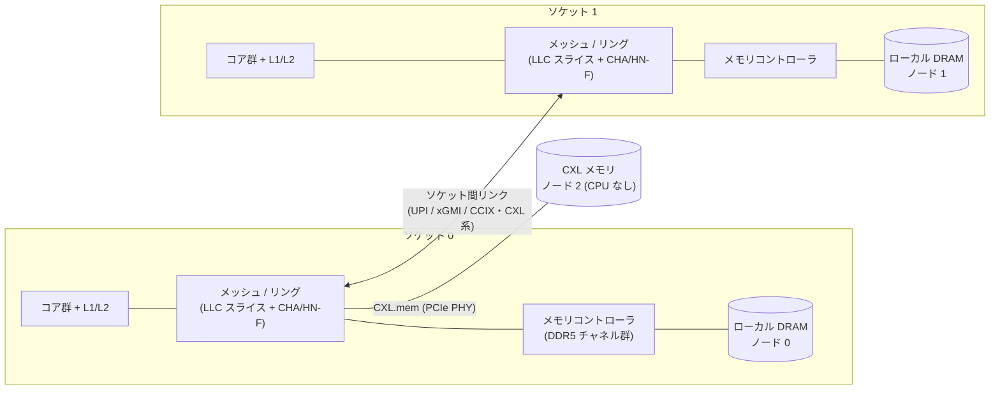
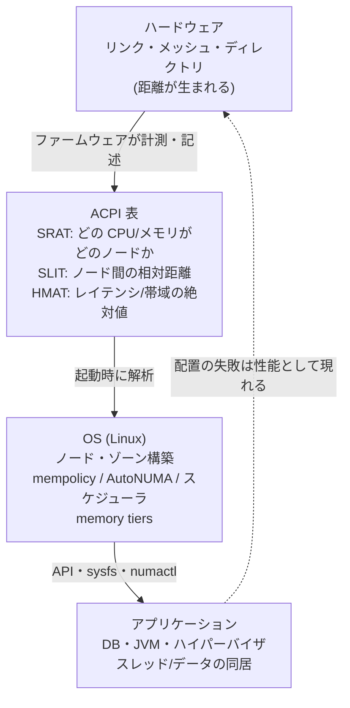
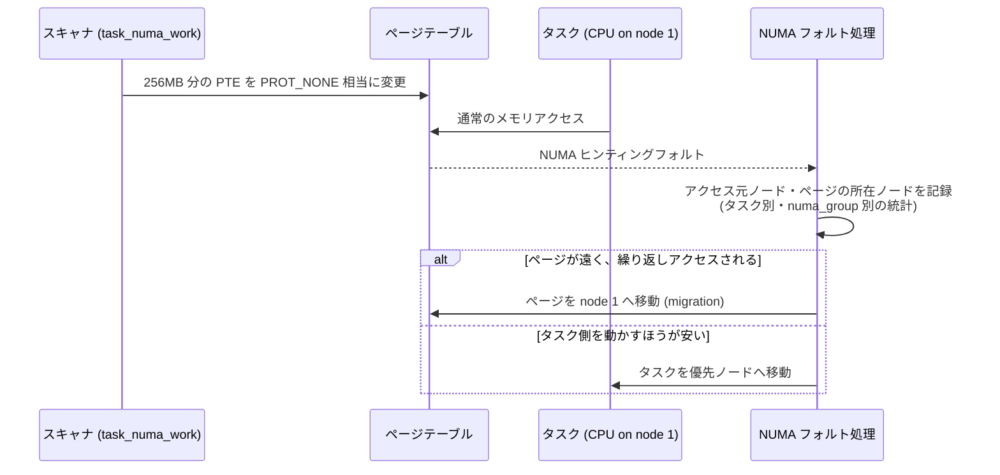

# NUMA とマルチソケット (NUMA & Multi-Socket Systems)

## 概要 (Overview)

[`cache-coherence.md`](cache-coherence.md) は「ディレクトリ型コヒーレンスは大規模・NUMA へ移行する」と一行で述べ、[`dram-memory-controllers.md`](dram-memory-controllers.md) は「メモリコントローラが CPU ダイに載ったことでメモリはソケットに属することになった」と結んだ。本ドキュメントはこの二つの帰結が合流する地点、すなわち **NUMA (Non-Uniform Memory Access)** とマルチソケット構成を扱う。

中心テーゼは、**NUMA とは「物理アドレス空間は一つだが、アドレスごとに距離が違う」という事実を、ハードウェアが隠しきれずにソフトウェアへ申告する仕組み**だということである。コヒーレンスプロトコルは「どのアドレスも同じ値に見える」ことを保証するが、「同じ速さで見える」ことは保証しない。その差分を、ファームウェアは ACPI の表 (SRAT/SLIT/HMAT) に書き、OS はメモリポリシーとスケジューラで埋め合わせ、アプリケーション (データベース・JVM・ハイパーバイザ) は配置の判断に織り込む。NUMA は単一の機能ではなく、**ハードウェアからアプリケーションまでを貫く「距離の申告と配慮」の契約**である。

この契約は 2020 年代に二度書き換えられつつある。一つはソケット内部の NUMA 化である。チップレットとメッシュの大型化により、1 ソケットの中にも距離の差が生まれ、サブ NUMA クラスタリング (SNC) や NPS (NUMA nodes Per Socket) として露出するようになった。もう一つは CPU を持たない NUMA ノードの登場である。CXL (Compute Express Link) で接続したメモリは「CPU のないリモートノード」として OS に見え、NUMA の仕組みがそのままメモリ階層化 (memory tiering) の基盤に転用された。

本書は (1) ソケット間リンクとスケールするコヒーレンス、(2) ソケット内 NUMA (SNC/NPS)、(3) ローカル/リモートの実測値、(4) ACPI による距離の申告、(5) Linux のメモリポリシーと AutoNUMA、(6) アプリケーションへの影響、(7) CXL メモリと階層化、を整理する。分析深度は Level 3。

## 方法論 (Methodology)

- 機構は「距離はどこで生まれ、誰がそれを知り、誰が対処するか」という三層 (ハードウェア → ファームウェア/OS → アプリケーション) の責任分界で整理する。
- レイテンシ・帯域の数値はすべて**出典と種別 (実測 / 代表値 / 推定)** を明示する。ベンダの製品仕様 (リンク速度など) は Intel の製品仕様ページを一次資料とし、性能の実測は査読論文 (Pond[^pond]、Sun et al.[^sun-cxl]) を優先する。異なる世代・構成の数値は単一の値に丸めず、範囲として示す。
- Linux の挙動は公式ドキュメント[^k-mempolicy][^k-sysctl]と、タグ `v7.2` のソースコード[^k-src]で確認する。コード引用には言語・目的・ファイルと行番号を付す。
- NUMA の基本概念と Linux の初期設計は、Linux NUMA サブシステムの実装者による解説 (Lameter, ACM Queue 2013)[^lameter]を典拠とする。
- コヒーレンスプロトコル (MESI・ディレクトリの基本) は [`cache-coherence.md`](cache-coherence.md)、スケジューラ側の負荷分散と NUMA 親和性は [`../../software/operating-systems/process-thread-scheduling.md`](../../software/operating-systems/process-thread-scheduling.md) に委ね、本書はその間を埋める「メモリ配置と距離」に集中する。

## 発見事項 (Findings)

1. **リモートアクセスのコストは「レイテンシ約 2 倍、帯域 1/3 前後」が実測の目安であり、帯域の落差のほうが深刻になりやすい。** Azure の本番サーバでの測定では、2 ソケット Intel Skylake (Xeon 8157M、DDR4) でローカル 78ns・80GB/s に対してリモート 142ns・30GB/s、2 ソケット AMD EPYC 7452 でローカル 115ns に対してリモート 255ns であった (実測)[^pond]。レイテンシ比は 1.8〜2.2 倍だが、帯域はソケット間リンクが律速して 4 割弱まで落ちる。メモリ帯域を使い切るワークロードほど NUMA の影響は大きい。
2. **NUMA の距離は「ホップ数」より「混雑」で決まることがある。** 遠いノードを避けるだけでは不十分で、特定ノードのメモリコントローラやソケット間リンクへのトラフィック集中が、リモートアクセスそのものより大きな劣化要因になりうる。Dashti et al. は、配置の最適化目標をローカリティから**トラフィックの分散 (混雑の回避)** に置き換えるべきだと論じた[^dashti]。first-touch で 1 ノードに偏ったデータを interleave に変えると速くなる、という直観に反する現象はこの機構で説明できる。
3. **コヒーレンスは「ソケットをまたぐ問い合わせ」を減らす方向に設計されている。** ソケット数が増えると、全キャッシュへのスヌープ放送はリンク帯域を食い潰す。Intel Xeon Scalable (Skylake-SP 以降) はスヌープモードを廃止してディレクトリモードのみとし[^intel-sp]、Arm CMN 系はホームノード (HN-F) ごとにスヌープフィルタを持つ[^k-armcmn]。**「誰が持っているかを知っている者に聞く」構造が、マルチソケットのスケール限界を押し広げた**。
4. **NUMA は「ソケットの単位」から「ダイとメッシュの単位」へ細分化した。** 1 ソケット内でも、コアから遠いメモリコントローラや LLC スライスへのアクセスは遅い。SNC (Intel) と NPS (AMD) はこの差を BIOS 設定で別ノードとして OS に申告させる機能であり、申告すれば局所性を活かせるが、申告しなければ OS は一様だと思って配置する[^intel-sp][^suse-epyc]。**同じハードウェアでも、どこまで距離を露出するかは運用判断になった**。
5. **Linux の既定動作は「最初に触ったスレッドのノードに置く (first-touch)」であり、これは初期化コードの書き方が性能を決めることを意味する。** 既定ポリシーは `MPOL_LOCAL` であり、ページは確保時ではなく**最初のページフォルト時**に、フォルトした CPU のノードへ割り当てられる[^k-src][^k-mempolicy]。単一スレッドで大きな配列をゼロ初期化してから並列処理すると、全ページが 1 ノードに偏る。
6. **AutoNUMA は「観測のためにわざとページフォルトを起こす」機構であり、無料ではない。** カーネルは一定周期で PTE をアクセス不可に書き換え、ヒンティングフォルトでアクセス元を知ってページまたはタスクを移動する (既定: 起動 1 秒後から、256MB ずつ、1〜60 秒周期で走査)[^k-src]。NUMA を意識して配置済みのアプリケーションにとっては純粋なオーバーヘッドであり、遅延に敏感なワークロードでは無効化が推奨されることがある[^suse-epyc]。
7. **CXL メモリは「CPU のない NUMA ノード」として OS に見え、NUMA の仕組みがそのままメモリ階層化に転用された。** Meta の TPP は CXL メモリを CPU レス NUMA ノードとして扱い、ホットページの昇格とコールドページの降格をカーネルで行う。その主要部分は Linux 5.18 に取り込まれた[^tpp]。ただし実機の CXL デバイスのレイテンシはコントローラ設計で大きくばらつく。リモートソケットの DDR5 と比べて +35% から約 3 倍まで開きがある (実測)[^sun-cxl]。そのため「CXL = リモートソケット相当」という近似は製品ごとに検証が要る。

## アーキテクチャ (Architecture)

### 2 ソケット ccNUMA の構成要素



凡例: 円柱はメモリ (NUMA ノードとして OS に見える単位)、四角は論理回路。CHA (Caching and Home Agent) は Intel の、HN-F (Fully coherent Home Node) は Arm CMN の用語で、いずれも「アドレスごとのホーム (コヒーレンスの調停者)」を担う。

- **ホームの概念**: 各物理アドレスには、そのラインのコヒーレンスを調停する**ホームエージェント**が一意に決まっている (通常はそのメモリを持つソケットの CHA/HN-F)。リモートのラインを読むとき、要求はリンクを越えてホームへ届き、ホームはディレクトリ/スヌープフィルタを引いて必要なキャッシュにだけ問い合わせる。**リモートアクセスの遅さとは、リンクの往復と、遠いメッシュの横断と、ホームでの調停の合計である**。
- **CPU のない NUMA ノード**: CXL メモリにはコアがない。そのため OS は「メモリだけを持つノード」として扱い、どの CPU からも遠いノードになる。ノードに CPU があることは NUMA の定義の一部ではない[^tpp][^k-cxl]。

### 距離の申告と配慮 — 責任の三層



## 技術詳細 (Technical Details)

### 1. ソケット間リンク — UPI・Infinity Fabric/xGMI・CMN/CCIX/CXL

| 系統 | 役割 | 世代ごとの公表値 (一次資料) |
|---|---|---|
| Intel UPI (Ultra Path Interconnect) | QPI の後継。ソケット間のコヒーレントリンク | Skylake-SP (Xeon 8180): 最大 3 リンク、最大 10.4 GT/s[^intel-sp][^intel-ark] / Sapphire Rapids (Xeon 8480+): 4 リンク、16 GT/s[^intel-ark] / Granite Rapids (Xeon 6980P): 6 リンク、24 GT/s[^intel-ark] |
| AMD Infinity Fabric / xGMI | ソケット内 (CCD↔IOD) とソケット間 (xGMI) を同じファブリックで統一 | EPYC 9004 は 1 パッケージに最大 13 ダイ (12 CCD + IOD)、各 CCD は IOD へ専用の Infinity Fabric リンクを持つ[^suse-epyc] |
| Arm CMN (Coherent Mesh Network) | AMBA CHI ベースのメッシュ。チップ間は CCIX/CXL 系ゲートウェイで接続 | CMN-600 の Linux ドキュメントは複数チップのメッシュを外部 CCIX リンクで結ぶ構成に言及する[^k-armcmn]。CMN-700 世代のドライバは CXL/CCIX ゲートウェイ用のノード種別 (CCRA/CCHA/CCLA) を扱う[^k-src] |

- **リンク本数と I/O の取引**: ソケット間リンクは SerDes を消費する。リンクを増やすとリモート帯域は増えるが、PCIe など外部 I/O に回せる資源が減る。プラットフォームごとにこの配分が設計判断になる (AMD の 2 ソケット構成について SUSE の解説は「一部のリンクはソケット間通信に使われる」と述べる)[^suse-epyc]。
- **リモート帯域の上限はリンクで決まる**: 発見事項 1 の Skylake 2 ソケットでの測定 (ローカル 80GB/s 対リモート 30GB/s) は、ローカルの DDR チャネル群の合計帯域に対し、ソケット間リンクの帯域が小さいことの直接の現れである[^pond]。

### 2. スケールするコヒーレンス — ディレクトリとスヌープフィルタ

[`cache-coherence.md`](cache-coherence.md) のディレクトリ型の議論を、マルチソケットの実装に当てはめる。

- **Intel: メモリディレクトリ + 各種キャッシュ**: Skylake-SP 以降は「ディレクトリモードのみ」となり、従来のスヌープモード選択は廃止された。CHA ごとの 8 エントリの IO ディレクトリキャッシュや、キャッシュ間転送を速める HitME キャッシュが補助する[^intel-sp]。それ以前の世代について、Haswell-EP の詳細な計測研究はディレクトリの有無とスヌープモードがリモート/ローカルのキャッシュ間転送レイテンシを大きく変えることを示した[^molka]。
- **スヌープフィルタ (snoop filter)**: 「どのラインがどこかのコアのプライベートキャッシュにあるか」を追跡する、包含的なタグの集合である。ここにないラインはどのコアも持っていないことが確定するため、スヌープ自体を省略できる。Arm CMN では HN-F が SLC (system level cache) とスヌープフィルタを持ち、Linux の PMU ドライバは `sf_hit`・`sf_evictions`・`sf_precise_to_imprecise` といった事象を数えられる[^k-src]。最後の事象名が示すとおり、容量を超えると共有者の追跡を正確なビットマップから粗い近似へ落とす。これは [`cache-coherence.md`](cache-coherence.md) で述べた「ディレクトリの記憶容量」問題の実装上の妥協である。
- **スヌープフィルタの容量溢れの副作用**: 包含的なディレクトリキャッシュやスヌープフィルタは、エントリを空けるとき、追跡対象のラインをコアのキャッシュから回収 (recall / 強制無効化) しなければならない[^sorin]。この場合、LLC に余裕があってもプライベートキャッシュのラインが追い出されうる。NUMA 環境で「遠いソケットのワークロードが自分のキャッシュ効率を下げる」干渉の一因になる。
- **CXL メモリの場合**: CXL メモリには、ラインを書き換えるコアもキャッシュも存在しない。Sun et al. の解析によれば、Sapphire Rapids は CXL メモリ向けにオンチップの高速なコヒーレンス確認機構を持つ。リモートソケットのように相手 CPU へ問い合わせる必要がないため、非一時的ストア (nt-st) では CXL メモリのほうがリモートソケット DDR5 より 25% 速い場合さえある (実測)[^sun-cxl]。

### 3. ソケット内 NUMA — SNC と NPS

- **SNC (Sub-NUMA Clustering, Intel)**: ソケットを 2 つ (以上) の局所性ドメインに分け、各ドメインのメモリコントローラのアドレスを、そのコントローラに近い半分の LLC スライスへ対応づける。「ソケットの LLC 全体はどのコアからも使える」ままで、近いスライス・近いコントローラに当たる確率を上げる[^intel-sp]。OS からは 1 ソケットが複数の NUMA ノードに見える。
- **NPS (Nodes Per Socket, AMD)**: BIOS で 1 ソケットあたりのノード数を変え、メモリチャネルのインタリーブ範囲をそれに合わせて区切る。NPS1 ではソケット内の全チャネルにインタリーブして 1 ノード、NPS2/NPS4 では 2/4 ノードに分割する。SUSE の解説は「レイテンシに極めて敏感で正確な相対距離を知る必要があるなら NPS を調整せよ。調整すると numactl に追加ノードとその間の距離が現れる」と述べる[^suse-epyc]。各モードの詳細は AMD のチューニングガイドを参照[^amd-tg]。
- **取引**: ノードを細かく割ると、局所性を守れるワークロードはレイテンシが下がる。一方、1 ノードあたりのチャネル数が減るため、**1 ノードに収まらない、または NUMA を意識しないワークロードは帯域が下がる**。細分化は「OS とアプリが距離に配慮する」ことが前提の選択肢であり、既定の 1 ノードは「配慮しなくても平均的に悪くない」側の選択である。

### 4. 実測値 — ローカル・リモート・CXL

すべて出典の測定条件付きで示す。異なる世代を一つの数値に丸めない。

| 構成 | ローカル | リモート (別ソケット) | CXL | 種別・出典 |
|---|---|---|---|---|
| 2S Intel Skylake 8157M, DDR4 | 78ns / 80GB/s | 142ns / 30GB/s | — | 実測 (Azure 本番機)[^pond] |
| 2S AMD EPYC 7452, DDR4 | 115ns | 255ns | — | 実測 (Azure 本番機)[^pond] |
| 典型的なサーバ (Meta の整理) | 約 100ns | 約 180ns | 約 170〜250ns | 代表値 (図中の目安)[^tpp] |
| Intel Sapphire Rapids, DDR5-4800 | — | 基準 (DDR5-R) | CXL-A: +35%、CXL-B: 約 2 倍、CXL-C: 約 3 倍 (ld) | 実測 (相対値)[^sun-cxl] |
| CXL プール (8〜16 ソケット) | — | — | ローカル比 +70〜90ns | 推定 (Intel のポート往復 25ns の測定値から)[^pond] |

- **読み方**: AMD のローカルが Intel より遅い一因は、メモリコントローラが CCD とは別の IOD にあり、すべてのメモリアクセスが Infinity Fabric を一度経由することにある (チップレット構成の代償)[^suse-epyc]。また EPYC Rome と Cascade Lake を比較した精密測定は、リモート**キャッシュ**へのアクセスのレイテンシがキャッシュライン状態 (コヒーレンス状態) とデータ配置で大きく変わることを示している[^velten]。「リモートは何 ns」という単一値は、アイドル時・DRAM ヒットという一つの断面にすぎない。
- **測り方**: Intel MLC (Memory Latency Checker) は、全ソケット間のアイドルレイテンシ行列、ソケット間の帯域行列、負荷ごとのレイテンシ (loaded latency)、キャッシュ間転送レイテンシを測る[^mlc]。MLC はポインタ追跡 (直列化した依存ロード) でレイテンシを測るため、並列アクセスでの実効値とは異なる。Sun et al. は独自ベンチマークで MLC より 76〜79% 低い ld レイテンシを得ている[^sun-cxl]。**数値を引用するときは「どのツールの、どのモードか」まで含めて引用する**必要がある。

### 5. ACPI による距離の申告 — SRAT・SLIT・HMAT

| 表 | 内容 | Linux での用途 |
|---|---|---|
| SRAT (System Resource Affinity Table) | CPU (APIC ID)・メモリ範囲・Generic Initiator を近接ドメイン (proximity domain) に対応づける | NUMA ノードの構築。CXL では CEDT と組み合わせて、ホットプラグ用ノードを予約する[^k-cxl] |
| SLIT (System Locality Information Table) | ドメイン間の相対距離行列 (自ノード = 10) | `numactl --hardware` の `node distances`。スケジューラのドメイン構築とフォールバック順 |
| HMAT (Heterogeneous Memory Attribute Table) | initiator→target のレイテンシ・帯域の値、メモリサイドキャッシュ | `/sys/devices/system/node/nodeY/access0/initiators/` の `read_latency` 等 (ns, MiB/s)[^k-numaperf]。メモリ階層 (tier) の判定 |

SLIT の「自ノードは 10、他ノードは 10 より大きい」という規約を、Linux は起動時に検証し、破っていれば表を捨てる。

```c
// Language: C. Purpose: validate the ACPI SLIT matrix before trusting NUMA distances.
// Source: Linux v7.2, drivers/acpi/numa/srat.c lines 288-303
static int __init slit_valid(struct acpi_table_slit *slit)
{
	int i, j;
	int d = slit->locality_count;
	for (i = 0; i < d; i++) {
		for (j = 0; j < d; j++) {
			u8 val = slit->entry[d*i + j];
			if (i == j) {
				if (val != LOCAL_DISTANCE)
					return 0;
			} else if (val <= LOCAL_DISTANCE)
				return 0;
		}
	}
	return 1;
}
```

- **SLIT は相対値で、単位を持たない**: EPYC 9004 の 2 ソケット構成では、ノード間距離は 32 と報告される。SUSE の解説は「距離はアクセスレイテンシの保証ではなく、相対的な差の推定である」と注意している[^suse-epyc]。実測のレイテンシ比 (約 2 倍) と SLIT の比 (3.2) が一致しないのは普通のことである。
- **HMAT が必要になった理由**: SLIT の一次元の数値では、「帯域は広いが遅い」「近いが帯域が狭い」といった異種メモリ (永続メモリ・HBM・CXL) を区別できない。HMAT はレイテンシと帯域を別々に、initiator と target の組ごとに絶対値で記述する。さらにメモリサイドキャッシュ (DRAM を遠いメモリのキャッシュとして使う構成) の属性も記述できる[^k-numaperf][^acpi]。

### 6. Linux の NUMA ポリシー — first-touch・mbind・numactl

**ポリシーのモードとスコープ**[^k-mempolicy]:

| モード | 振る舞い |
|---|---|
| `MPOL_DEFAULT` / ローカル | 確保した CPU のノードから (system default は local allocation) |
| `MPOL_BIND` | 指定ノード集合からのみ確保。尽きても他ノードに溢れない |
| `MPOL_PREFERRED` / `MPOL_PREFERRED_MANY` | 指定ノード (集合) を優先し、尽きたら他へフォールバック |
| `MPOL_INTERLEAVE` | 指定ノード集合にページ単位で巡回配置 |
| `MPOL_WEIGHTED_INTERLEAVE` | `/sys/kernel/mm/mempolicy/weighted_interleave/` の重みに比例して巡回 (DRAM と CXL の帯域比に合わせる用途) |

スコープは system default → task (fork/exec で継承) → VMA (`mbind()`) → 共有オブジェクトの順に細かくなる。システムコールは `set_mempolicy()`・`get_mempolicy()`・`mbind()`・`set_mempolicy_home_node()` の 4 つである[^k-mempolicy]。

```c
// Language: C. Purpose: the system-wide default NUMA policy is "local" (first-touch).
// Source: Linux v7.2, mm/mempolicy.c lines 138-141
static struct mempolicy default_policy = {
	.refcnt = ATOMIC_INIT(1), /* never free it */
	.mode = MPOL_LOCAL,
};
```

- **first-touch の帰結**: 物理ページはページフォルト時に確保される ([`../../software/operating-systems/virtual-memory-paging.md`](../../software/operating-systems/virtual-memory-paging.md) の demand paging)。したがって「どのノードに置かれるか」は、`malloc` を呼んだスレッドではなく**最初に書いたスレッド**で決まる。並列プログラムの定石は、計算と同じスレッド分割で初期化することである (parallel first-touch)。ポリシーは設定後に確保されたページにしか効かないが、`mbind()` は Linux 2.6.16 以降、既存ページの移動もできる[^k-mempolicy]。
- **numactl**: `numactl --cpunodebind=0 --membind=0 cmd` (CPU とメモリをノード 0 に固定)、`--interleave=all` (全ノードに分散)、`--preferred=N`、`--hardware` (ノード構成と SLIT 距離の表示) が主な使い方である。`numastat` はノード別のヒット/ミス (`numa_hit`・`numa_miss`・`numa_foreign`) を示す。
- **zone_reclaim_mode**: ローカルノードが足りないとき、リモートから確保する代わりにローカルのページを回収するかどうかを決める。既定は無効である。カーネルのドキュメントは、ファイルサーバのようなキャッシュ型ワークロードでは「キャッシュ効果のほうがデータ局所性より重要」なので無効のままにし、ノード単位に分割できるワークロードでのみ有効化を検討せよと述べる[^k-vm]。

### 7. AutoNUMA — 観測のためのフォルト



```c
// Language: C. Purpose: default scan cadence of automatic NUMA balancing.
// Source: Linux v7.2, kernel/sched/fair.c lines 2208-2218
unsigned int sysctl_numa_balancing_scan_period_min = 1000;
unsigned int sysctl_numa_balancing_scan_period_max = 60000;

/* Portion of address space to scan in MB */
unsigned int sysctl_numa_balancing_scan_size = 256;

/* Scan @scan_size MB every @scan_period after an initial @scan_delay in ms */
unsigned int sysctl_numa_balancing_scan_delay = 1000;

/* The page with hint page fault latency < threshold in ms is considered hot */
unsigned int sysctl_numa_balancing_hot_threshold = MSEC_PER_SEC;
```

- **モード**: `kernel.numa_balancing` は 0 (無効)、1 (`NUMA_BALANCING_NORMAL`: NUMA ノード間の配置最適化)、2 (`NUMA_BALANCING_MEMORY_TIERING`: 異種メモリ間の配置最適化) をとる。モード 2 では昇格の速度を `numa_balancing_promote_rate_limit_MBps` で制限する[^k-sysctl]。最後の行の `hot_threshold` は階層化モードで使われ、「スキャンからフォルトまでの時間が短いページ = ホット」と判定する。
- **コストと対立**: フォルト処理、TLB フラッシュ、ページ移動のコピーはすべて実行中のアプリケーションに上乗せされる。スケジューラの負荷分散は「空いているコアへ」、AutoNUMA は「データのあるノードへ」タスクを動かそうとするため、両者は対立しうる ([`../../software/operating-systems/process-thread-scheduling.md`](../../software/operating-systems/process-thread-scheduling.md) §8)。明示的にバインドしたワークロードでは無効化が推奨される[^suse-epyc]。

### 8. アプリケーションへの影響 — データベース・JVM・仮想マシン

- **データベース (容量の偏り)**: MySQL の「swap insanity」はよく知られた事例である。2 ノード構成で InnoDB バッファプール (例: 48GB) が既定ポリシーで 1 ノードに詰め込まれ、リモートノードに空きがあるのにスワップが発生した。対策は `numactl --interleave all` で mysqld を起動することであった[^jcole]。ここで interleave が選ばれたのは、局所性を捨ててでも**容量と帯域を全ノードに均等化する**ためである (発見事項 2 の「混雑の回避」と同型)。
- **データベース (実行エンジン)**: 分析系 DB の morsel-driven 並列化は、データを小さな断片 (morsel) に分け、各ワーカスレッドが**自ノードのメモリにある morsel を優先して取る**動的スケジューリングで、NUMA 局所性と負荷分散を両立させた[^leis]。NUMA への配慮は、OS 任せではなくクエリ実行エンジンの設計に入り込んでいる。
- **JVM**: G1 GC は JDK 14 (JEP 345) から `-XX:+UseNUMA` で NUMA 対応割り当てを行う。ヒープのリージョンを NUMA ノードに均等に割り当て、新規オブジェクトは割り当てるスレッドと同じノードのリージョンに置く。対象は若い世代のみで、Linux 限定である。「短命オブジェクトは割り当てたスレッドがアクセスする」という仮定が崩れると逆効果になりうると JEP 自身が述べている[^jep345]。GC は全ヒープを走査するため、NUMA を無視すると GC スレッドのリモートアクセスが停止時間を延ばす。
- **仮想マシン**: ハイパーバイザは、ゲストに見せる仮想 NUMA トポロジとホストの物理配置を一致させる必要がある。libvirt では `<numatune>` (strict/interleave/preferred/restrictive) でゲストメモリのホストノードを固定し、`<cpu><numa><cell>` でゲストのノードと `<distances>` (SLIT 相当) を定義する。6.6.0 以降はゲストに CPU のないノードも作れる[^libvirt]。Azure の Pond は、VM のメモリの一部を CXL プールに置き、それをゲストには「CPU のない NUMA ノード (zNUMA)」として見せる[^pond]。ゲスト OS の NUMA 機構にホットなデータをローカルへ寄せさせる設計である。ほとんどの VM は 1 NUMA ノードに収まることも報告されている[^pond]。
- **仮想化 ([`../../software/virtualization/hardware-virtualization-containers.md`](../../software/virtualization/hardware-virtualization-containers.md)) との接点**: vCPU がホストのノードをまたいで移動すると、ゲストから見えないリモートアクセスが発生する。ゲストの NUMA 最適化は、ホストの配置が固定されていて初めて意味を持つ。

### 9. CXL メモリ — CPU レス NUMA ノードと階層化

- **どう見えるか**: CXL.mem デバイスのメモリは、ACPI の CEDT (CXL Early Discovery Table) と SRAT を通じてノードとして予約され、DAX デバイスを `kmem` でシステムメモリに変換すると通常のページアロケータの管理下に入る。カーネルは memory tier を作り、メモリポリシーの対象になる[^k-cxl]。ロード/ストアで直接アクセスでき、CPU の全キャッシュ階層にキャッシュされる。この点で RDMA のような DMA 経由のメモリ拡張とは意味論が異なる[^sun-cxl]。
- **階層化の仕組み (TPP 以降の Linux)**: (a) **降格 (demotion)**: ローカル DRAM が逼迫したら、回収時にコールドページをスワップではなく CXL ノードへ移す。(b) **昇格 (promotion)**: AutoNUMA の階層化モードがヒンティングフォルトでホットページを見つけ、DRAM へ戻す。TPP は、ローカル DRAM を総容量の 20% にしても一部のワークロードで全量 DRAM に近い性能を示したと報告している[^tpp]。
- **帯域の加算**: CXL メモリは遅いが、**DRAM チャネルとは別の帯域源**である。帯域律速のワークロードでは、DRAM と CXL に帯域比で重み付けして分散する (`MPOL_WEIGHTED_INTERLEAVE`) と、全量 DRAM より速くなりうる。Sun et al. の動的配置ポリシー Caption は、従来の NUMA 向け既定ポリシーに比べ帯域集約型アプリケーションで最大 24% 改善した[^sun-cxl]。**CXL は「遅いメモリ」であると同時に「追加のメモリチャネル」であり、どちらとして使うかで最適ポリシーが逆転する**。
- **ばらつきの検証**: 発見事項 7 のとおり、CXL デバイスのレイテンシはコントローラの実装 (ASIC か FPGA か、背後の DRAM 世代) で数倍異なる[^sun-cxl]。HMAT が正しく記述されているか、MLC 等で実測と突き合わせることが導入時の手順になる。

### 10. 観測の入口 (Observability)

| 疑問 | 道具 |
|---|---|
| ノード構成と距離は | `numactl --hardware`、`lscpu`、`/sys/devices/system/node/` |
| HMAT の性能属性は | `/sys/devices/system/node/nodeY/access0/initiators/{read,write}_{latency,bandwidth}`[^k-numaperf] |
| 実効レイテンシ・帯域行列は | Intel MLC (`--latency_matrix`・`--bandwidth_matrix`・`--loaded_latency`)[^mlc] |
| プロセスのメモリはどこにあるか | `numastat -p <pid>`、`/proc/<pid>/numa_maps` |
| リモートアクセスはどこで起きているか | `perf mem` / `perf c2c` (PEBS・IBS・SPE によるデータアドレスとデータソースの標本化。[`performance-monitoring-units.md`](performance-monitoring-units.md) 参照) |
| AutoNUMA・階層化は動いているか | `/proc/vmstat` の `numa_hint_faults`・`numa_pages_migrated`・`pgpromote_*`・`pgdemote_*` |
| インターコネクトは混雑しているか | uncore PMU (Intel UPI/CHA、Arm CMN の `arm_cmn` PMU[^k-armcmn]、AMD Data Fabric) |

## セキュリティ考察 (Security Considerations)

- **ソケット間のタイミングチャネル**: リモートアクセスのレイテンシは、ホームでのディレクトリ状態や相手ソケットのキャッシュ状態に依存する。Velten et al. は自らの詳細なレイテンシ測定がサイドチャネル研究にも利用できると明言している[^velten]。コア境界・ソケット境界をまたぐコヒーレンス由来の漏洩は [`cache-coherence.md`](cache-coherence.md) のセキュリティ考察の延長にあり、**別ソケットに置けば隔離される**とは限らない。
- **帯域の共有はサービス妨害の経路になる**: ソケット間リンクとメモリコントローラは同居テナントの共有資源である。帯域を飽和させるテナントは、隣人のリモートアクセスを桁で遅くしうる (発見事項 2)。マルチテナント環境では、NUMA ノード単位の割り当て (cpuset の `cpuset.mems`) が性能隔離の最低線になる。
- **メモリ配置と機密性**: CXL メモリやプールされたメモリは、物理的には CPU パッケージの外、場合によっては共有スイッチの先にある。リンク上の盗聴・改ざんへの対策として CXL は IDE (Integrity and Data Encryption) を規定する[^cxl-spec]。機密計算 (AMD SEV・Intel TDX) でゲストメモリがどのノードに置かれるか、暗号化の範囲がそのノードに及ぶかは、プラットフォームごとに確認が要る ([`../security/side-channels-tee-secure-boot.md`](../security/side-channels-tee-secure-boot.md))。
- **ページ移動の暴走**: AutoNUMA や階層化のページ移動は、PTE の書き換えと TLB シュートダウンを伴うカーネルの複雑な経路である。悪意ある、または異常なアクセスパターンが移動を連発させれば、性能劣化攻撃にもなりうる (`numa_balancing_promote_rate_limit_MBps` はこの暴走を抑える安全弁の役割も持つ)[^k-sysctl]。
- **観測権限**: uncore PMU や `perf c2c` はシステム全体のメモリ挙動を明かす。これらは `perf_event_paranoid` と `CAP_PERFMON` で保護される (詳細は [`performance-monitoring-units.md`](performance-monitoring-units.md) のセキュリティ考察)。

## 結論 (Conclusions)

- NUMA は「一つのアドレス空間に、アドレスごとの距離がある」という事実の申告と配慮の契約である。ハードウェアは距離を生み、ACPI (SRAT/SLIT/HMAT) がそれを記述し、OS のポリシーとスケジューラが埋め合わせ、アプリケーションが配置で最終責任を負う。どの層が配慮を怠っても、性能の損失として現れる。
- リモートアクセスの実測コストは、レイテンシで約 2 倍、帯域で 1/3 前後である。帯域とリンク・コントローラの混雑のほうが支配的になりやすいため、「常にローカル」が正解とは限らない。容量と帯域を均すための interleave は、局所性と同格の選択肢である。
- コヒーレンスのスケーラビリティは、ディレクトリとスヌープフィルタによって「ソケット間の問い合わせを減らす」ことで保たれている。その容量の限界 (近似化・強制無効化) は、性能の干渉として上の層に漏れる。
- NUMA は細分化 (SNC/NPS) と異種化 (CXL の CPU レスノード) の両方向に拡張されつつある。後者では NUMA の仕組みがメモリ階層化の基盤にそのまま転用され、「遅いメモリ」と「追加の帯域源」という二つの顔をどう使い分けるかが、OS とアプリケーションの新しい設計問題になっている。

### 次の接続先 (Related Topics)

- [`cache-coherence.md`](cache-coherence.md) — ディレクトリ・スヌープの基本。本書のソケット間コヒーレンスの前提。
- [`dram-memory-controllers.md`](dram-memory-controllers.md) — ノードの中身 (チャネル・バンク・帯域)。リモート帯域の上限を決める側。
- [`performance-monitoring-units.md`](performance-monitoring-units.md) — `perf mem`/`perf c2c`・uncore PMU による NUMA 問題の観測。
- [`../hw-sw-interface/bus-interconnect.md`](../hw-sw-interface/bus-interconnect.md) — CXL・PCIe の物理層とプロトコル。
- [`../../software/operating-systems/virtual-memory-paging.md`](../../software/operating-systems/virtual-memory-paging.md) — first-touch を生む demand paging とページ移動の機構。
- [`../../software/operating-systems/process-thread-scheduling.md`](../../software/operating-systems/process-thread-scheduling.md) — スケジューリングドメインと NUMA 負荷分散。
- [`../../software/virtualization/hardware-virtualization-containers.md`](../../software/virtualization/hardware-virtualization-containers.md) — vNUMA とゲストメモリ配置。

## 参考文献 (References)

**一次資料 (Primary — 論文・規格・公式ドキュメント・ソース)**

[^lameter]: Lameter, C. (2013). NUMA (Non-Uniform Memory Access): An Overview. *ACM Queue*, 11(7), 40–51. DOI: 10.1145/2508834.2513149 — Linux NUMA サブシステムの実装者による概説 (first-touch・ポリシー・ノード距離)。

[^pond]: Li, H., Berger, D. S., Hsu, L., Ernst, D., Zardoshti, P., Novakovic, S., Shah, M., Rajadnya, S., Lee, S., Agarwal, I., Hill, M. D., Fontoura, M., & Bianchini, R. (2023). Pond: CXL-Based Memory Pooling Systems for Cloud Platforms. *Proc. ASPLOS '23*, Vol. 2, 574–587. DOI: 10.1145/3575693.3578835 — Azure 本番機でのローカル/リモートのレイテンシ・帯域実測 (§6 Prototype setup)、CXL の追加レイテンシ推定、zNUMA。

[^tpp]: Maruf, H. A., Wang, H., Dhanotia, A., Weiner, J., Agarwal, N., Bhattacharya, P., Petersen, C., Chowdhury, M., Kanaujia, S., & Chauhan, P. (2023). TPP: Transparent Page Placement for CXL-Enabled Tiered-Memory. *Proc. ASPLOS '23*. DOI: 10.1145/3582016.3582063 — CXL メモリを CPU レス NUMA ノードとして扱う階層化。Linux 5.18 に主要部が統合。

[^sun-cxl]: Sun, Y., Yuan, Y., Yu, Z., Kuper, R., Song, C., Huang, J., Ji, H., Agarwal, S., Lou, J., Jeong, I., Wang, R., Ahn, J. H., Xu, T., & Kim, N. S. (2023). Demystifying CXL Memory with Genuine CXL-Ready Systems and Devices. *Proc. MICRO '23*. DOI: 10.1145/3613424.3614256 — Sapphire Rapids と実機 CXL デバイス 3 種のレイテンシ・帯域の実測。

[^velten]: Velten, M., Schöne, R., Ilsche, T., & Hackenberg, D. (2022). Memory Performance of AMD EPYC Rome and Intel Cascade Lake SP Server Processors. *Proc. ICPE '22*, 165–175. DOI: 10.1145/3489525.3511689 — ローカル/リモートのキャッシュ・メモリレイテンシとコヒーレンス状態依存性の精密測定。

[^molka]: Molka, D., Hackenberg, D., Schöne, R., & Nagel, W. E. (2015). Cache Coherence Protocol and Memory Performance of the Intel Haswell-EP Architecture. *Proc. ICPP 2015*. DOI: 10.1109/ICPP.2015.83 — スヌープモード・ディレクトリとレイテンシの関係の計測。

[^dashti]: Dashti, M., Fedorova, A., Funston, J., Gaud, F., Lachaize, R., Lepers, B., Quéma, V., & Roth, M. (2013). Traffic Management: A Holistic Approach to Memory Placement on NUMA Systems. *Proc. ASPLOS '13*. DOI: 10.1145/2451116.2451157 — 混雑 (コントローラ・リンク) を配置の主目標とする Carrefour。

[^leis]: Leis, V., Boncz, P., Kemper, A., & Neumann, T. (2014). Morsel-Driven Parallelism: A NUMA-Aware Query Evaluation Framework for the Many-Core Age. *Proc. SIGMOD '14*. DOI: 10.1145/2588555.2610507 — NUMA を意識したクエリ実行エンジン。

[^acpi]: UEFI Forum. *Advanced Configuration and Power Interface (ACPI) Specification*, Version 6.5 — SRAT・SLIT・HMAT の定義。[uefi.org/specifications](https://uefi.org/specifications) — Accessed: 2026-10-04

[^cxl-spec]: CXL Consortium. *Compute Express Link Specification* (3.x) — CXL.mem・IDE の規格原典。[computeexpresslink.org](https://computeexpresslink.org/) — Accessed: 2026-10-04

[^intel-ark]: Intel — 製品仕様ページ: [Xeon Platinum 8180](https://www.intel.com/content/www/us/en/products/sku/120496/intel-xeon-platinum-8180-processor-38-5m-cache-2-50-ghz/specifications.html)・[Xeon Platinum 8480+](https://www.intel.com/content/www/us/en/products/sku/231746/intel-xeon-platinum-8480-processor-105m-cache-2-00-ghz/specifications.html)・[Xeon 6980P](https://www.intel.com/content/www/us/en/products/sku/240777/intel-xeon-6980p-processor-504m-cache-2-00-ghz/specifications.html) — Accessed: 2026-10-04。UPI リンク数・速度 (仕様値)。

[^intel-sp]: Intel — [Intel Xeon Processor Scalable Family Technical Overview](https://www.intel.com/content/www/us/en/developer/articles/technical/xeon-processor-scalable-family-technical-overview.html) — Accessed: 2026-10-04。UPI・メッシュ・CHA・SNC・ディレクトリモードの一次解説。

[^mlc]: Intel — [Intel Memory Latency Checker](https://www.intel.com/content/www/us/en/developer/articles/tool/intelr-memory-latency-checker.html) — Accessed: 2026-10-04。

[^amd-tg]: AMD. *High Performance Computing Tuning Guide for AMD EPYC 9004 Series Processors* (Doc. 58002, Rev. 1.0, 2024-07-08). [docs.amd.com](https://docs.amd.com/v/u/en-US/58002_amd-epyc-9004-tg-hpc) — Accessed: 2026-10-04。NPS 設定の公式ガイド。

[^k-mempolicy]: Linux Kernel Documentation — [NUMA Memory Policy](https://docs.kernel.org/admin-guide/mm/numa_memory_policy.html) — Accessed: 2026-10-04

[^k-numaperf]: Linux Kernel Documentation — [NUMA Memory Performance](https://docs.kernel.org/admin-guide/mm/numaperf.html) — Accessed: 2026-10-04。HMAT の sysfs 表現。

[^k-sysctl]: Linux Kernel Documentation — [Documentation for /proc/sys/kernel/](https://docs.kernel.org/admin-guide/sysctl/kernel.html) (`numa_balancing`) — Accessed: 2026-10-04

[^k-vm]: Linux Kernel Documentation — [Documentation for /proc/sys/vm/](https://docs.kernel.org/admin-guide/sysctl/vm.html) (`zone_reclaim_mode`) — Accessed: 2026-10-04

[^k-cxl]: Linux Kernel Documentation — [Compute Express Link (driver-api/cxl)](https://docs.kernel.org/driver-api/cxl/index.html) — Accessed: 2026-10-04。CEDT/SRAT・NUMA ノード予約・memory tiers・DAX kmem。

[^k-armcmn]: Linux Kernel Documentation — [Arm Coherent Mesh Network PMU](https://docs.kernel.org/admin-guide/perf/arm-cmn.html) — Accessed: 2026-10-04

[^k-src]: Linux kernel source, tag `v7.2` — `mm/mempolicy.c`・`kernel/sched/fair.c`・`drivers/acpi/numa/srat.c`・`drivers/perf/arm-cmn.c`。[github.com/torvalds/linux](https://github.com/torvalds/linux/tree/v7.2) — Accessed: 2026-10-04

[^jep345]: OpenJDK — [JEP 345: NUMA-Aware Memory Allocation for G1](https://openjdk.org/jeps/345) — Accessed: 2026-10-04

[^libvirt]: libvirt — [Domain XML format](https://libvirt.org/formatdomain.html) (NUMA Node Tuning / guest NUMA topology) — Accessed: 2026-10-04

**二次資料 (Secondary — 解説・実務報告)**

[^suse-epyc]: Gorman, M., Jambor, M., Faggioli, D., & Hollingsworth, B. (2025). [Optimizing Linux for AMD EPYC 9004 Series Processors with SUSE Linux Enterprise 15 SP4](https://documentation.suse.com/sbp/tuning-performance/html/SBP-AMD-EPYC-4-SLES15SP4/index.html). SUSE Best Practices — Accessed: 2026-10-04。EPYC 9004 のトポロジ・SLIT 距離・NPS・AutoNUMA の運用指針 (筆頭著者は AutoNUMA の実装者)。

[^jcole]: Cole, J. (2010). [The MySQL "swap insanity" problem and the effects of the NUMA architecture](https://blog.jcole.us/2010/09/28/mysql-swap-insanity-and-the-numa-architecture/) — Accessed: 2026-10-04。実務上の事例報告 (一次の観察記録として引用)。

[^sorin]: Sorin, D. J., Hill, M. D., & Wood, D. A. (2020). *A Primer on Memory Consistency and Cache Coherence* (2nd ed.). Morgan & Claypool. DOI: 10.2200/S00962ED2V01Y201910CAC049 — ディレクトリ型コヒーレンスとディレクトリキャッシュの回収 (recall) の標準的教科書。
