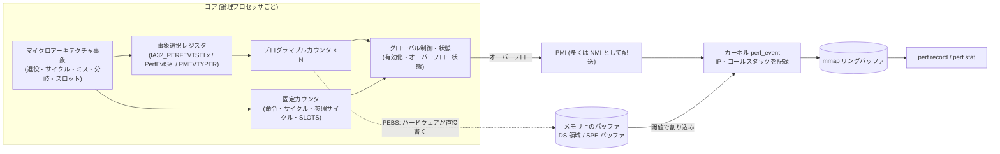
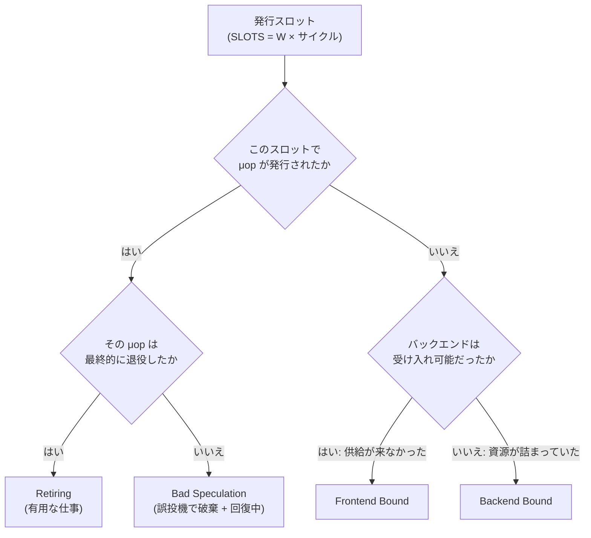

# 性能監視ユニット (Performance Monitoring Units)

## 概要 (Overview)

[`../../software/observability/observability-performance-engineering.md`](../../software/observability/observability-performance-engineering.md) は、可観測性の単価階層の最下層に PMU (performance monitoring unit) を置き、トップダウン解析を「数百のカウンタを一本の決定木に変換したもの」として紹介した。本ドキュメントはその PMU の**ハードウェアの内側**を扱う。カウンタはどう組まれ、事象はどう選ばれ、溢れたら何が起き、サンプルはなぜ嘘をつき、ベンダはその嘘をどう直してきたか。そして Linux の `perf_event` がそれをどう抽象化し、仮想化とセキュリティがどこで制約をかけるかを整理する。

中心テーゼは、**PMU とはマイクロアーキテクチャの「自己申告」装置であり、数えることは安く、帰属させることが難しい**、ということである。サイクルやキャッシュミスを数えるのは加算器を一つ置くだけで済む。しかし「どの命令がそのミスを起こしたか」を答えるには、数百命令が同時に飛んでいるアウトオブオーダパイプライン ([`pipeline-superscalar-ooo.md`](pipeline-superscalar-ooo.md)) から、特定の命令の履歴を取り出す必要がある。割り込みで IP を拾う素朴な方式はスキッド (skid) で外れる。Intel PEBS・AMD IBS・Arm SPE という三つの精密サンプリングは、この帰属問題への三つの異なる解答である。

もう一つの柱は、**生の事象は解釈のモデルなしには行動を導かない**ということである。トップダウン解析 (Yasin, ISPASS 2014)[^yasin] は、パイプラインの発行スロットを会計の単位にすることで、事象の羅列を排他的で網羅的な分類に変えた。そして Intel は Ice Lake 以降、その会計をハードウェアの専用カウンタに焼き込んだ[^k-topdown]。PMU の設計と解析手法は互いを形作りながら進化してきた。

本書は (1) カウンタのハードウェア、(2) counting と sampling、(3) スキッドと精密サンプリング、(4) 分岐記録とトレース (LBR/BRBE・Intel PT/CoreSight)、(5) トップダウン解析の導出、(6) Linux `perf_event` サブシステム、(7) PMU の仮想化、(8) セキュリティ制約、を整理する。分析深度は Level 3。

## 方法論 (Methodology)

- ハードウェアの仕様は各 ISA の一次資料 (Intel SDM Vol. 3[^intel-sdm]、AMD APM Vol. 2[^amd-apm]、Arm ARM[^arm-arm]) を典拠とする。レジスタのビット配置は、それを実装する Linux のヘッダ (タグ `v7.2`)[^k-src]で照合し、行番号付きで引用する。
- トップダウン解析は原著[^yasin]の定式化に従い、具体的な事象式は Intel の解析ツール `pmu-tools` (toplev) のソース[^pmu-tools]から行番号付きで引用する。導出は「発行スロットを 4 つの排他的な行き先に分ける」という会計原理から再構成する。
- カウンタの精度と非決定性は、ハードウェアカウンタの過大計数を系統的に測った研究[^weaver2013]を根拠に、「数字を読む前に測り方を読む」規律として記述する。
- `perf stat`・火焔グラフ・continuous profiling といった利用面は [`../../software/observability/observability-performance-engineering.md`](../../software/observability/observability-performance-engineering.md) に委ねる。本書は重複を避け、その下のハードウェアとカーネル機構に集中する。

## 発見事項 (Findings)

1. **カウンタは希少資源であり、多重化は推定を持ち込む。** 測れる事象は数百種あるのに、同時に使えるプログラマブルカウンタはコアあたり数本から十数本しかない (AMD Zen 系のコアカウンタは 6 本[^k-src]、Arm PMUv3 は最大 31 本[^arm-arm])。事象がカウンタを超えると、カーネルは事象群を時分割で入れ替え (多重化)、`time_enabled / time_running` の比で外挿する[^man-peo]。外挿は「計測していない時間も同じ割合で事象が起きた」という仮定に立つため、相 (phase) の変わるプログラムや稀な事象では誤差が大きい。
2. **割り込みベースのサンプリングは「起きた場所」ではなく「気づいた場所」を報告する。** カウンタのオーバーフローから割り込み処理が IP を記録するまでの間にも、パイプラインは数十〜数百命令を進めうる。`perf_event_open(2)` はこれをスキッドと呼び、「事象の発生からカーネルが停止して記録できるまでに実行される命令の数」と定義する[^man-peo]。ホットスポットが隣の命令や分岐の着地点にずれて見えるのはこのためである。
3. **精密サンプリングの三方式は、帰属の問いを別々に解いている。** Intel PEBS は、カウンタが溢れたら**ハードウェア自身が**メモリ上のバッファにレコード (IP・レジスタ・データアドレス・レイテンシ) を書く「事象起点」の方式である[^intel-sdm]。AMD IBS は、N 個ごとに 1 個の命令 (μop) にタグを付け、その命令の一生 (キャッシュ・TLB の当否、レイテンシ、データソース) を記録する「命令起点」の方式で、記録される IP にスキッドはない[^perf-ibs]。Arm SPE も命令起点で、サンプル間隔に疑似乱数の揺らぎを加え、レコードをメモリ上のバッファに書き出す[^perf-spe]。命令起点の系譜は DEC の ProfileMe (1997) に遡る[^dean-profileme]。
4. **分岐記録とトレースは「数える」と「全部録る」の間を埋める。** LBR (Last Branch Record) と Arm BRBE (Branch Record Buffer Extension) は、直近の分岐元・分岐先をリングバッファに保持し、サンプルごとに添付できる[^man-peo]。基本ブロックの実行頻度推定やフィードバック指向最適化の入力になる。Intel PT と Arm CoreSight は制御フローを圧縮パケットとして全量記録する。デコーダは実行の正確な流れを復元できるが、1 コアあたり毎秒数百 MB のデータを生み、デコードには収集の 2〜3 桁長い時間がかかる[^perf-pt]。
5. **トップダウン解析は発行スロットの会計であり、その網羅性は構造から導かれる。** スロット = 発行幅 × サイクルを母数に取る。各スロットは、μop が「発行されて退役した (Retiring)」「発行されたが破棄された (Bad Speculation)」「フロントエンドが供給できなかった (Frontend Bound)」「バックエンドが受け取れなかった (Backend Bound)」のどれか一つに必ず分類される[^yasin]。4 分類の和が 1 になることが設計上保証されるため、比率の大小をそのまま優先順位として読める。Ice Lake 以降の Intel コアは、固定カウンタ 3 (SLOTS) と `PERF_METRICS` レジスタでこの 4 分類をハードウェア上で直接計数する[^k-topdown]。
6. **`perf_event` は PMU を「ファイルディスクリプタ」に変えた。** 1 本のシステムコール `perf_event_open()` が、コア PMU・uncore PMU・ソフトウェア事象・tracepoint を同じ属性構造体で扱い、カウンタの割り当て・多重化・サンプルのリングバッファ (`mmap`)・グループの原子的読み出しをカーネルが仲介する[^man-peo]。PMU ドライバはカーネル内の `struct pmu` の実装として追加され、Linux 7.2 の `drivers/perf/` には Arm・RISC-V・各社 SoC・CXL 向けの PMU ドライバが並ぶ[^k-src]。
7. **PMU の仮想化は「エミュレーション」から「パススルー」へ移行しつつある。** KVM は従来、ゲストのカウンタ 1 本ごとにホスト側の `perf_event` を作成してエミュレートしてきた (perf ベースの vPMU)[^k-src]。正確だが、ゲストのカウンタ操作のたびに VM exit とホストのスケジューリングが入る。Linux 7.0 で x86 KVM に **mediated vPMU** が入り、ゲストが PMU ハードウェアを直接使い、VM entry/exit で文脈を切り替える方式が選べるようになった[^k-src]。
8. **PMU は測定器であり、それゆえ攻撃者の道具にもなる。** カウンタはキャッシュ攻撃・一時的実行攻撃の信号を増幅し、サンプルはレジスタやアドレスを含みうる。Linux は `perf_event_paranoid` (既定 2: 非特権ユーザのカーネルプロファイリングを禁止)[^k-src][^k-sysctl]と `CAP_PERFMON` (Linux 5.8 以降)[^man-peo]で段階的に制限する。逆向きに PMU で攻撃を検知する発想もあるが、ハードウェアカウンタによるマルウェア検知の有効性は再現研究で疑問視されている[^zhou2018]。

## アーキテクチャ (Architecture)

### PMU の構成要素と事象の流れ



凡例: 実線は通常の割り込み経路、点線は精密サンプリングでハードウェアがメモリへ直接書き込む経路。

- **コア PMU と uncore PMU**: コア PMU は論理プロセッサに属し、そのスレッドの事象を数える。uncore (オフコア) PMU は LLC スライス・メモリコントローラ・ソケット間リンク・メッシュ (Arm CMN など) に属し、特定のスレッドに帰属できないシステム全体の事象を数える。NUMA の混雑の観測には後者が要る ([`numa-multi-socket.md`](numa-multi-socket.md))。
- **固定カウンタ**: Intel では固定カウンタ 0〜3 が退役命令数・コアサイクル・参照サイクル・トップダウンの SLOTS に割り当てられている[^k-src]。これらは常に測りたい事象のために汎用カウンタを空けておく工夫である。

### 測定モードの単価階層

```
 counting      カウンタを読むだけ。オーバーヘッドほぼ 0。「どれだけ」に答える
 sampling      N 事象ごとに割り込み、IP/スタックを記録。周期でコストを制御。「どこで」に答える
 precise       PEBS/IBS/SPE。ハードウェアが命令単位の詳細を書く。「どの命令が、なぜ」に答える
 branch record LBR/BRBE。サンプルごとに直近の分岐履歴を添付。「どう来たか」に答える
 trace         Intel PT / CoreSight。制御フローを全量記録。データ量は非有界。「すべての経路」に答える
```

## 技術詳細 (Technical Details)

### 1. カウンタのハードウェア — 事象選択・オーバーフロー・割り込み

x86 の事象選択レジスタ (Intel `IA32_PERFEVTSELx`、AMD `PerfEvtSel`) は、事象番号と単位マスクで「何を」、特権フィルタで「いつ」、比較・エッジ・反転で「どう数えるか」を指定する。

```c
// Language: C. Purpose: bit layout of the x86 architectural event-select MSR.
// Source: Linux v7.2, arch/x86/include/asm/perf_event.h lines 23-33
#define ARCH_PERFMON_EVENTSEL_EVENT			0x000000FFULL
#define ARCH_PERFMON_EVENTSEL_UMASK			0x0000FF00ULL
#define ARCH_PERFMON_EVENTSEL_USR			(1ULL << 16)
#define ARCH_PERFMON_EVENTSEL_OS			(1ULL << 17)
#define ARCH_PERFMON_EVENTSEL_EDGE			(1ULL << 18)
#define ARCH_PERFMON_EVENTSEL_PIN_CONTROL		(1ULL << 19)
#define ARCH_PERFMON_EVENTSEL_INT			(1ULL << 20)
#define ARCH_PERFMON_EVENTSEL_ANY			(1ULL << 21)
#define ARCH_PERFMON_EVENTSEL_ENABLE			(1ULL << 22)
#define ARCH_PERFMON_EVENTSEL_INV			(1ULL << 23)
#define ARCH_PERFMON_EVENTSEL_CMASK			0xFF000000ULL
```

- **CMASK・INV・EDGE の意味**: CMASK を非 0 にすると、カウンタは「1 サイクルに事象が CMASK 回以上起きたサイクルの数」を数える。INV はその条件を反転し、EDGE は条件の立ち上がりだけを数える。これによって「0 μop しか供給されなかったサイクル」や「ストール区間の回数」といった**サイクル単位の状態**を、事象数のカウンタから合成できる。トップダウンの `IDQ_UOPS_NOT_DELIVERED.CYCLES_0_UOPS_DELIV.CORE` のような事象はこの仕組みに依存する。
- **特権フィルタ**: USR/OS ビットはリング 3/リング 0 を区別する。AMD はさらに `GUESTONLY`/`HOSTONLY` ビット (40/41) を持ち、仮想マシンの内外を区別して数えられる[^k-src]。Arm PMUv3 の `PMEVTYPER<n>_EL0` は例外レベル (EL0/EL1/EL2) とセキュリティ状態でフィルタする[^arm-arm]。Linux の `exclude_user`/`exclude_kernel`/`exclude_hv` はこれらに写像される。arm64 の VHE ホストではカーネル自身が EL2 で動くため、`exclude_kernel` は EL1 と EL2 の両方を除外する[^k-arm64perf]。
- **オーバーフローと PMI**: サンプリングでは、カウンタを `-(周期)` に初期化し、0 を跨いだ瞬間にオーバーフロー状態ビットを立て、INT ビットが有効なら PMI (performance monitoring interrupt) を上げる。x86 の PMI は Local APIC の LVT 経由で届き、Linux は通常これを NMI として受ける。NMI であるため、割り込み禁止区間のカーネルコードもサンプルできる ([`interrupts-exceptions-traps.md`](interrupts-exceptions-traps.md))。
- **カウンタ数の発見**: x86 は CPUID リーフ 0AH でアーキテクチャ PMU のバージョン・汎用カウンタ数・ビット幅・固定カウンタ数を報告し[^intel-sdm]、Arm は `PMCR_EL0.N` で実装されたカウンタ数を示す[^arm-arm]。カウンタ数は世代と SMT の有無で変わる。ツールは決め打ちせず、これらを読む必要がある。

### 2. counting と sampling — 多重化の会計

- **counting**: `perf stat` は事象をカウンタに常駐させ、終了時に読む。グループ (`group_fd`) にまとめた事象は同時にスケジュールされることが保証され、比率 (IPC = 命令/サイクル など) を同じ区間で計算できる[^man-peo]。
- **sampling**: `sample_period` (N 事象ごと) か `sample_freq` (毎秒 N 回。カーネルが周期を動的調整) で指定する[^man-peo]。カーネルはサンプリングが CPU を食い潰さないよう、`perf_cpu_time_max_percent` で割り込み処理時間の上限を設け、超えたら周期を伸ばして間引く (throttling)[^k-sysctl]。
- **多重化の実装**: カウンタが足りないとき、カーネルは柔軟 (flexible) な事象群を順に入れ替える。入れ替えは PMU ごとの hrtimer から呼ばれ、既定の間隔は `1000 / HZ` ミリ秒である[^k-src]。

```c
// Language: C. Purpose: rotate flexible events on a PMU when counters are oversubscribed (multiplexing).
// Source: Linux v7.2, kernel/events/core.c lines 4615-4624 (excerpt of perf_rotate_context())
	if (!(cpu_rotate || task_rotate))
		return false;

	perf_ctx_lock(cpuctx, cpuctx->task_ctx);
	perf_pmu_disable(pmu);

	if (task_rotate)
		task_event = ctx_event_to_rotate(task_epc);
	if (cpu_rotate)
		cpu_event = ctx_event_to_rotate(cpu_epc);
	/* ... sched out flexible groups, rotate the list, sched back in ... */
```

- **外挿の誤差**: 報告値は `count × time_enabled / time_running` で推定される[^man-peo]。`time_running` が `time_enabled` の数 % しかない事象は、その数 % の区間に何が起きたかで値が大きく揺れる。比率を計算する二つの事象が別々の時間片で測られると、分子と分母が違う相を見ることになる。**比率を取る事象は同じグループに入れる**ことが、多重化下での規律である。
- **カウンタそのものの誤差**: 同じ決定的なプログラムでも、退役命令数のような「決定的に見える」事象がハードウェアの実装 (割り込み・ページフォルト・特定命令の計上規則) によって過大計数され、実行ごとに揺らぐことが実測で示されている[^weaver2013]。PMU の値は真値ではなく、**仕様と実装の癖を含んだ観測値**である。

### 3. スキッドと精密サンプリング — PEBS・IBS・SPE

`perf_event_attr` の `precise_ip` は、スキッドに対する要求の強さを 2 ビットで表す。

```c
// Language: C. Purpose: user-visible contract for sampling skid in perf_event_attr.
// Source: Linux v7.2, include/uapi/linux/perf_event.h lines 433-448
				/*
				 * precise_ip:
				 *
				 *  0 - SAMPLE_IP can have arbitrary skid
				 *  1 - SAMPLE_IP must have constant skid
				 *  2 - SAMPLE_IP requested to have 0 skid
				 *  3 - SAMPLE_IP must have 0 skid
				 *
				 *  See also PERF_RECORD_MISC_EXACT_IP
				 */
				precise_ip     :  2, /* skid constraint       */
				mmap_data      :  1, /* non-exec mmap data    */
				sample_id_all  :  1, /* sample_type all events */

				exclude_host   :  1, /* don't count in host   */
				exclude_guest  :  1, /* don't count in guest  */
```

`perf record -e cycles:pp` の `p` の数がこの値に対応する。ハードウェアがどの水準を満たせるかは事象と PMU によって異なる。

| 方式 | 起点 | 仕組み | 得られるもの | 制約 |
|---|---|---|---|---|
| **Intel PEBS** | 事象 (カウンタのオーバーフロー) | 溢れた後の該当事象を起こした命令の退役時に、マイクロコード/ハードウェアがレコードを DS (Debug Store) 領域に書き、バッファが閾値に達したら割り込む[^intel-sdm] | IP、汎用レジスタ、データの線形アドレス、ロードレイテンシとデータソース (`perf mem` の基盤) | PEBS 対応事象に限られる。古い世代では記録 IP が事象を起こした命令の次を指すことがあり (off-by-one)、補正が必要だった (後の世代は事象を起こした命令の IP を別フィールドで記録する)[^intel-sdm] |
| **AMD IBS** | 命令 (N 個ごとにタグ) | IBS Fetch (命令フェッチ) と IBS Op (μop 実行) の 2 系統。タグ付き μop の一生を専用レジスタに記録[^perf-ibs] | スキッドのない IP、キャッシュ・TLB の当否、ミスレイテンシ、データソース、線形・物理アドレス、分岐の挙動 | ユーザ/カーネルのフィルタがないため `CAP_SYS_ADMIN` か `CAP_PERFMON` が必要。SMT スレッドごとに 1 系統。Zen 4 以降は L3 ミスのみを標本化する `l3missonly` を持つ[^perf-ibs] |
| **Arm SPE** | 命令 (間隔 + 疑似乱数の揺らぎ) | 選ぶ → 実行中にデータ収集 → 任意でフィルタ → メモリに書く → バッファ満杯で割り込み、の 5 段階[^perf-spe] | PC、PMU 事象、サイクル単位のタイミング、データアドレス、キャッシュ事象とデータの出所 | ドライバ (`ARM_SPE_PMU`) が必要。CPU によってはカーネルを KPTI 無効 (`kpti=off`) で起動する必要がある[^perf-spe] |

- **事象起点と命令起点の違い**: PEBS は「L3 ミスを N 回に 1 回」のように**事象の母集団**から標本化するので、稀な高コスト事象を効率よく捕まえられる。IBS/SPE は**命令の母集団**から標本化して後で事象を調べるので、1 つの標本に全属性 (どのレベルでミスしたか、何サイクルかかったか) が揃う。その代わり、稀な事象を捕まえるには多くの標本が要る。Zen 4 の `l3missonly` は、命令起点に事象起点の効率を一部取り込む折衷である。
- **ランダム化の意味**: サンプル間隔が一定だと、ループの周期と同期して同じ命令ばかりを標本化する (エイリアシング)。SPE が既定で間隔に疑似乱数の揺らぎを加えるのはこのためである[^perf-spe]。
- **ProfileMe からの系譜**: 命令起点の標本化は、アウトオブオーダ実行で事象と命令の対応が壊れる問題への解として、DEC Alpha 向けの ProfileMe で提案された[^dean-profileme]。IBS と SPE はその直系の思想を持つ。

### 4. 分岐記録とトレース — LBR/BRBE・Intel PT・CoreSight

- **LBR / BRBE**: 分岐が成立するたびに (from, to) の組をリングバッファに書く。`PERF_SAMPLE_BRANCH_STACK` を指定するとサンプルに添付され、エントリは新しい順に並ぶ[^man-peo]。用途は、(a) コールスタックの再構築 (フレームポインタなしでの `perf record --call-graph lbr`)、(b) 基本ブロックの実行回数推定 (サンプルごとの分岐対から区間を復元)、(c) 分岐予測ミスの分析 (エントリに予測当否のフラグを持つ実装がある[^intel-sdm]。[`branch-prediction-speculation.md`](branch-prediction-speculation.md) 参照) である。Arm の BRBE ドライバは Linux 6.17 で `drivers/perf/arm_brbe.c` として入った[^k-src]。
- **Intel PT (Processor Trace)**: 条件分岐の成否を 1 ビットずつ詰めた TNT パケット、間接分岐の行き先を示す TIP パケット、同期用の PSB パケットなどで制御フローを圧縮する。デコーダは実行バイナリを辿りながらパケットを照合し、**実行の正確な流れ**を復元する。その代わり、実行イメージが必要なので JIT や自己書き換えコードは難しく、データは 1 コアあたり毎秒数百 MB に達する。スナップショットモードでは、リングバッファを上書きし続け、興味のある瞬間だけ取り出す[^perf-pt]。
- **Arm CoreSight**: ETM/ETE (トレース源)、ファンネル・レプリケータ (経路)、ETB/ETR/TPIU (シンク) という部品の組み合わせである。トレースデータは設定用の APB とは別の ATB バスで帯域外に運ばれる。Linux では `perf record -e cs_etm/@tmc_etr0/u` のように PMU として扱われ、OpenCSD でデコードする[^k-coresight]。
- **使い分け**: LBR/BRBE は「サンプル直前の数十分岐」を安価に得る手段で、常時プロファイリングにも載る。PT/CoreSight は「すべての分岐」を得る手段で、短い区間の事後解析 (レイテンシスパイクの原因追跡、カバレッジ、ファジング) に向く。単価の階層 (アーキテクチャ節) の上端と下端に位置する。

### 5. トップダウン解析 — 発行スロットの会計と導出

**レベル 1 の導出**: 発行幅 W のコアでは、1 サイクルに W 個のスロットがある。各スロットに着目して二つの質問をする[^yasin]。



二分木の葉は互いに排他的で、すべてのスロットを覆う。したがって 4 つの比率の和は 1 である。この構造的な保証が、従来の「ミス率 × ペナルティの推定和」(重なり合うストールを二重計上しやすい) との本質的な違いである。

**事象への写像 (Ivy Bridge 世代の例)**: `pmu-tools` は各分類を次の式で計算する。

```python
# Language: Python. Purpose: Top-down Level-1 formulas as implemented in Intel's toplev (Ivy Bridge client model).
# Source: andikleen/pmu-tools, ivb_client_ratios.py (commit c7c46ef) lines 50, 180-181, 212-213, 449, 769, 859, 1919
Pipeline_Width = 4                                                    # line 50
def Retired_Slots(self, EV, level):                                   # lines 180-181
    return EV("UOPS_RETIRED.RETIRE_SLOTS", level)
def SLOTS(self, EV, level):                                           # lines 212-213
    return Pipeline_Width * CORE_CLKS(self, EV, level)
# Frontend_Bound (line 449)
self.val = EV("IDQ_UOPS_NOT_DELIVERED.CORE", 1) / SLOTS(self, EV, 1)
# Bad_Speculation (line 769)
self.val = (EV("UOPS_ISSUED.ANY", 1) - Retired_Slots(self, EV, 1) + Pipeline_Width * Recovery_Cycles(self, EV, 1)) / SLOTS(self, EV, 1)
# Backend_Bound (line 859)
self.val = 1 -(self.Frontend_Bound.compute(EV) + self.Bad_Speculation.compute(EV) + self.Retiring.compute(EV))
# Retiring (line 1919)
self.val = Retired_Slots(self, EV, 1) / SLOTS(self, EV, 1)
```

各式は木の葉と次のように対応する。

- **Frontend Bound**: `IDQ_UOPS_NOT_DELIVERED.CORE` は、バックエンドが受け入れ可能だったのに命令デコードキュー (IDQ) から μop が届かなかったスロット数を数える。「バックエンドが受け入れ可能」を条件に含むことで、バックエンドが詰まっている間の供給不足を Frontend に誤計上しない。
- **Bad Speculation**: 発行されたが退役しなかった μop (`UOPS_ISSUED.ANY − RETIRE_SLOTS`) に、誤投機からの回復中に発行が止まっていたサイクル × W (`Recovery_Cycles`、`INT_MISC.RECOVERY_CYCLES` に由来) を加える。回復中のスロットは「誤投機がなければ使えた」ので、ここに計上する。
- **Backend Bound**: 残差として定義される。直接数える事象がなくても 4 分類が閉じるのは、木が網羅的だからである。
- **Retiring**: 退役スロット数そのもの。Retiring が高いことは「効率が良い」ことを意味しない。ベクトル化 ([`simd-vector.md`](simd-vector.md)) やアルゴリズムの改善で、退役する μop 自体を減らす余地は残る。

**レベル 2 以降**: 支配的な分類だけを掘り下げる。

| L1 | L2 | 分割の考え方 (pmu-tools の式) |
|---|---|---|
| Frontend Bound | Latency / Bandwidth | 0 μop しか届かなかったサイクル × W を Latency (I キャッシュ・ITLB ミス、分岐の再ステア) とし (line 484)、残りを Bandwidth (デコーダ・μop キャッシュの供給幅不足) とする |
| Bad Speculation | Branch Mispredicts / Machine Clears | 分岐予測ミスの退役数の比で按分。Machine Clears はメモリ順序違反・自己書き換えコードなどによるパイプライン全消去 |
| Backend Bound | Memory Bound / Core Bound | メモリ起因のストールサイクル (`STALLS_MEM_ANY + RESOURCE_STALLS.SB`) がバックエンドストール全体に占める割合で按分し (lines 139, 891)、残りを Core Bound (演算器ポートの競合・除算器など) とする (line 1506) |
| Memory Bound (L3) | L1 / L2 / L3 / DRAM / Store Bound | 「L1D ミス待ちのストール」と「L2 ミス待ちのストール」の差で L2 Bound を出し (line 1123)、L2 ミス待ちを L3 ヒット率で L3 と DRAM に按分する (lines 1148, 1280) |

- **差分による帰属**: レベル 3 は「より遠い階層のミスを待っているストールサイクル」を入れ子のカウンタで数え、隣り合う差を取る。L2 Bound は「L1D ミス待ちだが L2 ミス待ちではない」ストールである。これにより、どのキャッシュ階層 ([`cache-memory-hierarchy.md`](cache-memory-hierarchy.md)) が支配的かを排他的に割り当てられる。DRAM Bound の中には、さらにローカル/リモート DRAM の区別がある ([`numa-multi-socket.md`](numa-multi-socket.md))。
- **ハードウェア化**: Ice Lake 以降では、固定カウンタ 3 が SLOTS を、`PERF_METRICS` が 4 分類の比率を 8 ビットずつ (合計 0xff = 100%) 直接保持する。汎用カウンタを消費しないため、多重化の誤差なしに常時 4 分類を測れる。ただし、トップダウンの事象はすべて SLOTS をリーダとするグループに入れる必要がある。また 8 ビット精度のため、短い区間では精度が落ちる[^k-topdown]。
- **限界**: (a) SMT では 2 スレッドがスロットを共有するため、スレッド単位の帰属に推定が入る (`CORE_CLKS` の SMT 補正)[^pmu-tools]。(b) 事象の定義は世代ごとに変わり、式もモデルごとに別ファイルになる。(c) 4 分類は「どこで詰まったか」を答えるが、「なぜか (どのデータ構造か)」は PEBS/IBS/SPE のサンプルで補う。

### 6. Linux perf_event サブシステム

システムコールの形は次のとおりである[^man-peo]。

```c
// Language: C. Purpose: perf_event_open(2) entry point (no glibc wrapper; invoked via syscall(2)).
// Source: Linux man-pages, perf_event_open(2), SYNOPSIS
int syscall(SYS_perf_event_open, struct perf_event_attr *attr,
            pid_t pid, int cpu, int group_fd, unsigned long flags);
```

- **スコープ**: `(pid, cpu)` の組で「このタスクをどの CPU でも」「この CPU 上の全タスク」などを指定する。タスク単位の事象は、コンテキストスイッチのたびにカーネルがカウンタを退避・復元する ([`../../software/operating-systems/process-thread-scheduling.md`](../../software/operating-systems/process-thread-scheduling.md))。
- **PMU ドライバ**: `attr.type` が PMU を選ぶ (`PERF_TYPE_HARDWARE` の汎用事象、`PERF_TYPE_RAW` の生の事象コード、`/sys/bus/event_source/devices/<pmu>/type` の動的 PMU 番号)。各 PMU ドライバはカウンタの割り当て制約 (どの事象がどのカウンタで数えられるか) を知っており、カーネルのスケジューラはグループ単位で「全部載るか、全部載らないか」を判定する。
- **サンプルの受け渡し**: `mmap` したリングバッファに、カーネルが `PERF_RECORD_SAMPLE` などのレコードを書き、ユーザ空間が読み進める。バッファのロック可能メモリ量は `perf_event_mlock_kb` が制御する[^k-perfsec]。
- **自己計測 (rdpmc)**: `mmap` のメタデータページに `cap_user_rdpmc` とカウンタ番号が公開されていれば、ユーザ空間は `rdpmc` 命令でシステムコールなしにカウンタを読める[^man-peo]。マイクロベンチマークや JIT の内部計測でのオーバーヘッドを最小化する手段であり、同時に「ユーザ空間に高分解能の事象カウンタを渡す」というセキュリティ上の判断でもある (x86 は `RDPMC_USER_DISABLE` に相当するビットも持つ[^k-src])。
- **uncore と CXL**: uncore PMU は CPU 単位ではなくソケット/デバイス単位の PMU として登録され、タスク単位の計測はできない。CXL デバイス自身の PMU (CPMU) にもドライバがある[^k-src]。

### 7. PMU の仮想化

```c
// Language: C. Purpose: perf-based vPMU — each guest counter is backed by a host perf_event.
// Source: Linux v7.2, arch/x86/kvm/pmu.c lines 265-305 (excerpt of pmc_reprogram_counter())
static int pmc_reprogram_counter(struct kvm_pmc *pmc, u32 type, u64 config,
				 bool exclude_user, bool exclude_kernel,
				 bool intr)
{
	struct kvm_pmu *pmu = pmc_to_pmu(pmc);
	struct perf_event *event;
	struct perf_event_attr attr = {
		.type = type,
		.size = sizeof(attr),
		.pinned = true,
		.exclude_idle = true,
		.exclude_host = 1,
		.exclude_user = exclude_user,
		.exclude_kernel = exclude_kernel,
		.config = config,
	};
	/* ... sample period derived from the guest counter value; PEBS precise level ... */
	event = perf_event_create_kernel_counter(&attr, -1, current,
						 kvm_perf_overflow, pmc);
```

- **perf ベース vPMU**: ゲストが事象選択 MSR を書くと VM exit が起き、KVM はそれをホストの `perf_event` (`exclude_host = 1` でゲスト実行中のみ計数) に翻訳する。オーバーフローはホストの perf コールバック (`kvm_perf_overflow`) からゲストへの仮想 PMI として注入される[^k-src]。ホストの perf が資源を仲介するため、ホストとゲストがカウンタを安全に共有できる。その代わり、カウンタの再プログラムに VM exit とホスト側のスケジューリングが伴い、ゲストのプロファイラが頻繁にカウンタを触ると重い。
- **mediated vPMU**: Linux 7.0 で x86 KVM に入った方式で、`enable_mediated_pmu` で有効化される[^k-src]。ゲストは PMU レジスタを (許可された範囲で) 直接操作し、KVM は VM entry/exit で PMU の文脈を丸ごと入れ替える。ゲスト内の計測は速く正確になるが、ゲスト実行中はホストからその CPU の事象を測れない。**可観測性の所有権をホストとゲストのどちらに渡すか**の選択になる。
- **arm64**: ハードウェアの例外レベルフィルタだけではホスト/ゲストを区別しきれないため、KVM はゲストへの entry/exit で計数の有効/無効を切り替える。非 VHE 構成では、entry/exit の直前直後にホスト事象を取りこぼす小さな空白がある[^k-arm64perf]。
- **露出の判断**: クラウドでは、ゲストに PMU をどこまで見せるか (全事象か、アーキテクチャ事象のみか、PEBS/LBR まで含めるか) がテナント分離の問題になる (次節)。ゲストから PMU が見えない環境では、トップダウン解析も `perf record -e cycles:pp` も使えず、タイマ割り込みベースのプロファイリングに落ちる。仮想化の全体像は [`../../software/virtualization/hardware-virtualization-containers.md`](../../software/virtualization/hardware-virtualization-containers.md) を参照。

### 8. 観測の入口 (Observability)

| 疑問 | 道具 |
|---|---|
| この CPU の PMU は何を持つか | `perf list`、`/sys/bus/event_source/devices/*/`、`cpuid` (リーフ 0AH)、`dmesg` の PMU 検出ログ |
| 多重化されていないか | `perf stat` 出力の括弧内の割合 (`time_running/time_enabled`)。100% 未満なら外挿値 |
| どこが律速か (L1→Ln) | `perf stat --topdown`、`perf stat -M TopdownL1`、`toplev -l2` |
| どの命令がミスしているか | `perf record -e <event>:pp` (PEBS)、`perf record -e ibs_op//` (AMD)、`perf record -e arm_spe//` (Arm) |
| メモリアクセスの出所と遅延 | `perf mem record/report`、`perf c2c` (偽共有・HITM の検出。[`cache-coherence.md`](cache-coherence.md)) |
| どう来たか / 全経路 | `perf record -b` (LBR/BRBE)、`perf record -e intel_pt//`、`perf record -e cs_etm//` |
| 権限はどうなっているか | `/proc/sys/kernel/perf_event_paranoid`、`getcap` で `cap_perfmon` |

## セキュリティ考察 (Security Considerations)

- **段階的な権限制御**: `perf_event_paranoid` は -1 (ほぼ制限なし)、0 以上 (非特権ユーザの ftrace 関数 tracepoint を禁止)、1 以上 (CPU 単位の事象を禁止)、2 以上 (カーネルプロファイリングを禁止) の段階をとり[^k-sysctl]、メインラインの既定値は 2 である[^k-src]。`CAP_PERFMON` は Linux 5.8 で導入され[^man-peo]、5.9 以降は `CAP_SYS_PTRACE` なしに監視権限を与えられる[^k-perfsec]。root 全権を渡さずにプロファイラを動かすための最小権限化である。カーネルのドキュメントは、perf が露出する情報を 4 種に分類し、レジスタやメモリアドレスを含む実行文脈のデータを最も機微なものとしている[^k-perfsec]。
- **フィルタを持たない機構は特権を要する**: AMD IBS はユーザ/カーネルのフィルタを持たないため、非特権ユーザに許すとカーネル実行中のアドレスやデータソースが標本に混入する。そのため Linux は IBS に `CAP_SYS_ADMIN` か `CAP_PERFMON` を要求する[^perf-ibs]。精密サンプリングが記録する物理アドレスやロードレイテンシも、キャッシュ攻撃の偵察に使える情報である。
- **PMU はサイドチャネルの増幅器**: キャッシュ攻撃や一時的実行攻撃 ([`branch-prediction-speculation.md`](branch-prediction-speculation.md)、[`../security/side-channels-tee-secure-boot.md`](../security/side-channels-tee-secure-boot.md)) は、時間計測の代わりに事象カウンタ (キャッシュミス・分岐予測ミス) で信号を得ることもできる。`rdpmc` をユーザ空間に許すことは、高分解能タイマを渡すのと同種の判断である。
- **エネルギーカウンタという隣接面**: Intel RAPL のエネルギーカウンタは、perf の power PMU と powercap の sysfs から読める。PLATYPUS は非特権の RAPL 読み出しから、SGX エンクレーブ内の処理や鍵に関する情報を推定する電力サイドチャネルを示した[^platypus]。これを受けて powercap のエネルギー値は特権ユーザ限定に改められた。**「性能・電力のテレメトリ」と「秘密の漏洩経路」の境界は事象の種類ではなく分解能と権限で決まる**。
- **仮想化環境での露出**: ゲストに PMU を渡すと、同じ物理コアを共有する他テナントの活動が、共有資源の事象 (uncore・LLC) として見える可能性がある。mediated vPMU では、VM entry/exit でカウンタと設定を確実に入れ替えることが、テナント間の情報漏洩を防ぐ前提条件になる。クラウド事業者が PMU の露出範囲を限定するのはこのためである。
- **防御としての PMU の限界**: 事象カウンタで攻撃やマルウェアを検知する研究は多い。しかし Zhou et al. は、ハードウェア性能カウンタによるマルウェア検知が現実的な条件下では信頼できないことを示した[^zhou2018]。PMU は「攻撃の兆候を拾える」が、それ単独で判定の根拠にするには非決定性 (前述の過大計数[^weaver2013]) とワークロード依存性が大きすぎる。

## 結論 (Conclusions)

- PMU はマイクロアーキテクチャの自己申告装置である。数えることはほぼ無料だが、アウトオブオーダ実行の中で「どの命令が」を答える帰属が本質的に難しい。スキッドはその難しさの症状であり、PEBS (事象起点)・IBS と SPE (命令起点)・LBR/BRBE (分岐履歴)・Intel PT と CoreSight (全量トレース) は、帰属のコストと精度の異なる解答群として理解できる。
- カウンタは希少資源であり、多重化と外挿は測定に推定を持ち込む。カウンタ自体も実装の癖を含む。数字を読む前に「どう数えたか」(グループ・多重化率・精密レベル) を読むことが、PMU を使う者の規律である。
- トップダウン解析は、発行スロットという排他的で網羅的な会計単位を選んだことで、事象の羅列を優先順位つきの決定木に変えた。その成功はハードウェアにフィードバックされ (SLOTS と `PERF_METRICS`)、解析手法と PMU 設計は共進化している。
- `perf_event` は PMU を権限制御可能なファイルディスクリプタに抽象化した。仮想化ではエミュレーションから mediated パススルーへの移行が進み、可観測性の所有権をホストとゲストのどちらに置くかという選択が表面化した。PMU は観測の道具であると同時に攻撃の道具でもあり、その露出範囲は性能工学とセキュリティの綱引きで決まる。

### 次の接続先 (Related Topics)

- [`../../software/observability/observability-performance-engineering.md`](../../software/observability/observability-performance-engineering.md) — PMU の上に立つ可観測性の全体像 (単価階層・火焔グラフ・continuous profiling)。
- [`../../software/compilers-runtimes/debug-info-stack-unwinding.md`](../../software/compilers-runtimes/debug-info-stack-unwinding.md) — サンプルにコールスタックを付けるアンワインド (フレームポインタ・DWARF・ORC・SFrame・LBR) の比較。
- [`pipeline-superscalar-ooo.md`](pipeline-superscalar-ooo.md) — トップダウンが数える発行スロットとスキッドを生むアウトオブオーダ実行。
- [`branch-prediction-speculation.md`](branch-prediction-speculation.md) — Bad Speculation の中身、LBR の予測当否フラグ、PMU を使う投機実行攻撃。
- [`cache-coherence.md`](cache-coherence.md)・[`numa-multi-socket.md`](numa-multi-socket.md) — `perf c2c`・uncore PMU で観測する共有とリモートアクセス。
- [`dram-memory-controllers.md`](dram-memory-controllers.md) — DRAM Bound の先にあるメモリコントローラ。
- [`../hw-sw-interface/bus-interconnect.md`](../hw-sw-interface/bus-interconnect.md) — uncore PMU が計測するインターコネクト (PCIe・CXL・AXI)。
- [`../../software/operating-systems/process-thread-scheduling.md`](../../software/operating-systems/process-thread-scheduling.md) — タスク単位カウンタの退避・復元が乗るコンテキストスイッチ。
- [`../../software/operating-systems/virtual-memory-paging.md`](../../software/operating-systems/virtual-memory-paging.md) — PEBS/SPE が記録する線形・物理アドレスとページフォルト事象。
- [`../../software/virtualization/hardware-virtualization-containers.md`](../../software/virtualization/hardware-virtualization-containers.md) — vPMU が載る VM exit/entry の機構。

## 参考文献 (References)

**一次資料 (Primary — 論文・ISA 仕様・公式ドキュメント・ソース)**

[^yasin]: Yasin, A. (2014). A Top-Down Method for Performance Analysis and Counters Architecture. *Proc. IEEE ISPASS 2014*. DOI: 10.1109/ISPASS.2014.6844459 — トップダウン解析の原典。

[^dean-profileme]: Dean, J., Hicks, J. E., Waldspurger, C. A., Weihl, W. E., & Chrysos, G. (1997). ProfileMe: Hardware Support for Instruction-Level Profiling on Out-of-Order Processors. *Proc. MICRO-30*. DOI: 10.1109/MICRO.1997.645821 — 命令起点サンプリングの原型。

[^weaver2013]: Weaver, V. M., Terpstra, D., & Moore, S. (2013). Non-Determinism and Overcount on Modern Hardware Performance Counter Implementations. *Proc. IEEE ISPASS 2013*. DOI: 10.1109/ISPASS.2013.6557172 — 「決定的」事象の過大計数と非決定性の実測。

[^platypus]: Lipp, M., Kogler, A., Oswald, D., Schwarz, M., Easdon, C., Canella, C., & Gruss, D. (2021). PLATYPUS: Software-based Power Side-Channel Attacks on x86. *Proc. IEEE S&P 2021*. DOI: 10.1109/SP40001.2021.00063 — RAPL エネルギーカウンタによるサイドチャネル。

[^zhou2018]: Zhou, B., Gupta, A., Jahanshahi, R., Egele, M., & Joshi, A. (2018). Hardware Performance Counters Can Detect Malware: Myth or Fact? *Proc. ACM AsiaCCS '18*. DOI: 10.1145/3196494.3196515 — PMU によるマルウェア検知の再検証。

[^intel-sdm]: Intel. *Intel 64 and IA-32 Architectures Software Developer's Manual*, Volume 3 (System Programming Guide) — 「Performance Monitoring」「Last Branch Records」「Intel Processor Trace」の各章 (章番号は改訂ごとに変わるため章題で参照)。[intel.com/sdm](https://www.intel.com/content/www/us/en/developer/articles/technical/intel-sdm.html) — Accessed: 2026-10-04

[^amd-apm]: AMD. *AMD64 Architecture Programmer's Manual, Volume 2: System Programming* (Pub. 24593) — 「Debug and Performance Resources」の章 (性能カウンタ・IBS)。事象の一覧はファミリごとの PPR (Processor Programming Reference) を参照。[amd.com](https://www.amd.com/en/search/documentation/hub.html) — Accessed: 2026-10-04

[^arm-arm]: Arm. *Arm Architecture Reference Manual for A-profile architecture* (DDI 0487) — Performance Monitors Extension (PMUv3)、Statistical Profiling Extension、Branch Record Buffer Extension の各章。[developer.arm.com](https://developer.arm.com/documentation/ddi0487/latest) — Accessed: 2026-10-04

[^man-peo]: Linux man-pages — [perf_event_open(2)](https://man7.org/linux/man-pages/man2/perf_event_open.2.html) — Accessed: 2026-10-04。`precise_ip`・スキッドの定義・多重化・`rdpmc`・`CAP_PERFMON`。

[^k-perfsec]: Linux Kernel Documentation — [Perf events and tool security](https://docs.kernel.org/admin-guide/perf-security.html) — Accessed: 2026-10-04

[^k-sysctl]: Linux Kernel Documentation — [Documentation for /proc/sys/kernel/](https://docs.kernel.org/admin-guide/sysctl/kernel.html) (`perf_event_paranoid`・`perf_cpu_time_max_percent`) — Accessed: 2026-10-04

[^k-arm64perf]: Linux Kernel Documentation — [Perf Event Attributes (arm64)](https://docs.kernel.org/arch/arm64/perf.html) — Accessed: 2026-10-04

[^k-coresight]: Linux Kernel Documentation — [Coresight - HW Assisted Tracing on ARM](https://docs.kernel.org/trace/coresight/coresight.html) — Accessed: 2026-10-04

[^k-topdown]: Linux kernel source — [`tools/perf/Documentation/topdown.txt`](https://github.com/torvalds/linux/blob/master/tools/perf/Documentation/topdown.txt) — Accessed: 2026-10-04。SLOTS 固定カウンタと `PERF_METRICS`。

[^perf-ibs]: Linux kernel source — [`tools/perf/Documentation/perf-amd-ibs.txt`](https://github.com/torvalds/linux/blob/master/tools/perf/Documentation/perf-amd-ibs.txt) — Accessed: 2026-10-04

[^perf-spe]: Linux kernel source — [`tools/perf/Documentation/perf-arm-spe.txt`](https://github.com/torvalds/linux/blob/master/tools/perf/Documentation/perf-arm-spe.txt) — Accessed: 2026-10-04

[^perf-pt]: Linux kernel source — [`tools/perf/Documentation/perf-intel-pt.txt`](https://github.com/torvalds/linux/blob/master/tools/perf/Documentation/perf-intel-pt.txt) — Accessed: 2026-10-04

[^k-src]: Linux kernel source, tag `v7.2` (比較のため `v6.16`/`v6.17`/`v6.19`/`v7.0` も参照) — `include/uapi/linux/perf_event.h`・`arch/x86/include/asm/perf_event.h`・`kernel/events/core.c`・`arch/x86/kvm/pmu.c`・`drivers/perf/` (`arm_brbe.c` は v6.17 で初出、x86 KVM の `enable_mediated_pmu` は v7.0 で初出)。[github.com/torvalds/linux](https://github.com/torvalds/linux/tree/v7.2) — Accessed: 2026-10-04

[^pmu-tools]: Kleen, A., et al. — [pmu-tools](https://github.com/andikleen/pmu-tools) (`ivb_client_ratios.py`, commit c7c46efd486b4f58bd1f2fbf0adea196a99ffafd) — Accessed: 2026-10-04。toplev のトップダウン式の実装。

**二次資料 (Secondary — 教科書・解説)**

- Gregg, B. (2020). *Systems Performance: Enterprise and the Cloud* (2nd ed.). Addison-Wesley. — PMC・perf の実務的解説。
- Hennessy, J. L., & Patterson, D. A. *Computer Architecture: A Quantitative Approach* (6th ed.). Morgan Kaufmann. — 性能評価とパイプラインストールの定量的整理。
