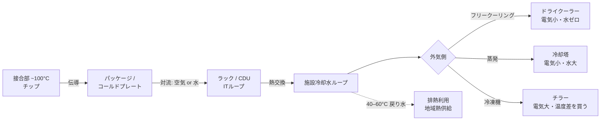

# データセンターの冷却 (Datacenter Cooling)

## 概要 (Overview)

データセンターに入った電力は、計算を経由して**ほぼ全量が熱になる**。冷却とは「チップ接合部（~100°C 上限）から外気まで、温度差を駆動力に熱を運び出す」一本の熱の道の設計であり、給電 (`datacenter-power.md`) と対をなすもう半分のインフラである。歴史的には「冷やしすぎの機械室」から始まり、封じ込め・外気利用・高温運転によって空冷は完成形に達した——そして AI ラックの 100 kW 超という密度（`datacenter-fundamentals.md`）が、その完成形を物理的に不可能にし、**液冷への世代交代**を強制した。

本ドキュメントは、熱の道を「チップ → ラック → 室内 → 熱源プラント → 大気」の各区間に分解し、空冷の到達点と限界、液冷の3方式（リアドア・直接液冷・液浸）、冷却分配ユニット (CDU) という新しい標準部品、水と電気の交換 (WUE vs PUE)、排熱利用までを扱う。チップ側のパッケージ・接合部の熱設計は `../semiconductor-manufacturing/` の実装、熱を生む側の議論は `../gpu-accelerators/`（電力密度）・`../../hardware/robotics/robotics-fundamentals.md`（熱律速の一般論）と接続する。分析深度は Level 3。

## 方法論 (Methodology)

- 冷却を**直列の熱抵抗の連鎖**（接合部→パッケージ→冷媒→室内/水→外気）として扱い、各区間で「温度差を何 K 使うか」の予算配分として設計判断を読む。熱力学の詳細な導出には立ち入らず、移動の三形態（伝導・対流・（相変化））の工学的帰結に絞る。
- 空冷→液冷の移行を「善悪」ではなく**体積流量と熱容量の算術**（空気と水の物性差）として説明する。
- 効率指標 (PUE への寄与・WUE) は `datacenter-fundamentals.md` の会計を引き継ぎ、方式間の比較を「電気・水・資本の三通貨」で行う。
- 密度・方式の採用状況（2026-07 時点）は、ベンダ要件（GPU 製品の液冷必須化）と業界の実装進度を区別して記す。

## 発見事項 (Findings)

1. **冷却設計とは「温度差という予算」の配分である。** 使える総温度差は「チップ上限 (~85–105°C) − 外気温度」しかない。この数十 K を、接合部→ヒートシンク/コールドプレート、冷媒の温度上昇、熱交換器、外気側設備が分け合う。**どこかの区間で贅沢に使えば他が苦しくなる**——高温運転（室温・水温を上げる）が省エネの王道なのは、外気側の区間に予算を譲ると冷凍機（圧縮機で温度差を「買う」装置）が不要になるからである。
2. **空気は「熱容量が小さく、送るのが高い」媒体であり、それが密度の上限を決めた。** 同一体積の水は空気の約 3,500 倍の熱を運び、送風の動力はファン則により風量の 3 乗で増える。1 ラック 20〜30 kW 付近から「必要風量が物理的に通らない・ファン電力が非現実的」になり、**空冷の限界はエンジニアリングではなく物性の限界**として現れる。AI ラック (100 kW 超) が液冷必須なのはこの算術の帰結である。
3. **空冷の完成形は「混ぜないこと」だった。** ホット/コールドアイルの封じ込め (containment) は、冷気と排気の混合——供給温度を下げざるを得なくする無駄の主因——を仕切りで断つだけで大きな効率を回収した。加えて ASHRAE の許容温度緩和（供給 27°C 級までの運転）[^ashrae]と外気利用（エコノマイザ: 外気・水側フリークーリング）により、「冷凍機がほぼ回らないデータセンター」が寒冷地では標準になり、PUE 1.1 台（`datacenter-fundamentals.md`）を支えた。
4. **液冷の3方式は「液体をどこまでチップに近づけるか」の階段である。** (1) **リアドア熱交換器**: ラック背面で排気を水冷し、室内空調を代替——サーバは空冷のまま、施設側の改修で 30〜50 kW 級まで延命する橋渡し。(2) **直接液冷 (DLC/D2C)**: コールドプレートをチップに直付けし、冷却水ループで主要な熱 (7〜8 割) を運ぶ——現行 AI ラックの標準で、残りの熱（メモリ・電源）は空冷が受け持つハイブリッドになる。(3) **液浸 (immersion)**: 基板ごと絶縁性流体に沈める——熱の道は最短だが、保守性・流体管理・部品適合性の運用コストが大きく、採用は限定的（2026-07 時点）。
5. **CDU (coolant distribution unit) が「施設の水」と「IT の水」を仲介する新しい標準部品になった。** 施設冷却水（水質・圧力・温度が施設都合）と、チップに触れるループ（清浄度・流量・漏れ管理が IT 都合）を熱交換器で分離し、流量・温度・圧力・漏水検知を制御する。液冷とは配管工事ではなく**もう一つの制御系の導入**であり、CDU の可用性設計 (N+1)・監視が、UPS と同格の信頼性部品として扱われ始めている。
6. **蒸発は「電気を水で買う」取引である。** 冷却塔・蒸発冷却は、水の蒸発潜熱で外気の湿球温度まで冷やせるため電力効率が高いが、大量の水を消費する (WUE)。乾式冷却（空冷チラー・ドライクーラー）は水を使わないが電力を食う。**PUE と WUE は部分的に交換関係**にあり、立地（乾燥地・水利権・世論）が最適解を反転させる——単一指標の最適化が歪みを生む構図の代表例である[^wue]。
7. **液冷は排熱を「資源」に変える入口でもある。** 空冷の排気 (30–40°C) は薄く広く、回収に値しないことが多いが、液冷の戻り水 (40–60°C、設計次第でそれ以上) は地域熱供給・温水需要に接続可能な品位を持つ。北欧などで実装が先行し、「熱の再利用率」を規制・調達要件に含める動き（EU のエネルギー効率指令等）が広がる——冷却が「捨てる技術」から「配る技術」へ拡張されつつある（2026-07 時点、実装は地域の熱需要インフラに依存する）。

## アーキテクチャ (Architecture)

### 熱の道 — チップから大気まで



### 方式の比較 — 三通貨（電気・水・資本）での整理

| 方式 | 対応密度の目安 | 電気 (PUE 寄与) | 水 (WUE) | 主な制約 |
|---|---|---|---|---|
| 空冷 + 封じ込め + 外気 | 〜20 kW/ラック | 良（寒冷地で最良） | エコノマイザ方式による | 密度の物性限界 |
| リアドア熱交換 | 〜40–50 kW | 中 | 施設水に依存 | 橋渡し的・室内風量は残る |
| 直接液冷 (D2C) + 空冷ハイブリッド | 100 kW 超（現行 AI ラック標準） | 良（高温水運転可） | 乾式なら小 | CDU・漏水管理・二重の冷却系 |
| 液浸 | 高密度・均一 | 良 | 小 | 保守性・流体・部品適合 |

## 技術詳細 (Technical Details)

### 1. 熱抵抗の連鎖と高温運転 (Thermal Resistance & Warm-Water Cooling)

```
T_junction = T_ambient + Σ (R_i × Q)     R: 各区間の熱抵抗 [K/W], Q: 熱流 [W]
設計とは: Q が与えられたとき、Σ R×Q が (T_j,max − T_ambient) に収まるよう
          各区間の R を金（面積・流量・材料）で買うこと
```

- **高温水直接液冷 (warm-water cooling)**: コールドプレート直付けにより「チップ→冷媒」の R が小さくなると、**冷媒側の温度を上げる余地**が生まれる（供給水 30〜45°C でも接合部が収まる）。高温の冷却水は一年中ドライクーラーで冷やせる＝冷凍機の排除＝電気の節約、かつ戻り水の品位向上＝排熱利用（発見事項 7）に直結する。「チップに近づくほど、外気側が楽になる」——熱予算の再配分こそ液冷の本質的な利得である。
- チップ側の限界も動く: 電力密度の上昇（`../gpu-accelerators/`）でパッケージ内の熱抵抗（ダイ→リッド）が支配的になりつつあり、リッド直冷・ダイ直冷・マイクロチャネルという**パッケージと冷却の共設計**（`../semiconductor-manufacturing/` の実装技術）が次の主戦場である。

### 2. 空冷の運用工学 (Air-Cooling Operations)

- 気流設計の目標は「**すべての吸気が供給温度であること**」に尽きる。再循環（排気の回り込み）とバイパス（冷気が負荷を通らず戻る）が二大損失で、封じ込め・ブランクパネル・床下圧力管理が対策になる。CFD (数値流体) 解析が設置前の標準検証になった。
- ASHRAE の熱ガイドライン[^ashrae]は「許容温度を上げるほど省エネ・機器故障率と交換」という統計的トレードオフを等級 (A1〜A4) で提供する。実務は「量産サーバは高温側で運転し、故障率の増分を TCO に織り込む」方向に動いた——可用性をソフトウェア (`../../software/distributed-systems/`) に引き渡したからこそ選べる運転点である。

### 3. 液冷の運用 — 新しい故障モード (Liquid-Cooling Operations)

- **漏水**は液冷固有の故障モードであり、対策は多層になる: ドリップレスのクイックコネクタ、ラック内の漏水センサとバルブ自動遮断、負圧運転（漏れたら液が漏れ出すのではなく空気を吸い込む）方式。
- **水質・流体管理**: 腐食・生物膜・凍結防止のための水処理 (PG25 等のグリコール混合・防食剤) と定期分析が、新しい運用科目として加わる。ITループの清浄度はコールドプレートの微細流路 (詰まり) に直結する。
- **二重系の複雑性**: D2C ハイブリッドでは液と空気の**二つの冷却系が同時に健全**である必要があり、故障解析の対象が増える。CDU の N+1、ループのループ化 (ring main)、そして「冷却停止から熱暴走までの猶予が空冷より短い」（熱容量の小さい局所ループ）ことへの高速な保護連動が設計要件になる——`../../software/embedded-rtos/realtime-fundamentals.md` 的な「最悪時間の保証」が冷却制御にも要求される。

### 4. 外気側の選択と水の会計 (Heat Rejection & the Water Ledger)

- 選択肢の整理: 冷却塔（蒸発・電気最小・水最大）/ 断熱補助付きドライクーラー（普段は乾式、酷暑日のみ散水）/ 完全乾式（水ゼロ・電気増・敷地大）。**設計外気条件（何年に一度の酷暑まで耐えるか）** が設備容量を決め、気候変動でこの前提自体が動いている。
- WUE の会計は敷地外まで延ばすと反転しうる: 乾式で電気を余分に使えば、その電気の発電所（火力の冷却水）で水を使う——**スコープの取り方で最適が変わる**のは、カーボン会計と同じ構造である（`../power-generation/`）。

## セキュリティ考察 (Security Considerations)

- **冷却は最も時間猶予の短い可用性攻撃面である。** 高密度ホールでは冷却停止から機器保護停止まで数分オーダーしかなく、BMS・チラー・CDU の制御系への攻撃は即座に物理的帰結を持つ。制御網の分離・手動フォールバック・熱イベントの独立監視（`../power-generation/plant-control-scada-security.md` と同型の OT 防御）が必須である。
- **保護連動の完全性**: 漏水遮断・緊急停止のロジックは、誤作動すれば自らが停止原因になる（偽の漏水信号での遮断誘発）。安全系の独立性と信号の検証——`../../hardware/robotics/control-systems.md` の「安全機能は制御則の外に」——が冷却にも適用される。
- **物理的侵入経路として**: 配管・空調ダクト・冷却塔エリアは、セキュリティ境界の設計で見落とされやすい動線であり、物理セキュリティの多層化（`datacenter-fundamentals.md`）に含める。
- **環境・社会的リスク**: 水利用・騒音（冷却塔・発電機試験）・冷媒（GWP 規制で対象冷媒が移行中）は、操業許認可と地域合意の問題としてインフラの継続性リスクになる——技術外の制約が設計に先行する点は立地選定 (`datacenter-power.md`) と同じである。

## 結論 (Conclusions)

冷却は「チップ上限から外気までの温度差を、どの区間にいくら配るか」という予算問題であり、空冷はその予算内で「混ぜない・上げる・外気で済ます」ことで完成形に達した。AI の密度は空気という媒体の物性限界を露呈させ、液体をチップへ近づける階段（リアドア → D2C → 液浸）と CDU という新標準部品、漏水・水質という新しい運用科目、そして排熱を配るという新しい出口をもたらした。給電 (`datacenter-power.md`) と冷却は、電気と熱という同じワットの入口と出口であり、AI データセンターの設計とは煎じ詰めれば **「ワットをどう入れ、どう出すか」の一体最適**である——これで本領域の基礎3部作（全体・入口・出口）が揃った。

---

## 参考文献 (References)

[^ashrae]: ASHRAE TC 9.9 (2021). *Thermal Guidelines for Data Processing Environments* (5th ed.). ASHRAE. — 許容温度等級 (A1–A4)・高温運転と故障率トレードオフの標準的典拠。

[^wue]: The Green Grid. *Water Usage Effectiveness (WUE): A Green Grid Data Center Sustainability Metric* (White Paper #35). — WUE の定義と PUE との交換関係の一次資料。

その他の標準的典拠を以下に挙げる。

- Barroso, L. A., Hölzle, U. & Ranganathan, P. (2018). *The Datacenter as a Computer* (3rd ed.). Morgan & Claypool. — 冷却方式・エコノマイザ・TCO の体系的整理。
- ASHRAE TC 9.9 (2019–). *Water-Cooled Servers — Common Designs, Components, and Processes* ほか液冷ガイドライン系列. — D2C・水質・CDU の実務標準。
- Open Compute Project — Cooling Environments Project（リアドア・D2C・液浸の仕様群）. https://www.opencompute.org/ — Accessed: 2026-07-13. — 液冷実装の業界仕様。
- NVIDIA. *GB200 NVL72* 製品資料（液冷要件）. https://www.nvidia.com/en-us/data-center/gb200-nvl72/ — Accessed: 2026-07-13. — 現行 AI ラックの液冷必須化（ベンダ要件）。
