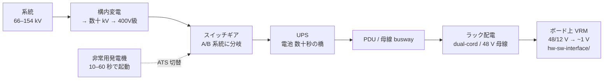

# データセンターの給電 (Datacenter Power)

## 概要 (Overview)

データセンターの給電とは、**系統の数万ボルト交流を、プロセッサの 1 V 直流まで、無停止で・冗長に・効率よく変換し続ける**チェーンの設計である。`../power-generation/` が扱った系統側（発電・送配電・市場）と、`../hw-sw-interface/clock-power-reset.md` が扱ったチップ側（オンボードの電源レール・POR）の間を埋める層であり、変換の各段——変電、無停電電源 (UPS)、配電 (PDU)、ラック内変換——のそれぞれに、効率(損失)・冗長性・保守性のトレードオフが埋め込まれている。

AI クラスタはこの層に二重の圧力をかけた: **密度**（1 ラック 100 kW 超は従来の配電の一桁上——`datacenter-fundamentals.md`）と、**変動**（数万 GPU が同期して動く学習ジョブは、MW 級の負荷ステップを系統に見せる）である。本ドキュメントは変換チェーンを上流から下流へ辿り、冗長トポロジ、ラック給電の 48 V 化、電力のオーバーサブスクリプション、そして系統との新しい関係までを扱う。時事性の高い数値は 2026-07 時点と明記する。分析深度は Level 3。

## 方法論 (Methodology)

- チェーンを**電圧の階段**（66/154 kV → 数十 kV → 400 V 級 → ラック → 12/48 V → ~1 V）として描き、各段に「なぜこの電圧か（電流と導体の算術）」「どこで冗長を確保するか」「何%を失うか」を対応づける。
- 冗長は `datacenter-fundamentals.md` の語彙（N+1/2N・コンカレントメンテナビリティ）を給電に具体化する形で扱う。
- 電池・電力変換の物理は既存文書（[`../power-generation/battery-energy-storage.md`](../power-generation/battery-energy-storage.md)・[`../../foundations/physics/electromagnetism/circuit-theory.md`](../../foundations/physics/electromagnetism/circuit-theory.md)）に委ね、本書はシステム構成の判断に徹する。
- 業界動向（48 V・±400 V DC・原子力併設）は目標値/構想と実装済みを区別する。

## 発見事項 (Findings)

1. **給電チェーンの設計原理は「電流を小さく保て」の一言に尽きる。** 導体の損失は I²R——同じ電力なら電圧を上げるほど電流と損失が減る（`../power-generation/generation-and-grid-fundamentals.md` の送電と同じ算術）。ゆえに変換チェーンは「できるだけ高い電圧で運び、負荷の直前で落とす」よう設計され、密度が上がるほど**高電圧をよりラックの近くまで**引き込む方向に進化してきた（配電の 400 V 級化、ラック内 48 V 化、±400 V DC 構想）。
2. **UPS の役割は「停電対策」ではなく「発電機が起動するまでの 10〜60 秒の橋」である。** 長時間の停電を電池で持たせる設計は非経済的で、実際の構成は「電池（または フライホイール）で数十秒 → 非常用発電機が引き継ぐ」の二段構えである。UPS 方式の選択——常時二重変換（オンライン: 常に AC→DC→AC、品質最高・損失数%）vs ライン インタラクティブ/エコモード（常時はバイパス、異常時に切替）——は**電力品質と効率の交換**であり、大規模事業者は損失を嫌ってエコモード・分散電池へ寄ってきた。
3. **冗長トポロジの本質は「二本の独立な道」をどこまで下流まで保つかである。** 2N 構成では独立な A/B 系統がラックの二重電源 (dual-cord) まで並走し、サーバの 2 台の PSU がその終端になる。ブロック冗長・分散冗長 (distributed redundant) は 2N の資本コストを削る中間解である。重要なのは**冗長の終端より下流は単一障害点**という自明な帰結で、単一電源の機器（一部のスイッチ・GPU 筐体)をどう扱うかが実務の詰めどころになる（ラック内 ATS・静的切替器）。
4. **ラック内の 48 V 化は「変換段数と I²R」の算術が Open Compute で製品化されたものである。** 従来の「AC → PSU で 12 V → マザーボード」に対し、OCP 系ラックは「ラック一括で 48 V DC 母線 → 各ボードで降圧」へ移行した。12 V → 48 V で同一電力の電流は 1/4、母線損失は 1/16 になり、電池 (BBU) をラックに分散して UPS 段を丸ごと省く構成も可能になる[^ocp]。AI ラックの kW 密度がこの移行を必須化し、さらに **±400 V DC をラックへ直接引き込む構想**（変換段の追加削減）が 2026 年時点で業界提案の段階にある[^ocp-hvdc]——目標値と実装の区別が要る領域である。
5. **電力のオーバーサブスクリプションは「名板値の嘘」を回収する。** 全サーバが銘板定格 (nameplate) で同時にピークを引くことは実際にはないため、実測分布に基づき定格合計が受電容量を超える台数を収容し、超過しそうな稀な瞬間だけ**電力キャッピング**（周波数制限・ジョブ抑制）で守る[^power-provisioning]——`../../software/virtualization/` のメモリオーバーコミットと同じ統計的多重化である。ただし AI 学習はこの前提を壊す: 同期ジョブは全 GPU のピークを**揃えて**引くため多重化の余地が薄く、逆に通信フェーズで一斉に電力が落ちる——負荷の相関が統計を裏切る。
6. **AI の負荷変動は施設と系統の新しい設計問題である（2026-07 時点）。** 学習ジョブの計算/通信の交代・チェックポイント・障害停止は、数十 MW 規模の負荷ステップを数秒〜数分スケールで生む。施設側はラック/施設レベルの平滑化（電池・キャパシタ・ダミー負荷）やジョブ側の電力整形で吸収を図り、系統側は大口需要家の変動・保護協調として扱い始めた——`../power-generation/electricity-markets-dispatch.md` の需要側資源の議論に、データセンターが最大のプレーヤとして登場した形である。
7. **給電は最大の停止原因であり続けている。** 業界調査で重大停止の主因は一貫して電源系である[^uptime-outage]。しかも多くは「UPS があるのに落ちた」型——切替の失敗、電池の劣化見逃し、保守時の誤操作——であり、冗長は**検証されて初めて冗長**である（負荷試験・実切替訓練）。`../../software/security/fuzzing-program-analysis.md` の「検出はインフラ」と同じく、可用性も行為ではなく運用の継続である。

## アーキテクチャ (Architecture)

### 電圧の階段 — 系統から 1 V まで



### 冗長トポロジの比較

| 構成 | 独立系統 | 耐えられる事象 | 資本コスト | 典型用途 |
|---|---|---|---|---|
| N | 1 | なし | 最小 | 冗長不要の負荷 |
| N+1 (並列冗長) | 1 系統 + 予備モジュール | UPS/発電機 1 台の故障 | 中 | Tier II〜III |
| 分散冗長 (3系統で 2N 相当) | 3 系統に負荷分散 | 1 系統の全損 | 中〜高 | 大規模での 2N 代替 |
| 2N | 完全独立 A/B | 片系統の全損 + 保守同時 | 最大 | Tier III〜IV |

- どの構成でも、**切替器 (ATS/STS) と下流の単一経路**が実質の弱点になる。「紙の上の 2N」と「訓練で実証された 2N」の差が停止統計（発見事項 7）を説明する。

## 技術詳細 (Technical Details)

### 1. UPS と エネルギー貯蔵 (UPS & Energy Storage)

- **常時二重変換 (double conversion)**: 入力 AC → 整流 → DC バス（電池接続）→ インバータ → 出力 AC。周波数・波形の乱れを完全に遮断するが、常時 2 回の変換損失（数%）を払う。**エコモード**は正常時バイパスで通し、異常検出時に数 ms でインバータへ切り替える——「品質の保険料を、切替リスクと引き換えに返金する」方式であり、大規模事業者の採用が進んだ。
- **貯蔵の選択**: 鉛蓄電池（安価・重い・寿命短）→ リチウムイオン（省スペース・BMS 必須——熱暴走リスクは `../power-generation/battery-energy-storage.md`・消防法規と一体）へ世代交代。フライホイールは 10 秒級の橋に特化した機械式の解。ラック分散 BBU（OCP 型）は「UPS という段」を消してチェーンを短くする[^ocp]。
- **発電機**: ディーゼルが標準（数十秒起動・燃料 24〜72 h 備蓄）。起動失敗が停止統計の常連であり、無負荷試運転ではなく**実負荷試験**が運用の要。排出規制・燃料の脱炭素（HVO・ガス・水素構想）と、そもそも発電機を持たない設計（系統二回線 + ソフトウェア冗長への引き渡し）が現在の論点である。

### 2. 配電と計測 (Distribution & Metering)

- PDU・母線 (busway) はラック列への配電と**計測の解像度**を提供する。回路単位の電流・電力の常時計測は、容量管理（オーバーサブスクリプションの前提データ）・故障予兆・課金の基盤であり、`../../software/observability/` の「観測の入口」が給電にもある——分岐回路レベルのテレメトリなしに統計的多重化は運用できない。
- 相バランス: 三相給電では負荷を 3 相に均等配分しないと中性線電流・変圧器容量を無駄にする。ラック内の機器配置が電気設計問題になる、地味だが恒常的な制約である。

### 3. 電力キャッピングの階層 (The Power Capping Hierarchy)

```
施設受電容量
  └ 変圧器・UPS 容量 (静的制約)
      └ ラック割当 (契約値)
          └ サーバ電力上限 —— RAPL 等でチップに強制
              └ プロセッサ DVFS (msスケールの実施機構)
```

- 実施の実体はチップの電力管理（DVFS・電力上限レジスタ——`../../software/operating-systems/power-management.md`・`../cpu-architecture/`）であり、施設の静的な契約をミリ秒の閉ループが守る、階層化された制御系である（`../../hardware/robotics/control-systems.md` のカスケード構造の給電版）。
- AI 学習でのキャッピングは性能に直結する（全 GPU が同期しているため 1 台の抑制が全体を遅らせる——`../gpu-accelerators/interconnects-scaleout-training.md` のストラグラー問題の電力版）。ゆえに AI クラスタでは「キャップで守る」より「変動を平滑化して容量内に収める」（電池バッファ・ジョブの電力整形）方向が探られている。

### 4. 系統との関係の変化 (The New Grid Relationship)

- 大口化: 単一キャンパスの受電が数百 MW 級になると、接続可否は送電・変電設備の増強計画に依存し、**「電力の取れる土地」が最希少資源**になる（`datacenter-fundamentals.md` の立地の議論）。
- 調達: 再エネ PPA（会計上のマッチング）から、24/7 カーボンフリー調達、自家発電・蓄電の併設、原子力（既設 PPA・SMR 併設構想——2026 年時点で多くは契約・建設段階）まで、`../power-generation/electricity-markets-dispatch.md` の市場の仕組みがデータセンター戦略の一部になった。
- 需要側資源として: 大規模電池・柔軟なワークロード（遅延許容のバッチ・学習）を持つデータセンターは、系統サービス（需要応答・周波数調整）の提供者にもなりうる——「系統の負担」から「系統の資源」への転換が構想され、実装はまだ限定的である。

## セキュリティ考察 (Security Considerations)

- **給電制御系は最も増幅率の高い OT 攻撃面である。** UPS・スイッチギア・発電機制御・BMS への侵入は、物理的破壊なしに全館停止を引き起こせる。ネットワーク接続された UPS/PDU の管理インターフェースは既定認証情報・未パッチの常連であり、管理網の分離・ベンダ保守経路の統制（`../power-generation/plant-control-scada-security.md` と同型）が第一線になる。
- **切替イベントは攻撃の窓である。** 系統→発電機切替・UPS バイパス操作は、正規手順でも停止リスクが最大化する瞬間であり、偽の異常を注入して切替を誘発する攻撃は「正規機構の悪用」として検出が難しい。切替ロジックの完全性と、異常時手順の訓練が防御を兼ねる。
- **電力テレメトリは情報を漏らす。** 施設・回路単位の電力波形はワークロードの推定（学習ジョブの開始・規模・チェックポイント周期）を許す——`../hardware-security/side-channels-tee-secure-boot.md` の電力サイドチャネルの施設スケール版であり、テレメトリの取り扱いは機密情報に準じる。
- **燃料・電池のサプライチェーン**: 非常用燃料の品質・補給契約、電池の劣化管理は可用性の一部であり、広域災害時には補給が競合する——冗長設計は「平時の独立性」だけでなく「危機時の調達競合」まで含めて評価する必要がある。

## 結論 (Conclusions)

給電チェーンは「電流を小さく保て」という一つの算術の反復であり、その上に「二本の独立な道をどこまで保つか」という冗長の設計と、「銘板値と実測の差を回収する」統計的多重化が載る。UPS は停電対策ではなく発電機への橋であり、冗長は訓練されて初めて実在し、48 V 化・DC 化はチェーンを短くする算術の帰結である。そして AI は、密度と同期変動という二つの新変数でこの体系を揺さぶり、データセンターを系統の最大の顧客かつ潜在的資源へと変えた。給電の設計は今や、チップの DVFS から電力市場までを貫く一本の制御問題である。

---

## 参考文献 (References)

[^ocp]: Open Compute Project. *Open Rack Standard (v2/v3)* — 48 V 母線・分散 BBU の仕様. https://www.opencompute.org/ — Accessed: 2026-07-13. — ラック給電 48 V 化の一次仕様。

[^ocp-hvdc]: Open Compute Project — Mt. Diablo / ±400 VDC 提案（2024–2025 の業界発表）. https://www.opencompute.org/ — Accessed: 2026-07-13. — 高圧 DC ラック給電の構想段階の一次資料（実装は限定的、目標値として扱う）。

[^power-provisioning]: Fan, X., Weber, W.-D. & Barroso, L. A. (2007). Power Provisioning for a Warehouse-sized Computer. *Proc. ACM/IEEE ISCA 2007*, 13–23. DOI: 10.1145/1250662.1250665 — 電力オーバーサブスクリプションと実測分布の原典。

[^uptime-outage]: Uptime Institute. *Annual Outage Analysis*（年次）. https://uptimeinstitute.com/ — Accessed: 2026-07-13. — 停止原因の統計（電源系が主因であり続けること）の出典。

その他の標準的典拠:

- Barroso, L. A., Hölzle, U. & Ranganathan, P. (2018). *The Datacenter as a Computer* (3rd ed.). Morgan & Claypool. — 給電チェーン・TCO・キャッピングの体系的整理。
- IEEE Std 3006.7 / IEEE Gold Book 系列. *Recommended Practice for Determining the Reliability of 7x24 Continuous Power Systems*. — 給電信頼性評価の実務標準。
