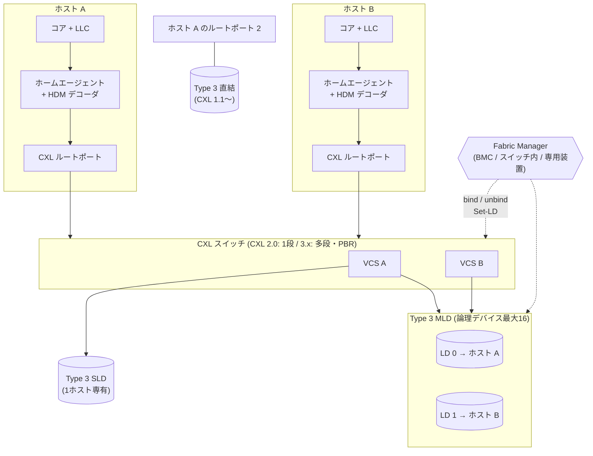
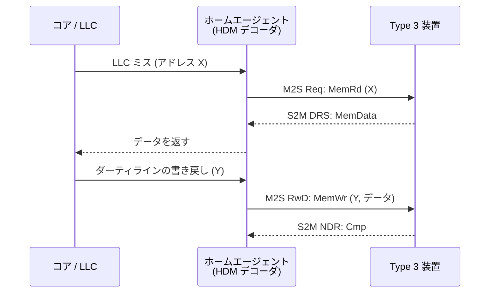

# CXL とメモリ拡張・プーリング (CXL Memory Expansion & Pooling)

## 概要 (Overview)

[`bus-interconnect.md`](bus-interconnect.md) は CXL (Compute Express Link) を「PCIe の物理層の上にコヒーレンシを載せた相互接続」として紹介し、3つのサブプロトコル (`CXL.io`・`CXL.cache`・`CXL.mem`) とデバイスの型 Type 1/2/3 を表にまとめた。[`../cpu/numa-multi-socket.md`](../cpu/numa-multi-socket.md) は、CXL メモリが「CPU のない NUMA ノード」として OS に見えることと、TPP による階層化の基本を扱った。本書はその先を扱う。対象は `CXL.mem` のメッセージの流れ、CXL 1.1 から 4.0 までの機能の積み上げ (スイッチ、プーリング、共有、ファブリック)、実機の遅延と帯域、OS のティアリング、プーリングの経済性、障害の影響範囲、セキュリティ、2026-10 時点の製品と採用状況である。

中心テーゼは次のとおり。**CXL はメモリを「CPU ソケットに付属する部品」から「スイッチ越しに配る資源」へ変えようとしている。しかし実機の CXL メモリはローカル DRAM より 100〜280ns ほど遠く、NUMA の階層を1段増やす。このため、CXL の価値はハードウェアの仕様よりも、どのページをどの階層に置くかというティアリング (tiering) の質で決まる。** 規格はプーリング (CXL 2.0) や複数ホスト間のコヒーレントな共有 (CXL 3.0) まで進んだ。一方で、2026-10 時点で実際に出荷・提供されているのは、1台のホストに直結するメモリ拡張 (Type 3) と、その上のソフトウェアやハードウェアによる階層化がほとんどである。

分析深度は Level 3 とし、プロトコル、エッジケース、故障モード、セキュリティ、最適化を扱う。

## 方法論 (Methodology)

- **プロトコルと版の整理**: 規格本文は CXL Consortium の評価版利用条件が AI による処理を制限しているため、本書では直接処理していない。代わりに、規格策定の中心人物による査読付きの解説 (Das Sharma, Blankenship & Berger, ACM Computing Surveys 2024)[^cxl-intro] と、Consortium の公式発表・白書[^cxl20-pr][^cxl31-wp][^cxl32-pr][^cxl40-pr]を一次資料とする。
- **性能の数値**: 実機での測定を載せた査読論文を優先する。Sun et al. (MICRO '23)[^sun-cxl] と Liu et al. (ASPLOS '25)[^melody] は独立した二つのグループの実測であり、両者を突き合わせる。Pond[^pond] と Das Sharma et al.[^cxl-intro] の遅延は**見積もり (estimate)** であり、実測と区別して示す。
- **OS の挙動**: Linux カーネルの公式文書 (CXL ドライバ文書とその成熟度表、sysctl 文書)[^k-cxl-maturity][^k-cxl-page][^k-cxl-reclaim][^k-sysctl] で確かめる。TPP の設計は論文[^tpp]に拠る。
- **製品と採用状況**: 時期で変わる事実なので、2026-10-24 にベンダーの一次発表を確かめた。可能なものは独立報道と突き合わせ、「計画」「サンプル」「量産」「プレビュー」を区別して書く。
- 重複を避けるため、コヒーレンスの基本は [`../cpu/cache-coherence.md`](../cpu/cache-coherence.md)、NUMA の申告 (SRAT/SLIT/HMAT) とメモリポリシーは [`../cpu/numa-multi-socket.md`](../cpu/numa-multi-socket.md)、ページ回収の LRU は [`../../software/operating-systems/virtual-memory-paging.md`](../../software/operating-systems/virtual-memory-paging.md) に任せる。

## 発見事項 (Findings)

1. **CXL メモリの遅延は「リモートソケットと同程度から、その数倍」まで製品で大きく異なる。** Sun et al. は Sapphire Rapids と3種の実機デバイスで、ロードの遅延がリモートソケットの DDR5 に比べて +35%、約2倍、約3倍になることを実測した[^sun-cxl]。Liu et al. は別の4種のデバイスで、アイドル時の遅延が 214〜394ns であり、同じ構成のローカル DRAM (111〜114ns) のおよそ2〜3.5倍になることを示した (実測)[^melody]。規格の策定者による見積もりも、直結で約 170ns、スイッチ1段を挟むと約 250ns である[^cxl-intro]。
2. **平均値より裾 (tail) が問題になる。** Liu et al. によれば、ローカル DRAM の p99.9 と p50 の差は 45ns にとどまる。これに対し、CXL デバイスでは p99.99 以上で 700ns から 1µs を超えた (実測)[^melody]。平均の遅延だけで「リモートソケット相当」とみなすと、遅延に敏感な処理の劣化を見落とす。
3. **CXL メモリは「遅いメモリ」であると同時に「別の帯域源」でもある。** DDR5-6400 の1チャネルは約 200 本の信号線で 50GB/s を運ぶ[^cxl-intro]。これに対し、x16 リンクの信号線は 64 本 (16 レーン × 送受の差動対) で、32GT/s (PCIe 5.0 世代) なら片方向 64GB/s、送受合計 128GB/s になる (符号化の損失を除いた単純計算)。信号線 1 本あたりの帯域は DDR5 の数倍であり、CPU のピン数を増やさずに帯域を足せる。ただしデバイスのコントローラの効率差は大きく、読み出し専用の負荷で理論帯域の 20〜47% しか出ない例がある (実測)[^sun-cxl]。帯域律速の負荷では、DRAM と CXL に帯域比で振り分けると全量 DRAM より速くなる例が報告されている[^sun-cxl][^melody]。
4. **CXL の価値はティアリングの質で決まる。** 全ページを CXL に置くと、負荷の 15〜22% が 50% を超えて遅くなった (実測)[^melody]。一方、Meta の本番機では割り当てたメモリの 55〜80% が2分間触られておらず、TPP はローカル DRAM だけの理想構成との差を 1% 未満に抑え、既定の Linux より 18% 速かった[^tpp]。Intel のハードウェアによるティアリング (Flat Memory Mode) でも、82% の負荷は劣化 5% 以内に収まったが、外れ値は最大 34% 劣化した[^fmm]。同じハードウェアでも、どのページを近くに置くかで結果が大きく変わる。
5. **プーリングの経済性は「取り残されたメモリ (stranded memory)」の回収で決まり、プールの大きさと遅延が釣り合う点が小さい。** Azure では DRAM がサーバ費用の最大 50% を占め、CPU コアが売り切れて余ったメモリは 95 パーセンタイルで 25% に達した[^pond]。Pond は 8〜16 ソケットのプールで利益の大半が得られると結論した。遅延の追加はその規模で 70〜90ns、ラック規模では 180ns 超と見積もられ、16 ソケットのプールで DRAM 必要量を 7% 減らせると評価した[^pond]。プールを大きくするほど回収できる量は増えるが、遅延も増える。
6. **CXL 3.0 の BISnp (Back-Invalidate Snoop) は、複数ホストのハードウェアコヒーレントな共有を可能にした。ただし 2026-10 時点の Linux はまだそこに届いていない。** BISnp により、メモリデバイス側がディレクトリを持ち、他ホストのキャッシュを無効化できるようになった[^cxl-intro]。しかし Linux の CXL 成熟度表では、Dynamic Capacity Device (DCD)、ハードウェアコヒーレントな共有メモリ、Type 2 の HDM-DB はいずれも「[0] Known gap」である[^k-cxl-maturity]。
7. **メモリを外に出すと、メモリ装置の故障がホストの故障になる。** ホストのアドレス空間に組み込まれた CXL メモリを、手順を踏まずに抜くとマシンチェック (machine check) を起こしうる。`ZONE_NORMAL` で載せた容量は事実上取り外せないものとして扱う必要がある[^k-cxl-devhotplug][^k-cxl-hotplug]。Pond はこの影響を限るため、ホストがプールのメモリをインタリーブしない設計を採った[^pond]。
8. **セキュリティの境界はリンクからメモリ装置の内側へ広がった。** CXL 2.0 はリンク上の暗号化と完全性保護 IDE (Integrity and Data Encryption) を加えた[^cxl20-pr]。CXL 3.1 の TSP (TEE Security Protocol) は、直結した CXL メモリ装置を機密 VM (TVM) の信頼境界に含める仕組みを定めた[^cxl31-wp]。プールで容量を別のホストへ渡すときは、前の利用者のデータを消すことが新たに要件になる。
9. **2026-10 時点で本番の選択肢と言えるのは、CXL 2.0 による1ホスト向けの拡張である。** Intel Xeon 6 と AMD EPYC 9005 は CXL 2.0 に対応し[^sth-xeon6][^amd-9005]、Samsung は 128GB の CMM-D を量産品として掲載している[^samsung-cmmd]。クラウドでは Azure が 2025-11 に Xeon 6 と CXL メモリを使う M シリーズ VM のプライベートプレビューを始めた[^azure-cxl]。CXL 3.x のスイッチやメモリモジュールは、サンプル出荷や量産計画の段階にある[^panmnesia][^xconn][^trendforce]。

## アーキテクチャ (Architecture)

### ホスト・スイッチ・メモリ装置の構成

CXL 2.0 以降で、1台のメモリ装置を複数ホストで分け合う構成を示す。



凡例: 実線はデータ経路 (`CXL.mem` のメッセージ)、点線は管理経路 (帯域内の CCI、または MCTP による帯域外の管理)、円柱はメモリを持つ装置、六角形は管理ソフトウェアを表す。VCS (Virtual CXL Switch) は、スイッチが各ホストに見せる仮想的なスイッチである。

- **ホームエージェントが主役**: ホストの LLC ミスのうち、アドレスが CXL の範囲に当たるものは、HDM (Host-managed Device Memory) デコーダによって CXL ポート上の要求に変換される[^pond][^cxl-intro]。コヒーレンスの調停点はホスト側に残る。
- **仮想階層 (Virtual Hierarchy)**: CXL 2.0 では、各ホストはスイッチを自分専用の VCS として見る。スイッチは VCS ごとのアドレス空間を追跡する必要があるため、CXL 2.0 は1段のスイッチと木構造に限られる[^cxl-intro]。
- **MLD (Multi-Logical Device)**: 1台の Type 3 装置を最大 16 の論理デバイス (LD) に分け、別々のホストに割り当てる。LD-ID はスイッチと装置の間のリンクにだけ現れ、ホストからは見えない[^cxl-intro]。
- **Fabric Manager (FM)**: どの LD をどのホストに渡すかを決める管理ソフトウェアである。`bind` で割り当て、`unbind` で外す。`unbind` には、ホストの協力を待たずに強制的にホットリムーブする選択肢もある。不調なホストや、ベアメタルの貸し出し先にあるホストを扱うためである[^cxl-intro]。

### 版ごとの機能の積み上げ

| 版 (公開) | 主な追加 | メモリ拡張・プーリングへの意味 |
|---|---|---|
| 1.0 / 1.1 (2019) | 3 プロトコルの多重化、68 バイトのフリット、Type 1/2/3 | 1ホストへの直結拡張。ホットプラグなし[^cxl-intro] |
| 2.0 (2020-11) | スイッチ1段、MLD によるプーリング、ホットプラグ、IDE、CDAT、DevLoad による QoS | 最大 16 ホストで1台の装置を分け合う[^cxl20-pr][^cxl-intro] |
| 3.0 (2022-08) | 64GT/s と 256 バイトのフリット、多段スイッチ、PBR (最大 4096 端点)、BISnp と HDM-DB、GFAM、DCD | 複数ホスト間のコヒーレントな共有、非木構造のファブリック[^cxl-intro] |
| 3.1 (2023-11) | PBR スイッチ向け FM API、GIM によるホスト間通信、TSP、メタデータ拡張、RAS 強化 | 機密計算への組み込み、プールの運用性[^cxl31-wp] |
| 3.2 (2024-12) | CHMU (ホットページ監視)、PPR の強化、TSP の拡張 | ティアリングを装置側から助ける[^cxl32-pr] |
| 4.0 (2025-11) | 128GT/s (PCIe 7.0 系)、ポートの束ね (bundled ports)、x2 リンク幅、リタイマ最大4個、RAS 強化 | 帯域とリーチの拡大[^cxl40-pr] |

すべての版は前の版と後方互換を保つ[^cxl40-pr]。

## 技術詳細 (Technical Details)

### 1. `CXL.mem` のメッセージとチャネル

`CXL.mem` は、ホスト (Master) から装置 (Subordinate) への M2S と、その逆の S2M という2方向で構成される。M2S には Req (要求) と RwD (Request with Data、書き込み) の2チャネル、S2M には NDR (No Data Response、完了通知) と DRS (Data Response、読み出しデータ) の2チャネルがある[^cxl-intro]。



- **HDM-H と HDM-D**: Type 3 のメモリ拡張は通常 HDM-H (host-only coherent) である。装置はコヒーレンス状態を持たず、ホストが全責任を負う。各キャッシュラインには、ホストが自由に使える 2 ビットのメタデータが付く。Type 2 のアクセラレータが持つメモリは HDM-D (device-managed coherent) であり、メッセージにキャッシュ状態とスヌープの属性が載る[^cxl-intro]。CXL 3.1 はこのメタデータに 32 ビットを追加し、アクセス制御、型のタグ、ティアリングに使えるようにした[^cxl31-wp]。
- **なぜ実機の CXL メモリはリモートソケットより速いことがあるのか**: リモートソケットの DRAM に触るときは、相手 CPU にコヒーレンスを問い合わせる必要がある。CXL メモリにはコアもキャッシュもないため、Sapphire Rapids はオンチップの構造で確認を済ませる。このため非一時的ストア (nt-st) では、CXL メモリのほうがリモート DDR5 より 25% 速い例がある[^sun-cxl]。

### 2. CXL 3.0 の BISnp による逆方向の無効化

CXL 2.0 までの `CXL.mem` では、装置からホストへ要求を出す経路がなかった。そのため、別の装置 (アクセラレータなど) がこのメモリを使いたいときはホストを経由するしかなかった。CXL 3.0 は S2M に BISnp、M2S にその応答 BIRsp という2チャネルを加え、これに対応するメモリ領域を HDM-DB (Device-coherent with Back-invalidate) と呼ぶ[^cxl-intro]。

- **複数ホストの共有での流れ**: メモリ装置 (MLD または GFAM 装置) が、各キャッシュラインの持ち主を記録するディレクトリ (またはスヌープフィルタ) を持つ。ホスト 1 とホスト 3 がライン X を共有 (S) で持っているときに、ホスト 4 が排他 (E) を要求したとする。装置はホスト 1 と 3 に BISnp を送り、両方の無効化完了を待ってから、ディレクトリを「E: ホスト 4」に書き換えてデータを渡す[^cxl-intro]。これは [`../cpu/cache-coherence.md`](../cpu/cache-coherence.md) のディレクトリ型コヒーレンスを、ホームをメモリ装置に移して行う形である。
- **専用チャネルにした理由**: BISnp を既存のチャネルに相乗りさせると、Req と応答の間に新しい依存が生まれ、デッドロックの恐れがある。BIRsp は受け手が事前に資源を確保しておく方式にして、依存グラフに循環が生じないようにした[^cxl-intro]。
- **代償**: ディレクトリの容量と、無効化の往復による遅延を装置側が負う。共有の粒度はキャッシュライン (64 バイト) なので、[`../cpu/cache-coherence.md`](../cpu/cache-coherence.md) の false sharing はホスト間でも起きる。そのうえ1回の往復はソケット内より桁違いに遠い。共有メモリは RDMA の代わりに細かい同期を速くする用途で期待されている[^cxl-intro]。ただし、ホスト間でロックを取り合う設計にすると遅延が大きく効く。

### 3. CFMWS・HDM デコーダ・インタリーブによるアドレスの割り当て

- **3段のデコーダ**: プラットフォームのファームウェアは、ACPI の CEDT にある CFMWS (CXL Fixed Memory Window Structure) で、CXL に使えるホスト物理アドレスの窓を静的に決める。その下で、ホストブリッジやスイッチのデコーダが窓をポートに振り分け、末端の装置のデコーダがホスト物理アドレスを装置内のアドレス (DPA) に変換する[^k-cxl-theory]。
- **インタリーブの組み合わせ**: 複数の装置にストライプしてリージョン (region) を作ると、帯域は足し合わされる。その代わり、どれか1台の故障がリージョン全体の故障になる (技術詳細 6)。ホストブリッジをまたぐインタリーブは起動時に CEDT で固定される。HDM で組んだインタリーブに装置を足し引きするには、リージョンを一度壊して作り直す必要がある[^k-cxl-devhotplug]。
- **ホットアドの前提**: 装置をあとから挿すには、起動時の CFMWS にそのための十分なアドレス空間が予約されていなければならない。CFMWS は起動後に広げられない[^k-cxl-devhotplug]。プーリングで容量を動的に出し入れする設計は、この「最初に窓を広く取る」ことに依存している。

### 4. 遅延と帯域の実測と見積もり

| 構成 | 遅延 | 種別・出典 |
|---|---|---|
| ローカル DDR5 (SPR/EMR 2 ソケット) | 111〜114ns | 実測 (Liu et al.)[^melody] |
| リモートソケット DDR5 (同上) | 191〜193ns | 実測 (Liu et al.)[^melody] |
| CXL 直結、ASIC 3種・FPGA 1種 (x8/x16) | 214〜394ns (x16 の ASIC は 239ns または 271ns) | 実測 (Liu et al.、プレプリント表 1)[^melody] |
| CXL 直結 3 種 (SPR) | リモート DDR5 比 1.35 倍〜約 3 倍 (ロード) | 実測 (相対値、Sun et al.)[^sun-cxl] |
| CXL 直結 (Type 3 SLD) | 約 170ns | 見積もり (Das Sharma et al.)[^cxl-intro] |
| CXL スイッチ1段経由 | 約 250ns (スイッチの往復で 62〜70ns 追加) | 見積もり (Das Sharma et al.)[^cxl-intro] |
| 8〜16 ソケットのプール | ローカル比 +70〜90ns | 見積もり (Pond)[^pond] |
| ラック規模のプール | ローカル比 +180ns 超 | 見積もり (Pond)[^pond] |

- **読み方**: 実測では見積もりより遅い装置が多い。Liu et al. のプレプリントは x16 の ASIC 装置 (CXL-D) を本文で 271ns、表で 239ns と書いており、食い違いが残る[^melody]。本書では範囲として示す。ばらつきの主因はコントローラの設計 (ASIC かソフト IP の FPGA か) と、背後の DRAM の世代である[^sun-cxl]。
- **帯域**: x8 の装置は 1 台あたり 18〜24GB/s、x16 の装置で 52GB/s を示した (実測)[^melody]。Sun et al. の測定では、読み出しのみの負荷で理論帯域に対する効率がリモート DDR5 の 70% に対して、CXL 装置は 46%・47%・20% であった[^sun-cxl]。帯域を大量に使う SPEC の 4 本 (bwaves、lbm、fotonik3d、roms) は、x8 の装置が飽和して 50% を超えて遅くなった[^melody]。
- **プリフェッチとの相互作用**: CXL の長い遅延は L2 プリフェッチャの効きを下げ、その分 L1 プリフェッチャが CXL から取りに行く量が増える。プリフェッチは平均遅延を改善するが、裾の遅延は改善しない[^melody]。
- **測り方の注意**: Intel MLC のように直列のポインタ追跡で測った値と、並列アクセスで測った値は大きく異なる。Sun et al. は独自の測定で MLC より 76〜79% 低いロード遅延を得た[^sun-cxl]。引用するときは測定の道具とモードを併記する ([`../cpu/numa-multi-socket.md`](../cpu/numa-multi-socket.md) 技術詳細 4)。

### 5. OS のティアリング (降格・昇格・安全弁)

CXL メモリは、DAX デバイスを `kmem` でシステムメモリに変換すると、CPU を持たない NUMA ノードとしてページアロケータの管理下に入る[^k-cxl-page]。その上で Linux は次の仕組みを組み合わせる。

- **降格 (demotion)**: 回収の際、コールドページをスワップに出す代わりに、遠いノードへ移す。移し先は `mm/memory_tier.c` が HMAT または CDAT の性能情報から選ぶ。有効にするには `/sys/kernel/mm/numa/demotion_enabled` を使う[^k-cxl-reclaim]。
- **昇格 (promotion)**: `kernel.numa_balancing` に `NUMA_BALANCING_MEMORY_TIERING` (値 2) を立てると、AutoNUMA と同じ「PTE を外してヒンティングフォルトを捕まえる」方法でホットページを見つけ、速いノードへ移す[^k-sysctl]。Linux 6.1 で、ヒンティングフォルトの遅延でホットページを選ぶアルゴリズムと、デバイスドライバが明示的に作る memory tier の仕組みが入った[^kn61]。
- **TPP の工夫 (ping-pong の抑止)**: 既定の NUMA balancing は、ヒンティングフォルトが起きたページをすぐに昇格させる。これでは、たまにしか触られないページまで DRAM に上がり、すぐに降格されて往復を繰り返す。TPP は、フォルトしたページがアクティブ LRU にある場合だけ昇格させる。非アクティブ LRU にあれば、まずアクティブ LRU に移して次のフォルトを待つ。また、降格を始める水位 (demotion watermark) を割り当て用の水位より高くとり、DRAM に新規割り当ての余地を常に残す[^tpp]。
- **安全弁**: `numa_balancing_promote_rate_limit_MBps` は、ノードごとの昇格の速度に上限を設ける。移動が多すぎるとアプリケーションの遅延を悪化させるからである[^k-sysctl]。

TPP の昇格判定を擬似コードで示す。

```text
# 擬似コード (TPP の昇格判定の要約。言語非依存)
# 前提: ページ p は CXL ノード上にあり、NUMA hint fault を起こした。
# 計算量: 1回のフォルトあたり O(1)。LRU リスト間の移動は定数時間。
on_numa_hint_fault(p, cpu):
    if node_of(p) is not a slow tier:      # TPP はローカルノードを標本にしない
        return
    if p in inactive_lru:
        mark_accessed(p); move_to_active_lru(p)   # 一度目は様子を見る (ヒステリシス)
        return
    target = local_node_of(cpu)
    if promote_rate_exceeded(target):       # rate limit の安全弁
        return
    migrate(p, target)                      # 割り当て水位を無視して移し、回収を誘発する
```

- **ゾーンの選択**: CXL の容量を `ZONE_MOVABLE` に載せると、カーネル自身の割り当て (移動できないもの) はそこに置かれない。後で取り外せる見込みも残る。`ZONE_NORMAL` に載せればカーネルも使えるが、その容量は「ページアロケータに恒久的につながったもの」とみなすべきである[^k-cxl-hotplug][^k-cxl-page]。大量の `ZONE_MOVABLE` を持つ構成では、ページ管理構造 (memmap) を置くためのローカルの `ZONE_NORMAL` が足りるかを確かめる必要がある[^k-cxl-hotplug]。
- **コンテナの隔離の穴**: Linux 6.15 以前の降格は cpuset の `mems_allowed` を無視する。それ以降の版でも、別の cgroup が最初に触った共有ページ (libc など) は降格されうる[^k-cxl-reclaim]。「このコンテナは CXL を使わない」という指定は完全には守られない。
- **ハードウェアでのティアリング**: Intel Xeon 6 の Flat Memory Mode は、DRAM と CXL メモリを一つの平らなアドレス空間として OS に見せる。どちらに置くかはプロセッサがキャッシュライン単位で決め、ホットなデータを DRAM 側に移す。包含的なキャッシュとは違い、データを二重には持たない[^intel-fmm][^fmm]。OS の版に依存せず、ページ単位の移動の費用もかからない。一方で、アプリケーションの性能を知らないため、VM 同士の競合による外れ値が出る。Zhong et al. はページカラーリングでこれを抑える割り当て器 Memstrata を提案し、外れ値の劣化を 30% 超から 6% 未満に下げた[^fmm]。

### 6. Pond に見るプーリングの仕組みと経済性

- **取り残しの実態**: Azure の 100 クラスタの追跡では、CPU コアの 75% が予約されているクラスタで平均 6% のメモリが取り残され、85% では 10% を超えた。95 パーセンタイルでは 25%、外れ値では 30% に達した[^pond]。取り残しとは、メモリは空いているのに、コアが売り切れているために貸し出せない状態を指す。
- **VM は割り当てたメモリを使い切らない**: VM の約半数は借りたメモリの 50% 未満しか触らない[^pond]。Pond はこの未使用分をプールから割り当て、ゲストには CPU を持たない仮想 NUMA ノード (zNUMA) として見せる。ゲスト OS はローカルノードから先に割り当てるため、zNUMA の大きさを未使用分に合わせれば、ほとんど触られない[^pond]。
- **遅延に敏感な負荷の見分け**: 遅延を 64ns または 140ns 増やす模擬では、158 の負荷のうち 43% と 37% が劣化 5% 以内に収まった。一方で 21% 超の負荷は 25% を超えて劣化した[^pond]。Pond は性能カウンタ (トップダウン分析の memory-bound 指標など) を使う機械学習モデルで敏感な VM を予測し、外れた場合は VM のメモリをローカルへ移して直す[^pond]。
- **割り当ての単位と速さ**: 容量は 1GB のスライス単位で、1スライスにつき1ホストに割り当てる。メモリ装置はアクセスごとに要求元と持ち主を照合し、許されないアクセスは致命的なメモリエラーにする[^pond]。オフライン化 (返却) には 1GB あたり 10〜100ms かかり、オンライン化は µs/GB で済む。そのため Pond は返却を非同期に行う[^pond]。規格側では、CXL 2.0 の FM が `Set-LD` で 256MB などの粒度の LD を作り、CXL 3.0 の DCD はより柔軟な容量の出し入れを定めた[^cxl-intro]。
- **費用の釣り合い**: 16 ソケットのプールで DRAM の必要量が 7% 減る。これは大規模クラウドにとって数億ドル規模に当たると Pond は見積もった[^pond]。ただし、この 7% は CXL コントローラやスイッチ、リタイマの費用と相殺される。Pond も 8 ソケット分のメモリ装置は AMD Genoa の I/O ダイの約半分、16 ソケット分は I/O ダイ1個分の規模になると見ている[^pond]。プーリングで得をするかどうかは DRAM の単価と取り残しの率で決まり、普遍的な答えはない。

### 7. 障害の影響範囲 (Blast Radius)

- **単一障害点の移動**: ソケットに直結した DIMM の故障は、そのホストだけの問題だった。プールのメモリ装置が壊れると、その装置からメモリを借りているすべてのホストに影響する。Pond はホストのインタリーブをローカルメモリの中だけにとどめ、プールのメモリにはかけない設計を採った。装置が故障しても、影響はその装置にメモリを持つ VM に限られ、他の装置の VM は動き続ける。ホストの故障は隔離され、そのホストに割り当てていたプールのメモリは他のホストに回せる。プールの管理者 (Pool Manager) が落ちても再割り当てができなくなるだけで、データ経路には影響しない[^pond]。
- **規格の封じ込め**: CXL は、装置が応答しなくなったときに、該当する仮想階層の未完了のアクセスにエラー応答を返す封じ込め (containment) のモデルを定める。これにより、ホストのタイムアウトで仮想階層全体が落ちるのを防ぐ[^cxl-intro]。訂正可能・訂正不能なエラーの報告と、ポイズン (poison) データの扱いも定められている[^cxl-intro]。
- **OS の現状**: Linux の成熟度表では、メモリ故障処理との連携 (Memory Failure coordination) は「[1] Initial」、スクラブ・PPR・スペアリングの制御は「[0] Known gap」である[^k-cxl-maturity]。CXL 4.0 も RAS の強化を柱の一つに挙げている[^cxl40-pr]。プールを本番で使うには、エラーの通知を受けて該当ページの VM だけを止める経路が要る。2026-10 時点で、それは Linux の標準機能として仕上がっていない。

故障モードを次の表にまとめる。

| 故障 | 直結拡張での影響 | プールでの影響 | 緩和策 |
|---|---|---|---|
| 装置の訂正不能エラー | そのページを使うプロセス。カーネルのデータならホスト全体 | 借りている全ホストの該当ページ | `ZONE_MOVABLE` に載せてカーネルのデータを置かない。ポイズンの通知 |
| インタリーブしたリージョンの1台の故障 | リージョン全体 | 同左 | プールにはインタリーブしない (Pond) |
| 手順を踏まない抜去・リンク断 | マシンチェックの恐れ[^k-cxl-devhotplug] | 同左 (複数ホスト) | 封じ込め、FM による計画的な unbind |
| Fabric Manager の故障 | なし | 再割り当てが止まる。データ経路は動く[^pond] | FM の冗長化 |
| 帯域を食い尽くすテナント | なし | 同じ装置の他ホストが遅くなる | DevLoad による送信元の抑制、LD ごとの帯域配分[^cxl-intro] |

## セキュリティ考察 (Security Considerations)

- **リンクの盗聴と改ざん**: CXL のリンクは既定では平文である。CXL 2.0 の IDE はリンク上のデータに機密性、完全性、リプレイ防止を与える[^cxl20-pr]。プールのメモリはスイッチやケーブルを経てラックの中を通るため、物理的に触れられる範囲が DIMM より広い。
- **機密計算への組み込み**: CXL 3.1 の TSP は直結の CXL メモリ装置を TVM の信頼境界に入れるための参照アーキテクチャである。TSP 対応の検出、CMA/SPDM による認証と構成証明 (attestation)、メモリの暗号化、アクセス制御、Dynamic Capacity を扱う[^cxl31-wp]。CXL 3.2 は TSP をさらに拡張し、IDE の保護範囲を広げた[^cxl32-pr]。Linux の成熟度表は TSP と IDE (TSP に包含) を「カーネルの対応の範囲外、または不要」に分類している[^k-cxl-maturity]。実際の保護は CPU の機密計算機能 (TDX や SEV-SNP) とプラットフォームのファームウェアに依存する。CXL メモリに機密 VM のメモリを置けるかどうかは、プラットフォームごとに確かめる必要がある (本書では製品ごとの対応状況を確認できていない)。
- **プールのデータ残留**: スライスや LD を別のホストへ渡すとき、前の利用者のデータが残っていれば、そのまま漏れる。Linux は CXL メモリ装置の消去を sysfs から呼べるようにしている。`security/sanitize` はユーザデータとメタデータを使えなくし、`security/erase` は媒体の暗号鍵を替えて消去する。どちらも装置がアドレス範囲を受け持っていない (無効化した) 状態でしか実行できない[^k-cxl-abi]。成熟度表も「Security commands」を「[3] Mature」としている[^k-cxl-maturity]。FM の再割り当ての手順に消去を組み込むことは、運用側の責任である。
- **ホスト間の隔離**: Pond のメモリ装置はアクセスごとに要求元と持ち主を照合して越境を止める[^pond]。照合の表が誤って設定されたり壊れたりすれば、他のホストのメモリを読み書きできてしまう。この表を書き換える FM の管理経路 (帯域内の CCI や帯域外の MCTP)[^cxl-intro] は、攻撃面として保護する必要がある。
- **共有メモリのサイドチャネル**: BISnp による共有では、あるホストのアクセスが他のホストのキャッシュの無効化として観測できる。これは [`../cpu/cache-coherence.md`](../cpu/cache-coherence.md) のコヒーレンス由来のタイミングチャネルと同じ構造を、ホスト間に持ち込む。共有の範囲は信頼できるホストどうしに限るべきである。
- **帯域の妨害**: 同じ装置やスイッチを使うテナントは帯域を奪い合う。CXL 2.0 の DevLoad と送信元の抑制は QoS の仕組みである[^cxl-intro]。ただし悪意のあるテナントに対する強制力の強さは実装次第であり、本書では確認していない。

## 結論 (Conclusions)

- CXL はソケットに付属していたメモリを、スイッチの先にある配れる資源へ変える方向に進んでいる。CXL 2.0 の MLD によるプーリング、CXL 3.0 の BISnp による複数ホストの共有、PBR によるファブリック、CXL 4.0 の 128GT/s と、規格は段階的にそこへ近づいた。
- 実機の CXL メモリはローカル DRAM の2〜3.5倍の遅延を持つ。製品によってはリモートソケットに近く、別の製品ではその数倍になる。裾の遅延は 1µs を超えうる。CXL メモリは NUMA の1段遠い階層であり、ローカル DRAM の代わりにはならない。
- そのため、CXL の価値はティアリングの質で決まる。全部を CXL に置けば負荷の2割前後が大きく劣化する。一方で、コールドなページだけを移せば、劣化をほぼ消したまま DRAM を減らせる。Linux の降格・昇格 (TPP 以降) と、Intel Flat Memory Mode のようなハードウェアのティアリングは、同じ問題に別の層から答えている。
- プーリングの経済性は取り残されたメモリを回収できる量で決まる。Pond の評価では 8〜16 ソケットという小さなプールで、DRAM の必要量を 7% 減らせた。プールを大きくすると、遅延と故障の影響範囲も広がる。
- 2026-10 時点の現実は CXL 2.0 による1ホスト向けの拡張とその階層化である。プーリングと共有は、規格とシリコンはそろいつつあるが、OS (DCD・共有メモリ・故障処理) と運用の側がまだ追いついていない。

### 次の接続先 (Related Topics)

- [`bus-interconnect.md`](bus-interconnect.md): PCIe の層構造と CXL の概説。本書の前提。
- [`iommu-dma-isolation.md`](iommu-dma-isolation.md): デバイスからの DMA を隔離する IOMMU。CXL の `CXL.io` と `CXL.cache` が持ち込む DMA の信頼境界を扱う。
- [`../cpu/numa-multi-socket.md`](../cpu/numa-multi-socket.md): CPU を持たない NUMA ノード、HMAT、`MPOL_WEIGHTED_INTERLEAVE`。
- [`../cpu/cache-coherence.md`](../cpu/cache-coherence.md): BISnp が装置側で実装するディレクトリ型コヒーレンスの基本。
- [`../cpu/dram-memory-controllers.md`](../cpu/dram-memory-controllers.md): CXL の装置の内側にある DRAM コントローラとチャネルの帯域。
- [`../accelerators/hbm-ai-memory.md`](../accelerators/hbm-ai-memory.md): HBM・GDDR・LPDDR と並ぶ容量層としての CXL メモリ。
- [`../../software/operating-systems/virtual-memory-paging.md`](../../software/operating-systems/virtual-memory-paging.md): 降格と昇格が前提とする LRU とページ回収。
- [`../../software/virtualization/hardware-virtualization-containers.md`](../../software/virtualization/hardware-virtualization-containers.md): zNUMA を見せるハイパーバイザとゲストのメモリ配置。
- [`../security/side-channels-tee-secure-boot.md`](../security/side-channels-tee-secure-boot.md): TSP が組み込まれる先の機密計算 (TEE)。

## 参考文献 (References)

**一次資料 (Primary: 論文・規格団体の発表・公式ドキュメント)**

[^cxl-intro]: Das Sharma, D., Blankenship, R., & Berger, D. S. (2024). An Introduction to the Compute Express Link (CXL) Interconnect. *ACM Computing Surveys*, 56(11), Article 290, 1–37. DOI: 10.1145/3669900 (プレプリント: arXiv:2306.11227) — CXL 1.0〜3.0 の版の歴史、`CXL.mem` の M2S/S2M チャネル、HDM-H/D/DB、MLD (最大 16 LD)、FM の bind/unbind/Set-LD、BISnp と共有、PBR (4096 端点)、封じ込め、遅延の見積もり (表 2)。

[^pond]: Li, H., Berger, D. S., Hsu, L., Ernst, D., Zardoshti, P., Novakovic, S., Shah, M., Rajadnya, S., Lee, S., Agarwal, I., Hill, M. D., Fontoura, M., & Bianchini, R. (2023). Pond: CXL-Based Memory Pooling Systems for Cloud Platforms. *Proc. ASPLOS '23*, Vol. 2, 574–587. DOI: 10.1145/3575693.3578835 — Azure での取り残しの測定、遅延の見積もり、zNUMA、1GB スライス、故障管理、DRAM 7% 削減。

[^tpp]: Maruf, H. A., Wang, H., Dhanotia, A., Weiner, J., Agarwal, N., Bhattacharya, P., Petersen, C., Chowdhury, M., Kanaujia, S., & Chauhan, P. (2023). TPP: Transparent Page Placement for CXL-Enabled Tiered-Memory. *Proc. ASPLOS '23*. DOI: 10.1145/3582016.3582063 — コールドメモリの割合 (55〜80%)、アクティブ LRU による昇格の抑制、降格の水位、Linux 5.18 への統合。

[^sun-cxl]: Sun, Y., Yuan, Y., Yu, Z., Kuper, R., Song, C., Huang, J., Ji, H., Agarwal, S., Lou, J., Jeong, I., Wang, R., Ahn, J. H., Xu, T., & Kim, N. S. (2023). Demystifying CXL Memory with Genuine CXL-Ready Systems and Devices. *Proc. MICRO '23*. DOI: 10.1145/3613424.3614256 — Sapphire Rapids と実機 3 種の遅延・帯域効率、nt-st の逆転、Caption。

[^melody]: Liu, J., Hadian, H., Wang, Y., Berger, D. S., Nguyen, M., Jian, X., Noh, S. H., & Li, H. (2025). Systematic CXL Memory Characterization and Performance Analysis at Scale. *Proc. ASPLOS '25*, Vol. 2. DOI: 10.1145/3676641.3715987 — 265 の負荷、実機 4 種、5 つの CPU 環境での遅延 (140〜410ns)、裾の遅延、プリフェッチャ。装置ごとの数値は先行版のプレプリント (Liu, J., Hadian, H., Xu, H., Berger, D. S., & Li, H. (2024). Dissecting CXL Memory Performance at Scale: Analysis, Modeling, and Optimization. arXiv:2409.14317v1、表 1) に拠る。

[^fmm]: Zhong, Y., Berger, D. S., Waldspurger, C., Wee, R., Agarwal, I., Agarwal, R., Hady, F., Kumar, K., Hill, M. D., Chowdhury, M., & Cidon, A. (2024). Managing Memory Tiers with CXL in Virtualized Environments. *Proc. OSDI '24*, 37–56. [usenix.org](https://www.usenix.org/conference/osdi24/presentation/zhong-yuhong) — Accessed: 2026-10-24。Intel Flat Memory Mode の評価と Memstrata。

[^cxl20-pr]: CXL Consortium. [CXL Consortium Releases Compute Express Link 2.0 Specification](https://www.businesswire.com/news/home/20201110005037/en) (2020-11-10) — Accessed: 2026-10-24。スイッチ、プーリング、IDE。

[^cxl31-wp]: Das Sharma, D., & Wagh, M. (2023). [Introducing Compute Express Link (CXL) 3.1: Significant Improvements in Fabric Connectivity, Memory RAS, Security and more!](https://computeexpresslink.org/wp-content/uploads/2023/12/CXL_3.1-White-Paper_FINAL.pdf) CXL Consortium — Accessed: 2026-10-24。GIM、PBR の FM API、TSP、メタデータ拡張。

[^cxl32-pr]: CXL Consortium. [CXL Consortium Announces Compute Express Link 3.2 Specification Release](https://design-reuse.com/news/57150/cxl-3-2-specification-release.html) (2024-12-06、Design & Reuse 掲載の発表全文) — Accessed: 2026-10-24。CHMU、PPR、TSP の拡張。

[^cxl40-pr]: CXL Consortium. [CXL Consortium Releases the Compute Express Link 4.0 Specification Increasing Speed and Bandwidth](https://computeexpresslink.org/wp-content/uploads/2025/11/CXL_4.0-Specification-Release_FINAL_Website-Copy.pdf) (2025-11-18) — Accessed: 2026-10-24。

[^k-cxl-theory]: Linux Kernel Documentation — [Compute Express Link: Theory of Operation](https://docs.kernel.org/driver-api/cxl/theory-of-operation.html) — Accessed: 2026-10-24。ルート・中間・末端のデコーダ、リージョン。

[^k-cxl-maturity]: Linux Kernel Documentation — [Compute Express Link Subsystem Maturity Map](https://docs.kernel.org/driver-api/cxl/maturity-map.html) — Accessed: 2026-10-24。DCD・共有・HDM-DB・RAS・TSP/IDE の成熟度。

[^k-cxl-page]: Linux Kernel Documentation — [The Page Allocator (CXL)](https://docs.kernel.org/driver-api/cxl/allocation/page-allocator.html) — Accessed: 2026-10-24。

[^k-cxl-reclaim]: Linux Kernel Documentation — [Reclaim (CXL)](https://docs.kernel.org/driver-api/cxl/allocation/reclaim.html) — Accessed: 2026-10-24。降格、`demotion_enabled`、cpuset との関係。

[^k-cxl-hotplug]: Linux Kernel Documentation — [Memory Hotplug (CXL)](https://docs.kernel.org/driver-api/cxl/linux/memory-hotplug.html) — Accessed: 2026-10-24。`ZONE_NORMAL`/`ZONE_MOVABLE`、memmap_on_memory。

[^k-cxl-devhotplug]: Linux Kernel Documentation — [CXL Device Hotplug](https://docs.kernel.org/driver-api/cxl/platform/device-hotplug.html) — Accessed: 2026-10-24。ホットリムーブとマシンチェック、CFMWS の予約、インタリーブの作り直し。

[^k-sysctl]: Linux Kernel Documentation — [Documentation for /proc/sys/kernel/](https://docs.kernel.org/admin-guide/sysctl/kernel.html) (`numa_balancing`、`numa_balancing_promote_rate_limit_MBps`) — Accessed: 2026-10-24。

[^intel-fmm]: Intel — [Intel Flat Memory Mode (support article 000102525)](https://www.intel.com/content/www/us/en/support/articles/000102525.html) — Accessed: 2026-10-24。Xeon 6 での対応、単一の平らなアドレス空間、データを二重に持たないこと。

[^amd-9005]: AMD. *5th Gen AMD EPYC Processor Architecture* (White Paper, First Edition, March 2025). [docs.amd.com](https://docs.amd.com/api/khub/documents/UIqhAbjRhgnzgzzdVU4pUw/content) — Accessed: 2026-10-24。CXL 2.0 で Type 1/3 の用途 (ソフトウェアによる階層化、プーリング) に対応。Type 2 は概念実証のみ。CXL 装置間、CXL と主記憶の間のインタリーブ。

[^k-cxl-abi]: Linux Kernel Documentation — [ABI: sysfs-bus-cxl](https://www.kernel.org/doc/Documentation/ABI/testing/sysfs-bus-cxl) (`security/sanitize`、`security/erase`) — Accessed: 2026-10-24。

[^azure-cxl]: Microsoft Tech Community — [Azure delivers the first cloud VM with Intel Xeon 6 and CXL memory - now in Private Preview](https://techcommunity.microsoft.com/blog/sapapplications/azure-delivers-the-first-cloud-vm-with-intel-xeon-6-and-cxl-memory---now-in-priv/4470067) (2025-11-20) — Accessed: 2026-10-24。同時期の Astera Labs の発表 ([Leo CXL Smart Memory Controllers on Microsoft Azure M-series Virtual Machines](https://www.asteralabs.com/news/astera-labs-leo-cxl-smart-memory-controllers-on-microsoft-azure-m-series-virtual-machines-overcome-the-memory-wall/), 2025-11-18) もプライベートプレビューと記す。2026-10-24 の検索では一般提供 (GA) の発表は見つからなかった。

[^samsung-cmmd]: Samsung Semiconductor — [CMM-D MXFAH1280MB0-CCP](https://semiconductor.samsung.com/next-gen-memory/cmm-d/md220/mxfah1280mb0-ccp/) — Accessed: 2026-10-24。128GB、E3.S 2T、PCIe 5.0 x8、CXL 2.0、状態「Mass Production」。

**二次資料・ベンダー発表 (Secondary / Vendor announcements: 製品状況の確認用)**

[^sth-xeon6]: ServeTheHome — [Welcome Back Intel Xeon 6900P Reasserts Intel Server Leadership](https://www.servethehome.com/welcome-back-intel-xeon-6900p-reasserts-intel-server-leadership/) (2024-09-24) — Accessed: 2026-10-24。Xeon 6900P の PCIe 5.0 96 レーンと CXL 2.0 対応。Intel の製品仕様ページ ([Xeon 6980P](https://www.intel.com/content/www/us/en/products/sku/240777/intel-xeon-6980p-processor-504m-cache-2-00-ghz/specifications.html)) は 96 レーンを示すが CXL の項目を持たないため、CXL 2.0 の版は独立報道で確認した。Flat Memory Mode の対応は Intel の文書[^intel-fmm]に拠る。

[^trendforce]: TrendForce — [Samsung Reportedly Targets 2026 CXL 3.2 Mass Production; SK hynix Advances New AI Memory Architecture](https://www.trendforce.com/news/2026/07/21/news-samsung-reportedly-targets-2026-cxl-3-2-mass-production-sk-hynix-advances-new-ai-memory-architecture/) (2026-07-21) — Accessed: 2026-10-24。韓国紙の報道の要約。Samsung の CXL 3.2 版 CMM-D の 2026 年末量産目標と、SK hynix の第2世代 CMM-DDR5 (量産時期は未公表)。いずれも報道ベースで、計画値である。SK hynix の第1世代 96GB 品の顧客検証完了は同社発表 ([SK hynix Completes Customer Validation of CXL 2.0-based DDR5](https://news.skhynix.com/en/sk-hynix-completes-customer-validation-of-cxl-based-ddr5/), 2025-04) で確認した。

[^panmnesia]: Panmnesia — [Panmnesia to mass-produce PCIe 6.4-CXL 3.2 fusion fabric switch](https://www.galvnews.com/panmnesia-to-mass-produce-pcie-6-4-cxl-3-2-fusion-fabric-switch/article_7ea62595-fa74-55b9-acb4-0ef2c46eea3b.html) (Business Wire 配信、2026-04-15) — Accessed: 2026-10-24。2026 年後半の量産計画とサンプル提供。ベンダーの主張である。

[^xconn]: DatacenterDynamics — [XConn Technologies unveils Apollo 2 hybrid switch for CXL 3.1 and PCIe Gen 6 protocols](https://datacenterdynamics.com/en/news/xconn-technologies-unveils-apollo-2-hybrid-switch-for-cxl-31-and-pcie-gen-6-protocols) (2025-03) — Accessed: 2026-10-24。CXL 3.1 スイッチの発表とサンプル提供。XConn は 2026-02-10 に Marvell に買収された ([Marvell (2026-02-10)](https://investor.marvell.com/news-events/press-releases/detail/1007/marvell-completes-acquisition-of-xconn-technologies) — Accessed: 2026-11-28)。買収発表の時点 (2026-01-06) で、PCIe 6 と CXL 3.1 のスイッチは「サンプル出荷中」とされていた ([Marvell (2026-01-06)](https://investor.marvell.com/news-events/press-releases/detail/1004/marvell-to-acquire-xconn-technologies-expanding-leadership-in-ai-data-center-connectivity) — Accessed: 2026-11-28)。後継の Structera S 30260 (CXL 3.0) は 2026 年第 3 四半期にサンプル出荷を始める予定とされ、量産品は CXL 2.0 の S 20256 だけである ([Marvell (2026-03-17)](https://investor.marvell.com/news-events/press-releases/detail/1017/marvell-launches-next-generation-cxl-switch-enabling-memory-pooling-to-break-through-the-ai-memory-wall) — Accessed: 2026-11-28)。CXL 3.x スイッチの量産出荷を示す資料は、2026-11-28 時点で見つからなかった。

[^kn61]: KernelNewbies — [Linux 6.1](https://kernelnewbies.org/Linux_6.1) (Memory tiering improvements) — Accessed: 2026-10-24。ホットページ選択の新アルゴリズムと、明示的な memory tier の作成。
