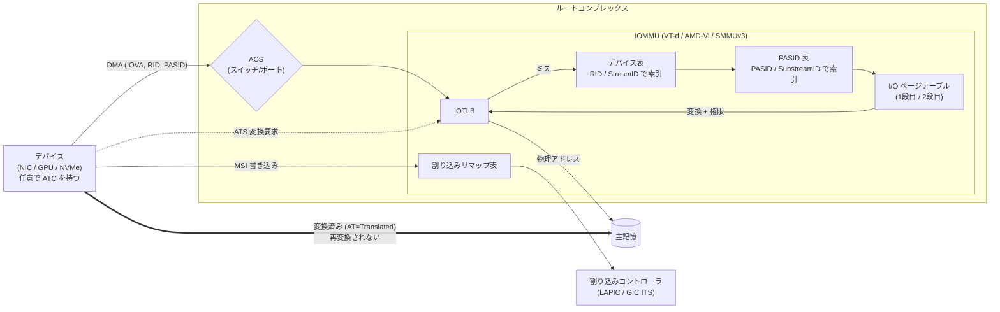

# IOMMU と DMA 隔離: VT-d・AMD-Vi・SMMUv3 から機密 I/O まで (IOMMU & DMA Isolation)

## 概要 (Overview)

[`mmio-dma-interrupts.md`](mmio-dma-interrupts.md) は DMA を「CPU を解放する一括転送」として扱い、IOMMU (I/O Memory Management Unit) をその保護手段として一行で紹介した。本書はその一行を掘り下げる。

中心テーゼは次の通りである。**IOMMU は「デバイスもメモリを勝手に読み書きできる主体である」という事実に対する MMU の答えであり、隔離の強さと I/O 性能の間で常に交渉している。** CPU 上のプロセスは MMU のページテーブルで閉じ込められるが、バスマスタ (bus master) になれるデバイスは物理アドレスを直接指定して DMA を発行できる。IOMMU はデバイスごとに I/O 仮想アドレス (IOVA: I/O Virtual Address) の空間を与え、DMA の宛先を変換と権限検査にかける[^vtd][^amdvi][^smmuv3]。ただし変換の細かさ (ページ粒度かバイト粒度か)、マッピングを外す時機 (strict か lazy か)、変換をどこで行うか (IOMMU か、ATS でデバイス自身か) の各選択が、そのまま隔離の強さと I/O 性能の取引になる。この交渉の帰結として、IOMMU が「有効」でも OS の使い方次第で突破されうることを Thunderclap が示した[^thunderclap]。

本書は3つの実装 (Intel VT-d、AMD-Vi、Arm SMMUv3) の共通構造、I/O ページテーブルと IOTLB、PASID と共有仮想アドレス (SVA: Shared Virtual Addressing)、割り込みリマッピング、SR-IOV と VFIO によるパススルー、ATS/PRI が持ち込む信頼の問題、DMA 攻撃と Kernel DMA Protection、オーバーヘッドの実測、機密計算 (confidential computing) の TDISP/IDE との関係までを扱う。CPU 側の MMU は [`virtual-memory-mmu.md`](../cpu/virtual-memory-mmu.md)、PCIe の TLP と ACS は [`bus-interconnect.md`](bus-interconnect.md)、ハイパーバイザ側の I/O 仮想化は [`hardware-virtualization-containers.md`](../../software/virtualization/hardware-virtualization-containers.md) に委ねる。

## 方法論 (Methodology)

- 3つの IOMMU 仕様 (Intel VT-d、AMD IOMMU、Arm SMMUv3) を読み、名前は違っても同じ役割を持つ構造 (デバイス識別子で引く表、PASID で引く表、ページテーブル、コマンド/無効化キュー、フォールトの記録) を対応づける[^vtd][^amdvi][^smmuv3]。
- Linux カーネルの実装と文書 (DMA API の IOMMU 層、VFIO、iommufd、swiotlb、PCI/TSM) を、OS が IOMMU を「どう使うか」の一次資料として使う[^kconfig][^dma-iommu][^vfio][^swiotlb][^pci-tsm]。
- 攻撃研究 (Thunderclap、Following the White Rabbit) から、隔離が破れる経路を空間 (どこまで見えるか)、時間 (いつまで見えるか)、信頼 (誰が変換するか) の3軸に分類する[^thunderclap][^white-rabbit]。
- 性能は査読論文と第三者の実測 (SIGCOMM 2018、USENIX ATC 2015、ASPLOS 2016、Netdev 0x18) で裏づけ、数値はすべて実測値 (demonstrated) として測定条件とともに示す[^neugebauer][^peleg][^markuze][^farshin]。

## 発見事項 (Findings)

1. **IOMMU は MMU と同じ部品でできているが、索引の鍵がプロセスではなくデバイスである。** PCIe の Requester ID (バス/デバイス/ファンクション) や Arm の StreamID でデバイスを特定し、そのデバイス用のページテーブルで IOVA を物理アドレスに変換する。変換結果は IOTLB (I/O TLB) にキャッシュされる。VT-d のルート/コンテキスト表、AMD のデバイス表 (Device Table)、SMMUv3 のストリーム表 (Stream Table) は、名前が違うだけで同じ役割を持つ[^vtd][^amdvi][^smmuv3]。

2. **隔離の単位はデバイスではなく IOMMU グループである。** ACS (Access Control Services) を持たないブリッジは、デバイス間の転送を IOMMU に届く前に折り返しうる。そのため IOMMU が区別できる最小単位は「他から隔離できるデバイスの集合」であり、VFIO はこのグループを所有の単位にしている[^vfio]。

3. **保護の粒度はページであり、それより細かい隔離はソフトウェアの責任になる。** IOMMU はページ単位でしか権限を付けられないため、2 KiB のパケットバッファの隣に別のカーネルデータが同居すると、デバイスはそれも読み書きできる。Thunderclap は Linux の NIC 受信バッファと同じページに NAT のディスパッチ表が置かれていた事例と、macOS の mbuf の関数ポインタを書き換える攻撃を実証した[^thunderclap]。

4. **無効化を遅らせると速くなるが、そのぶん隔離に時間的な穴が開く。** Linux の lazy モードは IOTLB の無効化をまとめて行い、外したはずのマッピングが「しばらく」有効なまま残る。カーネル設定のヘルプ自身が「隔離が弱まる代わりに性能が上がる」と明記しており、x86 と s390 では lazy が既定である[^kconfig]。既定では 10 ms のタイマーか、キュー (256 エントリ) が満ちた時点でまとめて無効化する[^dma-iommu]。

5. **ATS は性能のために変換の責任をデバイスへ委ね、IOMMU の検査を迂回する道を開く。** ATS (Address Translation Services) で「変換済み」と印の付いた要求は IOMMU で再変換されない。Thunderclap は、偽の ATS 能力を申告するだけで Linux が ATS を有効にし、物理メモリ全体に到達できたことを示した[^thunderclap]。現在の Linux は信頼しない (untrusted) と判定した PCI デバイスでは ATS を有効にしない (`drivers/pci/ats.c` の `pci_ats_supported()`)[^ats-c]。

6. **IOMMU の性能コストは IOTLB の到達範囲 (reach) で決まる。** Intel Xeon (Broadwell) 上の測定では、アクセス範囲が 256 KB を超えると 64 B の DMA 読み出しのスループットが約 70% 低下し、IOTLB ミス 1 回の代償は約 330 ns と見積もられた。そこから IOTLB は 64 エントリと推定されている (Intel は非公開)[^neugebauer]。200 Gbps 級の NIC でも IOMMU なしに比べ最大 20% の低下が報告されている[^farshin]。

7. **機密計算はデバイスを「隔離される側」から「信頼に入れてもらう側」へ移す。** 暗号化されたゲストは既定ではデバイスに自分のメモリを見せられず、swiotlb の非暗号化バッファでコピーする[^swiotlb]。TDISP (TEE Device Interface Security Protocol) と IDE (Integrity and Data Encryption) は、デバイスを認証し、リンクを暗号化した上で、ゲストの私有メモリへの直接 DMA を許すための規格である。Linux 6.19 で PCI/TSM の基盤と AMD SEV-TIO によるリンク暗号化が入ったが、ゲストへの機密デバイス割り当ての端から端までの流れは次の段階とされている[^tsm-619]。

## アーキテクチャ (Architecture)

### DMA 要求が IOMMU を通る経路

デバイスが発行した DMA 要求 (PCIe の Memory Read/Write TLP) は、ルートコンプレックス (root complex) で IOMMU に捕まる。IOMMU は要求者の識別子と、付いていれば PASID を鍵にして表を引き、ページテーブルを歩いて物理アドレスと権限を得る。



凡例: 実線は通常の要求の流れ、点線は ATS の変換要求 (デバイスが IOMMU に訳を問い合わせ、自分の ATC: Address Translation Cache に保持する)、二重線は ATS で変換済みと印を付けた要求である。二重線が IOMMU の変換を通らないことが、後述する ATS の信頼の問題の核心である。

### 3実装の対応表

| 役割 | Intel VT-d | AMD-Vi (AMD IOMMU) | Arm SMMUv3 |
|---|---|---|---|
| デバイス識別子 | Source ID (PCIe RID) | DeviceID | StreamID |
| デバイスで引く表 | ルート表 → コンテキスト表 | デバイス表 (DTE) | ストリーム表 (STE) |
| PASID で引く表 | スケーラブルモードの PASID ディレクトリ/表 | GCR3 表 | コンテキスト記述子 (CD) 表 |
| 2段変換 | 1段目 (first-stage) + 2段目 (second-stage) の入れ子 | ゲスト (v2) + ホスト (v1) ページテーブル | stage 1 + stage 2 |
| 無効化の発行 | 無効化キュー (Queued Invalidation) | コマンドバッファ | コマンドキュー |
| フォールト/ページ要求の通知 | フォールト記録、ページ要求キュー | イベントログ、PPR ログ | イベントキュー、PRI キュー |
| 割り込みの検査 | 割り込みリマップ表 (IRTE) | DTE が指す割り込みリマップ表 | GIC ITS (DeviceID/EventID → LPI) |

出典: 各仕様書[^vtd][^amdvi][^smmuv3]。Arm では MSI の検査を SMMU ではなく割り込みコントローラの ITS が担う[^gic]。VT-d のスケーラブルモードは仕様 Rev 3.0 で導入され、PASID の粒度で1段目、2段目、入れ子、パススルーを選べる[^vtd-sm]。

### IOMMU を誰が使うか: 3つの利用形態

1. **カーネルの DMA API の裏側**: ドライバは `dma_map_single()` などで IOVA を得る。IOMMU が有効なら DMA API が I/O ページテーブルを書き換え、無効なら物理アドレスがそのまま渡る[^dma-api]。Linux はデバイスごとに「変換あり (strict/lazy)」と「パススルー (恒等写像)」を選び、パススルーは「制限のないアクセス」と引き換えに最小のオーバーヘッドを得る[^kconfig]。
2. **ユーザ空間/VM へのパススルー**: VFIO はデバイスを IOMMU グループ単位でユーザ空間に渡し、そのアドレス空間 (VM ならゲスト物理アドレス) を I/O ページテーブルに写す。新しい API の iommufd は I/O ページテーブルをユーザ空間から管理するためのもので、入れ子変換や PASID を扱い、旧来のコンテナ/グループ方式を段階的に置き換える予定である[^vfio][^iommufd]。
3. **プロセスとのアドレス空間共有 (SVA)**: デバイスがプロセスと同じ仮想アドレスを使う。IOMMU の PASID エントリにプロセスのページテーブル (x86 なら CR3) を設定する[^sva]。

## 技術詳細 (Technical Details)

### I/O ページテーブル、IOTLB、無効化

I/O ページテーブルは CPU のページテーブルと同じ多段の基数木 (radix tree) で、2 MiB や 1 GiB の大きなページも使える[^vtd][^smmuv3]。違いは TLB の一貫性の保ち方である。CPU の TLB はアクセスのたびに参照されるので、ページを外すときは TLB シュートダウン (shootdown) で消す ([`virtual-memory-mmu.md`](../cpu/virtual-memory-mmu.md))。IOMMU では OS がコマンドキューに無効化命令を積み、完了を待つ。DMA マッピングはパケット1つ、I/O 要求1つごとに作って壊すので、この無効化が I/O の度に入る。

Linux の DMA 層はここに3つの方針を用意している[^kconfig]。

| 方針 | 動作 | 隔離 | 性能 |
|---|---|---|---|
| strict | unmap のたびに IOTLB を無効化し、完了を待つ | 外した瞬間にアクセス不能 | 無効化の待ちが I/O 経路に入る |
| lazy | 外した IOVA を flush queue に溜め、まとめて無効化する | 外した後もしばらくアクセスできる | 無効化の回数が減る |
| passthrough | 恒等写像 (IOVA = 物理アドレス) | デバイスは全メモリに到達しうる | 変換の追加コストが最小 |

lazy の「しばらく」は実装で決まる。Linux の flush queue は CPU ごとに 256 エントリを持ち、満杯になるか、既定 10 ms のタイマーが切れた時点で IOTLB を無効化する (`drivers/iommu/dma-iommu.c` の `IOVA_DEFAULT_FQ_SIZE` と `IOVA_DEFAULT_FQ_TIMEOUT`)[^dma-iommu]。既定値は x86 と s390 で lazy、それ以外 (arm64 など) で strict であり、起動引数 `iommu.strict=` と `iommu.passthrough=` で切り替えられる[^kconfig]。

### オーバーヘッドの実測

IOMMU のコストは2種類ある。(1) IOTLB ミス時のページウォーク、(2) マッピングの作成・破棄 (IOVA の割り当てと無効化) である[^thunderclap][^peleg]。

| 研究 | 構成 | 結果 (実測) |
|---|---|---|
| Neugebauer et al. (SIGCOMM 2018)[^neugebauer] | Netronome NFP-6000、Intel Xeon E5-2630 v4、IOMMU を 4 KiB ページに固定 | 256 KB 超の範囲で 64 B 読み出しが約 70% 低下、256 B で 30%、512 B 以上は変化なし。64 B 書き込みは 55% 低下。IOTLB ミス 1 回が約 330 ns |
| Farshin & Rizzo (Netdev 0x18)[^farshin] | 200 Gbps NIC、近年の Xeon Scalable と EPYC | IOMMU なしに比べ最大 20% のスループット低下 |
| Peleg et al. (USENIX ATC 2015)[^peleg] | Linux、多コアで高頻度に map/unmap するネットワーク負荷 | 当時の OS は IOVA 割り当てと IOTLB 管理が律速して性能が崩落。改良設計で IOMMU なしの 88.5〜100% |
| Markuze et al. (ASPLOS 2016)[^markuze] | 40 Gb/s NIC、Linux | 常時マップした影バッファへのコピー方式で、最も安全な既存方式の最大 5 倍、IOMMU なしに比べ 0〜25% 低下 |

数値は測定系 (世代、ページサイズ、転送サイズ、負荷) で大きく変わるので、単一の「IOMMU は何% 遅い」は存在しない。共通する教訓は、IOTLB の到達範囲 (エントリ数 × ページサイズ) を作業集合が超えると急に落ちること、そして小さい転送ほど影響が大きいことである。対策は大きなページで写す、バッファを使い回してアドレスの局所性を上げる、IOVA 割り当てを CPU ごとにキャッシュする、の3つに集約される[^farshin][^peleg]。

### バウンスバッファと swiotlb

ページより細かい隔離を得る素直な方法はコピーである。swiotlb はカーネルの DMA 層が使うバウンスバッファ (bounce buffer) の割り当て器で、デバイスが元のバッファに直接届かないときに一時バッファ経由で転送する[^swiotlb]。用途は3つある。

- **アドレス幅の不足**: 32 ビットしか DMA できない古いデバイスのため (歴史的な本来の用途)。
- **信頼しないデバイス**: Linux は外部に面したポートの下にあるデバイスを untrusted とし、常に strict で変換したうえで、ページ境界にそろわないバッファは swiotlb でコピーする。パディング部分にカーネルの残りデータが見えないよう 0 で埋める[^kconfig][^dma-iommu]。
- **機密計算のゲスト**: ゲストのメモリは暗号化されホストから読めないので、非暗号化の共有プールを介してコピーする。ドライバは変更不要である[^swiotlb]。

代償はコピーの CPU コストと帯域である。swiotlb の既定プールは起動時に 64 MiB 確保され、`CONFIG_SWIOTLB_DYNAMIC` で必要に応じて拡張できる[^swiotlb]。Markuze らの結果は、IOMMU の無効化が十分に遅いとコピーの方が速いことを示しており、隔離と性能の交渉が単純な一方向ではないことを表している[^markuze]。

### PASID、SVA、ATS/PRI

**PASID (Process Address Space ID)** は PCIe の TLP に付けられる 20 ビットの識別子で、1つのデバイス (同じ RID) の中で複数のアドレス空間を区別する[^sva][^pcie]。SMMUv3 では SubstreamID がこれに当たり、最大 20 ビットである[^smmu-ssid]。

**SVA** は PASID の上に作られる。OS はプロセスのページテーブルを IOMMU の PASID エントリに登録し、デバイスはプロセスの仮想アドレスをそのまま DMA に使う。x86 では `ENQCMD` 命令がスレッドごとの MSR `IA32_PASID` の値を作業記述子に自動で書き込み、ユーザ空間から PASID 付きの仕事を直接投入できる[^sva]。PASID はプロセスがはじめて SVA 対応デバイスに bind したときに割り当てられ、`fork` と `exec` で失われる[^sva]。

SVA ではページが常駐している保証がないので、デバイス側の I/O ページフォールトが必要になる。そこで ATS と PRI を組み合わせる[^sva][^pcie]。

```text
例示 (illustrative): SVA デバイスがページを引く流れ
1. デバイス → IOMMU: ATS Translation Request (PASID, VA)
2. IOMMU: ページなし → 失敗の Completion を返す
3. デバイス → IOMMU: PRI Page Request (PASID, VA, 読み/書き)
4. IOMMU → OS: ページ要求キュー / PPR ログ / PRI キューに積んで割り込み
5. OS: プロセスのページフォールト処理と同様にページを用意し、応答を返す
6. デバイス: ATS を再試行 → 変換を ATC に保持 → 変換済み要求で DMA
```

この手順は、デバイスが CPU のスレッドと同じ扱いを受けることを意味する。仮想化ではゲストのページテーブル (1段目) とホストの I/O ページテーブル (2段目) を入れ子にし、ゲスト内の SVA (vSVA) を実現する。iommufd はこの入れ子の割り当てを扱う[^iommufd][^vtd-sm]。

### ATS が持ち込む信頼の問題

ATS の目的は、デバイスが自分の ATC に変換を持つことで IOMMU の IOTLB への圧力とレイテンシを減らすことである。代わりに、**変換済み (Translated) と印の付いた要求を IOMMU は再変換しない**[^thunderclap][^pcie]。これは、デバイスが正しく振る舞うという前提を信頼の根に入れることを意味する。悪意あるデバイスや壊れたデバイスは、受け取った変換を無視して任意の物理アドレスに印を付けて送れる。

Thunderclap の攻撃シナリオ8はこれを実証した。Linux は ATS 能力を申告する任意のデバイスに ATS を許しており、FPGA で作った偽 NIC が ATS を申告し、要求に変換済みの印を付けるだけで、IOMMU を完全に迂回できた[^thunderclap]。論文によれば、ACS はこうした「変換済み」の要求を遮断できるが、既定では有効になっていなかった (性能上の配慮と推測されている)。FreeBSD と macOS は ATS に対応しておらず、この種の攻撃を受けない[^thunderclap]。

防御の選択肢は3段階になる。

1. **信頼しないデバイスでは ATS を使わない**: Linux は untrusted の PCI デバイスで ATS を有効にしない[^ats-c]。Thunderclap の開示を受けた Intel の作業が、Thunderbolt ポートで IOMMU を有効にし ATS を無効にしたと論文は記録している[^thunderclap]。
2. **ACS で変換済み要求を遮断する**: スイッチや下流ポートで変換済み要求を通さない。
3. **デバイスを認証して信頼する**: TDISP はデバイスのインタフェースを認証し、構成をロックしてからゲストのメモリに触れさせる手順を定める (後述)。ATS の信頼の問題を、無効化ではなく認証で解く方向である[^tdx-connect][^pci-tsm]。

### 割り込みリマッピング

MSI/MSI-X は「特定のアドレスへのメモリ書き込み」なので ([`mmio-dma-interrupts.md`](mmio-dma-interrupts.md))、DMA できるデバイスは任意の MSI を偽造できる。割り込みリマッピングがないと、パススルーされたデバイスは別の CPU に任意のベクタの割り込みを送りつけられる。Wojtczuk と Rutkowska は、VT-d の DMA リマッピングだけが有効で割り込みリマッピングがない構成で、ドライバドメインから Xen を乗っ取る攻撃を示した[^white-rabbit]。

割り込みリマッピングでは、デバイスの MSI はリマップ表の添字だけを運ぶ。IOMMU はデバイスの識別子と添字から、宛先 CPU とベクタを表で引き、その表に載っている割り込みだけを配送する[^vtd][^amdvi]。Arm では GIC の ITS が DeviceID と EventID から LPI への写像を持ち、同じ役割を果たす[^gic]。Linux の VFIO はこの機能がないプラットフォームでのパススルーを既定で拒否し、`vfio_iommu_type1` の `allow_unsafe_interrupts` で明示的に許可したときだけ通す[^vfio-unsafe]。同じ表は割り込みを VM に直接届けるポステッド割り込み (posted interrupt) にも使われる[^vtd]。

### SR-IOV、IOMMU グループ、VFIO

SR-IOV は1つの物理機能 (PF: Physical Function) から複数の仮想機能 (VF: Virtual Function) を生やす PCIe の仕組みで、VF はそれぞれ自分の RID を持つ[^pcie]。RID が別なので IOMMU は VF ごとに別のページテーブルを当てられ、VF を別々の VM に渡せる。性能と可搬性の取引は [`hardware-virtualization-containers.md`](../../software/virtualization/hardware-virtualization-containers.md) に譲る。

パススルーの安全性は IOMMU グループで決まる。VFIO の文書によれば、グループは「システムの他のすべてのデバイスから隔離できるデバイスの集合」であり、ACS を持たないブリッジの下や PCIe-PCI ブリッジの裏のデバイスはまとめて1つのグループになる[^vfio]。グループ内の一部だけを VM に渡すと、残りのデバイスと VM の間で IOMMU を通らない P2P 転送が起こりうるので、VFIO はグループ全体の所有を要求する。

### 機密計算との関係: TDISP、IDE、TSM

機密 VM (Intel TDX、AMD SEV-SNP、Arm CCA の Realm) では、ハイパーバイザも IOMMU の設定者も信頼の外に置かれる ([`side-channels-tee-secure-boot.md`](../security/side-channels-tee-secure-boot.md)、[`cloud-kms-confidential-computing.md`](../../software/cloud/cloud-kms-confidential-computing.md))。すると IOMMU の設定は、ゲストから見て信頼できない管理者が握るものになる。初期の機密 VM はデバイスを信頼せず、すべての I/O を swiotlb の共有バッファ経由でコピーすることでこれを避けた[^swiotlb]。

これを直接 DMA に戻すための規格群が次の3つである。

| 要素 | 役割 |
|---|---|
| SPDM / DOE | デバイスの証明書による認証と測定値の取得。PCIe のコンフィグ空間の DOE (Data Object Exchange) メールボックスで運ぶ[^tsm-619] |
| IDE | ルートポートとエンドポイント間の TLP を暗号化し完全性を保護する。鍵は送受信の両端に設定する[^tsm-619][^pci-tsm] |
| TDISP | デバイスの割り当て単位 (TDI: TEE Device Interface) を unlocked → locked → run と遷移させ、構成を固定してから機密ゲストに渡す[^pci-tsm][^tdisp-synopsys] |

TSM (TEE Security Manager) はこれらを調停する信頼された主体で、AMD では PSP のファームウェアが、Intel では TDX モジュールがその役を担う[^tsm-619][^tdx-connect]。Intel の TDX Connect 仕様は、自らを「PCI-SIG の TDISP 1.0 のホスト側実装であり、VT-d と TDX の拡張」と位置づけ、信頼された DMA と MMIO のアクセス制御、安全な IOTLB 無効化を定義している[^tdx-connect]。Arm では SMMU がグラニュール保護表 (GPT) を検査し、Realm のメモリへの DMA をハードウェアで止める。RME のデバイス割り当て (RME-DA) はその上にデバイスの Realm への直接割り当てを載せる[^smmu-rme][^linaro-cca]。

IDE と TDISP は PCI-SIG の ECN として追加され、Base Specification に統合された (Linux の実装は PCIe 7.0 の第11章を参照している)[^tdisp-synopsys][^pci-tsm]。

**2026-10 時点の Linux の状況**: 6.19 のマージで PCI/TSM の中核、IDE の確立、AMD SEV-TIO による最初の実装が入り、TDISP は bind と guest request の骨組みだけが入った[^tsm-619]。他アーキテクチャの実装は後続の版を見込むとされた[^tsm-619]。TDX Connect の SPDM と IDE 確立のパッチは 2025-11 に投稿されているが[^tdx-connect-lwn]、本書の執筆時点で mainline への取り込みは確認できなかった。

### 故障モードとエッジケース

| 事象 | 原因 | 帰結 |
|---|---|---|
| IOMMU フォールト | ドライバの unmap 後の DMA、誤った IOVA、ファームウェアが申告しない DMA (RMRR/IVMD 外) | 要求の破棄とログ。Windows はブート直後の範囲外 DMA でバグチェック (0xE6) になりうる[^ms-oem] |
| ブート中の無防備 | OS が IOMMU を構成する前に DMA が走る | ファームウェア側の保護が必要。Kernel DMA Protection は OS 起動後だけを守る[^ms-kdp][^ms-oem] |
| グループの巻き添え | ACS のない経路でグループが大きい | 1 デバイスだけをパススルーできない[^vfio] |
| lazy の時間窓 | 無効化の遅延 (既定 10 ms 以内) | 外したバッファを読み書きされうる[^kconfig][^dma-iommu] |
| ページの同居 | 小さい DMA バッファと他データが同じページ | 隣接データの漏洩や改竄[^thunderclap] |
| ATS の偽装 | 変換済み要求を IOMMU が再検査しない | IOMMU の完全な迂回[^thunderclap] |
| swiotlb の枯渇 | 機密 VM や untrusted デバイスで大量 I/O | マッピング失敗と I/O エラー、動的拡張で緩和[^swiotlb] |

## セキュリティ考察 (Security Considerations)

### 脅威モデルの転換

Thunderclap の最大の主張は、**周辺機器を TCB (Trusted Computing Base) から外せ**ということである。システムコールが MMU の下でも豊かな攻撃面であるのと同じく、IOMMU の下でもデバイスとドライバの共有メモリ・インタフェースは豊かな攻撃面であり、しかもデバイスは自分の device ID を選ぶことで攻撃するドライバを選べる[^thunderclap]。論文は FPGA の偽 NIC で macOS、FreeBSD、Linux を突破し、IOMMU をほとんど使っていなかった当時の Windows はさらに弱いと報告した。攻撃は USB-C のプロジェクタや電源アダプタを装った機器で数秒以内に成立した[^thunderclap]。

本書の3軸で整理すると次のようになる。

- **空間**: ページ粒度の同居。macOS の mbuf の関数ポインタ書き換え、Linux の NAT ディスパッチ表の露出[^thunderclap]。対策はバッファの専用割り当て、バウンスバッファ、コードポインタの目隠し (macOS 10.12.4 が導入)[^thunderclap][^dma-iommu]。
- **時間**: 外すべきマッピングが残る窓。NIC が送信完了を報告しなければ Linux は窓を開けたままにし、同じページの別の用途 (UNIX ドメインソケット、平文の VPN トラフィック) を観測できた[^thunderclap]。lazy 無効化も同じ種類の窓を作る[^kconfig]。
- **信頼**: ATS による変換の委譲と、コンフィグ空間の自己申告 (能力、デバイス ID) を OS が鵜呑みにすること[^thunderclap]。

### 外部ポートの防御: Kernel DMA Protection と各 OS

- **Windows**: Kernel DMA Protection は Windows 10 1803 で導入され、1803 以降に出荷された機器 (と対応ファームウェア) で有効になる[^ms-oem][^thunderclap]。IOMMU で外部周辺機器の DMA を止め、DMA リマッピング対応ドライバを持つ機器だけを自動で起動する。非対応ドライバの機器は、ユーザがサインインするか画面ロックを解除するまで起動しない[^ms-kdp]。ファームウェアは ACPI の DMAR 表 (Intel) や IVRS 表 (AMD) で有効化を申告し、外部ポートを `_DSD` で印付けし、ブート前の DMA を自分で防ぐ必要がある[^ms-oem]。FireWire、PCMCIA、CardBus、ExpressCard は対象外である[^ms-kdp]。
- **macOS**: Apple シリコンは DMA を行う主体ごとに IOMMU を持ち、電源投入時から既定拒否 (default-deny) で動く。マップされていないメモリへの PCIe/Thunderbolt からのアクセスはカーネルパニックを起こす[^apple]。Intel Mac は VT-d の DMA リマッピングと割り込みリマッピングを起動の非常に早い段階で有効にする[^apple]。
- **Linux**: 2018 年以降の Thunderbolt 機器で IOMMU による DMA 保護が使えれば、ドライバは自動で IOMMU を有効にし、`iommu_dma_protection` 属性で状態を示す[^tbt-linux]。外部ポートのデバイスは untrusted として strict + バウンスバッファで扱われ、ATS は許されない[^kconfig][^ats-c]。

### 残る課題

- **ファームウェアとブートの窓**: OS 起動前の DMA はファームウェアの責任である[^ms-oem]。ファームウェアが IOMMU を無効にした場合、Windows の要件は TPM の PCR[7] にその事実を記録させる[^ms-oem]。この扱いはセキュアブートの測定の連鎖とつながる ([`boot-initialization.md`](boot-initialization.md)、[`side-channels-tee-secure-boot.md`](../security/side-channels-tee-secure-boot.md))。
- **内部デバイスの信頼**: 既定の保護は外部ポートを中心にしており、内部の NIC や GPU は信頼された前提で lazy や passthrough になりやすい[^kconfig][^ms-oem]。ファームウェアを乗っ取られた内部デバイスは同じ攻撃面を持つ。
- **機密 I/O の TCB の拡大**: TDISP でデバイスを信頼すると、デバイスのファームウェアと IDE の鍵管理が TCB に入る。外せる相手 (ホスト、ハイパーバイザ) と、新たに信頼する相手 (デバイス) を対で評価する必要がある ([`cloud-kms-confidential-computing.md`](../../software/cloud/cloud-kms-confidential-computing.md) の「誰を信頼から外せたか」と同じ問い)。

## 結論 (Conclusions)

- IOMMU はデバイスという「CPU 以外のメモリの主体」に MMU を当てる仕組みである。VT-d、AMD-Vi、SMMUv3 は名前こそ違うが、デバイス表、PASID 表、ページテーブル、IOTLB、無効化キュー、割り込みリマップという同じ部品でできている。
- その隔離は常に性能と交渉している。ページ粒度か (バウンスバッファでバイト粒度にするか)、strict か lazy か、IOMMU で変換するか ATS でデバイスに任せるか。どれも速い方を選べば隔離のどこかに穴が開く。Linux が x86 で lazy を既定にしているのは、その交渉の現時点の着地点である。
- Thunderclap が示したように、IOMMU の有効化は出発点にすぎない。OS のメモリ割り当て、ドライバの共有メモリの扱い、ATS の許可、ブート前の窓までを含めて、はじめてデバイスを TCB から外せる。
- 機密計算は交渉の構図を変える。デバイスを締め出してコピーで済ませる段階から、TDISP と IDE でデバイスを認証して信頼の内側に入れる段階へ移りつつある。2026-10 時点で Linux はその基盤を取り込み始めた段階にある。

### 次の接続先 (Related Topics)

- [`mmio-dma-interrupts.md`](mmio-dma-interrupts.md): DMA、MSI、ディスクリプタリングの基礎。本書の前提。
- [`bus-interconnect.md`](bus-interconnect.md): PCIe の TLP、ACS、IDE。IOMMU が検査する「荷物」と経路。
- [`cxl-memory-pooling.md`](cxl-memory-pooling.md): コヒーレントな接続でデバイスがメモリを共有するときの次の隔離問題。
- [`virtual-memory-mmu.md`](../cpu/virtual-memory-mmu.md): CPU 側の MMU、TLB、シュートダウン、2段変換。
- [`interrupts-exceptions-traps.md`](../cpu/interrupts-exceptions-traps.md): 割り込みリマッピングの先にある CPU 側の割り込み受付。
- [`hardware-virtualization-containers.md`](../../software/virtualization/hardware-virtualization-containers.md): パススルー、SR-IOV、virtio との性能と可搬性の取引。
- [`side-channels-tee-secure-boot.md`](../security/side-channels-tee-secure-boot.md): TDX、SEV-SNP、CCA の CPU 側と、セキュアブートの測定。
- [`cloud-kms-confidential-computing.md`](../../software/cloud/cloud-kms-confidential-computing.md): 機密計算で誰を信頼から外せるかの評価。
- [`memory-safety-exploit-mitigations.md`](../../software/security/memory-safety-exploit-mitigations.md): Thunderclap の関数ポインタ書き換えと同系統の攻撃に対するソフトウェア側の緩和策。

## 参考文献 (References)

**一次資料 (Primary: 仕様・公式ドキュメント・論文)**

[^vtd]: Intel. *Intel Virtualization Technology for Directed I/O Architecture Specification* (Order No. D51397). — [PDF](https://cdrdv2-public.intel.com/831418/vt-directed-io-spec.pdf) — Accessed: 2026-10-24。ルート/コンテキスト表、スケーラブルモード、無効化キュー、ページ要求、割り込みリマッピングとポステッド割り込み。

[^vtd-sm]: Linux kernel. *iommu/vt-d: Enumerate the scalable mode capability* (Linux kernel commit 765b6a98c1de). — [git](https://git.evolution-x.org/anierin/msm-5.15/commit/765b6a98c1de3) — Accessed: 2026-10-24。VT-d 仕様 Rev 3.0 がスケーラブルモード (PASID 粒度の1段目/2段目/入れ子/パススルー) を導入したことの記述。

[^amdvi]: AMD. *AMD I/O Virtualization Technology (IOMMU) Specification* (Pub. No. 48882). — [docs.amd.com](https://docs.amd.com/v/u/en-US/48882_3.10_PUB) — Accessed: 2026-10-24。デバイス表、GCR3 表、コマンドバッファ、イベントログ、PPR ログ、割り込みリマッピング。Linux 側の概説は [x86 IOMMU Support](https://docs.kernel.org/arch/x86/iommu.html) — Accessed: 2026-10-24。

[^smmuv3]: Arm. *Arm System Memory Management Unit Architecture Specification, SMMU architecture version 3* (IHI 0070). — [developer.arm.com](https://developer.arm.com/documentation/ihi0070/latest) — Accessed: 2026-10-24。ストリーム表、コンテキスト記述子、stage 1/2、コマンド/イベント/PRI キュー。

[^smmu-ssid]: Brucker, J.-P. *[PATCH] iommu/arm-smmu-v3: Add support for Substream IDs* (Linux kernel mailing list, 2019). — [lkml](https://lkml.iu.edu/hypermail/linux/kernel/1907.0/03633.html) — Accessed: 2026-10-24。SMMU が最大 20 ビットの SSID を扱い、CD 表を STE から参照する構造。

[^smmu-rme]: Arm. *Arm System Memory Management Unit Architecture Specification Supplement: The Realm Management Extension (RME), for SMMUv3* (IHI 0094). — [developer.arm.com](https://developer.arm.com/documentation/ihi0094/latest) — Accessed: 2026-10-24。SMMU によるグラニュール保護検査。

[^gic]: Arm. *Arm Generic Interrupt Controller Architecture Specification, GIC architecture version 3 and version 4* (IHI 0069). — [developer.arm.com](https://developer.arm.com/documentation/ihi0069/latest) — Accessed: 2026-10-24。ITS による DeviceID/EventID から LPI への変換。

[^pcie]: PCI-SIG. *PCI Express Base Specification* (ATS、PRI、PASID、ACS、SR-IOV、IDE、TDISP を含む). — [pcisig.com/specifications](https://pcisig.com/specifications) — Accessed: 2026-10-24。

[^kconfig]: Linux kernel. `drivers/iommu/Kconfig`, choice "IOMMU default domain type" (`IOMMU_DEFAULT_DMA_STRICT` / `IOMMU_DEFAULT_DMA_LAZY` / `IOMMU_DEFAULT_PASSTHROUGH`). — [GitHub](https://github.com/torvalds/linux/blob/master/drivers/iommu/Kconfig) — Accessed: 2026-10-24。strict/lazy/passthrough の定義、x86 と s390 で lazy が既定であること、untrusted デバイスの扱い。起動引数は [The kernel's command-line parameters](https://docs.kernel.org/admin-guide/kernel-parameters.html) (`iommu.strict=`、`iommu.passthrough=`) — Accessed: 2026-10-24。

[^dma-iommu]: Linux kernel. `drivers/iommu/dma-iommu.c` (`IOVA_DEFAULT_FQ_SIZE` = 256、`IOVA_DEFAULT_FQ_TIMEOUT` = 10 ms、`dev_is_untrusted()` と swiotlb のバウンス判定、パディングの 0 埋め). — [GitHub](https://github.com/torvalds/linux/blob/master/drivers/iommu/dma-iommu.c) — Accessed: 2026-10-24。

[^ats-c]: Linux kernel. `drivers/pci/ats.c`, `pci_ats_supported()` (ATS 能力がないか `untrusted` なら false). — [GitHub](https://github.com/torvalds/linux/blob/master/drivers/pci/ats.c) — Accessed: 2026-10-24。

[^dma-api]: Linux Kernel Documentation. *Dynamic DMA mapping using the generic device*. — [docs.kernel.org](https://docs.kernel.org/core-api/dma-api.html) — Accessed: 2026-10-24。

[^swiotlb]: Linux Kernel Documentation. *DMA and swiotlb*. — [docs.kernel.org](https://docs.kernel.org/core-api/swiotlb.html) — Accessed: 2026-10-24。バウンスバッファ、CoCo VM での非暗号化プール、untrusted デバイス、既定 64 MiB、動的 swiotlb。

[^vfio]: Linux Kernel Documentation. *VFIO - "Virtual Function I/O"*. — [docs.kernel.org](https://docs.kernel.org/driver-api/vfio.html) — Accessed: 2026-10-24。IOMMU グループ、ACS、コンテナ/グループ/デバイスのモデル、iommufd への移行。

[^vfio-unsafe]: Linux kernel. `drivers/vfio/vfio_iommu_type1.c`, module parameter `allow_unsafe_interrupts`. — [Elixir](https://elixir.bootlin.com/linux/latest/source/drivers/vfio/vfio_iommu_type1.c) — Accessed: 2026-10-24。割り込みリマッピングのないプラットフォームで VFIO を許可するパラメータ。

[^iommufd]: Linux Kernel Documentation. *IOMMUFD*. — [docs.kernel.org](https://docs.kernel.org/userspace-api/iommufd.html) — Accessed: 2026-10-24。ユーザ空間からの I/O ページテーブル管理と入れ子変換。

[^sva]: Linux Kernel Documentation. *Shared Virtual Addressing (SVA) with ENQCMD*. — [docs.kernel.org](https://docs.kernel.org/arch/x86/sva.html) — Accessed: 2026-10-24。20 ビットの PASID、ATS/PRI、`IA32_PASID`、PASID の寿命。

[^pci-tsm]: Linux Kernel Documentation. *PCI Trusted Execution Environment Security Manager (TSM)*. — [docs.kernel.org](https://docs.kernel.org/driver-api/pci/tsm.html) — Accessed: 2026-10-24。Selective IDE Stream、TDI、TDISP の状態遷移。

[^tsm-619]: Williams, D. *Merge tag 'tsm-for-6.19'* (Linux kernel merge commit 249872f53d64, 2025-12-06). — [kernel.googlesource.com](https://kernel.googlesource.com/pub/scm/linux/kernel/git/deller/linux-fbdev/+/249872f53d64441690927853e9d3af36394802d5) — Accessed: 2026-10-24。PCI/TSM の中核、IDE の確立、AMD SEV-TIO、TDISP の骨組み、後続の予定。

[^tbt-linux]: Linux Kernel Documentation. *USB4 and Thunderbolt*. — [docs.kernel.org](https://docs.kernel.org/admin-guide/thunderbolt.html) — Accessed: 2026-10-24。IOMMU による DMA 保護と `iommu_dma_protection`。

[^tdx-connect]: Intel. *Intel TDX Connect Architecture Specification*. — [intel.com](https://www.intel.com/content/www/us/en/content-details/773614/intel-tdx-connect-architecture-specification.html) — Accessed: 2026-10-24。TDISP 1.0 のホスト側実装、信頼された DMA/MMIO、安全な IOTLB 無効化。

[^ms-kdp]: Microsoft. *Kernel DMA Protection*. — [learn.microsoft.com](https://learn.microsoft.com/en-us/windows/security/hardware-security/kernel-dma-protection-for-thunderbolt) — Accessed: 2026-10-24。

[^ms-oem]: Microsoft. *Kernel DMA Protection (Memory Access Protection) for OEMs*. — [learn.microsoft.com](https://learn.microsoft.com/en-us/windows-hardware/design/device-experiences/oem-kernel-dma-protection) — Accessed: 2026-10-24。1803/1809 からの対応、ブート前保護、DMAR/IVRS のフラグ、PCR[7] への記録。

[^apple]: Apple. *Direct memory access protections for Mac computers* (Apple Platform Security). — [support.apple.com](https://support.apple.com/guide/security/direct-memory-access-protections-seca4960c2b5/web) — Accessed: 2026-10-24。

[^thunderclap]: Markettos, A. T., Rothwell, C., Gutstein, B. F., Pearce, A., Neumann, P. G., Moore, S. W., & Watson, R. N. M. (2019). Thunderclap: Exploring Vulnerabilities in Operating System IOMMU Protection via DMA from Untrustworthy Peripherals. *Proc. NDSS 2019*. DOI: 10.14722/ndss.2019.23194 — 空間/時間の脆弱性、ATS による完全迂回 (攻撃シナリオ8)、各社の緩和策の開示記録。

[^white-rabbit]: Wojtczuk, R., & Rutkowska, J. (2011). *Following the White Rabbit: Software Attacks Against Intel VT-d Technology*. Invisible Things Lab. — [PDF](https://invisiblethingslab.com/resources/2011/Software%20Attacks%20on%20Intel%20VT-d.pdf) — Accessed: 2026-10-24。割り込みリマッピングのない VT-d 構成での MSI 偽造による脱出。

[^neugebauer]: Neugebauer, R., Antichi, G., Zazo, J. F., Audzevich, Y., López-Buedo, S., & Moore, A. W. (2018). Understanding PCIe Performance for End Host Networking. *Proc. ACM SIGCOMM 2018*, 327–341. DOI: 10.1145/3230543.3230560 — IOMMU の影響の測定 (Figure 9)。

[^peleg]: Peleg, O., Morrison, A., Serebrin, B., & Tsafrir, D. (2015). Utilizing the IOMMU Scalably. *Proc. USENIX ATC 2015*. — [usenix.org](https://www.usenix.org/conference/atc15/technical-session/presentation/peleg) — Accessed: 2026-10-24。

[^markuze]: Markuze, A., Morrison, A., & Tsafrir, D. (2016). True IOMMU Protection from DMA Attacks: When Copy Is Faster Than Zero Copy. *Proc. ASPLOS 2016*. DOI: 10.1145/2872362.2872379 — 影バッファ (コピー) による副ページ粒度の保護と性能。

**二次資料 (Secondary)**

[^farshin]: Farshin, A., & Rizzo, L. *Characterizing IOTLB Wall for Multi-100-Gbps Linux-based Networking*. Netdev 0x18 (2024). — [netdevconf.info](https://netdevconf.info/0x18/sessions/talk/characterizing-iotlb-wall-for-multi-100-gbps-linux-based-networking.html) — Accessed: 2026-10-24。

[^tdisp-synopsys]: Synopsys. *TEE Device Interface Secure Protocol (TDISP) for PCIe and CXL*. — [synopsys.com](https://www.synopsys.com/designware-ip/technical-bulletin/tee-device-interface-secure-protocol.html) — Accessed: 2026-10-24。TDISP と IDE が ECN として追加された経緯 (IP ベンダーの解説)。

[^linaro-cca]: Linaro. *Confidential computing on Arm architecture: use cases*. — [linaro.org](https://www.linaro.org/blog/confidential-computing-on-arm-architecture-use-cases/) — Accessed: 2026-10-24。SMMU による GPT 検査と RME-DA の概説。

[^tdx-connect-lwn]: *PCI/TSM: TDX Connect: SPDM Session and IDE Establishment* (patch series, 2025-11). — [LWN](https://lwn.net/Articles/1046815/) — Accessed: 2026-10-24。
