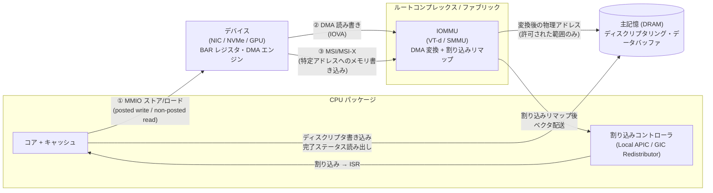

# デバイスとの対話: MMIO・DMA・割り込み (Device I/O: MMIO, DMA & Interrupts)

## 概要 (Overview)

CPU が周辺機器 (peripheral) とやり取りする手段は、突き詰めると3つに集約される。**MMIO**（レジスタを読み書きして指示する）、**DMA**（大量データをCPUを介さず転送する）、**割り込み (interrupt)**（デバイス側から完了・事象を通知する）。この3つは、デバイスドライバ (device driver) の基本構造そのものであり、OS の I/O 性能とリアルタイム性を決める。

本ドキュメントは、この3機構の動作原理と相互関係を整理し、ドライバがなぜそのように書かれるか（メモリバリア、キャッシュ整合、割り込みハンドラの制約）をハードウェアの観点から説明する。

## 方法論 (Methodology)

- 「CPU → デバイス」（制御: MMIO）と「デバイス → CPU」（通知: 割り込み）、「デバイス ⇄ メモリ」（一括転送: DMA）の3経路に分解する。
- 各機構について、何が起きるか・なぜその制約があるか・ソフトがどう書くべきかを対応づける。
- 典型的な1回の I/O（例: ディスク読み出し）を、3機構が協調する1本のシーケンスとして通す。

## 発見事項 (Findings)

1. **MMIO はメモリアクセスの形をとった「副作用のある操作」。** 同じアドレスへのロード／ストアでも、デバイス側で状態が変わる。ゆえにコンパイラ最適化・CPU並べ替え・キャッシュは誤動作の原因になりうる。
2. **DMA はCPUを解放するが、キャッシュ整合 (cache coherence) という新たな問題を持ち込む。** CPU のキャッシュと、DMA が触る主記憶の内容がずれうる。
3. **割り込みは「ポーリング (polling) の無駄」を消すが、コンテキスト切り替えとレイテンシのトレードオフを生む。** 高頻度割り込みは割り込み嵐 (interrupt storm) になり、受信処理が割り込み処理に飢える受信ライブロック (receive livelock) を招くため[^mogul]、ポーリング(NAPI 等)へ切り替える設計もある[^napi]。
4. **3機構は一つの I/O の中で必ず連携する。** 「MMIO で指示 → DMA で転送 → 割り込みで完了通知」が基本形。
5. **正しさはバリアと整合管理に依存する。** `volatile` だけでは不十分で、メモリバリア (memory barrier) とキャッシュ操作（または coherent DMA）が要る[^membarriers][^dma-api]。

## アーキテクチャ (Architecture)

### 3経路の俯瞰

CPU・IOMMU・デバイス・主記憶の間を流れる3経路（①MMIO, ②DMA, ③割り込み）を、IOMMU による DMA アドレス変換と MSI の割り込みリマップを含めて示す。



- 実線の向きはトランザクションの発行元 → 宛先。MSI は「メモリ書き込みの形をした割り込み」なので、DMA と同じく IOMMU を通過し、割り込みリマップ (interrupt remapping) の検査を受ける[^vtd]。
- ディスクリプタと完了ステータスは主記憶に置かれ、CPU とデバイスの双方がアクセスする（後述のディスクリプタリング）。

### ① MMIO (Memory-Mapped I/O)

デバイスのレジスタ (register) を物理アドレス空間に割り当て、通常のロード／ストア命令で読み書きする方式。対になる概念が **PMIO (Port-Mapped I/O)**（x86 の `in`/`out` 命令、専用 I/O 空間）。現代は MMIO が主流[^sdm]。

- **特徴**: アドレスへの読み書きが**副作用 (side effect)** を持つ。読むだけで FIFO が進む、書くだけで送信が始まる、といったレジスタがある。
- **必須の扱い**:
  - **キャッシュ不可 (uncacheable)** 領域としてマップする。キャッシュされると、デバイスの最新状態が見えない／書き込みがデバイスに届かない。
  - コンパイラに最適化させない（`volatile`、あるいは専用アクセサ `readl`/`writel`）[^device-io]。
  - 順序を保証する（レジスタ書き込みの順序が機能上重要なため。例: バッファアドレスを設定してから「開始」ビットを立てる）。Linux の `readl`/`writel` は同一デバイスへのアクセス同士の順序と、先行する通常メモリ書き込みの完了を保証するが、`*_relaxed` 版はこの対通常メモリの保証を持たないため、明示的な**メモリバリア**が要る[^membarriers]。

### ② DMA (Direct Memory Access)

DMA コントローラ (DMAC) がCPUを介さずにデバイスと主記憶間でデータをまとめて転送する。CPU は転送の開始だけ指示し、その間ほかの計算ができる。

- **流れ**: CPU が DMA ディスクリプタ（転送元・先アドレス、長さ）を設定 → デバイス/DMAC が転送 → 完了を割り込みで通知。
- **キャッシュ整合 (cache coherence) 問題**:
  - **デバイス→メモリ (受信)**: DMA が主記憶を更新しても、CPU のキャッシュに古い値が残っていると古いデータを読む。→ 事前に該当範囲を **invalidate** する。
  - **メモリ→デバイス (送信)**: CPU がキャッシュにだけ書いてまだ主記憶に反映していないと、DMA が古い主記憶を送る。→ 事前に **flush (clean)** する。
  - **coherent DMA**: ハードウェアがコヒーレンシを保証する構成（多くの x86）では、整合用の OS マッピング（例: `dma_alloc_coherent`）を使い手動 flush/invalidate を省ける。非コヒーレントな組込みでは streaming マッピング (`dma_map_single`) と明示的同期（`dma_sync_single_for_cpu` 等）が要る[^dma-api]。
- **IOMMU**: 物理アドレスを直接扱う DMA はメモリ保護を破りうる。IOMMU はデバイス用のアドレス変換・保護を提供し、悪意ある／故障デバイスからメモリを守る[^vtd]。

### ③ 割り込み (Interrupts)

デバイスが事象（転送完了、データ到着、エラー）をCPUへ非同期に通知する仕組み。

- **対比: ポーリング (polling)** — CPU が状態レジスタを繰り返し読む。低レイテンシだがCPUを浪費。割り込みは待機中CPUを解放するが、応答に切り替えコストがかかる。
- **流れ**: デバイスが割り込み信号 → 割り込みコントローラ (APIC / GIC) が CPU に通知[^sdm][^gic] → CPU が現在の実行を中断し**割り込みハンドラ (ISR)** へジャンプ → 処理後に元へ復帰。
- **MSI / MSI-X (Message Signaled Interrupts)**: 専用の割り込み線の代わりに、特殊な MMIO 書き込みで割り込みを通知する方式。線の本数制限を超えて多数のベクタ（MSI は最大 32、MSI-X は最大 2048）を使え、PCIe で標準[^pcie]。
- **上半分/下半分 (top half / bottom half)**: ISR は最小限（割り込み禁止状態で短時間）に留め、重い処理は後回し（Linux の softirq/tasklet/threaded IRQ）[^ldd3]。ハンドラ内でブロックや重い処理をすると、他割り込みを取りこぼしレイテンシが悪化するため。
- **割り込みの分散 (IRQ affinity)**: マルチコアでは、どの割り込みをどのコアに届けるかを設定できる。MSI-X の複数ベクタをキューごとに別コアへ振る（NIC の RSS: 受信フローをハッシュで複数キューに分散）ことで、割り込み処理とその後のデータ処理を同じコアに揃え、キャッシュ局所性とスケーラビリティを確保する。
- **割り込み嵐 (interrupt storm)**: 高スループット時に割り込みが多すぎてCPUが処理に埋もれる。対策が**割り込み合体 (interrupt coalescing)** や、高負荷時にポーリングへ切り替える **NAPI**（Linux ネットワーク）[^napi]。この問題を受信ライブロックとして定式化し、割り込みからポーリングへの切り替えを提案したのが Mogul & Ramakrishnan である[^mogul]。

## 技術詳細 (Technical Details)

### 典型シーケンス: ディスクブロック読み出し

```
1. (MMIO)  ドライバが DMA ディスクリプタを準備し、転送先メモリ範囲を
           DMA 用にマップ（必要なら invalidate を予約）。
2. (MMIO)  コントロールレジスタにバッファアドレス・LBA・長さを書き込み、
           最後に「開始」ビットを立てる。  ← 書き込み順序が重要 → バリア必須
3. (DMA)   デバイスがディスク→主記憶へデータを転送（CPU は別作業可能）。
4. (IRQ)   転送完了でデバイスが割り込みを発行。
5. (ISR)   ハンドラが状態レジスタを読み(MMIO)、完了/エラーを確認。
           非コヒーレント環境なら受信範囲を invalidate。
           重い後処理は bottom half へ委譲し、待機プロセスを起床。
```

この1本に MMIO・DMA・割り込みが必ず登場する。3機構を別々でなく「協調する1つの流れ」として理解するのが要点。

### ディスクリプタリングと scatter-gather — 高速デバイスの定石

NIC や NVMe のような高速デバイスでは、I/O ごとに MMIO でパラメータを書き込む方式では追いつかない。定石は**主記憶上のディスクリプタリング (descriptor ring)** である。

```
 主記憶上のリングバッファ（ドライバとデバイスが共有）
   ┌──────┬──────┬──────┬──────┬──────┐
   │desc 0│desc 1│desc 2│desc 3│ ...  │   各 desc = バッファアドレス+長さ+フラグ
   └──────┴──────┴──────┴──────┴──────┘
      ▲ head（デバイスが消費）    ▲ tail（ドライバが追加）
```

1. ドライバはディスクリプタを**メモリに**書き、MMIO は**テールポインタの更新（ドアベル, doorbell）1回だけ**。
2. デバイスは自ら DMA でディスクリプタを読み、データを転送し、完了ステータスもメモリに DMA で書き戻す。
3. 割り込みは複数完了をまとめて1回（合体と相性が良い）。

つまり**制御情報そのものを DMA に載せ、遅い MMIO を細い通知路に限定する**設計である。[`storage-nvm-interface.md`](storage-nvm-interface.md) の NVMe 送信/完了キューはこの形の直接の実例。Linux カーネル側の受信リングと NAPI の扱いは [`kernel-network-stack.md`](../../software/networking/kernel-network-stack.md) を参照。

- **scatter-gather**: 1つの転送を複数の（アドレス, 長さ）エントリで表す。OS の仮想記憶はページ単位でしか物理連続性を保証しないため（[`virtual-memory-mmu.md`](../cpu/virtual-memory-mmu.md)、OS 側は [`virtual-memory-paging.md`](../../software/operating-systems/virtual-memory-paging.md)）、大きなバッファを物理的に非連続なまま転送するには必須の機能。

### MMIO のコスト非対称 — posted write と read の遅さ

PCIe では MMIO **書き込みは posted**（完了応答を待たずに発行）だが、**読み出しは non-posted**（デバイスまでの往復完了を待つ）[^pcie]。結果として次の性質が生じる。

- MMIO read は数百 ns〜µs 級になりえて（実測では PCIe の往復だけで数百 ns 規模[^neugebauer]）、通常のメモリアクセスより桁違いに遅い。高速パスから read を排除し、**状態はデバイスに DMA でメモリへ書かせて、CPU はメモリを読む**（上のリング構造はこれも達成している）。
- posted write は「発行した＝届いた」ではない。**書き込みの到達を保証したい箇所では同じデバイスのレジスタを read back する**のがドライバの古典的イディオム（PCIe の順序規則により、read 完了は先行 write の到達を含意する）[^pcie][^device-io]。

### MMIO アクセスの注意（例示）

```c
// 例示コード (illustrative)。リポジトリ内の実コードではない。
// 悪い例: 通常のポインタ。コンパイラが読みを消す/まとめる可能性がある。
uint32_t *reg = (uint32_t*)0xFE001000;
while (*reg & BUSY) {}        // 最適化で1回しか読まれないことがある

// 良い例 1: Linux の writel は同一デバイスへの書き込み同士の順序を保証する
writel(buf_phys, base + REG_ADDR);   // バッファアドレス設定
writel(len,      base + REG_LEN);    // 長さ設定
writel(START,    base + REG_CTRL);   // 最後に開始（順序が機能上必須）

// 良い例 2: 主記憶上のディスクリプタ → ドアベル。relaxed 版では明示バリアが要る
ring[tail].addr = cpu_to_le64(buf_dma);  // 通常メモリへの書き込み
ring[tail].len  = cpu_to_le32(len);
wmb();                                   // ディスクリプタをドアベルより先に可視化
writel_relaxed(tail + 1, base + REG_DOORBELL);
```

`writel` 自体が「先行する通常メモリ書き込みの完了を待つ」意味論を持つため、良い例 2 は `wmb()` + `writel_relaxed()` の代わりに `writel()` 1 回でもよい[^membarriers]。

### メモリ順序との接続

ここでのバリアは [`memory-ordering-atomics.md`](../cpu/memory-ordering-atomics.md) のメモリ順序（ソフトウェア側の整理は [`memory-models-synchronization.md`](../../software/concurrency/memory-models-synchronization.md)）と同根の問題である。違いは相手が「他コア」ではなく「デバイス」である点。MMIO の順序保証（device ordering）はアーキテクチャ依存で、強い順序の I/O マッピングや専用バリア命令で担保する。

## セキュリティ考察 (Security Considerations)

- **DMA 攻撃 (DMA attack)**: PCIe/Thunderbolt 等の外部接続デバイスが DMA で任意の物理メモリを読み書きし、認証回避や鍵窃取を行う（例: 物理アクセス下の攻撃）。**対策は IOMMU によるデバイス単位のアドレス制限**と、外部 DMA の既定無効化。ただし IOMMU を有効にしても、OS が共有ページや IOVA の再利用を雑に扱うと突破されうることが Thunderclap で示された[^thunderclap]。
- **MMIO の取り扱い**: 仮想化・ユーザ空間ドライバ (VFIO 等) でデバイスを直接触らせる場合、レジスタ経由で DMA を仕掛けられるため IOMMU 隔離が前提（[`hardware-virtualization-containers.md`](../../software/virtualization/hardware-virtualization-containers.md)）。
- **割り込みの信頼性**: 偽の／過剰な割り込み（割り込み嵐）は DoS になりうる。レート制限・合体・閾値で防御する。
- **境界での検証**: デバイスから来るデータ（ディスクリプタ長、DMA で書かれた内容）は**信頼できない入力**として検証する。長さの取り違えはバッファオーバーフローに直結する。

## 結論 (Conclusions)

- CPU とデバイスの対話は MMIO（制御）・DMA（一括転送）・割り込み（通知）の3機構に集約され、これらは1つの I/O の中で必ず連携する。
- ドライバ実装の難所は「副作用のあるメモリアクセス」であり、`volatile`・メモリバリア・キャッシュ整合（または coherent DMA）で順序と可視性を律する必要がある。
- 性能とレイテンシは割り込みとポーリングのバランス（合体・NAPI）で調停される。
- DMA は強力ゆえに危険でもあり、IOMMU による隔離と、デバイス入力の検証がセキュリティの要となる。

### 次の接続先 (Related Topics)

- [`memory-ordering-atomics.md`](../cpu/memory-ordering-atomics.md) — MMIO の順序保証の基礎。
- [`cache-memory-hierarchy.md`](../cpu/cache-memory-hierarchy.md) / [`cache-coherence.md`](../cpu/cache-coherence.md) — DMA のキャッシュ整合問題の背景。
- [`interrupts-exceptions-traps.md`](../cpu/interrupts-exceptions-traps.md) — CPU 側の割り込み受付と ISR への制御移行。
- [`storage-nvm-interface.md`](storage-nvm-interface.md) — ディスクリプタリングの実例 (NVMe キュー)。
- [`bus-interconnect.md`](bus-interconnect.md) — PCIe トランザクション（posted/non-posted）と順序規則の詳細。
- [`block-io-stack.md`](../../software/operating-systems/block-io-stack.md) — OS のブロック I/O 層から見た同じ流れ。
- [`in-vehicle-networks.md`](../../engineering/automotive/in-vehicle-networks.md) — 実デバイス通信の応用例（車載バスと ECU）。

## 参考文献 (References)

**一次資料 (Primary — 仕様・公式ドキュメント・論文)**

[^pcie]: PCI-SIG. *PCI Express Base Specification*. — [pcisig.com/specifications](https://pcisig.com/specifications) — Accessed: 2026-07-02。posted/non-posted トランザクション、順序規則、MSI/MSI-X の規範。

[^sdm]: Intel. *Intel 64 and IA-32 Architectures Software Developer's Manual*, Vol. 3A（APIC・割り込み処理）. — [intel.com SDM](https://www.intel.com/content/www/us/en/developer/articles/technical/intel-sdm.html) — Accessed: 2026-07-02。

[^gic]: Arm. *Arm Generic Interrupt Controller Architecture Specification, GIC architecture version 3 and version 4* (IHI 0069). — [developer.arm.com](https://developer.arm.com/documentation/ihi0069/latest) — Accessed: 2026-10-04。Distributor/Redistributor/ITS と LPI（MSI の Arm 側受け口）の規範。

[^vtd]: Intel. *Intel Virtualization Technology for Directed I/O Architecture Specification* (Order No. D51397). — [PDF](https://cdrdv2-public.intel.com/831418/vt-directed-io-spec.pdf) — Accessed: 2026-10-04。DMA リマッピングと割り込みリマッピングの規範。

[^dma-api]: Linux Kernel Documentation, *Dynamic DMA mapping using the generic device* (DMA API). — [kernel.org DMA API](https://www.kernel.org/doc/html/latest/core-api/dma-api.html) — Accessed: 2026-07-02。coherent/streaming マッピングと同期操作の一次ドキュメント。

[^device-io]: Linux Kernel Documentation, *Bus-Independent Device Accesses*. — [docs.kernel.org](https://docs.kernel.org/driver-api/device-io.html) — Accessed: 2026-10-04。`readl`/`writel` の意味論と、posted write を同一デバイスからの read で確定させるイディオム。

[^membarriers]: Howells, D., McKenney, P. E. et al. *Linux Kernel Memory Barriers* (Documentation/memory-barriers.txt), "Kernel I/O Barrier Effects". — [kernel.org](https://www.kernel.org/doc/Documentation/memory-barriers.txt) — Accessed: 2026-10-04。`writeX()` が先行する通常メモリ書き込みの完了を待つこと、`*_relaxed` 版がその保証を持たないことの規範。

[^napi]: Linux Kernel Documentation, *NAPI*. — [docs.kernel.org](https://docs.kernel.org/networking/napi.html) — Accessed: 2026-10-04。割り込み駆動とポーリングを切り替える受信処理機構。

[^mogul]: Mogul, J. C., & Ramakrishnan, K. K. (1997). Eliminating Receive Livelock in an Interrupt-Driven Kernel. *ACM Transactions on Computer Systems*, 15(3), 217–252. DOI: 10.1145/263326.263335 — 割り込み過多による受信ライブロックとポーリング併用の原典。

[^neugebauer]: Neugebauer, R., Antichi, G., Zazo, J. F., Audzevich, Y., López-Buedo, S., & Moore, A. W. (2018). Understanding PCIe Performance for End Host Networking. *Proc. ACM SIGCOMM 2018*, 327–341. DOI: 10.1145/3230543.3230560 — PCIe のレイテンシ・帯域・IOMMU コストの実測。

[^thunderclap]: Markettos, A. T., Rothwell, C., Gutstein, B. F., Pearce, A., Neumann, P. G., Moore, S. W., & Watson, R. N. M. (2019). Thunderclap: Exploring Vulnerabilities in Operating System IOMMU Protection via DMA from Untrustworthy Peripherals. *Proc. NDSS 2019*. DOI: 10.14722/ndss.2019.23194 — IOMMU 有効下でも成立する DMA 攻撃の実証。

**二次資料 (Secondary)**

[^ldd3]: Corbet, J., Rubini, A., & Kroah-Hartman, G. (2005). *Linux Device Drivers* (3rd ed.). O'Reilly. — [lwn.net/Kernel/LDD3](https://lwn.net/Kernel/LDD3/) — Accessed: 2026-07-02。MMIO アクセサ・DMA・割り込みハンドラのドライバ実装イディオム。
