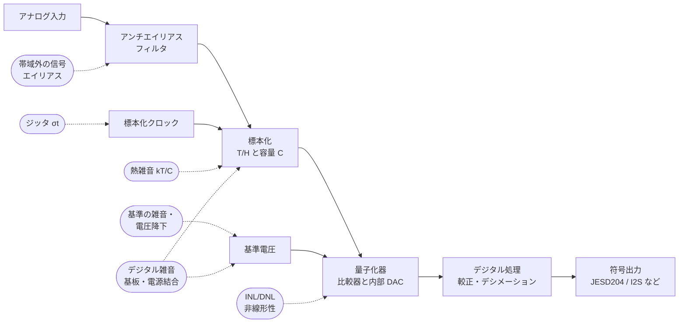
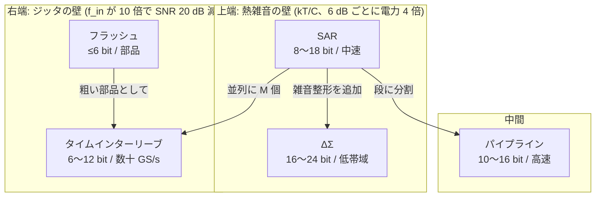

# AD/DA 変換器 (Analog-to-Digital and Digital-to-Analog Converters)

## 概要 (Overview)

マイクの電圧も、アンテナに届いた電波も、銅線の先で鈍った SerDes の波形も、計算機に入るときは **AD 変換器 (ADC: analog-to-digital converter)** を通り、出るときは **DA 変換器 (DAC: digital-to-analog converter)** を通る。標本化と量子化の数学、つまり「条件を守れば標本化は情報を失わない」「量子化の代価は 1 bit あたり約 6 dB の雑音である」は [`../../foundations/mathematics/fourier-signal-processing/sampling-dft-fft.md`](../../foundations/mathematics/fourier-signal-processing/sampling-dft-fft.md) が扱った。本稿はその先の**工学の問い**を扱う。現実の変換器は理想の N bit にどこまで近づけるのか。何がそれを止めているのか。

本稿の中心テーゼは次のとおりである。**変換器の性能は分解能・速度・電力の三者の交換で決まり、その交換の限界は回路方式よりも物理で決まっている。** 低速・高分解能の側では標本化容量の熱雑音 (kT/C) が 1 bit ごとに電力を 4 倍に引き上げる。高速の側では標本化クロックのジッタが入力周波数に比例して SNR を削る。フラッシュ、SAR、パイプライン、ΔΣ、タイムインターリーブという方式の違いは、この二つの壁のどこに陣取り、どの誤差をどこへ追い出すかの違いとして読める。Murmann の講義資料は ISSCC/VLSI の 25 年分の実測データをもとに、現在の変換器は「低速 ADC では 8kT·SNR のエネルギー限界、高速 ADC/DAC では数十 fs のタイミングジッタ」という実用上の限界の近くで動いていると結論している[^murmann-sc]。

## 方法論 (Methodology)

- 変換器を「標本化 (sampling) → 量子化 (quantization) → 符号化」の 3 段と、それを支える基準電圧 (reference) とクロック (clock) の 2 本の柱に分解する。各段の誤差がどの性能指標に現れるかを対応づける。
- 性能の比較には査読付き学会 (ISSCC、VLSI Symposium) の発表を集めた Murmann の ADC Performance Survey[^murmann-survey] と、その解説である ISSCC 2022 の講義資料[^murmann-sc] を一次のデータ源とする。2026-10 時点で公開データは 1997〜2026 年分 (2026-08-01 改訂) である。個別の数値は講義資料が示した 2022 年時点の値で、最新データで外縁が動いている可能性がある。
- 研究発表 (変換器コアの消費電力) と市販品 (I/O や較正回路を含む消費電力) は、同じ性能指数でも条件が違う。両者を並べるときは区別して表記する。
- 本文中の計算例 (kT/C 雑音、ジッタによる SNR の上限、8kT 限界の FOM 換算など) は、出典の式に数値を入れた本稿の試算である。前提 (T = 300 K、正弦波入力など) を併記する。

## 発見事項 (Findings)

1. **公称の分解能と実効の分解能は別物である。** 理想の N bit ADC の SNR は 6.02N + 1.76 dB で、これはナイキスト帯域全体での量子化雑音だけを数えた値である[^mt001]。実際の変換器は熱雑音、ジッタ、非線形性を加えた SINAD から実効ビット数 (ENOB) を逆算して評価する。例えば TI の 12 bit、10.4 GS/s の RF ADC である ADC12DJ5200RF の公表値は ENOB 8.8 bit、SNR 55.6 dB で、公称より約 3 bit 少ない[^ti-adc12dj]。

2. **高分解能の側の壁は熱雑音であり、1 bit 増やすたびに電力が 4 倍になる。** 標本化容量 C の熱雑音は √(kT/C) で、SNR を 6 dB 上げるには C を 4 倍にする必要があり、同じ速度で充電するには電流も 4 倍になる。Murmann は SNDR が約 50 dB を超える領域の変換器の大半がこの「雑音で律速される (noise limited)」傾き、つまり 6 dB あたりエネルギー 4 倍に乗っていると示した。低速域の性能指数は年約 1 dB で改善を続け、P/fs = 8kT·SNR という実用上の限界に近づいている[^murmann-sc]。

3. **高速の側の壁はクロックジッタであり、回路方式では越えられない。** 標本化時刻が σ_t だけ揺らぐと、周波数 f_in の正弦波入力に対する SNR の上限は −20 log₁₀(2π f_in σ_t) になる[^ti-jitter][^murmann-sc]。入力周波数が 10 倍になると上限は 20 dB 下がる。1 GHz の入力で 12 bit 相当の 74 dB を得るには、σ_t をおよそ 32 fs 以下にする必要がある (本稿の試算)。Murmann の 2022 年の講義資料では、学会発表の最良値から推定したジッタの外縁は約 50 fs rms だった[^murmann-sc]。

4. **方式の違いは「1 回の変換に何サイクル使い、何個の比較器を使うか」の配分の違いである。** フラッシュは約 1 サイクルで 2^B 個の比較器を使い、SAR は約 B サイクルで比較器 1 個、パイプラインは段をずらして毎サイクル 1 サンプルを出しながら比較器を約 B 個に抑える[^murmann-sc]。ΔΣ は速度を分解能に交換し、タイムインターリーブは M 個のチャネルを並べて速度を M 倍にする。どの方式も、熱雑音とジッタの壁そのものは動かせない。

5. **研究の変換器コアと市販の変換器の電力効率には桁違いの差がある。** 224 Gb/s SerDes 受信器向けの 7 bit、1.75 GS/s の SAR ADC (3 nm CMOS、64 本のインターリーブで 112 GS/s を構成する 1 チャネル) は Walden の性能指数で 6.9 fJ/conv-step を報告した[^bheemisetti]。前述の ADC12DJ5200RF の公表値 (4 W、10.4 GS/s、ENOB 8.8 bit) から同じ指数を計算すると約 0.86 pJ/conv-step になる (本稿の試算。JESD204C の I/O などを含む)。性能指数を比べるときは、何を電力に含めたかを揃える必要がある。

6. **DAC の難しさは「正しい値」より「正しい時刻」にある。** 電流ステアリング型 DAC で上位ビットを 2 進の重みのまま切り替えると、切り替え時刻のずれがグリッチになる。Murmann の試算では、SFDR 60 dB を 10 GS/s で得るには許容できるスキューが約 150 fs しかない[^murmann-sc]。そのため高速 DAC は上位ビットを温度計符号に分割 (セグメント化) する。DAC の帯域内 SNR もジッタで決まり、5 GHz の出力で 100 fs のジッタがあると約 50 dB になる[^murmann-sc]。

7. **混載 SoC の変換器は同じチップのデジタル回路から雑音を受ける。そしてその結合はセキュリティの問題にもなる。** デジタル回路のスイッチング雑音は基板と電源を通じてアナログ回路に入る[^afzali]。Screaming Channels は、同じチップ上の無線送信器が暗号処理の漏えいを電波に乗せて遠くまで運ぶことを示した[^screaming]。WALNUT は、アンチエイリアスフィルタが不十分な MEMS 加速度センサで、エイリアシングと増幅器のクリップを使って出力を操作できることを示した[^walnut]。

## アーキテクチャ (Architecture)

### 変換器の信号チェーンと誤差の入口

ADC は「前段フィルタ → 標本化 → 量子化 → デジタル処理」の 1 本の鎖であり、誤差はそれぞれ別の入口から入る。次の図で、実線は信号の流れ、点線は誤差や雑音の注入を表す。



凡例: 四角は信号処理のブロック、角丸は誤差源、点線の矢印は誤差が入る位置を表す。

- **誤差の入口は 3 系統に分かれる。** 時間軸 (クロックのジッタ)、振幅軸 (熱雑音、量子化雑音、非線形性)、環境 (基準電圧とデジタル雑音) である。性能指標の SNR、SFDR、INL/DNL はそれぞれ別の系統を見ている。
- **アンチエイリアスフィルタは標本化より前に置くしかない。** 標本化で一度折り返した成分は、後段のデジタル処理では信号と区別できない[^fourier]。
- **DAC は同じ鎖の逆向きである。** 符号から電流や電圧の段を作り、クロックで切り替え、再構成フィルタ (reconstruction filter) で段差を滑らかにする。誤差の入口も同じ 3 系統になる。

### 分解能×速度×電力の領域図

方式ごとの得意な領域を、分解能と速度の 2 軸で示す。1 変換の手間とフラッシュの 6 bit 以下は Murmann の講義資料による[^murmann-sc]。分解能と速度の範囲は、方式の性質と代表的な用途から本稿が置いた目安で、境界は厳密ではない。

| 方式 | 1 変換の手間 (サイクル / 比較器) | 典型的な分解能 | 典型的な速度 | 主な用途 |
|---|---|---|---|---|
| フラッシュ (flash) | ~1 / ~2^B | 6 bit 以下が典型 | GS/s 級 (インターリーブの部品として) | 超高速の粗い量子化、他方式の部品 |
| SAR (逐次比較) | ~B / 1 | 8〜18 bit | kS/s〜数百 MS/s (1 チャネル) | センサ、IoT、インターリーブの単位 |
| パイプライン (pipeline) | ~1 (段ごとに並行) / ~B | 10〜16 bit | 数十 MS/s〜GS/s | 無線の IF/RF 標本化、計測 |
| ΔΣ (delta-sigma) | 過剰標本化 (OSR 倍) / 1〜数 bit | 16〜24 bit 以上 | 帯域 Hz〜数十 MHz | オーディオ、精密計測、センサ |
| タイムインターリーブ (time-interleaved) | M 個並列 | 下位方式による | 数十〜100 GS/s 超 | 直接 RF 標本化、ADC 型 SerDes 受信器 |

この表は二つの壁で区切られた平面として読める。右 (高速) へ進むとジッタの壁、上 (高分解能) へ進むと熱雑音の壁にぶつかる。Murmann の講義資料では、2022 年時点の速度×分解能の外縁は f_s × 2^ENOB ≈ 5 TS/s-levels だった[^murmann-sc]。



凡例: 箱は方式、矢印は方式の派生関係 (SAR を段に分けるとパイプライン、並べるとタイムインターリーブ、雑音整形を加えると ΔΣ に近づく) を表す。Murmann は現在の主流を「SAR を核にした複合型 (hybrid)」と要約している[^murmann-sc]。

## 技術詳細 (Technical Details)

### 1. 標本化と量子化の要点

サンプリング定理、エイリアシング、量子化雑音の導出は [`sampling-dft-fft.md`](../../foundations/mathematics/fourier-signal-processing/sampling-dft-fft.md) に譲り、ここでは変換器の設計に効く点だけを挙げる。

- **ナイキスト条件とアンチエイリアス。** f_s > 2 f_max を守れば標本化は可逆である。ただし f_s/2 を超える成分は、標本化の前にアナログのフィルタで落とすしかない。フィルタの急峻さと f_s の余裕は交換関係にあり、過剰標本化 (oversampling) するとフィルタを緩くできる[^fourier]。
- **意図的なエイリアス。** 帯域通過信号は第 2、第 3 ナイキストゾーンで標本化 (アンダーサンプリング) して、折り返しでベースバンドへ落とせる。このとき SNR を決めるのは f_s ではなく入力周波数なので、ジッタの要求が厳しくなる。TI の解説は、100 MS/s で 10 MHz と 110 MHz の入力が同じ標本値になる例を示し、高いナイキストゾーンでの標本化ではクロックのジッタが SNR を支配すると述べている[^ti-jitter]。
- **6.02N + 1.76 dB の前提。** 6.02 は 20 log₁₀ 2、1.76 は 10 log₁₀(3/2) に由来し、フルスケールの正弦波、ナイキスト帯域全体の雑音、入力と相関しない量子化誤差を仮定している[^mt001][^mt229]。12 bit で 74.0 dB、16 bit で 98.1 dB、24 bit で 146.2 dB である。帯域を BW に絞れば、過剰標本化の処理利得 10 log₁₀(f_s/2BW) が加わる[^mt001]。

### 2. 性能指標が測るもの

単一トーンを入れて DFT で出力を解析するのが基本の測り方である。用語と試験法は IEEE Std 1241 が定める[^ieee1241]。

| 指標 | 定義 | 主に見ている誤差 |
|---|---|---|
| SNR | 信号電力 / 雑音電力 (高調波を除く) | 量子化雑音、熱雑音、ジッタ |
| SINAD (SNDR) | 信号電力 / (雑音 + 高調波) | 上記 + 非線形性 |
| ENOB | (SINAD − 1.76) / 6.02 | SINAD を理想の bit 数に換算した値 |
| SFDR | 信号電力 / 最大のスプリアス | 非線形性、インターリーブの不整合 |
| DNL | 各コード幅の理想 1 LSB からのずれ | 内部 DAC の素子の不整合、ミッシングコード |
| INL | 伝達特性の理想直線からのずれの累積 | 弓なりの歪み → 高調波 |
| NSD | 雑音スペクトル密度 (dBFS/Hz) | 帯域の一部だけを使う RF 用途の雑音床 |

出典: 定義は Murmann[^murmann-sc] と IEEE Std 1241[^ieee1241]。

- **INL と SFDR はつながっている。** INL の曲線が 3 次や 2 次の弓なりを示すとき、SFDR はおよそ −20 log₁₀(INL/2^B) で見積もれる。Murmann の例では INL 0.5 LSB の 13 bit ADC で見積もり 84 dB、実測 89 dB だった[^murmann-sc]。
- **DNL が −1 LSB に達するとミッシングコードになる。** あるコードが一度も出力されなくなる。ADC を帰還制御に使う系では、ミッシングコードは局所的な利得ゼロとして振る舞う。
- **単一トーンの指標が意味を失う用途もある。** 無線の受信では、帯域外のスプリアスより、隣接チャネル漏えい比 (ACLR)、2 トーン試験の相互変調、NSD のほうが重要になる[^murmann-sc]。RF ADC のデータシートが NSD を前面に出すのはこのためである。ADC12DJ5200RF は単一チャネル動作で −154.4 dBFS/Hz を公表している[^ti-adc12dj]。

### 3. 熱雑音とジッタによる下限

**熱雑音 (kT/C)。** スイッチと容量で標本化すると、スイッチの抵抗が出す熱雑音が容量に帯域制限されて、抵抗値によらず電圧 √(kT/C) の雑音が残る[^murmann-sc]。T = 300 K、C = 1 pF では約 64 µV rms である (本稿の試算)。これは 1 V フルスケールの 12 bit ADC の量子化雑音 (LSB/√12 ≈ 70 µV) とほぼ同じ大きさになる。1 bit 増やして雑音を半分にするには C を 4 倍にし、同じ速度で充電するには電流 (≈ 電力) も 4 倍にする。Murmann はこの関係を P/f_s ∝ kT × SNR とまとめ、1997〜2021 年のデータで「SNDR 約 50 dB 以上は 6 dB あたりエネルギー 4 倍 (noise limited)、それ以下は 2 倍 (technology limited)」という二つの傾きを示した[^murmann-sc]。

実用上の下限は P/f_s = 8kT·SNR (レールツーレールの B 級回路に相当、Vittoz 1990 による) とされる[^murmann-sc]。これを Schreier の性能指数に換算すると約 192 dB になる (本稿の試算: FOM_S = 10 log₁₀(1/16kT)、T = 300 K)。低速域の FOM_S は年約 1 dB (3 年で 2 倍) の割合で改善してきた[^murmann-sc]。

**ジッタ。** 正弦波 A sin(2π f_in t) の傾きの最大値は 2π f_in A なので、標本化時刻が σ_t ずれると振幅の誤差はそれに比例する。ここから次の上限が出る[^ti-jitter]。

```text
SNR_jitter = −20 log10(2π · f_in · σ_t)      [dB, 単一正弦波入力]
SNR_total  = −20 log10( sqrt( 10^(−SNR_q/10) + 10^(−SNR_th/10) + 10^(−SNR_jitter/10) ) )
σ_t        = sqrt( σ_clock² + σ_aperture² )   (クロック源と ADC 内部のアパーチャジッタの二乗和)
```

出典: TI Analog Applications Journal、Neu (2010) の式 (1)〜(3)[^ti-jitter]。前提: 雑音源どうしが無相関であること。

| 入力周波数 | 目標 SNR | 許容ジッタ σ_t (本稿の試算) | 典型的な用途 |
|---|---|---|---|
| 20 kHz | 122 dB (20 bit 相当) | 約 6.3 ps | 高品位オーディオ |
| 100 MHz | 98 dB (16 bit 相当) | 約 20 fs | 計測、IF 標本化 |
| 1 GHz | 74 dB (12 bit 相当) | 約 32 fs | 直接 RF 標本化 |
| 28 GHz | 50 dB (約 8 bit 相当) | 約 18 fs | 112 GS/s 級の ADC 型 SerDes |

- **最悪の場合は高周波の単一トーンである。** Murmann は Da Dalt (2002) を引いて、ジッタの影響は入力の自己相関関数の曲率で決まると説明している。帯域内に一様に広がった信号では単一トーンより約 4.8 dB、30 dB の損失がある有線チャネルの信号では約 10 dB、影響が小さくなる[^murmann-sc]。SerDes の ADC が RF ADC より大きいジッタを許容できるのはこのためである。
- **TI の例。** 400 fs のクロックジッタは 100 MHz 入力で SNR を 72 dBc に制限し、熱雑音で決まる 74 dBc と合成すると全体は 69.5 dBc になる[^ti-jitter]。
- **位相雑音からジッタへ。** クロック源のジッタは位相雑音のスペクトルを積分して求める。積分範囲の選び方で値が変わるので、データシートのジッタ値は積分範囲とセットで読む[^ti-jitter]。発振器の物理は [`../timekeeping/clocks-time-synchronization.md`](../timekeeping/clocks-time-synchronization.md)、チップ内の PLL は [`../hw-sw-interface/clock-power-reset.md`](../hw-sw-interface/clock-power-reset.md) を参照。

### 4. ADC の方式

**フラッシュ。** 2^B − 1 個の比較器で、すべての判定レベルと同時に比べる。1 サイクルで答えが出るが、比較器の数が 1 bit ごとに倍になり、オフセットの管理も難しくなるので、6 bit 以下が典型である[^murmann-sc]。比較器の判定時間には限りがあり、判定レベルぎりぎりの入力ではメタスタビリティ (metastability) が起きる。誤りの確率は 2^B に比例して増えるので、10 GS/s を超える領域ではインターリーブに移る[^murmann-sc]。温度計符号の途中に孤立した誤りが出る「スパークルコード」は、符号器の設計で抑える。

**SAR (successive approximation register、逐次比較)。** 内部 DAC (多くは容量アレイ) と比較器 1 個で 2 分探索を行い、1 サイクルに 1 bit を決める。線形性は内部 DAC の素子の整合で決まり、10 bit を超えると比較器の雑音が問題になる[^murmann-sc]。冗長性 (1 bit あたりの重みを 2 未満にする) を入れると、途中の判定誤りを後の段で取り戻せる。非同期 SAR では上位ビットが下位ビットの時間を借りられ、メタスタビリティによる大きな誤りを小さな時間余裕で防げる[^murmann-sc]。容量の電荷再分配は基準電圧に大きな過渡電流を流す (§7)。

**パイプライン。** SAR の内部 DAC を段に分け、各段に比較器と残差増幅器を置いて、前の段が次のサンプルを処理するあいだに後ろの段が残りを処理する。スループットは 1 段の速さ、遅延は段数で決まる[^murmann-sc]。各段の残差を 2^k 倍に増幅して次段の要求を緩めるが、アナログ側の利得とデジタル側の重みが合わないと誤差になるので、較正 (calibration) が欠かせない。近年は各段の小さな ADC に SAR を使う「パイプライン SAR」が多い[^murmann-sc]。

**ΔΣ (delta-sigma)。** 粗い量子化器 (1〜数 bit) を帰還ループの中に置き、ループフィルタ (積分器) で量子化誤差のスペクトルを高域へ押し出す (雑音整形、noise shaping)。その後デシメーションフィルタで帯域外の雑音を捨て、高い分解能の低速データに変換する。L 次の変調器では、過剰標本化率 (OSR) を 2 倍にするごとに帯域内の SQNR が約 6L + 3 dB 改善する (1 次で 9 dB、2 次で 15 dB)[^adi-sd][^schreier]。性能は帰還 DAC とループフィルタの初段で決まる[^murmann-sc]。連続時間型 (CT ΔΣ) は前段のアンチエイリアスを内蔵できる代わりに、帰還 DAC のジッタに敏感である。オーディオの ADC/DAC がほぼ ΔΣ である理由と PDM マイクとの関係は [`../peripherals/audio-subsystem.md`](../peripherals/audio-subsystem.md) を参照。

**タイムインターリーブ。** M 個の ADC を位相をずらしたクロックで順に動かし、速度を M 倍にする[^black-hodges]。各チャネルは全入力帯域を追従しなければならない。チャネル間の不整合はスプリアスになる[^kurosawa][^murmann-sc]。

| 不整合 | 現れ方 | 対策の例 |
|---|---|---|
| オフセット | k·f_s/M に固定のスプリアス (入力によらない) | デジタルで差し引く |
| 利得 | k·f_s/M ± f_in にスプリアス | デジタルで利得補正 |
| タイミング (スキュー) | k·f_s/M ± f_in にスプリアス。f_in に比例して大きくなる | クロック位相の微調整、全体共通の T/H |
| 帯域 | 周波数に依存する利得・位相誤差 | 適応等化型のバックグラウンド較正 |

タイミングの不整合は決定論的なジッタと同じ形で効くので、インターリーブは速度と引き換えにジッタの壁をさらに近づける。

### 5. 性能指数と ADC Performance Survey

分解能・速度・電力の三者を 1 つの数にまとめるのが性能指数 (FOM: figure of merit) である。二つの流儀があり、1 bit あたりのエネルギーの増え方の仮定が違う[^murmann-sc]。

```text
Walden FOM   : FOM_W = P / (f_s · 2^ENOB)            [J/conv-step]  小さいほど良い。1 bit で 2 倍を仮定
Schreier FOM : FOM_S = SNDR + 10 log10( (f_s/2) / P ) [dB]           大きいほど良い。1 bit で 4 倍を仮定
               (原型は DR と信号帯域 BW を使う FOM_S,DR = DR + 10 log10(BW / P))
```

出典: Walden (1999)[^walden]、Schreier の FOM の原型は Schreier & Temes (2005)[^schreier]、SNDR 版は Ali ら (2010)。整理は Murmann の講義資料[^murmann-sc]。

- **どちらの FOM を使うかで勝者が変わる。** Walden の FOM は 1 bit ごとに電力 2 倍を仮定するので、熱雑音で律速される高分解能の変換器を不当に不利にする。Schreier の FOM は 4 倍を仮定するので、高分解能域の比較に向く。Murmann は「FOM の選択によらず、比較は似た速度と分解能の設計どうしに限るべきだ」としている[^murmann-sc]。
- **高速域で FOM_S は約 −10 dB/dec で落ちる。** 高速ではトランジスタの効率 (g_m/I_D) が下がり、電力が f_s に比例するという FOM の前提が成り立たなくなる。さらにインターリーブのオーバーヘッドや低ジッタのクロック生成の電力が加わる[^murmann-sc]。
- **方式の盛衰は用途に引っ張られる。** Murmann の速度×分解能の時系列では、SAR が主流を取った時期と、パイプラインが巻き返した時期が交互に現れる。その進歩は連続的ではなく階段状で、用途の需要と投資が牽引していると見られる[^murmann-sc]。
- **研究データの範囲。** Survey は ISSCC と VLSI Symposium の発表に限られる[^murmann-survey]。市販品の電力は I/O、較正、基準電圧を含むことが多く、学会の変換器コアの値と直接比べられない (発見事項 5)。

### 6. DAC の方式

| 方式 | 構造 | 長所 | 主な誤差 | 用途 |
|---|---|---|---|---|
| 抵抗ストリング | 2^B 個の抵抗の分圧からタップを選ぶ | 単調性が構造上保証される | 素子数が多い、出力インピーダンスがコードで変わる | 低速のトリム、基準電圧 |
| R-2R ラダー | R と 2R の 2 種類の抵抗の梯子 | 素子が 2 種類で済む | 上位ビットの切り替えでグリッチ、抵抗比の整合 | 中速の精密 DAC |
| 電流ステアリング | 単位電流源の出力先を切り替える | GS/s 級に向く | 電流源の不整合、タイミングのずれ、出力インピーダンスの変動 | RF DAC、通信 |
| ΔΣ DAC | 雑音整形して 1〜数 bit の DAC を高速に動かす | 素子の整合を要求しない | 帯域外の雑音、クロックジッタ | オーディオ |

出典: Kester 編の Data Conversion Handbook[^kester] と Murmann[^murmann-sc]。

- **グリッチは「値の誤差」でなく「時刻の誤差」である。** 2 進の重みで 0111 → 1000 と変わるとき、上位ビットの ON と下位ビットの OFF がずれると一瞬だけ 0000 や 1111 に近い出力が出る。このエネルギーをグリッチインパルス (glitch impulse) と呼ぶ。Murmann の試算では、SFDR 60 dB に許容できるスキューは 1 GS/s で約 1.5 ps、10 GS/s で約 150 fs、64 GS/s で SFDR 40 dB に約 230 fs である[^murmann-sc]。そのため、下位ビットは 2 進、上位ビットは温度計符号にするセグメント化が定石になった[^murmann-sc]。
- **NRZ 出力は sinc で帯域が落ちる。** ゼロ次ホールドの出力は sinc(f/f_s) の周波数特性を持ち、f_s/2 で約 −3.9 dB 落ちる (本稿の試算)。また f_s の整数倍の周りにイメージが出るので、再構成フィルタが必要になる。過剰標本化するとこのフィルタを緩くできる[^kester][^murmann-sc]。
- **RF DAC の雑音床は熱雑音とジッタで決まる。** Murmann が示した最先端の RF DAC (Lin、ISSCC 2018) の解析では、2 GHz 出力で測った NSD 約 −160 dBFS/Hz が、50 fs のジッタから計算した約 −159 dBFS/Hz とほぼ一致し、「これ以上の改善はきわめて難しい」と結論している[^murmann-sc]。DAC でも、変換器の限界はクロックの物理に行き着く。
- **DAC 型の有線送信器。** 112G/224G の SerDes 送信器は DAC を使って PAM4 の波形と送信 FFE を作る。評価指標は SFDR よりアイの品質 (ランダムジッタ) と帯域内 SNDR になる[^murmann-sc]。

### 7. 基準電圧とクロック

ADC の出力は「入力 / 基準電圧」の比である。したがって、基準電圧の雑音とドリフトは信号の誤差としてそのまま出力に現れる。

- **SAR の基準電圧は過渡電流を受け止めなければならない。** 容量 DAC の電荷再分配は各ビットの判定のたびに基準電圧から電流を引く。上位ビットの判定ほど大きい。ADI の Analog Dialogue の解説は数 mA のスパイクを示し、平均電流による基準電圧の降下を 1/2 LSB 以内に抑えるよう求めている[^adi-ref]。ADI の AN-931 は、基準電圧の回路が ADC 内部のスイッチ抵抗、デカップリング容量、基準電圧源のインダクタンスでできた RLC 回路として振る舞い、低消費電力の基準電圧源は上位ビットの判定中に整定できないことが多いと述べている[^adi-an931]。TI の ADS8355 のデータシートも、各変換の開始時点で基準電圧を 1 LSB 以内に整えるよう求め、チャネルごとに別の基準バッファを置くことを推奨している[^ti-ads8355]。
- **基準電圧をチャネル間で共有すると、チャネル間のクロストークの経路になる。** あるチャネルの過渡電流が、別のチャネルの基準電圧を揺らすためである[^ti-ads8355]。
- **クロックは ADC の一部として設計する。** 標本化クロックのジッタは §3 のとおり SNR の上限を直接決める。TI の解説はクロック源のジッタと ADC 内部のアパーチャジッタを二乗和で合成し、クロック入力のスルーレートが低いと ADC 内部のバッファの熱雑音がジッタに変わることも示している[^ti-jitter]。オーディオで「クロックはコーデック側で作り、SoC が従う」構成が好まれるのは、同じ理由による ([`../peripherals/audio-subsystem.md`](../peripherals/audio-subsystem.md))。

### 8. 混載 SoC の雑音結合

センサハブ、無線 SoC、RFSoC のように、変換器が大規模デジタル回路と同じダイに載る構成が増えた。このときデジタル回路は変換器にとって最大の雑音源になる。

- **結合経路。** デジタルのスイッチング電流は共通の基板、電源とグラウンドの配線、パッケージのインダクタンス、ボンディングワイヤ間の容量を通じてアナログ回路に入る。Afzali-Kusha らの総説は、基板雑音の結合をモデル化、回避 (ガードリング、ディープ N ウェル、電源分離、配置の分離)、検証の 3 段で整理している[^afzali]。
- **時間と周波数で避ける。** デジタル雑音はスイッチングの瞬間に集中するので、標本化の瞬間をデジタルのクロックエッジから外す、高精度の変換中はデジタル側の動作を止める、といった回避策がとられる。デジタルのクロックとその高調波が信号帯域に落ちないよう周波数を計画することも同じ発想である。こうした回避策の整理も上記の総説にある[^afzali]。
- **基板の外も同じ問題を抱える。** ADI の Kester は ADC の AGND と DGND のピンをどう接続するかについて、変換器の内部で分けたグラウンドを外部で一点に結ぶ考え方を解説している[^kester]。基板のリターン電流の経路は [`../signal-integrity/signal-integrity-engineering.md`](../signal-integrity/signal-integrity-engineering.md) の電源インテグリティの議論と同じ問題である。

### 9. 応用と律速する壁

| 応用 | 典型的な方式 | 典型的な仕様 | 律速する壁 | 関連文書 |
|---|---|---|---|---|
| オーディオ | ΔΣ ADC/DAC | 24 bit / 48〜192 kHz (公称) | 熱雑音、帯域外雑音の処理 | [`audio-subsystem.md`](../peripherals/audio-subsystem.md) |
| センサ (MEMS、生体) | SAR、ΔΣ、インクリメンタル | 12〜24 bit / Hz〜kHz | 消費電力 (常時オン)、1/f 雑音 | [`sensor-hub-mems.md`](../peripherals/sensor-hub-mems.md) |
| イメージセンサ | 列並列 ADC | 10〜14 bit / 画素 | 面積、列ごとのばらつき | [`camera-image-sensors.md`](../peripherals/camera-image-sensors.md) |
| 無線の直接 RF 標本化 | インターリーブ (パイプライン、SAR) | 12〜14 bit / GS/s 級 | ジッタ、インターリーブの不整合 | [`radio-fundamentals-modulation.md`](../wireless/radio-fundamentals-modulation.md) |
| ADC 型 SerDes 受信器 | 大規模インターリーブ SAR | 6〜7 bit / 50〜112 GS/s | 電力、ジッタ | [`serdes-link-architecture.md`](../signal-integrity/serdes-link-architecture.md) |

- **直接 RF 標本化。** ADC をアンテナに近づけ、ミキサの段を減らしてデジタル側で周波数変換する。2026-10 時点の製品例として、TI の ADC12DJ5200RF (12 bit、単一チャネル 10.4 GS/s、−3 dB 帯域 8 GHz、使える入力周波数 10 GHz 超、JESD204C) がある[^ti-adc12dj]。AMD の Zynq UltraScale+ RFSoC は、Gen 3 と DFE で 14 bit の RF-ADC を FPGA と同じパッケージに統合し、ADC ごとに 48 bit の NCO と 2〜40 倍のデシメーションフィルタを持つ (最高標本化速度は品種による)[^amd-pg269]。RF チェーンのどこに ADC を置くかの議論は [`radio-fundamentals-modulation.md`](../wireless/radio-fundamentals-modulation.md) の発見事項 8 と合流する。
- **ADC 型 SerDes 受信器。** Murmann は有線受信器向けの ADC を 28〜112 GS/s、SNDR 30〜40 dB の領域に位置づけた[^murmann-sc]。224 Gb/s PAM4 では、Bheemisetti らの 7 bit、1.75 GS/s の SAR を 64 本インターリーブして 112 GS/s を構成する。1 チャネルの SNDR はナイキスト入力で 37 dB、電力は 0.69 mW である[^bheemisetti]。SerDes 側の電力予算の議論は [`serdes-link-architecture.md`](../signal-integrity/serdes-link-architecture.md) を参照。
- **センサ。** Murmann は生体センシングなどの用途を「低〜中速、SNDR の要求は幅広く、低消費電力が鍵」と位置づけている[^murmann-sc]。常時オンのセンサハブでは、変換 1 回あたりのエネルギーが電池寿命に効く。

## セキュリティ考察 (Security Considerations)

変換器はアナログの物理世界とデジタルの論理世界の境界にある。境界で起きる現象 (エイリアシング、非線形性、雑音結合) は、そのまま攻撃面になる。

- **エイリアシングを使った出力の操作 (WALNUT)。** Trippel らは MEMS 加速度センサの共振周波数の音を当て、アンチエイリアスフィルタが不十分な場合はエイリアシングで出力に偏りを、増幅器のクリップで DC 成分を作り、センサ出力を操作できることを示した[^walnut]。提案された対策には増幅前に共振周波数を除去すること、標本化間隔のランダム化、位相を 180° ずらした標本化が含まれる[^walnut]。これは §1 の「アンチエイリアスは標本化の前に置くしかない」という原則のセキュリティ版である。対象機種とベンダの対応は [`../peripherals/sensor-hub-mems.md`](../peripherals/sensor-hub-mems.md) を参照。
- **非線形性による復調 (DolphinAttack)。** Zhang らは、マイクの前段回路の非線形性が超音波に載せた音声コマンドを可聴帯域に復調し、音声アシスタントを操作できることを示した[^dolphin]。復調は ADC の前段で起き、生じた成分は可聴帯域にあるので、ADC のアンチエイリアスフィルタを通り抜ける ([`../peripherals/audio-subsystem.md`](../peripherals/audio-subsystem.md))。
- **混載チップの雑音結合による漏えい (Screaming Channels)。** Camurati らは無線送信器と CPU を同じダイに載せたチップで、暗号処理のデジタル雑音が送信器の信号に混ざって電波として放射され、離れた場所から電磁サイドチャネル攻撃ができることを示した[^screaming]。§8 の雑音結合が変換器の性能の問題であると同時に情報漏えいの経路でもあることを示す。
- **クロックと基準電圧への干渉。** 標本化クロックや基準電圧に外部から雑音を注入できれば、変換結果を劣化させられる。ジッタは入力周波数に比例して効くので、高い周波数の信号を扱う系ほど影響が大きい。供給元を検証できないクロック源や電源は、計測系の完全性 (integrity) を保証できなくする。
- **防御の指針。** (1) アンチエイリアスフィルタを、帯域外で予想される信号 (共振、超音波、RF) まで含めて設計する。(2) 標本化を可能な範囲でランダム化し、決まった周波数への注入を広帯域の雑音に変える。(3) 変換結果の妥当性を、複数センサの融合や物理モデルとの照合で検査する。(4) 暗号処理と無線送信器が同居するチップでは、両者の同時動作を避けるか、雑音の結合経路を設計段階で検証する。

## 結論 (Conclusions)

- 変換器の性能は分解能・速度・電力の三者の交換で決まる。その交換の限界は二つの物理である。高分解能の側では熱雑音 kT/C が 6 dB ごとに電力 4 倍を課し、高速の側ではクロックジッタが入力周波数 10 倍ごとに SNR を 20 dB 削る。Murmann の整理では、現在の変換器はどちらの壁にも近いところで動いている。
- 方式 (フラッシュ、SAR、パイプライン、ΔΣ、タイムインターリーブ) の違いは、時間と比較器をどう配分し、どの誤差をどこへ追い出すかの違いである。どの方式も壁そのものは動かせない。主流は SAR を核にした複合型である。
- 性能指標は誤差の入口ごとに分かれる。公称の bit 数ではなく ENOB と NSD で読み、性能指数を比べるときは電力に何を含めたかを揃える。
- DAC の難しさは時刻の精度にある。グリッチとジッタが高速 DAC の性能を決め、セグメント化と低ジッタのクロックがその答えになっている。
- 基準電圧とクロックは変換器の外にあるが、性能の一部である。混載 SoC ではデジタル回路の雑音が第 3 の壁になり、同じ結合経路はセキュリティ上の漏えいと注入の経路にもなる。

### 次の接続先 (Related Topics)

- [`../../foundations/mathematics/fourier-signal-processing/sampling-dft-fft.md`](../../foundations/mathematics/fourier-signal-processing/sampling-dft-fft.md) — サンプリング定理、エイリアシング、量子化雑音、ΔΣ の数学。本稿の前提。
- [`../../foundations/information-theory/channel-capacity-coding.md`](../../foundations/information-theory/channel-capacity-coding.md) — SNR とビット数の関係を、通信路容量の側から見る。
- [`../timekeeping/clocks-time-synchronization.md`](../timekeeping/clocks-time-synchronization.md) — 発振器の安定度と位相雑音。ジッタの源。
- [`../hw-sw-interface/clock-power-reset.md`](../hw-sw-interface/clock-power-reset.md) — チップ内の PLL とクロック分配。標本化クロックの生成側。
- [`../wireless/radio-fundamentals-modulation.md`](../wireless/radio-fundamentals-modulation.md) — RF チェーンでの ADC の位置と、ソフトウェア無線への流れ。
- [`../signal-integrity/serdes-link-architecture.md`](../signal-integrity/serdes-link-architecture.md) — ADC-DSP 型受信器と DAC 型送信器。
- [`../signal-integrity/signal-integrity-engineering.md`](../signal-integrity/signal-integrity-engineering.md) — ジッタの分解と電源インテグリティ。
- [`../peripherals/audio-subsystem.md`](../peripherals/audio-subsystem.md) — ΔΣ 型のオーディオ ADC/DAC とクロックの家系。
- [`../peripherals/sensor-hub-mems.md`](../peripherals/sensor-hub-mems.md) — センサの読み出し回路と、共振を突く攻撃。
- [`../peripherals/camera-image-sensors.md`](../peripherals/camera-image-sensors.md) — 列並列 ADC による画素の読み出し。

## 参考文献 (References)

**一次資料 (Primary: 論文・規格・データシート・公開データ)**

[^walden]: Walden, R. H. (1999). Analog-to-digital converter survey and analysis. *IEEE Journal on Selected Areas in Communications*, 17(4), 539–550. DOI: 10.1109/49.761034。Walden の性能指数の原典 (本文は参照できず、FOM の定義は Murmann の講義資料で確認)。

[^murmann-survey]: Murmann, B. ADC Performance Survey 1997-2026. [GitHub: bmurmann/ADC-survey](https://github.com/bmurmann/ADC-survey) — Accessed: 2026-10-24。ISSCC と VLSI Symposium の発表データ (2026-08-01 改訂のデータを含む)。

[^murmann-sc]: Murmann, B. (2022). *Introduction to ADCs/DACs: Metrics, Topologies, Trade Space, and Applications*. ISSCC 2022 Short Course. [PDF (ADC-survey リポジトリ内)](https://github.com/bmurmann/ADC-survey/tree/main/pdf) — Accessed: 2026-10-24。指標の定義、方式の比較、熱雑音とジッタの限界、FOM の整理、DAC のグリッチとジッタの試算。

[^bheemisetti]: Bheemisetti, C., Pandey, K., Lotan, I., Ori, G., Khairi, A., Krupnik, Y., Virobnik, U., Subrahmanyam, B., Cohen, A., & Krishnapura, N. (2025). A 7-bit 1.75-GS/s 6.9-fJ/conv.-step FoMw Loop-Unrolled Fully Asynchronous SAR ADC in 3-nm CMOS for a 224-Gb/s SerDes Receiver. *IEEE Journal of Solid-State Circuits*, 60(4), 1486–1499. DOI: 10.1109/JSSC.2024.3449115

[^black-hodges]: Black, W. C., & Hodges, D. A. (1980). Time interleaved converter arrays. *1980 IEEE International Solid-State Circuits Conference, Digest of Technical Papers*, 14–15. DOI: 10.1109/ISSCC.1980.1156111

[^kurosawa]: Kurosawa, N., Maruyama, K., Kobayashi, H., Sugawara, H., & Kobayashi, K. (2000). Explicit formula for channel mismatch effects in time-interleaved ADC systems. *Proceedings of the 17th IEEE Instrumentation and Measurement Technology Conference*, 2, 763–768. DOI: 10.1109/IMTC.2000.848838

[^afzali]: Afzali-Kusha, A., Nagata, M., Verghese, N. K., & Allstot, D. J. (2006). Substrate Noise Coupling in SoC Design: Modeling, Avoidance, and Validation. *Proceedings of the IEEE*, 94(12), 2109–2138. DOI: 10.1109/JPROC.2006.886029

[^screaming]: Camurati, G., Poeplau, S., Muench, M., Hayes, T., & Francillon, A. (2018). Screaming Channels: When Electromagnetic Side Channels Meet Radio Transceivers. *Proceedings of the 2018 ACM SIGSAC Conference on Computer and Communications Security*, 163–177. DOI: 10.1145/3243734.3243802

[^walnut]: Trippel, T., Weisse, O., Xu, W., Honeyman, P., & Fu, K. (2017). WALNUT: Waging Doubt on the Integrity of MEMS Accelerometers with Acoustic Injection Attacks. *2017 IEEE European Symposium on Security and Privacy*, 3–18. DOI: 10.1109/EuroSP.2017.42。エイリアシングとクリップの機構、対策の一覧は [プロジェクトの論文 PDF](https://spqr.eecs.umich.edu/walnut/) と著者の講演資料で確認。

[^dolphin]: Zhang, G., Yan, C., Ji, X., Zhang, T., Zhang, T., & Xu, W. (2017). DolphinAttack: Inaudible Voice Commands. *Proceedings of the 2017 ACM SIGSAC Conference on Computer and Communications Security*, 103–117. DOI: 10.1145/3133956.3134052

[^ieee1241]: IEEE Std 1241-2023. *IEEE Standard for Terminology and Test Methods for Analog-to-Digital Converters*. DOI: 10.1109/IEEESTD.2023.10269815

[^ti-adc12dj]: Texas Instruments. [ADC12DJ5200RF product page](https://www.ti.com/product/ADC12DJ5200RF) — Accessed: 2026-10-24。12 bit、10.4 GS/s (単一チャネル)、ENOB 8.8 bit、SNR 55.6 dB、SFDR 65 dB、NSD −154.4 dBFS/Hz、消費電力 4 W (いずれも公称の typ 値)。

[^amd-pg269]: AMD. [Zynq UltraScale+ RFSoC RF Data Converter LogiCORE IP Product Guide (PG269), RF-ADC Features](https://docs.amd.com/r/en-US/pg269-rf-data-converter/RF-ADC-Features) — Accessed: 2026-10-24。Gen 3/DFE の 14 bit RF-ADC、48 bit NCO、2〜40 倍のデシメーション。標本化速度は品種による (DS926 を参照)。

[^ti-ads8355]: Texas Instruments. [ADS8355 datasheet (SBAS761A), Application Information](https://www.ti.com/document-viewer/ADS8355/datasheet/application-information-t6119333-22) — Accessed: 2026-10-24。基準電圧を各変換の開始時に 1 LSB 以内に整える要求と、チャネルごとの基準バッファ。

**二次資料 (Secondary: 教科書・アプリケーションノート)**

[^schreier]: Schreier, R., & Temes, G. C. (2005). *Understanding Delta-Sigma Data Converters*. Wiley-IEEE Press. (第 2 版: Pavan, S., Schreier, R., & Temes, G. C., 2017)。ΔΣ 変調の雑音整形と、Schreier の性能指数の原型。

[^kester]: Kester, W. (Ed.). (2005). *Data Conversion Handbook*. Newnes / Analog Devices. DAC の方式 (抵抗ストリング、R-2R、電流ステアリング)、グリッチ、再構成フィルタ、AGND/DGND の接続。

[^mt001]: Kester, W. MT-001: Taking the Mystery out of the Infamous Formula, "SNR = 6.02N + 1.76dB," and Why You Should Care. Analog Devices. [PDF](https://www.analog.com/media/en/training-seminars/tutorials/MT-001.pdf) — Accessed: 2026-10-24。式の前提 (ナイキスト帯域全体の雑音) と処理利得。

[^mt229]: Man, C. MT-229: Quantization Noise: An Expanded Derivation of the Equation, SNR = 6.02 N + 1.76 dB. Analog Devices. [Web](https://www.analog.com/MT-229) — Accessed: 2026-10-24。定数 6.02 と 1.76 の由来、量子化誤差を無相関とみなせる条件。

[^ti-jitter]: Neu, T. (2010). Clock jitter analyzed in the time domain, Part 1. *Analog Applications Journal*, 3Q 2010, Texas Instruments (SLYT379). [PDF](https://www.ti.com/lit/pdf/slyt379) — Accessed: 2026-10-24。ジッタによる SNR の上限の式、雑音源の合成、400 fs での計算例。

[^adi-sd]: Analog Devices. [Sigma-Delta ADCs Tutorial](https://www.analog.com/en/resources/technical-articles/sigmadelta-adcs-tutorial.html) — Accessed: 2026-10-24。過剰標本化率 2 倍ごとの SNR 改善 (1 次 9 dB、2 次 15 dB)。

[^adi-ref]: Analog Devices. [Voltage Reference Design for Precision Successive-Approximation ADCs](https://www.analog.com/en/resources/analog-dialogue/articles/precision-successive-approximation-adcs.html). *Analog Dialogue*, 47-06 — Accessed: 2026-10-24。SAR の基準電圧の過渡電流と、1/2 LSB 以内の降下という要求。

[^adi-an931]: Analog Devices. [AN-931: Understanding PulSAR ADC Support Circuitry](https://www.analog.com/en/resources/app-notes/an-931.html) — Accessed: 2026-10-24。基準電圧の回路を RLC としてみる見方と、上位ビットの判定中の整定。

[^fourier]: 本リポジトリ [`foundations/mathematics/fourier-signal-processing/sampling-dft-fft.md`](../../foundations/mathematics/fourier-signal-processing/sampling-dft-fft.md)。サンプリング定理、アンチエイリアス、アンダーサンプリング、ΔΣ の数学 (同文書の参考文献を参照)。
