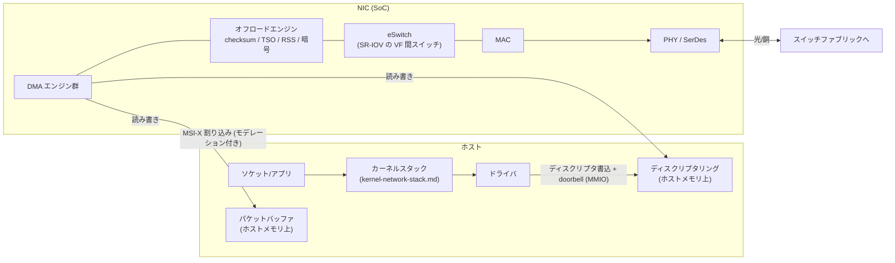

# NIC とスイッチ (NIC & Switch Hardware): パケット単価との戦い

## 概要 (Overview)

[`../../software/networking/kernel-network-stack.md`](../../software/networking/kernel-network-stack.md) は、カーネルが NIC からパケットを受け取って以降の機械を扱った。本ドキュメントはその**向こう側**——NIC (network interface card) というシリコンの内部と、パケットがデータセンタを渡り歩くときに通過するスイッチ ASIC の内部——を扱う。ソフトウェア側 5 本 ([`../../software/networking/`](../../software/networking/README.md)) に対してハードウェア側が空白だった非対称を埋める層である。

中心テーゼは、**ネットワークハードウェアの設計はすべて「パケット単価 (per-packet cost)」の会計から導出できる**、ということ。100GbE で最小フレーム (64B) が到着する間隔は約 6.7 ns——DRAM アクセス 1 回 (約 100 ns) より一桁短く、[`../cpu-architecture/cache-memory-hierarchy.md`](../cpu-architecture/cache-memory-hierarchy.md) の物差しではキャッシュミス 1 回すら許されない。この「1 パケットに使える時間はほぼゼロ」という制約が、ディスクリプタリングによる一括受け渡し、オフロードによる仕事のシリコン移管、RSS による複数コア分配、スイッチの固定パイプライン、そして最終的には CPU 自体の迂回 (RDMA・DPU) まで、この領域の全設計を一本の線で説明する。

もう一つの軸は**境界の移動史**である。「どこまでを NIC (ハードウェア) がやり、どこからをカーネル (ソフトウェア) がやるか」の線は固定ではなく、チェックサム → セグメンテーション (TSO) → プロトコル全体 (RDMA) → インフラ全体 (DPU) へと 30 年かけて移動し続けてきた。TOE (TCP offload engine) の失敗と RDMA の成功、そして DPU の登場は、[`../../software/networking/`](../../software/networking/README.md) が扱った「層をまたぐ設計判断」のハードウェア側の記録である。

本書は (1) パケット単価の算術、(2) NIC と CPU の界面 (リング・割り込み・DMA)、(3) オフロードの系譜、(4) RDMA とロスレスイーサネット、(5) スイッチ ASIC の内部、(6) SmartNIC/DPU、を整理する。分析深度は Level 3。

## 方法論 (Methodology)

- すべての機構を「パケットあたり何 ns / 何回のメモリアクセスを消費するか」という単価会計から演繹する。回線速度・フレームサイズからの理論値 (148.8 Mpps 等) は IEEE 802.3 のフレーミングから計算で導く。
- HW/SW の境界の各移動 (checksum → TSO → RDMA → DPU) を「何を固定化し、何の柔軟性を失ったか」の取引として対で記述する。
- 一次資料は標準仕様 (IEEE 802.3, InfiniBand Architecture Specification, PCIe) と大規模運用者の実測論文 (Microsoft の RoCE 運用、Azure/AWS の SmartNIC) を優先する。ベンダ固有機能は構造の説明に必要な範囲で参照し、製品名は代表例として扱う。
- カーネル側の受け皿 (NAPI・GRO・XDP) は [`../../software/networking/kernel-network-stack.md`](../../software/networking/kernel-network-stack.md) に委ね、本書はシリコン側から境界を照らす。

## 発見事項 (Findings)

1. **パケット単価の算術が全設計を支配する。** 100GbE の最小フレームはプリアンブル・IFG 込みで 84B = 672 bit、毎秒約 1 億 4880 万パケット (148.8 Mpps)、間隔 6.7 ns。DRAM 1 アクセス (約 100 ns) の間に 15 パケット届く。よって「1 パケットごとに何かする」設計は物理的に成立せず、**一括化 (batching)・専用化 (offload)・並列化 (multi-queue) 以外の選択肢がない**——ソフト側で見た NAPI・GRO・io_uring と同じ結論に、ハードは物理から到達する。
2. **NIC と CPU の界面は「共有メモリ上の lock-free リングプロトコル」である。** ドライバはディスクリプタ (パケットバッファへのポインタ+メタデータ) をメモリ上のリングに書き、doorbell レジスタ (MMIO) で NIC を突く。NIC は DMA でディスクリプタとパケットを読み書きし、完了を書き戻し、割り込みで通知する——[`../hw-sw-interface/mmio-dma-interrupts.md`](../hw-sw-interface/mmio-dma-interrupts.md) の三要素がここで一つの協定に組み上がる。割り込みモデレーション・doorbell の間引き・完了の一括書き戻しは、すべて「界面イベントの単価×頻度」を下げる同型の工夫である。
3. **オフロードとは「パケット単位の仕事をバイト単位・フロー単位に変換する」ことである。** チェックサム計算はバイト単位の仕事なので NIC の配線に吸わせる。TSO は「64KB の塊を渡せば NIC が MTU に刻む」ことで、ホストのパケット単価をフロー単価に変える (受信側の LRO/GRO はその逆)。RSS はフローハッシュでキューを選び、パケット並列をコア並列に写像する。**NIC は「ディスクリプタ形式を ISA とするコプロセッサ」** であり、オフロードの各項目はその命令セットの拡張である。
4. **RDMA は「カーネルもリモート CPU も呼ばない」ことで単価をゼロに近づける——代償はネットワークへの要求。** InfiniBand 由来の verbs モデル (QP: queue pair) では、アプリが NIC に直接 work request を書き、NIC 同士がリモートメモリを読み書きする。往復にどちらの OS も介在しない。これを Ethernet に載せた RoCEv2 はロスレス動作を前提に設計され、PFC (priority flow control) による無損失化が**輻輳の伝播・デッドロック・head-of-line blocking** という新種の障害を持ち込んだ (Microsoft の大規模運用報告 Guo et al. 2016 が代表的記録)。「取りこぼさない網」は「詰まりが伝染する網」でもある——[`../../software/networking/tcp-transport-congestion.md`](../../software/networking/tcp-transport-congestion.md) がロスを信号として使ったのと正反対の設計であり、AI クラスタの collective 通信 ([`../gpu-accelerators/`](../gpu-accelerators/README.md) ロードマップ) はこの網の上に立つ。
5. **スイッチ ASIC は「転送表をプログラムとする固定周波数の専用計算機」である。** 数十 Tbps 級のスイッチチップは、パース → マッチ+アクション (match-action) の多段パイプラインを全ポート line rate で回す。表引き (宛先 MAC/IP → 出力ポート) は SRAM/TCAM、パケット本体は共有バッファに置き、トラフィックマネージャがキューイングと QoS を裁く。P4 とプログラマブルパイプライン (RMT) は「パイプラインの段は固定、段の意味を再定義可能」という折衷で、GPU が示した「専用化スペクトラム」のネットワーク版である。
6. **バッファは小さすぎても大きすぎても病気になる。** スイッチの共有バッファは µs 級のバースト (特に incast: 多対一の同時応答) を吸収する保険だが、深すぎるバッファは [`../../software/networking/tcp-transport-congestion.md`](../../software/networking/tcp-transport-congestion.md) のバッファブロートを再演する。現代のデータセンタは「浅いバッファ + ECN マーキングで早期に混雑を申告」(DCTCP 系) へ収斂し、輻輳制御の一部がスイッチの閾値設定に移った——**輻輳制御はもはやエンドホストだけの仕事ではない**。
7. **境界は「NIC にインフラ全体を移す」ところまで動いた (DPU)。** SR-IOV は NIC 内の埋め込みスイッチ (eSwitch) で VM に仮想 NIC を直結し ([`../../software/virtualization/`](../../software/virtualization/README.md))、Azure は仮想スイッチの転送表を FPGA に (Firestone et al. 2018)、AWS Nitro はハイパーバイザ・ストレージ・ネットワークの全インフラを専用カードに移した。ホスト CPU を「テナントに 100% 売る」ためにインフラを別の計算機に追い出す——**NIC はもはや周辺機器ではなく、ホストと対等な「もう一台のサーバ」** である。

## アーキテクチャ (Architecture)

### NIC の内部と CPU との界面



### スイッチ ASIC のパイプライン

```
 入力ポート群 (SerDes ×多数)
    │ ①パーサ: ヘッダ抽出 (Ethernet/VLAN/IP/TCP…) — プログラマブル機では P4 で定義
    ▼
 ②入力パイプライン: match-action の多段
     L2 表 (SRAM) / LPM ルート表 / ACL (TCAM) / トンネル終端 … 各段が固定サイクルで表引き
    ▼
 ③トラフィックマネージャ: 共有パケットバッファ + キューイング
     宛先キュー選択・QoS/スケジューリング・ECN マーキング・(PFC の発火点)
    ▼
 ④出力パイプライン: ヘッダ書換え (TTL/トンネル) → デパーサ → SerDes へ
 
 全段が line rate で流れる「工場のライン」— 分岐も待ち合わせもできない代わりに速い。
 cut-through (ヘッダだけ見て転送開始) vs store-and-forward はレイテンシと検査の取引。
```

## 技術詳細 (Technical Details)

### 1. 界面の経済 — リング・割り込み・DMA

- **リングの往復を減らす**: 完了通知の一括書き戻し、doorbell の集約、ディスクリプタへの小パケット埋め込み (inline) など、PCIe 越しの往復 ([`../hw-sw-interface/bus-interconnect.md`](../hw-sw-interface/bus-interconnect.md)——1 往復サブ µs 級) を 1 回でも減らす工夫が積まれている。PCIe の帯域そのものより、**小さな転送の回数**が先に尽きる。
- **割り込みの経済**: パケット毎の割り込みは 10GbE ですら成立しない。適応的モデレーション (レートに応じて通知間隔を可変) と NAPI のポーリングが対になり、「低負荷ではレイテンシ優先・高負荷ではスループット優先」へ自動遷移する。キューごとの MSI-X が RSS と組んで、割り込み先 CPU とデータの所在 (キャッシュ) を揃える。
- **マルチキュー**: 送受それぞれ数十〜数百のキューを持ち、RSS (受信のフローハッシュ分配)・XPS (送信のコア別キュー) でコア間の共有をなくす。[`../../software/concurrency/`](../../software/concurrency/README.md) の「共有をやめるのが最速の同期」がハード構成に現れた形である。

### 2. オフロードの系譜と統計フィルタ

- **ステートレス系** (checksum, TSO/LRO, RSS, VXLAN 等トンネルの内側ヘッダ処理) は「界面の意味を変えずに単価を下げる」ため広く定着した。
- **ステートフル系の教訓**: TCP 全体を NIC に入れる TOE は、輻輳制御の進化 ([`../../software/networking/tcp-transport-congestion.md`](../../software/networking/tcp-transport-congestion.md) の CUBIC→BBR) やセキュリティ修正をファームウェア更新に人質に取るため、Linux 本流には受け入れられなかった。**進化の速い層を固定化してはならない**——これが境界設計の第一法則であり、後年の「TLS の鍵操作だけオフロード (kTLS offload)」「輻輳制御はホスト・パケット処理は NIC」という分割線の根拠になった。
- **時刻**: ハードウェアタイムスタンプ (PHY/MAC での打刻) は PTP ([`../timekeeping/clocks-time-synchronization.md`](../timekeeping/clocks-time-synchronization.md)) の精度の源泉であり、NIC が分散システムの「物理時計」の末端装置を兼ねる。

### 3. RDMA — verbs・RoCEv2・ロスレスの代償

- **モデル**: アプリは QP (送受のワークキュー対) に work request を post し、NIC が DMA で直接ユーザメモリを読み書きする (メモリ登録とピン留めが前提)。one-sided (READ/WRITE: リモート CPU 不関与) と two-sided (SEND/RECV) があり、レイテンシは µs 級、CPU 使用は桁で減る。
- **RoCEv2 と PFC**: Ethernet は本来ロスを許す網であり、RDMA (再送が弱い) のために PFC で「詰まったら上流を止める」無損失化を行う。停止は連鎖するため、(a) 輻輳が無関係なフローを巻き込む、(b) 循環依存でデッドロックが起きうる、(c) 誤動作 NIC が網全体を止める (PFC storm)、という運用上の難所が実務報告に揃っている (Guo et al. 2016)。緩和として ECN ベースの輻輳制御 (DCQCN) が NIC に実装され、PFC は「最後の安全弁」に格下げするのが定石になった。
- **用途**: AI 学習クラスタの collective 通信 (NCCL over IB/RoCE)、ストレージ (NVMe-oF)、分散 DB。「**ネットワークがメモリバスの延長になる**」ことで、[`../../software/distributed-systems/`](../../software/distributed-systems/README.md) の前提レイテンシが一桁変わる。

### 4. スイッチ ASIC — 表・バッファ・プログラマビリティ

- **表引きの材料**: 完全一致 (L2) は SRAM ハッシュ、最長一致 (LPM ルート) は専用構造、ワイルドカード (ACL/分類) は TCAM——TCAM は全エントリ並列比較で 1 サイクル回答する代わりに、面積・電力が桁で高い「贅沢品」であり、表の規模配分 (プロファイル) がスイッチの性格を決める。
- **共有バッファと incast**: バッファは全ポート共有のプールで、動的閾値で 1 キューの独占を防ぐ。分散処理の scatter-gather (多ワーカが同時に応答) が起こす incast はマイクロバーストの典型で、バッファ吸収 + ECN 早期マーキング + 送信側のペーシングの三段で受ける。
- **プログラマブルパイプライン**: RMT (Bosshart et al. 2013) は「段数・表サイズは固定、各段のマッチ対象とアクションは再構成可能」というモデルで、P4 (Bosshart et al. 2014) がその記述言語。INT (in-band network telemetry) のような「スイッチが自分の滞留時間をパケットに書き込む」観測はこの成果である。専用チップ (Intel Tofino) は商業的に撤退した (2023 発表, as of 2026) が、P4 は固定機能 ASIC の設定記述・SmartNIC・ソフトデータプレーンに残った——**完全な汎用性より「固定パイプライン+再定義」が経済的均衡点だった**という結論ごと学ぶべき事例である。
- **形態**: データセンタは「マーチャントシリコン 1 チップ + 白箱」の leaf-spine (Clos) へ収斂し ([`hardware/README.md`](../README.md) のデータセンター候補と接続)、大型シャーシは VOQ (仮想出力キュー) とセルベースのファブリックで HoL を回避する多チップ構成をとる。

### 5. SmartNIC / DPU — インフラの引越し先

- **SR-IOV / eSwitch**: NIC が PF/VF (物理/仮想機能) を提供し、VM が VF を直接叩く。VF 間・VF-外部間の転送は NIC 内蔵の eSwitch が裁き、ハイパーバイザはデータパスから消える ([`../../software/virtualization/hardware-virtualization-containers.md`](../../software/virtualization/hardware-virtualization-containers.md) の SR-IOV/vDPA 議論の実体)。ライブマイグレーションとの相性問題は、状態が NIC 内に住むことの直接の帰結である。
- **Azure AccelNet**: 仮想スイッチのポリシー適用を「初回パケットはソフトで判定、フローの転送規則を FPGA に流し込む」方式でオフロード (Firestone et al. 2018)。「**遅い経路が規則を作り、速い経路が規則を回す**」という分業は、JIT ([`../../software/compilers-runtimes/`](../../software/compilers-runtimes/README.md)) と同型の構造である。
- **AWS Nitro / DPU**: 汎用 Arm コア + アクセラレータを積んだカードがハイパーバイザ・ストレージ・VPC 処理・セキュリティ (計測ブート) を引き取り、ホストは「顧客の計算だけをする箱」になる。信頼の起点がホストから DPU へ移る点で、[`../hardware-security/side-channels-tee-secure-boot.md`](../hardware-security/side-channels-tee-secure-boot.md) の root of trust 議論の新しい主役でもある。

### 6. 観測の入口 (Observability)

| 疑問 | 道具 |
|---|---|
| NIC は何を落としているか | `ethtool -S` (キュー別・理由別カウンタ)、`ip -s link` (rx_dropped/overrun) |
| 割り込み・キューの偏り | `/proc/interrupts`、`ethtool -l/-x` (キュー数・RSS 表)、`irqbalance` の効き |
| オフロードの有効状態 | `ethtool -k` (tso/gro/checksum…)、無効化して差分測定 |
| リング枯渇・モデレーション | `ethtool -g/-c`、ドロップカウンタと突き合わせ |
| PCIe 帯域・往復の限界 | `lspci -vv` (LnkSta)、NIC ベンダのカウンタ (PCIe posted credits 等) |
| RDMA の健康 | `rdma statistic`、CNP/ECN カウンタ、PFC pause カウンタ (スイッチ側と両面で) |
| スイッチの滞留・ドロップ | ポート別キュー深度/ECN マーク数 (gNMI/sFlow)、INT 対応網ならパケット内テレメトリ |

## セキュリティ考察 (Security Considerations)

- **DMA できる装置は事実上メモリ全権を持つ。** NIC は DMA エンジンの塊であり、悪意ある/侵害されたデバイスや誤設定のディスクリプタは任意メモリ読み書きに直結する。IOMMU ([`../hw-sw-interface/`](../hw-sw-interface/README.md) ロードマップ) による装置別アドレス空間の強制が防御線で、SR-IOV では VF ごとの分離が正しく効いているかがテナント境界そのものになる。
- **ファームウェアと DPU は「ホストより下」の攻撃面。** NIC/DPU は独立した CPU・OS・更新経路を持つ計算機であり、侵害されればホストの全トラフィックとストレージを透過的に触れる位置にいる。署名付きファームウェア・計測ブート・ベンダの供給網管理 ([`../semiconductor-manufacturing/semiconductor-fabrication.md`](../semiconductor-manufacturing/semiconductor-fabrication.md) のサプライチェーン議論) がそのまま適用される。逆に Nitro のように「**DPU 側を信頼の起点にしてホストを信頼しない**」構成は、この非対称を防御に転用した設計である。
- **ロスレス網は DoS の増幅器になりうる。** PFC は「1 台の異常が網を止める」性質を構造的に持ち、悪意ある pause 送出や ECN/CNP の偽装は帯域を安価に奪う。RDMA は歴史的に認証・暗号を持たず (閉域網前提)、マルチテナント環境では PSP/IPsec 系のライン暗号オフロードとテナント分離が必須になる。
- **スイッチの表は資源枯渇攻撃の対象。** MAC 学習表の洪水 (flooding 化を誘発)、TCAM の規則枯渇、ハッシュ衝突の誘発はいずれも古典だが、共有バッファ・共有表という構造がある限り消えない。制御プレーン (BGP 等) の保護は [`../../software/networking/`](../../software/networking/README.md) のルーティング候補に委ねる。
- **オフロードは検査の死角を作る。** NIC 内で完結する VF 間トラフィックはホストの tcpdump に映らない。eSwitch のミラーリング・カウンタを観測経路に組み込まない限り、「見えない経路」が監視の穴になる。

## 結論 (Conclusions)

- ネットワークハードウェアの設計原理は「パケット単価 6.7 ns」という算術に集約される。リング・オフロード・マルチキュー・固定パイプラインは、この単価を一括化・専用化・並列化で回避する同一戦略の別表現である。
- HW/SW の境界は静的でなく、「進化の遅い仕事 (バイト処理・転送) はシリコンへ、進化の速い仕事 (輻輳制御・ポリシー) はソフトへ」という淘汰を 30 年繰り返してきた。TOE の失敗、AccelNet の「遅い経路が規則を作る」分業、Tofino の撤退は、いずれもこの淘汰圧の記録である。
- RDMA とロスレスイーサネットは「ネットワークをメモリバスに近づける」代わりに、輻輳の伝播という分散システム的な故障モードを持ち込んだ。AI クラスタの通信はこの取引の上に成立しており、[`../gpu-accelerators/`](../gpu-accelerators/README.md) のスケールアウト学習分析はここに接続する。
- DPU への「インフラの引越し」は、NIC を周辺機器からもう一台のサーバへ昇格させ、信頼の起点・攻撃面・観測経路のすべてを再配置した。ネットワークハードウェアの分析は、もはや I/O の各論ではなくプラットフォーム設計論である。

### 次の接続先 (Related Topics)

- [`../../software/networking/kernel-network-stack.md`](../../software/networking/kernel-network-stack.md) — 本書の対。NAPI・GRO・XDP というホスト側の受け皿。
- [`../hw-sw-interface/mmio-dma-interrupts.md`](../hw-sw-interface/mmio-dma-interrupts.md)・[`../hw-sw-interface/bus-interconnect.md`](../hw-sw-interface/bus-interconnect.md) — リング協定の部品 (MMIO/DMA/割り込み/PCIe)。
- [`../../software/networking/tcp-transport-congestion.md`](../../software/networking/tcp-transport-congestion.md) — バッファ・ECN・輻輳制御のプロトコル側。
- [`../../software/virtualization/hardware-virtualization-containers.md`](../../software/virtualization/hardware-virtualization-containers.md) — SR-IOV/virtio/vDPA の仮想化側。
- [`../timekeeping/clocks-time-synchronization.md`](../timekeeping/clocks-time-synchronization.md) — ハードウェアタイムスタンプと PTP。
- [`../gpu-accelerators/README.md`](../gpu-accelerators/README.md) — RDMA/collective 通信の最大の需要者 (スケールアウト学習候補)。

## 参考文献 (References)

**一次資料 (Primary — 論文・仕様)**

- Guo, C., et al. (2016). RDMA over Commodity Ethernet at Scale. *ACM SIGCOMM '16*. DOI: 10.1145/2934872.2934908 — RoCEv2/PFC の大規模運用と障害 (デッドロック・storm) の実測記録。
- Firestone, D., et al. (2018). Azure Accelerated Networking: SmartNICs in the Public Cloud. *USENIX NSDI '18*. — FPGA SmartNIC による仮想スイッチオフロードの設計と運用。
- Bosshart, P., et al. (2013). Forwarding Metamorphosis: Fast Programmable Match-Action Processing in Hardware for SDN. *ACM SIGCOMM '13*. DOI: 10.1145/2486001.2486011 — RMT (プログラマブルパイプライン) の原典。
- Bosshart, P., et al. (2014). P4: Programming Protocol-Independent Packet Processors. *ACM SIGCOMM CCR*, 44(3). DOI: 10.1145/2656877.2656890 — P4 言語の原典。
- Zhu, Y., et al. (2015). Congestion Control for Large-Scale RDMA Deployments. *ACM SIGCOMM '15*. DOI: 10.1145/2785956.2787484 — DCQCN の原典。
- IEEE 802.3 — Ethernet 標準 (フレーミング・PFC は 802.1Qbb)。InfiniBand Trade Association — *InfiniBand Architecture Specification* (verbs/RoCEv2 Annex)。

**二次資料 (Secondary — 公式文書・解説)**

- Linux Kernel Documentation — [Scaling in the Linux Networking Stack](https://docs.kernel.org/networking/scaling.html) (RSS/RPS/XPS) — Accessed: 2026-07-10。
- AWS — [The AWS Nitro System](https://aws.amazon.com/ec2/nitro/) — Accessed: 2026-07-10。DPU 型インフラオフロードの一次的説明 (ベンダ資料)。
- NVIDIA Networking — ConnectX / BlueField アーキテクチャ資料 — Accessed: 2026-07-10。eSwitch・RDMA オフロードの実装例 (ベンダ資料)。
