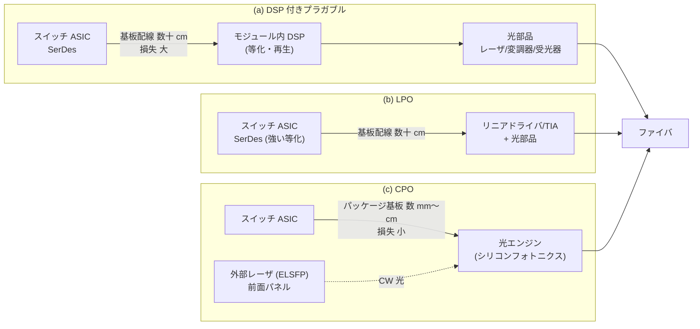

# 光インターコネクト (Optical Interconnect): 電気の配線をどこまで短くできるか

## 概要 (Overview)

[`nic-switch-architecture.md`](nic-switch-architecture.md) は、スイッチ ASIC の中でパケットがどう裁かれるかを扱った。本ドキュメントはその**外側**、つまり ASIC の SerDes から出た電気信号が光に変わり、ファイバを通って隣のラックや隣の建屋に届くまでの区間を扱う。データセンターと AI クラスタで「ネットワークの帯域」と呼ばれているものは、物理的にはこの区間の部品、すなわち光トランシーバ (optical transceiver)・ファイバ・光スイッチの性能と電力の積である。

中心テーゼは、**帯域の限界は銅線の損失と電力で決まっており、光への移行は「電気の配線をどこまで短くできるか」の競争である**、ということ。[`../signal-integrity/serdes-link-architecture.md`](../signal-integrity/serdes-link-architecture.md) が示したとおり、銅線の損失は周波数とともに急増し、SerDes はそれを計算 (イコライゼーション・FEC) で補ってきた。しかしレーンあたり 200 Gb/s の世代では、銅のケーブルは規格の目標でも 1 m 程度しか届かず[^dj-obj]、ASIC から前面パネルのトランシーバまでの数十 cm の基板配線すら、最大 22 dB 級の損失 (ベンダ公称) を抱える[^nv-blog]。そこで業界は光電変換の位置を前面パネル (プラガブル) から、DSP を省いたプラガブル (LPO)、さらに ASIC と同じパッケージ (CPO) へと内側に寄せてきた。どの段階も「電気で走る距離を縮め、それで浮いた電力と損失を帯域に回す」という同じ取引である。

もう一つの軸は**交換単位 (field-replaceable unit) の移動**である。光電変換を ASIC に近づけるほど電力は下がるが、壊れたときに抜き差しできる単位は大きくなる。プラガブルなら 1 ポート、CPO なら最悪でスイッチ 1 台になる。故障の大半がファイバ・コネクタ・トランシーバという「光の部品」に集まる現場の実測[^corropt]を踏まえると、電力と保守性の取引こそが、この領域の設計判断の核心である。

本書は (1) トランシーバの部品とフォームファクタ、(2) 変調方式 (NRZ・PAM4・コヒーレント) と到達距離ごとの規格、(3) 波長多重 (WDM)、(4) 電力の内訳と pJ/bit、(5) LPO と CPO、(6) シリコンフォトニクス、(7) 光回線スイッチ (OCS)、(8) 故障とリンクフラップの運用、を扱う。光の物理 (レーザ・受光・シリコンフォトニクスの原理) は [`../../foundations/physics/quantum-solid-state/optoelectronics.md`](../../foundations/physics/quantum-solid-state/optoelectronics.md) に委ねる。製品の状況は 2026-10 時点で書く。分析深度は Level 3。

## 方法論 (Methodology)

- 各方式を「電気で走る距離」「光電変換の位置」「交換単位」の三つで記述し、電力と保守性の取引として比べる。
- 規格の値は IEEE 802.3 (802.3bs/cu/db/ck/df/dj) と OIF・MSA の実装規約 (800ZR、ELSFP、LPO) の一次資料を使う。802.3dj は 2026-10 時点で承認前なので、**目標 (objective)** と明記する。
- 電力の値は大半がベンダの公称値である。同じ指標 (W/ポート) を複数のベンダと独立報道で突き合わせ、範囲で示す。pJ/bit は W をビットレートで割った**本書の計算値**であり、出典の値ではない。
- 運用の主張は大規模運用者の査読論文と技術報告 (Microsoft の CorrOpt、Google の Apollo/Jupiter/Lightwave Fabrics、Meta の Llama 3) を優先する。CPO の信頼性はベンダ発表と、それを検証した報道に頼るしかなく、その限界も書く。

## 発見事項 (Findings)

1. **銅が届く距離はレーン速度が倍になるたびに縮み、200 Gb/s/レーンでラック内に追い込まれた。** IEEE P802.3dj は 200 Gb/s/レーンの銅ツイナックス (twin-axial) ケーブルの目標到達距離を「少なくとも 1.0 m」とし、同じ規格の光の目標を 500 m・2 km・10 km・40 km と並べている[^dj-obj]。NVIDIA の GB200 NVL72 が 72 GPU を 5,000 本を超える銅ケーブルで結んだ[^nv-nvl72]のは、1 m 級の距離なら銅のほうが光より電力もコストも安いからである。つまり**ラックの中は銅、ラックの外は光**という境界線が、レーン速度によって引かれている。
2. **光トランシーバの電力は、光の部品ではなく電気の部品が多くを占める。** DSP を載せたプラガブル (再生型、retimed) は 800G で 16〜18 W、1.6T で約 30 W と報告されている[^nextplatform][^nv-blog]。これは本書の計算で約 19〜22 pJ/bit にあたる。Meta の比較では、CPO の電力は再生型より 65%、DSP を除いたリニアドライブ光学 (LPO: linear pluggable optics) より 35% 低い。ここから逆算すると、LPO の電力は再生型の約 54% になる[^nextplatform]。Arista も LPO を約 10 W、DSP 型を 25〜30 W と示した[^arista-hoti]。**モジュールの電力の約半分は光と無関係な「電気信号の再生」に使われている**。
3. **CPO の電力削減は「電気で走る距離」の短縮でほぼ説明できる。** NVIDIA は ASIC からプラガブルまでの 200 Gb/s 電気チャネルの損失を最大 22 dB、CPO では約 4 dB としている (ベンダ公称)[^nv-blog]。損失が小さければ、ASIC 側の SerDes は強いイコライゼーションも、モジュール側の DSP も要らない。Broadcom の CPO は 800G あたり 5.5 W (第 2 世代)、約 3.5 W (第 3 世代) と報じられ、プラガブルの 16〜18 W より 70% 以上低い[^nextplatform]。102.4 Tb/s のスイッチ 1 台で換算すると、光の電力は約 2 kW から 0.5 kW 前後に下がる (本書の計算)。
4. **CPO の代償は交換単位の拡大であり、各世代はレーザを外に出すことでそれを縮めてきた。** Broadcom の第 1 世代 CPO (Humboldt) は、レーザか光部品が壊れるとスイッチごと交換する必要があった。第 2 世代 (Bailly) はレーザを着脱可能にし、第 3 世代 (Davisson) はレーザを前面パネルから交換できるモジュールに移した[^nextplatform][^bcm-th6]。OIF の ELSFP (外部レーザ用の小型プラガブル) 実装規約は、この「**最も壊れやすく熱に弱いレーザだけを、最も冷たい前面に置いて抜き差しできるようにする**」設計を業界で共通化したものである[^oif-elsfp]。
5. **変調方式の選択は「どれだけ DSP に頼るか」の選択であり、到達距離が延びるほど DSP は重くなる。** データセンター内の光は強度変調・直接検波 (IM-DD: intensity modulation / direct detection) の PAM4 が主流で、802.3bs (2017) から 802.3cu (100G/λ)、802.3dj (200G/λ 目標) へと 1 波長あたりの速度を倍々に上げてきた[^802-3bs][^802-3cu][^dj-obj]。80〜120 km のデータセンター間接続 (DCI) では、位相と偏波も使うコヒーレント (coherent) 方式が使われる (OIF 800ZR)[^oif-800zr]。コヒーレントは受信側に大きな DSP を持つため、IM-DD より電力が大きい。
6. **光回線スイッチ (OCS) は「パケットを見ないスイッチ」であり、見ないからこそ速度世代をまたいで使える。** Google の Palomar OCS は 136×136 ポートの MEMS ミラー式で、挿入損失は概ね 2 dB 未満、切替はミリ秒級、最大消費電力は 108 W である[^apollo]。光をそのまま反射するだけなのでデータレートにも波長にも依存せず、40G から 400G までの 4 世代のトランシーバを同じ OCS で通した[^apollo]。Jupiter はこの OCS でスパイン層を置き換え、10 年で 5 倍の速度と容量、30% の設備費削減、41% の電力削減を報告した[^jupiter]。TPU v4 では OCS が故障ノードの迂回を担い、システムコストの 6% 未満で最大 3 倍の可用性を得た[^lightwave]。
7. **光リンクの故障は「光の部品」に集中し、その多くは清掃・挿し直しで直る。** Microsoft の 15 データセンター・35 万リンクの調査では、パケット破損 (corruption) の原因はコネクタの汚れ (17〜57%)、ファイバの曲げ・損傷 (14〜48%)、トランシーバの不良・緩み (6〜45%) が大半で、レーザの劣化は 1% 未満だった[^corropt]。Llama 3 の 54 日間の学習で起きた予期しない中断 419 回のうち、ネットワークのスイッチとケーブルは 35 回 (8.4%) である[^llama3]。CPO はこのうち「トランシーバの緩み」を消す一方で、残る故障の交換単位を大きくする。

## アーキテクチャ (Architecture)

### 光電変換の位置と「電気で走る距離」

凡例: 実線の矢印は電気信号、点線は変調されていない連続光 (CW: continuous wave)。枠は交換単位ではない。交換単位は (a)(b) がモジュール 1 個、(c) がレーザモジュールとスイッチ全体の二段になる。

### 到達距離ごとの規格 (IEEE 802.3、800G/1.6T 世代)

| 区分 | 媒体 | 到達距離 | 方式 | 主な用途 |
|---|---|---|---|---|
| CR (銅) | ツイナックス | ≥1.0 m (200G/レーン目標) | 電気 PAM4 | ラック内、GPU とスイッチの直結 |
| VR / SR | MMF (OM4/OM5) | 50 m / 100 m (100G/レーン) | VCSEL 850 nm、IM-DD | 列内の短距離 |
| DR | 並列 SMF | ≥500 m | 1 ファイバ 1 波長、PAM4 | リーフ・スパイン間 |
| DR-2 / FR | 並列 SMF / 単一 SMF | ≥2 km | DR-2 は 1 ファイバ 1 波長、FR は 1 本に 4 波長 | 建屋内の長い配線 |
| LR | 単一 SMF | ≥10 km | 1 波長または 4 波長 | キャンパス |
| ER | 単一 SMF | ≥40 km (800G の目標) | 単一 SMF の双方向 | キャンパス間 |
| ZR | SMF (増幅付き DWDM) | 80〜120 km | コヒーレント | データセンター間 (DCI) |

出典は 802.3db (MMF の 50/100 m)[^802-3db]、802.3df (800G、2024-02 承認)[^802-3df]、P802.3dj の目標 (200G/レーン、800G と 1.6T)[^dj-obj]、OIF 800ZR (80〜120 km)[^oif-800zr]。P802.3dj は 2026-09 の会合でも投票の意見処理を続けており、2026-10 時点で最終承認は確認できなかった[^dj-status]。

## 技術詳細 (Technical Details)

### 1. トランシーバの部品とフォームファクタ

- **送信側**: 短距離の MMF には VCSEL (面発光レーザ) を直接変調して使い、SMF には DML (直接変調レーザ) か EML (電界吸収型変調器付きレーザ) を使う。シリコンフォトニクスでは連続光を出すレーザと、シリコンの変調器 (マッハツェンダ型またはリング型) を分ける (§5)。Google は Apollo の世代を重ねる中で、DML から EML に移った。理由は高速化に加え、消光比 (extinction ratio) を上げて双方向リンクの多重反射 (MPI) を抑えるためである[^apollo]。
- **受信側**: フォトダイオード (PD) が光電流を出し、TIA (トランスインピーダンスアンプ) が電圧に変える。TIA には、低速では高い利得 (弱い光を拾う)、高速では低い利得 (広帯域) が必要で、1 個の設計で全速度の感度を保つことは難しい[^apollo]。
- **DSP**: 再生型モジュールではホスト側の電気信号を一度デジタルに落として等化し、光側の PAM4 波形を作り直す。Google は Apollo のトランシーバで、アナログの CDR から DSP ASIC に移した。DSP は光部品とアナログ回路への要求を緩める代わりに、電力とレイテンシを増やす[^apollo]。
- **フォームファクタ**: QSFP-DD と OSFP はいずれも 8 本の電気レーンを持つ 800G 世代の主流形状である。QSFP-DD は QSFP28 などの旧世代と後方互換を持ち、OSFP は互換を捨てて放熱の余裕を取った。両者は物理的に互換ではない[^juniper-ff]。モジュールの管理 (温度・光パワーの監視、ファームウェア更新) は OIF の CMIS (Common Management Interface Specification) が共通化している[^oif-elsfp]。

### 2. 変調方式 (NRZ・PAM4・コヒーレント)

- **NRZ から PAM4 へ**: 電気側と同じ理由 (Nyquist 周波数の半減と、アイ高さ 1/3 の交換) で、光も 50 Gb/s/λ 以降は PAM4 になった。802.3bs (2017) が 400G で光の PAM4 を導入し、802.3cu (2021) が 1 波長 100 Gb/s を、P802.3dj が 1 波長 200 Gb/s を目標にしている[^802-3bs][^802-3cu][^dj-obj]。PAM4 の算術は [`../signal-integrity/serdes-link-architecture.md`](../signal-integrity/serdes-link-architecture.md) §1 に譲る。
- **光特有の劣化**: 光の PAM4 はレーザの非線形性、ファイバの分散 (波長によって伝わる速さが違う)、反射による MPI に弱い。TDECQ (PAM4 の送信波形品質の指標) は、P802.3dj の 2026-09 の会合でもまだ議論が続いていた[^dj-status]。200G/λ の光は電気以上に余裕がない。
- **コヒーレント**: 振幅に加えて位相と 2 つの偏波を使い、受信側で局部発振光と干渉させて電界そのものを復元する。分散を DSP で補償できるので長距離に強いが、DSP が大きい。OIF の 800ZR 実装規約 (2024-10) は、増幅器付き 80〜120 km の DWDM リンクの 800G プラガブルを定めた[^oif-800zr]。データセンター内では電力が見合わず、IM-DD が使われる。

### 3. 波長多重 (WDM)

- **CWDM** は 20 nm 間隔の粗い波長格子 (ITU-T G.694.2) で、レーザの温度制御が要らないため安い[^itu-cwdm]。FR4 などが 1 本のファイバに 4 波長を載せる。Google は Apollo で CWDM4 の波長格子を世代をまたいで固定した。そうすれば新旧の集約ブロック (aggregation block) が直接つながる。その過程で、温度制御なしの CWDM DML を早期に開発し、それが後の CWDM4 MSA につながった[^apollo]。
- **DWDM** は 100/50 GHz 間隔、またはフレキシブルグリッド (ITU-T G.694.1) で数十波長を載せ、光増幅器と組み合わせてデータセンター間を結ぶ[^itu-dwdm]。レーザの波長を精密に保つ必要があり、コヒーレントのトランシーバと組になる。
- **並列ファイバと WDM の選択**: DR は 1 ファイバ 1 波長で、ファイバの芯数が増える代わりに光部品 (合分波器) が要らない。WDM は芯数を減らす代わりに、合分波器の損失と波長管理を払う。OCS を使う場合は、OCS のポートがファイバ単位で高価なので WDM が有利になる。Google はさらにサーキュレータ (circulator) で 1 本のファイバを双方向に使い、ファイバと OCS ポートを半分にした[^apollo]。

### 4. 電力の内訳と pJ/bit

| 方式 | 報告値 | pJ/bit (本書の計算) | 値の性格 |
|---|---|---|---|
| DSP 付きプラガブル 800G | 16〜18 W | 約 20〜22.5 | 報道による比較値[^nextplatform] |
| DSP 付きプラガブル 1.6T | 約 30 W | 約 19 | ベンダ公称[^nv-blog] |
| LPO | 再生型の約半分 (Arista: 約 10 W 対 25〜30 W) | 約 10 | Meta の比較からの逆算、ベンダ発表[^nextplatform][^arista-hoti] |
| CPO (Broadcom 第 2 世代) 800G | 5.5 W | 約 6.9 | 報道[^nextplatform] |
| CPO (NVIDIA) 1.6T | 9 W | 約 5.6 | ベンダ公称[^nv-blog] |
| CPO (Broadcom 第 3 世代) 800G | 約 3.5 W | 約 4.4 | 報道[^nextplatform] |

- **読み方**: 二つのベンダ (NVIDIA と、Broadcom の比較を報じた Next Platform) が、プラガブルを約 20 pJ/bit、CPO を 4〜7 pJ/bit と、同じ桁の値を示している。ただしどちらも CPO を売る側の数字であり、測定条件 (温度、リンク長、FEC の有無) は揃っていない。独立した測定は見つからなかった。
- **規模の算術**: 102.4 Tb/s のスイッチ 1 台の光を 20 pJ/bit で動かすと、102.4×10¹² × 20×10⁻¹² ≈ 2 kW になる。5 pJ/bit なら約 0.5 kW である。ASIC そのものに匹敵する電力が光に使われており、数万ポートのクラスタではこの差がラックの給電・冷却の設計 ([`../../engineering/datacenters/datacenter-power.md`](../../engineering/datacenters/datacenter-power.md)) に直接響く。NVIDIA の Jensen Huang は GTC 2024 の基調講演 (2024-03-18) で、NVL72 のラック内を光にしていればトランシーバとリタイマだけで約 20 kW を使い、銅の NVLink にしたことでその 20 kW を計算に回せたと述べた。この発言は講演の文字起こしと当日の報道で確かめた。NVIDIA の文書やブログには同じ記述が見当たらず、一次資料は講演の映像だけである (2026-11-28 時点)[^gtc2024-copper][^semianalysis]。
- **理論の下限**: Miller は、光リンクのエネルギーは受信側の容量を充電する電気のエネルギーで下限が決まり、光電変換部品を小さく集積すれば fJ/bit 級まで下げられると論じた[^miller]。現在の pJ/bit 級との差の多くは、電気の配線と DSP にある。

### 5. LPO と CPO: 何を省き、何を払うか

- **LPO が省くもの**: モジュールの DSP とリタイマ。光部品の前後にはリニアドライバと TIA だけが残る。LPO MSA は 2025-03 に 100 Gb/s/レーンの仕様を公開し、200G/レーンの仕様も検討している[^lpo-msa]。
- **LPO が払うもの**: 信号の再生点がなくなるので、ASIC の SerDes から基板配線、モジュール、ファイバ、相手のモジュール、相手の基板配線までが**一つのアナログチャネル**になる。リンクが動くかどうかは、両端のホストとモジュールの組み合わせに依存する。DSP 型なら「モジュールで切って」切り分けられた故障を、LPO では端から端まで追う必要がある。LPO MSA がモジュール単体ではなく、部品・モジュール・システムの三段で相互運用の要件を決めているのはこのためである[^lpo-msa]。
- **CPO が省くもの**: 前面パネルまでの電気配線そのもの。光エンジン (変調器・受光器・ドライバ・TIA) を ASIC と同じ基板に載せ、電気で走るのはパッケージ内の数 mm〜数 cm になる[^nv-blog][^nextplatform]。NVIDIA はレーザの数が 4 分の 1 になるとしている (ベンダ公称)[^nv-pr]。
- **CPO が払うもの**: (a) **交換単位**。光エンジンはパッケージにはんだ付けされ (Broadcom 第 2 世代)、壊れればスイッチごと交換になる[^nextplatform]。外部レーザを前面に出すのはこの対策である (発見事項 4)。(b) **構成の柔軟性**。プラガブルならポートごとに DR・FR・LR を選び、ベンダも変えられるが、CPO は出荷時に光の種類が決まる。(c) **歩留まり**。高価な ASIC と多数の光エンジンを一体で組むため、光エンジンを組む前に良品と確かめる (known-good) 試験が要る。(d) **ファイバの取り回し**。パッケージの縁から前面パネルまで、多数のファイバを引き回す必要がある。
- **2026-10 時点の状況**: Broadcom は 102.4 Tb/s・200G/レーンの Tomahawk 6 Davisson の出荷を 2025-10 に発表した[^bcm-th6]。NVIDIA は Quantum-X (InfiniBand) を 2026 年初め、Spectrum-X (Ethernet) を 2026 年後半に出す計画を示した[^nv-blog]。TrendForce は 2026-07 に、Spectrum-X の CPO スイッチが一部の顧客に出荷され始めたと報じ、量産の制約は光エンジンとパッケージングの供給能力だとした[^trendforce]。広く量産・普及した段階とは言えない。

### 6. シリコンフォトニクス

- **材料の非対称**: シリコンは通信波長 (1310/1550 nm) で透明なので導波路になるが、同じ理由で光らず、受光にはゲルマニウムを足す必要がある。レーザは III-V 族半導体を外付けするか貼り合わせる[^shekhar]。物理は [`../../foundations/physics/quantum-solid-state/optoelectronics.md`](../../foundations/physics/quantum-solid-state/optoelectronics.md) §5 を参照。CPO が外部レーザと相性が良いのは、この材料の事情と、レーザを熱源 (ASIC) から離したいという熱の事情が一致するためである。
- **変調器の二系統**: マッハツェンダ変調器 (MZM) は帯域が広く温度に鈍感だが、素子が大きい。リング変調器 (MRM: micro-ring modulator) は桁違いに小さく低電力で、リングごとに波長を割り当てて WDM にできる。ただし共振波長が温度で動くため、ヒータと制御ループで常に合わせ込む必要がある[^shekhar]。CPO の密度ではリングが有利だが、制御の電力と、温度変化に追従できなかったときの故障が新しい設計課題になる。
- **CMOS の製造基盤に乗る利点**: 導波路と変調器を半導体工場で作れるので、多数の光チャネルを 1 チップにまとめられる。Broadcom の第 3 世代 CPO は TSMC の COUPE (光と電気のチップを積層する実装技術) を使う[^bcm-th6]。光の世界も [`../semiconductor-manufacturing/semiconductor-fabrication.md`](../semiconductor-manufacturing/semiconductor-fabrication.md) の先端パッケージングの競争に入った。

### 7. 光回線スイッチ (OCS): Apollo と Jupiter

- **仕組み**: 2 次元の MEMS ミラーアレイで、入力ファイバの光を任意の出力ファイバに反射する。ミラーの角度を変えるとミリ秒で接続が変わる。パケットを読まないため、1 ポートあたりの電力は高電圧ドライバの数十 mW 程度で、データレートに依存しない[^apollo]。
- **Palomar の数値**: 136×136 (うち 8 ポートは予備)。挿入損失は概ね 2 dB 未満で、裾の多くはスプライスとコネクタの損失のばらつきによる。反射減衰量は典型値 −46 dB (仕様は −38 dB より小)。厳しい反射の仕様は、双方向通信では反射光が主信号にそのまま重なり、多値 PAM ほど影響を受けやすいことから来ている。最大消費電力は 108 W、10 年で数万台を製造・配備した[^apollo]。
- **トランシーバとの共設計**: OCS とサーキュレータの損失 (数 dB) は、トランシーバの光パワーの余裕から払う。Google はこのために合分波器とパッケージの損失を詰め、DSP で MPI を補償するアルゴリズムを作った[^apollo]。OCS は単体の部品ではなく、**OCS・サーキュレータ・WDM トランシーバの三点セット**で成立している。
- **Jupiter の効果**: Clos 網ではスパイン層を最大規模で先に建てる必要があり、そのときの速度世代に網全体が縛られる。Jupiter は OCS でスパインを置き換え、集約ブロック同士を直結 (direct-connect) した。新しい速度のブロックを、旧いブロックと混在させながら段階的に足せる[^jupiter]。報告された 30% の設備費削減と 41% の電力削減は、主にスパインのスイッチとその光トランシーバを除いたことによる[^jupiter]。
- **TPU との組み合わせ**: TPU v4 は 4,096 チップの 3D トーラスを OCS で組み替え、故障チップを避けたスライスを作る。Lightwave Fabrics は、静的な網と比べて最大 3 倍の可用性と、モデルによって最大 3.3 倍の性能を報告した[^lightwave][^tpu-v4]。詳細は [`../accelerators/tpu-systolic-arrays.md`](../accelerators/tpu-systolic-arrays.md) を参照。
- **限界**: ミリ秒の切替はパケット単位の交換には遅すぎる。OCS が使えるのは、トラフィックの形が予測でき、トポロジを分〜時間の単位で組み替えれば足りる用途 (ブロック間の集約トラフィック、学習ジョブ) に限られる[^apollo]。

### 8. 故障とリンクフラップの運用

- **故障の内訳**: CorrOpt の調査では、破損の原因は表のように分かれた[^corropt]。

| 原因 | 寄与 (DC により幅) | 典型症状 (送信パワー/受信パワー) | 処置 |
|---|---|---|---|
| コネクタの汚れ | 17〜57% | 送信正常・受信低下 | 清掃 |
| ファイバの曲げ・損傷 | 14〜48% | 両端で受信が同時に低下 | ファイバ交換 |
| トランシーバの不良・緩み | 6〜45% | 光パワー正常でも破損 | 挿し直し → 交換 |
| 共有部品の故障 | 10〜26% | 同じ機器の複数リンク | 機器の修理 |
| レーザの劣化 | 1% 未満 | 送受とも徐々に低下 | 交換 |

- **破損と輻輳は違う**: 破損による損失率はリンクの利用率に依存せず時間的に安定している。輻輳制御で負荷を下げても減らない[^corropt]。ロスレスを前提にする RDMA の網 ([`nic-switch-architecture.md`](nic-switch-architecture.md) §3) では、わずかな破損でも再送が性能を大きく落とすため、破損したリンクは早めに外す必要がある。CorrOpt は外しても容量の制約を満たすリンクだけを選んで外し、症状から原因を推定して修理を指示する[^corropt]。
- **早期の兆候**: モジュールのデジタル診断 (送受の光パワー、レーザのバイアス電流、温度) と、FEC が訂正した誤りの数 (訂正前 BER) は、リンクが落ちる前に劣化を示す。RS-FEC は訂正前の BER が悪くても誤りゼロに見せるので、訂正できなかった符号語 (uncorrectable codeword) の数だけを見ていると兆候を見逃す。FEC の仕組みは [`../signal-integrity/serdes-link-architecture.md`](../signal-integrity/serdes-link-architecture.md) §4 を参照。
- **リンクフラップ**: リンクの上下を繰り返すと、そのたびにルーティングの再計算と RDMA の接続断が起き、同期的な学習ジョブを止める。Apollo の論文は、トーラス型の網では 1 リンクの断が大きな性能低下を生むので、ハードウェアの信頼性にクラスタ網以上の価値があると述べている[^apollo]。万台規模で部品数に比例して故障が増える算術は [`../../foundations/mathematics/probability-statistics/reliability-theory.md`](../../foundations/mathematics/probability-statistics/reliability-theory.md)、学習ジョブ側の対策は [`../accelerators/interconnects-scaleout-training.md`](../accelerators/interconnects-scaleout-training.md) §4 が扱う。
- **CPO の信頼性データ**: Broadcom は 2025-10、Meta での試験で 400G 換算 100 万ポート時間、リンクフラップ 0 回を発表した。試験は Meta の高温の評価環境で行われた[^bcm-meta]。報道によれば、Meta は CPO のリンク故障がプラガブルの 5 分の 1 としたが、CPO の値は試験室のストレス条件、プラガブルの値は実運用から取っており、条件は揃っていない。LPO との比較もない[^nextplatform]。2026-10 時点で、実運用の大規模な CPO 故障データは公開されていない。
- **CPO と運用手順の関係**: CorrOpt の上位の原因のうち、コネクタの汚れとファイバの損傷は CPO でも前面パネルのコネクタとファイバに残る。トランシーバの緩みは CPO で消えるが、光エンジンの故障はスイッチ交換になる。したがって CPO の導入は、「ポートを 1 個替える」運用から、「冗長な経路にトラフィックを逃がし、スイッチを計画的に替える」運用への移行を伴う。

## セキュリティ考察 (Security Considerations)

- **ファイバは盗聴できる。** ファイバを規定より強く曲げると光の一部が漏れ、受光器で読める。光パワーの低下は CorrOpt の監視と同じ指標で検出できるが[^corropt]、わずかな漏れはコネクタの汚れと区別しにくい。建屋の外を通る DCI では MACsec (IEEE 802.1AE) や、コヒーレントのトランシーバが持つ回線暗号で伝送路を暗号化するのが前提になる[^macsec]。
- **トランシーバは計算機である。** DSP とマイコンを持つモジュールは、CMIS 経由でファームウェアを更新でき、リンクの中間に位置する。署名のないファームウェアや出所の不確かなモジュールは、[`../../software/security/software-supply-chain-security.md`](../../software/security/software-supply-chain-security.md) の来歴の問題をポート単位で持ち込む。
- **OCS の制御面はトポロジそのものを書き換える。** OCS はパケットを見ないので、パケットフィルタやミラーリングの対象にならない。接続を変える制御プレーン (SDN コントローラ) が侵害されると、網の形を任意に変え、トラフィックを観測点の外に迂回させられる。Jupiter は OCS の制御を中央の SDN に置いている[^jupiter]。そのため、コントローラの認証と変更の監査がトポロジの完全性を守る。
- **レーザは目に危険である。** CPO の外部レーザは複数の光エンジンに給電するため高い光パワーを扱う。ELSFP がブラインドメイト (差し込むと自動で結合する) の光コネクタを採ったのは、目の安全のリスクを下げるためである[^oif-elsfp]。光パワーの上限は IEC 60825-1 のレーザ安全クラスで管理され、保守手順にも組み込む必要がある[^iec60825]。
- **可用性への攻撃は物理層から始まる。** ファイバの切断、パッチパネルでの誤接続、前面のレーザモジュールの抜き取りは、論理的な防御をすべて迂回する。CPO で 1 台のスイッチに集まるポートが増えるほど、1 回の物理的な破壊の影響は大きくなる。

## 結論 (Conclusions)

- 光インターコネクトの歴史は光電変換の位置を ASIC に近づけ、電気で走る距離を縮める歴史である。DSP 付きプラガブル、LPO、CPO の順に、電気の損失と、それを補う DSP の電力が削られてきた。銅が 200G/レーンでラック内に追い込まれた事実が、この競争の駆動力である。
- 電力の削減には保守性の代償が伴う。CPO の世代交代はレーザを外に出して交換単位を小さくする歴史でもあった。故障の大半がコネクタ・ファイバ・トランシーバという光の部品に集まるため、CPO の採否は電力の算術だけでは決まらず、冗長経路と計画交換を前提にした運用を組めるかで決まる。
- OCS は逆向きの解である。電気に変換しないことで、速度の世代交代と電力の両方から自由になった。パケットを見ない代わりに、予測できるトラフィックと組み合わせて初めて価値が出る。Google の Jupiter と TPU は、その共設計の記録である。
- 2026-10 時点で、200G/λ の規格 (P802.3dj) は承認前、CPO は出荷の初期段階にあり、信頼性の公開データはベンダの試験に限られる。次の 2〜3 年で、実運用の故障データが CPO の採否を決めることになる。

### 次の接続先 (Related Topics)

- [`nic-switch-architecture.md`](nic-switch-architecture.md) — スイッチ ASIC の内部。光の電力はこの ASIC の電力予算と同じ桁にある。
- [`../signal-integrity/serdes-link-architecture.md`](../signal-integrity/serdes-link-architecture.md) — PAM4・イコライゼーション・FEC。LPO で SerDes に求められる性能の前提。
- [`../signal-integrity/signal-integrity-engineering.md`](../signal-integrity/signal-integrity-engineering.md) — チャネルの損失バジェットと BER。LPO の端から端までのバジェット設計の道具。
- [`../accelerators/interconnects-scaleout-training.md`](../accelerators/interconnects-scaleout-training.md) — 光ファブリックの上で動く集合通信と、故障を前提にした学習ジョブ。
- [`../accelerators/tpu-systolic-arrays.md`](../accelerators/tpu-systolic-arrays.md) — OCS で組み替える TPU のポッド。
- [`../../engineering/datacenters/datacenter-power.md`](../../engineering/datacenters/datacenter-power.md) — 光の pJ/bit が積み上がる先の、ラックと建屋の給電。
- [`../../foundations/physics/quantum-solid-state/optoelectronics.md`](../../foundations/physics/quantum-solid-state/optoelectronics.md) — レーザ・受光・シリコンフォトニクスの物理。

## 参考文献 (References)

**一次資料 (Primary — 規格・論文)**

[^802-3bs]: IEEE Std 802.3bs-2017. *IEEE Standard for Ethernet Amendment 10: Media Access Control Parameters, Physical Layers, and Management Parameters for 200 Gb/s and 400 Gb/s Operation*. — 光の PAM4 を導入した 400G 規格。

[^802-3cu]: IEEE Std 802.3cu-2021. *IEEE Standard for Ethernet Amendment 11: Physical Layers and Management Parameters for 100 Gb/s and 400 Gb/s Operation over Single-Mode Fiber at 100 Gb/s per Wavelength*. — 1 波長 100 Gb/s の SMF 規格。

[^802-3db]: IEEE Std 802.3db-2022. *Physical Layer Specifications and Management Parameters for 100 Gb/s, 200 Gb/s, and 400 Gb/s Operation over Optical Fiber using 100 Gb/s Signaling*. 到達距離 (OM4/OM5 で 50 m と 100 m) の確認は [IEEE P802.3db Task Force completes last draft (Lightwave)](https://www.lightwaveonline.com/optical-tech/transmission/article/14280425/ieee-p8023db-100-gb-s-200-gb-s-and-400-gb-s-short-reach-fiber-task-force-completes-last-draft) — Accessed: 2026-10-24。

[^802-3df]: IEEE Std 802.3df-2024. *Media Access Control Parameters for 800 Gb/s and Physical Layers and Management Parameters for 400 Gb/s and 800 Gb/s Operation*. [IEEE SA — IEEE 802.3df-2024](https://standards.ieee.org/standard/802_3df-2024.html) — Accessed: 2026-10-24。標準化委員会の承認は 2024-02-15、発行は 2024-03-15。

[^dj-obj]: IEEE P802.3dj Task Force. [Adopted IEEE P802.3dj Objectives](https://www.ieee802.org/3/dj/projdoc/objectives_P802d3dj_240314.pdf) (2024-03-14) — Accessed: 2026-10-24。200 Gb/s/レーンの銅 1.0 m、SMF 500 m・2 km・10 km・20 km・40 km の目標。

[^dj-status]: IEEE 802.3. [P802.3dj SA ballot conditional approval notice (2026-02-13)](https://ieee802.org/email/stds-802-lmsc/msg00846.html) および [IEEE P802.3dj Sept 2026 Session](https://www.ieee802.org/3/dj/public/26_09/index.html) — Accessed: 2026-10-24。2026-09 時点で意見処理 (TDECQ・受信感度など) が続いている。

[^oif-800zr]: OIF. [OIF Releases 800ZR Coherent Interface Implementation Agreement (2024-10-30)](https://www.businesswire.com/news/home/20241030270894/en/OIF-Releases-800ZR-Coherent-Interface-Implementation-Agreement-IA-and-Key-400ZR-IA-Updates-Addressing-Market-Demands-for-Scalable-Interoperable-High-Capacity-Solutions) — Accessed: 2026-10-24。80〜120 km の増幅付き DWDM リンク。

[^oif-elsfp]: OIF. [OIF Announces External Laser Small Form Factor Pluggable (ELSFP) Implementation Agreement (2023-08-08)](https://www.businesswire.com/news/home/20230808055417/en/OIF-Announces-External-Laser-Small-Form-Factor-Pluggable-ELSFP-Implementation-Agreement-Paving-the-Way-for-Advancements-in-Co-Packaged-Optics-Applications) — Accessed: 2026-10-24。前面配置・ブラインドメイト光コネクタ・CMIS 管理。

[^lpo-msa]: LPO MSA. [LPO MSA Announces Release of Specification for Linear Pluggable Optical Modules (2025-03-25)](https://www.globenewswire.com/news-release/2025/03/25/3048840/0/en/LPO-MSA-Announces-Release-of-Specification-for-Linear-Pluggable-Optical-Modules.html) — Accessed: 2026-10-24。

[^itu-cwdm]: ITU-T Recommendation G.694.2 (12/2003). *Spectral grids for WDM applications: CWDM wavelength grid*. [itu.int](https://www.itu.int/rec/T-REC-G.694.2) — Accessed: 2026-10-24。20 nm 間隔は ITU-T の解説資料 [Coarse Wavelength Division Multiplexing (ITU-T, 2004)](https://itu.int/dms_pub/itu-t/oth/0B/04/T0B040000150009PDFE.pdf) の「This wavelength grid supports a channel spacing of 20 nm」で確認 (Accessed: 2026-10-24)。

[^itu-dwdm]: ITU-T Recommendation G.694.1. *Spectral grids for WDM applications: DWDM frequency grid*. — 固定格子とフレキシブルグリッド。

[^macsec]: IEEE Std 802.1AE. *IEEE Standard for Local and Metropolitan Area Networks — Media Access Control (MAC) Security*. — リンク層の暗号化。

[^iec60825]: IEC 60825-1:2014 (Edition 3.0). *Safety of laser products — Part 1: Equipment classification and requirements*. [IEC Webstore](https://webstore.iec.ch/en/publication/3587) — Accessed: 2026-10-24。波長 180 nm〜1 mm のレーザ製品の安全要求とクラス分け (規格の概要で確認。本文は有償のため未取得)。

[^apollo]: Urata, R., Liu, H., Yasumura, K., et al. (2022). Mission Apollo: Landing Optical Circuit Switching at Datacenter Scale. *arXiv:2208.10041*. https://arxiv.org/abs/2208.10041 — Palomar OCS (136×136、挿入損失、108 W)、サーキュレータ、CWDM4 の維持、DML から EML、DSP 化。

[^jupiter]: Poutievski, L., Mashayekhi, O., Ong, J., et al. (2022). Jupiter Evolving: Transforming Google's Datacenter Network via Optical Circuit Switches and Software-Defined Networking. *Proc. ACM SIGCOMM 2022*, 66–85. DOI: 10.1145/3544216.3544265 — 5 倍の速度・容量、30% の設備費、41% の電力の削減。

[^lightwave]: Liu, H., Urata, R., et al. (2023). Lightwave Fabrics: At-Scale Optical Circuit Switching for Datacenter and Machine Learning Systems. *Proc. ACM SIGCOMM 2023*, 499–515. DOI: 10.1145/3603269.3604836 — TPU v4 での最大 3 倍の可用性、システムコストの 6% 未満。

[^tpu-v4]: Jouppi, N. P., et al. (2023). TPU v4: An Optically Reconfigurable Supercomputer for Machine Learning with Hardware Support for Embeddings. *Proc. ACM/IEEE ISCA 2023*. DOI: 10.1145/3579371.3589350

[^corropt]: Zhuo, D., Ghobadi, M., Mahajan, R., Förster, K.-T., Krishnamurthy, A., & Anderson, T. (2017). Understanding and Mitigating Packet Corruption in Data Center Networks. *Proc. ACM SIGCOMM 2017*. DOI: 10.1145/3098822.3098849 — 15 データセンター・35 万リンク・7 か月の調査、原因別の寄与 (Table 2)。

[^llama3]: Llama Team, AI @ Meta. (2024). The Llama 3 Herd of Models. *arXiv:2407.21783*. — Table 5: 予期しない中断 419 回の原因別内訳 (Network Switch/Cable 35 回、8.4%)。

[^miller]: Miller, D. A. B. (2017). Attojoule Optoelectronics for Low-Energy Information Processing and Communications. *Journal of Lightwave Technology*, 35(3), 346–396. DOI: 10.1109/JLT.2017.2647779

[^shekhar]: Shekhar, S., Bogaerts, W., Chrostowski, L., Bowers, J. E., Hochberg, M., Soref, R., & Shastri, B. J. (2024). Roadmapping the next generation of silicon photonics. *Nature Communications*, 15, 751. DOI: 10.1038/s41467-024-44750-0

**ベンダ発表 (First-party — 公称値)**

[^nv-pr]: NVIDIA. [NVIDIA Announces Spectrum-X Photonics, Co-Packaged Optics Networking Switches (2025-03-18)](https://investor.nvidia.com/news/press-release-details/2025/NVIDIA-Announces-Spectrum-X-Photonics-Co-Packaged-Optics-Networking-Switches-to-Scale-AI-Factories-to-Millions-of-GPUs/default.aspx) — Accessed: 2026-10-24。レーザ 4 分の 1、電力効率 3.5 倍 (公称)。

[^nv-blog]: NVIDIA Technical Blog. [Scaling AI Factories with Co-Packaged Optics for Better Power Efficiency](https://developer.nvidia.com/blog/scaling-ai-factories-with-co-packaged-optics-for-better-power-efficiency/) — Accessed: 2026-10-24。プラガブル 30 W 対 CPO 9 W、電気チャネル損失 22 dB 対約 4 dB、提供時期の計画 (いずれも公称)。

[^nv-nvl72]: NVIDIA Blog. [NVIDIA Blackwell: Born for Extreme-Scale AI Inference](https://blogs.nvidia.com/blog/blackwell-ai-inference/) — Accessed: 2026-10-24。NVLink スパインの 5,000 本超の銅ケーブル。

[^bcm-th6]: Broadcom. [Broadcom Announces Tomahawk 6 – Davisson, the Industry's First 102.4 Tbps Ethernet Switch with Co-Packaged Optics (2025-10-08)](https://investors.broadcom.com/news-releases/news-release-details/broadcom-announces-tomahawkr-6-davisson-industrys-first-1024) — Accessed: 2026-10-24。200G/チャネル、TSMC COUPE、出荷開始。

[^bcm-meta]: Broadcom. [Broadcom Showcases Industry-Leading Quality and Reliability of Co-Packaged Optics (2025-10-01)](https://www.nasdaq.com/press-release/broadcom-showcases-industry-leading-quality-and-reliability-co-packaged-optics-2025) — Accessed: 2026-10-24。Meta の高温評価環境で 100 万ポート時間・フラップ 0 回 (ベンダ発表)。

[^arista-hoti]: Converge Digest. [HOTI'25: Arista Outlines Pathways to Energy-Efficient Optics and Liquid-Cooled Racks](https://convergedigest.com/hoti25-arista-outlines-pathways-to-energy-efficient-optics-and-liquid-cooled-racks/) — Accessed: 2026-10-24。Arista の講演資料の要約 (LPO 約 10 W 対 DSP 型 25〜30 W)。

[^juniper-ff]: Juniper Networks. [800G Form Factors](https://www.juniper.net/documentation/us/en/hardware/800g-optics-cables-guide/optics/topics/concept/800g-form-factors.html) — Accessed: 2026-10-24。QSFP-DD800 と OSFP800 の非互換、OSFP の放熱型式。

**二次資料 (Secondary — 専門報道)**

[^nextplatform]: The Next Platform. [The Third Time Will Be The Charm For Broadcom Switch Co-Packaged Optics (2025-10-17)](https://www.nextplatform.com/2025/10/17/the-third-time-will-be-the-charm-for-broadcom-switch-co-packaged-optics/) — Accessed: 2026-10-24。Broadcom 3 世代の 800G あたり電力 (約 6.4 / 5.5 / 約 3.5 W)、プラガブル 16〜18 W、Meta の比較 (CPO は再生型より 65%、LPO より 35% 低い)、交換単位の変遷、信頼性比較の条件の違い。

[^trendforce]: TrendForce. [Press Center (2026-07-27)](https://www.trendforce.com/presscenter/news/20260727-13151.html) — Accessed: 2026-10-24。Spectrum-X の CPO スイッチの一部顧客への出荷開始と供給制約。

[^gtc2024-copper]: [TWiT News 401 transcript — NVIDIA GTC 2024 Keynote](https://twit.tv/posts/transcripts/twit-news-401-transcript) — Accessed: 2026-11-28。基調講演 (2024-03-18) の機械的な文字起こしで、「transceivers and retimers alone would have cost 20,000 watts」の発言 (約 51 分 59 秒)。同じ発言は当日の報道 [ServeTheHome — This is the NVIDIA DGX GB200 NVL72](https://www.servethehome.com/this-is-the-nvidia-dgx-gb200-nvl72/) (Accessed: 2026-11-28) も伝えている。

[^semianalysis]: SemiAnalysis. [Nvidia's Optical Boogeyman – NVL72, Infiniband Scale Out](https://newsletter.semianalysis.com/p/nvidias-optical-boogeyman-nvl72-infiniband) — Accessed: 2026-10-24。GTC 2024 の基調講演での「光なら約 20 kW」という発言の引用 (二次報道)。
