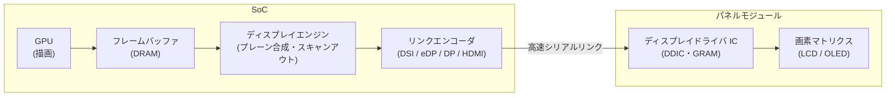

# ディスプレイパイプライン: フレームバッファからパネルへ (Display Pipeline: From Framebuffer to Panel)

## 概要 (Overview)

画面に絵が出るとき、GPU が描いたフレームは「メモリ上のフレームバッファ → ディスプレイエンジンのスキャンアウト → リンク (MIPI DSI / eDP / DisplayPort / HDMI) → パネルの駆動 IC → 画素」という縦の経路を通る。この経路の中心にいるのが **ディスプレイエンジン (display engine / display controller)**——GPU の描画コアとは別の、決まったレートでメモリを読み続ける専用ハードウェアである。

本ドキュメントは、この経路を層ごとに分解し、なぜ画面は毎秒 60 回以上更新され続けるのか（スキャンアウトの締切）、SoC とパネルはどう繋がるのか（DSI/eDP/DP/HDMI）、ティアリングやカクつきはどこで生まれるのか（vsync とバッファリング）をハードウェアの観点から説明する。[`audio-subsystem.md`](audio-subsystem.md) が扱った「締切のある連続ストリーム」問題の映像版であり、`../../software/android/graphics-pipeline.md`（SurfaceFlinger/HWC）と `../../software/ios/core-animation-render-server.md`（Core Animation）が乗るハードウェア側の土台にあたる。

## 方法論 (Methodology)

- 1 フレームの旅（アプリ描画 → コンポジション → スキャンアウト → リンク伝送 → パネル駆動 → 発光）を通しで追い、各層で「データの形式」「クロックの出どころ」「失敗モード（ティアリング・アンダーラン・ジャダー）」を対応づける。
- 用語の混同を最初に固定する：**GPU（描画する）とディスプレイエンジン（送り出す）は別のハードウェア**であり、性能も故障モードも独立である。
- リンク規格は「組込み向け（DSI/eDP）」と「外部接続向け（DP/HDMI）」に分け、帯域・符号化・制御チャネルを同じ軸で比較する。
- OS 側スタックは Linux DRM/KMS を基準とし、Android (HWC)・iOS は対応関係のみ示す。

## 発見事項 (Findings)

1. **スキャンアウトはオーディオ再生と同型の「締切付き DMA」である。** ディスプレイエンジンはピクセルクロックに従いメモリを読み続け、供給が間に合わない（アンダーラン）と画面の乱れとして即座に可視化される。オーディオの DMA リングと同じ構造が、3 桁大きい帯域で動いている。
2. **ブランキング期間は CRT の遺産だが、現代では「更新の窓」として再利用されている。** 電子ビームの帰線のために設けられた垂直ブランキング (vblank) が、いまはフレームバッファ切り替え (page flip) の安全な瞬間、および HDMI がオーディオ等を多重化する帯域として使われる。
3. **ディスプレイエンジンは合成機能を持つ特殊 DMA エンジンであり、GPU の仕事を奪うことで電力を節約する。** 複数プレーン（オーバーレイ）をスキャンアウト時に重ねられるため、動画＋UI 程度の合成なら GPU を起こさずに済む。モバイルの再生時間はこのオフロードに大きく依存する。
4. **必要帯域（解像度 × リフレッシュレート × 色深度）はリンクの進化より速く伸び、圧縮が標準装備になった。** VESA DSC は最大 3:1 の「視覚的無損失 (visually lossless)」圧縮で、4K 高リフレッシュや薄型配線の成立条件になっている。DSI-2 向けの VDC-M は最大 5:1 まで踏み込む。
5. **省電力と滑らかさの要求が「固定周期で送り続ける」という古典契約を崩しつつある。** パネル側がフレームを記憶して自己更新する PSR / コマンドモード、描画完了に合わせて周期を伸縮させる VRR (Adaptive-Sync) は、いずれも「送らない・待つ」ことを許す方向への転換である。

## アーキテクチャ (Architecture)

### 経路の全体像

| 層 | 役割 | データの形式 | 主な失敗モード |
|---|---|---|---|
| GPU / アプリ | フレームを描く | レンダターゲット (テクスチャ) | 描画遅延 → フレーム落ち |
| ディスプレイエンジン | プレーン合成と定レート読み出し | スキャンライン順のピクセル列 | FIFO アンダーラン → 画面乱れ |
| リンク (DSI/DP/…) | シリアル伝送 | パケット / TMDS キャラクタ | リンクエラー → ブラックアウト |
| DDIC | 列/行駆動、ガンマ、GRAM | 駆動電圧・電流 | 表示ムラ・残像 |
| 画素 | 光に変換 | 輝度 | 焼き付き (OLED)・応答遅れ (LCD) |

### GPU とディスプレイエンジンの分離

描画（GPU）は「間に合えばよい」ソフトリアルタイムだが、スキャンアウト（ディスプレイエンジン）は 1 ピクセルたりとも待てないハードリアルタイムである。この性質の違いから両者は分離され、間にフレームバッファ（とバッファリング規律）を挟む。Linux DRM/KMS の用語では、プレーン (plane) がスキャンアウト対象のバッファ、CRTC がタイミングを生成するディスプレイエンジン本体、エンコーダ/コネクタがリンク層に対応する。

## 技術詳細 (Technical Details)

### スキャンアウトとタイミング — pixel clock と blanking

フレームは左上から右へ、1 ラインずつ下へ読み出される。各ラインと各フレームの端には CRT 由来のブランキング（フロントポーチ・同期パルス・バックポーチ）が付き、有効領域＋ブランキングの総画素数 × リフレッシュレートが **ピクセルクロック**になる。

- 例：4K60 (CTA-861 のタイミング) は総画素 4400 × 2250 × 60 Hz = **594 MHz**。有効データは 594 MHz × 24 bit ≈ 14.3 Gbps で、8b/10b 符号化の TMDS では線路上 17.82 Gbps ≈ HDMI 2.0 の上限 18 Gbps にほぼ張り付く。
- vblank は 4K60 で (2250−2160) ライン ≈ 0.67 ms。page flip・レジスタ更新はこの窓で行うとティアリングしない。

### リンク規格の比較

| 規格 | 主用途 | 物理層と符号化 | 帯域（規格上限） | 特徴 |
|---|---|---|---|---|
| MIPI DSI / DSI-2 | スマホ・組込みのパネル直結 | D-PHY（80 Mbps〜6.5 Gbps/レーン、v3.0 で 9 Gbps）または C-PHY | レーン数×レーン速度 | ビデオモード（垂れ流し）とコマンドモード（GRAM 書込）の 2 動作 |
| eDP | ノート PC 内蔵パネル | DP と同系（AUX チャネル併設） | DP に準ずる | PSR/PSR2（パネル自己リフレッシュ）で省電力 |
| DisplayPort 2.1 | PC 外部モニタ | 4 レーン、128b/132b（効率 ~96.7%） | UHBR20 で 80 Gbps（実効 ~77.4 Gbps） | パケットベース、MST で数珠繋ぎ、USB-C Alt Mode |
| HDMI 2.1 | TV・民生機器 | FRL 4 レーン、16b/18b（~88.9%）。2.0 以前は TMDS 8b/10b | FRL 48 Gbps（実効 ~42.6 Gbps）、TMDS は 18 Gbps | CEC・ARC/eARC・音声多重化、コンテンツ保護と強く結合 |

注：帯域の数値は各規格の**上限（spec 値）** であり、実機はケーブル・実装の認証レベルに依存する。

### 圧縮 — DSC と VDC-M

リンク帯域が足りないとき、VESA **DSC (Display Stream Compression)** が送信側で圧縮し DDIC 側で伸長する。24 bpp を 8 bpp へ（3:1）、30 bpp なら 3.75:1 まで圧縮しても「視覚的無損失」とされ、DP/HDMI/DSI すべてが採用する。モバイル向けの **VDC-M** は回路規模と引き換えに最大 5:1 を達成し、MIPI DSI-2 に採択された。圧縮は消費電力の道具でもある——同じ映像をより少ないレーン・低いレーン速度で送れる。

### パネルの物理 — LCD と OLED

- **LCD**：常時点灯のバックライトの前で、液晶が偏光を回して画素ごとの透過率を作る「光のバルブ」。黒はバックライト漏れとの戦いになり、コントラストと応答速度（ゴースト）が弱点。輝度制御はバックライト側で行う。
- **OLED**：画素そのものが電流駆動で発光する。完全な黒と高速応答を得る代わりに、有機材料の劣化＝**焼き付き (burn-in)** と、低輝度制御に使われる PWM 調光のフリッカが弱点。画素回路（TFT）は電流のばらつき補償を抱え込む。
- どちらも末端は **DDIC (display driver IC)** が駆動する。DDIC はガンマ補正・ソース/ゲート駆動に加え、コマンドモード用のフレームメモリ **GRAM** を持ちうる。GRAM を持つパネルは SoC が止まっても表示を維持できる（Always-On Display の基盤）。

### 同期 — vsync・バッファリング・VRR・PSR

- **ティアリング**はスキャンアウト中のバッファをフロントに切り替えたときに起きる。対策はダブル/トリプルバッファリングと「vblank でのみ flip する」規律 (vsync)。バッファを増やすほどティアリングと落ちフレームには強く、遅延は増える——オーディオのバッファサイズと同じつまみである。
- **VRR (variable refresh rate)**：DP の Adaptive-Sync（AMD FreeSync の標準化）や HDMI 2.1 VRR は、vblank の長さを描画完了に合わせて伸縮させ、ジャダーと遅延を同時に減らす。下限を割るフレームはリフレッシュを整数倍して繰り返す (LFC)。
- **PSR (panel self refresh)**：静止画面のあいだ eDP パネルが自前のバッファで自己更新し、リンクとディスプレイエンジンを眠らせる。DSI のコマンドモード（GRAM 更新）も同じ思想で、モバイルの静止画表示電力を大きく下げる。

### ソフトウェアとの接点

Linux では DRM/KMS がこの層の抽象化で、アトミックコミットにより「次の vblank でプレーン構成一式を切り替える」操作を提供する。Android の SurfaceFlinger は HWC (hardware composer) HAL を通じて「どのレイヤをディスプレイエンジンのプレーンに割り当て、どれを GPU 合成に落とすか」を毎フレーム交渉する（`../../software/android/graphics-pipeline.md`）。iOS の render server も同様に Core Animation レイヤツリーを合成してスキャンアウトに載せる（`../../software/ios/core-animation-render-server.md`）。いずれの OS でも「vsync に間に合わせる」スケジューリングがフレームペーシングの中核であり、ハードの締切がそのままソフトの設計を規定している。

## セキュリティ考察 (Security Considerations)

- **コンテンツ保護 (HDCP)**：DP/HDMI はリンク暗号 HDCP と結合しており、現行は HDCP 2.3。初代 HDCP (1.x) はマスター鍵の導出が公表され事実上破られた歴史があり、「リンク暗号は鍵管理が寿命を決める」例になっている。保護映像はメモリ上でも保護バッファ（TEE が管理するセキュアビデオパス）に置かれ、`../hardware-security/side-channels-tee-secure-boot.md` の TEE がここで実務に登場する。
- **EDID/DDC・AUX は「ディスプレイからホストへの入力」である**：モニタの能力記述 EDID はホスト側でパースされるため、悪意ある（または改造された）ディスプレイ機器が脆弱なパーサを突く経路になりうる。DP の AUX/MST や HDMI CEC も同様に、単なる「出力ポート」ではなく双方向の攻撃面として扱う必要がある。
- **画面は放射する**：CRT 時代に van Eck が実証した表示内容の電磁波盗聴 (TEMPEST) は、デジタルリンクでも形を変えて成立しうる（ケーブル・パネル駆動の放射から画面内容を復元する研究系譜）。物理的に「表示する」こと自体が漏洩チャネルであるという認識は、機密環境の設計要件になっている。
- **セキュア表示 (trusted UI)**：決済確認などで「いま画面に出ているものをアプリが改竄できない」ことを保証するには、TEE がディスプレイエンジンのプレーンを直接掌握するセキュア UI パスが要る。表示パイプラインは単なる出力装置ではなく、信頼境界の末端である。

## 結論 (Conclusions)

- ディスプレイパイプラインは「GPU が描き、ディスプレイエンジンが締切どおり送り出し、DDIC が光に変える」3 段のシステムであり、汎用 I/O 機構（DMA・割り込み・高速シリアルリンク）がハードリアルタイム制約下でどう組み合わされるかの集大成である。
- ティアリング・カクつき・遅延・電力は独立の問題ではなく、**vsync とバッファリングという 1 つの規律**の裏表として現れる。オーディオのバッファ問題と同型であり、周期が 16.7 ms か 10 ms かの違いでしかない。
- 帯域の伸びは圧縮 (DSC/VDC-M) で、電力の要求は「送らない」機構 (PSR/コマンドモード/VRR) で吸収されつつあり、リンクは「固定レートの垂れ流し」から「必要なときに必要なだけ送るパケット網」へ寄っている。
- 表示は信頼境界の末端でもある。HDCP・保護バッファ・セキュア UI・EDID パースはいずれも「画面」がセキュリティ設計の対象であることを示す。

### 次の接続先 (Related Topics)

- [`audio-subsystem.md`](audio-subsystem.md) — 同型の「締切付きストリーム」の音声版。バッファと遅延の議論はそのまま対応する。
- [`usb-architecture.md`](usb-architecture.md) — USB-C DP Alt Mode がピン資源をどう明け渡すか。
- `../hw-sw-interface/mmio-dma-interrupts.md` — スキャンアウトの土台となる DMA・割り込みの一般論。
- `../gpu-accelerators/gpu-simt-architecture.md` — 「描く側」の内部。本ドキュメントは「出す側」を扱った。
- `../../software/android/graphics-pipeline.md` / `../../software/ios/core-animation-render-server.md` — この上に乗る OS 側コンポジション。

## 参考文献 (References)

**一次資料 (Primary — 仕様・公式ドキュメント)**

- VESA. *DisplayPort 2.1 / UHBR 認証・DSC 規格概要*. — [vesa.org DSC](https://vesa.org/vesa-display-compression-codecs/dsc/) — Accessed: 2026-07-06。DSC の圧縮率（8 bpp への圧縮、24 bpp 比 3:1 / 30 bpp 比 3.75:1）と「視覚的無損失」定義の規範元。
- VESA. *VESA Publishes Display Compression Standard for Mobile Applications* (VDC-M 発表, 2018). — [vesa.org](https://vesa.org/featured-articles/vesa-publishes-display-compression-standard-for-mobile-applications/) — Accessed: 2026-07-06。VDC-M の最大 5:1 圧縮と MIPI DSI-2 への採択。
- MIPI Alliance. *MIPI D-PHY Specification* (概要公開ページ) および *MIPI D-PHY v3.0 プレスリリース*. — [mipi.org/specifications/d-phy](https://www.mipi.org/specifications/d-phy) / [press release](https://www.mipi.org/press-releases/mipi-d-phy-v3.0-doubles-data-rate-of-physical-layer-interface-while-extending-power-efficiency) — Accessed: 2026-07-06。レーン速度（〜6.5 Gbps、v3.0 で 9 Gbps）と DSI-2/C-PHY の関係。
- Linux Kernel Documentation. *DRM Kernel Mode Setting (KMS)*. — [kernel.org DRM/KMS docs](https://docs.kernel.org/gpu/drm-kms.html) — Accessed: 2026-07-06。プレーン/CRTC/エンコーダ/コネクタの抽象とアトミックコミットの一次ドキュメント。
- CTA. *CTA-861 (A DTV Profile for Uncompressed High Speed Digital Interfaces)*. — 4K60 の 4400×2250 タイミングと 594 MHz ピクセルクロックの規範元（HDMI が参照するビデオタイミング規格）。
- van Eck, W. (1985). Electromagnetic Radiation from Video Display Units: An Eavesdropping Risk? *Computers & Security*, 4(4), 269–286. DOI: 10.1016/0167-4048(85)90046-X。表示内容の電磁波盗聴（TEMPEST）を公開文献で初めて実証した査読付き論文。

**二次資料 (Secondary)**

- Rambus. *VESA Display Stream Compression (DSC): The Complete Guide*. — [rambus.com](https://www.rambus.com/blogs/vesa-display-stream-compression-dsc-the-complete-guide/) — Accessed: 2026-07-06。DSC/VDC-M の技術解説（IP ベンダによる整理）。
- PCWorld. *What DisplayPort's new Ultra-High Bit Rate (UHBR) certification means to you*. — [pcworld.com](https://www.pcworld.com/article/619538/what-you-need-to-know-about-displayport-uhbr-the-new-ultra-high-bit-rate-certification.html) — Accessed: 2026-07-06。UHBR10/13.5/20 の帯域と認証の解説。DP 2.1 の 80 Gbps（実効 ~77.4 Gbps）・HDMI 2.1 FRL 48 Gbps（実効 ~42.6 Gbps）は本記事および各規格団体公表値で相互確認した。
