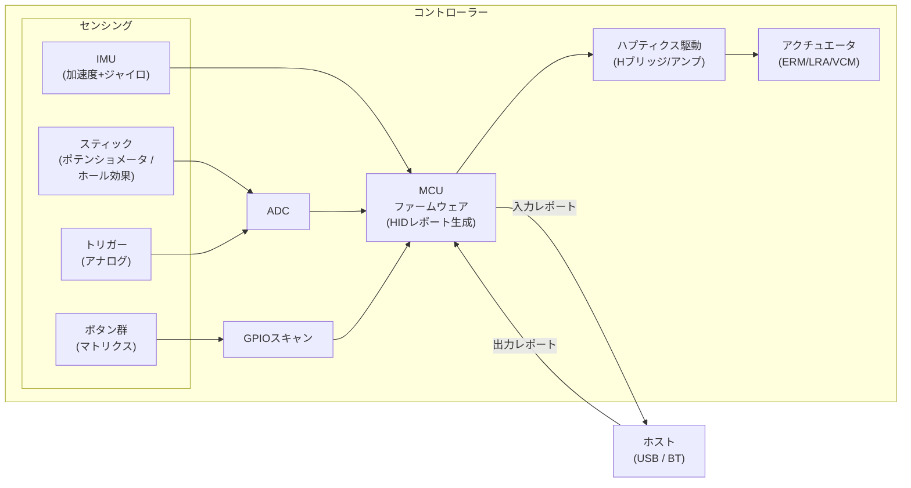
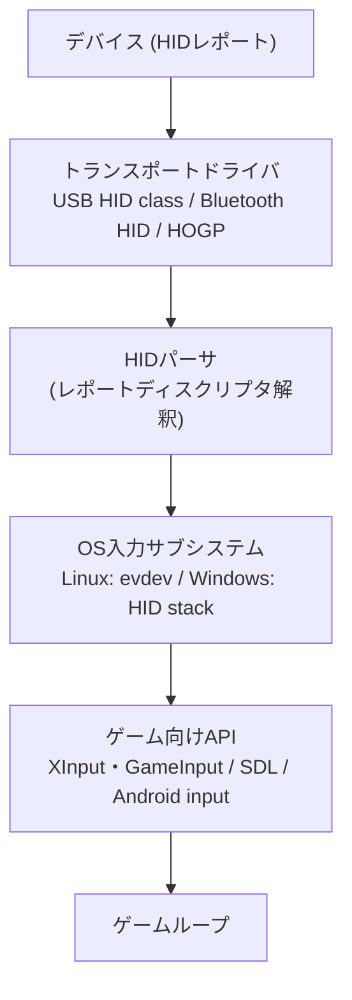

# 入力デバイスとHID: ゲームコントローラーの解剖 (Input Devices & HID: Anatomy of a Game Controller)

## 概要 (Overview)

ゲームコントローラーは、入力デバイス (input device) の技術要素がほぼすべて詰まった格好の題材である。アナログセンシング（スティック・トリガー）、デジタル入力のスキャン（ボタン）、触覚フィードバック（振動）、そしてそれらを OS へ届ける **HID (Human Interface Device)** プロトコル——キーボードもマウスもタッチパッドも、原理はこの部分集合にすぎない。

本ドキュメントは、コントローラーを「センサ → ファームウェア → 伝送路 → ホストOS」の一本の経路として解剖し、スティックドリフトはなぜ起きるのか、なぜドライバなしで挿すだけで動くのか、「ポーリングレート 1000Hz」は何を意味するのかをハードウェアの観点から説明する。

## 方法論 (Methodology)

- コントローラーを **入力経路**（センサ → ADC/スキャン → HID レポート → 伝送 → OS 入力サブシステム → ゲーム）と **出力経路**（ゲーム → 出力レポート → アクチュエータ駆動）の2本に分解する。
- 各段について、物理原理・設計上の制約・ソフトウェアから見える振る舞いを対応づける。
- 「ボタンを1回押してから画面に反映されるまで」を1本のレイテンシバジェット (latency budget) として通しで見る。
- 伝送路は USB を基準とし、無線（Bluetooth HID / HOGP）は差分として扱う（無線層の詳細は `bluetooth-pairing-protocol.md` に委譲）。

## 発見事項 (Findings)

1. **HID の本質は「自己記述型プロトコル」である。** デバイスは自分のデータ形式を**レポートディスクリプタ (report descriptor)** として申告し、ホストはそれを解釈して汎用ドライバだけで扱う。「挿すだけで動く」のはこの仕組みの直接の帰結。
2. **スティックドリフトは電気機械的な摩耗問題であり、センシング原理の置き換えで解決されつつある。** 接触式のポテンショメータ (potentiometer) は摺動で摩耗・汚損するが、非接触のホール効果 (Hall effect) / TMR センサは原理的に摺動摩耗がない。
3. **入力遅延はパイプラインの総和であり、ポーリングレートはその1項にすぎない。** センサ読み取り、デバウンス、伝送間隔、OS 処理、ゲームループ、表示までが直列に足し合わさる。
4. **振動は ERM → LRA → ボイスコイルへと「モーター」から「スピーカー」に近づく進化をした。** 立ち上がり時間と再現できる周波数帯域が世代を分ける。
5. **HID はトランスポート非依存で、同じレポートモデルが USB・Bluetooth・BLE に載る。** 一方で実際の主要コントローラーは HID の標準ゲームパッド定義をそのまま使わず、ベンダ固有レポート＋ホスト側 API（XInput/GameInput 等）の組み合わせで拡張機能を実現している。

## アーキテクチャ (Architecture)

### デバイス側ブロック図



### ホスト側スタック



要点は、**トランスポート層（USB/BT）と HID 層が分離している**こと。HID パーサから上は、レポートがどの物理経路で来たかを知らない。

## 技術詳細 (Technical Details)

### アナログスティック — ポテンショメータとその限界

古典的なスティックは軸ごとに**ポテンショメータ**（可変抵抗の分圧回路）を持ち、傾きを電圧に変換して MCU の ADC（典型 8〜12 bit）で読む。

- **ドリフトの機序**: (1) 抵抗皮膜とワイパの**摺動摩耗**、(2) 摩耗粉・埃による接触不良、(3) スプリングのへたりによる中立点のずれ。いずれも「触れて擦る」構造に由来する。
- **ソフト側の緩和**: 中立点キャリブレーション、デッドゾーン (deadzone)、外周の真円度補正。ただし摩耗の進行そのものは止められず、デッドゾーン拡大は操作精度と引き換えになる。
- **非接触センシングへの置換**: **ホール効果センサ**は磁石の位置を磁束密度で読む（ラチオメトリック出力を同じく ADC で読む）ため摺動部がなく、**TMR (Tunnel Magnetoresistance)** はさらに低消費電力・高感度。近年の交換用スティックモジュールや一部純正機はこちらに移行している。Nintendo は Switch 2 のスティックについて「ホールセンサではないが、耐久性を考慮して新設計した」と説明しており、方式選定が各社で分かれている点は注意（一次情報: 任天堂開発者インタビュー）。

### ボタン — マトリクススキャンとデバウンス

ボタンを1個ずつ GPIO に繋ぐとピンが足りないため、**マトリクススキャン (matrix scanning)**（行を順に駆動し列を読む）で N+M 本のピンに圧縮するのが定石。同時押しで偽の押下が見える**ゴースト (ghosting)** は、キーごとのダイオードまたは配置設計で回避する。

機械接点は閉じる瞬間に数百 µs〜数 ms **バウンス (chatter/bounce)** するため、**デバウンス**が必須。方式は「一定時間の安定を待つ」（遅延を足す）か「最初のエッジで確定し不応期を置く」（速いが誤検出リスク）かで、**入力遅延に直接効く設計判断**になる。

### HID レポートディスクリプタ — 「挿すだけで動く」の正体

HID デバイスは列挙時に**レポートディスクリプタ**を渡す。これは「この後送るバイト列のビットフィールドが何を意味するか」を宣言する小さなバイトコードである。

```text
// 例示 (illustrative): ゲームパッドのディスクリプタ断片（意味を注記）
Usage Page (Generic Desktop)     // 意味体系の名前空間
Usage (Game Pad)
Collection (Application)
  Usage (X)  Usage (Y)           // スティックX/Y軸
  Logical Minimum (0) Logical Maximum (255)
  Report Size (8) Report Count (2)
  Input (Data, Var, Abs)         // → レポート先頭2バイトは X,Y
  Usage Page (Button)
  Usage Minimum (1) Usage Maximum (16)
  Report Size (1) Report Count (16)
  Input (Data, Var, Abs)         // → 続く2バイトはボタン16個のビットマップ
End Collection
```

ホストの HID パーサはこれを解釈し、汎用ドライバが「X軸」「ボタン3」といった**意味 (usage)** 付きの入力イベントに変換する。usage の語彙は HID Usage Tables で標準化されている。振動などの逆方向は **出力レポート (output report)** として同じ仕組みで流れる。

実際の主要コントローラーは、標準の Game Pad usage だけでは表せない機能（IMU、タッチパッド、アダプティブトリガー、LED）を**ベンダ固有レポート**で運び、ホスト側の専用スタック（XInput/GameInput、Linux の `hid-playstation`/`hid-nintendo` 等）が解釈する。「HID だから完全に汎用」ではない点が実務上の落とし穴になる。

### ポーリングレートと遅延バジェット

USB の HID は**インタラプト転送 (interrupt transfer)** を使い、ホストが `bInterval` で申告された間隔でデバイスを周期的に取りに行く（デバイス側から押し込む仕組みではない）。

| 伝送路 | 最小間隔 | 相当ポーリングレート |
|---|---|---|
| USB Full-Speed | 1 ms | 1000 Hz |
| USB High-Speed | 125 µs | 8000 Hz |
| Bluetooth Classic (HID) | 実効 ~7.5〜11 ms 前後(実装依存) | ~90〜133 Hz |
| BLE (HOGP) | 接続間隔 7.5 ms〜(交渉次第) | ~133 Hz〜 |

エンドツーエンドの遅延はおおよそ:

```text
センサ読取/スキャン周期 + デバウンス + レポート生成
+ 伝送待ち(平均 = ポーリング間隔/2) + OS入力処理
+ ゲームループ(フレーム同期) + 表示遅延(V-Sync, パネル応答)
```

ポーリングを 1000 Hz → 8000 Hz にしても縮むのは「伝送待ち」の項（平均 0.5 ms → 62.5 µs）だけで、**60 Hz ゲームループ（~16.7 ms）や表示側が支配的な環境では体感差は小さい**。遅延を語るときは必ずどの区間の話かを特定する必要がある。

### ハプティクス — ERM から LRA、ボイスコイルへ

| 方式 | 原理 | 立ち上がり | 帯域 | 例 |
|---|---|---|---|---|
| **ERM** (Eccentric Rotating Mass) | 偏心錘付きDCモーター | 遅い（数十 ms、慣性） | 振幅と周波数が連動し独立制御不可 | 従来型ゲームパッドの「ゴロゴロ」 |
| **LRA** (Linear Resonant Actuator) | バネ質量系を共振周波数(~150–250 Hz)で駆動 | 速い（アクティブブレーキ併用で ~ms 級） | 共振点近傍のみ | スマホのタップ感、精密な「クリック」 |
| **ボイスコイル型 (VCM)** | スピーカーと同構造で広帯域波形を再生 | 速い | 広い（波形をそのまま鳴らせる） | DualSense のハプティクス |

進化の方向は「回す」から「波形を再生する」へ、つまり**モーターからスピーカーへ**の接近である。加えて DualSense のアダプティブトリガーは、トリガー軸にギヤモーターで可変抵抗を与える**力覚 (force feedback)** で、振動とは別系統になる。駆動指令はいずれも HID 出力レポート（またはベンダ固有レポート）で届く。

## セキュリティ考察 (Security Considerations)

- **HID は「入力を注入できる」権限そのものである。** HID キーボードを名乗る不正 USB デバイス（いわゆる BadUSB 系）は、挿された瞬間からキー入力を打ち込める。OS は USB の申告内容を基本的に信用するため、対策は物理ポート管理・USB デバイス許可リスト・新規 HID キーボードの承認 UI などホスト側の運用に寄る。
- **独自 2.4 GHz 無線の入力機器には注入・盗聴の前例がある。** Bastille の **MouseJack** (2016) は、複数ベンダの非 Bluetooth 系ワイヤレスマウス/キーボードのドングルが暗号化・認証不備により無線越しのキーストローク注入を許すことを示した。Bluetooth のペアリング済みリンクは暗号化される（詳細は `bluetooth-pairing-protocol.md`）のに対し、独自プロトコルは実装品質が保証されない。
- **レポートディスクリプタはホストにとって信頼できない入力である。** ディスクリプタは事実上の小さなバイトコードであり、パーサの解釈バグはカーネル内の脆弱性になる（各 OS の HID パーサは fuzzing の常連対象）。デバイス由来のデータ長・値域は検証が必要——`../hw-sw-interface/mmio-dma-interrupts.md` の「デバイス入力を信頼しない」原則の HID 版である。
- **入力デバイスはサイドチャネルの発生源にもなる。** IMU 内蔵コントローラーの加速度・ジャイロ値は環境振動を拾いうるため、モーションデータへのアクセス権限は音声ほどではないにせよ無害ではない。

## 結論 (Conclusions)

- ゲームコントローラーは「アナログセンシング＋マトリクススキャン＋HID＋ハプティクス」の複合体であり、入力デバイス全般の代表例として理解できる。
- HID のレポートディスクリプタによる自己記述が「ドライバ不要」を実現するが、実際の製品はベンダ固有レポートで拡張されており、純粋な標準 HID とホスト専用スタックの二層構造になっている。
- スティックドリフトは接触式センシングの構造的問題で、ホール効果/TMR への移行が根本対策。デッドゾーンはあくまで対症療法。
- 入力遅延は直列パイプラインの総和で、ポーリングレートは一項にすぎない。高ポーリング化の効果は他の区間（フレームレート・表示）との相対で決まる。
- HID はトランスポート非依存であり、無線化の本質的な差は伝送区間の遅延と信頼性、そしてリンクのセキュリティに現れる。

### 次の接続先 (Related Topics)

- `bluetooth-pairing-protocol.md` — 無線コントローラーの伝送路 (HID over GATT) とリンク暗号化。
- `../hw-sw-interface/mmio-dma-interrupts.md` — ホスト側で USB/BT コントローラーが割り込み・DMA で動く土台。
- `../../software/operating-systems/process-thread-scheduling.md` — 入力イベントがゲームスレッドに届くまでのスケジューリング遅延。
- `../../software/android/platform-architecture.md` — モバイル OS の入力パイプラインの実例。

## 参考文献 (References)

**一次資料 (Primary — 仕様・公式ドキュメント)**

- USB Implementers Forum. *Device Class Definition for HID 1.11*. — [usb.org/hid](https://www.usb.org/hid) — Accessed: 2026-07-05。レポートディスクリプタ・レポートモデルの規範。
- USB Implementers Forum. *HID Usage Tables*. — [usb.org/document-library/hid-usage-tables](https://www.usb.org/document-library/hid-usage-tables-fur-14) — Accessed: 2026-07-05。Generic Desktop / Game Pad 等 usage の標準語彙。
- USB Implementers Forum. *USB 2.0 Specification*（インタラプト転送・bInterval）. — [usb.org/document-library/usb-20-specification](https://www.usb.org/document-library/usb-20-specification) — Accessed: 2026-07-05。
- Bluetooth SIG. *HID over GATT Profile (HOGP) 1.0*. — [bluetooth.com/specifications/specs/](https://www.bluetooth.com/specifications/specs/) — Accessed: 2026-07-05。BLE 上の HID 伝送の規範。
- Linux Kernel Documentation. *HID subsystem / hid-playstation, hid-nintendo drivers*. — [kernel.org HID docs](https://www.kernel.org/doc/html/latest/hid/index.html) — Accessed: 2026-07-05。ベンダ固有レポートをホストがどう扱うかの実装一次資料。
- 任天堂. 「開発者に訊きました: Nintendo Switch 2」(スティック新設計に関する言及). — [nintendo.com/jp/interview/](https://www.nintendo.com/jp/interview/) — Accessed: 2026-07-05。方式選定が分かれている例の一次情報。

**二次資料 (Secondary)**

- Bastille Networks. *MouseJack: Injecting Keystrokes into Wireless Mice* (2016). — [mousejack.com](https://www.mousejack.com/) — Accessed: 2026-07-05。非 Bluetooth 無線入力機器への注入攻撃の実証（研究発表、技術白書付き）。
- Texas Instruments. *Haptics: Solutions for ERM and LRA Actuators* (アプリケーションノート). — [ti.com](https://www.ti.com/lit/an/sloa194/sloa194.pdf) — Accessed: 2026-07-05。ERM/LRA の駆動特性・立ち上がり時間・アクティブブレーキ。
- iFixit. *DualSense Controller Teardown*. — [ifixit.com](https://www.ifixit.com/) — Accessed: 2026-07-05。ボイスコイル型ハプティクス・アダプティブトリガー機構の物理構成の確認。
