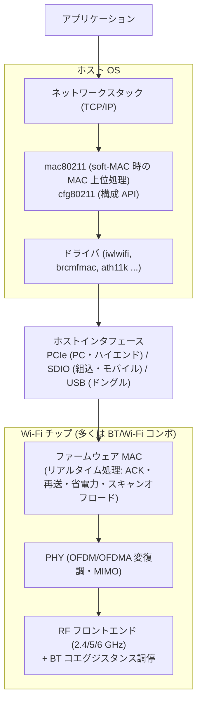

# Wi-Fi (802.11): 無線LANの解剖 (Wi-Fi 802.11: Anatomy of Wireless LAN)

## 概要 (Overview)

Wi-Fi (IEEE 802.11) は、`bluetooth-pairing-protocol.md` で見た近距離無線と、広域のセルラー (5G) の間を埋める「無線のもう一本の背骨」である。Bluetooth が「聴いていない時間を最大化する」低消費電力設計なら、Wi-Fi は**免許不要帯域でイーサネット級のスループットを出す**ことを設計目標に、四半世紀にわたり物理層 (PHY) を作り替え続けてきた——11 Mbps (802.11b, 1999) から仕様上 46 Gbps (802.11be, 2024) まで、3桁半の進化である。

本ドキュメントは、Wi-Fi を「共有媒体の交通整理」という視点から解剖する。免許不要の 2.4/5/6 GHz 帯という前提がなぜ CSMA/CA・OFDMA・MLO といった機構を要請するのか、「Wi-Fi に繋がる」の裏で走るスキャン・認証・アソシエーションは何をしているのか、そしてスマホの中で Wi-Fi チップのファームウェアがどこまでを肩代わりしているのか（full-MAC/soft-MAC 分割）までを扱う。

## 方法論 (Methodology)

- **電波規制 (免許不要帯) → PHY (変調・帯域幅・MIMO) → MAC (CSMA/CA・アグリゲーション・省電力) → 接続管理 (スキャン・アソシエーション・ローミング) → ホスト実装 (チップ・ドライバ分割)** の順に、制約が設計を決める向きで積み上げる。
- 世代 (802.11b/g/n/ac/ax/be) は「速くなった」ではなく、**律速要因が何から何へ移ったか**（帯域幅 → 空間 → 多元接続 → 帯域そのもの）で整理する。
- ホスト側は Linux の mac80211 フレームワークを参照実装とし、`bluetooth-pairing-protocol.md` の HCI 境界と対比する。
- セキュリティは WEP→WPA→WPA2→WPA3 の世代交代を軸に、既知攻撃 (KRACK, Broadpwn 等) と対応づける。
- 世代の年・速度・変調は IEEE / Wi-Fi Alliance の一次情報を基準に確認した（数値は**仕様上の最大値**であり、実効スループットは通常その半分以下になる点に注意）。

## 発見事項 (Findings)

1. **Wi-Fi の設計はすべて「免許不要帯域」という一点から導出できる。** 2.4/5/6 GHz は誰でも使えるがゆえに干渉が前提であり、送信前に聴く CSMA/CA、干渉に強い OFDM、Bluetooth とのコエグジスタンス（同一コンボチップ内の時分割調停）は、すべて「帯域を独占できない」ことへの応答である。セルラーのような集中スケジューリングは、免許を持たない者には原理的に使えない。
2. **MAC のオーバーヘッドとの闘いが世代進化の裏テーマである。** PHY レートを上げてもフレームごとのヘッダ・確認応答・競合待ちは縮まないため、802.11n 以降は A-MPDU（複数フレームの束ね送り + 一括 ACK）が不可欠になった。「1 Gbps の Wi-Fi で 1 Gbps 出ない」最大の理由は MAC 層にある。
3. **Wi-Fi 6 の本質は「速さ」ではなく「多数同時」への転換である。** OFDM ではチャネル全体を1局が占有するが、OFDMA はチャネルをリソースユニット (RU) に分割して複数クライアントに同時割当する。1フレームごとに競合する CSMA/CA の世界に、AP 主導のスケジューリングを部分的に持ち込んだ——多数の小さなトラフィック（IoT・混雑環境）が主戦場になった時代の要請である。
4. **Wi-Fi 7 の MLO は「リンクの冗長化」という新しい軸を開いた。** 320 MHz や 4096-QAM は従来路線の延長だが、MLO (Multi-Link Operation) は 2.4/5/6 GHz の複数リンクを1つのアソシエーションに束ね、干渉時のフェイルオーバーと遅延の安定化を狙う。単一リンクの高速化から**リンク集合の品質保証**への転換である。
5. **Wi-Fi チップは「もう一つの OS の外のコンピュータ」である。** 802.11 の時間制約（応答フレーム、再送、省電力タイミング）はホスト OS では守れないため、リアルタイム MAC 処理はチップ内ファームウェアが担う。この分業（full-MAC/soft-MAC）は性能・電力の必然だが、ホストから見えない実行環境が常時電波を聴いていることを意味し、Broadpwn 級の「チップだけを乗っ取る」攻撃面を作った。

## アーキテクチャ (Architecture)

### 端末内の Wi-Fi 経路

MAC 処理の分割線が2流儀ある:

| | soft-MAC | full-MAC |
|---|---|---|
| MAC 上位処理 (アソシエーション管理等) | ホスト側 (Linux では mac80211) | チップ内ファームウェア |
| チップの役割 | 時間制約の厳しい下位処理のみ | スキャン・接続・ローミングまで自律実行 |
| 典型 | PC 向け PCIe チップ | モバイル向け SDIO チップ |
| トレードオフ | 柔軟・デバッグ可能 / ホスト負荷 | ホストがスリープしても接続維持 / 不透明 |

いずれでも ACK 応答（受信後 SIFS = 数十 µs 以内）などのリアルタイム下位 MAC はチップ側にある。モバイルで full-MAC が選ばれるのは、**アプリケーションプロセッサを寝かせたまま**接続維持・スキャン・パケットフィルタをこなせるからで、`bluetooth-pairing-protocol.md` の Controller/Host 分離 (HCI) と同じ力学がより深い位置で働いている（ただし HCI ほど境界は標準化されておらず、ファームウェア API はベンダ独自）。

### 接続確立 — スキャンからアソシエーションまで

1. **スキャン**: パッシブ（AP が約 100 ms 周期で放送するビーコンを聴く）またはアクティブ（プローブ要求を送る。このとき過去の接続先 SSID を晒すことがプライバシー問題になる——後述）。
2. **認証 (Authentication)**: 歴史的経緯で残る儀式的なステップ（オープン系では実質素通し。WPA3-SAE ではここで鍵交換を行う）。
3. **アソシエーション**: 能力（対応レート・帯域幅・ストリーム数）を交換し AP のクライアントテーブルに登録。
4. **4ウェイハンドシェイク**: パスフレーズ由来（WPA3 では SAE 由来）の PMK からセッション鍵 PTK を導出し、暗号化を開始。
5. **ローミング**: 同一 SSID の別 AP へ移る際に 1–4 をやり直すと音声通話が切れるため、802.11r (Fast BSS Transition) が鍵導出を先回りさせ、802.11k/v が近隣 AP 情報と誘導を提供する。

## 技術詳細 (Technical Details)

### CSMA/CA — 「聴いてから話す」の理由と限界

免許不要帯では中央の調停者がいないため、802.11 は **CSMA/CA (Carrier Sense Multiple Access with Collision Avoidance)** を採る: 送信前に媒体を聴き、使用中なら待ち、空いてもランダムなバックオフ時間だけ追加で待ってから送る。有線イーサネットの CSMA/**CD**（衝突検出）と違い「衝突を検出できない」（自分の送信中に受信できない）ので、衝突を**避ける**方に倒し、受信側の ACK が返らなければ衝突とみなして再送する。

- **隠れ端末問題**: 端末 A と C が互いに聴こえない位置から同じ AP に送ると、キャリアセンスが機能せず AP 上で衝突する。対策の **RTS/CTS** は「送っていいか」「どうぞ（周囲は黙って）」の短い予約交換で、CTS を聴いた隠れ端末も黙る。ただし予約自体がオーバーヘッドなので、通常は大きいフレームにのみ適用される。
- 帰結として、Wi-Fi の遅延は**確率的**である。混雑時のバックオフ膨張・再送は遅延の裾を伸ばし、これが後述の OFDMA/MLO による「スケジューリングの奪還」の動機になる。

### PHY の世代進化 — 律速要因の移り変わり

| 世代 | 年* | PHY | 最大チャネル幅 | 変調 (最大) | 仕様最大レート* | 鍵となる追加 |
|---|---|---|---|---|---|---|
| 802.11b | 1999 | DSSS/CCK (2.4 GHz) | 22 MHz | CCK | 11 Mbps | 普及の起点 |
| 802.11a/g | 1999/2003 | OFDM (a: 5 GHz / g: 2.4 GHz) | 20 MHz | 64-QAM | 54 Mbps | OFDM 化 |
| 802.11n (Wi-Fi 4) | 2009 | OFDM | 40 MHz | 64-QAM | 600 Mbps | **MIMO** (〜4 ストリーム)、**A-MPDU** |
| 802.11ac (Wi-Fi 5) | 2013 | OFDM (5 GHz) | 160 MHz | 256-QAM | 約 6.9 Gbps | **DL MU-MIMO**、ビームフォーミング標準化 |
| 802.11ax (Wi-Fi 6/6E) | 2021 (認証は 2019〜) | **OFDMA** | 160 MHz | 1024-QAM | 約 9.6 Gbps | **OFDMA**、**TWT**、BSS カラーリング、6E で 6 GHz |
| 802.11be (Wi-Fi 7) | 2024 (認証は 2024-01〜) | OFDMA | **320 MHz** (6 GHz) | **4096-QAM** | 約 46 Gbps | **MLO**、マルチ RU |

\* 年は IEEE 標準の承認年（Wi-Fi Alliance の認証開始はしばしば先行）。レートは全ストリーム・最大帯域幅・最短 GI での**仕様上の最大値**で、実効スループットは干渉・距離・MAC オーバーヘッドにより通常この半分以下。

読み筋は「何が律速か」の移動である: 帯域幅を広げ (b→n→ac)、空間を多重し (MIMO)、変調を密にする (64→4096-QAM。ただし高次 QAM ほど高 SNR、つまり近距離でしか使えない) という単一リンク高速化が飽和し、Wi-Fi 6 で**多数クライアントの効率** (OFDMA)、Wi-Fi 6E/7 で**帯域そのものの追加** (6 GHz) と**リンクの多重化** (MLO) に軸が移った。

### OFDM → OFDMA、MIMO → MU-MIMO — 「同時に複数」への2つの道

- **OFDMA**: OFDM のサブキャリア群を **RU (Resource Unit)** に分割し、1回の送信機会で複数クライアントに同時割当する（周波数方向の分割）。多数の小パケット（スマート家電、混雑したオフィス）で、クライアントごとに競合・プリアンブルを繰り返す無駄を消す。セルラー (LTE/5G) では当初からの技術であり、Wi-Fi 6 は「基地局的なスケジューリング」を CSMA/CA の世界に輸入したと言える。
- **MU-MIMO**: 複数アンテナの空間多重 (MIMO) を複数ユーザーに向ける（空間方向の分割）。ビームフォーミングで各クライアント方向に別ストリームを形成する。チャネル状態の頻繁な測定 (sounding) が必要でオーバーヘッドが重く、実利用は条件を選ぶ。
- 空間ストリーム数は仕様上 8 (ac/ax)・16 (be) まで定義されるが、端末は電力・アンテナ実装の制約で 2 ストリーム程度が主流——**仕様最大と市場実装の乖離**が常に大きい領域である。

### A-MPDU と省電力 — MAC 層の2つの工夫

- **A-MPDU (アグリゲーション)**: 複数の MAC フレームを束ねて1回の送信機会で送り、**ブロック ACK** で一括確認する。競合待ち・プリアンブル・ACK という固定費を償却する仕組みで、802.11n 以降の実効スループットはこれなしに成立しない。
- **省電力の進化**: レガシーパワーセーブは「寝る→ビーコンごとに起きて自分宛の有無 (TIM) を確認」という受動型で、起床タイミングを端末が選べない。Wi-Fi 6 の **TWT (Target Wake Time)** は端末と AP が起床スケジュールを**交渉**し、IoT デバイスなら数秒〜数分単位で眠れる。Bluetooth LE の接続間隔交渉（`bluetooth-pairing-protocol.md`）と同じ思想が、ようやく Wi-Fi にも入った形である。

### 6 GHz と Wi-Fi 7 — 帯域の追加とリンクの束ね

- **Wi-Fi 6E**: 米 FCC が 2020年4月に 5.925–7.125 GHz の **1200 MHz** を免許不要開放し（各国で開放幅は異なる）、Wi-Fi は 20 年ぶりの新帯域を得た。6 GHz にはレガシー機器が存在しないため、WPA3 必須・高効率モードのみというクリーンな運用ができる。
- **Wi-Fi 7 (802.11be)**: IEEE 承認 2024年9月（Wi-Fi Alliance の CERTIFIED Wi-Fi 7 は 2024年1月開始）。**320 MHz チャネル**（6 GHz 帯のみ）、**4096-QAM**、そして **MLO**——複数バンドのリンクを単一アソシエーションとして束ね、同時利用（スループット）や動的切替（干渉回避・低遅延）に使う。発見事項 4 の通り、MLO は速度より**遅延の安定性**への投資である。

## セキュリティ考察 (Security Considerations)

- **WEP→WPA→WPA2→WPA3 — 後付け暗号の 25 年**: 初代 WEP (1999) は RC4 の誤用（IV 再利用・鍵導出の欠陥）で数分で破れることが示され、緊急避難の WPA (TKIP, 2003) を経て WPA2 (AES-CCMP, 2004) が長く標準となった。しかし **KRACK** (Vanhoef & Piessens, CCS 2017) は 4ウェイハンドシェイクの鍵再インストールを突き、**プロトコル自体**の設計欠陥が 13 年潜伏し得ることを示した。WPA3 (2018) は **SAE (Simultaneous Authentication of Equals)** で辞書攻撃耐性と前方秘匿性を導入し、**PMF (Protected Management Frames, 802.11w)** を必須化した。教訓は一貫している: **共有媒体の MAC 層に暗号を後付けし、かつ旧機器と互換を保つことは極めて難しい**。移行期間は常に 10 年単位であり、ダウングレード互換モードが新しい攻撃面になる。
- **オープンネットワークと Evil Twin**: SSID は名乗るだけの文字列であり、AP は自分を証明しない。同名の偽 AP (evil twin) を立てれば端末は自動接続し得る。管理フレーム保護以前は**偽装 deauthentication フレーム1発**で正規 AP から切断→偽 AP へ誘導が可能だった。PMF は deauth/disassoc を認証付きにしてこれを塞ぐ（WPA3 で必須になった理由）。公衆 Wi-Fi の実務的な防御は、Wi-Fi 層を信用せず上位で守る（TLS/VPN）ことに尽きる。
- **プローブ要求と MAC アドレスランダム化**: アクティブスキャンは端末の MAC アドレスを晒し、小売・空港での動線追跡に実利用されてきた（Bluetooth の RPA と同型の問題）。現代の iOS/Android はスキャン時・接続時に **MAC アドレスをランダム化**するが、ネットワークごとに固定のランダム値を使う実装が多く、また上位層の識別子（DHCP ホスト名等）で再同定され得るなど、緩和であって根治ではない。
- **チップファームウェアという攻撃面**: 発見事項 5 の裏面。**Broadpwn (CVE-2017-9417)** は Broadcom BCM43xx ファームウェアのヒープオーバーフローで、細工した無線フレーム（不正長の WME 情報要素）だけで**ユーザー操作ゼロ・ペアリング等の前提ゼロ**のままチップ上でコード実行に至った (Artenstein, Black Hat USA 2017)。チップはホストメモリへの DMA 経路を持つことが多く、チップ掌握はホスト侵害の足場になる。`usb-architecture.md` の Thunderclap、`bluetooth-pairing-protocol.md` の BlueBorne と並べると、「**常時電波を聴くパーサは、それがどの実行環境で走っていようと第一級の攻撃面**」という共通則が浮かぶ。緩和は IOMMU によるチップ DMA の封じ込めとファームウェア更新の配布経路の確保である。

## 結論 (Conclusions)

- Wi-Fi のアーキテクチャは「免許不要帯域の共有」という制約から一貫して導出できる: 聴いてから話す CSMA/CA、干渉に強い OFDM、Bluetooth とのコエグジスタンス、そして確率的遅延という宿命。
- 世代進化は律速要因の移動である——帯域幅・変調・MIMO による単一リンク高速化 (b→ac) から、多数同時の効率 (ax: OFDMA/TWT)、新帯域 (6E: 6 GHz)、リンク多重 (be: MLO) へ。仕様最大レートと実効値の乖離は MAC オーバーヘッドと市場実装（2 ストリーム主流）に由来する。
- 端末実装は「リアルタイム MAC はチップ、方針はホスト」という分業 (full-MAC/soft-MAC) で成り、Bluetooth の HCI と同じ力学ながら境界の標準化は弱い。ファームウェアオフロードは電力の必然であると同時に、Broadpwn が示した通り不可視の攻撃面である。
- セキュリティの歴史 (WEP→WPA3) は、互換性を保ちながら MAC 層に暗号を後付けする困難の記録であり、KRACK・deauth・evil twin への解（SAE, PMF）が出揃ったのは規格誕生から約 20 年後だった。無線から来るものは信頼できない入力である——本ディレクトリの無線2文書に共通する結論がここでも成り立つ。

### 次の接続先 (Related Topics)

- `bluetooth-pairing-protocol.md` — 同じ 2.4 GHz を分け合う相棒。低消費電力最適化 (BT) とスループット最適化 (Wi-Fi) の設計目標対比、コンボチップでの同居。
- `usb-architecture.md` — ホストインタフェースとしての USB/PCIe、チップ DMA と IOMMU の議論の土台。
- `../hw-sw-interface/bus-interconnect.md` — Wi-Fi チップを SoC に繋ぐ PCIe/SDIO の下部構造。
- `../../software/networking/tcp-transport-congestion.md` — 無線区間のロス・遅延変動を吸収する上位トランスポート層。
- `../timekeeping/clocks-time-synchronization.md` — TWT・ビーコンタイミングの土台となる時刻同期。

## 参考文献 (References)

**一次資料 (Primary — 仕様・公式ドキュメント・査読付き論文)**

- IEEE. *IEEE 802.11 Standards — 802.11ax-2021 / 802.11be-2024 ほか*. — [standards.ieee.org](https://standards.ieee.org/ieee/802.11/) — Accessed: 2026-07-06。PHY/MAC・OFDMA・TWT・MLO の規範。承認年（ax: 2021年2月、be: 2024年9月）の根拠。
- Wi-Fi Alliance. *Wi-Fi CERTIFIED 6 / Wi-Fi 6E / Wi-Fi CERTIFIED 7 プログラム*. — [wi-fi.org/discover-wi-fi](https://www.wi-fi.org/discover-wi-fi) — Accessed: 2026-07-06。世代名と認証開始時期（Wi-Fi 7: 2024年1月）、WPA3/SAE/PMF 要件。
- FCC. *FCC Opens 6 GHz Band to Wi-Fi and Other Unlicensed Uses* (2020-04-23). — [fcc.gov/document/fcc-opens-6-ghz-band-wi-fi-and-other-unlicensed-uses-0](https://www.fcc.gov/document/fcc-opens-6-ghz-band-wi-fi-and-other-unlicensed-uses-0) — Accessed: 2026-07-06。5.925–7.125 GHz・1200 MHz 開放の一次情報。
- Vanhoef, M., & Piessens, F. (2017). Key Reinstallation Attacks: Forcing Nonce Reuse in WPA2. *ACM CCS 2017*. — [krackattacks.com](https://www.krackattacks.com/) — Accessed: 2026-07-06。KRACK の査読付き原典。
- NVD. *CVE-2017-9417 (Broadpwn)*. — [nvd.nist.gov/vuln/detail/CVE-2017-9417](https://nvd.nist.gov/vuln/detail/CVE-2017-9417) — Accessed: 2026-07-06。Broadcom BCM43xx ファームウェアのリモートコード実行の公式記録。
- Linux Kernel Documentation. *mac80211 / cfg80211 subsystem*. — [kernel.org 802.11 docs](https://www.kernel.org/doc/html/latest/driver-api/80211/index.html) — Accessed: 2026-07-06。soft-MAC/full-MAC 分割のホスト側参照実装。

**二次資料 (Secondary)**

- López-Pérez, D. et al. *IEEE 802.11be Wi-Fi 7: Feature Summary and Performance Evaluation*. — [arxiv.org/abs/2309.15951](https://arxiv.org/html/2309.15951v3) — Accessed: 2026-07-06。320 MHz・4096-QAM・MLO の技術解説（プレプリント）。
- Artenstein, N. (2017). *Broadpwn: Remotely Compromising Android and iOS via a Bug in Broadcom's Wi-Fi Chipsets*. Black Hat USA 2017. — [解説: bleepingcomputer.com](https://www.bleepingcomputer.com/news/security/broadpwn-bug-affects-millions-of-android-and-ios-devices/) — Accessed: 2026-07-06。WME 情報要素起点のチップ乗っ取りの発見者発表。
- Cisco. *What Is Wi-Fi 6 vs. Wi-Fi 6E vs. Wi-Fi 7?* — [cisco.com](https://www.cisco.com/site/us/en/learn/topics/networking/what-is-wifi-6-vs-wifi-6e.html) — Accessed: 2026-07-06。世代機能（OFDMA/TWT/MLO）の技術解説。
- TechTarget. *802.11 standards: How do 802.11ac, 802.11ax, 802.11be differ?* — [techtarget.com](https://www.techtarget.com/searchnetworking/tip/Whats-the-difference-between-80211ax-vs-80211ac) — Accessed: 2026-07-06。世代比較（年・レート・変調）のクロスチェックに使用。
